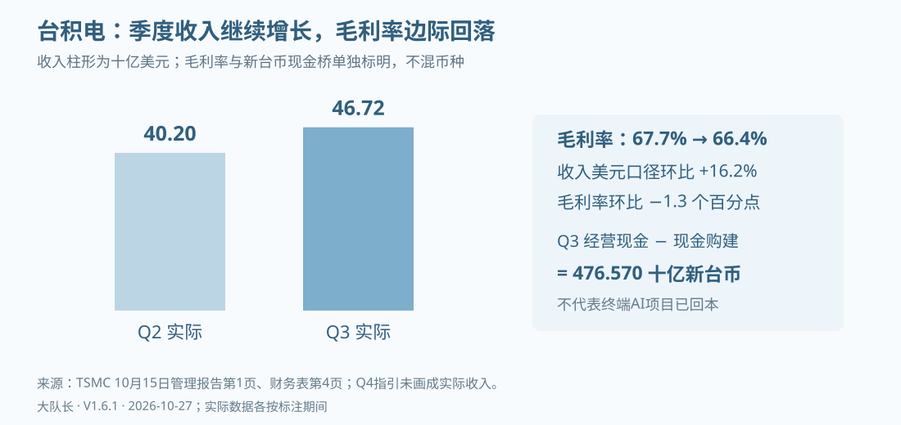
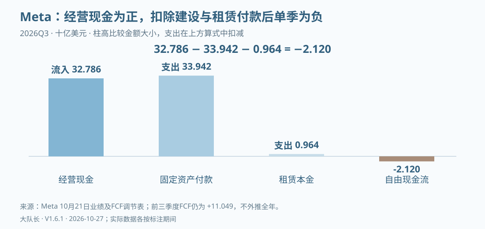
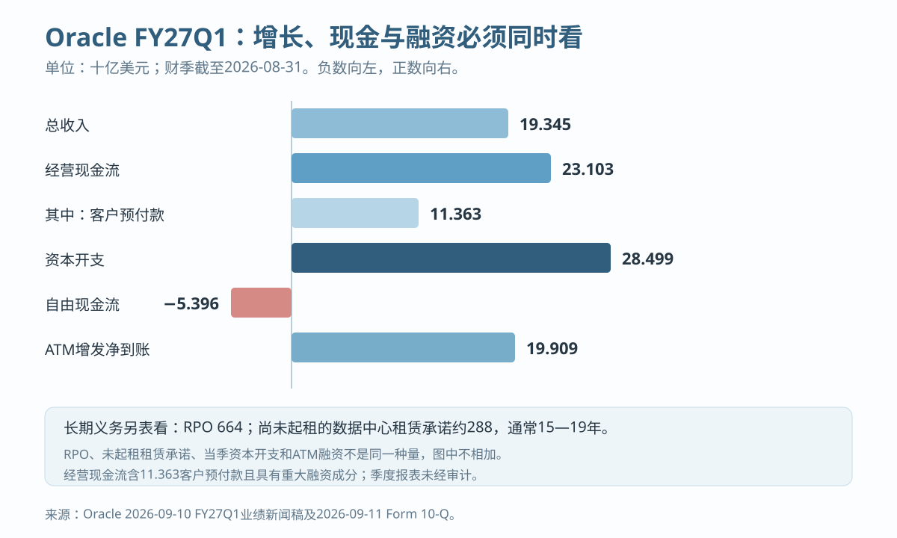
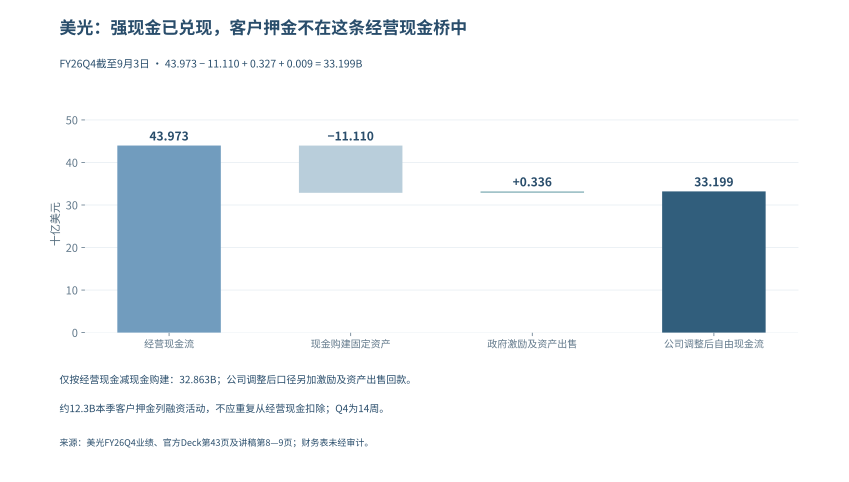
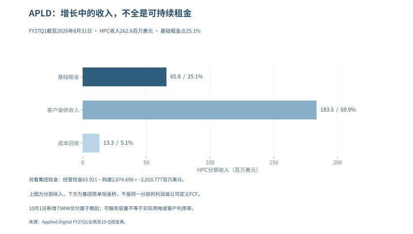

## 第一部分：哪些是真金白银，哪些是估值游戏？

> 观察截至2026年10月27日，北京时间。金额无特别说明均为十亿美元；台积电、ASML、中国公司及韩国初步值另标本币。各公司财期分别列示，季度财务表与美光全年业绩发布表未经审计，Microsoft、Lumentum及Coherent的全年数据来自已审计10-K。以下区分经营收益、投资收益、会计估计与现金回收，不以其中一种直接替代另一种。

### 从收入走到现金

Alphabet第二季度的稀释每股收益是9.11美元，其中股权证券收益的税后贡献为6.26美元；与此同时，Google Cloud收入与营业利润仍在快速增长。Amazon也同时呈现AWS经营改善和投资重估拉高净利润。仅看净利润，会高估经营改善；把重估全部剔除后说“没有真需求”，又会漏掉已经实现的云业务增长。

本篇沿着一笔收入走到现金：先辨认客户支付的是什么，再把营业利润、持仓收益与税项分开，随后检查回款、资本开支和租赁，最后问新投入能否在设备失去经济竞争力前赚回成本。Oracle FY27Q1把矛盾推得更清楚：云基础设施收入增长121%，资本开支却超过经营现金流，经营现金又得到大额客户预付款支持。当前证据支持“经营兑现与资本回收压力并存”，不支持“五家公司利润都不真实”，也不支持“高增长足以证明任何建设成本都合理”。

| 阅读位置 | 要回答的问题 | 不能偷换的口径 |
|---|---|---|
| 经营与现金拆解 | 哪些经营已兑现，利润如何进入现金？ | 非经营收益不等于假利润，现金支出不等于当期费用 |
| 客户与回款 | NVIDIA的客户和回款发生了什么变化？ | 直接客户、最终客户、应收集中度分开 |
| 估值与历史比较 | 公司好与投资回报好之间差在哪里？ | 估值时点、历史案例与预测概率分开 |
| 后续证据与反方检验 | 下一次财报应怎样推翻或加强判断？ | 观察规则不冒充统计模型，风险不等于交易指令 |

### 1.1 五大巨头：经营兑现与现金回收分开判断

公司利润需要按来源判断：已经交付的产品与服务、非经营收益、仍待收回的应收款，以及支持未来增长的资本投入，回答的是不同问题。下表把经营与现金压力并列，避免把盈利质量压成缺少统一权重的单一评分。

| 公司与统计期 | 已确认的经营 | 本篇重点核查 | 当前判断 |
|---|---|---|---|
| NVIDIA，FY27Q2，截至7/26 | 收入96.221，数据中心89.023；GAAP毛利率75.0% | 经营现金24.077，低于前季50.344；应收周转天数由45天升至60天 | 需求和利润强，回款节奏与支持客户的安排需跟踪 |
| Microsoft，FY26Q4，截至6/30 | 收入90.007，营业利润40.603；Azure及其他云服务收入增43% | 经营现金55.441，现金购置固定资产35.802 | 现金仍厚，不能用OpenAI投资关系否定整个云业务 |
| Alphabet，2026Q2 | Cloud收入24.768、营业利润8.814 | 股权证券收益税前99.031；单季自由现金流−5.855 | 经营和持仓收益均真实入账，但估值不能混用 |
| Amazon，2026Q2 | AWS收入42.232、营业利润16.621 | 其他收益净额53.415，全部非营业税前净额53.396；截至6/30过去12个月FCF−7.604 | AWS增长成立，合并净利润和现金回收需分别解释 |
| Meta，2026Q3，截至9/30 | 收入64.601，其中广告63.061；GAAP净利润9.860 | 经营现金32.786，现金固定资产购置33.942、融资租赁本金0.964；损益含法律和解费用9.89 | 广告继续增长，单季FCF转负；营业利润下降不能全部归因于AI投入 |

资料：[NVIDIA CFO说明](https://www.sec.gov/Archives/edgar/data/1045810/000104581026000073/q2fy27cfocommentary.htm)、[Microsoft财报](https://www.microsoft.com/en-us/Investor/earnings/FY-2026-Q4/press-release-webcast)、[Alphabet财报](https://s206.q4cdn.com/479360582/files/doc_financials/2026/q2/2026q2-alphabet-earnings-release.pdf)、[Amazon财报](https://ir.aboutamazon.com/news-release/news-release-details/2026/Amazon-com-Announces-Second-Quarter-Results/default.aspx)、[Meta10月21日Q3财报](https://investor.atmeta.com/investor-news/press-release-details/2026/Meta-Reports-Third-Quarter-2026-Results/default.aspx)。这不是同期间排名：NVIDIA季度终点不同，Amazon所列FCF为滚动12个月；尚未取得新季报的公司不提前填入预测。

台积电10月15日已发布Q3正式业绩：美元收入46.72B，较Q2的40.20B增长约16.2%；新台币收入1,494.24B，同比增长50.9%，与美元口径的41.2%不能互换。毛利率由67.7%降至66.4%，但归母净利润由706.56B升至763.06B新台币。HPC占收入68%并不等于AI占比，Q4的52.3—54.3B美元收入区间仍是指引。这些实际经营结果反驳即时需求断崖，却不能证明下游每个项目均已回本。[台积电Q3管理报告，第1—2页](https://investor.tsmc.com/english/encrypt/files/encrypt_file/reports/2026-10/f83780000ddc0c3b48e57a87eab6814c4ab35058/3Q26%20ManagementReport.pdf)、[Q3实绩与Q4指引](https://investor.tsmc.com/english/quarterly-results/2026/q3)

### 1.2 从账面利润到可支配现金

#### 1.2.1 持仓重估：单列，不把“非现金”写成“不真实”

持有的股权升值可以按照适用准则进入损益，这一收益有经济含义，但它既不是售出云服务的收入，也不一定在当季变成现金。对投资者的直接影响是：使用含巨额重估的每股收益计算市盈率，可能得到看似便宜、实际不可持续的倍数。

Alphabet官方披露，Q2股权证券收益净额99.031，税后使净利润增加约77.1，每股收益增加6.26。因此9.11减6.26约为2.85美元，这是“只剔除该项影响后的EPS”，并非公司提供的纯经营EPS，更不是已剔净全部一次性项目的标准化盈利。该证券收益也不能全部指认为Anthropic；公司资产组合还包括其他上市及非上市投资，逐项归因要以附注为准。[Alphabet财报附表第9页](https://s206.q4cdn.com/479360582/files/doc_financials/2026/q2/2026q2-alphabet-earnings-release.pdf)

Amazon的Q2净利润62.647与税前项目不能直接相减得到税后“真实净利润”。其中53.415是其他收益净额；加上利息收入、扣除利息费用后的全部非营业税前净额为53.396，不能把两个标签混用。10-Q进一步列出，私营股权可观察价格上调约50.5，主要涉及Anthropic；估值考虑证券权利、流动性事件时间、其他证券类别以及缺乏流动性折价，并不是“最新估值×固定持股比例”。未来融资价格会影响计量，但具体利润贡献仍须等待适用证券与税项的披露。[Amazon Q2 10-Q，利润表及投资附注](https://www.sec.gov/Archives/edgar/data/1018724/000101872426000026/amzn-20260630.htm)

Microsoft也需要做同样拆分。公司Q4非GAAP净利润调整只排除了OpenAI投资的0.480税后收益，但业绩稿另提示当季存在Anthropic投资收益3.2。因此“公司非GAAP”不能自动等同于“已剔除所有投资收益”。NVIDIA当季股权证券净收益约7.8，同样要与GPU经营利润分开看。对所有公司执行相同规则，才能避免只挑支持泡沫判断的项目。

用于比较的利润桥应写成：

> GAAP净利润 − 已披露的税后非经营收益 + 已披露的税后非经营损失 ± 其他明确调整 = 研究口径调整后净利润。

若只拿到税前项目，保留税前利润桥；不以统一21%税率替公司补出“实际税后值”。投资盈利能否重复、能否兑现、能否分配是三个不同问题。即使下一轮融资继续涨价，也不能把未实现持仓收益赋予云服务收入同样的估值倍数。

#### 1.2.2 折旧：会计寿命与经济寿命之间的差距

GPU可以继续开机，并不代表它还能按原租价获得客户。反过来，新一代芯片出现，也不代表旧设备马上归零；旧GPU可能转向价格敏感的推理、内部研发或较低负载任务。检验折旧的对象，应当是特定资产组的可赚取现金，而不是笼统地宣布“GPU都只能用三年”。

服务器、网络设备与数据中心建筑不能使用统一经济寿命。不同公司的设备构成、部署批次和残值判断不同，会计估计变更通常影响未来费用分摊；只有取得违背准则、错误估计或重大减值的证据，才进一步判断是否错报。外部研究者可以提出较短的经济寿命，但其测算仍是敏感性假设，不能直接记成公司已审计报表中的少提费用。

在现有财报上，先检查四件事：固定资产新增何时转为可使用，折旧是否随投产增加，闲置或提前退役是否减值，以及租赁资产和自建资产是否被放在不同费用项目。公司会计政策及未来变更须在原附注逐项核对，不用一张多年旧表替代当前政策。[Microsoft FY2026 10-K](https://www.sec.gov/Archives/edgar/data/789019/000119312526323660/msft-20260630.htm)、[Meta Q2 10-Q](https://www.sec.gov/Archives/edgar/data/1326801/000162828026050705/meta-20260630.htm)

一个可复算的敏感性例子：假设某批设备可折旧基础60亿美元、残值为零，直线法6年折旧每年10亿美元；若经济寿命只有3年，每年经济耗损相当于20亿美元。两种假设相差10亿美元税前费用，但这只是同一设备组、全年在用的演示。不能用全公司固定资产乘这个差额，也不能把它记成某家公司实际少提折旧。

现金流也不能完全解决这个问题。折旧虽在经营现金流中加回，设备最终仍需替换；评价长久期项目应另估维持性资本开支，不能把“经营现金为正”当作“设备全生命周期已经回本”。

#### 1.2.3 自由现金流：先统一计算，再谈压力

| 公司 | 统计期 | 经营现金流 | 扣减项目 | FCF或可比计算 | 口径边界 |
|---|---|---:|---:|---:|---|
| Alphabet | 2026Q2 | 39.069 | 现金固定资产购置44.924 | −5.855 | 公司定义；TTM仍为+53.273，不能把单季转负说成全年无现金 |
| Microsoft | FY26Q4 | 55.441 | 现金固定资产购置35.802 | +19.639 | 本表现金桥；不是“总CapEx约41”再额外扣一遍租赁新增 |
| Meta | 2026Q3 | 32.786 | 固定资产33.942+融资租赁本金0.964 | −2.120 | 公司定义，已包含该租赁本金；前九个月累计仍为+11.049 |
| NVIDIA | FY27Q2 | 24.077 | 固定资产及无形资产2.677+相关本金0.059 | +21.341 | 公司定义，不能仅用PP&E现金购置替代全部扣项 |
| Amazon | 截至6/30的TTM | 161.403 | 净现金购置固定资产169.007 | −7.604 | 公司主FCF，未在这一行额外扣融资租赁本金 |
| Oracle | FY27Q1，截至8/31 | 23.103 | 资本开支28.499 | −5.396 | 经营现金含11.363客户预付款，且公司明确其具有重大融资成分 |

这些数据来自上列各公司财报现金流及非GAAP调节表；前五项算术分别为39.069−44.924、55.441−35.802、32.786−33.942−0.964、24.077−2.677−0.059、161.403−169.007，Oracle为23.103−28.499。不得把季度列与TTM列相加得到“行业FCF”。

Meta的Q2历史值仍有比较价值：经营现金31.862，现金固定资产购置30.116、租赁本金0.962，FCF为+0.784；Q3经营现金增加0.924，而上述两项付款合计增加3.828，单季FCF因而减少2.904至−2.120。Q3期末现金、现金等价物及有价证券合计约82.45，不能由单季转负推成即将出现支付危机；也不能把公司包含租赁本金的135—145全年资本支出指引写成已发生支出。[Meta Q2历史财报](https://investor.atmeta.com/investor-news/press-release-details/2026/Meta-Reports-Second-Quarter-2026-Results/default.aspx)、[Q3现金流及指引](https://investor.atmeta.com/investor-news/press-release-details/2026/Meta-Reports-Third-Quarter-2026-Results/default.aspx)

Oracle FY27Q1总收入19.345、云收入11.607，其中IaaS为7.388、同比增长121%；经营兑现很强，但资金桥不能只看增长率。当季经营现金23.103中，11.363来自具有重大融资成分的客户预付款；资本开支28.499后，自由现金流为−5.396。公司同时完成ATM普通股增发，净到账19.909。客户预付款与股权融资都是真实资金来源，却不是云服务已经赚回成本的证据。[Oracle FY27Q1业绩](https://investor.oracle.com/files/content_files/1q27-pressrelease-September_FINAL.pdf)、[Oracle FY27Q1 10-Q](https://www.sec.gov/Archives/edgar/data/1341439/000119312526389274/orcl-20260831.htm)

这张图也刻意没有把664的剩余履约义务、288的未起租数据中心租赁承诺和当季资本开支相加。约13%的RPO预计未来12个月确认，约37%在第13—36个月、34%在第37—60个月，其余更晚；288的租赁承诺预计FY27Q2至FY29陆续开始，合同通常为15—19年，尚未反映在8月31日资产负债表。它们强化的是未来收入能见度和长期履约约束，不是当期现金、收入或损失。

判断外部融资需求，应先比较经营现金与现金CapEx，再看现金余额、债务到期、股息回购、股权投资和租赁还本。FCF已经扣过CapEx，不能再把两者的大小关系当成资金缺口；即使FCF为正，大额投资和偿债也可能带来融资需求，即使单季为负，也可能由既有现金余额覆盖。

Amazon最能说明这个区别：AWS收入和分部利润显著增长，但合并口径建设付款更快，导致滚动FCF转负。这里既不能说AWS利润“依赖Anthropic重估”，也不能用AWS利润率替整个AI建设项目算回报。零售物流、其他技术基础设施和服务采购都在合并报表中，纯AI回报需要更细的资本和利润归属。

#### 1.2.4 利润高增而现金没有同步：光模块的现实检验

两家A股光模块公司的半年报，把“需求真实但要查现金”落到了可核对的账上。金额单位在本小节改为人民币亿元，统计期均为2026年1—6月，半年报未经审计。

| 公司 | 归母净利润 | 同比 | 经营活动现金流量净额 | 同比 | 现金购建长期资产 |
|---|---:|---:|---:|---:|---:|
| 中际旭创 | 136.51 | +241.70% | 18.00 | −44.08% | 48.02 |
| 新易盛 | 75.29 | +90.98% | 16.16 | +69.67% | 12.64 |

资料：[中际旭创8/22半年报，第8、60页](https://static.cninfo.com.cn/finalpage/2026-08-22/1225491753.PDF)、[新易盛8/25半年报，第7、44页](https://static.cninfo.com.cn/finalpage/2026-08-25/1225499406.PDF)。归母利润与合并经营现金并非完全一致的权益归属口径，表中仅比较量级，不将两者相除标成严格的现金转化率。

中际旭创利润增长没有在同期等比例变成现金，需继续跟踪存货、应收项目与供应商付款；新易盛经营现金同比上升，也不表示每笔订单均已回款。这些差异可能来自交付增长带来的营运资金占用、备货和结算节奏，不能仅由半年CFO较小推出虚假收入。

若按“经营现金−现金购建长期资产”做简单资金桥，中际旭创约−30.02亿元、新易盛约+3.53亿元。它们不是估值模型中的FCFF，也未扣除所有融资与投资支出；用途是找出需要下一期报表解释的资金差额，而不是由一次现金差额推断公司长期价值。

10月23日的经营公告提供了订单和产品进度，却没有补齐Q3现金表：中际旭创披露海外重点客户订单已覆盖2027年，部分客户给出2028年需求指引；新易盛披露800G和1.6T已是主要出货产品，1.6T仍在爬坡。订单、需求指引和已实现收入应分开记录。截至10月27日，证据集中尚未取得两家公司正式Q3报告，故前表保留H1期间，不把经营公告改写成新季报。[中际旭创公告，第1—2页](https://static.cninfo.com.cn/finalpage/2026-10-23/1225617691.pdf)、[新易盛公告，第1页](https://static.cninfo.com.cn/finalpage/2026-10-23/1225617676.pdf)

#### 1.2.5 海外光学供应商：经营改善与融资损失可以同时发生

Lumentum（朗美通）8月11日披露，截至6月27日的FY26Q4收入为10.063亿美元，同比增109.3%；GAAP营业利润率27.8%，非GAAP营业利润率36.6%。但同季GAAP净亏损约72亿美元，主要受约78亿美元非现金债务清偿损失影响，来自可转债股权化，而不是同额设备经营亏损或现金外流。非GAAP净利润3.263亿美元有助于观察调整后的经营，仍不能抹去债务转换对普通股股东的稀释。[Lumentum季度业绩及调节表](https://www.sec.gov/Archives/edgar/data/1633978/000162828026055726/lite_ex991xq4fy26.htm)

现金要另看完整期间：Lumentum FY2026全年经营现金流7.514亿美元、现金固定资产购置4.513亿美元，两项相减为3.001亿美元。它支持全年经营现金覆盖这项建设付款，却不是单季现金转化率，也未扣除所有投资和融资支出。这一案例提醒我们，看到巨额净亏损时先查发生在哪一层，不能直接判定需求或流动性已经崩塌。[Lumentum FY2026 10-K，现金流量表及债务附注](https://www.sec.gov/Archives/edgar/data/1633978/000162828026057358/lite-20260627.htm)

Coherent（高意）的反差在现金端。8月12日披露的FY26Q4收入为20.46亿美元，报告口径同比增33.8%，不与公司另列的备考增速混用；GAAP与非GAAP毛利率分别为38.5%和40.2%，两种利润定义也分别列示。随后提交的FY2026全年10-K显示，经营现金流只有0.79514亿美元，现金固定资产购置11.02909亿美元，两项之差为−10.23395亿美元。年报解释了存货、应收占款及应付抵补；当年获得的NVIDIA股权资金属于融资现金，不是客户买产品产生的经营现金。[Coherent季度业绩](https://www.sec.gov/Archives/edgar/data/820318/000119312526346860/d128030dex991.htm)、[Coherent FY2026 10-K，现金流量表及流动性分析](https://www.sec.gov/Archives/edgar/data/820318/000082031826000020/iivi-20260630.htm)

上述两家全年现金均来自已审计年报，季度业绩仍是未经审计口径，不能将全年现金与单季利润相除。Coherent的负差额表明扩产与营运资金需要资金支持，不足以单独证明收入虚假或公司将发生支付危机；下一步应检查库存何时交付、应收何时回款，以及融资现金能覆盖多久。

#### 1.2.6 整机与芯片：调整后现金需要逐项还原

Dell（戴尔科技）截至7月31日的FY27Q2，AI优化服务器收入为164.01亿美元、同比增100%，AI订单609亿美元、期末在手订单约950亿美元；9月1日公司将全年AI服务器收入指引从600亿提高到740亿美元。收入证明交付，订单和上调指引则还需未来履约，不能合成已经收回的现金。[Dell官方季度业绩，第1—2页](https://investors.delltechnologies.com/node/20956/pdf)

同季Dell合并经营现金流为22.25亿美元，同比下降约13%。公司现金调节表将其扣除12.39亿美元净资本支出后得到9.86亿美元FCF，再加回66.67亿美元融资应收调整及4.96亿美元经营租赁设备调整，得到81.49亿美元调整后FCF。这三个现金指标不能互换，81.49亿美元不是当季实际经营现金流。客户融资、设备交付与回款的时间差应进入研究；仅凭AI服务器收入翻倍，还无法判断客户的算力项目是否赚回资本成本。[Dell业绩现金表及FCF调节，第5、8—9页](https://investors.delltechnologies.com/node/20956/pdf)

HPE（慧与）9月2日发布的FY26Q3同样截至7月31日，合并收入122.13亿美元，“Cloud & AI”分部收入90.42亿美元、分部营业利润率17.0%，但该分部纳入服务器、混合云与金融服务，并非纯AI收入和利润。合并经营现金流16.41亿美元，减去7.45亿美元固定资产及软件投入、加回0.92亿美元资产处置、扣除0.30亿美元汇兑影响，才得到公司定义的9.58亿美元FCF。网络业务还受Juniper并表影响，不能把合并增速全部解释成AI有机增长。[HPE季度业绩及现金调节](https://investors.hpe.com/~/media/Files/H/HP-Enterprise-IR/documents/q3-2026/q3-2026-earnings-press-release.pdf)、[HPE 10-Q，分部及经营分析](https://www.sec.gov/Archives/edgar/data/1645590/000164559026000080/hpe-20260731.htm)

Marvell（迈威尔）8月27日披露截至8月1日的FY27Q2收入27.393亿美元、同比增37%，GAAP净利润3.080亿美元；经营现金流6.055亿美元、现金固定资产购置1.267亿美元，两项相减为4.788亿美元。这是当季利润与现金同时为正的例子，但无晶圆厂模式仍有资本约束：10-Q列示长期产能预付款余额4.870亿美元，年初为2.788亿美元，并披露供应与产能承诺。预付款余额变化不能再次从已含相关现金影响的CFO中扣除；数据中心收入21.715亿美元也包含多类产品，不能都算作终端AI付费。[Marvell季度业绩](https://investor.marvell.com/news-events/press-releases/detail/1031/marvell-technology-inc-reports-second-quarter-of-fiscal-year-2027-financial-results)、[Marvell 10-Q，附注3、9及14](https://investor.marvell.com/sec-filings/all-sec-filings/content/0001835632-26-000025/mrvl-20260801.htm)

这三家季度报表未经审计，现金定义各不相同，也不能与前两家全年值求和得到“行业现金回收率”。研究的落点应是各公司的交付、付款条件和投入回收期，而不是让一张高增长表替代全部判断。

#### 1.2.7 美光：存储利润已兑现为现金，但终端回本仍是另一道题

美光9月30日公布截至9月3日的FY26Q4及全年业绩，本季收入54.229B、GAAP净利润37.701B、经营现金流43.973B；全年收入133.188B、经营现金89.675B。以下财务数据来自公司未经审计的业绩材料，季度与全年分别展示。[美光官方业绩及财务表](https://investors.micron.com/news/press-release/2026/Micron-Technology-Inc--Reports-Record-Fiscal-Fourth-Quarter-and-Full-Year-2026-Results/default.aspx)

| 现金桥（十亿美元） | FY26Q4 | FY2026 |
|---|---:|---:|
| 经营现金流 | 43.973 | 89.675 |
| 现金购建固定资产 | 11.110 | 30.712 |
| 两项相减：本报告简单现金桥 | 32.863 | 58.963 |
| 政府激励款 | 0.327 | 3.316 |
| 固定资产出售回款 | 0.009 | 0.029 |
| 公司净资本支出 | 10.774 | 27.367 |
| 公司调整后自由现金流 | 33.199 | 62.308 |

净资本支出把政府激励和资产出售回款从购建支出中扣除，因此本季公司调整后自由现金流为43.973−11.110＋0.327＋0.009＝33.199B；本报告仅用经营现金减现金购建，得到32.863B。两种口径都为正，却不是同一指标，更不能称其中一种为“GAAP自由现金流”。[官方演示材料，第43、49页现金调节](https://s25.q4cdn.com/621799436/files/doc_financials/2026/q4/Q4-26-Earnings-Deck.pdf)

同比或环比还要核对周数：FY2026有53周，Q4有14周，Q3有13周。本季收入较上季41.456B增长30.81%，机械按周归一后约增长21.47%，但后一个数字仍未剔除价格、产品结构和交付节奏，不是有机增长率。[美光Q3 10-Q，Note 1及MD&A](https://www.sec.gov/Archives/edgar/data/723125/000072312526000015/mu-20260528.htm)

这组现金是对“供应链利润没有经营现金支持”的直接反证。公司披露Q4收取约12.3B客户押金，但其列入融资活动、不增加经营现金或自由现金流，因此不能再从43.973B里重复扣除。长期合同可支持建设，押金也存在满足采购条件后的返还安排，不能当永久收入；供应商现金充裕与云商、模型客户是否收回投资，仍需分别检验。[美光官方讲稿，第8—9页](https://s25.q4cdn.com/621799436/files/doc_financials/2026/q4/Q4-FY26-Prepared-Remarks.pdf)

公司对FY27Q1给出61.5±1.5B收入指引，预计净资本支出约11.5B、上半年约25B且下半年更高。这些是管理层前瞻，不是已发生支出，也不是明确的全年资本支出点值。后续反证重点是存储售价、交付、应收和库存、合同重议以及新增产能投产后的现金回报。

#### 1.2.8 机房交付开始收费，不等于全部收入都是经常租金

Applied Digital于10月7日美东盘后发布FY27Q1业绩，报告期截至8月31日。HPC托管收入262.6百万美元中，基础租金65.8、租户装修服务183.5、费用回收13.3；三项相加与分部收入一致，基础租金仅占约25.1%。装修服务是本期已确认收入，但不能把262.6全部乘四当作稳定年租金，也不能把收入当收现。[公司季度财报，HPC Hosting Update](https://www.globenewswire.com/news-release/2026/10/07/3376854/0/en/applied-digital-reports-fiscal-first-quarter-2027-results.html)

集团GAAP收入341.9百万美元与调整后收入300.4不是同一个范围：后者排除合并子公司ChronoScale。10月1日新增75MW达到可服务状态，使Polaris Forge 1园区已投入运营的关键IT负荷容量达到250MW，这是可服务容量而非实时用电负荷，也是季度末之后的交付，不能倒放进截至8月31日的租金中。它提供了建设转运营的正面证据；项目回本仍须对照运营成本、融资和后续现金。

集团现金表给出的另一面也不能省略：经营现金流63.921百万美元，购建固定资产及其他资产2,074.698百万美元，相减为−2,010.777百万美元；同期净融资现金流1,543.472百万美元。这个简单现金桥不是公司定义的FCF，也不是HPC分部现金流；它说明本季建设远超经营现金支持，却不能仅凭建设期缺口判定项目净现值为负或公司破产。[FY27Q1 10-Q，第5页](https://ir.applieddigital.com/sec-filings/all-sec-filings/content/0001144879-26-000059/apld-20260831.htm)

#### 1.2.9 三星初步利润：能更新方向，不能替代现金表

三星10月8日给出的2026Q3初步合并销售额约195万亿韩元、营业利润约107.4万亿韩元，是K-IFRS估计区间的中点，不是已审计完整财报。公告没有将这组数字拆成HBM利润、经营现金或客户回报；因此只能纳入利润观察，不据此补造现金回收，也不与美元公司的收入直接求和。[三星Q3预披露](https://news.samsung.com/global/samsung-electronics-announces-earnings-guidance-for-third-quarter-2026)

三星完整Q3业绩电话会安排在北京时间10月29日09:00；SK海力士Q3电话会为10月28日08:00。上述时间是公司日程，不是财务结果，截止日尚不能把未来季报的利润和现金填入当前表。[三星投资者日历](https://www.samsung.com/global/ir/ir-events-presentations/events/)、[SK海力士电话会邀请](https://news.skhynix.com/en/q3-2026-earnings-conference-call-invitation/)

#### 1.2.10 台积电与ASML：现金充裕，也要分清重估与预收的影响

台积电Q3的经营现金流为919.776B新台币，固定资产购建现金443.206B，相减为476.570B；两项均来自本季现金流表，不是前三季累计，也不与美元收入直接相除。经营现金高于Q2的783.365B，同时收入与归母利润增长，对“供应链只有账面利润”的说法构成反证。不过，Q2营业外收入95.83B降至Q3的34.59B，包含上一季资产处置及重估因素的消退，解释了净利润为何没有跟收入等幅增长。[台积电财务表，第4页](https://investor.tsmc.com/english/encrypt/files/encrypt_file/reports/2026-10/3a94d1034b9e6b22446b674f7aaf3d088a12a193/FS.pdf)、[管理报告，第1页](https://investor.tsmc.com/english/encrypt/files/encrypt_file/reports/2026-10/f83780000ddc0c3b48e57a87eab6814c4ab35058/3Q26%20ManagementReport.pdf)

ASML于10月14日披露截至9月27日的Q3美国GAAP业绩，以下改用十亿欧元：收入11.6620、营业利润5.1728、净利润4.9604，分别较上年同期增长约55.2%、109.6%和133.5%。利润增长既有设备及升级业务支持，也含0.5097税前股权投资收益，管理层明确主要来自Mistral AI投资估值上升；该项约占税前利润5.7507的8.9%，不能把税前收益直接从税后净利润减去，伪造一个“调整后净利润”。[ASML财务表，第2页](https://investor.asml.com/static-files/d310262b-d037-485d-83b5-92c93cc462f0)、[管理层讲稿，第1页](https://investor.asml.com/static-files/40c56a6b-1460-4f69-9340-6a869560d24b)

同季ASML经营现金11.7976，减去固定资产0.4133与无形资产0.0339，公司定义的FCF为11.3504。现金很强，但资产负债变动贡献7.0090、约占经营现金59.4%，管理层亦说明订单和客户预付款的推动；该总项不全是客户预付款，也不能当成设备已经交付并赚到利润。现金流表已经调回股权估值收益，不再重复扣一次。Q4收入14.2—15.2、全年44—45仍是公司指引，而2029—2030年的客户意向也不能改称已锁定订单。[财务表，第9页](https://investor.asml.com/static-files/d310262b-d037-485d-83b5-92c93cc462f0)、[管理层讲稿，第2页](https://investor.asml.com/static-files/40c56a6b-1460-4f69-9340-6a869560d24b)、[正式业绩稿](https://www.investor.asml.com/news-releases/news-release-details/asml-reports-eu11.7-billion-total-net-sales-and-eu5.0-billion-net-income-q3-2026)

#### 1.2.11 中国存储：利润与备货现金可能走向相反方向

德明利10月26日公开的未经审计三季报，使存储链的现金压力有了新样本，以下均为人民币亿元：Q3收入116.45、归母利润27.29，而前三季累计归母利润87.46、经营现金净额−136.91。不能把累计现金流标成单季；从前三季经营现金再减现金购建长期资产5.00，简单资金桥约为−141.91。同期存货由年末70.58升至289.86，公司解释包括企业级存储备货，净融资现金143.93则属于资金来源，不是经营回款。[德明利2026三季报，第2—4、18—19页](https://disc.static.szse.cn/download/disc/disk03/finalpage/2026-10-26/e8eabd45-e97f-4bed-b05d-27f58665dc50.PDF)

这个样本要求追踪库存交付、收款与新增借款，尚不足以判定收入虚假或即将违约。江波龙10月15日公布的是业绩预告而非正式三季报：前三季预计收入380—400亿元、归母利润140—149亿元；公司称Q3经营现金转正，却未披露数额。其关于DRAM、NAND涨幅收窄的说明，提示售价与利润弹性不能线性外推，但预告不能替代经营现金明细。[江波龙业绩预告，第1—2页](https://static.cninfo.com.cn/finalpage/2026-10-15/1225607002.PDF)

#### 1.2.12 税务折旧：改变现金时点，不改变设备的物理寿命

税务折旧与财务报表中的折旧回答不同问题：前者决定合格投资何时抵减应税所得，后者把资产成本分摊到受益期间。IRS在2026年1月14日发布的Notice 2026-11说明，现行法律一般对2025年1月19日后取得并投入使用的合格资产恢复永久100%的额外首年折旧；具体资格、取得日期、投用时间与选项仍需逐项检查。不能据此把所有AI建设支出都立即扣除，数据中心建筑与设备也不能一概归类。[IRS《额外首年折旧指引》，2026-01-14](https://www.irs.gov/newsroom/treasury-irs-issue-guidance-on-the-additional-first-year-depreciation-deduction-amended-as-part-of-the-one-big-beautiful-bill)、[IRS Publication 946（2025），Special Depreciation Allowance](https://www.irs.gov/publications/p946)

提前抵扣可以改善建设初期的税后现金，却不是政府按设备价格无条件返还固定比例，也不表示设备永久多创造了同额经济利润。只为展示机制，假设设备计税基础100、可抵扣所得足够、边际税率21%，且暂不考虑州税、亏损结转、最低税等限制：首年全部抵扣可使当期税额比“不扣这笔折旧”少21，但如果对照方案是在以后年份逐年抵扣，增量价值主要是税盾提前的现值差，而不是额外获得21的永久收益。实际项目要对照各年税盾，而非从CapEx直接扣一个统一百分比。

有效税率也不能单独作为利润真实性评分。所得税费用除以税前利润是会计指标，现金缴税是付款指标；税收抵免、地域利润结构、一次性税项与递延所得税都可能造成差异。当税前利润含大额投资重估或接近零时，单季有效税率尤其不适合用统一红黄绿阈值比较。

| 检查对象 | 应读取的材料 | 能支持的判断 | 不能直接推出的结论 |
|---|---|---|---|
| 额外首年税务折旧 | 现行法规、资产类别、取得与投用日期 | 哪笔投资可提前形成税盾 | 全部AI投资都获得同一现金补贴 |
| 会计折旧与减值 | 固定资产政策、资产组、使用寿命与减值附注 | 费用分摊是否匹配资产使用 | 税法允许首年扣除，所以会计利润应同额下降 |
| 有效税率 | 税前利润、所得税费用及税率调节表 | 税项如何改变报告净利润 | 税率低就代表收入虚假 |
| 现金税与递延税 | 现金缴税、递延税资产负债及可实现性说明 | 税盾何时转成现金、以后可能怎样回转 | 本期少缴税可永远按同一数额持续 |

税制影响资本预算，是需要保留的机制；但订单提前、供给紧张、关税风险和产品升级也能改变采购时点。没有项目层面的反事实或公司明确归因，不能仅从订单排到远期证明建设由税务激励驱动，更不能把尚未发生的立法逆转设为固定年份的需求断崖。

### 1.3 英伟达的“真客户”分类

#### 1.3.1 先区分三种客户

直接向NVIDIA下单的客户可能是云厂，也可能是整机商、分销商或系统集成商；最终使用GPU的客户可能经多家云采购算力，资金提供者又可能是这些企业的投资人。三者不是同一张名单。把匿名直接客户按猜测填成微软、Meta、Amazon和Google，既放大精确感，也会错算穿透集中度。

截至7月26日的FY27Q2 10-Q披露，有一个直接客户占本季总收入16%，上半年有三个直接客户分别占16%、15%、13%。期末应收的五大直接客户分别占22%、14%、13%、11%、10%，这是应收余额占比，不能当成收入占比。公司还说明一个AI研究与部署企业通过购买其客户的云服务，对NVIDIA收入有重要贡献，但没有提供可直接计算的穿透占比。[NVIDIA Q2 10-Q，客户集中度及信用风险附注](https://www.sec.gov/Archives/edgar/data/1045810/000104581026000075/nvda-20260726.htm)

#### 1.3.2 回款节奏与现金缓冲

Q2收入环比增18%，经营现金却由50.344降至24.077，DSO从45天升至60天；公司解释与对部分投资级大客户延长付款期限、营运资金及现金税款有关。这里值得跟踪的是新增应收何时收回，而不是仅用“投资级”标签忽略账期，也不是一看到DSO增加就宣布坏账。

下一期应同时检验收入、回款和客户支持安排：应收增长若主要因为可解释的大型合同交付，后续能按期收款，则当前担忧会减轻；若反复延长账期，并伴随客户再融资困难、合同变更或应收减值，才构成更强的信用证据。分析中还应剔除季度末交付集中、税款支付和库存准备的影响。

9月28日NVIDIA新增150B股票回购授权，使剩余总授权达到235B；公司预计在FY2028结束前执行。这是潜在现金用途，不是已完成回购，更不是新增产业融资；150B已包含在235B中，不能相加，也不能在估值中预先扣减同额已回购股数。[NVIDIA回购授权公告](https://nvidianews.nvidia.com/news/nvidia-announces-a-150-billion-share-repurchase-authorization-increase)

#### 1.3.3 从卖设备到承担部分下游风险

GPU销售完成并确认收入，不能说明供应商此后没有风险。NVIDIA同时向部分客户提供股权资金、云服务承诺及建设担保，第二部分逐项核对法律状态；这些安排能帮助客户交付，也使供应商暴露于客户的再融资和终端需求。风险取决于合同期限、担保触发和第三方承接能力，不取决于给所有相关收入打一个统一“循环折扣”。

一个反证也要保留：博通9/2发布的FY26Q3业绩中，AI半导体收入16.7、同比增长221%，合并FCF13.665。这说明供应链确有收入和现金同时兑现的环节，不能把行业描述成纯粹的账面循环；但博通合并口径含基础设施软件，也不是云厂AI项目回报率。[博通官方财报](https://investors.broadcom.com/news-releases/news-release-details/broadcom-inc-announces-third-quarter-fiscal-year-2026-financial)

### 1.4 估值层面：现在贵不贵？

截至10月27日，本章没有取得同一交易时点的价格、最新股本和一致盈利预测的完整横截面，因此不给出当前个股PE或行业历史分位的精确排名。财报能够支持盈利结构判断，能否承受某一买入价格还需要一张独立估值表。

对重估收益较大的公司，先用分部营业利润和经营现金检验核心业务，再把投资资产单独估值；对高投入云厂，检查建设项目何时投产、收入如何爬坡、成熟期维持性资本开支是多少。只把当期负FCF永久化会低估增长资产，只把远期利润率套上今天投入又会高估项目。

| 估值对象 | 较合适的起点 | 需要另做的检查 |
|---|---|---|
| 广告、订阅等成熟业务 | 正常化营业利润、现金流 | AI效率收益与新增运营成本是否同时计入 |
| 云与AI基础设施 | 分部利润、投入资本及分阶段现金流 | 新旧资产组、投产率、利用率、资本化费用、租赁 |
| 持有的非上市股权 | 证券类别、交易价格与披露账面值 | 稀释、流动性折价、税与可出售限制 |
| GPU供应商 | 正常化盈利与经营现金 | 周期峰值利润、应收、库存及对客户的支持义务 |

“好公司不等于好股票”仍是本报告保留的判断，但它需要价格和现金流共同支持，不是一张历史崩盘图就能证明。相同增长预期下，估值越依赖多年后的现金，折现率和终局竞争格局的误差越重要。

### 1.5 六大历史泡沫横向对比

#### 1.5.1 横向对比表：比较机制，不平均跌幅

历史案例用于提出问题，不用于从六个样本估计AI崩盘概率。公司股价和市场指数、局部低点和长期低点、价格恢复和投资总回报不能直接合并；本节比较融资与经营机制，不计算跨案例平均跌幅。

| 案例 | 可借鉴的机制 | 不能直接套到AI的部分 |
|---|---|---|
| 南海公司，1720 | 债转股、融资叙事和投资人信心互相加强 | 不能说完全没有业务，更不能由其股价路径推算AI价格 |
| 英国铁路，1840年代 | 建设付款先行，收入爬坡慢；重复建设和竞争侵蚀回报 | 铁路寿命、监管和融资条件与GPU项目不同 |
| 美国，1929—1932 | 保证金和信贷收缩放大资产价格下跌 | 宏观萧条及银行危机不能简化为股市一天造成 |
| 日本，1980年代末 | 抵押品价格、信贷供给与企业资产负债表相互作用 | 土地、银行与人口结构不等于美国云计算行业 |
| 互联网与电信，2000年前后 | 订单预期失真、库存积压、供应商与客户同周期 | 当年盈利公司与亏损初创必须分别比较 |
| 次贷，2007—2009 | 风险转移未必减少总风险，期限和流动性错配会传染 | AI股权投资不等于住房按揭或多层结构化债权 |

#### 1.5.2 南海泡沫：融资能力不是商业回报

南海公司的债转股安排与贸易叙事共同支撑股价，英格兰银行档案也明确记录了公司的奴隶贸易活动。历史上存在业务，不意味着业务现金能解释当时估值；这个区别同样适用于AI，研究者需要追问外部客户愿意付多少钱，而不是在“有业务”与“纯骗局”之间二选一。[英格兰银行档案](https://www.bankofengland.co.uk/CalmView/Record.aspx?id=DS%2FUK%2F633&pos=7&src=CalmView.Persons)

对于当前项目，应把融资额、投资者权利和可分配现金分别登记；融资成功证明资本愿意承受风险，不能直接证明项目净现值为正。

#### 1.5.3 铁路狂热：正确的技术方向也会遇到错误的资本预算

铁路案例保留的重点是现金时序：线路立项、征地和施工先消耗资金，客货流量在通车后才逐步形成；预测越乐观，越容易在多个相近市场重复建设。技术改变社会，与早期投资人获得足够回报，是两件事。Odlyzko的研究还强调需求预测、会计分析和资本市场认知的重要性，适合用来校验建设叙事，而非拿一个旧跌幅机械套到GPU。[Odlyzko铁路狂热研究目录](https://www-users.cse.umn.edu/~odlyzko/doc/bubbles.html)

AI的差异在于设备更新更快、网络互联和电力约束更复杂；机房建筑可能长期使用，具体加速器却可能很快失去单位成本优势。因此模型至少要拆出土建、电力、冷却、服务器和网络设备，不用一个统一寿命代表整个数据中心。

#### 1.5.4 1929：区分估值损失与融资失灵

美联储历史资料记录，道指从1929年9月高点至1932年7月累计跌约89%，价格指数直到1954年才回到旧高点。这个恢复时间不包含股息再投资，也不是通胀调整后的真实购买力回本年限。[美联储历史资料](https://www.federalreservehistory.org/essays/stock-market-crash-of-1929)

对AI更有用的问题是：价格下降时，谁会被要求追加抵押品，谁必须在短期还债，谁可以等待经营恢复。强现金巨头和高负债算力租赁商不该置于同一个风险桶。但也不能反过来说“大公司有现金，所以全系统不可能出风险”；信用敞口可能集中在项目公司、租赁、银行或私人信贷基金。

#### 1.5.5 日本泡沫：资产负债表修复为何拖慢投资

日本央行相关研究把银行对房地产放贷、土地抵押价值和股票价格的共同变化纳入分析，说明资产涨价会反过来扩张融资能力，价格回落后则压缩借款与投资。[日本央行研究](https://www.imes.boj.or.jp/research/abstracts/english/me14-1-6.html)

AI产业可借鉴的是抵押品和现金流之间的反馈，而非“必然失去三十年”。若GPU残值下调导致授信收缩，算力运营商可能减少采购、压低供货商订单；如果它们已经锁定长期客户且不靠短期续贷，反馈就可能较弱。需要合同数据才能区分。

#### 1.5.6 互联网：订单、库存与收入之间可以突然脱节

Cisco在2001财年因需求急降确认约22亿美元额外库存费用，2002年报保留了这一记录。当供应链以强需求为依据备货，而客户突然削减订单，损失会先表现为存货和采购承诺调整，不一定先表现在过去一季的毛利率。[Cisco 2002年报](https://www.cisco.com/c/dam/en_us/about/ac49/ac20/downloads/annualreport/ar2002/pdf/AR.pdf)

商业模式之间不能只比烧钱总额。编程订阅与电商履约的成本结构不同，更有解释力的是每单位业务的收入、服务成本、获客支出和留存，以及固定建设投入能否随需求调整。

#### 1.5.7 次贷：转移风险与消灭风险不是一回事

美联储对次贷危机的回顾强调，住房相关资产损失、金融机构承压和信用收缩相互传导。对AI产业而言，股权出资、项目贷款、租赁与担保可以重新分配风险，但不能只看某一家公司的表内债务减少，就宣布整个网络去杠杆。[美联储次贷危机回顾](https://www.federalreservehistory.org/essays/subprime-mortgage-crisis)

类比也有边界。基础设施贷款的抵押物、借款人、期限与证券化结构必须逐笔查证；没有证据表明某一项目复制了次贷的杠杆层级时，不把“表外”当作“金融危机已重演”。

#### 1.5.8 横向扩展：历史对照落到当前的检查表

| 维度 | 需要的数据 | 哪种证据会加强担忧 | 哪种证据会缓解担忧 |
|---|---|---|---|
| 终端需求 | 付费、留存、实际用量与客户集中度 | 用量减速且客户依赖融资补贴 | 外部客户扩散、价格与用量共同支持收入 |
| 资本时序 | 投产批次、建设付款、延期与取消条款 | 付款不可推迟而收入持续后移 | 可分期建设，已投产资产回款好 |
| 设备残值 | 利用率、租价、转用途、减值 | 租价下降快于成本，续租不畅 | 老设备仍可获得正的增量现金贡献 |
| 融资 | 债务到期、担保、抵押与授信 | 账期延长、抵押折价、再融资成本升 | 合同期覆盖债务且外部资金分散 |

#### 1.5.9 三种调整路径：不是统一的崩盘时间表

融资先出问题时，即便需求仍在，资金不足也可能阻断建设和交付。盈利先落后时，企业可以继续经营，但估值随回报预期下降。技术效率或架构改变时，一些资产回报受损，另一些应用或供应商可能获益。这三条路径可能交叉，不能归纳成“已涵盖所有泡沫”的定律。

市值变化并非所有买卖参与者之间的严格零和结算，企业还能创造利润、分红或毁损资本；物理比喻不能替代现金流模型。

#### 1.5.10 AI与2000年的差异：缓冲与风险同时存在

当下大型平台拥有成熟广告、订阅和软件业务，能够把这些现金投入新业务，这是其缓冲。另一方面，客户支持已从股权出资延伸到长期承诺与担保，风险并未因当期盈利较强而消失。两者应放在同一个资产负债表分析中。

2026年已有收入、现金、融资、应收和资产投入可供验证；未来投产和续租还有自己的窗口。研究需要按数据发生时间逐项结算，不能不断把判断推迟到更远年份。

#### 1.5.11 AI与铁路的相似：同一座设施也要分层估值

土地和机房可以使用较长时间，GPU与网络设备需要持续更新，软件及模型投入又有不同的费用化方式。把整个项目当铁路，会低估技术替代；把整个项目当三年报废的GPU，又会高估土建和电力资产的损耗。

方向正确不保证投资回报，检验需要落到资产组：建设资本由谁承担，客户合同覆盖哪些年份，期满后谁接盘，设备升级需要多少钱，最先亏损的是股东、债权人还是供应商。第二部分沿这条线检查循环投资安排。

### 1.6 下一次财报：怎样把现金桥补完整

每家公司应保留至少连续四季同口径数据；短期波动不直接升级为趋势。

| 检查项 | 截至10月27日已有观察 | 下一次必须补的证据 |
|---|---|---|
| 营业利润→净利润 | Alphabet、Amazon存在大额重估 | 投资类别、税后影响、已实现/未实现变化 |
| 净利润→经营现金 | NVIDIA回款节奏放慢；部分光学供应商营运资金占用大 | 应收账龄、存货、预付款、应付与税项现金桥 |
| 经营现金→可支配现金 | 平台建设支出显著吸收经营现金 | 现金固定资产、租赁本金、股权投资和债务到期分列 |
| 本期投入→远期回报 | 尚缺纯AI项目组的完整回报表 | 项目投产率、利用率、租价、维持性投入和终端付费 |

CoreWeave 9月22日完成4.2可转债提供了一个新的资金分类案例：现金增加来自融资，既不增加当期营业收入，也不证明过去的设备投资已经靠客户付款收回。它可以缓解流动性压力，但财报复查仍须把经营、投资、融资三类现金分开；债务展期带来的生存时间与项目本身的盈利能力，是两个问题。[CoreWeave完成发行8-K](https://www.sec.gov/Archives/edgar/data/1769628/000176962826000432/crwv-20260917.htm)

### 1.7 反方路径表——本报告最可能错在哪里

| 反方证据 | 对本篇判断的影响 | 使用限制 |
|---|---|---|
| 云与AI收入高增，同时经营现金和资本回报连续改善 | 弱化“资本投入可能无法充分回收”的担忧 | 不能只看公司自报run-rate；要有同口径实现收入与现金 |
| 客户来源扩散，应收账期回落且没有减值 | 弱化集中度和融资支持依赖 | 直接客户变多，不自动代表最终资金来源更分散 |
| 老设备持续取得正现金贡献，退役与减值在原预算内 | 支持较长经济寿命假设 | 不等于所有资产都可用同一折旧寿命 |
| 新项目阶段性投入可调整，成熟业务现金覆盖建设与还本 | 降低外部融资断裂风险 | 不同公司分别判断，不用行业总额替代 |
| 应用付费持续增长且服务成本增速低于收入 | 支持商业化兑现快于原设想 | 宏观就业变化不能直接证明AI替代率或客户ROI |

这些是研究重估条件，不是统计模型中的自动阈值。调整情景判断时，应记录证据的持续时间、可比性与传导机制；不能把出现了几条好消息直接换成某个崩盘概率。

### 1.8 我可能错在哪里

本篇最主要的识别困难，是无法从合并财报完整分离纯AI投入及其利润。现金CapEx、云租赁、研发费用和预付算力分散在不同科目，投资回报很可能被低估或高估；模型必须公开分配假设，而不是给“AI资本开支”一个看似精确的总量。

持仓重估可以连续出现，剔除它有利于观察核心业务，却不能否认这部分资产本身有价值。估值时若已经将投资资产单列，再把其收益资本化进主营价值，就会重复计算；反过来全数忽略也会低估公司资产。

现金流的单季变化还受税款、营运资金和交付时点影响。当前最稳妥的结论是：需求与营业利润已获得多家公司支持，而利润能否持续转成足够现金、覆盖长周期投入与客户支持义务，尚需逐季验证。它不是“需求已崩”的结论，也不是全面减仓或做空AI资产的执行信号。

