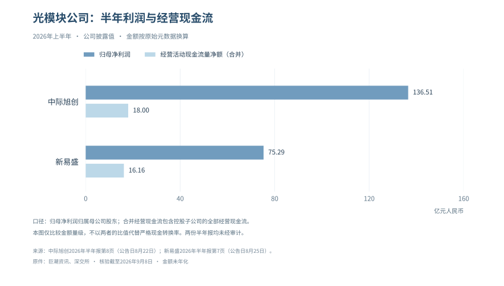
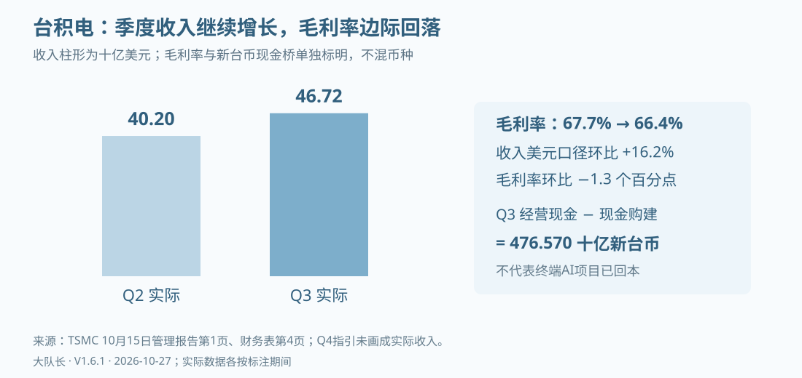

## 第六部分：对中国投资者的核心启示

海外资本开支与中国公司的利润之间，至少还隔着产品结构、供应商份额、交付节奏和回款四道关。截至2026年10月31日，Microsoft、Alphabet和Amazon新季云收入继续增长；国内正式三季报却给出不同现金路径：中际旭创Q3现金回升，新易盛Q3经营现金转负，天孚通信前三季现金购建后仍有余量，江波龙单季转正但累计为负。增长已经兑现，资金回收仍须逐家公司核算，海外总CapEx不能直接代替中国公司的盈利模型。[中际旭创Q3](https://static.cninfo.com.cn/finalpage/2026-10-30/1225643953.PDF)、[新易盛Q3](https://static.cninfo.com.cn/finalpage/2026-10-30/1225642947.PDF)、[天孚通信Q3](https://static.cninfo.com.cn/finalpage/2026-10-29/1225634414.PDF)

### 6.1 用经营条件识别周期

项目何时形成收入、融资能否续接、投资开支能否主动调整，比年份本身更有解释力。某个季度进入研究日历，只代表需要取得新证据；条件没有成立，就不能因为时间到了而宣布周期转折。

周期判断分别跟踪供应商订单和收入是否减速，客户资本支出是否超过可持续现金创造，以及融资压力是否由个别公司扩散到更多信用主体。强需求能够反驳第一条的即时崩塌，却不能自动消除第二条；单名降级也不能自动证明第三条已经发生。

模型公司的融资窗口也要按真实阶段判断。媒体计划、秘密递交申请、公开递表、注册生效和实际发行不是同一阶段，锁定期及售股安排还要读取正式条款；不能用计划中的IPO日期串出一条必然的资金流出与市场下跌路径。

#### 6.1.1 如果投资周期比预计更长

物理约束可以让交付延期，既可能让供给扩张放缓、改善最终供需，也可能使在建工程和利息占用继续累积。这两个方向不能一开始就合并为“延迟必然放大”，必须逐项目核对：客户付款是否随交付发生，设备能否转售，合同能否取消，以及建设期利息最终由谁承担。

反方压力测试采用条件而不预设概率迁移。如果单位任务成本下降使需求扩张快于价格下降，成熟业务能持续补贴建设，且回款没有恶化，那么原先偏谨慎的现金回收判断应当弱化。相反，若收入尚未起量、维护性资本开支已经到来，同时客户依赖新融资付费，时间延长会增加资本缺口。

这里须区分两种路径：渐进幻灭指回报低于乐观定价，投资和估值分阶段调整；软着陆指收入与效率逐步吸收前期投入，建设节奏有序回落。交付延期可能通向其中任何一种，本节不替它预设概率，也不据此给出加减仓百分比。

### 6.2 A股传导需要逐项拆解

| 环节 | 需要验证的传导变量 | 常见误判 |
|---|---|---|
| 光模块 | 集群规模、端口密度、速率升级、单价、良率、客户份额和回款 | 云厂总CapEx增速直接等于模块收入增速 |
| 存储 | DRAM/NAND价格、企业级产品结构、备货成本、库存跌价与回款 | 海外HBM景气直接等于全部国内存储公司现金增长 |
| 服务器与交换设备 | 平台切换、单机价值量、订单转收入、存货和信用条件 | 订单增加等同于利润和现金增加 |
| 电源与散热 | 功率密度、液冷渗透、工程验收、售后服务与项目延期 | 数据中心用电增长意味着全部设备公司同幅受益 |
| 国产计算与基础软件 | 可交付供给、兼容性、迁移成本、客户预算和使用效率 | 出口限制自动带来所有国产公司的高利润 |
| 电力与能源 | 项目位置、并网、供电合同、实际电价与回报机制 | 美国数据中心扩张直接利好所有中国能源公司 |

这些是研究变量，不是行业评级。实际公司模型应从客户和产品出发，再汇总行业暴露；不能先认定某个板块“极高风险”或“确定受益”，再挑数字证明。

#### 光模块：利润增长与现金占用分别核算

中际旭创、新易盛10月30日公告的三季报与天孚通信10月29日公告的三季报，已将10月27日的H1基线推进到9月末。下表均为2026年前三季累计、人民币亿元；数字按原始元数换算，季度报告未经审计。

| 公司 | 营业收入 | 归母净利润 | 经营现金流净额 | 收入/归母利润同比 |
|---|---:|---:|---:|---|
| 中际旭创 | 695.47 | 222.38 | 80.08 | +178.13% / +211.81% |
| 新易盛 | 318.50 | 113.72 | 14.64 | +92.97% / +79.74% |
| 天孚通信 | 47.51 | 20.83 | 14.62 | +21.25% / +42.18% |

来源：[中际旭创正式季报](https://static.cninfo.com.cn/finalpage/2026-10-30/1225643953.PDF)、[新易盛正式季报](https://static.cninfo.com.cn/finalpage/2026-10-30/1225642947.PDF)、[天孚通信正式季报](https://static.cninfo.com.cn/finalpage/2026-10-29/1225634414.PDF)。收入、归母利润及经营现金与[经济参考报](https://www.jjckb.cn/20261030/d1aaf74f7891450cbe54a641ed7efc0b/c.html)、[中国证券报天孚财讯](https://finance.eastmoney.com/a/202610283913873750.html)等独立编辑报道在显示精度内一致；它们仍以公司报表为基础，不能视作客户付款的独立经济证据。

经营兑现已不再只是预期，但现金变化出现分化：中际旭创前三季经营现金同比+46.81%，新易盛−68.42%，天孚+8.75%。不宜把归母利润与合并经营现金之比命名为严格“利润现金转化率”，也不宜仅凭差额指控利润失真。

接上同一合并现金表的购建固定资产、无形资产及其他长期资产付款，可得到下列资金简桥。先用原始元数相减，再四舍五入；这不是FCFF，也没有包含其他投资、分红、偿债和融资。

| 公司 | 前三季经营现金 | 前三季现金购建 | 前三季差额 | Q3经营现金（9M−H1） | Q3差额（9M桥−H1桥） |
|---|---:|---:|---:|---:|---:|
| 中际旭创 | 80.08 | 91.61 | −11.52 | +62.09 | +18.50 |
| 新易盛 | 14.64 | 18.06 | −3.42 | −1.52 | −6.94 |
| 天孚通信 | 14.62 | 4.91 | +9.71 | 本表未复核H1差额 | 本表未复核H1差额 |

中际旭创累计算式为（8,008,444,194.49−9,160,875,564.49）÷1亿；新易盛为（1,464,429,142.65−1,806,016,532.89）÷1亿；天孚为（1,461,851,321.62−491,017,854.77）÷1亿。Q3差额使用已核H1原始数而非四舍五入后的表格相减。[中际旭创H1现金表](https://static.cninfo.com.cn/finalpage/2026-08-22/1225491753.PDF)、[新易盛H1现金表](https://static.cninfo.com.cn/finalpage/2026-08-25/1225499406.PDF)

旧H1图保留为历史对照，不能用它覆盖本次反向变化：中际旭创上半年−30.02亿元的资金差额已收窄，新易盛上半年+3.53亿元的余量已消失。累计为负可以由已有现金或融资支付，单季为正也不等于扩产全生命周期回本。

截至10月31日，本轮尚未完成三家公司从合并净利润、非现金项目到营运资本的完整调节，也未把购建拆成维护性和扩张性投入。因此不能把差额归因于某一客户拖款，或直接年化为正常化现金。后续需核对账龄和期后收款、存货交付和减值、预付款及应付的现金影响；资产负债表余额变化可能含汇兑、并购及非现金项目，不直接充当现金流。

模型的双向调整有具体落点：备货随交付下降、应收按合同收回时，降低后续营运资本占用假设；账龄延长、库存减值持续增加时，下调可回收现金并重估扩产。中际旭创本季改善是必须纳入的反证，新易盛本季压力也不能被行业高景气掩盖。

#### 光模块：订单能见度尚不能代替现金表

10月23日的三份经营公告把产品进展推到更近的观察时点：中际旭创披露海外重点客户订单覆盖2027年，部分客户提供2028年需求指引；新易盛称800G和1.6T已是主要出货产品；天孚通信称用于CPO的FAU、ELS相关产品已稳定量产。这些消息不等于全部订单不可取消，更不等于已经确认收入或收款。天孚2027—2029年股权激励增长目标也不是已实现业绩或公司盈利预测。三家公司正式Q3财报已进入上表；经营进度与财务兑现分别记录，产品已量产仍须检验良率、定价与回款。[中际旭创公告，第1—2页](https://static.cninfo.com.cn/finalpage/2026-10-23/1225617691.pdf)、[新易盛公告](https://static.cninfo.com.cn/finalpage/2026-10-23/1225617676.pdf)、[天孚通信公告，第2页](https://static.cninfo.com.cn/finalpage/2026-10-23/1225617692.pdf)

#### 存储：单季改善与累计占款分别判断

德明利10月26日公开三季报，Q3收入116.45亿元、归母利润27.29亿元；前三季累计归母利润87.46亿元、经营现金−136.91亿元，期末存货289.86亿元，较年末增加219.28亿元。其前三季经营现金减现金购建长期资产，按原始元数计算为（−13,690,577,650−500,131,017.67）÷1亿＝−141.91亿元；这个缺口表明备货与扩张依赖资金支持，不足以认定虚假利润。合并现金与归母利润不构成严格同权益口径比率，累计现金也不能冒充Q3单季现金。[德明利三季报，第2—4、18—19页](https://disc.static.szse.cn/download/disc/disk03/finalpage/2026-10-26/e8eabd45-e97f-4bed-b05d-27f58665dc50.PDF)

本节旧版“一份正式季报与一份预告”的证据边界已推进：江波龙10月30日正式季报转存原文给出前三季收入387.18亿元、归母利润143.22亿元、经营现金−22.74亿元；公司说明Q3单季经营现金+8.77亿元。单季转正是缓解担忧的证据，累计为负仍提示备货占款，不能只选其中一项。巨潮/交易所原站直链和现金购建明细尚未在本轮完整交叉核验，故来源状态保留为“公告转存件”，不据此形成精确正常化FCF。10月15日预告关于DRAM、NAND涨幅收窄的判断仍需后续售价验证。[三季报转存原文](https://money.finance.sina.com.cn/corp/view/vCB_AllBulletinDetail.php?id=12680548&stockid=301308)、[每经报道](https://www.nbd.com.cn/articles/2026-10-29/4628749.html)

由此应把“行业涨价”拆成公司采购价格、库存交付与收款的时间差。德明利的累计现金占用与江波龙单季改善不能简单平均，也不能由美光或韩国HBM业绩给国内全板块统一上修。

### 6.3 编程工具与软件公司的传导

编程工具按席位收费的收入，只覆盖软件生产工具市场的一部分。若企业把节省的工时用于更多项目、采用按用量计价的代理或采购交付服务，市场边界会改变；反过来，个人用户使用频率低、付费席位流失或高频用户推理成本过高，也会削弱利润。

因此“工具更便宜”既不是外包公司必然受损的证据，也不是工具厂商拥有无限市场的证据。软件公司的模型至少要分合同金额、交付人时、人员成本、工具和算力成本、验收周期，以及客户是否要求分享效率收益。项目毛利可以先按“合同收入−交付人工−工具与算力−其他交付成本”建立，再另扣销售、研发与管理费用；节省工时只有变成新增交付或实际成本下降，才进入盈利，而不从全体开发者人数直接推公司收入。

### 6.4 客户集中与融资暴露

客户集中度、关联投资和收入质量应分栏记录。供应商向客户投资，并不能证明所有后续收入虚假；同样，已经签订采购合同，也不代表客户具备无条件履约的现金能力。

研究底稿应列出具名客户、已确认收入、未履约合同、收款期限、担保或增信、投资余额与取消条件。未披露客户身份的收入不能由研究者擅自分配给某一家云厂，未披露的循环收入占比应保留缺失；客户集中和融资关联可以提示核验方向，不能直接生成行业统一风险排名。

### 6.5 公司估值怎样承接行业判断

先形成产品收入预测，再由毛利、费用、折旧、税和营运资本形成利润及现金流，最后讨论估值倍数。产业判断可以改变这些输入，却不能越过盈利模型直接产生某个精确跌幅。

例如只为说明敏感性的假设公司：基准EBITDA为100、企业价值倍数为20倍，净债务200、稀释股数100，则每股价值为18。若EBITDA增长20%至120、倍数回落25%至15倍，企业价值变成1800，每股价值为16，较18下降11.1%。盈利上涨与股价估值下降完全可能同时发生；这里的数字是教学假设，不是任何真实公司的目标价。

| EBITDA（基准=100） | 15倍 | 20倍 | 25倍 |
|---|---:|---:|---:|
| 80 | 10 | 14 | 18 |
| 100 | 13 | 18 | 23 |
| 120 | 16 | 22 | 28 |

表中每股价值统一按“EBITDA×倍数−200，再除以100”计算。净债务、股数固定只是为了看清两个变量；真实模型须同步处理现金生成、融资和稀释，并用现金流折现检验终值是否承担过多价值。

### 6.6 跨境工具：通道规则不能替代研究

港股通南向交易和大湾区跨境理财通是两种不同制度，不能把市场每日额度当成个人可持有、可积攒的配额。港交所2026年7月6日版常见问题说明，每日额度按净买盘管理、未使用部分不结转；因此持有股票不产生可以保存的个人历史额度。[港交所《互联互通常见问题》，2026-07-06，第15—16页](https://www.hkex.com.hk/-/media/HKEX-Market/Mutual-Market/Stock-Connect/Getting-Started/Information-Booklet-and-FAQ/FAQ/FAQ_Cn.pdf)

场内QDII的溢价必须用同一时点可比净值、汇率和交易价格计算。跨时区净值滞后、停申购和二级流动性会影响结果，未取得同日可比样本时，不能给全市场一个“当前普遍溢价”区间。基金规模增长或市场回撤也不保证某一天溢价必然归零。

本报告不对读者的跨境投资资格、汇款用途或适用产品作个别认定。需要交易时，应另按最新官方规则及产品说明核实，而不是根据研究观点提前安排通道或仓位。

### 6.7 截止日之后，需要取得哪些证据

10月28—30日的Microsoft、Alphabet、Amazon、Vertiv及国内光模块财报已由“待披露”转为本版输入；三星、SK海力士季度现金摘要及Intel业绩也已补核，详见利润章。Meta、台积电、ASML和德明利则是10月27日已知基线。披露层级仍分正式公告、演示摘要及完整报表，下一步应检验新收入能否继续形成现金，而非财报一出就机械调仓。

| 北京时间 | 官方未来节点 | 需要核验的变量 | 对中国公司的传导限制 |
|---|---|---|---|
| 11月3日23:00 | 美国9月JOLTS | 职位空缺、招聘和离职 | 不是AI替代人数统计 |
| 11月4日06:00 | AMD 2026Q3电话会；业绩于美东3日盘后公布 | 数据中心与非AI业务、现金和指引 | 未公布前不预填结果；CPU与GPU收入不全部归为AI |
| 11月5日21:30 | 美国Q3生产率初值 | 产出、工时、单位劳动成本 | 季度总量不能直接归因于AI |
| 11月6日21:30 | 美国10月就业报告 | 招聘、失业、工时 | 需区分周期、行业和AI影响 |
| 11月10日21:30 | 美国10月CPI | 通胀与利率预期 | 影响折现率，不直接确认供应商订单 |
| 11月13日21:30 | 美国10月PPI | 上游价格与成本 | 不能代替特定元器件成交价 |
| 11月18日06:00 | NVIDIA FY27Q3电话会；结果预计稍早公布 | 收入、应收、付款期限、客户支持和现金 | 季度终点10月25日；不与云厂9月季机械相加 |

日历来源：[美国劳工统计局11月日程](https://www.bls.gov/schedule/2026/11_sched.htm)、[AMD10月6日官方公告](https://ir.amd.com/news-events/press-releases/detail/1300/amd-to-report-fiscal-third-quarter-2026-financial-results)、[NVIDIA10月28日官方公告](https://nvidianews.nvidia.com/news/nvidia-sets-conference-call-for-third-quarter-financial-results-6928873)。11月所列美国时点使用冬令时EST，北京加13小时；电话会时间与财报稿精确发布时间分开，日程仍可能调整。没有正式日期的公司，不填写预约传闻时刻。

国内下一次核验以应收、存货、期后收款、预付款及资本购建为重点。海外新季云收入强，是支持交付的证据；Alphabet Cloud还包含TPU系统销售，Microsoft亦改了分部口径，不能把增长率全部解释为同一种可重复算力租金，更不能等比例上推中国供应商收入。

台积电Q3收入46.72B美元、毛利率66.4%，新台币经营现金919.776B与现金购建443.206B相减为476.570B，说明其自身需求和现金已经兑现；HPC收入占比68%却不能作为纯AI占比。Q4收入52.3—54.3B美元仍为指引，不能从供应商的强现金一步跳到中国光模块、设备或存储公司的盈利上修，仍要回到产品、份额、价格和回款。[台积电10月15日Q3管理报告，第1—2页](https://investor.tsmc.com/english/encrypt/files/encrypt_file/reports/2026-10/f83780000ddc0c3b48e57a87eab6814c4ab35058/3Q26%20ManagementReport.pdf)、[Q3现金流表，第4页](https://investor.tsmc.com/english/encrypt/files/encrypt_file/reports/2026-10/3a94d1034b9e6b22446b674f7aaf3d088a12a193/FS.pdf)

### 6.8 政策冲击的归因

出口管制影响可采购产品、部署地点和技术迁移成本，资本市场监管影响交易通道，两者不能合并成一个“AI风险事件”。对具体公司，依次核对产品是否在规则范围、许可证条件、实际可交付时间与替代方案，再调整销量、成本和交期。政策讨论稿不等于生效规则，获准采购也不等于已经交付；涉及处罚金额、产品禁令和实施日期时，必须保留对应监管文件，不把未核实的金额写入风险损失。

### 6.9 本章可能判断错在哪里

供应商份额提升和产品升级可能抵消行业投资减速，这是宏观外推最容易漏掉的反方；营运资本也有季节性，仅看一个季度或累计前三季现金不足以给全年结论。与此同时，增长真实不能保护过高的买入估值，政策支持也不能保证单一公司的产品被采用。下一次核验应允许这些方向同时进入模型，而不是只寻找支持原观点的数字。

