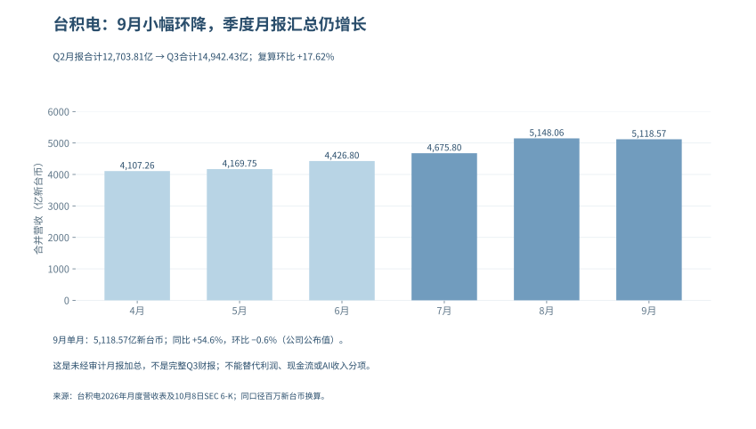

# AI周期与泡沫 · 公开精简版

V1.5.1 · 正文修订 · 2026-10-09

## 免责声明与阅读边界

本报告为“大队长”基于公开资料形成的个人研究，不代表任何任职机构观点，不构成个性化投资建议、收益保证或交易指令。技术和商业判断可能错误，信息也可能随后修订。

V1.5.1为V1.5基础上的增量正文修订版，增量资料检索截止2026年10月9日上午；各项财务、统计、行情与政策数据以正文明确的期间或观察日为准，不能全部理解为该日现值。公司指引、研究假设和已实现结果分开阅读；缺失的原始证据不以推测填补。

本版按主题重编，不沿用旧版分页；旧版与历史档案保留不改。历史评分和预测记录只用于追溯，未完成统计校准的数字不属于经过验证的崩盘概率。审计条目总数不等于本轮全部事实复核通过。

## 本版修订说明

1. 本篇按目标读者重新组织结论和展开；更新写进相应论点，不以前置全景财报替代原正文。

2. 利润篇：新增APLD基础租金、装修收入与集团现金桥；三星Q3只列初步合并估计，期后交付、分部与集团口径分别处理。

3. 变现篇：新增Haiku 5.5按请求长度分档的价目及算例，更新Sonnet缓存费；视觉广告测试不当作已确认收入。

4. AGI篇：补AMD预发布测试的方法和速度门槛，厂商吞吐比不外推成商业收入或投资回报。

5. 中国传导：台积电9月月报结转，复算Q2/Q3月报加总；新增就业修订，并接续CPI、PPI、Q3电话会和FOMC北京时间。

逐项勘误与修订见文末《本版逐项修订记录》，可从目录跳转。

2026-09-08编排勘误：本册正文从第一章起连续编号，目录和当前章节引用同步；导读不占章号。母稿对应关系见文末“分册编号勘误”，研究数据与结论未因本次编排修改。

<!-- BODY_START -->

## 公开版导读：把一笔AI资本开支追到最后

讨论AI泡沫，最容易把两个问题混成一个：技术有没有用，这个价格买下技术所需的资产能不能赚钱。技术很有用，投资也可能回报不足；某些资产价格过高，也不意味着用户没有从AI得到价值。本公开版以这一区分组织后面的利润、变现、国际格局与中国公司传导。

先从利润看起。云厂既经营成熟业务，也持有模型公司的股份，公司财报中的净利润有时包含投资价值变化。营业利润、重估收益与经营现金需要分别读，才能判断扩张的底气来自哪里；仅凭一个创纪录的净利润，既不能证明新增机房回本，也不能因为其中含有非现金收益就认定经营虚假。

第二步看付费。编程、办公、客服、广告和模型API有不同的收费机制，席位、用量和成功任务也不是相同单位。规模测算必须说明客户数、实际价格、续费及服务成本；一个人买多种工具的真实支出可以分别记录，但工具再向模型和云支付的费用不能重复算成终端市场。读者应能从这些输入重新计算收入，而不只是接受一个总量。

第三步看约束。AGI的讨论涉及任务可靠性、算力效率、能源和技术规则，不应由股市财报主导。该篇以新的能力披露和政策节点为线索，同时保留公司目标与独立验证之间的距离；没有用排行榜的分数差推出“智能差距百分比”，也没有替AGI安排确定到来的年份。

最后才回到公司与投资。海外扩容传导到中国企业，要经过产品、客户份额、交付、单价和回款。正式半年报给出了经营兑现的证据，仍需要用估值检验买入价格是否预支了过多增长。读者不必先认同“泡沫”这个词，可以逐章检查哪条链已经接上、哪条仍缺证据。

**V1.5.1本篇修订（10月9日）。** 正文接续台积电9月营收、APLD现金与收入分类、三星初步估计、模型价目及AMD厂商测试；本期新增与上期事实分开，测试、计划和已实现结果不混写。

## 第一章：哪些是真金白银，哪些是估值游戏？

> V1.5.1 正文修订｜增量检索截至2026-10-09上午，北京时间；本轮加入Applied Digital截至8月31日的季度业绩及三星Q3初步估计，既有财报保留各自期间。金额无特别说明均为十亿美元；韩国初步值另标韩元。季度财务表及美光既有全年业绩表未经审计，Microsoft、Lumentum及Coherent全年数据来自已审计10-K。本篇讨论盈利来源、可持续性与现金转化，不把会计估计或投资收益本身认定为舞弊。

### 本篇内容地图与逻辑链

Alphabet第二季度的稀释每股收益是9.11美元，其中股权证券收益的税后贡献为6.26美元；与此同时，Google Cloud收入与营业利润仍在快速增长。Amazon也同时呈现AWS经营改善和投资重估拉高净利润。仅看净利润，会高估经营改善；把重估全部剔除后说“没有真需求”，又会漏掉已经实现的云业务增长。

本篇沿着一笔收入走到现金：先辨认客户支付的是什么，再把营业利润、持仓收益与税项分开，随后检查回款、资本开支和租赁，最后问新投入能否在设备失去经济竞争力前赚回成本。Oracle最新季度把矛盾推得更清楚：云基础设施收入增长121%，资本开支却超过经营现金流，经营现金又得到大额客户预付款支持。当前证据支持“经营兑现与资本回收压力并存”，不支持“五家公司利润都不真实”，也不支持“高增长足以证明任何建设成本都合理”。

| 阅读位置 | 要回答的问题 | 不能偷换的口径 |
|---|---|---|
| 1.1—1.2 | 哪些经营已兑现，利润如何进入现金？ | 非经营收益不等于假利润，现金支出不等于当期费用 |
| 1.3 | NVIDIA的客户和回款发生了什么变化？ | 直接客户、最终客户、应收集中度分开 |
| 1.4—1.5 | 公司好与投资回报好之间差在哪里？ | 估值时点、历史案例与预测概率分开 |
| 1.6—1.8 | 下一次财报应怎样推翻或加强判断？ | 观察规则不冒充统计模型，风险不等于交易指令 |

### 1.1 五大巨头：经营兑现与现金回收分开判断

本版撤下旧的“真实性星级”。没有统一权重和可复算评分，给公司打两星或四星会制造精确感；更有用的是把已经确认的经营、还未收回的现金以及需要解释的会计项目放在同一张表里。

| 公司与统计期 | 已确认的经营 | 本篇重点核查 | 当前判断 |
|---|---|---|---|
| NVIDIA，FY27Q2，截至7/26 | 收入96.221，数据中心89.023；GAAP毛利率75.0% | 经营现金24.077，低于前季50.344；应收周转天数由45天升至60天 | 需求和利润强，回款节奏与支持客户的安排需跟踪 |
| Microsoft，FY26Q4，截至6/30 | 收入90.007，营业利润40.603；Azure及其他云服务收入增43% | 经营现金55.441，现金购置固定资产35.802 | 现金仍厚，不能用OpenAI投资关系否定整个云业务 |
| Alphabet，2026Q2 | Cloud收入24.768、营业利润8.814 | 股权证券收益税前99.031；单季自由现金流−5.855 | 经营和持仓收益均真实入账，但估值不能混用 |
| Amazon，2026Q2 | AWS收入42.232、营业利润16.621 | 当季非经营税前收益53.415；截至6/30过去12个月FCF−7.604 | AWS增长成立，合并净利润和现金回收需分别解释 |
| Meta，2026Q2 | 收入60.801，其中广告59.363 | 经营现金31.862，现金固定资产购置30.116、融资租赁本金0.962 | 广告付费真实，新增投入几乎用尽当季经营现金 |

资料：[NVIDIA CFO说明](https://www.sec.gov/Archives/edgar/data/1045810/000104581026000073/q2fy27cfocommentary.htm)、[Microsoft财报](https://www.microsoft.com/en-us/Investor/earnings/FY-2026-Q4/press-release-webcast)、[Alphabet财报](https://s206.q4cdn.com/479360582/files/doc_financials/2026/q2/2026q2-alphabet-earnings-release.pdf)、[Amazon财报](https://ir.aboutamazon.com/news-release/news-release-details/2026/Amazon-com-Announces-Second-Quarter-Results/default.aspx)、[Meta财报](https://investor.atmeta.com/investor-news/press-release-details/2026/Meta-Reports-Second-Quarter-2026-Results/default.aspx)。这不是同期间排名：NVIDIA季度终点不同，Amazon所列FCF为滚动12个月。

台积电9月10日披露的8月合并营收为5,148.06亿新台币，较7月的4,675.80亿环比增长约10.1%、同比增长53.3%；1—8月累计33,868.70亿新台币、同比增长39.3%。7月同比44.7%的放缓没有延续，至少在公司合并营收层面尚未出现需求断崖；但月报没有拆出AI、手机、先进制程、先进封装、量价或汇率贡献，不能写成“AI收入增长53.3%”，也不能据此证明项目已经回本。[台积电2026年月度营收](https://investor.tsmc.com/english/monthly-revenue/2026)、[8月营收6-K](https://www.sec.gov/Archives/edgar/data/1046179/000104617926000658/tsm-revenue20260910.htm)

### 1.2 从账面利润到可支配现金

#### 1.2.1 持仓重估：单列，不把“非现金”写成“不真实”

持有的股权升值可以按照适用准则进入损益，这一收益有经济含义，但它既不是售出云服务的收入，也不一定在当季变成现金。对投资者的直接影响是：使用含巨额重估的每股收益计算市盈率，可能得到看似便宜、实际不可持续的倍数。

Alphabet官方披露，Q2股权证券收益净额99.031，税后使净利润增加约77.1，每股收益增加6.26。因此9.11减6.26约为2.85美元，这是“只剔除该项影响后的EPS”，并非公司提供的纯经营EPS，更不是已剔净全部一次性项目的标准化盈利。该证券收益也不能全部指认为Anthropic；公司资产组合还包括其他上市及非上市投资，逐项归因要以附注为准。[Alphabet财报附表第9页](https://s206.q4cdn.com/479360582/files/doc_financials/2026/q2/2026q2-alphabet-earnings-release.pdf)

Amazon的Q2净利润62.647与非经营税前收益53.415不能直接相减得到税后“真实净利润”。10-Q进一步列出，私营股权可观察价格上调约50.5，主要涉及Anthropic；估值考虑证券权利、流动性事件时间、其他证券类别以及缺乏流动性折价，并不是“最新估值×固定持股比例”。本版据此撤回旧文对后续三个季度重估收益和净利润占比的线性外推。[Amazon Q2 10-Q，投资附注](https://www.sec.gov/Archives/edgar/data/1018724/000101872426000026/amzn-20260630.htm)

Microsoft也需要做同样拆分。公司Q4非GAAP净利润调整只排除了OpenAI投资的0.480税后收益，但业绩稿另提示当季存在Anthropic投资收益3.2。因此“公司非GAAP”不能自动等同于“已剔除所有投资收益”。NVIDIA当季股权证券净收益约7.8，同样要与GPU经营利润分开看。对所有公司执行相同规则，才能避免只挑支持泡沫判断的项目。

用于比较的利润桥应写成：

> GAAP净利润 − 已披露的税后非经营收益 + 已披露的税后非经营损失 ± 其他明确调整 = 研究口径调整后净利润。

若只拿到税前项目，保留税前利润桥；不以统一21%税率替公司补出“实际税后值”。投资盈利能否重复、能否兑现、能否分配是三个不同问题。即使下一轮融资继续涨价，也不能把未实现持仓收益赋予云服务收入同样的估值倍数。

#### 1.2.2 折旧：会计寿命与经济寿命之间的差距

GPU可以继续开机，并不代表它还能按原租价获得客户。反过来，新一代芯片出现，也不代表旧设备马上归零；旧GPU可能转向价格敏感的推理、内部研发或较低负载任务。检验折旧的对象，应当是特定资产组的可赚取现金，而不是笼统地宣布“GPU都只能用三年”。

原文把服务器、网络设备与数据中心建筑混成统一寿命，并用“延长折旧虚增利润”作结论，措辞超过了证据。不同公司设备构成、部署批次和残值判断不同；会计估计变更通常影响未来费用分摊，只有出现违背准则、错误估计或重大减值证据，才进一步判断其是否错报。旧版关于某公司全年“虚增29亿美元”及全行业“少提1760亿美元”的外部测算，不再冒充已审计事实。

在现有财报上，先检查四件事：固定资产新增何时转为可使用，折旧是否随投产增加，闲置或提前退役是否减值，以及租赁资产和自建资产是否被放在不同费用项目。公司会计政策及未来变更须在原附注逐项核对，不用一张多年旧表替代当前政策。[Microsoft FY2026 10-K](https://www.sec.gov/Archives/edgar/data/789019/000119312526323660/msft-20260630.htm)、[Meta Q2 10-Q](https://www.sec.gov/Archives/edgar/data/1326801/000162828026050705/meta-20260630.htm)

一个可复算的敏感性例子：假设某批设备可折旧基础60亿美元、残值为零，直线法6年折旧每年10亿美元；若经济寿命只有3年，每年经济耗损相当于20亿美元。两种假设相差10亿美元税前费用，但这只是同一设备组、全年在用的演示。不能用全公司固定资产乘这个差额，也不能把它记成某家公司实际少提折旧。

现金流也不能完全解决这个问题。折旧虽在经营现金流中加回，设备最终仍需替换；评价长久期项目应另估维持性资本开支，不能把“经营现金为正”当作“设备全生命周期已经回本”。

#### 1.2.3 自由现金流：先统一计算，再谈压力

| 公司 | 统计期 | 经营现金流 | 扣减项目 | FCF或可比计算 | 口径边界 |
|---|---|---:|---:|---:|---|
| Alphabet | 2026Q2 | 39.069 | 现金固定资产购置44.924 | −5.855 | 公司定义；TTM仍为+53.273，不能把单季转负说成全年无现金 |
| Microsoft | FY26Q4 | 55.441 | 现金固定资产购置35.802 | +19.639 | 本表现金桥；不是“总CapEx约41”再额外扣一遍租赁新增 |
| Meta | 2026Q2 | 31.862 | 固定资产30.116+融资租赁本金0.962 | +0.784 | 公司定义，已包含该租赁本金 |
| NVIDIA | FY27Q2 | 24.077 | 固定资产及无形资产2.677+相关本金0.059 | +21.341 | 公司定义，不能仅用PP&E现金购置替代全部扣项 |
| Amazon | 截至6/30的TTM | 161.403 | 净现金购置固定资产169.007 | −7.604 | 公司主FCF，未在这一行额外扣融资租赁本金 |
| Oracle | FY27Q1，截至8/31 | 23.103 | 资本开支28.499 | −5.396 | 经营现金含11.363客户预付款，且公司明确其具有重大融资成分 |

这些数据来自上列各公司财报现金流及非GAAP调节表；前五项算术分别为39.069−44.924、55.441−35.802、31.862−30.116−0.962、24.077−2.677−0.059、161.403−169.007，Oracle为23.103−28.499。不得把季度列与TTM列相加得到“行业FCF”。

Oracle FY27Q1总收入19.345、云收入11.607，其中IaaS为7.388、同比增长121%；经营兑现很强，但资金桥不能只看增长率。当季经营现金23.103中，11.363来自具有重大融资成分的客户预付款；资本开支28.499后，自由现金流为−5.396。公司同时完成ATM普通股增发，净到账19.909。客户预付款与股权融资都是真实资金来源，却不是云服务已经赚回成本的证据。[Oracle FY27Q1业绩](https://investor.oracle.com/files/content_files/1q27-pressrelease-September_FINAL.pdf)、[Oracle FY27Q1 10-Q](https://www.sec.gov/Archives/edgar/data/1341439/000119312526389274/orcl-20260831.htm)

这张图也刻意没有把664的剩余履约义务、288的未起租数据中心租赁承诺和当季资本开支相加。约13%的RPO预计未来12个月确认，约37%在第13—36个月、34%在第37—60个月，其余更晚；288的租赁承诺预计FY27Q2至FY29陆续开始，合同通常为15—19年，尚未反映在8月31日资产负债表。它们强化的是未来收入能见度和长期履约约束，不是当期现金、收入或损失。

本版同时更正旧推理：“CapEx大于FCF”并不自动表示需要外部融资，因为FCF已经扣过CapEx。应比较经营现金能否覆盖现金CapEx，再看现金余额、债务到期、股息回购、股权投资和租赁还本。即使FCF为正，大额投资和偿债也可能带来融资需求；即使单季为负，也可能由既有现金余额覆盖。

Amazon最能说明这个区别：AWS收入和分部利润显著增长，但合并口径建设付款更快，导致滚动FCF转负。这里既不能说AWS利润“依赖Anthropic重估”，也不能用AWS利润率替整个AI建设项目算回报。零售物流、其他技术基础设施和服务采购都在合并报表中，纯AI回报需要更细的资本和利润归属。

#### 1.2.4 利润高增而现金没有同步：光模块的现实检验

两家A股光模块公司的半年报，把“需求真实但要查现金”落到了可核对的账上。金额单位在本小节改为人民币亿元，统计期均为2026年1—6月，半年报未经审计。

| 公司 | 归母净利润 | 同比 | 经营活动现金流量净额 | 同比 | 现金购建长期资产 |
|---|---:|---:|---:|---:|---:|
| 中际旭创 | 136.51 | +241.70% | 18.00 | −44.08% | 48.02 |
| 新易盛 | 75.29 | +90.98% | 16.16 | +69.67% | 12.64 |

资料：[中际旭创8/22半年报，第8、60页](https://static.cninfo.com.cn/finalpage/2026-08-22/1225491753.PDF)、[新易盛8/25半年报，第7、44页](https://static.cninfo.com.cn/finalpage/2026-08-25/1225499406.PDF)。归母利润与合并经营现金并非完全一致的权益归属口径，表中仅比较量级，不将两者相除标成严格的现金转化率。

中际旭创利润增长没有在同期等比例变成现金，需继续跟踪存货、应收项目与供应商付款；新易盛经营现金同比上升，也不表示每笔订单均已回款。这些差异可能来自交付增长带来的营运资金占用、备货和结算节奏，不能仅由半年CFO较小推出虚假收入。

若按“经营现金−现金购建长期资产”做简单资金桥，中际旭创约−30.02亿元、新易盛约+3.53亿元。它们不是估值模型中的FCFF，也未扣除所有融资与投资支出；用途只是找出需要下一期报表解释的资金差额。原先依靠业绩预告的事前判断，应另按事前条件结算，半年报补齐不能倒写成预告节点命中。

#### 1.2.5 海外光学供应商：经营改善与融资损失可以同时发生

Lumentum（朗美通）8月11日披露，截至6月27日的FY26Q4收入为10.063亿美元，同比增109.3%；GAAP营业利润率27.8%，非GAAP营业利润率36.6%。但同季GAAP净亏损约72亿美元，主要受约78亿美元非现金债务清偿损失影响，来自可转债股权化，而不是同额设备经营亏损或现金外流。非GAAP净利润3.263亿美元有助于观察调整后的经营，仍不能抹去债务转换对普通股股东的稀释。[Lumentum季度业绩及调节表](https://www.sec.gov/Archives/edgar/data/1633978/000162828026055726/lite_ex991xq4fy26.htm)

现金要另看完整期间：Lumentum FY2026全年经营现金流7.514亿美元、现金固定资产购置4.513亿美元，两项相减为3.001亿美元。它支持全年经营现金覆盖这项建设付款，却不是单季现金转化率，也未扣除所有投资和融资支出。这一案例提醒我们，看到巨额净亏损时先查发生在哪一层，不能直接判定需求或流动性已经崩塌。[Lumentum FY2026 10-K，现金流量表及债务附注](https://www.sec.gov/Archives/edgar/data/1633978/000162828026057358/lite-20260627.htm)

Coherent（高意）的反差在现金端。8月12日披露的FY26Q4收入为20.46亿美元，报告口径同比增33.8%，不与公司另列的备考增速混用；GAAP与非GAAP毛利率分别为38.5%和40.2%，两种利润定义也分别列示。随后提交的FY2026全年10-K显示，经营现金流只有0.79514亿美元，现金固定资产购置11.02909亿美元，两项之差为−10.23395亿美元。年报解释了存货、应收占款及应付抵补；当年获得的NVIDIA股权资金属于融资现金，不是客户买产品产生的经营现金。[Coherent季度业绩](https://www.sec.gov/Archives/edgar/data/820318/000119312526346860/d128030dex991.htm)、[Coherent FY2026 10-K，现金流量表及流动性分析](https://www.sec.gov/Archives/edgar/data/820318/000082031826000020/iivi-20260630.htm)

上述两家全年现金均来自已审计年报，季度业绩仍是未经审计口径，不能将全年现金与单季利润相除。Coherent的负差额表明扩产与营运资金需要资金支持，不足以单独证明收入虚假或公司将发生支付危机；下一步应检查库存何时交付、应收何时回款，以及融资现金能覆盖多久。

#### 1.2.6 整机与芯片：调整后现金需要逐项还原

Dell（戴尔科技）截至7月31日的FY27Q2，AI优化服务器收入为164.01亿美元、同比增100%，AI订单609亿美元、期末在手订单约950亿美元；9月1日公司将全年AI服务器收入指引从600亿提高到740亿美元。收入证明交付，订单和上调指引则还需未来履约，不能合成已经收回的现金。[Dell官方季度业绩，第1—2页](https://investors.delltechnologies.com/node/20956/pdf)

同季Dell合并经营现金流为22.25亿美元，同比下降约13%。公司现金调节表将其扣除12.39亿美元净资本支出后得到9.86亿美元FCF，再加回66.67亿美元融资应收调整及4.96亿美元经营租赁设备调整，得到81.49亿美元调整后FCF。这三个现金指标不能互换，81.49亿美元不是当季实际经营现金流。客户融资、设备交付与回款的时间差应进入研究；仅凭AI服务器收入翻倍，还无法判断客户的算力项目是否赚回资本成本。[Dell业绩现金表及FCF调节，第5、8—9页](https://investors.delltechnologies.com/node/20956/pdf)

HPE（慧与）9月2日发布的FY26Q3同样截至7月31日，合并收入122.13亿美元，“Cloud & AI”分部收入90.42亿美元、分部营业利润率17.0%，但该分部纳入服务器、混合云与金融服务，并非纯AI收入和利润。合并经营现金流16.41亿美元，减去7.45亿美元固定资产及软件投入、加回0.92亿美元资产处置、扣除0.30亿美元汇兑影响，才得到公司定义的9.58亿美元FCF。网络业务还受Juniper并表影响，不能把合并增速全部解释成AI有机增长。[HPE季度业绩及现金调节](https://investors.hpe.com/~/media/Files/H/HP-Enterprise-IR/documents/q3-2026/q3-2026-earnings-press-release.pdf)、[HPE 10-Q，分部及经营分析](https://www.sec.gov/Archives/edgar/data/1645590/000164559026000080/hpe-20260731.htm)

Marvell（迈威尔）8月27日披露截至8月1日的FY27Q2收入27.393亿美元、同比增37%，GAAP净利润3.080亿美元；经营现金流6.055亿美元、现金固定资产购置1.267亿美元，两项相减为4.788亿美元。这是当季利润与现金同时为正的例子，但无晶圆厂模式仍有资本约束：10-Q列示长期产能预付款余额4.870亿美元，年初为2.788亿美元，并披露供应与产能承诺。预付款余额变化不能再次从已含相关现金影响的CFO中扣除；数据中心收入21.715亿美元也包含多类产品，不能都算作终端AI付费。[Marvell季度业绩](https://investor.marvell.com/news-events/press-releases/detail/1031/marvell-technology-inc-reports-second-quarter-of-fiscal-year-2027-financial-results)、[Marvell 10-Q，附注3、9及14](https://investor.marvell.com/sec-filings/all-sec-filings/content/0001835632-26-000025/mrvl-20260801.htm)

这三家季度报表未经审计，现金定义各不相同，也不能与前两家全年值求和得到“行业现金回收率”。研究的落点应是各公司的交付、付款条件和投入回收期，而不是让一张高增长表替代全部判断。

#### 1.2.7 美光：存储利润已兑现为现金，但终端回本仍是另一道题

美光9月30日公布截至9月3日的FY26Q4及全年业绩，本季收入54.229B、GAAP净利润37.701B、经营现金流43.973B，不能再将其列为“结果尚未公布”。全年收入133.188B、经营现金89.675B；以下财务数据来自公司未经审计的业绩材料，季度与全年分别展示。[美光官方业绩及财务表](https://investors.micron.com/news/press-release/2026/Micron-Technology-Inc--Reports-Record-Fiscal-Fourth-Quarter-and-Full-Year-2026-Results/default.aspx)

| 现金桥（十亿美元） | FY26Q4 | FY2026 |
|---|---:|---:|
| 经营现金流 | 43.973 | 89.675 |
| 现金购建固定资产 | 11.110 | 30.712 |
| 两项相减：本报告简单现金桥 | 32.863 | 58.963 |
| 政府激励款 | 0.327 | 3.316 |
| 固定资产出售回款 | 0.009 | 0.029 |
| 公司净资本支出 | 10.774 | 27.367 |
| 公司调整后自由现金流 | 33.199 | 62.308 |

净资本支出把政府激励和资产出售回款从购建支出中扣除，因此本季公司调整后自由现金流为43.973−11.110＋0.327＋0.009＝33.199B；本报告仅用经营现金减现金购建，得到32.863B。两种口径都为正，却不是同一指标，更不能称其中一种为“GAAP自由现金流”。[官方演示材料，第43、49页现金调节](https://s25.q4cdn.com/621799436/files/doc_financials/2026/q4/Q4-26-Earnings-Deck.pdf)

同比或环比还要核对周数：FY2026有53周，Q4有14周，Q3有13周。本季收入较上季41.456B增长30.81%，机械按周归一后约增长21.47%，但后一个数字仍未剔除价格、产品结构和交付节奏，不是有机增长率。[美光Q3 10-Q，Note 1及MD&A](https://www.sec.gov/Archives/edgar/data/723125/000072312526000015/mu-20260528.htm)

这组现金是对“供应链利润没有经营现金支持”的直接反证。公司披露Q4收取约12.3B客户押金，但其列入融资活动、不增加经营现金或自由现金流，因此不能再从43.973B里重复扣除。长期合同可支持建设，押金也存在满足采购条件后的返还安排，不能当永久收入；供应商现金充裕与云商、模型客户是否收回投资，仍需分别检验。[美光官方讲稿，第8—9页](https://s25.q4cdn.com/621799436/files/doc_financials/2026/q4/Q4-FY26-Prepared-Remarks.pdf)

公司对FY27Q1给出61.5±1.5B收入指引，预计净资本支出约11.5B、上半年约25B且下半年更高。这些是管理层前瞻，不是本轮已发生支出，也不是明确的全年资本支出点值。后续反证重点是存储售价、交付、应收和库存、合同重议以及新增产能投产后的现金回报。

#### 1.2.8 机房交付开始收费，不等于全部收入都是经常租金

Applied Digital于10月7日美东盘后发布FY27Q1业绩，报告期截至8月31日。HPC托管收入262.6百万美元中，基础租金65.8、租户装修服务183.5、费用回收13.3；三项相加与分部收入一致，基础租金仅占约25.1%。装修服务是本期已确认收入，但不能把262.6全部乘四当作稳定年租金，也不能把收入当收现。[公司季度财报，HPC Hosting Update](https://www.globenewswire.com/news-release/2026/10/07/3376854/0/en/applied-digital-reports-fiscal-first-quarter-2027-results.html)

集团GAAP收入341.9百万美元与调整后收入300.4不是同一个范围：后者排除合并子公司ChronoScale。10月1日新增75MW达到可服务状态，使Polaris Forge 1园区已投入运营的关键IT负荷容量达到250MW，这是可服务容量而非实时用电负荷，也是季度末之后的交付，不能倒放进截至8月31日的租金中。它提供了建设转运营的正面证据；项目回本仍须对照运营成本、融资和后续现金。

集团现金表给出的另一面也不能省略：经营现金流63.921百万美元，购建固定资产及其他资产2,074.698百万美元，相减为−2,010.777百万美元；同期净融资现金流1,543.472百万美元。这个简单现金桥不是公司定义的FCF，也不是HPC分部现金流；它说明本季建设远超经营现金支持，却不能仅凭建设期缺口判定项目净现值为负或公司破产。[FY27Q1 10-Q，第5页](https://ir.applieddigital.com/sec-filings/all-sec-filings/content/0001144879-26-000059/apld-20260831.htm)

#### 1.2.9 三星初步利润：能更新方向，不能替代现金表

三星10月8日给出的2026Q3初步合并销售额约195万亿韩元、营业利润约107.4万亿韩元，是K-IFRS估计区间的中点，不是已审计完整财报。公告没有将这组数字拆成HBM利润、经营现金或客户回报；本版因此纳入利润观察，不据此补造现金回收，也不与美元公司的收入直接求和。[三星Q3预披露](https://news.samsung.com/global/samsung-electronics-announces-earnings-guidance-for-third-quarter-2026)

### 1.3 英伟达的“真客户”分类

#### 1.3.1 先区分三种客户

直接向NVIDIA下单的客户可能是云厂，也可能是整机商、分销商或系统集成商；最终使用GPU的客户可能经多家云采购算力，资金提供者又可能是这些企业的投资人。三者不是同一张名单。把匿名直接客户按猜测填成微软、Meta、Amazon和Google，既放大精确感，也会错算穿透集中度。

最新10-Q披露FY27Q2有一个直接客户占总收入16%，上半年有三个直接客户分别占16%、15%、13%。上年同期“两家占39%”不再是当前季度值。期末应收的五大直接客户分别占22%、14%、13%、11%、10%，这是应收余额占比，也不能当成收入占比。公司还说明一个AI研究与部署企业通过购买其客户的云服务，对NVIDIA收入有重要贡献，但没有提供可直接计算的穿透占比。[NVIDIA Q2 10-Q，客户集中度及信用风险附注](https://www.sec.gov/Archives/edgar/data/1045810/000104581026000075/nvda-20260726.htm)

#### 1.3.2 现金垫仍在，但已不是只看Q1的故事

Q2收入环比增18%，经营现金却由50.344降至24.077，DSO从45天升至60天；公司解释与对部分投资级大客户延长付款期限、营运资金及现金税款有关。这里值得跟踪的是新增应收何时收回，而不是仅用“投资级”标签忽略账期，也不是一看到DSO增加就宣布坏账。

下一期应同时检验收入、回款和客户支持安排：应收增长若主要因为可解释的大型合同交付，后续能按期收款，则当前担忧会减轻；若反复延长账期，并伴随客户再融资困难、合同变更或应收减值，才构成更强的信用证据。分析中还应剔除季度末交付集中、税款支付和库存准备的影响。

9月28日NVIDIA新增150B股票回购授权，使剩余总授权达到235B；公司预计在FY2028结束前执行。这是潜在现金用途，不是已完成回购，更不是新增产业融资；150B已包含在235B中，不能相加，也不能在估值中预先扣减同额已回购股数。[NVIDIA回购授权公告](https://nvidianews.nvidia.com/news/nvidia-announces-a-150-billion-share-repurchase-authorization-increase)

#### 1.3.3 从卖设备到承担部分下游风险

GPU销售完成并确认收入，不能说明供应商此后没有风险。NVIDIA同时向部分客户提供股权资金、云服务承诺及建设担保，[《循环投资网络》](04_循环投资网络.html)逐项核对法律状态；这些安排能帮助客户交付，也使供应商暴露于客户的再融资和终端需求。风险取决于合同期限、担保触发和第三方承接能力，不取决于给所有相关收入打一个统一“循环折扣”。

一个反证也要保留：博通9/2发布的FY26Q3业绩中，AI半导体收入16.7、同比增长221%，合并FCF13.665。这说明供应链确有收入和现金同时兑现的环节，不能把行业描述成纯粹的账面循环；但博通合并口径含基础设施软件，也不是云厂AI项目回报率。[博通官方财报](https://investors.broadcom.com/news-releases/news-release-details/broadcom-inc-announces-third-quarter-fiscal-year-2026-financial)

### 1.4 估值层面：现在贵不贵？

本版不再把2026年5月的CAPE、个股PE或集中度列为9月15日现价。没有同一交易时点的价格、最新股本及一致的盈利预测，不能据旧数给出“现在便宜/昂贵”的精确结论。

对重估收益较大的公司，先用分部营业利润和经营现金检验核心业务，再把投资资产单独估值；对高投入云厂，检查建设项目何时投产、收入如何爬坡、成熟期维持性资本开支是多少。只把当期负FCF永久化会低估增长资产，只把远期利润率套上今天投入又会高估项目。

| 估值对象 | 较合适的起点 | 需要另做的检查 |
|---|---|---|
| 广告、订阅等成熟业务 | 正常化营业利润、现金流 | AI效率收益与新增运营成本是否同时计入 |
| 云与AI基础设施 | 分部利润、投入资本及分阶段现金流 | 新旧资产组、投产率、利用率、资本化费用、租赁 |
| 持有的非上市股权 | 证券类别、交易价格与披露账面值 | 稀释、流动性折价、税与可出售限制 |
| GPU供应商 | 正常化盈利与经营现金 | 周期峰值利润、应收、库存及对客户的支持义务 |

“好公司不等于好股票”仍是本报告保留的判断，但它需要价格和现金流共同支持，不是一张历史崩盘图就能证明。相同增长预期下，估值越依赖多年后的现金，折现率和终局竞争格局的误差越重要。

### 1.5 六大历史泡沫横向对比

#### 1.5.1 横向对比表：比较机制，不平均跌幅

历史案例用于提出问题，不用于从六个样本估计AI崩盘概率。原表混用公司股价和市场指数、局部低点和长期低点、价格恢复和投资总回报，平均“跌79%”没有可比性，本版撤下。

| 案例 | 可借鉴的机制 | 不能直接套到AI的部分 |
|---|---|---|
| 南海公司，1720 | 债转股、融资叙事和投资人信心互相加强 | 不能说完全没有业务，更不能由其股价路径推算AI价格 |
| 英国铁路，1840年代 | 建设付款先行，收入爬坡慢；重复建设和竞争侵蚀回报 | 铁路寿命、监管和融资条件与GPU项目不同 |
| 美国，1929—1932 | 保证金和信贷收缩放大资产价格下跌 | 宏观萧条及银行危机不能简化为股市一天造成 |
| 日本，1980年代末 | 抵押品价格、信贷供给与企业资产负债表相互作用 | 土地、银行与人口结构不等于美国云计算行业 |
| 互联网与电信，2000年前后 | 订单预期失真、库存积压、供应商与客户同周期 | 当年盈利公司与亏损初创必须分别比较 |
| 次贷，2007—2009 | 风险转移未必减少总风险，期限和流动性错配会传染 | AI股权投资不等于住房按揭或多层结构化债权 |

#### 1.5.2 南海泡沫：融资能力不是商业回报

南海公司的债转股安排与贸易叙事共同支撑股价，但旧文称其“从未进行实质贸易”不准确。英格兰银行档案明确记录了公司的奴隶贸易活动；历史上存在业务，不意味着业务现金能解释当时估值。这个区别恰好适用于AI：研究者需要追问外部客户愿意付多少钱，而不是在“有业务”与“纯骗局”之间二选一。[英格兰银行档案](https://www.bankofengland.co.uk/CalmView/Record.aspx?id=DS%2FUK%2F633&pos=7&src=CalmView.Persons)

本版不再使用流传的牛顿名言、若干轶事或未经同源核对的个体损失作为推理依据。对于当前项目，应把融资额、投资者权利和可分配现金分别登记；融资成功证明资本愿意承受风险，不能直接证明项目净现值为正。

#### 1.5.3 铁路狂热：正确的技术方向也会遇到错误的资本预算

铁路案例保留的重点是现金时序：线路立项、征地和施工先消耗资金，客货流量在通车后才逐步形成；预测越乐观，越容易在多个相近市场重复建设。技术改变社会，与早期投资人获得足够回报，是两件事。Odlyzko的研究还强调需求预测、会计分析和资本市场认知的重要性，适合用来校验建设叙事，而非拿一个旧跌幅机械套到GPU。[Odlyzko铁路狂热研究目录](https://www-users.cse.umn.edu/~odlyzko/doc/bubbles.html)

AI的差异在于设备更新更快、网络互联和电力约束更复杂；机房建筑可能长期使用，具体加速器却可能很快失去单位成本优势。因此模型至少要拆出土建、电力、冷却、服务器和网络设备，不用一个统一寿命代表整个数据中心。

#### 1.5.4 1929：区分估值损失与融资失灵

美联储历史资料记录，道指从1929年9月高点至1932年7月累计跌约89%，价格指数直到1954年才回到旧高点。这个恢复时间不包含股息再投资，也不是通胀调整后的真实购买力回本年限。[美联储历史资料](https://www.federalreservehistory.org/essays/stock-market-crash-of-1929)

对AI更有用的问题是：价格下降时，谁会被要求追加抵押品，谁必须在短期还债，谁可以等待经营恢复。强现金巨头和高负债算力租赁商不该置于同一个风险桶。但也不能反过来说“大公司有现金，所以全系统不可能出风险”；信用敞口可能集中在项目公司、租赁、银行或私人信贷基金。

#### 1.5.5 日本泡沫：资产负债表修复为何拖慢投资

日本央行相关研究把银行对房地产放贷、土地抵押价值和股票价格的共同变化纳入分析，说明资产涨价会反过来扩张融资能力，价格回落后则压缩借款与投资。[日本央行研究](https://www.imes.boj.or.jp/research/abstracts/english/me14-1-6.html)

AI产业可借鉴的是抵押品和现金流之间的反馈，而非“必然失去三十年”。若GPU残值下调导致授信收缩，算力运营商可能减少采购、压低供货商订单；如果它们已经锁定长期客户且不靠短期续贷，反馈就可能较弱。需要合同数据才能区分。

#### 1.5.6 互联网：订单、库存与收入之间可以突然脱节

Cisco在2001财年因需求急降确认约22亿美元额外库存费用，2002年报保留了这一记录。这比“公司股价25年永不回本”的过期说法更适合用于研究：当供应链以强需求为依据备货，而客户突然削减订单，损失会先表现为存货和采购承诺调整，不一定先表现在过去一季的毛利率。[Cisco 2002年报](https://www.cisco.com/c/dam/en_us/about/ac49/ac20/downloads/annualreport/ar2002/pdf/AR.pdf)

Pets.com和Webvan仍可作商业模式与前置建设的历史参照，但不再用未经重核的IPO天数、仓库成本和亏损绝对额给当前实验室排“危险程度”。编程订阅与电商履约的成本结构不同；比烧钱总额更有效的是每单位业务的收入、服务成本、获客支出和留存。

#### 1.5.7 次贷：转移风险与消灭风险不是一回事

美联储对次贷危机的回顾强调，住房相关资产损失、金融机构承压和信用收缩相互传导。对本轮AI而言，股权出资、项目贷款、租赁与担保可以重新分配风险，但不能只看某一家公司的表内债务减少，就宣布整个网络去杠杆。[美联储次贷危机回顾](https://www.federalreservehistory.org/essays/subprime-mortgage-crisis)

类比也有边界。基础设施贷款的抵押物、借款人、期限与证券化结构必须逐笔查证；没有证据表明某一项目复制了次贷的杠杆层级时，不把“表外”当作“金融危机已重演”。

#### 1.5.8 横向扩展：历史对照落到当前的检查表

| 维度 | 本轮需要的数据 | 哪种证据会加强担忧 | 哪种证据会缓解担忧 |
|---|---|---|---|
| 终端需求 | 付费、留存、实际用量与客户集中度 | 用量减速且客户依赖融资补贴 | 外部客户扩散、价格与用量共同支持收入 |
| 资本时序 | 投产批次、建设付款、延期与取消条款 | 付款不可推迟而收入持续后移 | 可分期建设，已投产资产回款好 |
| 设备残值 | 利用率、租价、转用途、减值 | 租价下降快于成本，续租不畅 | 老设备仍可获得正的增量现金贡献 |
| 融资 | 债务到期、担保、抵押与授信 | 账期延长、抵押折价、再融资成本升 | 合同期覆盖债务且外部资金分散 |

#### 1.5.9 三种调整路径：不是统一的崩盘时间表

融资先出问题时，即便需求仍在，资金不足也可能阻断建设和交付。盈利先落后时，企业可以继续经营，但估值随回报预期下降。技术效率或架构改变时，一些资产回报受损，另一些应用或供应商可能获益。这三条路径可能交叉，不能归纳成“已涵盖所有泡沫”的定律。

本版撤下以物理守恒、熵增或六个历史案例推导“崩盘必然发生”的段落。市值变化并非所有买卖参与者之间的严格零和结算，企业还能创造利润、分红或毁损资本；物理比喻不能替代现金流模型。

#### 1.5.10 AI与2000年的差异：缓冲与风险同时存在

当下大型平台拥有成熟广告、订阅和软件业务，能够把这些现金投入新业务，这是其缓冲。另一方面，客户支持已从股权出资延伸到长期承诺与担保，风险并未因当期盈利较强而消失。两者应放在同一个资产负债表分析中。

本版不再声明“2027年才是首个验证窗口”。2026年已有收入、现金、融资、应收和资产投入可供验证；未来投产和续租还有自己的窗口。研究需要按数据发生时间逐项结算，不能不断把判断推迟到更远年份。

#### 1.5.11 AI与铁路的相似：同一座设施也要分层估值

土地和机房可以使用较长时间，GPU与网络设备需要持续更新，软件及模型投入又有不同的费用化方式。把整个项目当铁路，会低估技术替代；把整个项目当三年报废的GPU，又会高估土建和电力资产的损耗。

因此保留原报告“方向正确不保证投资回报”的核心，但把检验落到资产组：建设资本由谁承担，客户合同覆盖哪些年份，期满后谁接盘，设备升级需要多少钱，最先亏损的是股东、债权人还是供应商。[《循环投资网络》](04_循环投资网络.html)沿这条线检查循环投资安排。

### 1.6 下一次财报：怎样把现金桥补完整

本节补齐旧版1.5直接跳到1.7的编号缺口，给出可持续更新的底表要求。每家公司应保留至少连续四季同口径数据；短期波动不直接升级为趋势。

| 检查项 | 本轮已有观察 | 下一次必须补的证据 |
|---|---|---|
| 营业利润→净利润 | Alphabet、Amazon存在大额重估 | 投资类别、税后影响、已实现/未实现变化 |
| 净利润→经营现金 | NVIDIA回款节奏放慢；部分光学供应商营运资金占用大 | 应收账龄、存货、预付款、应付与税项现金桥 |
| 经营现金→可支配现金 | 平台建设支出显著吸收经营现金 | 现金固定资产、租赁本金、股权投资和债务到期分列 |
| 本期投入→远期回报 | 尚缺纯AI项目组的完整回报表 | 项目投产率、利用率、租价、维持性投入和终端付费 |

CoreWeave 9月22日完成4.2可转债提供了一个新的资金分类案例：现金增加来自融资，既不增加当期营业收入，也不证明过去的设备投资已经靠客户付款收回。它可以缓解流动性压力，但财报复查仍须把经营、投资、融资三类现金分开；债务展期带来的生存时间与项目本身的盈利能力，是两个问题。[CoreWeave完成发行8-K](https://www.sec.gov/Archives/edgar/data/1769628/000176962826000432/crwv-20260917.htm)

### 1.7 反方路径表——本报告最可能错在哪里

| 反方证据 | 对本篇判断的影响 | 使用限制 |
|---|---|---|
| 云与AI收入高增，同时经营现金和资本回报连续改善 | 弱化“资本投入可能无法充分回收”的担忧 | 不能只看公司自报run-rate；要有同口径实现收入与现金 |
| 客户来源扩散，应收账期回落且没有减值 | 弱化集中度和融资支持依赖 | 直接客户变多，不自动代表最终资金来源更分散 |
| 老设备持续取得正现金贡献，退役与减值在原预算内 | 支持较长经济寿命假设 | 不等于所有资产都可用同一折旧寿命 |
| 新项目阶段性投入可调整，成熟业务现金覆盖建设与还本 | 降低外部融资断裂风险 | 不同公司分别判断，不用行业总额替代 |
| 应用付费持续增长且服务成本增速低于收入 | 支持商业化兑现快于原设想 | 宏观就业变化不能直接证明AI替代率或客户ROI |

旧版“任意两条/三条成立就自动改概率”的规则既自相矛盾，也没有统计校准，本版撤下。上述是研究重估条件；如何影响全报告情景权重，需要另记录证据和判断，不能由本篇自行补猜分数。

### 1.8 我可能错在哪里

本篇最主要的识别困难，是无法从合并财报完整分离纯AI投入及其利润。现金CapEx、云租赁、研发费用和预付算力分散在不同科目，投资回报很可能被低估或高估；模型必须公开分配假设，而不是给“AI资本开支”一个看似精确的总量。

持仓重估可以连续出现，剔除它有利于观察核心业务，却不能否认这部分资产本身有价值。估值时若已经将投资资产单列，再把其收益资本化进主营价值，就会重复计算；反过来全数忽略也会低估公司资产。

现金流的单季变化还受税款、营运资金和交付时点影响。当前最稳妥的结论是：需求与营业利润已获得多家公司支持，而利润能否持续转成足够现金、覆盖长周期投入与客户支持义务，尚需逐季验证。它不是“需求已崩”的结论，也不是全面减仓或做空AI资产的执行信号。

## 第二章：AI靠什么赚钱？——变现版图与编程TAM

本篇口径：V1.5.1正文修订，增量检索截至2026年10月9日上午（北京时间）。美元数字中，B代表十亿美元；1B等于10亿美元。公司披露的ARR（年度经常性收入指标）、run-rate（按近期经营速度年化）与财报已确认收入分开使用，不能互相替代。本轮更新Haiku分档价格、Sonnet缓存调价和广告测试计划，既有收入保留原披露期，不用产品发布代替财报。

### 本篇内容地图与逻辑链

AI商业化已经不只发生在编程工具里。企业生产力订阅、客服智能体和对话广告都出现了可以核对的收费或经营指标，因此本篇撤回“编程是唯一被验证的大市场”以及“API降价必然使行业收入持续下降”的判断。更难回答的问题是：这些收入中有多少来自终端客户，有多少在云、模型与应用之间重复出现；客户付费能否覆盖部署和复核成本；平台在重度使用增加时，能否同时留下毛利和现金。

| 研究问题 | 落点 | 本版结论与边界 |
|---|---|---|
| 谁在付钱，卖的是什么 | 2.1—2.3 | 分清云服务、广告、订阅与API；整体业务收入不冒充纯AI收入 |
| 编程市场到底有多大 | 2.4 | 固定席位只是一个情景；按量收费已经出现，原“绝对上限”不成立 |
| 编程以外能否赚钱 | 2.5 | 逐个看合同、续费和交付成本；不从估值推断经营规模 |
| 收入能否消化资本投入 | 2.6—2.8 | 用资产批次、服务成本和现金流建模，不再把收入/资本开支比称为IRR |
| 什么事实会改变判断 | 2.9—2.10 | 观察同口径增长、付费留存、成功任务成本与回收期；未知保留未知 |

本篇没有给出“所有AI收入合计”，因为现有公开披露不足以完成全链条抵销。一个企业给应用公司付款，应用公司向模型公司买API，模型公司再向云厂租算力，三层都可能确认收入，但不能据此认定社会终端支付了三遍钱。这个缺口影响的是总量测算的可信度，不是否认各层真实提供了服务。

### 2.1 14个变现领域：按收费机制分类，不再混排规模榜

原表把收入、运行率、投资额与公司估值放在同一列，排出的名次没有可比意义。下面保留14类覆盖范围，改看客户、收费单位以及仍缺什么证据。已经有产品收费，不等于产品利润为正；一家公司的净利润为正，也不能证明其每个AI产品盈利。

| 领域 | 主要付费方与收费单位 | 可用证据 | 不能直接推出什么 |
|---|---|---|---|
| 云算力与模型托管 | 企业、模型公司；算力时长、token及承诺用量 | 云分部收入，部分专项AI run-rate，见2.2 | 云整体收入不是纯AI收入；长期承诺不是已收现金 |
| 广告优化 | 广告主；展示、点击或转化 | 广告收入、展示量与单价；ChatGPT Ads新增披露，见2.2 | 全部广告增长不能归因于AI；广告主流水不是平台收入 |
| 企业生产力 | 企业；席位加额外用量 | M365 Copilot付费席位，见2.3 | 席位×标价不能冒充实际ARR或利润 |
| 聊天订阅与API | 消费者、开发者及企业 | 公司run-rate、API费率，见2.3与2.7 | 年化速度不是已完成全年收入 |
| 编程与开发智能体 | 开发者、工程组织；席位、用量及任务 | 订阅、计费规则、部分收入增速，见2.4 | 注册用户不是付费开发者；生成代码不是验收产出 |
| 客服与CRM | 企业；席位、会话、动作或成功解决量 | Agentforce ARR及口径说明，见2.5 | 计费动作数不等于独立客户数，也不等于成功解决数 |
| 法律科技 | 律所与企业法务；用户、文档或项目 | 具名部署、采购与续费应逐项核查 | 部署公告不能替代合同金额与法律责任成本 |
| 金融研究与信息 | 金融机构及企业；内容订阅和工作流 | AlphaSense公司ARR历史锚，见2.5 | 数据许可、专家网络等收入不全是新增生成式AI收入 |
| 医疗文书与辅助诊断 | 医院、医生或支付方；席位、就诊次序 | 采购合同、实际使用、临床评价 | 签约额不等于已确认收入；节时不等于诊疗质量提高 |
| 音频、视频与内容生成 | 创作者、企业；订阅、时长、生成量 | ElevenLabs公司ARR，见2.5 | 内容全市场规模不等于生成工具可收费规模 |
| 教育 | 学生、家庭、学校；订阅或课程 | 付费留存、考试与学习效果 | 传统教育应用全部收入不属于AI新增收入 |
| 自动驾驶与机器人 | 乘客、物流和工业客户；运量、工时或设备 | 付费运营许可、单位作业成本与交付 | 估值、融资及演示不能替代可复制的经营利润 |
| 科研与生物医药 | 药企、实验室；服务、授权及里程碑 | 已收服务费、研发里程碑和临床结果 | 合同最大里程碑金额不是当前收入 |
| 主权AI与防务 | 政府及承包商；项目和维护合同 | 拨款、签约、履约与验收 | 预算意向不是订单，订单不是当期财政付款 |

后八类不是被统一判为“仍在烧钱”，而是缺少足够一致的公开数据来做行业利润排名。研究可以先跟踪客户价值和合同兑现，再决定哪些公司值得建立盈利模型，不能用同一个ARR标签把所有场景磨平。

### 2.2 云与广告：最成熟的收费渠道，不等于全部都是AI收入

#### 2.2.1 云分部实际收入与AI专项披露

| 公司及统计期 | 已确认收入或经营指标 | AI归因边界 |
|---|---|---|
| Amazon AWS，2026Q2 | 收入42.232B，营业利润16.621B，利润率复算39.4% | 公司称AI业务run-rate超过25B；它包含在业务体系内，不能与AWS收入再加总 |
| Microsoft Azure，FY2026全年 | 公司披露全年收入超过100B，增长41% | Azure不等于Intelligent Cloud部门，也不等于Microsoft Cloud，更不是纯AI收入 |
| Google Cloud，2026Q2 | 收入24.768B，营业利润8.814B，利润率复算35.6% | 公司把AI基础设施、AI解决方案与核心GCP服务并列为增长来源，没有给出可抵销的纯AI收入表 |

来源：[Amazon第二季度财报](https://ir.aboutamazon.com/news-release/news-release-details/2026/Amazon-com-Announces-Second-Quarter-Results/default.aspx)、[Microsoft官方电话会](https://www.microsoft.com/en-us/investor/events/fy-2026/earnings-fy-2026-q4)、[Alphabet第二季度财报第2页](https://s206.q4cdn.com/479360582/files/doc_financials/2026/q2/2026q2-alphabet-earnings-release.pdf)。三行统计期间不同，刻意不做合计或排名。

这组数字证明平台具备真实收费能力和分部盈利，并不能单独说明本轮新增算力的资本回报率。成熟数据库、存储、网络及既有客户的利润可以与新AI业务共存；如果拿全云分部利润去覆盖新增AI资产，再声称每一批新资产已经回本，会把存量利润垫成新投资的证据。

AWS另行披露AI业务与芯片业务的run-rate都超过25B。芯片业务涵盖的工作负载与AI业务可能交叉，在公司未提供抵销表前，两项不能相加为“50B新增AI收入”。同样，云厂给模型公司提供的融资可能支持客户付云账单，需继续追踪现金来源，但不能因此把客户实际消耗算力的收入一概判为虚假。

#### 2.2.2 广告的两种AI变现方式

2026Q2，Meta广告收入59.363B，Google广告收入81.629B，合计140.992B；这个合计只说明两个广告业务的季度规模，不是生成式AI收入。Meta同时披露广告展示量增长14%、平均单价增长12%，收入变化可以从量与价拆解，但需要实验或经营分项，才能进一步分辨AI推荐、宏观广告需求、客户结构和汇率的贡献。来源：[Meta季度财报](https://investor.atmeta.com/investor-news/press-release-details/2026/Meta-Reports-Second-Quarter-2026-Results/default.aspx)、[Alphabet季度财报](https://s206.q4cdn.com/479360582/files/doc_financials/2026/q2/2026q2-alphabet-earnings-release.pdf)。

一种变现是在原有广告业务里提高转化或降低广告主获客成本；另一种是在新AI入口直接卖广告。OpenAI于2026年8月31日披露，ChatGPT Ads推出不足200天，年化收入运行率达到1B。这是比“AI优化了4000亿美元广告盘子”更直接的新增收费证据，但它仍不是全年广告收入已经达到1B，也没有独立披露广告业务利润。来源：[OpenAI广告业务公告](https://openai.com/index/expanding-access-to-ai-with-chatgpt-ads/)。

广告模式能补贴免费用户的推理成本，也会引入新的约束：广告库存、商业意图和转化测量是否充足，增加商业内容是否损害用户信任，以及新的广告预算是否只是从其他平台转移。对单个平台，抢到份额可以增长；对整个产业，预算转移不能被算成同等规模的新终端需求。

10月5日OpenAI又公布图像生成场景的视觉广告，计划当月稍后在美国Free/Go用户中测试，并扩展归因与增量效果测量合作。这使广告变现具备更多可测试的场景，但新格式并非已全面上线，公告也没有新增广告收入或利润数字；特定广告主的效果案例不能外推成全平台投资回报。[OpenAI广告与测量更新](https://openai.com/index/new-chatgpt-ads-format-and-measurement/)

### 2.3 模型层和企业订阅：增长已出现，利润结论仍要等账

#### 2.3.1 先分清三个“年收入”

财报收入对应已经履约的统计期间。ARR是公司对经常性合同收入所定义的年化指标，定义并不跨公司统一；run-rate则把最近一个月或季度的经营速度外推成年。高速增长企业的期末run-rate通常会高于过去一年的已确认收入，按量业务还会受客户集中采购、季节性和短期活动影响。

因此本篇保留披露日期，宁可把新值列为未决，也不把“目前公开核实到的旧锚”改写成“目前公司只做到这个规模”。

| 主体 | 本次直接核实的公开披露锚 | 如何使用 |
|---|---|---|
| OpenAI | 2026-03-31公司公告称每月收入2B | 算术年化约24B，是3月时点经营速度，不是2025全年收入，也不是9月新值 |
| Anthropic | 2026-05-28公司披露当月run-rate突破47B；此前4月披露超过30B、2025年末约9B | 同一公司披露显示增长，但未提供同口径经审计全年利润和现金流；47B不是9月即时值 |
| Claude Code | 2026-02-12公司披露run-rate超过2.5B | 是Anthropic内的产品；不能再与母公司总额相加；不可冒充9月现值 |
| M365 Copilot | 2026-07-29官方电话会称付费席位超过3000万 | 是明确的付费覆盖证据；没有足够信息用统一牌价还原全部合同收入 |
| ChatGPT Ads | 2026-08-31公司披露广告run-rate1B | 新商业渠道的收费证据，不再与OpenAI整体收入机械相加 |

来源：[OpenAI3月公告](https://openai.com/index/accelerating-the-next-phase-ai/)、[Anthropic5月H轮公告](https://www.anthropic.com/news/series-h)、[Anthropic4月公告](https://www.anthropic.com/news/anthropic-amazon-compute)、[Claude Code2月披露](https://www.anthropic.com/news/anthropic-raises-30-billion-series-g-funding-380-billion-post-money-valuation)、[Microsoft7月电话会](https://www.microsoft.com/en-us/investor/events/fy-2026/earnings-fy-2026-q4)、[OpenAI8月广告公告](https://openai.com/index/expanding-access-to-ai-with-chatgpt-ads/)。

Anthropic的5月47B锚已有官网一手披露，应替换只停在4月30B的旧口径。8月媒体报道Anthropic与OpenAI的run-rate进一步提高，但本次没有取得对应公司正式财务文件，不将这些报道升级为更晚的公司确认值。两家公司的收入确认方式、云渠道分成和股权相关收益仍需要原始会计政策及报表对照，不能从一篇转述稿先认定一家全部用总额法、另一家全部用净额法，再统一打七折“还原真实收入”。

#### 2.3.2 收费增长为什么仍不等于单位经济跑通

把用户拉进产品，只解决了第一步。订阅收入相对稳定而使用量迅速增加时，每个付费席位消耗的推理、工具调用和人工支持可能上升，收入增长与产品毛利改善可以分开走；相反，缓存、模型路由和更低成本模型也可能使使用增长快于成本增长，利润不必随API标价下降。

财务模型应逐月跟踪：付费客户和付费席位、每席实际收入、额外用量收入、折扣与赠送额度、活跃率、取消或降档、推理与支持成本。只拿“付费席位×公开月费”计算ARR会忽略大客户折扣、年付时点、不同产品组合和试用安排，原文M365 Copilot“72亿美元ARR”因此退出当前事实表。

判断上，我现在更看重同一客户跨季度的付费用量和毛利，而不是用户总数。增长可能足够快，也可能主要由一批重度用户驱动；没有净收入留存、毛利和现金收款的配套数据，无法仅凭run-rate大小裁决最终赢家。

### 2.4 编程市场TAM：保留席位模型，取消“绝对上限”

#### 2.4.1 人数基数与实际计费边界

原主报告把3650万专业开发者归给GitHub，出处有误。这个数字来自SlashData对2025年初的调查估算，同期总开发者约4720万；SlashData在2026Q1汇编中把总数更新为4840万，但本次未取得同口径更新后的专业开发者分项。以下继续用3650万作历史基数的敏感性测算，不称其为2026年9月精确人口。来源：[SlashData2025人口研究](https://www.slashdata.co/post/global-developer-population-trends-2025-how-many-developers-are-there)、[2026Q1汇编](https://www.slashdata.co/post/14-software-developer-trends-insights-you-need-to-know-in-q1-2026)。

GitHub在Microsoft FY26Q4电话会中披露的平台用户与Copilot用户是另外两种统计对象，不能用注册平台账户替代职业人口，也不能把Copilot用户全算成付费用户。一个工程师同时订阅多个工具时，个人数要去重，但实际支付给不同供应商的费用可以分别记录；工具公司再向上游支付的模型费，则需要在全产业终端市场汇总时抵销。

2026年6月，GitHub开始把Copilot计费转向按token消耗的AI Credits，席位内含额度之外还可追加用量，旧年付合同存在过渡安排。这意味着市场已经不完全遵循“每名程序员每月只买一份固定20美元软件”的约束。来源：[GitHub计费方案公告](https://github.blog/news-insights/company-news/github-copilot-is-moving-to-usage-based-billing/)、[6月上线说明](https://github.blog/changelog/2026-06-01-updates-to-github-copilot-billing-and-plans/)。

#### 2.4.2 旧模型重算：人数×渗透×单价

纯席位市场年收入 = 可触达专业人数N × 付费渗透率s × 月均实际收入P × 12。

下表是机械敏感性，不是市场预测。基数N=3650万，忽略新增非专业用户，假设每人只购一个产品，价格是情景变量而非任一公司的实际平均售价。

| 月均实际收入 | 25%付费渗透 | 50%付费渗透 | 100%付费渗透 |
|---|---:|---:|---:|
| 10美元 | 10.95亿美元 | 21.90亿美元 | 43.80亿美元 |
| 20美元 | 21.90亿美元 | 43.80亿美元 | 87.60亿美元 |
| 30美元 | 32.85亿美元 | 65.70亿美元 | 131.40亿美元 |
| 40美元 | 43.80亿美元 | 87.60亿美元 | 175.20亿美元 |
| 100美元 | 109.50亿美元 | 219.00亿美元 | 438.00亿美元 |

原文“3650万×30美元×12”在不同位置被写成110亿美元、131亿美元或131B，统一更正为131.4亿美元，即13.14B。这个错误会把市场空间放大十倍，也说明不能只检查首页最新数据而保留正文公式与地图的旧结论。

席位模型仍然有用：它能问清客户规模、支付能力和份额假设。但它不是一个不受商业模式变化影响的硬天花板。重度企业可能把工具费归入研发预算，按任务或计算用量支付；非开发者可能只在建站、数据清洗或自动化项目期间付费，新增用户也未必全年留存。

#### 2.4.3 扩展模型：不能既算席位又重复算同一笔用量

收入可以写成：基础席位收入＋超过内含额度的按量收入＋独立任务或服务收入－退款与折扣。其中“超过内含额度”很重要，如果某订阅已包含一部分token，再把该部分token价值加一遍，模型就高估收入。

举一个只用于计算的企业情景：有1000万付费席位，平均实际订阅费每月30美元，形成36亿美元年收入；每席全年额外消耗100美元，新增10亿美元，合计46亿美元。若另有100万非开发者每年只购买两个月、每月20美元，新增0.4亿美元，而不是把他们算成全年2.4亿美元订阅。这里的用户数、价格与消耗全是研究假设，没有被写成行业实际值。

任务计费还有另一条边界：用户愿意为完成一次迁移、修复或构建支付多少，取决于替代的总成本，而不是输出了多少代码。代码生成便宜可以扩大需求，但如果需求澄清、测试、上线、合规与维护仍依赖人，应用公司只能获取其中一部分价值。软件外包总市场不能无折扣搬成AI编程工具的收入空间。

#### 2.4.4 当前竞争证据与估值方法

Cursor于2025年11月公司公告披露年化收入超过1B、该轮投后估值29.3B；其官网2026年3月Press索引转引Bloomberg关于2B年化收入的报道，证据性质仍是媒体报道。原文“500亿美元谈判估值”不再标作已经完成的当前估值，也不把2B当作全年经审计收入。来源：[Cursor公司融资公告](https://cursor.com/blog/series-d)、[Cursor Press索引](https://cursor.com/blog/topic/press)。

Microsoft7月官方电话会披露GitHub Copilot收入环比增长超过60%，并指出新按量模式对收入和毛利有影响。这是“市场不只靠固定低价席位”的直接反向证据，但仍不足以复原其收入绝对额、利润和全部付费人数。Claude Code的母子产品重复统计也必须避免，不能把Anthropic全部收入再加上Code收入来估编程市场。

原文用“Cursor估值是传统TAM的数倍”直接判定泡沫，逻辑需要撤回：估值是未来现金流存量，TAM是每年收入流量，两者没有必须小于1的关系。真正应问的是未来可服务市场、份额、净利或现金利润率、竞争下的定价、资本消耗与股权稀释；高增长能否使目前的高倍数下降，以及增长放慢后利润能否接上。缺少这些输入，不给出貌似精确的公司合理估值。

#### 2.4.5 生产力：不能把个人感受直接外推为TAM

一个反例值得保留。METR对16名熟悉自己代码库的开源开发者、246项任务做早2025年工具随机试验，允许使用AI时平均完成时间增加19%。这只适用于该工具版本、任务与样本，不能推出今天所有AI编程无效。METR在2026年2月的后续说明又明确指出，不愿在无AI条件下工作的开发者和任务退出实验、并行agent计时等问题，使新实验难以可靠估计加速幅度。来源：[METR原始论文](https://metr.org/Early_2025_AI_Experienced_OS_Devs_Study-paper.pdf)、[后续实验说明](https://metr.org/blog/2026-02-24-uplift-update/)。

所以我撤掉原文无条件的“效率提高5—10倍”。客户采购更适合测一项真实任务从提出到验收的总时间，包括提示词、复核、失败重试、集成和维护，并同时记录缺陷与风险。愿意付费说明客户看到了价值，不代表每个客户都已经把价值准确算成现金收益。

### 2.5 编程之外：按工作流寻找可续费的需求

#### 2.5.1 客服与CRM：看结果，也看计量变化

Salesforce于2026年8月26日披露，Agentforce ARR超过1.5B，与Data360合计接近3.9B；公司同时说明本季Agentforce ARR纳入其AI offerings、Slackbot与Headless360。这比原0.8B更近，但产品口径已变化，不能把所有同比增幅视作同一产品自然增长，更不能将Agentforce、合计值和全公司收入相加。来源：[Salesforce FY27Q2财报](https://www.salesforce.com/news/press-releases/2026/08/26/fy27-q2-earnings/)。

客服是容易形成闭环的场景，因为工单成本、解决率、人工转接率及投诉可以量化。研究时仍要警惕“动作数”指标：一个问题拆成十个动作，平台计费可能上升，但客户没有因此获得十个问题的解决。实际商业价值应落在成功解决、重复联系、处理时长和客户损失上，而不只看agent活跃。

#### 2.5.2 法律与金融研究：付费能力来自责任和内容

Harvey官方新闻室在8—9月持续披露具名律所与企业部署，证明其不是只有演示；但部署公告没有提供足以重建当前ARR、回款或利润的统一财务明细。本版不把第三方不同日期的估算更新成一个新的“精确收入”。来源：[Harvey新闻室](https://www.harvey.ai/newsroom)。

法律工作流的价值不只是更快生成文本，还包括引用核验、案例权限、版本留痕和责任分配。金融研究同理，内容许可、专家访谈、公告检索和工作流已经有预算池。AlphaSense在2025年10月官方披露ARR超过0.5B，可作为历史收费锚，但它包括原有信息与工作流业务，不是0.5B纯AI新增收入，也不是9月最新值。来源：[AlphaSense公司公告](https://www.alpha-sense.com/press/alphasense-surpasses-500m-in-arr/)。

这些业务可能比通用聊天更有留存，却也承担数据授权、审查和企业销售成本。是否有定价权，要看客户会不会在下一份合同里继续付费、能否用更便宜的通用模型加现有内容替代，以及错误发生后谁承担成本。

#### 2.5.3 音频与内容：把订阅增长和权利成本同时建模

ElevenLabs5月5日公司公告披露，2026年前四个月ARR超过0.5B，2025年末为0.35B。该页面后来标注8月31日更新，但收入句子的统计区间仍是前四个月，不能把它改成“截至8月底0.5B”。来源：[ElevenLabs公司公告](https://elevenlabs.io/blog/500m-arr-and-new-investors)。

这类产品已有明确付费用户，却还要分创作者、企业客服和媒体制作：个人可能按项目订阅又取消，企业可能为低时延、授权声音和服务质量付高价；合成量增长还会带来推理、存储、审核和内容授权成本。不能用生成分钟数推全年订阅收入，也不能假定模型成本下降全部留给应用商。

#### 2.5.4 医疗、教育与物理世界：确认价值的时间更长

医疗文书可以先看记录时长、复核率和病历质量，辅助诊断还需要临床安全与支付方认可；教育要看留存与学习效果，不能将某教育公司的所有订阅收入都贴成AI变现；自动驾驶、机器人则必须把人工接管、设备维护、保险及利用率算入单位作业成本。

科研和新药更容易出现“合同上限很大、近期现金很小”的情况。里程碑付款必须按条件、触发概率与时间拆开，项目合作证明对方愿意试，不等于药品已经上市。主权AI与防务也要区分意向、预算、合同、验收与收款，不能把政治优先级直接变成年收入预测。这些是不同的研究模型，不能用统一的“AI应用ARR”加总代替。

### 2.6 全球资本开支三层拆解：保留结构，修正回收模型

原来的算力芯片、数据中心物理层与电力层划分仍然有助于研究，只是不能把三层企业收入一加，就当作终端用户投入了同样多的新增资本。芯片卖给服务器厂，服务器卖给云厂，会在不同公司分别形成收入；设备购置、数据中心租赁与电力采购还可能分别落在资本开支、租赁和运营成本中。

| 层级 | 应记录的投入 | 回收与风险变量 | 与本篇变现端怎样对接 |
|---|---|---|---|
| 算力芯片及网络 | 设备购置、服务器和网络配置 | 有效利用率、服务年限、更新替换、单位任务成本 | 转化为可收费算力与成功任务，不以峰值性能直接推收入 |
| 数据中心物理层 | 土建、配电、冷却、机柜及租赁 | 达到可用状态日期、爬坡、建设成本、可转用性 | 未投运部分不能与已上线收入假定同年满产匹配 |
| 电力与接入 | 发电与电网投资、接入、长期购电 | 能否按期交付、价格、最低采购及弃电约束 | 电力瓶颈可能限制收入，也可能推迟开支，不必然导致需求消失 |

旧版引用的Goldman全球五年累计7.6T和Moody's特定云厂年度预测，样本、起止年及资产口径并不相同，本次未获得两份原始完整模型，因此不继续用它们作为“已经相互验证”的当前总盘子。尤其不能把一个覆盖全球的累计值称为已经签署的资本承诺，也不能用某几年占累计值23%就证明投资前置。

#### 2.6.1 为什么旧“资本回收倍数”不能给出IRR

旧文把年终收入上限1.36—2.06T乘五，得到6.8—10.3T，再除以7.6T资本开支，称为资本回收倍数并判断IRR为负。这至少少了收入实现路径、运营费用、税、营运资金、投资发生日期和残值。收入不是可还给投资人的现金；折旧也不能在现金投资扣除后再当作现金流出重复扣减。

即使只检查数学，“五年线性达峰”也不能直接用终点乘五。假设年收入从零按连续直线升至R，第五年末达到R，五年累计收入面积为2.5R；若规定五个年末收入分别为0.2R、0.4R、0.6R、0.8R和R，离散合计为3R。两种定义都不是5R。它们只是例题，不能作为对真实AI产业收入的预测。

#### 2.6.2 改用项目或资产批次现金流

在企业自由现金流口径下，FCFF = 税后经营利润＋折旧摊销－资本开支－营运资金增加；企业价值是这些未来FCFF和终值的贴现。项目回报则应按建设期投入、投产爬坡、收入、服务成本、更新资本和退出残值逐期列示。没有完整现金流时，应保留“回报未证实”，不能把粗糙收入比升级为收益率。

这也改变了周期判断的力度：资本开支高、云利润增长与应用收入增长可以同时发生，风险不自动消失；资本开支暂时放缓，也可能是接电和建设约束，不能自动解释为需求崩塌。真正需要跟踪的是已投运批次的收入利用率、服务毛利和回收周期，与下一批投入是否匹配。

### 2.7 API定价与收入方程：从“死亡螺旋”改为可检验情景

#### 2.7.1 当前费率反映分层与缓存，不是统一归零

Anthropic9月发布的Fable5.1，标准未缓存输入与输出分别为每百万token10美元和50美元，缓存读取价从Fable5的1美元降为0.25美元；缓存写入仍另收费。这是特定产品、特定计价项目的降价，不是所有token都降75%，更不是同质量全市场价格每月下降15%。来源：[Fable5.1发布说明](https://www.anthropic.com/claude-fable-and-mythos-5-1)、[官方定价表](https://platform.claude.com/docs/en/about-claude/pricing)。

费率还要注明有效期。Google9月2日公布Gemini 3.8 Flash每百万token输入0.75美元、输出3.75美元的推广价，脚注明确其于2026年12月31日到期，2027年1月1日起拟适用1.50美元和7.50美元。后者是已公告、尚未生效的价格，不能写成9月已涨价；前者也不能直接外推全年客户成本。预算应分期计价，并与任务耗用量和成功率一起复算。来源：[Google发布说明及价格脚注](https://blog.google/innovation-and-ai/models-and-research/gemini-models/3-8-flash-and-3-8-flash-cyber/)。

原图把不同模型代际、不同能力和输入价连成一条“30美元跌到0”的曲线，且把开源模型直接记为零价格，当前撤回。开源权重可能免去部分授权费，但推理仍有服务器、能耗、运维和服务质量成本；不同tokenizer对相同文字计数也可能不同。研究质量调整后的价格，应固定任务、质量门槛、延迟和账单，而不只选最便宜的一项输入价。

9月22日的两组披露进一步说明，低价竞争与更低任务成本需要分别测量。下表为标准API每百万token的美元标价，不是已实现平均收入，也不代表各模型能力相等。

| 9月22日发布的模型 | 未缓存输入 | 输出 | 缓存读取 | 限定条件 |
|---|---:|---:|---:|---|
| OpenAI GPT-6 Sol | 2.00 | 10.00 | 0.20 | 提示输入不超过272k token的标准价 |
| OpenAI GPT-6 Luna | 0.10 | 0.50 | 0.01 | 同上；不同能力层级，不作同质量降价比较 |
| Anthropic Claude Opus 5.5 | 4.00 | 20.00 | 0.20 | 标准模式；缓存写入、快速模式另计 |

来源：[OpenAI 9月22日官方变更记录](https://developers.openai.com/api/docs/changelog)、[Anthropic Opus 5.5发布与价目](https://www.anthropic.com/claude-opus-5-5)。Anthropic上一代Opus 5的输入、输出为5和25美元，缓存读取0.50美元，因此前两项下降20%、缓存读取下降60%；公司所称典型工作成本降低40%，还包含任务耗用量变化，是厂商测试结论，不是本报告独立实测，更不是毛利提高40%。

预算例题可以保持简单：若一批请求均符合上述上下文条件，合计100万未缓存输入和20万计费输出token，Sol账单为4美元，Luna为0.20美元，Opus 5.5为8美元。这里只比较固定用量账单；一旦任务成功率、重试、工具、缓存和人工复核不同，便不能按这个比例宣布真实交付成本下降。价格下降可能扩大付费任务，也可能侵蚀模型商的单位收入，最终仍要用留存、用量与成本一起验证。

10月1日版记录的Sonnet 5.5输入、输出、缓存读取价为每百万token 2、10、0.20美元；其中缓存价已被10月7日调价接续，不能继续当现价。9月29日GPT-6.1 Sol披露的输入、输出为2和10美元，缓存输入0.10美元，保留该发布时点。固定100万未缓存输入、20万输出的简化账单仍为4美元，缓存读取降价并不改变这个没有缓存的例题。[Sonnet 5.5](https://www.anthropic.com/claude-sonnet-5-5)、[GPT-6.1 Sol发布](https://openai.com/index/introducing-gpt-6-1-sol/)

10月7日Anthropic发布Haiku 5.5，同时将Sonnet 5.5缓存读取价降至0.10美元，较旧价下降50%，标准输入和输出价未变。10月9日回读的官方价目如下，均为每百万token美元价；这是收费规则，不是已实现单价或模型商毛利。[Haiku发布及当日调价](https://www.anthropic.com/claude-haiku-5-5)、[当前价目与上下文分档](https://platform.claude.com/docs/en/about-claude/pricing)

| 模型及每条请求的条件 | 未缓存输入 | 输出 | 缓存读取 |
|---|---:|---:|---:|
| Haiku 5.5，提示输入不超过100k token | 0.10 | 0.50 | 0.01 |
| Haiku 5.5，提示输入超过100k token | 0.50 | 2.50 | 0.05 |
| Sonnet 5.5，标准模式 | 2.00 | 10.00 | 0.10 |

Haiku的100k门槛按每条请求判断，包含缓存读写输入，不是只对超过门槛的部分加价。若10条请求各10万未缓存输入、2万输出，合计100万输入、20万输出，账单为0.20美元；若同一总量拆成5条各20万输入、4万输出的请求，每条都进入高档价，合计为1.00美元。缓存写入、工具等费用另计，实际成本还取决于成功率和重试。Sonnet多数智能体任务成本约降20%只是厂商给出的工作流效果，不能据此认定行业毛利率变化。

商业计费也在变。Microsoft 9月25日明确将Cowork、Code和Autopilot等长任务纳入按使用量计费，并提供预算和消耗管理；微软宣布Home、Code将在随后数周经Frontier分批推出，Autopilot计划月底扩大私人预览，本轮未另核实际覆盖范围。它让重任务有机会按消耗收费，却尚不能证明客户已经持续购买或贡献正毛利；不能把产品发布写成新增收入。[Microsoft官方公告，“Managing AI spend”](https://blogs.microsoft.com/blog/2026/09/25/introducing-the-new-copilot-with-home-code-and-autopilot/)

#### 2.7.2 离散增长要保留交叉项

对一个固定口径的收费品类，收入R=P×Q。若本月平均实际单价变化p、收费量变化q，则收入增长率为：

**g = (1+p)×(1+q)－1 = p＋q＋p×q。**

连续时间的微分近似可以写dR/R=dP/P+dQ/Q，但不能把它直接当较大月变动的精确公式。以下保留原压力假设，统一使用离散算法。

| 假设情景，不是观测事实 | 单价月变化p | 收费量月变化q | 收入月变化g |
|---|---:|---:|---:|
| 用量较强 | -15% | +20% | +2.00% |
| 中间压力情景 | -15% | +10% | -6.50% |
| 用量较弱 | -15% | +5% | -10.75% |
| 收入保持不变 | -15% | +17.65% | 约0.00% |

固定-15%降价时，维持收入所需用量增幅为1/0.85－1=17.647%。但本篇没有证据表明所有平台一直处于这个单价和用量组合；公司近期披露的收费扩张，恰好要求撤回“中间情景就是大多数API平台实际处境”的旧断言。

多产品公司的收入应写为各品类P×Q之和，再加订阅和其他收入。廉价模型用量占比提高可能拉低混合单价，同时更长的agent任务增加收费量；缓存提高还会改变价格结构。两个时期的混合单价下降，未必意味着同一服务遭遇同等幅度的价格战。

#### 2.7.3 一笔API账单应该怎样复算

以下是按Fable5.1公开价构造的例题，流量不是实际客户数据：未缓存输入100万token、缓存读取1000万token、输出20万token，则三项费用分别为10美元、2.5美元和10美元，合计22.5美元。若只将缓存读取价换成上一代的1美元、其余条件保持不变，则为30美元，账单下降25%，不是75%。

这张简化账单假设缓存已写入，不含新缓存写入、工具、运行环境、地区加价、税费或协议折扣；真实预算要补齐这些项目，并比较任务成功率。价格低25%而失败重试翻倍，成功任务成本仍可能更高；高价模型一次成功，也可能比低价模型反复调用便宜。

### 2.8 单位经济与客户ROI：让利润、现金和价值各归各位

#### 2.8.1 应用商的收入与毛利桥

先看一组假设，不把它冒充任何公司的盈利预测：10万个付费用户，每人每月平均实际付款30美元，月收入为300万美元；月推理与托管成本120万美元，另有60万美元交付成本，包括支持、内容许可和支付费用，则毛利120万美元、毛利率40%。这还没有减研发、销售、管理、利息和税，不能叫净利润率。

若推理与托管单价降30%、总用量增20%，这项成本由120万美元变为100.8万美元；收入与其他交付成本暂时不变时，毛利变为139.2万美元、毛利率46.4%。因此上游API价格下降不必导致下游应用毛利下降。若竞争又迫使应用售价降20%，月收入变为240万美元，同样成本下毛利率则仅33.0%。最后结果取决于节约由用户、应用商还是模型商拿走。

#### 2.8.2 客户值不值得付钱

客户月净收益 = 可兑现的新增毛利或成本节约－工具费用－新增集成与复核成本－错误和合规损失。节省时间只有在释放出有效产能、减少加班或产生新增业务时，才进一步转成财务收益，不能直接把员工工资按分钟乘出来全部视作现金节约。

例如，一项假设工作流每月节约20小时，每小时完全成本200元，其中只有40%能够转化为可兑现产能或成本节约，则月收益先计1600元；若工具及复核每月合计1000元，净收益600元。按该例，以“净收益/本期投入1000元”定义的月度简单ROI为60%；若可兑现比例降到20%，收益只有800元，反而净亏200元。这里没有预测哪家企业能做到这个比例，模型只是把真正需要调研的变量暴露出来。

医疗、法律、金融和生产代码不能只优化这道平均数。一项低概率大损失也可能决定产品必须增加人工复核，所以本篇不把任务自动完成率直接视作可替代人员比例。

#### 2.8.3 从毛利走到资本回报

应用企业的预收款可能先增加现金，收入后确认；云企业资本投入先发生，折旧和收入在以后期间展开；模型公司还需要持续训练和研发。比较各层利润时，需要注明研发处理、内容授权、股权薪酬和租赁口径，并检查是否把某公司的投资收益误当经营利润。

原文“每1美元终端消费有0.55美元流向芯片、仅0.10美元留给模型应用”的比例缺少完整抵销表，当前撤回。它把某些企业当期利润率、设备投资及产业链收入切片混在一起，不能支持全球利润分配结论。更可行的办法是选择有账单和合同的单一项目，把终端付款、渠道分成、模型费、云资源费与设备折旧逐项对上，再讨论可复制程度。

### 2.9 2026年余下阶段与2027年的核验表

不再设“2027年应用ARR必须达到云厂资本开支50%”这种跨口径阈值。年度运行率与年度资本开支不对应相同资产寿命、收入范围或现金流，它们的比值可以提示压力，但不能直接判回本。下面的观察按每家公司下一次正式披露或合同复核滚动进行，不把尚未宣布的日期写成日历事实。

| 要验证什么 | 当前可确认 | 后续需要的证据 | 什么会迫使我改判断 |
|---|---|---|---|
| 编程从席位扩展到用量 | GitHub已调整计费并披露收入增长 | 同口径付费留存、单客消费与毛利 | 用量收入持续增长且留存稳定，应上调固定席位模型之外的空间 |
| 企业AI愿付费而非只试用 | 付费席位和Agentforce ARR已有披露 | 续费、折扣、范围变化与同口径增长 | 合同扩张主要来自降价、合并口径或赠额，应下调收入质量判断 |
| 对话广告是否可复制 | ChatGPT Ads披露1B run-rate | 后续实际收入、客户复投与成本 | 多期增长、复投与产品体验保持，支持新增渠道；只有短期投放则不外推 |
| 模型层是否形成可持续利润 | 收入增长已得到公司披露支持 | 经审计财务、服务毛利、研发和现金消耗 | 同口径毛利和现金改善可反驳“收入追不上成本”；未披露不等于亏损扩大 |
| API便宜是否降低成功任务成本 | 缓存等具体费项下降 | 固定任务集账单、失败重试和复核 | 成功任务成本下降同时客户净收益改善，扩大可付费场景 |
| 新资产能否回收 | 云分部仍有真实收入与利润 | 资产投产批次、利用率和新增自由现金流 | 新资产回报逐批改善，应收敛资本错配担忧；靠重复融资维持则相反 |

### 2.10 我可能错在哪里

我仍可能低估按任务计费带来的市场扩张。若少量高强度企业用户愿意持续购买昂贵但可靠的工作成果，收入可以超出传统开发者席位模型；但也不能把理论能节省的全部劳动成本默认交给工具公司。

我也可能高估私营公司指标的可比性。订阅、用量、渠道收入和合同范围一变，增长曲线就会断口径；即使数字由公司自行披露，也不自动拥有审计报表的证据强度。公开信息暂时不能回答的毛利与现金问题，不能靠精确小数填平。

还有一项与原文相反的风险：我可能低估硬件和推理成本下降、计算效率提高对应用商的帮助。如果单位任务成本下降快于售价，收入不必爆发也可能实现更好的利润；若更可靠的模型减少复核，用户的实际投资回报也会提高。对此不能只看标价，而要同时验证质量、用量和费用。

本篇当前判断是：AI收费渠道已经拓宽，收入增长不应被“价格归零”叙事一笔抹去；资本回报仍要逐家公司、逐批资产核验。研究重点由“有没有人在付钱”，转为“谁付的钱没有重复统计，谁在承担交付成本，谁最终留住现金”。

## 第三章：AGI何时到来？

9月初的新模型，使“能力还没有进步”越来越难成为谨慎定价的理由。Anthropic 在9月1日发布 Fable 5.1 与 Mythos 5.1，Google 在9月2日发布 Gemini 3.8 Flash 与 Flash Cyber，OpenAI 在9月3日发布 GPT-6 Astra；这些产品既拓展长流程任务，也呈现不同的部署限制。对本报告而言，需要重估的是从任务能力到经济产出的传导速度，而不是因为过去担心泡沫，就维持一个必然推迟的 AGI 时间表。[Anthropic 发布说明](https://www.anthropic.com/claude-fable-and-mythos-5-1)、[Google 发布说明](https://blog.google/innovation-and-ai/models-and-research/gemini-models/3-8-flash-and-3-8-flash-cyber/)、[OpenAI 发布说明](https://openai.com/index/gpt-6-astra/)

我仍然把能力、交付和回报分开。模型在某类测试中跨过人类参照线，是技术证据；企业敢不敢交给它连续执行真实业务，要加上可靠性、权限、数据和责任；能力创造的收益最终由模型厂商、应用商、员工还是客户取得，则是另一个竞争问题。此前正文把这几层压成了一个 AGI 年份，又让这个年份承担估值和崩盘时间的解释，证据承受不了这样的推导。

### 3.1 实验室的时间表，应怎样读

公开预测的价值，在于暴露预测者对技术路径的假设。它不是一组口径一致的测量值。有人讨论能否完成多数高价值工作，有人要求跨领域学习达到人类水平，还有人谈的是远超专家群体的超级智能；把这些年份排在一起取中位数，得到的只是一个数字，并没有得到共同定义下的概率。

Dario Amodei 在2026年1月《The Adolescence of Technology》中继续讨论短时间内出现强大 AI 的可能，并保留时间可能更远的限定。他设想的是具备广泛专业能力、可大规模复制的系统，不只是一个聊天产品升级。本文把它作为实验室负责人提出的风险情景，不作为“2027年已经得到确认”的事实。其商业利益需要识别，技术论证也不能仅因商业利益就被忽略。[Amodei 原文](https://darioamodei.com/essay/the-adolescence-of-technology)

另一种更便于研究的进展，是 Google DeepMind 2026年3月16日公布的认知评估框架：把一般认知能力拆成十类，并要求用有保留测试、有人类参照的任务形成能力画像。这一方法没有解决所有定义争议，却比“某位负责人说还差几年”更适合持续更新，因为可以明确看到某一能力改善、另一能力仍薄弱。[DeepMind 认知框架](https://storage.googleapis.com/deepmind-media/DeepMind.com/Blog/measuring-progress-toward-agi/measuring-progress-toward-agi-a-cognitive-framework.pdf)

因此，本版撤下 Altman、Hassabis、Musk、LeCun、Sutskever、Hinton、Schmidt 等人在不同场合的年份汇总，不沿用未经逐条找到原始访谈和发布日期的精确概率，也不再用“技术最深”“最独立”给人物打分。这不表示这些人的意见不重要，而是本篇尚未完成那张表所需要的同口径核验。

预测市场也遵守同一纪律。要保留一个数字，至少要同时存下问题的结算条件、截止日期、观察时点和聚合方式；“通用智能首次宣布”“多数职业自动化”“超级智能”不能互相替代。旧文中的 Metaculus 2033年、Manifold 35%、Polymarket 25%等，不具备可重放的同期快照，本版不把它们写作当前市场共识，更不称为“最客观参考”。

**本篇的时间判断改为：能力继续快速改善有证据，通用性和经济替代程度仍须分别验收；暂不提供统一 AGI 到达年份或经校准概率。** 一个可用的时间判断，必须先说明什么算到达，以及什么新证据会使判断前移或后移。

### 3.2 Scaling：从“算得更多”转向“交付同一结果花多少代价”

预训练、后训练、推理时计算和外部工具共同改变系统能力，不能用其中一代模型的表现宣告整条路径结束。旧文把 GPT-4.5 的媒体评价当作预训练缩放失效的证明，又把推理模型概括成“思考越久越好”，两端都说得太满。预算增加后，某些任务会改善，某些任务可能更早到达收益平台；若增加搜索只是反复走入错误路径，更多计算并不自动变成更可靠的答案。

评估应固定任务、工具和质量门槛，再比较成本，而不是只比每百万 token 的价目表。一项业务的有效成本至少包含模型调用、重试、工具调用、基础设施、人工复核和失败返工。模型 A 单次调用更便宜，若需要多次尝试和大量人工检查，交付一个合格结果未必便宜；模型 B 单次更贵，但能减少流程往返，也可能更有经济性。这是本篇的研究方法，不是对任何厂商成本的实测结论。

9月的公开评测提供了一个具体例子。同一模型发布页上的高分项目和低分项目并存，不能挑最醒目的一个分数代表全部能力。下表仅记录当次发布披露，不制作跨年份“智能总量”曲线。

| 当次披露 | 可核结果及条件 | 应怎样使用 |
|---|---|---|
| OpenAI GPT-6 Astra，9月3日 | FrontierMath Tier 4（v2）97.6%；AutomationBench 41.4%；发布页注明各推理预算中的最高结果，研究/API环境可能不同于产品环境 | 专门数学测试与业务流程测试进展不均，不能用前者代替后者 |
| Anthropic Fable 5.1，9月1日 | OSWorld 2.0 部分计分77.9%、严格计分41.7%；HLE无工具60.9%、有工具65.0%，且有生产防护参与 | 同一模型换验收规则或工具，结论会明显变化；不能与其他设置的分数直接排行 |

来源：[OpenAI 评测表及脚注](https://openai.com/index/gpt-6-astra/)、[Anthropic 评测表及防护说明](https://www.anthropic.com/claude-fable-and-mythos-5-1)。这些是厂商披露，不是本文完成的独立复测。

旧版 SWE-bench、HLE、ARC-AGI、GPQA、FrontierMath 的进展表把不同版本和预算连成一条曲线，本版撤掉那条伪可比曲线。此后若恢复趋势图，每个观测点都应绑定模型版本、数据集版本、工具、尝试次数、预算和测试日期；只要关键设置变化，就应另开序列，而不是继续画线。

长任务能力的进展也需要这样读。METR 的50%时间跨度，是根据人类完成任务所需时间拟合出的成功率尺度，不是“AI已能稳定独立工作这么久”。METR 在2026年3月20日说明，修正拟合错误会改变既有结果，任务分布与统计选择也会显著影响估计。原文直接写“14小时自主工作”，遗漏了可靠性阈值和样本范围，本版撤回这种表述。[METR 方法与修订](https://metr.org/notes/2026-03-20-impact-of-modelling-assumptions-on-time-horizon-results/)

对 DeepSeek 的讨论回到已公开产品与技术材料。官方透明中心列明 DeepSeek-V4 于2026年4月24日发布，提供模型卡和技术报告入口；此前“R2、32B、AIME 92.7%、单24GB显卡”组合仍缺一手依据，不能继续作为低成本突破的论据。API报价也不等于训练成本，低报价可能包含效率改善、补贴或商业选择，只有完整成本口径才能区分。[DeepSeek 官方透明中心](https://www.deepseek.com/en/transparency/)

我的判断是：**竞争正在从一次回答的能力，延伸到一项工作能否在可接受的预算和风险内结束。** 如果高分没有减少人工检查，企业支付的对象仍然是辅助工具；若任务验收率提高、复核成本下降且能持续复现，应用收入的扩张才有更扎实的基础。

9月22日，OpenAI发布Sol与Luna，Anthropic发布Opus 5.5，竞争继续向不同能力与成本层级展开。Anthropic称Opus 5.5典型工作成本比Opus 5低40%，但其中包含标价与任务耗用量变化；这一厂商声明需用固定任务和验收标准复测，不能直接推出企业人员成本下降40%。这些产品扩大了可选的部署方案，仍没有给出统一AGI到达日期。[OpenAI官方变更记录](https://developers.openai.com/api/docs/changelog)、[Anthropic发布说明](https://www.anthropic.com/claude-opus-5-5)

### 3.3 AGI定义：能力、通用性与自主性不能互相替代

本文保留三类讨论，但不把它们当作已排好先后的三个到达日期。

| 讨论对象 | 真正需要回答的问题 | 不足以单独证明它的证据 |
|---|---|---|
| 经济上有用的强 AI | 在什么行业、质量和总成本条件下，能够完成多少付费工作？ | 竞赛高分、用户数、单次演示 |
| 广泛的人类水平认知能力 | 在未专门准备的新任务上，学习、推理、记忆和迁移是否足够稳定？ | 少数任务超人、长上下文长度、模型自己声称理解 |
| 超级智能与高度自主系统 | 在广泛领域能超越多强的人类参照，且可以多大范围独立行动？ | 更快回答、更多并行实例、某项安全阈值被触发 |

DeepMind 2023年的“Levels of AGI”把表现深度、能力广度与自主性区分开来；2026年6月12日“From AGI to ASI”继续讨论 AGI 之后的多种发展路径，而不是给出一个从当前模型直接通向超级智能的保证。本文采用这一区分，但表中的经济验收问题属于作者用于产业研究的操作化方法。[AGI 层级论文](https://arxiv.org/abs/2311.02462)、[DeepMind 后AGI研究](https://deepmind.google/research/publications/239142/)

安全限制也不能简单当作能力不足。模型可能具备一项潜在能力，但部署方因为风险而限制访问；反过来，移除防护后的研究成绩，也不能等同于客户可购买的生产能力。OpenAI 9月3日称 Astra 达到其内部准备度框架的网络安全 Critical 等级，同时披露监控难度与额外部署防护。这是厂商风险分类及测试结果，并非跨机构共同认可的 AGI 认证，也不能推成现实世界普遍失控已经发生。[OpenAI 安全说明](https://openai.com/index/safety-overview-gpt-6-astra/)

Google 的同次发布提供了另一种对照：3.8 Flash与Flash Cyber使用同一基础智能，但网络安全防护和开放对象不同。前者进入API、企业及订阅产品，后者因网络安全限制更宽松，仅通过Fairwind计划提供给可信防御方。这个差异提醒我们，评估客户实际可用的能力，必须连同产品版本、权限和防护配置记录，不能把受限环境的成绩全部折算为普通客户能够购买的服务。[Google部署与防护说明](https://blog.google/innovation-and-ai/models-and-research/gemini-models/3-8-flash-and-3-8-flash-cyber/)

投资研究需要同时保留这两种方向：能力变强可能拓宽收入来源，防护、审批、责任和数据隔离也可能增加交付成本。把产品受限全部解释成“模型不行”，或把实验室上限全部折算成即期收入，都会误读商业化速度。

### 3.4 算力、电力和数据，怎样约束而非决定时间表

原文说 AGI 时间“本质上是前沿训练边际算力的函数”，低估了算法、数据、评估方式和组织能力。算力是重要投入，但投入扩张和能力进展之间没有一张经验证的 AGI 年份换算表；同样的硬件规模，可以因利用率、通信、故障和训练方案不同而产出不同结果。

安全工程也会改变训练进度。OpenAI9月1日说明，在此前Hugging Face事件后，曾暂停部分前沿训练两周，其中包含部分Astra训练；某些更大的强化学习运行暂停更久，8月28日已恢复此前暂停的一项大型运行，部分小规模实验仍暂缓。公司同时明确Astra没有参与原事件。这是特定训练流程的暂停与恢复，不能写成所有训练停摆，也不能据此推算AGI统一延期；它说明硬件就绪之后，隔离、监控和安全验收仍可能约束有效研发进度。[OpenAI训练与恢复说明](https://openai.com/index/path-to-astra/)

**先看能够运行的集群，而不是宣布的功率。** 一处站点的公告可能分别提到土地容量、获批供电、已通电容量、已安装服务器及正在提供服务的能力。它们不是五种说法指向同一个数量。原文据规划功率推算2027年前有效训练算力仅能扩张8—12倍，缺少项目清单、投运节奏和利用率，不能保留为事实。

**电力约束是地方性的，也会被重新分配。** 数据中心关心的不只是全国发电量，还有特定节点的变压器、输电、备用电源、许可和可用时间。发电项目排队接入电网的统计，不能直接套给所有新增用电负荷；自备电源也有设备、燃料和监管约束，并非天然快捷通道。第四章用 IEA 更新说明需求规模，本节只保留机制：某个地点延误，可能带来迁址、降密度、分期投运或推迟交付，不能直接宣布全球技术路线因此延后若干年。

**先进制造约束要穿透到系统交付。** 先进制程、HBM高带宽存储器、先进封装、网络设备和整机集成都可能限制数量，但“封装晶圆/月”不能直接换算成“每年几座训练中心”。需要知道晶圆尺寸、产品组合、良率、每个封装所需资源、芯片互联方式及单站配置。原文 CoWoS 产能支持5—8座集群、供需缺口2—3倍、制程复制固定需要三年的说法，未能给出这条计算链，本版撤出。

**数据约束应按任务讨论。** 高质量、新颖、可合法使用的数据更有价值，不等于互联网文本已全部用完。可自动验证的数学或代码任务，与依靠现实反馈、隐性知识和复杂评价的任务，获得可靠训练信号的难度不同；合成数据能扩展某些训练，也需要筛选与独立检验。对于未披露训练集的模型，本文不再猜测它“已经消耗了公开数据的30—50%”。

下表替代原来的“算力倍数—AGI年份”表。它是一组研究情景，不分配概率，也不声称可以预测某年到达。

| 情景 | 需要观察到的变化 | 研究含义 | 使该情景失效的证据 |
|---|---|---|---|
| 能力与部署共同加速 | 新任务稳定通过，单位合格任务成本下降，客户从试点扩为持续使用 | 应提高商业化速度假设，复查过度保守的采用率 | 成绩只在特定工具或高预算下成立，客户留存和验收未改善 |
| 能力改善、交付受阻 | 评测提高，但接入、数据治理、责任或供应交付持续拖延 | 延后受影响业务现金流，保留其他已可用场景收入 | 客户在同等合规要求下快速规模部署 |
| 成本改善、价值被竞争让渡 | 替代模型多、降价快，客户获得明显收益而厂商利润率承压 | 区分产业生产率提高与模型供应商的投资回报 | 产品差异和迁移成本使净价格、续约及利润率保持稳定 |

这张表留下的开放问题很具体：下一次能力跃迁，能否让需要反复人工复核的任务真正减少复核？新建算力是先满足增长的付费需求，还是先成为固定成本？这比保留一个看似精确的 AGI 年份更值得跟踪。

### 3.5 从技术时间表到估值：保留折现，撤回伪精确归因

AI 公司的现金流可以来自广告效率、云服务、代码工具和企业自动化，不必等到所有人都承认 AGI 已经到达。因此，原文“如果AGI不来，当前估值无法用任何模型证成”不成立；相反，某些远期估值确实可能依赖尚未验证的大规模采用，必须通过公司模型识别，不能先给整个行业统一贴上一个比例。

本版撤回“AGI贡献估值40—60%”“推迟三年通常打折40—55%”及某家实验室估值必然从5000亿美元降到2000—2500亿美元的表述。没有现有业务、未来业务、资本投入和融资条款的拆分，就无法从一个融资估值倒推出 AGI 叙事占比；私募不同轮次的权利条款也会影响表面估值的可比性。

可以保留的是一个透明的折现计算。假设某一段原本会产生的现金流**整体后移三年，金额与风险不变**，它的新旧现值比为 `1 / (1+r)^3`。这不是任何公司的目标价，也没有纳入额外投入或业务流失。

| 年折现率 r（情景输入） | 该段现金流后移三年的现值保留比例 | 该段现值减少 |
|---|---:|---:|
| 8% | 79.4% | 20.6% |
| 10% | 75.1% | 24.9% |
| 12% | 71.2% | 28.8% |

如果仅有40%的企业价值来自这段被延后的现金流，那么在10%折现率这一简化情景下，企业价值的纯时间损失为 `40% × [1 − 1/(1.1)^3] ≈ 9.95%`，不是24.9%，更不是自动变成40—55%。40%只是演示输入，不能反向称为市场已经给 AGI 分配了40%的价值。

竞争可能进一步降低远期净价格，新增训练或服务支出可能减少净现金流，融资可能稀释普通股权益；这些因素都需要进入对应年度的模型，而不是在纯折现损失之上再随意加一个折价。需求超预期、成本下降或者其他业务改善，也可能部分抵消延期损失。方向必须由模型输入决定。

能力到现金流确有时滞，但“所有企业需要18—24个月采购”“AGI后必有2—4年空窗”缺少统一样本，不再给出这种固定时滞。应逐场景看付费试点、扩容、续约、合同责任和回款：开发工具的用户可能当天尝试，金融核心流程则可能经过数据权限、审计和多层验收。把两者放进同一个采用率，会高估某些业务，也低估另一些业务。

同理，电力和半导体资产不因 AGI 推迟就天然安全。有明确客户、可执行长约和可承受债务的项目，与依靠未来租约填满的投机性扩建，风险截然不同。能源或设备需求增加，最终还要经过竞争、定价、资本开支和营运资金才到股东回报。本文保留对兑现时间和资本错配的警惕，不提供一个只凭 AGI 判断即可成立的对冲组合。

### 3.6 我可能错在哪里

第一，9月的新模型可能正处于企业采用加速的早期，既有收入与就业数据天然滞后。如果多家客户持续披露同类业务的验收率、人员投入和净收益改善，只用历史落地慢来压低采用率，会低估这一轮变化。

第二，过度强调榜单限制，也可能漏掉真实技术跃迁。标准化评测不是全部，但也不是没有价值；应保留可复现进步，同时用新任务、不同预算和实际交付补充，而不是因为结果与原判断冲突就否定评测。

第三，物理瓶颈和数据瓶颈会随着架构、调度与算法变化而移动。如果同等质量的工作需要明显更少的计算，旧产能可能获得更多产出；若更便宜的能力诱发更多调用，绝对需求又可能上升。不能只选择有利于看多或看空的一半机制。

最后，本篇没有完成 AGI 概率校准，也没有把全部前沿模型放进同一个独立测试。保留缺口意味着暂时少说一个数字，不意味着可以停止研究；下一次修订需要优先补真实工作样本，而不是再添一张名人预测时间表。

## 第四章：AI如何颠覆国际格局？

中美模型的竞争不等于两国完整产业能力已经相同，芯片受限也不等于受限的一方无法做出有价值的应用。AI 对国际格局的影响，要沿着模型、制造、能源、资本、制度和应用扩散分别观察；其中一层收敛，另一层完全可能仍受约束。原文把“模型差距2.7%”与“中国市场归零”并列为总判断，既混淆了测量口径，也把国家竞争压成了单向叙事。

### 4.1 中美模型差距：先修正量尺，再讨论追赶

本版明确撤销“从15%缩到2.7%的能力差距”。Arena 的配对偏好和 Bradley–Terry 类评分反映特定样本中哪种回答更常被选中，分数原点和尺度不提供“智能相差百分之几”的意义；将30分除以某个总分，不能得到30分所代表的能力比例。即使榜单采用不同评分实现，这条“相对评分不等于能力比率”的限制仍然成立。[Arena 评分方法说明](https://blog.lmarena.ai/blog/2024/arena-hard/)

Stanford《2026 AI Index》确实认为中美前沿模型表现差距大幅收窄。这支持“竞争更接近”的方向，但报告有统计截点，不能当成9月8日所有模型、所有任务的实时排名，也不能推出成本、长任务、安全和商业化能力全面一致。本版保留收窄判断，不继承错误的百分比解释。[Stanford 2026 AI Index](https://hai.stanford.edu/ai-index/2026-ai-index-report)

要形成一张对投资有用的比较表，我会同时记录任务正确率、同质量成本、响应时延、中文及专业数据适配、部署权限、工具调用和失败恢复。中国模型在中文应用和本地部署上可能更符合某些客户需要，美国模型在另一些复杂任务上可能有优势；两者都应在目标场景里验证，而不是用国别替代模型版本和工作负载。

DeepSeek-V4 的官方发布和华为云2026年4月24日首发适配说明，能够核实模型与国产平台服务适配的进展。这是有意义的工程证据，但模型可在某平台运行，不等于它全部训练阶段都在该平台完成，更不等于所有企业迁移成本已经消失。本版不再从推理适配外推完整前沿训练的自主供给。[DeepSeek 官方透明中心](https://www.deepseek.com/en/transparency/)、[华为云首发适配](https://www.huaweicloud.com/news/2026/20260424172129152.html)

### 4.2 主权AI：比较实际能力，而不是把公告金额相加

主权 AI 的合理诉求包括数据治理、关键服务连续性、本地语言、产业能力和政策自主。买到外国芯片、租到海外模型与拥有本地长期运维能力，满足的是不同层次的需要；国有资本参与也不自动等于项目具有商业回报。

**美国：把 Stargate 的承诺与运行分开。** OpenAI 2026年1月20日官方更新称，Abilene 已在训练和服务前沿系统，同时把2029年10GW目标及超过半程的数量明确称为规划容量。已经提供服务是比签约更强的证据，却不能据此宣布整个10GW都已投运。多年投资目标、各站点预算和供应商合同可能指向同一项目，不应重复加总。[Stargate 官方进展](https://openai.com/index/stargate-community/)

**沙特：首期、五年规划与当地吸收能力不同。** NVIDIA 与 HUMAIN 2025年5月13日公告的范围是未来五年最高500MW、数十万颗GPU的规划，首期为18,000颗GB300系统；这不能写成“已采购50万颗GPU”。芯片到货以后，还要解决机房、电力、网络、运维与客户需求，才形成可出售的计算服务。本轮仍未取得各期验收与利用率的连续一手记录，因此不把旧规划升级成2026年9月15日已验证投运规模。[NVIDIA—HUMAIN 公告](https://nvidianews.nvidia.com/news/saudi-arabia-and-nvidia-to-build-ai-factories-to-power-next-wave-of-intelligence-for-the-age-of-reasoning)

**欧洲：动员投资不是财政已经支出。** 欧盟 InvestAI 的2000亿欧元目标包括动员公共和私人资本，其中200亿欧元用于巨型AI设施的安排也不等于全部资金已拨付。欧委会的具体设施页面强调以欧盟、成员国与金融机构资金降低风险、吸引私营投资。研究时要继续跟踪项目遴选、融资关闭、建设和使用，不把政策目标直接放进年度设备收入。[欧盟AI行动计划](https://eur-lex.europa.eu/legal-content/EN/TXT/?uri=celex%3A52025DC0165)、[欧委会AI Gigafactories](https://commission.europa.eu/topics/competitiveness/competitiveness-coordination-tool-projects/ai-gigafactories_en)

**印度：区分已供给与拟增购。** 印度政府2026年2月17日披露现有38,000颗GPU，并宣布随后增加20,000颗；同一声明中的未来两年超过2000亿美元投资，是预期而不是到账记录。本文保留这些数值的公告日期，不把38,000与20,000相加后称为9月已验证运行的58,000颗。[印度PIB公告](https://www.pib.gov.in/PressReleasePage.aspx?PRID=2229171&lang=1&reg=1)

**中国：应用扩散需要比装机更细的验收。** 国家发展改革委2025年8月26日对国务院“人工智能+”意见的解读，把科学、产业、消费、民生、治理和全球合作列为重点，并强调应用与基础能力供给协同。政策目标应与实际采用分开；也不能从安全可控要求推出所有国资云和政务云拥有同一个全国强制国产比例。[国家发展改革委政策解读](https://www.ndrc.gov.cn/xxgk/jd/jd/202508/t20250826_1400058.html)

英国、日本及阿联酋等地仍是重要观察对象，但本次没有逐个复核其全部项目进度，不再给出缺少边界的“全球主权AI总投入”排名。对这些项目，后续应统一收集投运容量、可用时间、单位成本、外部客户收入和对单一海外供应商的依赖；把地区间可比较的指标补齐，比把各种意向金额汇总成一个更大的数字更有价值。

### 4.3 军事与安全：采购需求、可部署能力和实战效果三层证据

AI 的军用价值不能靠公司估值证明，估值也不能用每一份政府合同总额直接解释。美国国防部2025年5月21日公布 Palantir Maven Smart System 软件许可合同的7.95亿美元修改金额，是可核的采购记录；它不是当年已确认收入，更不提供模型在某次行动中的效果测量。[美国国防部合同公告](https://www.defense.gov/News/Contracts/Contract/Article/4194643/)

本版撤下 Anduril、Helsing、Shield AI、Scale AI 等企业的旧私募估值列表，以及“伊朗行动期token上涨4425%”对实效的暗示。资金、调用次数和可交付能力之间没有固定换算关系；如果没有原始合同条款、客户验收和可公开验证的任务结果，不能写成军事 AI 已全面规模化成熟。

从产业研究角度，可以按证据强度逐步推进：先核正式预算和采购，再核可部署范围、权限与责任，最后才讨论持续服务收入、毛利和续约。某项实验、演习或厂商演示能够说明技术方向，但不能越级成为实战效果的证据。军工客户还可能要求专有集成、离线环境和长周期认证，这些成本不能被“软件毛利率高”的一般印象遮住。

前沿模型的网络安全能力使这一问题更紧迫，但安全发布材料主要说明受控测试和防护边界，不应被用来渲染未经证实的作战能力。对投资者，更可核的影响是客户安全预算、产品可用范围和部署责任怎样变化，而不是凭一次演示押注全部军事格局已经重写。

### 4.4 就业冲击：更新到8月研究，保留因果边界

本节最重要的新证据来自 Stanford Digital Economy Lab 2026年8月修订的“Canaries in the Coal Mine?”。作者报告：在其分析中，22—25岁、从事AI高暴露职业的年轻人，就业相对较低暴露同龄人的参照路径落后19%；分化主要通过招聘减少而非离职增加体现。同时，研究没有发现全经济范围的普遍岗位替代，作者把这些结果定位为描述性早期信号，不是AI造成失业的因果估计。[Stanford 修订研究](https://digitaleconomy.stanford.edu/publication/canaries-in-the-coal-mine-six-facts-about-the-recent-employment-effects-of-artificial-intelligence/)

原文“0—2年经验程序员就业下降20%，资深程序员上升”的写法，把年龄、职业、比较期与对照组混在了一起，也错误挂在 Anthropic 使用报告之下。年龄不等于工作年限，高暴露职业不只包括程序员，相对参照路径的落后不等于绝对岗位同比下降19%。此外，教育控制、样本选择和部分既有趋势都会影响解释，不能省略这些限制后宣称AI已经消灭了对应比例的岗位。

Anthropic Economic Index 更适合回答用户把什么任务交给模型、如何使用，而不是用来计算全国就业变化。2026年3月24日发布的“Learning curves”研究观察的是2月Claude使用，用户自选样本不等于全部劳动者或企业。使用量上升既可能是自动化，也可能是增强工作，两者对招聘和产出的影响不同。[Anthropic 研究与样本说明](https://www.anthropic.com/research/economic-index-march-2026-report)

IMF此前关于发达经济体约60%岗位可能受AI影响的结论，讨论的是暴露和互补/替代潜力，不是60%岗位消失。其2026年1月的新技能研究继续把劳动市场变化拆为技能需求、工资和机会差异，提示单一失业总量并不能概括转型。[IMF 暴露度原文](https://www.imf.org/en/Blogs/Articles/2024/01/14/ai-will-transform-the-global-economy-lets-make-sure-it-benefits-humanity)、[IMF 2026技能研究](https://www.imf.org/en/blogs/articles/2026/01/14/new-skills-and-ai-are-reshaping-the-future-of-work)

这会怎样进入国际竞争分析？如果入门任务减少而资深人员产出提高，短期生产率和长期人才培养可能朝相反方向走；企业节省的成本，也未必全部转成利润，可能通过降价交给客户。应跟踪招聘结构、岗位职责、单位产出、工资和培训，而不是仅盯一份裁员名单。中国、印度和美国在服务出口、产业结构和人才路径上不同，不能把美国某一年龄组样本直接外推成全球就业预测。

本篇据此提高对年轻劳动者入门机会和组织培养机制的关注，但没有把该研究升级为“AI已经引发宏观衰退”，也没有给出净失业人数预测。

### 4.5 能源格局：采用IEA 2026更新，区分需求与投资回报

IEA 2026年4月16日《Key Questions on Energy and AI》把全球数据中心用电估计更新为2025年485TWh，并在其中心预测中给出2030年约950TWh、约占届时全球用电3%；其中AI导向数据中心用电预计增长更快。这里的485和950均是**全部数据中心**口径，2030数字是预测，不是已经发生的需求。[IEA 2026更新](https://www.iea.org/reports/key-questions-on-energy-and-ai/executive-summary)

旧版2025年报告的2024年415TWh、2030年945TWh可以用于说明预测沿革，不能与新基年混成一条实际增长序列。原文“2026年超过1050TWh”“2030年AI占美国用电8—12%”“2025美国电力增量50%”涉及不同研究、地域和数据中心范围，未完成同口径核查，本版不再使用。[IEA 2025版](https://www.iea.org/reports/energy-and-ai/executive-summary)

| 比较项 | 旧研究版本 | 本版采用 | 可得出的结论 |
|---|---|---|---|
| 全球数据中心基年用电 | 2024年415TWh | 2025年485TWh，IEA2026年估计 | 基年向前推进一年，不能称为原年数值被上修 |
| 全球数据中心2030年用电 | 2025版预测945TWh | 2026版预测950TWh | 中心预测接近；不能据此说全部近期瓶颈已经解决 |

用电增长首先改变的是地区负荷结构。对于已有稳定低成本电源、网络和变压器余量的地区，新增负荷可能提高现有资产利用率；对于本已紧张的地区，新增负荷则需要扩建，建设成本由谁承担、能否收回，会成为居民、监管机构、开发商与公用事业公司的分配问题。因此，“需求更大”与“现有股东赚得更多”之间，还隔着电价机制和资本成本。

核电重启是一个可核的案例，但仍要区分融资与投运。美国能源部2025年11月18日宣布为835MW的 Crane Clean Energy Center 重启项目提供10亿美元贷款；贷款协议完成交割并不代表机组已经重启，更不能从单一项目推算美国2030年前会新增25GW核电。后续应查许可、施工、试验和实际发电，而不是把长期购电协议当成当期电源。[美国能源部项目公告](https://www.energy.gov/articles/energy-department-closes-loan-restart-nuclear-power-plant-pennsylvania)

中东的能源和资本、北欧部分地区的电源与气候、中国东西部的负荷和能源互补，都可能影响选址，但低电价不是完整竞争力。训练、推理与实时交互对延迟要求不同，电费优势可能被数据跨境、网络、人才、设备和低利用率抵消。我们需要的是可用、稳定、合规且有客户的计算服务，不是孤立比较一度电的价格。

我保留“能源与电网是重要约束”的判断，撤销“能源是全行业最确定受益方”的表述。能够锁定优质客户、合理分担扩建成本且不承担过量闲置风险的企业，更可能把新增需求变成回报；若项目依赖高利用率才能覆盖债务，而客户仍处于试用阶段，技术乐观反而可能放大财务风险。

### 4.6 从货币到制度：国家议价力来自什么

先进计算资源可以影响谈判，但它不是字面意义上的硬通货。芯片有迭代、故障和使用场景，计算服务有时效和地域限制，无法像统一货币那样直接互换。原文从 Stargate 使用美元结算就推出美元体系强化，跨过了贸易、储备、资产供给和资本流动等必要环节，本版不再保留这一直接因果。

更值得研究的是控制权落在哪里：模型接口能否被单方面关闭，数据与日志由谁处理，软件更新依赖谁，芯片与备件是否持续可得，关键岗位由本地团队还是外部供应商运行。主权基金可以买股份，也可以买服务或建基础设施，三种行为的现金流、稀释、控制权和政治目标并不一样，不能合并成一个“主权资金托底”的利好。

规则本身也是竞争因素。欧委会2026年7月31日说明，8月2日起开始相关执法及新的透明度要求，包括部分系统告知用户正与AI交互、特定合成内容标识。这些是已进入实施阶段的事项，不再只是未来日历；也不能把这一日期写成所有高风险系统义务在同一天全部生效。[欧委会7月31日说明](https://digital-strategy.ec.europa.eu/en/news/commission-starts-enforcing-ai-act-rules-and-new-transparency-requirements-2-august)

对供应商，这类要求可能增加标识、日志、评估和客户支持成本，也可能让已具备合规能力的企业获得采购信任。究竟形成壁垒还是压缩利润，要看新增成本、可执行的统一标准和客户是否愿意支付，不能预先假定“监管强就必然落后”或“监管强就必然拥有定价权”。具体法律适用仍需按产品、主体及正式文本另行判断，本文不是合规意见。

先进制造的地域集中同样有双重性：既能形成议价力，也使供应中断的影响更集中。所谓“硅盾”不是可以直接代入估值的安全保证，应通过供应商、产能地区、备份能力和关键交付期分析风险。技术地位重要，并不意味着地缘风险已经被技术地位抵消。

### 4.7 模型与硬件：两条曲线保留为可检验框架

9月28—29日Sonnet 5.5和GPT-6.1 Sol继续降低部分工作流的用量或缓存费用，但能力提高、任务成本下降与企业回报仍是三道验证。厂商测试及公开价目支持预算重算，不支持提前给出统一AGI年份或行业利润率。[Sonnet 5.5发布](https://www.anthropic.com/claude-sonnet-5-5)、[GPT-6.1 Sol发布](https://openai.com/index/introducing-gpt-6-1-sol/)

旧版认为“模型收敛、训练硬件分化、推理硬件收窄”，这个区分仍有研究价值，但本版不再把它称为已经量化确认的结构性事实。模型能力、训练集群效率和推理部署成本之间有联系，却没有一一对应关系，需要独立测量。

**前沿训练关注的是系统效率。** 单颗芯片的理论浮点算力只是输入之一。大规模训练还取决于存储带宽、互联、通信算法、编译器、容错、调度、有效利用率与整轮训练能否完成。把某国产芯片说成“H100的70%”，若不说明精度、模型、并行规模、软件栈和功耗，就不足以形成采购或产业判断；用这个百分比再推国家落后几代，更不可靠。

**推理关注的是目标工作负载。** 固定模型、上下文、输出质量和延迟后，比较吞吐、每个合格任务成本和运维投入，才可能判断国产设备在哪些场景具有竞争力。短文本批处理、长上下文检索、低延迟对话和复杂多轮代理，对算力、带宽与存储的要求不同，不能从某一种任务成功迁移推出整个推理市场已完成替代。

**后训练进展不能冒充预训练已全面替代。** 适配、微调、全参数后训练、完整预训练的计算规模和目标不同。原版本已提醒910C后训练与完整预训练的边界，本次继续保持这一边界；具体科研结果若没有原始论文、配置和独立复现，就不再往前补猜厂商的整套训练来源。

| 研究层 | 验收时应取的证据 | 仍不可直接推出 |
|---|---|---|
| 模型 | 同任务质量、预算、版本和独立复测 | 国家综合AI实力相同 |
| 前沿训练硬件 | 训练日志、集群规模、利用率、故障与实际成本 | 单卡理论算力等于整集群效率 |
| 推理硬件 | 指定服务质量下的吞吐、延迟、能耗和迁移成本 | 一个适配案例覆盖全部企业 |
| 产业兑现 | 交付、客户验收、复购、回款及利润 | 出货规划等于收入或利润 |

国产替代可能提供订单机会，但并非所有环节都能同时获得高利润。下游替代加速时，上游设备、存储或关键材料也可能遭遇限制；进口产品重新进入时，本地客户可能受益而本地供应商面临压价。旧版35%、50%替代率和40—60%空间缺少统一分母与一手来源，本版撤销，不用更大的预测数字替代实证。

**开放生态的入口也在变化，但交易状态必须说清。** NVIDIA于9月2日签署收购Hugging Face的协议，9月3日向SEC提交披露，预期在2027年上半年完成，仍须监管批准及满足交割条件。因此，截至本版只能称“已签约”，不能称“已完成收购”。研究意义在于芯片平台与模型、数据集分发入口可能联系更紧；这属于对竞争结构的判断，不是已经实现的排他控制。[交易8-K](https://www.sec.gov/Archives/edgar/data/1045810/000104581026000078/nvda-20260902.htm)、[SEC披露日期](https://www.sec.gov/Archives/edgar/data/1045810/000104581026000078/0001045810-26-000078-index.htm)

NVIDIA承诺继续支持开放模型和数据集，并保留用户对云、框架及不同硬件的选择，不要求使用NVIDIA算力。这是收购方的公开承诺，后续仍须验证平台治理和实际兼容性，不能由承诺推定开放性永久不变，也不能反过来断言中国模型会被自动排除。对国际竞争，值得跟踪的是跨芯片分发、模型可得性和监管适用怎样变化，而不只是交易规模。[NVIDIA开放生态说明](https://blogs.nvidia.com/blog/nvidia-to-acquire-hugging-face/)

本篇的保留判断是：**中国模型和应用有参与全球竞争的基础，硬件约束须按训练、推理和具体供应环节拆开；研究公司时，最终仍要核客户愿意为哪种可交付能力付多少钱。**

9月16日的MLPerf Inference v6.1提供了一组预览证据：NVIDIA披露Vera Rubin NVL72在Qwen3-VL和DeepSeek-R1上的吞吐最高分别达到GB300的3.7倍和2.5倍，软件栈及负载不同。MLCommons次日分析确认Preview类别；本文未独立复跑，不能把测试倍数当收入或利润倍数。[NVIDIA测试说明](https://blogs.nvidia.com/blog/vera-rubin-nvl72-mlperf-inference/)、[MLCommons方法与分析](https://mlcommons.org/2026/09/chairs-mlperf-inference-v6-1/)

9月30日证据已从预览推进到有限生产使用：CoreWeave称Rubin NVL72向指定客户有限提供，涉及数百颗GPU，Cognition是首个生产客户；其SWE-2推理在相同交互性能条件下，每GPU总token吞吐最高达到GB200 NVL72的4.8倍。这是客户测试、供应商发布，不是本报告独立验收；与前述不同模型、GB300基准的MLPerf不能拼成同一增长序列。设备小时成本及实际利用率尚缺，不能直接把单位成本除以4.8。[CoreWeave工程说明](https://www.coreweave.com/blog/cognition-becomes-first-customer-for-nvidia-vera-rubin-nvl72-on-coreweave-cloud)

NVIDIA同日称CoreWeave的V100仍在运行客户工作负载，反驳了“每次换代旧卡就立即无用途”的极端说法，却没有给出租价、余下成本或项目回收率。仍在使用不等于租金不降，也不等于所有旧卡投资已经回本。[NVIDIA生产部署说明](https://blogs.nvidia.com/blog/coreweave-agentic-ai-vera-rubin/)

对资本回收，效率改善有两面：同样设备投入可能支持更多收费任务，也可能降低旧设备的可承受租价。只有利用率、任务需求、功耗和实际采购成本进入同一模型，才能判断哪一面更强；不能将基准吞吐改善直接换算成全行业算力需求减少。

AMD于10月8日补充解释MI455X相对MI355X的测试：在DeepSeek-V4-Flash、输入输出各1,024 token的单GPU比较中，每用户20 token/秒门槛下总吞吐比为2.47倍，90 token/秒门槛下才达到33.98倍。测试来自AMD于7月使用预发布硬件与软件的厂商测量，不是10月交付验收，也不是对NVIDIA的比较。工作负载和交互门槛一变，倍数随之改变，不能把最高点直接除进全行业推理成本或转成投资回报。[AMD技术说明及测试脚注](https://rocm.blogs.amd.com/software-tools-optimization/mi455x-vs-mi355x/README.html)

### 4.8 出口管制：更新法律和商业事实，不把传闻写成规则

第一处必须纠正的是时间。美国 BIS 在2025年5月13日宣布撤销拜登政府的 AI Diffusion Rule，并指示不执行该规则；因此，原文将那套全球三层安排继续列作2026年现行总框架不妥。它与2026年某份新草案的媒体消息是不同事件，不应混成“同一规则在2026年才被撤回”。不执行该规则也不等于其他先进计算、最终用途和实体限制一并取消。[BIS 2025年公告](https://media.bis.gov/press-release/department-commerce-announces-rescission-biden-era-artificial-intelligence-diffusion-rule-strengthens)

第二处是2026年1月13日已公布的调整。BIS 对 NVIDIA H200、AMD MI325X 及类似芯片向中国出口的申请改为在安全条件下逐案审查，并提出美国供给、买方合规和第三方检测等要求。这不是全面自由出口，也不是所有买方都已获许可。[BIS 2026年1月13日公告](https://www.bis.gov/press-release/department-commerce-revises-license-review-policy-semiconductors-exported-china)

还要补上2026年5月31日的BIS指引：对于总部或最终母公司总部位于D:5国家组或澳门的主体，即使实体设在其他境外地区，出口属于该指引范围的先进计算物项仍须申请许可，除非适用规定的许可例外。该要求源自2023年，不能把2025年不执行AI Diffusion新增要求理解成一并取消。研究海外供给时，要同时核最终母公司、物项与具体许可，不能只看机房所在地。[BIS 5月31日正式指引](https://www.bis.gov/media/documents/bis-guidance-may-31-2026.pdf)

同一指引也保留存量运行边界：其他活动符合EAR的正常数据中心运营商，在进一步通知前，无须仅因此停止现有物项的使用、存储、处置或维护。它并不是要求所有境外存量机房停运的新禁令，不能省略这项限定后推算全面断供的规模。[BIS指引末段](https://www.bis.gov/media/documents/bis-guidance-may-31-2026.pdf)

商业落地还需另核。NVIDIA 截至2026年7月26日季度的10-Q说明，美方已给予针对特定中国客户的小量H200许可，但中国方面的限制使公司未能出售所有获许可产品；已完成的部分许可项下发货，占最近季度Data Center收入不足1%。8月26日发布的下一季展望仍不假设中国 Data Center compute 收入。这个组合说明少量交货与下一季指引采用什么假设是两件事，不能缩写成“英伟达全部对华营收为零”，更不能说“中国AI需求归零”。[NVIDIA 10-Q](https://www.sec.gov/Archives/edgar/data/1045810/000104581026000075/nvda-20260726.htm)、[NVIDIA 8月26日展望](https://nvidianews.nvidia.com/news/nvidia-announces-financial-results-for-second-quarter-fiscal-2027)

阅读后续消息时，按“正式规则—个别许可—目的地许可—交货验收—收入回款”逐层记录；任何一层未完成，就不能自动标记下一层完成。

| 情景（不赋概率） | 先核的触发证据 | 可能改善的方面 | 可能恶化的方面 |
|---|---|---|---|
| 部分供给限制缓解 | 正式规则或具体许可，随后有可验证交付 | 下游获得更多设备选择，部分建设成本或等待时间下降 | 国产供应商面临进口竞争、价格与订单压力 |
| 限制延续但有个案通道 | 审查政策稳定，个别许可与实际销售分化 | 已完成认证的替代方案可能获得持续订单 | 关键配套仍受限，客户项目可能延误 |
| 限制扩大 | 已生效的规则、清单或正式许可变化 | 部分替代研发和本地采购动机增强 | 上游断供、迁移成本、利用率和资本回收可能同时受损 |

本版删除原先30%/50%/20%的主观权重，也删除“三种情景都有上行机会”的结论。政策带来的情绪交易与公司形成现金流是两件事；没有历史样本和估计程序，这张表只用于压力测试，不能包装成客观概率或直接交易信号。

### 4.9 我可能错在哪里

模型层的收敛可能被下一次架构或数据突破重新拉开，也可能比现有榜单显示得更快。如果只盯公开英语问答榜，既可能忽视某些领域的落后，也可能漏掉中文与企业专有场景的优势。

国产设备的工程改进也可能快于公开证据出现的速度。本篇对未公开配置不补猜，不意味着断言它没有发生；应把这类信息留在待核层，等待可复核的训练、推理或客户验收材料，而不是先写成确定突破再等待来源。

主权项目不完全服从商业资本回报，安全和公共服务目标可能支持较长的投资周期。因此，单用普通企业回收期判断所有项目都会停工，会低估政策投入的持续性；但政策持续投入同样不能证明每一家供应商估值合理。

最后，出口政策、劳动市场和能源数据的变化速度不同。规则可能当天变化，采购与就业统计需要更长时间出现。下一次更新应分别刷新这几条证据链，不以一个新日期给全部旧数据盖章，也不让一个刚发布的模型覆盖仍然未知的产业结果。

## 第五章：对中国投资者的核心启示

海外资本开支与中国公司的利润之间，至少还隔着产品结构、供应商份额、交付节奏和回款四道关。截至2026年10月9日上午，光模块仍采用已披露半年报的各自期间；台积电9月合并营收同比增长54.6%、环比下降0.6%，Q3月报合计仍高于Q2，不能用单月波动替代中国供应商的产品、份额和回款分析。对中国公司的研究重点，是找到产品升级和份额变化，再判断增长占用了多少资金；海外总投资增速不能直接代替这两项计算。[台积电月报](https://investor.tsmc.com/english/monthly-revenue/2026)

### 5.1 从日历判断改为条件判断

原稿的2026年下半年至2028年窗口，是研究者安排复查的时间范围，不是已经被模型识别的崩盘日期。项目何时形成收入、融资能否续接、投资开支能否主动调整，比年份本身更有解释力；只要条件没有成立，就不能因为时间到了而宣布周期转折。

本版分别跟踪三条相互关联的观察路径：供应商订单和收入是否减速，客户资本支出是否超过可持续现金创造，以及融资压力是否由个别公司扩散到更多信用主体。强需求能够反驳第一条的即时崩塌，却不能自动消除第二条；单名降级也不能自动证明第三条已经发生。

对于原文“未来两家模型公司必在某月上市，随后固定月份解禁”的推演，当前正文只在取得发行人文件后登记确切日期。媒体计划、秘密递交申请、获准上市和实际发行不是同一阶段，不能据其中一个安排完整的后续事件链。

#### 5.1.1 如果投资周期比预计更长

物理约束可以让交付延期，既可能让供给扩张放缓、改善最终供需，也可能使在建工程和利息占用继续累积。这两个方向不能一开始就合并为“延迟必然放大”，必须逐项目核对：客户付款是否随交付发生，设备能否转售，合同能否取消，以及建设期利息最终由谁承担。

反方压力测试采用条件而不预设概率迁移。如果单位任务成本下降使需求扩张快于价格下降，成熟业务能持续补贴建设，且回款没有恶化，那么原先偏谨慎的现金回收判断应当弱化。相反，若收入尚未起量、维护性资本开支已经到来，同时客户依赖新融资付费，时间延长会增加资本缺口。

这里须区分两种路径：渐进幻灭指回报低于乐观定价，投资和估值分阶段调整；软着陆指收入与效率逐步吸收前期投入，建设节奏有序回落。交付延期可能通向其中任何一种，本节不替它预设概率，也不据此给出加减仓百分比。

### 5.2 A股传导需要逐项拆解

| 环节 | 需要验证的传导变量 | 常见误判 |
|---|---|---|
| 光模块 | 集群规模、端口密度、速率升级、单价、良率、客户份额和回款 | 云厂总CapEx增速直接等于模块收入增速 |
| 服务器与交换设备 | 平台切换、单机价值量、订单转收入、存货和信用条件 | 订单增加等同于利润和现金增加 |
| 电源与散热 | 功率密度、液冷渗透、工程验收、售后服务与项目延期 | 数据中心用电增长意味着全部设备公司同幅受益 |
| 国产计算与基础软件 | 可交付供给、兼容性、迁移成本、客户预算和使用效率 | 出口限制自动带来所有国产公司的高利润 |
| 电力与能源 | 项目位置、并网、供电合同、实际电价与回报机制 | 美国数据中心扩张直接利好所有中国能源公司 |

这些是研究变量，不是行业评级。实际公司模型应从客户和产品出发，再汇总行业暴露；不能先认定某个板块“极高风险”或“确定受益”，再挑数字证明。

#### 光模块：本轮已经可以结算什么

中际旭创与新易盛已分别在8月22日、8月25日公告2026年半年报。下表均为2026年上半年，不混用单季或年化数字；金额按原始人民币元除以一亿元换算。

| 公司 | 营业收入（亿元） | 归母净利润（亿元） | 经营现金流净额（亿元） | 收入/归母利润同比 |
|---|---:|---:|---:|---|
| 中际旭创 | 417.78 | 136.51 | 18.00 | +182.49% / +241.70% |
| 新易盛 | 209.10 | 75.29 | 16.16 | +100.34% / +90.98% |

来源：[中际旭创2026半年报，第8、26页](https://static.cninfo.com.cn/finalpage/2026-08-22/1225491753.PDF)；[新易盛2026半年报，第7、14页](https://static.cninfo.com.cn/finalpage/2026-08-25/1225499406.PDF)。半年度报告未经审计，数字仍须结合其会计附注阅读。

经营兑现已不再只是预期，但现金变化并不一致：中际旭创经营现金流同比下降44.08%，公司解释主要为采购付款增加；新易盛同比增长69.67%，公司解释包括销售回款和税费返还增加。这里比较的是同周期两种财务结果，不能把归母利润与合并经营现金流之比命名为严格的“利润现金转化率”，更不能仅凭差额指控利润失真。

再接上同一合并现金流量表中的“购建固定资产、无形资产和其他长期资产支付的现金”，可以先得到一条不依赖盈利假设的资金简桥。以下均为2026H1、人民币亿元，先用原始元数相减，再四舍五入。

| 公司 | 经营现金流净额 | 现金购建长期资产 | 两项相减 | 这一步能够判断什么 |
|---|---:|---:|---:|---|
| 中际旭创 | 18.00 | 48.02 | −30.02 | 当期经营现金未覆盖该项建设支出 |
| 新易盛 | 16.16 | 12.64 | +3.53 | 当期经营现金覆盖该项支出后仍有余量 |

中际旭创算式为（1,799,674,832.02−4,802,161,195.37）÷1亿；新易盛为（1,616,408,524.15−1,263,841,519.77）÷1亿。新易盛展示数16.16减12.64为3.52，与原值计算后显示3.53相差0.01，来自舍入，不是另加了一项现金。[中际旭创半年报第60页](https://static.cninfo.com.cn/finalpage/2026-08-22/1225491753.PDF)、[新易盛半年报第44页](https://static.cninfo.com.cn/finalpage/2026-08-25/1225499406.PDF)

这不是企业自由现金流（FCFF），也不是全部融资需求：尚未纳入其他投资、分红、偿债和融资支出，负差额可以由存量现金或其他资金支付，正差额也不等于可全部分给股东。现金购建支出已在这里扣除，不能再拿该差额去减同一笔建设支出。

截至本轮，尚未完成从合并净利润、非现金项目到营运资本变动的逐项调节，也没有把现金购建拆成维护性和扩张性支出。因此暂不能把30.02亿元归因于某一客户拖款，或称3.53亿元为正常化年度现金。下一期应检查应收账龄及期后收款、存货周转与减值、预付款和应付的现金影响；资产负债表期末余额之差还可能含汇兑、并购及非现金变动，不直接充当现金流。

模型的双向调整有具体落点：如果备货随交付下降、应收按合同收回，便降低后续营运资本占用假设；若账龄延长和库存减值持续增加，则下调可收回现金，并重估扩产计划。两种变化都比单看利润与现金的量级差更有解释力。

#### 业绩验证与原预测记分分开

“半年报增长得到证实”不等于“7月预告事件和股价反应的事先判断全部命中”。原E判断2的双公司预告事件及对应价格窗口证据尚未齐全，因此仍记部分验证。删除的是“正式业绩仍待披露”的过期原因，不是倒改原判断窗口；本篇也不把7月价格锚称为9月15日现价。

### 5.3 编程工具与软件公司的传导

编程工具按席位收费的收入，只覆盖软件生产工具市场的一部分。若企业把节省的工时用于更多项目、采用按用量计价的代理或采购交付服务，市场边界会改变；反过来，个人用户使用频率低、付费席位流失或高频用户推理成本过高，也会削弱利润。

因此“工具更便宜”既不是外包公司必然受损的证据，也不是工具厂商拥有无限市场的证据。软件公司的模型至少要分合同金额、交付人时、人员成本、工具和算力成本、验收周期，以及客户是否要求分享效率收益。项目毛利可以先按“合同收入−交付人工−工具与算力−其他交付成本”建立，再另扣销售、研发与管理费用；节省工时只有变成新增交付或实际成本下降，才进入盈利，而不从全体开发者人数直接推公司收入。

### 5.4 客户集中与融资暴露

客户集中度、关联投资和收入质量应分栏记录。供应商向客户投资，并不能证明所有后续收入虚假；同样，已经签订采购合同，也不代表客户具备无条件履约的现金能力。

研究底稿应列出具名客户、已确认收入、未履约合同、收款期限、担保或增信、投资余额与取消条件。未披露客户身份的收入不能由研究者擅自分配给某一家云厂，未披露的循环收入占比应保留缺失，不再使用旧稿的“几乎100%”“67%”做行业统一风险排名。

### 5.5 公司估值怎样承接行业判断

先形成产品收入预测，再由毛利、费用、折旧、税和营运资本形成利润及现金流，最后讨论估值倍数。产业判断可以改变这些输入，却不能越过盈利模型直接产生某个精确跌幅。

例如只为说明敏感性的假设公司：基准EBITDA为100、企业价值倍数为20倍，净债务200、稀释股数100，则每股价值为18。若EBITDA增长20%至120、倍数回落25%至15倍，企业价值变成1800，每股价值为16，较18下降11.1%。盈利上涨与股价估值下降完全可能同时发生；这里的数字是教学假设，不是任何真实公司的目标价。

| EBITDA（基准=100） | 15倍 | 20倍 | 25倍 |
|---|---:|---:|---:|
| 80 | 10 | 14 | 18 |
| 100 | 13 | 18 | 23 |
| 120 | 16 | 22 | 28 |

表中每股价值统一按“EBITDA×倍数−200，再除以100”计算。净债务、股数固定只是为了看清两个变量；真实模型须同步处理现金生成、融资和稀释，并用现金流折现检验终值是否承担过多价值。

### 5.6 跨境工具：通道规则不能替代研究

港股通南向交易和大湾区跨境理财通是两种不同制度，不能把市场每日额度当成个人可持有、可积攒的配额。港交所常见问题明确每日额度按净买盘管理、未使用部分不结转；原稿“保留持仓来保护历史额度、避免额度被回收”缺乏制度依据，本版删除，不再提供这类操作建议。[港交所互联互通常见问题，2026年7月6日版，第15—16页](https://www.hkex.com.hk/-/media/HKEX-Market/Mutual-Market/Stock-Connect/Getting-Started/Information-Booklet-and-FAQ/FAQ/FAQ_Cn.pdf)

场内QDII的溢价必须用同一时点可比净值、汇率和交易价格计算。跨时区净值滞后、停申购和二级流动性会影响结果，原稿“当前普遍溢价25%—40%”没有本轮同日全样本支持，撤出当前结论。基金规模增长或市场回撤也不保证某一天溢价必然归零。

本报告不对读者的跨境投资资格、汇款用途或适用产品作个别认定。需要交易时，应另按最新官方规则及产品说明核实，而不是根据研究观点提前安排通道或仓位。

### 5.7 下一轮核验日历

| 日期/时间（注明时区） | 已确认事件 | 应在正文更新的变量 | 截至10月9日上午状态 |
|---|---|---|---|
| 9月10日13:30，北京时间 | 台积电8月月营收 | 5148.06亿新台币；环比约+10.1%、同比+53.3%；不得等同AI或先进封装收入 | 已更新 |
| 9月10日20:30，北京时间 | 美国8月PPI | 最终需求环比+0.4%、同比+5.4%；成本与政策利率背景 | 已更新 |
| 9月11日05:00电话会，北京时间 | Oracle FY27Q1；财报于美东9月10日盘后发布 | IaaS +121%；CapEx 28.499B、FCF −5.396B、预付款及股权融资 | 已更新 |
| 9月11日20:30，北京时间 | 美国8月CPI | 总项环比+0.4%、同比+3.4%；核心同比+2.4% | 已更新 |
| 9月17日02:00，北京时间 | FOMC与经济预测 | 加息25bp至3.75%—4.00%；2026/27年末利率预测中位数均4.1%，不等于承诺 | 已公布，替换旧待核项 |
| 美国9月17日及22日 | CoreWeave短约与可转债 | 短期算力租价、续约风险；4.2B发行与现金扣项 | 已披露，分别记合同和融资 |
| 美国9月21日 | NVIDIA DSX Ready计划 | 维谛参与CDU资格计划；不等于中国供应商订单或收入 | 已披露，盈利传导待证 |
| 美国9月30日业绩发布；10月1日04:30北京时间电话会 | 美光FY26Q4，截至9月3日 | 收入54.229B、经营现金43.973B；现金购建11.110B；14周季度不可无差别同比环比 | 已公布；指引另列 |
| 9月30日20:30，北京时间 | 美国8月PCE及年度修订 | 总项/核心同比3.4%/3.0%，环比0.3%/0.2%；不与旧初值混算 | 已公布 |
| 10月2日20:30，北京时间 | 美国9月就业报告 | 新增2.9万人，7—8月合计下修6万人，失业率4.2% | 已公布；替换当前旧初值 |
| 10月8日，北京时间 | 台积电9月月营收 | 511.857十亿新台币，同比+54.6%、环比−0.6% | 已公布；原日历节点结转 |
| 10月14日20:30，北京时间 | 美国9月CPI | 通胀分项、折现及政策背景，不预填结果 | 官方未来日程 |
| 10月15日14:00，北京时间 | 台积电Q3电话会 | 收入、利润率、资本支出与先进封装指引 | 官方未来日程，不预填 |
| 10月15日20:30，北京时间 | 美国9月PPI | 成本传导与通胀结构 | 官方未来日程 |
| 10月29日02:00，北京时间 | FOMC决议，02:30发布会 | 新决策与9月会议纪要分开 | 官方未来日程 |

来源：[台积电月营收](https://investor.tsmc.com/english/monthly-revenue/2026)、[Oracle业绩](https://investor.oracle.com/files/content_files/1q27-pressrelease-September_FINAL.pdf)、[BLS PPI](https://www.bls.gov/news.release/archives/ppi_09102026.htm)、[BLS CPI](https://www.bls.gov/news.release/archives/cpi_09112026.htm)、[FOMC决议](https://www.federalreserve.gov/newsevents/pressreleases/monetary20260916a.htm)、[经济预测](https://www.federalreserve.gov/monetarypolicy/fomcprojtabl20260916.htm)、[CoreWeave短约](https://investors.coreweave.com/news/news-details/2026/CoreWeave-Continues-to-Contract-New-Compute-Capacity-at-Higher-Prices/default.aspx)、[CoreWeave融资8-K](https://www.sec.gov/Archives/edgar/data/1769628/000176962826000432/crwv-20260917.htm)、[DSX Ready](https://blogs.nvidia.com/blog/dsx-ready-ai-factories-power-cooling/)、[美光日程](https://investors.micron.com/news/press-release/2026/Micron-Technology-to-Report-Fiscal-Fourth-Quarter-Results-on-September-30-2026/default.aspx)。美光列的是电话会时间，不是新闻稿精确发布时间。

本轮新增日程与结果来源：[美光正式业绩](https://investors.micron.com/news/press-release/2026/Micron-Technology-Inc--Reports-Record-Fiscal-Fourth-Quarter-and-Full-Year-2026-Results/default.aspx)、[BEA 8月PCE](https://www.bea.gov/news/2026/personal-income-and-outlays-august-2026)、[台积电财务日历](https://investor.tsmc.com/english/financial-calendar)。美光强业绩只证明其自身经营，不能直接写成中国存储、设备或光模块公司的盈利上修；仍需对应产品、供货份额、价格和回款。

本轮以百万新台币月报统一复算：Q2为410,726＋416,975＋442,680＝1,270,381；Q3为467,580＋514,806＋511,857＝1,494,243，环比增长17.62%。它是月报算术汇总、未经审计，不是完整Q3财报，更不能提前推出美元口径业绩、毛利或AI占比。[SEC9月营收报告](https://www.sec.gov/Archives/edgar/data/1046179/000104617926000680/tsm-revenue20261008.htm)

新增宏观日历来源：[BLS10月发布日历](https://www.bls.gov/schedule/2026/10_sched.htm)、[美联储10月日历](https://www.federalreserve.gov/newsevents/2026-october.htm)。美国东部10月仍为夏令时，北京时间加12小时；日程可能调整。季度复查仍是证据与模型更新，不是按季度固定加减仓。台积电9月环降不用于倒改E中原6月营收判断的事件窗口。

### 5.8 政策冲击的归因

出口管制影响可采购产品、部署地点和技术迁移成本，资本市场监管影响交易通道，两者不能合并成一个“AI风险事件”。对具体公司，依次核对产品是否在规则范围、许可证条件、实际可交付时间与替代方案，再调整销量、成本和交期。政策讨论稿不等于生效规则，获准采购也不等于已经交付；涉及处罚金额、产品禁令和实施日期时，必须保留对应监管文件，不把未核实的金额写入风险损失。

### 5.9 本章可能判断错在哪里

供应商份额提升和产品升级可能抵消行业投资减速，这是宏观外推最容易漏掉的反方；营运资本也有季节性，仅看半年现金不足以给全年结论。与此同时，增长真实不能保护过高的买入估值，政策支持也不能保证单一公司的产品被采用。下一次核验应允许这些方向同时进入模型，而不是只寻找支持原观点的数字。

## 本版逐项修订记录

### 分册编号勘误 · 2026-09-08

按本册实际收录顺序重排章节，正文目录、网页锚点和PDF书签由同一正文重建；未收录主题改用报告名称指引，不再假设读者手里有母稿。

| 全景母稿位置 | 本册位置 |
|---|---|
| 第一部分（1.x） | 第一章（1.x） |
| 第三部分（3.x） | 第二章（2.x） |
| 第四部分（4.x） | 第三章（3.x） |
| 第五部分（5.x） | 第四章（4.x） |
| 第六部分（6.x） | 第五章（5.x） |

下列历史修订记录的当前落点已换成本册编号；带“原”“母稿”或描述已删除指引的旧号仍用于追溯。此次只修改编排与定位文字，不重算数据、不改变结论，也不改写冻结记录。

以下保留所选章节的V1.5基础修订记录，并将本轮变更标为V1.5.1；每条对应正文纠错或证据更新。

### 利润真实性拆解：逐项修订

V1.5.1（10月9日），1.2.8：加入Applied Digital租金、装修与费用回收三分表及配图，区别GAAP/调整后收入范围和期后75MW交付；不把全部托管收入当经常租金。

V1.5.1（10月9日），1.2.9：新增三星Q3预披露，仅按韩元合并初步估计记录，不认作HBM独立利润或现金回本。

V1.5.1（10月1日），1.2.7：美光由未来节点转为正式业绩，新增季度与全年现金桥及配图；区别14周季度、公司调整后FCF与本报告简单现金桥，客户押金不重复扣除。

V1.5.1（10月1日），1.3.2：加入NVIDIA新增回购授权，明确授权未必执行，不冒充产业现金流入。原有公司的财季和历史更正保留。

V1.5.1（9月24日），1.6：以CoreWeave实际完成可转债说明融资现金与经营回收的区别；原公司财报期间和数据不变，不冒充新季度结果。

1. 将1.1—1.3旧Q1快照改为各公司最新可得季报；不再以前置模块覆盖仍旧的正文。

2. 删除真实性星级与“非现金即虚假”判断，增加税前/税后、营业/投资、公司non-GAAP/研究调整的区分。

3. 用Amazon Q2实际披露结算重估问题，撤回固定股比线性外推后三季；补入Microsoft、NVIDIA也有投资收益，统一标准。

4. 逐行重算五家公司FCF，修正Amazon租赁本金口径及“CapEx大于FCF”的重复扣减推理；单季和TTM不混排成总量。

5. 增加两家光模块半年报利润—现金对比与图表，明确未审计、合并范围差异和非FCFF口径。

6. 用NVIDIA最新直接客户、应收集中度及DSO替换匿名客户实名估算，收入与回款分开判断。

7. 历史六案例保留机制与对照，撤销平均跌幅、物理定律、必然崩盘及不准确的南海无贸易、Cisco永不回本表述。

8. 补齐1.6现金桥检查表，重写1.7反方条件和1.8盲点；未经校准的情景计数和概率变化不沿用。

9. V1.5.1：恢复台积电7月合并营收作为公司经营旁证，标清8月10日披露与9月10日下一事件；不将整体营收推成AI分部增长，不重复计入原E判断。

10. V1.5.1（9月15日证据更新）：台积电改用已披露的8月合并营收；Oracle FY27Q1新增收入—经营现金—客户预付款—资本开支—自由现金流—ATM股权融资的同周期资金桥，并把RPO与未起租租赁承诺分开。新数据削弱近期需求断崖判断，但不证明资本已经回收。

10. V1.5.1：新增1.2.5，将Lumentum非现金债务清偿损失与营业利润、全年现金分开；补Coherent季度毛利与全年现金、营运资金及股权融资，负资金差不直接推为危机。

11. V1.5.1：新增1.2.6，逐项还原Dell经营现金、FCF及调整后FCF，核对HPE分部和现金扣项、Marvell产能预付款；明确不同统计期不加总，收入与订单不证明客户回本。

### AI变现与编程TAM：逐项修订

V1.5.1（10月9日），3.2.2：补入OpenAI视觉广告及测量计划；美国测试、合作方案与已实现广告收入分开。

V1.5.1（10月9日），3.7.1：Sonnet缓存价由历史0.20接至0.10美元，新增Haiku按请求分档价目和0.20/1.00美元账单；不把总用量门槛、厂商效果或缓存降幅当作全行业同质量降价。

V1.5.1（10月1日），3.7.1：补Sonnet 5.5与GPT-6.1 Sol价目和固定用量账单；明确任务消耗改善、缓存费下降与标准token牌价不同。新增Microsoft长任务按量收费安排，未将推出计划当成已实现收入或毛利。

V1.5.1（9月24日），3.7.1：新增Sol、Luna及Opus 5.5标准价目和固定token账单算例，区分牌价、厂商任务成本声明及实际单位经济；不从降价直接推利润或需求变化。

1. **章节相关性。** 删除沿用全景版的财报、融资、市场指数和IPO前置更新页；仅将与云收费、广告、订阅、编程及资本回收有关的证据写入对应章节。

2. **收入口径。** 2.1—2.2将“云+广告7500亿美元AI变现”改为分业务、分统计期和分证据的分类表；纠正Azure与智能云部门、年化与全年收入混淆。

3. **新增变现。** 2.2、2.3更新ChatGPT Ads8月31日公司披露，区分1B运行率、累计收入和盈利。

4. **企业订阅。** 2.3、2.5更新Microsoft付费席位和Salesforce8月ARR，单列Agentforce产品范围变化，不将所有增长当作同口径自然增长。

5. **私营公司数据。** 2.3—2.5保留公司公开披露的确切日期；独立复审补入Anthropic5月28日已披露的47B运行率，替换仅停留4月30B的旧锚。更晚媒体估算未获得正式文件者不冒充当前一手事实，删除无依据的统一盈利状态标签。

6. **编程TAM。** 2.4纠正人口出处和十倍单位错误，完整重算价格—渗透率表；保留历史专业人口基数，补充新的总人口线索但不混用。

7. **商业模式与估值。** 2.4写入GitHub按量计费事实，增加内含额度抵销和非开发者季节付费情景；撤回“估值大于年度TAM即不合理”的推论。

8. **生产力证据。** 2.4加入METR原实验与2026年后续限制，撤回无条件效率提升5—10倍，并保留新工具可能改善的反证。

9. **资本回收。** 2.6保留三层结构，撤回未取得原始模型的总量作为当前输入；纠正线性达峰、收入比与IRR混用，改为逐期FCFF与资产批次核验。

10. **API模型。** 2.7用9月实际费率与离散增长式替换“价格归零/死亡螺旋”定论；精确修正悲观情景为-10.75%，以固定账单展示缓存降价的边界。

11. **单位经济。** 2.8增加可复算但明确假设的应用毛利与客户ROI桥；撤回没有抵销表支持的55%/10%产业利润分配。

12. **结论与反证。** 2.9—2.10撤回唯一编程市场、必然收入下降与跨口径回收阈值，改为收费扩张已确认、资本回收待逐项证实；保留双向改变判断的条件。

详细核验网址、修改前缺陷和计算验收见《V1.5_变现正文修订证据》。本篇仅为个人研究，不构成投资建议。

**本篇V1.5.1修订记录**

1. **费率有效期。** 仅在2.7.1补入Google推广价到期与后续拟适用价格的区别，避免将限期报价外推为长期单位成本。事实来源为对应正文的9/2官方发布及脚注；未加入无关财报前言，未改动旧V1.5修订记录。

### AGI与国际格局：逐项修订

V1.5.1（10月9日），5.7：新增AMD预发布硬件测试的工作负载、每用户速度和测试日期边界；34倍只属于特定门槛，未转成量产、成本或收益结论。

V1.5.1（10月1日），5.7：加入9月28—29日模型迭代，Rubin由单纯预览证据接续至有限生产使用；列明指定客户、SWE-2、GB200和每GPU口径。修正旧文“提高若干倍”的歧义为“达到基准的若干倍”；V100仍服役不等于租金或项目回报已获证明。

V1.5.1（9月24日），4.2与5.7：加入9月22日模型发布和MLPerf Inference v6.1的Rubin预览结果，保留厂商声明、基准条件与量产部署之间的边界；不据此更新统一AGI年份或已实现利润。

1. **主题回归**：取消旧分项报告前置的大厂财报、融资与股价总览，直接从9月模型能力及其经济含义展开；保留原第四、第五部分全部专题主线。

2. **能力证据更新**：加入9月1日 Anthropic、9月3日 OpenAI 的官方发布和评测限制；撤下未核R2信息及不具可比性的跨基准饱和曲线。

3. **时间表纠正**：撤回未经同口径核验的名人年份、预测市场快照和算力倍数到AGI年份映射，以定义、验收条件和复查证据替代。

4. **估值纠正**：撤回AGI占估值40—60%和延期通常折损40—55%的结论，补入明确假设的三年折现计算，区分受影响现金流与整家公司价值。

5. **国际比较纠正**：删除Elo百分比作为能力差距，保留模型、训练硬件、推理部署及产业兑现的分层框架。

6. **主权项目纠正**：逐项标注Stargate、HUMAIN、InvestAI、IndiaAI的公告日期和规划/运行边界，不重复加总，不把采购计划写成投运事实。

7. **就业更新**：纳入Stanford2026年8月修订的19%相对就业差异，并保留22—25岁、比较组、样本与非因果限制；将Anthropic使用数据和全国就业统计分开。

8. **能源更新**：采用IEA2026版2025年485TWh及2030年950TWh预测，拆开年份、地区和全部数据中心/AI子集；撤销未经核验的核电总量和能源必然受益判断。

9. **政策更新**：修正AI Diffusion时间线，补BIS2026年1月逐案审查、NVIDIA8月披露的许可到收入边界，以及欧盟8月透明度要求；政策情景不再赋主观概率。

10. **修订边界**：新源不改变历史冻结PDF和V1.4，未声称模型已获独立复测、未证明AGI实现、未完成项目逐站验收，也未构成全报告审核通过。原4.10反证小节在本册顺排为3.6（全景母稿4.6），目录随实际正文重建。

**本篇V1.5.1修订记录**

1. **部署差异。** 第三章开篇与3.3补Google9/2发布，区分基础智能、网络安全防护和用户可访问范围，不新增跨设置排行榜。来源：[Google发布原文](https://blog.google/innovation-and-ai/models-and-research/gemini-models/3-8-flash-and-3-8-flash-cyber/)。

2. **研发进度。** 3.4补特定训练暂停、恢复及仍暂缓的边界，将安全工程纳入进度约束；不把原事件归给Astra，也不外推AGI延期。来源：[OpenAI9/1说明](https://openai.com/index/path-to-astra/)。

3. **生态交易。** 4.7补Hugging Face收购的签约、披露和预计交割阶段，以及开放选择承诺，竞争影响按待验证判断处理。来源：[SEC交易文件](https://www.sec.gov/Archives/edgar/data/1045810/000104581026000078/nvda-20260902.htm)、[公司生态说明](https://blogs.nvidia.com/blog/nvidia-to-acquire-hugging-face/)。

4. **境外总部规则。** 4.8补5/31BIS对既有许可要求的澄清，同时保留例外与存量运行限定，避免把规则宽松或收紧都推成全面结论。来源：[BIS指引](https://www.bis.gov/media/documents/bis-guidance-may-31-2026.pdf)。本轮保留上述V1.5修订记录，仅更新与本篇主题相关的正文。

### 中国投资者传导：逐项修订

V1.5.1（10月9日），导语与6.7：结转台积电9月营收，加入Q2/Q3月报合计及配图；明确单月环降与季度增长并存，更新CPI、PPI和FOMC北京时间日历，不倒改原E窗口。

V1.5.1（10月1日），6.7：美光从未来日程更新为正式业绩，加入PCE年度修订；下一轮日历改列10月8日营收、10月15日台积电电话会。美光现金不直接外推中国供应商盈利，原E事件窗口不改。

V1.5.1（9月24日），6.7：FOMC改为已公布结果，加入CoreWeave合同与融资、维谛资格计划及美光下一次电话会；新消息不越过中国公司自身订单、份额和回款环节直接推盈利。

5.1与5.1.1：用条件和项目现金约束取代固定崩盘日期，删除错用的情景标签和概率；原6.1.5在本册顺排为5.1.1（全景母稿6.1.1）。

5.2：直接写入两家光模块2026半年报及现金流分化，替换“业绩待披露”；原E判断2仍部分验证。

5.3—5.5：补足行业到公司收入、现金和估值的传导，加入可复算倍数敏感性表。

5.6：删除“持仓保护港股通额度”以及无同日样本的QDII普遍溢价断言。

5.7—5.9：更新官方事件日历，撤出未重新核实的处罚数字，保留政策与经营的归因边界。

V1.5.1，5.1、5.3与5.8：删除独立版本未必收录的第三、第五、第八部分指引，将情景区别、软件项目毛利与政策传导过程直接写在本篇，开头改为中国公司的当前研究问题。

V1.5.1，5.2：加入两家2026H1经营现金减现金购建的原值算式、舍入说明和适用边界；未完成的净利润至经营现金调节、维护与扩张支出拆分继续列为缺口，不虚构明细。原E判断2及价格窗口文字保持不变。

V1.5.1，来源复核：中际旭创原件本轮重新读取；新易盛原链接本次访问失败，沿用9月8日上一轮原件核验记录的精确元数，未声称本次重新打开成功。

V1.5.1（9月15日证据更新）：6.7将台积电、Oracle、PPI与CPI由未来日历改为已实现值，FOMC继续标为待公布；新增数据只更新需求与折现率背景，不替中国公司的产品、份额、回款和估值模型作结论。
