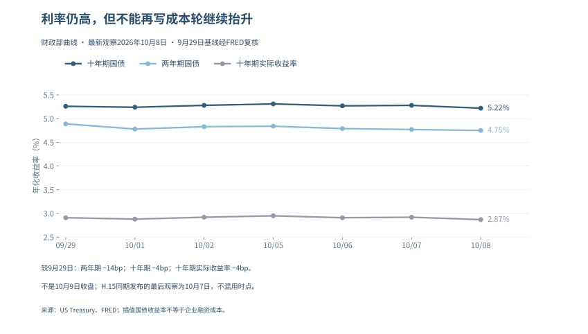

# AI泡沫研究 · 风险传导剧本

V1.5.1 · 正文修订 · 2026-10-09

## 免责声明与阅读边界

本报告为“大队长”基于公开资料形成的个人研究，不代表任何任职机构观点，不构成个性化投资建议、收益保证或交易指令。技术和商业判断可能错误，信息也可能随后修订。

V1.5.1为V1.5基础上的增量正文修订版，增量资料检索截止2026年10月9日上午；各项财务、统计、行情与政策数据以正文明确的期间或观察日为准，不能全部理解为该日现值。公司指引、研究假设和已实现结果分开阅读；缺失的原始证据不以推测填补。

本版按主题重编，不沿用旧版分页；旧版与历史档案保留不改。历史评分和预测记录只用于追溯，未完成统计校准的数字不属于经过验证的崩盘概率。审计条目总数不等于本轮全部事实复核通过。

## 本版修订说明

1. 本篇按目标读者重新组织结论和展开；更新写进相应论点，不以前置全景财报替代原正文。

2. 风险结论：同时承认需求、交付和融资兑现与资本回收约束；纠正当期利率方向，9月会议纪要不冒充10月决议。历史评分不重校准。

逐项勘误与修订见文末《本版逐项修订记录》，可从目录跳转。

2026-09-08编排勘误：本册正文从第一章起连续编号，目录和当前章节引用同步；导读不占章号。母稿对应关系见文末“分册编号勘误”，研究数据与结论未因本次编排修改。

<!-- BODY_START -->

## 风险传导剧本：不是时间预言，而是条件压力测试

### 一、风险从哪一层开始

风险可能由终端付费不及预期开始，也可能由技术改进导致旧资产经济寿命缩短开始，还可能由融资突然变贵或地缘规则改变交付开始。它们会经过不同的资产负债表，不能全部画成“某家公司股价跌了，然后整个AI行业崩盘”。

### 二、从局部问题到系统扩散的五步

第一步是可核对的经营偏离：价格、用量、客户续约或交付低于原模型。这里应保留原来的基准和统计期，不能用任何一次环比下降自动确认趋势。

第二步是现金偏离：应收、存货或未完工资产增加，经营现金与建设资金需求分离。要检查季节性、客户预付款和采购节奏，不能把增长期的正常备货直接称为坏账。

第三步是融资承压：借款价格、保证金、抵押物和担保条件恶化，股权融资的每股摊薄代价增加。单名事件只是单名事件，需观察是否跨客户、跨平台扩散。

第四步是资产调整：建设延期、订单撤销、设备转售、减值或债务重组。经济损失、会计确认与市场定价发生在不同时间，不能只按公司公告日安排整个冲击。

第五步才是广谱共振：多家公司同时受到影响，信用、融资、订单和估值出现相互强化。没有跨主体证据，不称为系统性风险已经发生。

### 三、三条中止路径

客户持续付费和成本下降，可以在经营端中止传导；企业削减可选择的建设支出、引入股权或延长债务期限，可以缓冲现金端；新用途或客户迁移，也可能提高闲置资产的再利用价值。每一种缓冲都要看代价，仍不能因为它出现就断言风险已经消失。

### 四、每一步都要留下反证

| 判断 | 应观察的支持 | 会削弱判断的事实 |
|---|---|---|
| 需求走弱 | 同口径价格、利用率或客户续约恶化 | 真实付费扩大、产品升级抵销旧产品减速 |
| 现金缺口扩大 | 回款弱而不可撤销支出继续增加 | 营运资本释放、建设节奏变得灵活 |
| 信用扩散 | 多主体融资成本或担保条件同步恶化 | 单名问题隔离，广谱融资继续可用 |
| 旧资产价值下降 | 租金下调、转售折价或减值 | 新任务需求吸收旧资产并产生正现金 |

### 五、与当前证据怎样连接

截至10月9日上午，台积电月报汇总、APLD期后交付以及SoftBank已执行股权出资，继续构成反对“需求或融资已全面断裂”的证据；APLD收入结构与集团现金桥又说明建设转运营不等于已经回本。10月8日十年期收益率5.22%，较9月29日略降，就业转弱则增加另一方向的不确定性。仍没有足够跨主体证据把整条危机剧本标为已启动。后文综合章列出来源、观察日与反证，不把融资、收入、现金或利率变化合成一个未经校准的分数。

本篇不提供看跌期权期限、加减仓比例或固定止损。投资者即使方向判断正确，也可能因杠杆、到期、流动性和路径而亏损；研究压力测试不能代替适当性和风险预算。

## 风险教育：研究观点不是交易指令

直接卖空股票可能面临理论上不封顶的亏损，保证金追缴和借券条件变化会使投资者在观点兑现前被迫退出。期权、反向和杠杆产品也有各自的期限、路径、费用与流动性风险，不能把“看对长期方向”当作收益保证。[SEC：Key Points About Regulation SHO](https://www.sec.gov/investor/pubs/regsho.htm)

这里没有读者的资产、负债、风险承受能力或适当性信息，报告本身不提供个性化投资建议，更不能用主观情景权重安排工具期限、止损或仓位。

## 第一章：把经营、资本回收与金融条件分别判断

### 1.1 六个维度，不再用红灯数量代替模型

| 维度 | 当前正文采用的判断方式 | 不能从中直接推出什么 |
|---|---|---|
| 需求与交付 | 按公司已实现收入、产品出货、订单转化及利用率核查；最新光模块半年报支持经营增长 | 全产业链所有项目满载、未来需求永久成立 |
| 盈利与现金 | 合法非经营收益与经营利润分栏，现金与营运资本逐项对账 | 非现金收益就是造假、现金暂弱就是需求崩溃 |
| 资本与信用 | 现有债务、未来承诺、租赁与担保分开，观察客户付款来源 | 把不同项目相加成“AI总债务” |
| 估值 | 预测盈利、倍数、折现率、净债务和股数有据可算 | 由行业故事直接得出精确跌幅 |
| 技术与商业化 | 任务能力、单位成本、生产部署和付费收益逐层验证 | 基准进步就是AGI、整体云收入就是AI收入 |
| 宏观与国际约束 | 按最新统计修订和生效政策判断，区分单名风险与系统扩散 | 就业行业变化可单独归因于AI、出口限制必然强化所有国产公司 |

现金回收须以企业或项目为边界，分别记录初始投资、历年经营现金、后续资本支出与残值，再对时间和风险折现。报表经营现金已包含营运资本变化，不能再扣一遍；若从税后营业利润重建企业自由现金流，才另加非现金折旧、减资本支出和营运资本增加。资本开支形成多年资产，收入来自多种业务，产业链内部销售还需抵销；一年的资本开支与某类消费者订阅收入相除，不能代替这个回收模型。

#### 当前证据怎样进入下一次判断

增量检索截止2026年10月9日上午，金额中的B为十亿美元。各行仍按注明的财季或公告日读取，不求和，也不按数量折成风险分。复查窗口为各主体下一次正式业绩或融资披露；方向变化应在随后两次可比披露中复查，并解释季节性及口径变化，不能将“连续两次”本身包装成统计检验。

| 主体与基线 | 当前能够支持的判断 | 降低担忧的证据 | 提高担忧的证据与模型动作 |
|---|---|---|---|
| 美光，FY26Q4截至9月3日：收入54.229B、经营现金43.973B、现金购建11.110B | 供应商利润有实质现金支持；客户押金另列融资，不需从经营现金再扣一次 | 价格、交付及现金在新增供给投产后仍可持续：降低对存储端回收的担忧 | 售价或交付转弱、合同重议、库存应收持续积压：下调利润与回收，不将合并现金替终端客户证明ROI |
| Akamai，9月24日公开Anthropic七年合同11.6B；预计相关建设5.5B、年内增加1.7B | 合同增强需求可见性，先期投入与后期回款仍有时间差；金额不可相加 | 按期交付并收到约定付款：缩小建设期资金缺口 | 延期、服务中断或客户付款不足：延后收入现金、增加融资与履约压力 |
| NVIDIA，FY27Q2截至7月26日：收入96.221B，经营现金24.077B；前季经营现金50.344B，应收周转由45天升至60天 | 销售强、回款时点需要单独检查；不是已确认坏账 | 新增应收按约收回，扣除税款与交付时点影响后现金改善：降低营运资本占用假设 | 反复延长账期，叠加客户融资困难或应收减值：下调可收回现金，扩大压力情景 |
| Alphabet，2026Q2：Cloud营业利润8.814B，集团经营现金39.069B、现金购建44.924B | 云经营盈利与集团单季建设占用同时存在；不能据此计算AI项目回报 | 建设增速趋缓、经营现金增长，且服务续用和盈利保持：上调现金回收 | 投入继续扩大而交付、利用或回款落后：推迟现金流、增加建设压力；不把全部差额归因AI |
| GitHub Copilot：6月转向按量计费，7月官方电话会披露收入环比增逾60% | 固定低价席位不是唯一收入来源；尚无完整利润和现金披露 | 同口径用量收入、续费与毛利改善：上调席位之外的收入和利润假设 | 增长主要来自口径变动、低留存或成本更快上升：下调单客现金贡献 |
| CoreWeave，8月DDTL 5.5：额度2.6B，贷款约5年、底层客户合同平均约3年 | 部分还款依赖续租、转租或其他资金，须做期限压力测试；并非已违约 | 后续合同净回款可覆盖剩余债务及维护投入：降低续租与残值折价 | 续租价格或利用率低于原模型，并影响偿债覆盖：下调剩余期现金及残值 |
| CoreWeave，9月17日短约及9月22日融资：新签3—6个月合同；完成4.2B可转债 | 短期算力价格及融资仍有支持，但短约收入与多年债务期限不同 | 短约到期后仍能续接，建设按期投运且净现金覆盖债务：改善流动性判断 | 续约降价、利用率下降或融资消耗快于现金生成：收紧租金、期限与稀释假设 |
| Oracle，FY27Q1截至8月31日：IaaS 7.388B、同比+121%；CapEx 28.499B、FCF −5.396B | 需求兑现；经营现金含11.363B客户预付款，同期完成19.909B ATM净募资 | RPO按期转收入和回款，后续建设由主营现金覆盖：上调回收并降低融资依赖 | 预付款、增发或新融资继续快于可支配现金，288B未起租租赁进入执行：提高期限与稀释压力 |
| Broadcom AI XPV，截至8月2日：初始35B；Backstop全部部署后最大未折现潜在责任约29B | 融资平台仍可支持扩张；风险由客户经租赁与担保转给金融伙伴和供应商 | 客户按期付租、机架残值稳定、42B条件性票据无需发行：降低或有损失 | 票据发行、租赁违约或处置折价出现：计入信用损失、残值和现金流压力 |
| 台积电，9月营收511.857十亿新台币、同比+54.6%；Q3月报相加环比+17.62% | 月度环降0.6%尚不支持季度需求断崖；合并收入不是纯AI收入 | 10月15日季度业绩、利润和现金接续强度：提高收入与现金预测依据 | 订单或利润指引转弱：按产品、客户与汇率拆解，不用单月波动直接定拐点 |
| Applied Digital，FY27Q1截至8月31日：HPC收入262.6百万美元，基础租金65.8；集团简单现金桥−2.010777B | 租赁开始兑现，建设仍重；分部收入不能与集团现金混成项目回报 | 后续投产带动可重复租金，现金增长快于维护与后续投入：改善回收 | 装修收入退坡、建设超支或客户回款迟滞：重估租金与融资需求；不凭建设期负现金判破产 |

来源：[NVIDIA CFO说明及现金披露](https://www.sec.gov/Archives/edgar/data/1045810/000104581026000073/q2fy27cfocommentary.htm)、[Alphabet Q2财报](https://s206.q4cdn.com/479360582/files/doc_financials/2026/q2/2026q2-alphabet-earnings-release.pdf)、[GitHub计费上线说明](https://github.blog/changelog/2026-06-01-updates-to-github-copilot-billing-and-plans/)、[Microsoft 7月官方电话会](https://www.microsoft.com/en-us/investor/events/fy-2026/earnings-fy-2026-q4)、[CoreWeave 8月10日贷款公告](https://investors.coreweave.com/news/news-details/2026/CoreWeave-Closes-2-6-Billion-Loan-Facility-Expanding-Financing-Flexibility-for-AI-Infrastructure/default.aspx)、[Oracle FY27Q1 10-Q](https://www.sec.gov/Archives/edgar/data/1341439/000119312526389274/orcl-20260831.htm)、[Broadcom FY26Q3 10-Q](https://investors.broadcom.com/static-files/96641754-401f-4090-a4ab-210728c83a28)。这是对已核证据的研究应用，不是新增已命中的预测记分。

### 1.2 当前合并判断与反方证据

截至2026年10月9日上午，当前判断是：**上游需求与机房交付继续兑现，新增股权资金仍能进入；资本回收压力没有因此消失，长期利率较9月底小幅回落，就业转弱又增加了宏观不确定性。现有证据仍不足以确认AI泡沫全面破裂。** 台积电Q3月报合计高于Q2，Applied Digital新增机房开始运营，是需要承认的正面证据；后者装修收入占比较高、集团建设现金缺口较大，又要求把“已交付、经常租金、累计回本”分开检查。[台积电月报](https://investor.tsmc.com/english/monthly-revenue/2026)、[Applied Digital财报](https://www.globenewswire.com/news-release/2026/10/07/3376854/0/en/applied-digital-reports-fiscal-first-quarter-2027-results.html)

10月2日BLS公布9月非农新增2.9万人、失业率4.2%；7月由+2.1万下修至−1.0万，8月由+16.2万下修至+13.3万，合计下修6.0万。本轮应以新修订替换当前宏观输入，旧初值只留在历史记录：就业动能比前版所见偏弱，不能继续只强调上次修订支持韧性；但也不能凭一个月认定衰退，更不能归因于AI。[BLS 10月2日就业报告](https://www.bls.gov/news.release/archives/empsit_10022026.htm)

9月中旬曾将宏观腿由“方向分化”上调为偏紧观察，依据是当时的通胀与利率证据：美国8月PPI环比0.4%、同比5.4%，剔除食品、能源和贸易服务后环比0.3%、同比4.7%；CPI环比0.4%、同比3.4%，核心CPI环比0.3%、同比2.4%。这是历史判断，不是10月9日再度上调；本轮新增的利率略降与就业转弱，须按下文分别纳入。[BLS 8月PPI](https://www.bls.gov/news.release/archives/ppi_09102026.htm)、[BLS 8月CPI](https://www.bls.gov/news.release/archives/cpi_09112026.htm)

美联储9月16日将联邦基金目标区间上调25个基点至3.75%—4.00%，原“等待决议”已经变为实际政策收紧；北京时间为9月17日02:00。同期经济预测中，2026年及2027年末政策利率中位数均为4.1%，2026年核心PCE通胀中位数为3.4%。预测中位数既不是承诺，也不是当前目标区间，更不能直接当作公司的融资利率。[FOMC正式决议](https://www.federalreserve.gov/newsevents/pressreleases/monetary20260916a.htm)、[9月经济预测表](https://www.federalreserve.gov/monetarypolicy/fomcprojtabl20260916.htm)

本轮较晚的市场观察来自美国财政部10月8日收益率表：两年期4.75%、十年期5.22%、十年实际收益率2.87%。相对前版9月29日4.89%、5.26%、2.91%，分别下降14、4、4个基点，不能写成“本周长端继续抬升”。10月8日发布的美联储H.15末观察仍是10月7日，三项为4.77%、5.28%、2.92%；两张官方表只是更新时间不同，不是冲突报价。[财政部名义收益率](https://home.treasury.gov/resource-center/data-chart-center/interest-rates/TextView?field_tdr_date_value_month=202610&type=daily_treasury_yield_curve)、[实际收益率](https://home.treasury.gov/resource-center/data-chart-center/interest-rates/TextView?field_tdr_date_value_month=202610&type=daily_treasury_real_yield_curve)、[H.15](https://www.federalreserve.gov/releases/h15/)

2—10年期限差由37扩大至47个基点，十年名义与实际差仍为2.35个百分点；这里记录的是曲线变化，不识别其全部原因，也不把名实差等同纯通胀预期。利率仍高于9月22日较早基线，估值压力未完全消除；企业资金成本还受信用利差、重定价日和对冲影响，不应把国债变动直接平移到所有公司的加权平均资本成本。

10月7日公布的9月15—16日FOMC纪要显示，当时多数与会者认为年内再加息可能合适，同时强调以后各次决策依赖新增资料。它记录的是9月会议判断，先于10月2日新就业报告，不能读成10月已经决定加息。纪要还描述会议时公司债发行活跃、AI大云厂利差较前次会议略收窄，这反对“当时融资已全面封闭”，但不能冒充10月9日单名信用现值。[FOMC纪要，第5、9页](https://www.federalreserve.gov/monetarypolicy/files/fomcminutes20260916.pdf)

9月30日BEA发布的8月PCE价格指数同比3.4%、环比0.3%，核心同比3.0%、环比0.2%；同一修订版本中7月两项环比均为0.1%，不能写成“全面降温”。本次年度修订追溯至2021年1月，原稿保留的7月旧初值不能直接与8月新版相减来证明通胀回落，也不能由单月数据推定后续降息。[BEA 8月个人收入与支出](https://www.bea.gov/news/2026/personal-income-and-outlays-august-2026)

信用端还要区分公开交易与许可受限的市场序列。本公开版不复载ICE BofA期权调整利差的精确点位；CoreWeave的SEC文件确认9月22日已完成4.2B可转债，比“已定价、等待交割”更进一步。扣初始购买人折扣后的所得约4.137B，再扣0.5662B capped call交易成本，余约3.5708B，尚未扣其他发行费用。新增融资缓冲近期流动性，却不是客户付费或经营利润，2.875%的现金票息也不是包含股权期权和交易成本的综合融资成本。[CoreWeave完成发行8-K](https://www.sec.gov/Archives/edgar/data/1769628/000176962826000432/crwv-20260917.htm)、[FRED许可说明](https://fred.stlouisfed.org/series/BAMLH0A0HYM2)

SoftBank已于10月1日执行对OpenAI本轮第三笔10B出资，补核后的本轮30B全部完成，是融资尚可接续的直接证据，却不是客户经营付费。它与CoreWeave9月已完成融资一道，仍不支持融资窗口全面关闭；就业转弱和高利率值得提高警惕，但多主体信用、订单与现金同步恶化尚缺充分证据，本轮不新增C“宏观共振”或严格信用触发。[SoftBank执行公告](https://group.softbank/en/news/press/20261001)

反方证据必须保留在正文：如果未来两个季度，投入与折旧的增速趋缓、客户持续付费、同口径现金创造改善，原先对资本回收的谨慎判断就应下调。不能把盈利强解释为“泡沫继续加码”、盈利弱解释为“泡沫证实”，让同一个假说对任何结果都成立。

### 1.3 情景定义与既有分数的使用边界

| 情景 | 研究含义 | 应出现的观察 | 与其他情景的区别 |
|---|---|---|---|
| A 渐进幻灭 | 回报低于乐观定价，投资调整与估值消化分阶段发生 | 增速回落、盈利预测或倍数下修，未必出现系统违约 | 不是软着陆的同义词 |
| B 技术颠覆 | 架构或成本变化重新分配产业利润 | 相同任务更低成本、客户迁移、供应商定价变化 | 可利好应用、利空部分硬件；不全是看空 |
| C 宏观共振 | 经营压力叠加融资或宏观收缩 | 多类信用、融资与订单同步恶化 | 不能仅靠一次股价回撤确认 |
| D 软着陆 | 收入与效率吸收前期投入，资本开支有序调整 | 回收改善、客户续用、融资无需恶化 | 不需要所有股票上涨 |

V1.4保留的78/100与A45/B22/C10/D23，是研究者既有评分与情景分配，不是统计模型估出的概率。本次正文纠偏没有重新完成权重校准，不能给换版虚构新的分数；它们作为既有研究假设留档，不再放在每篇分项报告封面上充当本篇结论。由于情景并非天然互斥，B还有双向影响，A+B+C=77%也不能被称为“崩盘概率77%”。

六维看板、情景权重和固定事件记分承担不同任务。前者是检查框架，情景用于讨论可能路径，固定记分用于复核事前条件；三者不能未经建模就互相换算，更不能由“两个灯亮”直接给出交易动作。

### 1.4 原判断怎样结算，怎样纠错

六条E判断仍按原事件和原阈值登记，原件不倒改。本轮修正了光模块判断的待核原因：两家公司正式半年报已经披露，缺的是原预告事件与对应价格窗口的完整证据，不是缺半年报。既有记录为五条按原阈值成立、一条部分验证；这个汇总是历史规则的结果，不是六个独立概率样本，更不是研究者长期胜率。

T-V14-03的事前条件是NVIDIA数据中心收入同比低于25%，本期财报核查应按这一条件结算，不应改成早期正文另写的50%。信用事件确认、私募轮次定价和经营增速也应分别使用自己的事件ID。已经发生的信用事件被用于建立规则时，只能是基准状态，不能包装成规则建立后的预测命中。

### 1.5 还缺哪些能够推翻本报告的证据

目前最关键的缺口，是终端客户为AI持续支付多少钱、单位任务成本下降后谁保留利润，以及多年资本承诺怎样与可获得的经营现金对上。公开分部披露不足时，应保留缺口；不能拿整个云或广告收入填满，也不能把缺披露自动判定成亏损。

台积电9月营收已于10月8日公布，511.857十亿新台币、同比+54.6%、环比−0.6%；Q3三个月相加为1,494.243十亿新台币、较Q2月报合计+17.62%，不是已经公布的完整季报。10月15日14:00北京时间Q3电话会仍待验证毛利、现金及资本支出。三星初步合并利润尚待正式分部与现金表，美光下一季指引也不预先算作兑现。[台积电月报](https://investor.tsmc.com/english/monthly-revenue/2026)、[官方日历](https://investor.tsmc.com/english/financial-calendar)、[三星初步估计](https://news.samsung.com/global/samsung-electronics-announces-earnings-guidance-for-third-quarter-2026)

后续继续核对CoreWeave短约续接与资金消耗、Oracle预付款和未起租租赁上表、Broadcom XPV租赁付款及条件性票据状态。模型价格下降和推理效率提高，应先进入成功任务成本与旧资产租价，再验证客户用量能否抵消价格压力；不能直接折算成全行业收入或毛利变化。每项只改变对应模型输入，不把事件数量折成概率。

## 本版逐项修订记录

### 分册编号勘误 · 2026-09-08

按本册实际收录顺序重排章节，正文目录、网页锚点和PDF书签由同一正文重建；未收录主题改用报告名称指引，不再假设读者手里有母稿。

| 全景母稿位置 | 本册位置 |
|---|---|
| 第八部分（8.x） | 第一章（1.x） |

下列历史修订记录的当前落点已换成本册编号；带“原”“母稿”或描述已删除指引的旧号仍用于追溯。此次只修改编排与定位文字，不重算数据、不改变结论，也不改写冻结记录。

以下保留所选章节的V1.5基础修订记录，并将本轮变更标为V1.5.1；每条对应正文纠错或证据更新。

### 风险与综合结论：逐项修订

V1.5.1（10月9日），1.1—1.2：加入台积电季度月报汇总、Applied Digital租金与建设现金、SoftBank已执行出资；综合判断由“长端继续抬升”接续为“高位小幅回落，就业转弱，需求与交付仍兑现”，不新增系统性触发。

V1.5.1（10月9日），8.2：用9月就业及7—8月新修订替换当前宏观输入；区分10月8日财政部观察、只到10月7日的H.15及记录9月会议的FOMC纪要。

V1.5.1（10月9日），8.5：结转台积电9月营收节点，保留10月15日季报为未来验证；E原窗口、历史权重与触发阈值不倒改。

V1.5.1（10月1日），1.1—1.2：新增美光强经营现金与Akamai先建设后回款的双向证据；H.15接至9月29日并更新图表，PCE保留同比、环比与修订版本边界。合并结论不再只强调融资接续，明确承认存储端现金改善。

V1.5.1（10月1日），8.5：美光正式值与下一季指引分开；下一轮观察转向台积电营收与Q3电话会。没有重估历史分数、改写E判断或宣布系统性触发。

V1.5.1（9月24日），1.1—1.2：补入CoreWeave短约与已完成可转债；FOMC待公布改为加息实际值，政策区间、预测中位数和市场收益率分别列示，新增利率观察图。结论调整为需求与融资仍可接续、资金门槛抬高，但不新增系统性危机触发，不重新包装78分和情景权重。

V1.5.1（9月24日），8.5：用已确认的美光电话会替换过期日历，增加短约续接、模型定价与现金回收的复查条件。

风险教育：删除带有具体期限与止损安排的工具建议，保留一般风险原理及SEC出处。

1.1—1.2：替换旧六灯快照；撤销跨周期、跨口径“6倍脱节”的确定性结论，采用已公布就业修订和有日期的信用观察。

1.3：统一情景名称；把78分及既有权重限定为未重新校准的研究假设，撤销“77%就是崩盘概率”的表述。

1.4—1.5：更正E判断2待核原因、固定触发阈值和基准事件的时间纪律；说明真正可能证伪报告的证据。

V1.5.1，1.1—1.2：将NVIDIA回款、Alphabet建设现金、GitHub计费和CoreWeave期限差四项既有核验证据接入当前判断、复查窗口及正反模型动作；不同公司、期间和业务边界分别列明，不将观察矩阵换成概率。

V1.5.1，1.1与1.5：现金回收方法和下轮日历直接写在本篇，删除独立风险版本未必收录的第三、第六部分指引；保留1.3既有评分边界及1.4原判断原文，不修改E冻结规则。

V1.5.1（9月15日证据更新）：台积电、Oracle和Broadcom分别补入需求、资金桥与风险转移证据；PPI、CPI、国债收益率及融资定价、签约和到账状态更新至各自最新可核日期。宏观腿升为偏紧观察，但公开证据不能确认融资全面关闭；许可受限的分层信用精确值不在公开版复载。故78/100、A45/B22/C10/D23、严格1/3与广义2/3均不变。
