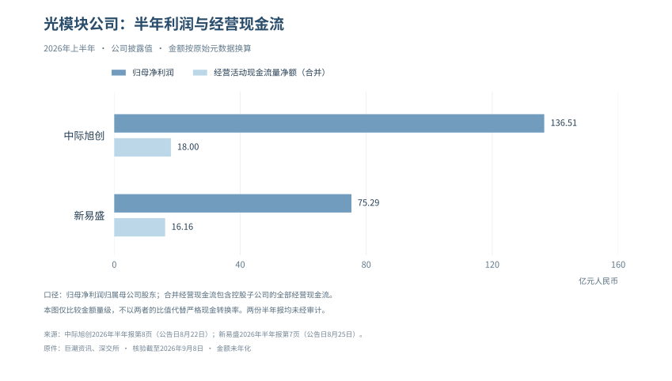

# 利润真实性拆解

V1.5 · 正文修订 · 2026-09-08

## 免责声明与阅读边界

本报告为“大队长”基于公开资料形成的个人研究，不代表任何任职机构观点，不构成个性化投资建议、收益保证或交易指令。技术和商业判断可能错误，信息也可能随后修订。

V1.5为正文修订版，资料检索截止2026年9月8日；各项财务、统计、行情与政策数据以正文明确的期间或观察日为准，不能全部理解为该日现值。公司指引、研究假设和已实现结果分开阅读；缺失的原始证据不以推测填补。

本版按主题重编，不沿用旧版分页；旧版与原投递件保留不改。历史评分和预测记录只用于追溯，未完成统计校准的数字不属于经过验证的崩盘概率。审计条目总数不等于本轮全部事实复核通过。

## 本版修订说明

1. 利润篇：按财季重建经营与投资收益、现金流、折旧和租赁；纠正把非现金收益等同虚假利润的表述。

逐项勘误与修订见文末《本版逐项修订记录》，可从目录跳转。

<!-- BODY_START -->

## 第一部分：哪些是真金白银，哪些是估值游戏？

> V1.5 正文修订｜事实核验截至2026-09-08，北京时间。公司数据按各自财季列示，金额无特别说明均为十亿美元；季度财务报表未经审计，Microsoft全年数据来自已审计10-K。本篇讨论盈利的来源、可持续性与现金转化，不把会计估计或投资收益本身认定为舞弊。

### 本篇内容地图与逻辑链

Alphabet第二季度的稀释每股收益是9.11美元，其中股权证券收益的税后贡献为6.26美元；与此同时，Google Cloud收入与营业利润仍在快速增长。Amazon也同时呈现AWS经营改善和投资重估拉高净利润。仅看净利润，会高估经营改善；把重估全部剔除后说“没有真需求”，又会漏掉已经实现的云业务增长。

本篇沿着一笔收入走到现金：先辨认客户支付的是什么，再把营业利润、持仓收益与税项分开，随后检查回款、资本开支和租赁，最后问新投入能否在设备失去经济竞争力前赚回成本。当前证据支持“经营兑现与资本回收压力并存”，不支持“五家公司利润都不真实”，也不支持“高增长足以证明任何建设成本都合理”。

| 阅读位置 | 要回答的问题 | 不能偷换的口径 |
|---|---|---|
| 1.1—1.2 | 哪些经营已兑现，利润如何进入现金？ | 非经营收益不等于假利润，现金支出不等于当期费用 |
| 1.3 | NVIDIA的客户和回款发生了什么变化？ | 直接客户、最终客户、应收集中度分开 |
| 1.4—1.5 | 公司好与投资回报好之间差在哪里？ | 估值时点、历史案例与预测概率分开 |
| 1.6—1.8 | 下一次财报应怎样推翻或加强判断？ | 观察规则不冒充统计模型，风险不等于交易指令 |

### 1.1 五大巨头：经营兑现与现金回收分开判断

本版撤下旧的“真实性星级”。没有统一权重和可复算评分，给公司打两星或四星会制造精确感；更有用的是把已经确认的经营、还未收回的现金以及需要解释的会计项目放在同一张表里。

| 公司与统计期 | 已确认的经营 | 本篇重点核查 | 当前判断 |
|---|---|---|---|
| NVIDIA，FY27Q2，截至7/26 | 收入96.221，数据中心89.023；GAAP毛利率75.0% | 经营现金24.077，低于前季50.344；应收周转天数由45天升至60天 | 需求和利润强，回款节奏与支持客户的安排需跟踪 |
| Microsoft，FY26Q4，截至6/30 | 收入90.007，营业利润40.603；Azure及其他云服务收入增43% | 经营现金55.441，现金购置固定资产35.802 | 现金仍厚，不能用OpenAI投资关系否定整个云业务 |
| Alphabet，2026Q2 | Cloud收入24.768、营业利润8.814 | 股权证券收益税前99.031；单季自由现金流−5.855 | 经营和持仓收益均真实入账，但估值不能混用 |
| Amazon，2026Q2 | AWS收入42.232、营业利润16.621 | 当季非经营税前收益53.415；截至6/30过去12个月FCF−7.604 | AWS增长成立，合并净利润和现金回收需分别解释 |
| Meta，2026Q2 | 收入60.801，其中广告59.363 | 经营现金31.862，现金固定资产购置30.116、融资租赁本金0.962 | 广告付费真实，新增投入几乎用尽当季经营现金 |

资料：[NVIDIA CFO说明](https://www.sec.gov/Archives/edgar/data/1045810/000104581026000073/q2fy27cfocommentary.htm)、[Microsoft财报](https://www.microsoft.com/en-us/Investor/earnings/FY-2026-Q4/press-release-webcast)、[Alphabet财报](https://s206.q4cdn.com/479360582/files/doc_financials/2026/q2/2026q2-alphabet-earnings-release.pdf)、[Amazon财报](https://ir.aboutamazon.com/news-release/news-release-details/2026/Amazon-com-Announces-Second-Quarter-Results/default.aspx)、[Meta财报](https://investor.atmeta.com/investor-news/press-release-details/2026/Meta-Reports-Second-Quarter-2026-Results/default.aspx)。这不是同期间排名：NVIDIA季度终点不同，Amazon所列FCF为滚动12个月。

### 1.2 从账面利润到可支配现金

#### 1.2.1 持仓重估：单列，不把“非现金”写成“不真实”

持有的股权升值可以按照适用准则进入损益，这一收益有经济含义，但它既不是售出云服务的收入，也不一定在当季变成现金。对投资者的直接影响是：使用含巨额重估的每股收益计算市盈率，可能得到看似便宜、实际不可持续的倍数。

Alphabet官方披露，Q2股权证券收益净额99.031，税后使净利润增加约77.1，每股收益增加6.26。因此9.11减6.26约为2.85美元，这是“只剔除该项影响后的EPS”，并非公司提供的纯经营EPS，更不是已剔净全部一次性项目的标准化盈利。该证券收益也不能全部指认为Anthropic；公司资产组合还包括其他上市及非上市投资，逐项归因要以附注为准。[Alphabet财报附表第9页](https://s206.q4cdn.com/479360582/files/doc_financials/2026/q2/2026q2-alphabet-earnings-release.pdf)

Amazon的Q2净利润62.647与非经营税前收益53.415不能直接相减得到税后“真实净利润”。10-Q进一步列出，私营股权可观察价格上调约50.5，主要涉及Anthropic；估值考虑证券权利、流动性事件时间、其他证券类别以及缺乏流动性折价，并不是“最新估值×固定持股比例”。本版据此撤回旧文对后续三个季度重估收益和净利润占比的线性外推。[Amazon Q2 10-Q，投资附注](https://www.sec.gov/Archives/edgar/data/1018724/000101872426000026/amzn-20260630.htm)

Microsoft也需要做同样拆分。公司Q4非GAAP净利润调整只排除了OpenAI投资的0.480税后收益，但业绩稿另提示当季存在Anthropic投资收益3.2。因此“公司非GAAP”不能自动等同于“已剔除所有投资收益”。NVIDIA当季股权证券净收益约7.8，同样要与GPU经营利润分开看。对所有公司执行相同规则，才能避免只挑支持泡沫判断的项目。

用于比较的利润桥应写成：

> GAAP净利润 − 已披露的税后非经营收益 + 已披露的税后非经营损失 ± 其他明确调整 = 研究口径调整后净利润。

若只拿到税前项目，保留税前利润桥；不以统一21%税率替公司补出“实际税后值”。投资盈利能否重复、能否兑现、能否分配是三个不同问题。即使下一轮融资继续涨价，也不能把未实现持仓收益赋予云服务收入同样的估值倍数。

#### 1.2.2 折旧：会计寿命与经济寿命之间的差距

GPU可以继续开机，并不代表它还能按原租价获得客户。反过来，新一代芯片出现，也不代表旧设备马上归零；旧GPU可能转向价格敏感的推理、内部研发或较低负载任务。检验折旧的对象，应当是特定资产组的可赚取现金，而不是笼统地宣布“GPU都只能用三年”。

原文把服务器、网络设备与数据中心建筑混成统一寿命，并用“延长折旧虚增利润”作结论，措辞超过了证据。不同公司设备构成、部署批次和残值判断不同；会计估计变更通常影响未来费用分摊，只有出现违背准则、错误估计或重大减值证据，才进一步判断其是否错报。旧版关于某公司全年“虚增29亿美元”及全行业“少提1760亿美元”的外部测算，不再冒充已审计事实。

在现有财报上，先检查四件事：固定资产新增何时转为可使用，折旧是否随投产增加，闲置或提前退役是否减值，以及租赁资产和自建资产是否被放在不同费用项目。公司会计政策及未来变更须在原附注逐项核对，不用一张多年旧表替代当前政策。[Microsoft FY2026 10-K](https://www.sec.gov/Archives/edgar/data/789019/000119312526323660/msft-20260630.htm)、[Meta Q2 10-Q](https://www.sec.gov/Archives/edgar/data/1326801/000162828026050705/meta-20260630.htm)

一个可复算的敏感性例子：假设某批设备可折旧基础60亿美元、残值为零，直线法6年折旧每年10亿美元；若经济寿命只有3年，每年经济耗损相当于20亿美元。两种假设相差10亿美元税前费用，但这只是同一设备组、全年在用的演示。不能用全公司固定资产乘这个差额，也不能把它记成某家公司实际少提折旧。

现金流也不能完全解决这个问题。折旧虽在经营现金流中加回，设备最终仍需替换；评价长久期项目应另估维持性资本开支，不能把“经营现金为正”当作“设备全生命周期已经回本”。

#### 1.2.3 自由现金流：先统一计算，再谈压力

| 公司 | 统计期 | 经营现金流 | 扣减项目 | FCF或可比计算 | 口径边界 |
|---|---|---:|---:|---:|---|
| Alphabet | 2026Q2 | 39.069 | 现金固定资产购置44.924 | −5.855 | 公司定义；TTM仍为+53.273，不能把单季转负说成全年无现金 |
| Microsoft | FY26Q4 | 55.441 | 现金固定资产购置35.802 | +19.639 | 本表现金桥；不是“总CapEx约41”再额外扣一遍租赁新增 |
| Meta | 2026Q2 | 31.862 | 固定资产30.116+融资租赁本金0.962 | +0.784 | 公司定义，已包含该租赁本金 |
| NVIDIA | FY27Q2 | 24.077 | 固定资产及无形资产2.677+相关本金0.059 | +21.341 | 公司定义，不能仅用PP&E现金购置替代全部扣项 |
| Amazon | 截至6/30的TTM | 161.403 | 净现金购置固定资产169.007 | −7.604 | 公司主FCF，未在这一行额外扣融资租赁本金 |

这些数据来自上列各公司财报现金流及非GAAP调节表；算术分别为39.069−44.924、55.441−35.802、31.862−30.116−0.962、24.077−2.677−0.059、161.403−169.007。不得把季度列与TTM列相加得到“行业FCF”。

本版同时更正旧推理：“CapEx大于FCF”并不自动表示需要外部融资，因为FCF已经扣过CapEx。应比较经营现金能否覆盖现金CapEx，再看现金余额、债务到期、股息回购、股权投资和租赁还本。即使FCF为正，大额投资和偿债也可能带来融资需求；即使单季为负，也可能由既有现金余额覆盖。

Amazon最能说明这个区别：AWS收入和分部利润显著增长，但合并口径建设付款更快，导致滚动FCF转负。这里既不能说AWS利润“依赖Anthropic重估”，也不能用AWS利润率替整个AI建设项目算回报。零售物流、其他技术基础设施和服务采购都在合并报表中，纯AI回报需要更细的资本和利润归属。

#### 1.2.4 利润高增而现金没有同步：光模块的现实检验

两家A股光模块公司的半年报，把“需求真实但要查现金”落到了可核对的账上。金额单位在本小节改为人民币亿元，统计期均为2026年1—6月，半年报未经审计。

| 公司 | 归母净利润 | 同比 | 经营活动现金流量净额 | 同比 | 现金购建长期资产 |
|---|---:|---:|---:|---:|---:|
| 中际旭创 | 136.51 | +241.70% | 18.00 | −44.08% | 48.02 |
| 新易盛 | 75.29 | +90.98% | 16.16 | +69.67% | 12.64 |

资料：[中际旭创8/22半年报，第8、60页](https://static.cninfo.com.cn/finalpage/2026-08-22/1225491753.PDF)、[新易盛8/25半年报，第7、44页](https://static.cninfo.com.cn/finalpage/2026-08-25/1225499406.PDF)。归母利润与合并经营现金并非完全一致的权益归属口径，表中仅比较量级，不将两者相除标成严格的现金转化率。

中际旭创利润增长没有在同期等比例变成现金，需继续跟踪存货、应收项目与供应商付款；新易盛经营现金同比上升，也不表示每笔订单均已回款。这些差异可能来自交付增长带来的营运资金占用、备货和结算节奏，不能仅由半年CFO较小推出虚假收入。

若按“经营现金−现金购建长期资产”做简单资金桥，中际旭创约−30.02亿元、新易盛约+3.53亿元。它们不是估值模型中的FCFF，也未扣除所有融资与投资支出；用途只是找出需要下一期报表解释的资金差额。原先依靠业绩预告的事前判断，应另按事前条件结算，半年报补齐不能倒写成预告节点命中。

### 1.3 英伟达的“真客户”分类

#### 1.3.1 先区分三种客户

直接向NVIDIA下单的客户可能是云厂，也可能是整机商、分销商或系统集成商；最终使用GPU的客户可能经多家云采购算力，资金提供者又可能是这些企业的投资人。三者不是同一张名单。把匿名直接客户按猜测填成微软、Meta、Amazon和Google，既放大精确感，也会错算穿透集中度。

最新10-Q披露FY27Q2有一个直接客户占总收入16%，上半年有三个直接客户分别占16%、15%、13%。上年同期“两家占39%”不再是当前季度值。期末应收的五大直接客户分别占22%、14%、13%、11%、10%，这是应收余额占比，也不能当成收入占比。公司还说明一个AI研究与部署企业通过购买其客户的云服务，对NVIDIA收入有重要贡献，但没有提供可直接计算的穿透占比。[NVIDIA Q2 10-Q，客户集中度及信用风险附注](https://www.sec.gov/Archives/edgar/data/1045810/000104581026000075/nvda-20260726.htm)

#### 1.3.2 现金垫仍在，但已不是只看Q1的故事

Q2收入环比增18%，经营现金却由50.344降至24.077，DSO从45天升至60天；公司解释与对部分投资级大客户延长付款期限、营运资金及现金税款有关。这里值得跟踪的是新增应收何时收回，而不是仅用“投资级”标签忽略账期，也不是一看到DSO增加就宣布坏账。

下一期应同时检验收入、回款和客户支持安排：应收增长若主要因为可解释的大型合同交付，后续能按期收款，则当前担忧会减轻；若反复延长账期，并伴随客户再融资困难、合同变更或应收减值，才构成更强的信用证据。分析中还应剔除季度末交付集中、税款支付和库存准备的影响。

#### 1.3.3 从卖设备到承担部分下游风险

GPU销售完成并确认收入，不能说明供应商此后没有风险。NVIDIA同时向部分客户提供股权资金、云服务承诺及建设担保，第二部分逐项核对法律状态；这些安排能帮助客户交付，也使供应商暴露于客户的再融资和终端需求。风险取决于合同期限、担保触发和第三方承接能力，不取决于给所有相关收入打一个统一“循环折扣”。

一个反证也要保留：博通9/2发布的FY26Q3业绩中，AI半导体收入16.7、同比增长221%，合并FCF13.665。这说明供应链确有收入和现金同时兑现的环节，不能把行业描述成纯粹的账面循环；但博通合并口径含基础设施软件，也不是云厂AI项目回报率。[博通官方财报](https://investors.broadcom.com/news-releases/news-release-details/broadcom-inc-announces-third-quarter-fiscal-year-2026-financial)

### 1.4 估值层面：现在贵不贵？

本版不再把2026年5月的CAPE、个股PE或集中度列为9月8日现价。没有同一交易时点的价格、最新股本及一致的盈利预测，不能据旧数给出“现在便宜/昂贵”的精确结论。

对重估收益较大的公司，先用分部营业利润和经营现金检验核心业务，再把投资资产单独估值；对高投入云厂，检查建设项目何时投产、收入如何爬坡、成熟期维持性资本开支是多少。只把当期负FCF永久化会低估增长资产，只把远期利润率套上今天投入又会高估项目。

| 估值对象 | 较合适的起点 | 需要另做的检查 |
|---|---|---|
| 广告、订阅等成熟业务 | 正常化营业利润、现金流 | AI效率收益与新增运营成本是否同时计入 |
| 云与AI基础设施 | 分部利润、投入资本及分阶段现金流 | 新旧资产组、投产率、利用率、资本化费用、租赁 |
| 持有的非上市股权 | 证券类别、交易价格与披露账面值 | 稀释、流动性折价、税与可出售限制 |
| GPU供应商 | 正常化盈利与经营现金 | 周期峰值利润、应收、库存及对客户的支持义务 |

“好公司不等于好股票”仍是本报告保留的判断，但它需要价格和现金流共同支持，不是一张历史崩盘图就能证明。相同增长预期下，估值越依赖多年后的现金，折现率和终局竞争格局的误差越重要。

### 1.5 六大历史泡沫横向对比

#### 1.5.1 横向对比表：比较机制，不平均跌幅

历史案例用于提出问题，不用于从六个样本估计AI崩盘概率。原表混用公司股价和市场指数、局部低点和长期低点、价格恢复和投资总回报，平均“跌79%”没有可比性，本版撤下。

| 案例 | 可借鉴的机制 | 不能直接套到AI的部分 |
|---|---|---|
| 南海公司，1720 | 债转股、融资叙事和投资人信心互相加强 | 不能说完全没有业务，更不能由其股价路径推算AI价格 |
| 英国铁路，1840年代 | 建设付款先行，收入爬坡慢；重复建设和竞争侵蚀回报 | 铁路寿命、监管和融资条件与GPU项目不同 |
| 美国，1929—1932 | 保证金和信贷收缩放大资产价格下跌 | 宏观萧条及银行危机不能简化为股市一天造成 |
| 日本，1980年代末 | 抵押品价格、信贷供给与企业资产负债表相互作用 | 土地、银行与人口结构不等于美国云计算行业 |
| 互联网与电信，2000年前后 | 订单预期失真、库存积压、供应商与客户同周期 | 当年盈利公司与亏损初创必须分别比较 |
| 次贷，2007—2009 | 风险转移未必减少总风险，期限和流动性错配会传染 | AI股权投资不等于住房按揭或多层结构化债权 |

#### 1.5.2 南海泡沫：融资能力不是商业回报

南海公司的债转股安排与贸易叙事共同支撑股价，但旧文称其“从未进行实质贸易”不准确。英格兰银行档案明确记录了公司的奴隶贸易活动；历史上存在业务，不意味着业务现金能解释当时估值。这个区别恰好适用于AI：研究者需要追问外部客户愿意付多少钱，而不是在“有业务”与“纯骗局”之间二选一。[英格兰银行档案](https://www.bankofengland.co.uk/CalmView/Record.aspx?id=DS%2FUK%2F633&pos=7&src=CalmView.Persons)

本版不再使用流传的牛顿名言、若干轶事或未经同源核对的个体损失作为推理依据。对于当前项目，应把融资额、投资者权利和可分配现金分别登记；融资成功证明资本愿意承受风险，不能直接证明项目净现值为正。

#### 1.5.3 铁路狂热：正确的技术方向也会遇到错误的资本预算

铁路案例保留的重点是现金时序：线路立项、征地和施工先消耗资金，客货流量在通车后才逐步形成；预测越乐观，越容易在多个相近市场重复建设。技术改变社会，与早期投资人获得足够回报，是两件事。Odlyzko的研究还强调需求预测、会计分析和资本市场认知的重要性，适合用来校验建设叙事，而非拿一个旧跌幅机械套到GPU。[Odlyzko铁路狂热研究目录](https://www-users.cse.umn.edu/~odlyzko/doc/bubbles.html)

AI的差异在于设备更新更快、网络互联和电力约束更复杂；机房建筑可能长期使用，具体加速器却可能很快失去单位成本优势。因此模型至少要拆出土建、电力、冷却、服务器和网络设备，不用一个统一寿命代表整个数据中心。

#### 1.5.4 1929：区分估值损失与融资失灵

美联储历史资料记录，道指从1929年9月高点至1932年7月累计跌约89%，价格指数直到1954年才回到旧高点。这个恢复时间不包含股息再投资，也不是通胀调整后的真实购买力回本年限。[美联储历史资料](https://www.federalreservehistory.org/essays/stock-market-crash-of-1929)

对AI更有用的问题是：价格下降时，谁会被要求追加抵押品，谁必须在短期还债，谁可以等待经营恢复。强现金巨头和高负债算力租赁商不该置于同一个风险桶。但也不能反过来说“大公司有现金，所以全系统不可能出风险”；信用敞口可能集中在项目公司、租赁、银行或私人信贷基金。

#### 1.5.5 日本泡沫：资产负债表修复为何拖慢投资

日本央行相关研究把银行对房地产放贷、土地抵押价值和股票价格的共同变化纳入分析，说明资产涨价会反过来扩张融资能力，价格回落后则压缩借款与投资。[日本央行研究](https://www.imes.boj.or.jp/research/abstracts/english/me14-1-6.html)

AI产业可借鉴的是抵押品和现金流之间的反馈，而非“必然失去三十年”。若GPU残值下调导致授信收缩，算力运营商可能减少采购、压低供货商订单；如果它们已经锁定长期客户且不靠短期续贷，反馈就可能较弱。需要合同数据才能区分。

#### 1.5.6 互联网：订单、库存与收入之间可以突然脱节

Cisco在2001财年因需求急降确认约22亿美元额外库存费用，2002年报保留了这一记录。这比“公司股价25年永不回本”的过期说法更适合用于研究：当供应链以强需求为依据备货，而客户突然削减订单，损失会先表现为存货和采购承诺调整，不一定先表现在过去一季的毛利率。[Cisco 2002年报](https://www.cisco.com/c/dam/en_us/about/ac49/ac20/downloads/annualreport/ar2002/pdf/AR.pdf)

Pets.com和Webvan仍可作商业模式与前置建设的历史参照，但不再用未经重核的IPO天数、仓库成本和亏损绝对额给当前实验室排“危险程度”。编程订阅与电商履约的成本结构不同；比烧钱总额更有效的是每单位业务的收入、服务成本、获客支出和留存。

#### 1.5.7 次贷：转移风险与消灭风险不是一回事

美联储对次贷危机的回顾强调，住房相关资产损失、金融机构承压和信用收缩相互传导。对本轮AI而言，股权出资、项目贷款、租赁与担保可以重新分配风险，但不能只看某一家公司的表内债务减少，就宣布整个网络去杠杆。[美联储次贷危机回顾](https://www.federalreservehistory.org/essays/subprime-mortgage-crisis)

类比也有边界。基础设施贷款的抵押物、借款人、期限与证券化结构必须逐笔查证；没有证据表明某一项目复制了次贷的杠杆层级时，不把“表外”当作“金融危机已重演”。

#### 1.5.8 横向扩展：历史对照落到当前的检查表

| 维度 | 本轮需要的数据 | 哪种证据会加强担忧 | 哪种证据会缓解担忧 |
|---|---|---|---|
| 终端需求 | 付费、留存、实际用量与客户集中度 | 用量减速且客户依赖融资补贴 | 外部客户扩散、价格与用量共同支持收入 |
| 资本时序 | 投产批次、建设付款、延期与取消条款 | 付款不可推迟而收入持续后移 | 可分期建设，已投产资产回款好 |
| 设备残值 | 利用率、租价、转用途、减值 | 租价下降快于成本，续租不畅 | 老设备仍可获得正的增量现金贡献 |
| 融资 | 债务到期、担保、抵押与授信 | 账期延长、抵押折价、再融资成本升 | 合同期覆盖债务且外部资金分散 |

#### 1.5.9 三种调整路径：不是统一的崩盘时间表

融资先出问题时，即便需求仍在，资金不足也可能阻断建设和交付。盈利先落后时，企业可以继续经营，但估值随回报预期下降。技术效率或架构改变时，一些资产回报受损，另一些应用或供应商可能获益。这三条路径可能交叉，不能归纳成“已涵盖所有泡沫”的定律。

本版撤下以物理守恒、熵增或六个历史案例推导“崩盘必然发生”的段落。市值变化并非所有买卖参与者之间的严格零和结算，企业还能创造利润、分红或毁损资本；物理比喻不能替代现金流模型。

#### 1.5.10 AI与2000年的差异：缓冲与风险同时存在

当下大型平台拥有成熟广告、订阅和软件业务，能够把这些现金投入新业务，这是其缓冲。另一方面，客户支持已从股权出资延伸到长期承诺与担保，风险并未因当期盈利较强而消失。两者应放在同一个资产负债表分析中。

本版不再声明“2027年才是首个验证窗口”。2026年已有收入、现金、融资、应收和资产投入可供验证；未来投产和续租还有自己的窗口。研究需要按数据发生时间逐项结算，不能不断把判断推迟到更远年份。

#### 1.5.11 AI与铁路的相似：同一座设施也要分层估值

土地和机房可以使用较长时间，GPU与网络设备需要持续更新，软件及模型投入又有不同的费用化方式。把整个项目当铁路，会低估技术替代；把整个项目当三年报废的GPU，又会高估土建和电力资产的损耗。

因此保留原报告“方向正确不保证投资回报”的核心，但把检验落到资产组：建设资本由谁承担，客户合同覆盖哪些年份，期满后谁接盘，设备升级需要多少钱，最先亏损的是股东、债权人还是供应商。第二部分沿这条线检查循环投资安排。

### 1.6 下一次财报：怎样把现金桥补完整

本节补齐旧版1.5直接跳到1.7的编号缺口，给出可持续更新的底表要求。每家公司应保留至少连续四季同口径数据；短期波动不直接升级为趋势。

| 检查项 | 本轮已有观察 | 下一次必须补的证据 |
|---|---|---|
| 营业利润→净利润 | Alphabet、Amazon存在大额重估 | 投资类别、税后影响、已实现/未实现变化 |
| 净利润→经营现金 | NVIDIA回款节奏放慢；光模块利润与现金差距大 | 应收账龄、存货、预付款、应付与税项现金桥 |
| 经营现金→可支配现金 | 平台建设支出显著吸收经营现金 | 现金固定资产、租赁本金、股权投资和债务到期分列 |
| 本期投入→远期回报 | 尚缺纯AI项目组的完整回报表 | 项目投产率、利用率、租价、维持性投入和终端付费 |

### 1.7 反方路径表——本报告最可能错在哪里

| 反方证据 | 对本篇判断的影响 | 使用限制 |
|---|---|---|
| 云与AI收入高增，同时经营现金和资本回报连续改善 | 弱化“资本投入可能无法充分回收”的担忧 | 不能只看公司自报run-rate；要有同口径实现收入与现金 |
| 客户来源扩散，应收账期回落且没有减值 | 弱化集中度和融资支持依赖 | 直接客户变多，不自动代表最终资金来源更分散 |
| 老设备持续取得正现金贡献，退役与减值在原预算内 | 支持较长经济寿命假设 | 不等于所有资产都可用同一折旧寿命 |
| 新项目阶段性投入可调整，成熟业务现金覆盖建设与还本 | 降低外部融资断裂风险 | 不同公司分别判断，不用行业总额替代 |
| 应用付费持续增长且服务成本增速低于收入 | 支持商业化兑现快于原设想 | 宏观就业变化不能直接证明AI替代率或客户ROI |

旧版“任意两条/三条成立就自动改概率”的规则既自相矛盾，也没有统计校准，本版撤下。上述是研究重估条件；如何影响全报告情景权重，需要另记录证据和判断，不能由本篇自行补猜分数。

### 1.8 我可能错在哪里

本篇最主要的识别困难，是无法从合并财报完整分离纯AI投入及其利润。现金CapEx、云租赁、研发费用和预付算力分散在不同科目，投资回报很可能被低估或高估；模型必须公开分配假设，而不是给“AI资本开支”一个看似精确的总量。

持仓重估可以连续出现，剔除它有利于观察核心业务，却不能否认这部分资产本身有价值。估值时若已经将投资资产单列，再把其收益资本化进主营价值，就会重复计算；反过来全数忽略也会低估公司资产。

现金流的单季变化还受税款、营运资金和交付时点影响。当前最稳妥的结论是：需求与营业利润已获得多家公司支持，而利润能否持续转成足够现金、覆盖长周期投入与客户支持义务，尚需逐季验证。它不是“需求已崩”的结论，也不是全面减仓或做空AI资产的执行信号。

## 本版逐项修订记录

这里只列本报告实际采用章节的修订；每条对应原文纠错或证据更新，不是全景财报前言。

### 利润真实性拆解：逐项修订

1. 将1.1—1.3旧Q1快照改为各公司最新可得季报；不再以前置模块覆盖仍旧的正文。

2. 删除真实性星级与“非现金即虚假”判断，增加税前/税后、营业/投资、公司non-GAAP/研究调整的区分。

3. 用Amazon Q2实际披露结算重估问题，撤回固定股比线性外推后三季；补入Microsoft、NVIDIA也有投资收益，统一标准。

4. 逐行重算五家公司FCF，修正Amazon租赁本金口径及“CapEx大于FCF”的重复扣减推理；单季和TTM不混排成总量。

5. 增加两家光模块半年报利润—现金对比与图表，明确未审计、合并范围差异和非FCFF口径。

6. 用NVIDIA最新直接客户、应收集中度及DSO替换匿名客户实名估算，收入与回款分开判断。

7. 历史六案例保留机制与对照，撤销平均跌幅、物理定律、必然崩盘及不准确的南海无贸易、Cisco永不回本表述。

8. 补齐1.6现金桥检查表，重写1.7反方条件和1.8盲点；未经校准的情景计数和概率变化不沿用。
