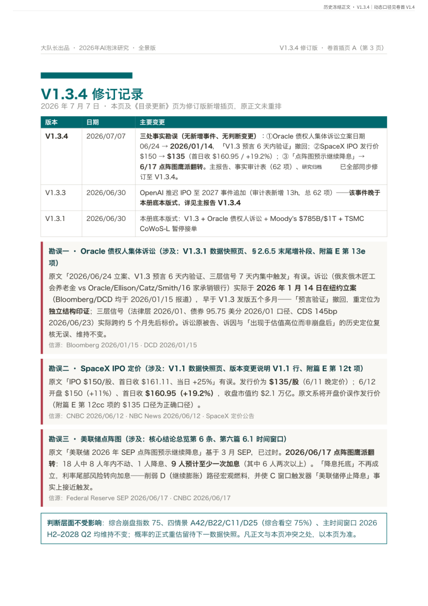
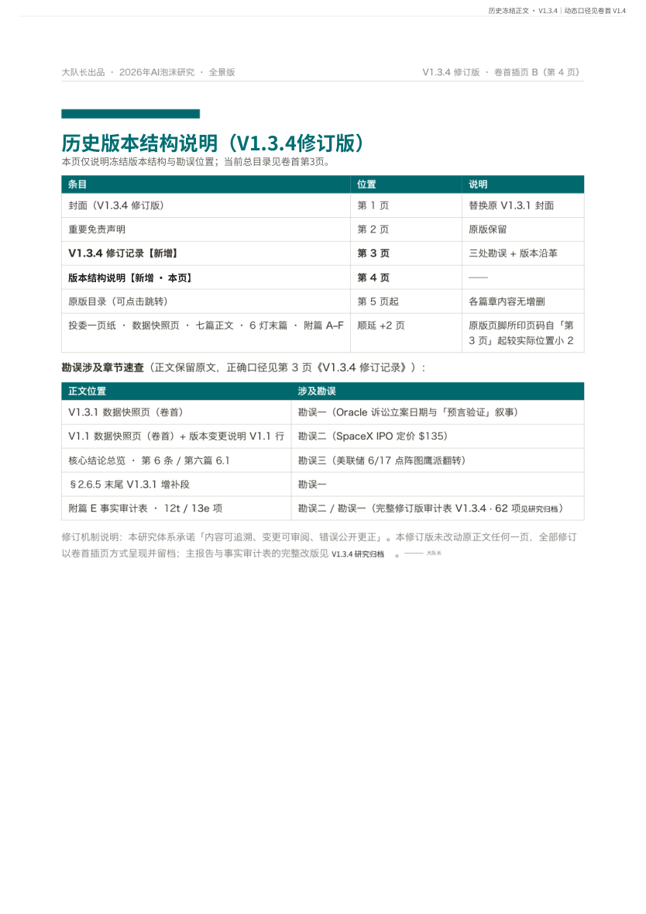
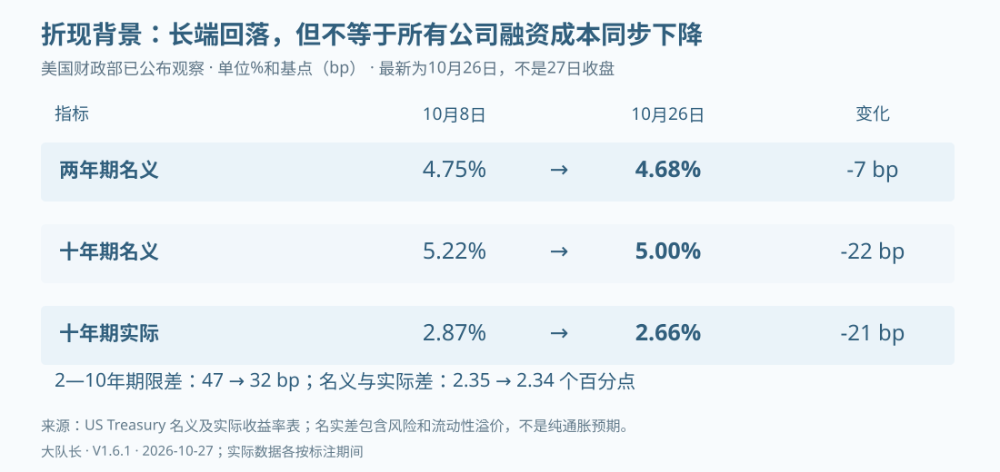

# AI周期与泡沫研究 V1.6.1 原339页完整版校注更新

大队长 · 2026-10-27

完整PDF是版面依据；本文件为现行分析加原PDF逐页抽取阅读稿，原图表和跨页表格以PDF为准。原32、33图像页以图片保留。旧原文不等于当前事实。


## 历史原页 1｜新版PDF第6页

> 历史原文，非当前事实。相关校注：FIN-16


```text
大队长 · 独立研究 · 研究维护版
2026年AI泡沫研究 · 全景版
V1.4 · 当前维护版
综合崩盘指数　78 / 100
四情景　A45 / B22 / C10 / D23（软着陆以外合计77%）
触发器　严格执行1/3 · 广义早期预警2/3
当前判断：供应链盈利增长与现金转化分化并存，就业初值已上修；
严格触发仍为1/3，现有证据未显示系统性融资关闭。
阅读规则：卷首V1.4为当前口径；后接历史冻结正文，仅用于展示研究过程。
版本　V1.4 · 2026/09/08就业修订与半年报补录
数据　研究资料至2026/09/08 10:00 · VIX至9/4 · 信用至9/3 · 历史锚各注明日期
大队长 · AI周期与泡沫研究
基于公开信息 · 不构成投资建议

```


## 历史原页 2｜新版PDF第7页

> 历史原文，非当前事实。相关校注：FIN-16


```text
重要免责声明
本报告是个人基于公开信息完成的研究维护版，用于研究方法展示、事实核验与情景推演，不代表所在机构意见，不构成
任何证券的投资建议、收益承诺或交易指令。报告中的分数、概率和触发器是可复盘的研究工具，不是统计意义上的精确
崩盘概率，也不直接对应仓位、减仓或对冲比例。市场价格、公司指引与传媒报道会持续变化，读者应核对原始来源并独
立判断。
当前资料与历史边界
本版研究资料核验至2026-09-08 10:00（北京时间）。金融快照按各指标实际观测日记录；旧日期的价格、公司指引和
预测只作为历史观察锚，不代表当前现价。后接历史正文保留当时版本与口径，动态结论以卷首V1.4为准。
关于投资风险与判断限制
投资有风险，入市需谨慎。市场状况瞬息万变，数据准确性与时效性可能因披露和修订而变化。报告中的目标价、概率估
算、情景预测均存在重大不确定性，历史先例不保证未来表现。78分及四情景权重属于研究判断，未经完整统计校准，不
构成收益保证、交易授权或仓位建议。
关于做空工具的特别风险警示
历史正文中的做空与对冲工具仅作风险教育和机制对照。做空风险极高：标的价格可能持续上涨，理论亏损无上限；杠
杆、反向或杠杆ETF、期权和期货涉及时间衰减、保证金追加、强制平仓及路径依赖风险，可能损失全部乃至超过初始本
金。
即使方向判断正确，持续逆向波动也可能使投资者先因保证金不足而平仓。监管限制、借券召回、保证金上调、流动性骤
降和交易规则变化，均可能使仓位无法在预期价格或时间关闭。使用任何此类工具前，应充分了解风险、咨询具备资质的
专业人士，并独立评估自身承受能力。
关于版权与转载
本报告版权归作者所有。引用请注明来源，未经授权不得用于商业用途；转载时应保留出处、数据日期、口径边界及免责
声明，不得断章取义。本研究为个人基于公开信息的独立分析，不代表所在机构意见。
个人研究 · 不构成投资建议 · 读者应独立核验并自行决策
大队长 · AI周期与泡沫研究 · 全景版
重要免责声明 · V1.4维护版 · 2026/09/08
个人研究 · 基于公开信息 · 不构成投资建议
第 2 页

```


## 历史原页 3｜新版PDF第8页

> 历史原文，非当前事实。相关校注：


```text
大队长 · AI周期与泡沫研究 · V1.4超全景版
V1.4 · 滚动核验至 2026/09/08
总目录
本页是超全景版唯一当前导航；页码为339页合并版实际页码，条目可点击跳转。
A｜当前有效口径
重要免责声明
2
V1.4 当前更新与勘误｜滚动核验至2026-09-08
4
0. V1.4滚动更新日志（7/20—9/8）
4
1. V1.4当前结论
9
2. 触发器治理：V1.4重新基准化
9
3. 累计新增四十九项审计事实
10
4. 市场与事件快照
24
5. 证伪条件与下一观察窗口
25
6. 9/8复审与勘误结论
26
7. 本版具体更新位置
28
8. 主要来源
29
超全景整合说明
31
B｜历史冻结研究（仅供回溯）
V1.3.4修订记录
32
历史版本结构说明
33
V1.3.4a勘误与增补
34
历史原版索引（留档）
35
个人研究 · 基于公开信息 · 不构成投资建议
第 3 页 / 共 339 页

```


## 历史原页 4｜新版PDF第9页

> 历史原文，非当前事实。相关校注：FIN-16, N27-10


```text
重要免责声明
本报告是个人基于公开信息完成的研究维护版，用于研究方法展示、事实核验与情景推演，不代表所在机构意见，不构成
任何证券的投资建议、收益承诺或交易指令。报告中的分数、概率和触发器是可复盘的研究工具，不是统计意义上的精确
崩盘概率，也不直接对应仓位、减仓或对冲比例。市场价格、公司指引与传媒报道会持续变化，读者应核对原始来源并独
立判断。
V1.4 更新模块｜滚动核验至2026-09-08
数据截止：公司公告、监管文件与一手资料核验至 2026-09-08 10:00（北京时间）；VIX至9/4，信用利差至9/3，
个股价格沿用各自标注日的历史观察锚，未统称为当日行情。E判断原A股价格窗口截至7/24，本轮补入8月22日、
25日公告的两家光模块半年报与9月4日就业报告；台积电8月营收、Oracle　FY27Q1和8月CPI仍待公布。
版本性质：这是当前研究维护版。历史发布包中的研究材料及已登记的前瞻判断原件全部冻结，不回写、不追溯改
写。
一句话结论：AI供应链的盈利增长继续得到半年报支持，但利润转化为现金的速度明显分化；美国就业初值上修则削
弱了短期衰退叙事。现有证据没有触及新的严格触发条件，研究指数维持78分、情景权重A45/B22/C10/D23，严
格1/3、广义2/3。
本轮变化：补入美国8月就业与7月修订值，回溯补录中际旭创和新易盛2026H1半年报，修正“业绩待披露”的过期状
态；新增13bc—13be三项，审计109→112项。E判断2仍为部分验证，原因改为原预告事件及对应价格窗口证据尚未
齐全；后续半年报不倒写成事前命中。完整变更轨迹见下方日志。
0. V1.4滚动更新日志（7/20—9/8）
V1.4·9/8｜就业修订与光模块半年报补录
改动一：就业初值修订。　BLS公布8月非农新增16.2万人、失业率4.1%，7月由初值减少2.3万人修订为增加2.1万人。历
史记录保留初值，当前宏观分析改用修订值，不再沿用“7月负增长”作为现状。
改动二：补齐光模块半年报。 中际旭创、新易盛分别于8月22日和25日公告2026H1半年报，归母净利润同比增长
241.70%和90.98%；这是对8月披露的漏更补正，不能写成9月新发生的业绩。两家公司经营现金流分别同比下降
44.08%、增长69.67%，增加同周期利润与现金流图。
改动三：修正E判断2的待核原因。 正式半年报已披露，撤销当前“中际旭创正式业绩尚未披露”的旧状态；盈利增长获得
后续支持，但原预告事件、双样本价格窗口证据仍不完整，整条维持部分验证，不重算7月已冻结的窗口。
改动四：刷新金融快照与日历。　VIX更新为9月4日14.53，HY/IG　OAS为本轮可取得的9月3日265/81bp。下一节点改为
9月10日台积电月营收、北京时间9月11日凌晨Oracle财报电话会与当晚CPI，以及9月15—16日FOMC。
改动五：说明分数的来源。 本轮事件变更为0；78分可追溯既有事件加分，但完整统计校准模型尚未建立，四情景为研究
者主观权重。新增事实不机械改变分数、权重或触发状态。
改动六：同步全部版式。 审计109→112项；更新主报告、机构简版、全景版和维护版，最新修订前置，变更一条一段，
目录、页码、书签与实际分页重新核对。
改动七：修复目录锚点。 复核发现部分未进入目录的小标题复用了锚点，导致“当前结论”“市场快照”等目录项虽可点
击，却跳到较早页面。改为全部标题独立编号，验收增加标题与目标页语义匹配；不只比较目录数字和链接页码。
大队长 · AI周期与泡沫研究 · V1.4更新模块
V1.4　·　滚动核验至 2026/09/08
个人研究 · 基于公开信息 · 不构成投资建议
第 3 页 / 共 30 页

```


## 历史原页 5｜新版PDF第10页

> 历史原文，非当前事实。相关校注：FIN-16


```text
V1.4·9/4｜经营验证扩围与平台入口整合
改动一：经营兑现从GPU扩展到芯片、服务器和网络系统。　Broadcom　AI半导体收入同比增长221%，Dell　AI优化服务
器收入同比增长100%，HPE“Cloud　&　AI”收入同比增长25.4%，Marvell数据中心收入同比增长46%；它们共同反驳“当
前需求已经崩塌”，但各自业务口径不同，不能横向相加或据此直接推导云厂终端投资回报率。
改动二：利润和现金并非只有一种形态。　Broadcom本季自由现金流$13.665B、占收入46%；Dell基础设施解决方案集
团营业利润率升至15.0%；HPE“Cloud　&　AI”营业利润率升至17.0%、公司自由现金流$0.958B。供应商和系统层已出现
利润转化，但Dell订单与backlog不是现金，HPE分部又包含服务器、存储和金融服务，不能把这些数字统称为“AI利润
率”。
改动三：NVIDIA向模型分发和开发者入口下移。 9月2日签署的Hugging　Face收购协议包含约$11.9B股东对价和最高
约$1.0B员工留任权益计划，预计2027年上半年完成；NVIDIA承诺平台继续开放并支持其他芯片厂商。交易尚待监管批
准，它改变的是生态控制与分发入口，不是当期收入、AI基础设施资本开支或终端单位经济证据。
改动四：补记遗漏的Marvell官方财报。　Marvell　FY27Q2于8月27日披露，早于上版截止日却未被纳入；本版以“回溯
补录”而非9月新事件处理，公开说明遗漏，不把它伪装成刚发生的消息。
改动五：宏观与金融条件仍未共振。 7月JOLTS职位空缺约730万，8月制造业PMI为54.6、服务业PMI为55.4，但服务业
就业指数47.8、价格指数72.6；增长、就业和价格方向分化。9月3日VIX为14.32，9月2日HY/IG　OAS为266/81bp，广
谱融资条件仍偏平稳。
改动六：审计与判断。 新增13aw—13bb六项，事实审计表103→109项，并新增“AI产业链经营验证”图。新证据强化了
需求与供应商兑现，也增加平台集中度观察，却没有触及私募平/降轮、NVIDIA需求断崖或新的信用事件阈值，因此78
分、A45/B22/C10/D23、严格1/3和广义2/3均不变。
V1.4·8/28财报后｜NVIDIA需求触发结算与融资结构确认
改动一：NVIDIA需求触发正式结算。　FY27Q2数据中心收入同比+117%，远高于“低于25%”的事前固定阈值，T-
V14-03明确记SAFE，严格触发仍为1/3。
改动二：经营与指引更新。　NVIDIA季度收入$96.221B、毛利率75.0%，FY27Q3收入指引$108B±2%，且未假设中国
数据中心计算收入；需求没有在本期形成断崖。
改动三：融资平台从新闻观察进入官方档案。　NVIDIA与Apollo、BlackRock、Blackstone、Brookfield、Goldman
Sachs及KKR签署谅解备忘录，拟长期动员超过$500B第三方资本；平台独立承销但仍待最终协议，不能写成已到位资金
或NVIDIA表内债务。
改动四：OpenAI相关担保正式确认。　NVIDIA　8-K确认俄亥俄PORTS项目累计上限$105B的分期剩余价值担保；它不
是当前负债或当期现金流出，但把芯片供应商与客户租赁信用更直接地连接起来，取代7/29“$250B/$350B媒体洽谈”的
旧WATCH。
改动五：承诺、应收与现金转化。　10-Q披露未来承诺$366B，其中供应与产能$279B；应收账款$63.1B、DSO由45天
升至60天，部分投资级客户付款期延长至90天—1年。增长仍强，但营运资金与交付融资占用明显上升。
改动六：供应链交叉验证。　TSMC　7月营收同比+44.7%；Lumentum　FY26Q4收入同比+109.3%，Coherent高意同比
+33.8%，两家公司下一季收入指引继续上行。光链与晶圆代工均不支持“当期需求已崩”。
改动七：宏观与市场地基。 7月核心PCE同比3.3%，实际PCE环比基本持平；VIX　8/27为14.51，HY/IG　OAS　8/26为
267/80bp。宏观呈“增长偏弱、通胀仍高”，但广谱融资尚未关闭。
改动八：审计、图表与判断。 新增13ao—13av八项，事实审计表95→103项；新增“NVIDIA财报双面证据”图。需求
SAFE不冲销新确认的担保与交付融资风险，指数小幅升至78，A/D各迁移1pct，触发数不变。
V1.4·8/9周末｜解禁结算、宏观与供应链复核
改动一：SpaceX解禁从“待观察”改为“首轮已结算”。 8/6约9.12亿股取得出售资格，但当日SPCX上涨6.14%至
$114.92；8/7再涨15.83%至$133.11，仍低于$135发行价1.4%。这说明首轮供给没有形成即时价格踩踏，但两日反弹不
能证明后续解禁已无风险，也不构成私募新一轮定价。
改动二：广谱市场地基更新。　VIX更新至14.90（8/7），HY/IG　OAS更新至271/78bp（8/6）；相较上一截止点，波动
与高收益利差继续回落，局部资本锁定尚未扩散成系统性信用关闭。
大队长 · AI周期与泡沫研究 · V1.4更新模块
V1.4　·　滚动核验至 2026/09/08
个人研究 · 基于公开信息 · 不构成投资建议
第 4 页 / 共 30 页

```


## 历史原页 6｜新版PDF第11页

> 历史原文，非当前事实。相关校注：


```text
改动三：美国就业转弱（8/9当时观察，9/4已修订）。 7月非农就业初值减少2.3万，失业率4.1%，5—6月合计下修10.3
万，过去12个月月均新增仅3.4万。当时宏观尾部风险上升，但利差和波动率没有同步恶化，因此暂列WATCH，不上调C
情景或新增触发。9/4将7月修订为增加2.1万人，当前解释见§3.24。
改动四：AI服务器需求旁证。　TrendForce把2026年全球AI服务器出货增速预测从28%上调至接近31%，估算九大CSP
资本开支同比约增90%。这是第三方研究估算，不是公司指引；它反对“当期需求已经崩塌”，但不能替代收入、利用率
和现金回报验证。
改动五：内存约束与架构调整。　TrendForce称DRAM供给将紧至2027年，NVIDIA及部分CSP正在评估降低下一代产品
HBM配置；最终规格尚未确定，且没有NVIDIA一手确认。本版将其列为“供给约束推动架构优化”，不误写成需求削减。
改动六：光模块政策口径。　TrendForce称中国企业约占2026年全球光模块代工产能56%，并明确FCC提案尚未正式发
布、关键定义不清。本版只列政策WATCH，不写成“禁令落地”，也不改变E判断2。
改动七：待发布日历纠正。　TSMC　7月营收仍待8/10 13:30（北京时间）发布；Lumentum财报窗口改为北京时间8/12
清晨，Coherent高意为8/13 04:30；未披露数据一律不提前入表。
改动八：Alphabet融资补证。　Alphabet　8/6定价、8/7提交最终文件，发行10档合计$25.0B高级无抵押债，预计净募
约$24.8B并于8/10交割；用途仅为一般公司用途（可包括偿债），不能写成AI专项融资。同日ATM文件只是增加销售代
理，没有扩大$40B上限，也不证明已经发行新股。
改动九：Terafab首期计划。　SpaceX与Tesla公布在Texas建设Terafab，官方项目页确认逻辑、内存和先进封装一体
化及1TW/年目标；Reuters披露首期约$16.8B。该数字与5月地方申报的$55B初始投资、远期扩建口径不是同一范围，
不能相互替换，更不能把计划额当已发生CapEx。
改动十：审计与图表。 新增13ah—13an七项事实，事实审计项目由88项增至95项；新增“8/9周末证据对照”图，将估
值承接、广谱信用、宏观就业与供应链证据分栏。
判断影响。 解禁承接、服务器需求与偏窄利差支持需求/流动性未失序，就业转弱和长期资本消耗提高尾部风险。证据相
互制衡，且没有满足新的固定硬条件，因此指数77、A44/B22/C10/D24、严格1/3和广义2/3均不变。
V1.4·8/5晨间｜五大公司财报、资本锁定与SPCX解禁
改动一：Amazon需求与经营。 新增Q2收入、AWS收入与营业利润、AI/芯片业务年化收入；需求仍受供给约束，反对
“当前需求已经崩塌”。
改动二：Amazon现金回报。 分开经营现金流、现金资本开支和自由现金流；过去十二个月自由现金流转负，验证扩建
速度已经超过当期现金创造。
改动三：Amazon循环融资与利润质量。 新增OpenAI、Anthropic云服务承诺、股权投资和算力交付挂钩融资安排；
将Anthropic估值上调带来的非经营收益从经营利润中剥离。
改动四：Microsoft资本锁定。 补入FY2026　10-K的未起租租赁、采购、建设和PP&E应付口径；强调不同合同义务不
能相加成“AI总债务”，短寿命设备与建设节奏仍具一定调整空间。
改动五：Meta官方Q&A与10-Q。 删除“完整官方Q&A待补”旧状态；补入算力溢价承接、长期能见度边界、第三方云
和合资资本结构，以及未起租租赁和合同承诺。
改动六：Apple应用端对照。 新增收入、研发、经营现金流和现金PP&E；把研发、第三方云与自有数据中心拆开，避免
用低现金CapEx误判AI投入。
改动七：SpaceX财报与解禁。 新增Q2经营、分部、RPO、客户集中度、CapEx、现金与债务；将管理层前瞻与已实现
数据分栏，并新增8/6解禁供给观察。
改动八：信用与波动率。　HY　OAS更新至278bp、IG　OAS至78bp、VIX至15.86（均截至8/3）；广义信用没有恶化，
局部融资与单名风险仍未扩散为系统性收缩。
改动九：审计与图表。 新增13z—13ag八项事实，事实审计项目由80项增至88项；新增“财报窗口需求与现金流”图，所
有动态市场数字保留日期标签。
判断影响。 五家公司共同强化“真实需求仍强、资本锁定和现金回报分化扩大”。证据双向且没有触发V1.4固定硬条件，
故指数77、A44/B22/C10/D24、严格1/3和广义2/3均不变。
大队长 · AI周期与泡沫研究 · V1.4更新模块
V1.4　·　滚动核验至 2026/09/08
个人研究 · 基于公开信息 · 不构成投资建议
第 5 页 / 共 30 页

```


## 历史原页 7｜新版PDF第12页

> 历史原文，非当前事实。相关校注：


```text
V1.4·7/30晨间｜Microsoft与Meta财报、FOMC结算
改动一：Microsoft需求与经营兑现。 新增FY26Q4收入、Microsoft　Cloud、Azure、Commercial　RPO及FY27Q1
Azure指引；剔除OpenAI后的RPO增速与新增来源单列，避免把84%总增速冒充基础客户增速。
改动二：Microsoft资本开支与现金流。 分开约$41B总CapEx、$35.802B现金PP&E、$5.6B融资租赁和$19.639B自
由现金流；不重复相加，不把RPO当收入或现金。
改动三：Microsoft会计口径。 数据中心及办公楼预计使用寿命从15年延至25年，更多未来租赁由融资租赁转为经营租
赁；自然年2026披露CapEx由约$190B改为约$175B，属于分类口径变化，底层投资预期不变，不能写成“削减AI投资
$15B”。
改动四：Meta财报。 新增Q2收入、利润率、CapEx、经营现金流、自由现金流及全年CapEx指引；结论是高投入继
续、现金缓冲变薄，不是需求或业务失败已被证明。
改动五：FOMC。 记录按兵不动、9—3票型和三名加息异议；它强化利率托底没有反转，但不是新增严格信用或需求触
发器。
改动六：E验证记分卡。 按冻结阈值结算判断5和判断6为成立，汇总更新为5条成立、1条部分验证、0条待核、0条错
误；判断原件不回写。
改动七：维谛技术。 将Q2从待发布改为已核；收入有机增速略低于原指引下限，但利润率、现金流和全年指引均走强。
没有本季定量订单/backlog披露时，不补造订单数字。
改动八：审计与图表。 新增Microsoft经营、Microsoft资本与会计、Meta　Q2、FOMC和维谛技术Q2五项事实，并新
增“Microsoft需求兑现与现金流”图；事实审计项目由75项增至80项。
判断影响。　Microsoft与Meta同时证明真实需求仍强、资本与现金流压力也继续扩大；FOMC没有转鸽。新增证据方向
相反且没有触发V1.4固定硬条件，因此指数77、A44/B22/C10/D24、严格1/3和广义2/3均不变。
V1.4·7/29晨间｜SEC补证、融资观察与图表升级
改动一：Alphabet 10-Q状态勘误。 7/23提交的官方10-Q已核到，撤销“尚未找到”；新增长期采购承诺、未开始租
约、金融担保和债务结构的审计口径。
改动二：Meta结构融资。 新增El　Paso合资交易，分开总成本、外部项目债、租约与剩余价值担保；明确项目债不是
Meta表内债务。
改动三：NVIDIA融资观察。 将官方已披露的$3.5B设施租约担保，与媒体报道中讨论的$250B融资担保、最高$350B
芯片采购融资严格分栏；后两者未获公司确认，不当作已签交易。
改动四：市场地基。　CAPE更新至40.57（7/28）、VIX更新至18.21（7/28）、HY　OAS更新至281bp（7/27）；7/23
—7/28硬件风险资产明显弱于QQQ，但尚未进入系统性恐慌或信用收缩。
改动五：证据降级。　TSMC官方只确认先进封装产能极紧并限制客户增长；具体停接单日期和269万片仅保留为市场渠道
口径。
改动六：排版与图表。 新增“四大云厂CapEx斜率”“Alphabet资本锁定与现金流”“AI硬件风险资产相对回撤”三张图，
并将变更点保持一条一段。
改动七：审计表。 新增13s　Alphabet　10-Q和13t　Meta　El　Paso，事实审计项目由73项增至75项；NVIDIA未确认报道
只入WATCH，不伪装成永久事实项。
判断影响。 官方10-Q显著提高“资本锁定”证据等级，但其承诺也服务于供给扩张；NVIDIA巨额担保仍处洽谈报道阶
段。指数77、A44/B22/C10/D24、严格1/3和广义2/3均不变。
V1.4·7/24收盘｜E判断2价格腿结算
改动一：收盘结算。 新易盛7/24收476.02元；预告后五个交易日最高收盘551.77元，比6/23收盘锚552.00元低0.23元
（0.04%）。按事前零容差规则，价格腿临界成立。
改动二：验证记分卡。 新易盛盈利腿成立、价格腿规则内临界成立；中际旭创尚无可核半年报预告，E判断2整条继续记
“部分验证”。
改动三：归因边界。 7/24上证指数下跌1.61%、深证成指下跌2.47%，个股弱反应含有市场共同因素；本次只按事前规则
结算结果，不把全部跌幅归因于公司基本面。
大队长 · AI周期与泡沫研究 · V1.4更新模块
V1.4　·　滚动核验至 2026/09/08
个人研究 · 基于公开信息 · 不构成投资建议
第 6 页 / 共 30 页

```


## 历史原页 8｜新版PDF第13页

> 历史原文，非当前事实。相关校注：FIN-16


```text
改动四：阈值敏感性。 551.77元仅比552.00元低0.04%。若事前规则设有0.1%安全边际，价格腿应记为临界未决；原件
没有容差条款，因此不在结果出现后改门槛。
判断影响。　E记分结构、77分、A44/B22/C10/D24及触发器计数均不变。
V1.4·7/24滚动｜官方文字补充与全量复审
改动一：Alphabet官方文字。 新增CEO书面发言，补充Cloud积压订单、模型API　tokens、Gemini　App月活、既有
客户超承诺使用和供给约束。
改动二：市场反应。 补入7/23 GOOGL、ORCL、NVDA与SPCX市场快照，并明确油价、利率和地缘因素的多变量归因
边界。
改动三：DeepSeek勘误。 按DeepSeek、华为云与arXiv资料，把“完整预训练替代”修正为“华为云首发适配、V4-
Flash　API服务＋全参数后训练能力”，撤销无一手来源的R2　32B旧口径。
改动四：审计表。 新增13q—13r，事实审计项目由71项增至73项。
判断影响。 需求强度继续被确认，市场对高CapEx的容忍度下降；指数77、A44/B22/C10/D24及触发器计数不变。
V1.4·7/23滚动｜Alphabet财报后核验
改动一：经营兑现。 新增Google　Cloud收入、利润和利润率。
改动二：现金流。 拆分CapEx、经营现金流、自由现金流和折旧。
改动三：融资与利润质量。 补入债务、股权融资和股权证券重估对EPS的影响。
改动四：验证记分卡。　E判断4由待核转为成立；事实审计表新增13o—13p，由69项增至71项。
判断影响。 “需求满载×现金流裂缝”得到双验证；指数、概率和触发数不变。
V1.4·7/21滚动｜事实审计与E记分卡
改动一：新易盛。 新增2026H1净利润同比增长77.56%—102.93%的业绩预告。
改动二：天孚通信。 新增2026H1净利润同比增长25%—45%的业绩预告。
改动三：日期勘误。 撤销“7/15创业板中报预告统一截止”的错误日历口径。
改动四：审计表。 新增13m—13n，由67项增至69项。
判断影响。 新易盛业绩子样本成立，E判断2整条仍待定；指数、概率和触发数不变。
V1.4·7/20首发｜研究维护版
改动一：信用。　Oracle降至BBB-，严格信用触发①确认。
改动二：供需。 更新TSMC　Q2实际值、Q3指引和全年CapEx/收入指引。
改动三：估值承接。　SPCX于7/17跌破135美元发行价。
改动四：资本开支。 新增Reuters转述的UBS四大hyperscaler合计总CapEx　2026—2028增速斜率。
改动五：市场快照。 刷新CAPE、VIX、HY　OAS、ORCL、NVDA和SPCX。
改动六：触发器治理。 将严格执行触发1/3与广义早期预警2/3正式分栏。
改动七：审计表。 新增13i—13l，由63项增至67项。
判断影响。 指数75→77；概率A42/B22/C11/D25→A44/B22/C10/D24；主时间窗不变。
历史勘误版
V1.3.4a（2026-07-09）。 增补CDS口径、Oracle　RPO、API通缩、Meta加拿大数据中心、NVIDIA增持
CoreWeave和SK海力士上市；当时判断与概率不变。
V1.3.4（2026-07-07）。 修正Oracle诉讼日期、SpaceX　IPO发行价和美联储点阵图三处事实口径；当时指数75、
A42/B22/C11/D25不变。
大队长 · AI周期与泡沫研究 · V1.4更新模块
V1.4　·　滚动核验至 2026/09/08
个人研究 · 基于公开信息 · 不构成投资建议
第 7 页 / 共 30 页

```


## 历史原页 9｜新版PDF第14页

> 历史原文，非当前事实。相关校注：FIN-16


```text
治理说明：本节只记录V1.4发布后的逐日滚动更新；V0.1—V1.3.4的完整历史沿革保留在后文历史表格中。V1.3.4
及以前版本保留原始时点，但可证伪的错误事实已在本版显式列出并更正，避免静默改写。历史发布材料继续冻结。
1. V1.4 当前结论
项目
V1.3.4 历史口径
V1.4 当前
口径
变化
综合崩盘指数
75 / 100
78 / 100
+3；Oracle信用事件贡献2分，NVIDIA官方担保与交付融资结构确认再贡
献1分；9/4经营验证及9/8就业修订与半年报补录均不加分
A　渐进幻灭
42%
45%
+3pct
B　技术颠覆
（双向尾部）
22%
22%
不变
C　宏观共振
11%
10%
-1pct
D　软着陆
25%
23%
-2pct
A+B+C（软着
陆以外）
75%
77%
+2pct
严格核心触发
历史文本使用了不同事件
集，不与本版续算
1 / 3
T-V14-01　Oracle评级/信用事件已确认
广义早期预警
V1.4于2026-07-20重新基
准化
2 / 3
W-V14-01信用恶化 + W-V14-02估值承接转弱
判断没有反转。　V1.4当前把A情景较V1.3.4上调3pct；8/28新增的1分来自官方确认的担保与交付融资结构。9/4新增
公司经营数据继续证明需求与供应商兑现，NVIDIA收购Hugging　Face则增加平台集中度观察，但二者都没有跨越既定
计分阈值。
物理侧。 强需求说明产能与基础设施仍然满载。
金融侧。　Oracle降级与SPCX跌破发行价，说明金融承接先出现裂缝。
合并判断。 “物理满载 × 金融裂缝”同时出现，才是当前最重要的晚周期签名。
2. 触发器治理：V1.4重新基准化，不与历史x/3续算
Trigger
ID
层
级
固定定义
首次
生效
当前状态
使用方式
T-
V14-01
严
格
关键AI债务主体
发生评级下调或
同等信用事件
2026
-07-
20
CONFIRMED：S&P官方监管发布入口与专题页确认行动
日为7/8、评级为BBB-/A-3、展望稳定；超出官方标题与
摘要的细化理由继续分级使用
计入1/3；同一Oracle事件
的CDS后续扩大不重复计分
T-
V14-02
严
格
私募AI龙头新一
轮融资估值持平
或下修
2026
-07-
20
WATCH↑：SPCX是二级市场参考，不是私募新一轮定价
不计入已触发
T-
V14-03
严
格
NVIDIA数据中心
收入同比增速低
于25%
2026
-07-
20
SAFE（8/26结算）：FY27Q2数据中心收入同比增长
117%，远高于25%阈值
不计入已触发；下一财报重
新观察，不回写本次结果
W-
V14-01
广
义
债务或单名信用
显著恶化
2026
-07-
20
已出现：Oracle评级与CDS
提高监测频率，不是交易指
令
W-
V14-02
广
义
一级或二级估值
承接转弱
2026
-07-
20
已出现：SPCX跌破发行价；7/23—7/28硬件资产显著弱
于QQQ
提高监测频率，不是交易指
令
W-
V14-03
广
义
核心算力需求斜
率断裂
2026
-07-
20
尚未出现：NVIDIA数据中心+117%；Broadcom　AI半导
体+221%；Dell　AI服务器+100%；Marvell数据中心
+46%；HPE广义“Cloud　&　AI”+25.4%
需要订单、收入或利用率证
据，不用几日股价替代；
HPE分部并非纯AI口径
不可比说明。　V1.2的“1.5/3→2/3”使用了NVDA、SpaceX发债等不同事件集，既不是上表严格触发，也不能自动映射
为V1.4广义预警。旧序列在V1.2停止；V1.4从2026-07-20重新基准化，后续只按Trigger　ID续算。
大队长 · AI周期与泡沫研究 · V1.4更新模块
V1.4　·　滚动核验至 2026/09/08
个人研究 · 基于公开信息 · 不构成投资建议
第 8 页 / 共 30 页

```


## 历史原页 10｜新版PDF第15页

> 历史原文，非当前事实。相关校注：N27-01


```text
3. 累计新增四十九项审计事实
3.1 Oracle：信用触发正式确认
评级变化。　2026-07-08　05:21　EDT，S&P将Oracle长期发行人评级由BBB/A-2下调至 BBB-/A-3，展望稳定，标
题明确指向业务风险上升与现金流转弱；Oracle距投机级仅一档。V1.3.4a的2026-07-09是版本日期，不是评级行动
日。
融资背景。　Oracle　2026财年已筹集约 $43B债务 + $5B股权，同时AI基础设施资本开支继续扩张。
信源边界。　S&P官方监管发布索引和“Oracle　Downgrade　Explained”专题页共同确认降级事件、行动时间、BBB-/
A-3与稳定展望；Oracle融资数字来自公司公告。后续若取得单篇rating　action固定链接，只补链接，不改已核事实。
市场快照。　ORCL　7/28收 $120.12；Oracle　5年CDS　7/17收约198.23bp、7/20盘中约203bp，而广义HY　OAS至
7/27仅281bp。这说明单名信用压力显著，尚不是全市场信用关闭。
判断影响。 “信用恶化”由高位预警升级为严格触发确认。
3.2 TSMC：需求与物理满载继续证真
Q2实际值。 收入 $40.20B，毛利率 67.7%，营业利润率 60.3%。
Q3指引。 收入 $44.6B–$45.8B，毛利率 65%–67%。
全年指引。 资本开支上调至 $60B–$64B；2026年美元收入增速指引提高至“略高于40%”。
CoWoS证据边界。　TSMC官方文字可以支持“先进封装产能极紧，已限制客户增长”；但“CoWoS-L停接2027Q1以后订
单”“所有新项目排队”和“269万片需求”只有市场渠道或二手转述，不再写成公司确认。
判断影响。 算力需求仍强，同时供给扩张与资本沉淀继续累积。
3.3 SPCX：二级市场承接跌破发行锚
市场表现。　SPCX　7/20收 $119.85，较$135发行价低 11.2%，较6/16峰值$225.64回撤约 46.9%。
证据边界。 这不是私募down　round，不能计入严格触发②。
判断影响。 一级估值锚向二级市场的传导已经失败，广义估值预警维持“已出现”，且强度继续上升。
3.4 资本开支斜率：绝对额仍高，边际增速开始降档
UBS估算。　Reuters　7/17转述的UBS估算显示，四大hyperscaler合计总CapEx可能由 2026年$673B（同比
+76%），升至 2027年约$841B（+25%）、2028年约$892B（+6%）。
公司范围。 报道上下文对应 Microsoft、Amazon、Alphabet、Meta。
口径边界。 这是四家公司合计总资本开支，不是单家公司指引，也不等于纯AI　CapEx。
斜率含义。 它表达的不是资本开支绝对额坍塌，而是由“高速扩张”进入“高位降速”。
跟踪重点。 真正需要盯的是收入和现金流增速能否追上折旧、利息与资本开支，而不是只看CapEx绝对额。
大队长 · AI周期与泡沫研究 · V1.4更新模块
V1.4　·　滚动核验至 2026/09/08
个人研究 · 基于公开信息 · 不构成投资建议
第 9 页 / 共 30 页

```


## 历史原页 11｜新版PDF第16页

> 历史原文，非当前事实。相关校注：


```text
图表口径：Microsoft、Amazon、Alphabet、Meta合计总CapEx；数据为Reuters转述的UBS估算，不等于纯AI
支出，也不是公司正式指引。柱形显示绝对额，标注显示同比增速。
3.5 Alphabet：经营兑现与现金流裂缝同步扩大
指标
2026Q2
同比/环比
框架含义
总收入
$119.796B
+24% YoY
总需求仍强
Google　Cloud收入
$24.768B
+81.8% YoY
AI与云变现明显加速
Google　Cloud营业利润/利润
率
$8.814B / 35.6%
利润 +211.9% YoY
经营兑现，不只是资本开支叙事
资本开支
$44.924B
+100.1% YoY / +25.9%
QoQ
建设强度继续抬升
经营现金流/自由现金流
$39.069B / -
$5.855B
OCF　+40.8% YoY
CapEx增速远快于OCF，单季FCF转
负
折旧
$7.104B
+42.1% YoY
资本沉淀开始更快进入利润表
表观EPS/剔除股权收益EPS
$9.11 / 约$2.85
股权证券收益税后贡献EPS　$6.26
必须拆分经营利润与持仓重估
上半年现金流。 经营现金流 $84.859B，资本开支 $80.598B，自由现金流仅 $4.261B，同比下降约82.4%。
外部融资。 长期债务由2025年末 $46.547B 升至 $98.165B；上半年股权融资净流入 $49.6B，Q2高级票据净流
入 $20.3B。
资产负债表边界。 现金及有价证券仍达 $242.474B。这不是偿债危机，而是强资产负债表公司也开始用外部融资支撑
高强度建设。
资本开支指引。 电话会直播口径把2026年CapEx由 $180B–$190B 上调至 $195B–$205B，并称2027年仍将显著
增加。
证据等级。 7/22官方已发布CEO书面发言；截至本版截止时，完整官方电话会文字稿仍未挂出。服务器与数据中心建设
分项只采用二手文字稿并降级标注，不当作官方正式文本。
判断影响。E判断4成立。 需求崩塌被进一步证伪，但金融裂缝扩大同时得到更强证据。
3.6 Alphabet官方书面发言：需求不是“纸面订单”，但供给约束仍在
Alphabet　7/22发布的CEO书面发言给出四个比财报表格更接近业务实况的指标：
四大云厂合计总资本开支：绝对额上升，增速快速降档
Microsoft、Amazon、Alphabet、Meta｜UBS估算，经Reuters转述｜十亿美元
0
250
500
750
1,000
$673B
$841B
$892B
2026E
2027E
2028E
同比+76%
同比+25%
同比+6%
大队长 · AI周期与泡沫研究 · V1.4更新模块
V1.4　·　滚动核验至 2026/09/08
个人研究 · 基于公开信息 · 不构成投资建议
第 10 页 / 共 30 页

```


## 历史原页 12｜新版PDF第17页

> 历史原文，非当前事实。相关校注：


```text
积压订单。　Google　Cloud积压订单达 $514B。
模型调用。 模型API每分钟处理 220亿tokens，高于上季约160亿。
用户规模。　Gemini　App月活跃用户达 9.5亿。
客户用量。 既有Cloud客户扩大使用量，实际使用超过原承诺额 50%以上。
供给约束。 公司同时明确表示供给仍然受限。
判断影响。 该组事实强化“需求真实且商业化正在发生”，也说明高CapEx不是纯粹的无需求建设。
证伪边界。 积压订单、tokens与用户数都不是现金回报率，不能用来抵消自由现金流转负、折旧加速和外部融资扩张。
3.7 Alphabet 10-Q：资本锁定从估算升级为官方披露
监管文件状态。　Alphabet　2026Q2　Form　10-Q于 2026-07-23 提交，申报号 0001652044-26-000071。此前版本
称“10-Q尚未找到”属于检索状态错误，本版显式撤销。
长期承诺。 截至6/30，剩余期限超过一年的固定或保证合同承诺为 $707.0B，绝大部分与技术基础设施及库存的长期
供应协议相关，也包括能源服务与内容许可；相关长期供应协议和内容许可通常履行至2030年，能源协议可延续至2054
年。
总合同义务。 重大采购承诺及其他合同义务合计 $811.0B，其中 $200.7B 为短期；主要涉及技术基础设施和库存的
长期供应协议及未结采购订单，也包括内容许可和能源照付不议合同。
租约与担保。 尚未开始的租约未来付款为 $85.2B，主要与数据中心有关；金融担保最大潜在付款为 $7.6B，用于支持
交易对手为未来电力采购和能源协议采购长交期设备。
表外与条件性敞口。　10-Q还披露数据中心相关信用衍生品名义额/最大潜在敞口 $43.785B（账面衍生负债约
$0.815B），以及尚待最终定条款的 $24.1B　backstop和对未具名私营公司、受里程碑约束的 $20B 未来资本承诺。
后两者只进入观察，不冒充已提款或已入账债务。
债务变化。 长期债务账面值由2025年末 $46.547B 升至 $98.165B，半年增加$51.618B、约110.9%；但公司同期也
有大额股权和优先股融资，不能直接推导为短期偿付危机。
口径边界。　$707.0B已处于更广的$811.0B合同义务披露逻辑中；$85.2B租约、$7.6B担保、$43.785B名义敞口与
$98.165B长期债务的期限、会计分类和范围不同，部分可能重叠，严禁相加成“AI总债务”。
判断影响。 这些官方披露把“高CapEx”推进到“多年采购、租赁与担保锁定”的层面，增强执行风险和资本回收压力；但
锁定供给也反映真实建设需求，因此只提高证据等级，不机械上调指数。
大队长 · AI周期与泡沫研究 · V1.4更新模块
V1.4　·　滚动核验至 2026/09/08
个人研究 · 基于公开信息 · 不构成投资建议
第 11 页 / 共 30 页

```


## 历史原页 13｜新版PDF第18页

> 历史原文，非当前事实。相关校注：


```text
图表口径：左侧为当期现金流，右侧为10-Q披露的不同期限和会计分类。右侧数字不可相加；图表用于辨认“流量、
存量与或有敞口”，不是债务加总。
3.8 Meta El Paso：表外迁移获得公司一手证据
交易结构。　Meta　7/28宣布与BlackRock建立El　Paso　1GW数据中心合资安排，预计自2028年起分期上线；总开发成
本约 $14B，BlackRock与Meta分别按80%和20%出资，交易宣布时仍待交割。
债务与租赁。　BlackRock一侧拟使用 $12.5B 项目债；Meta将租用整个园区，初始租期4年、可延长至最多20年，并
承担初始总阈值约 $13B、随时间递减的剩余价值担保。
口径边界。　$12.5B是项目公司/BlackRock一侧的外部债务，不是Meta公告日新增的同额表内债务；$13B是递减担保阈
值，也不是公告日已确认负债。
判断影响。 这是“股权＋项目债＋租赁＋担保”表外迁移的一手验证，增强融资复杂度证据；交割、租金与会计并表口径
未完整披露前，不单独升分。
3.9 NVIDIA：从媒体巨额洽谈更新为官方担保与融资平台
历史媒体口径撤销为当前值。 7月媒体报道的约$250B租赁担保和$350B芯片采购融资从未成为公司正式披露，不能继续
作为现行数值。它们保留在历史审计轨迹，但当前判断只使用8-K、10-Q和公司公告。
OpenAI项目担保。　NVIDIA　8/17　Form　8-K披露，SB　Energy与OpenAI的PORTS数据中心项目计划提供4.25GW容
量，预计自2028年开始分阶段达到可用状态。NVIDIA对特定OpenAI付款义务提供的累计担保上限为 $105B；触发条
件包括OpenAI破产、违约或不付款，担保损失取决于保证最低租赁价值与资产回收额之间的缺口。
追索边界。　OpenAI承诺就NVIDIA履行担保所产生的付款进行补偿并提供赔偿，但补偿本身受OpenAI届时偿付能力约
束。因此$105B既不是已发生损失，也不能因为存在追索安排而视为零风险。
算力融资平台。　NVIDIA　8/10宣布与Apollo、BlackRock、Blackstone、Brookfield、Goldman　Sachs和KKR签署
谅解备忘录，目标是随时间动员 超过$500B第三方资本 建设算力基础设施。公告明确最终协议仍待签署；NVIDIA还可
能对融资资产提供有限剩余价值支持。
判断影响。 “媒体WATCH”已部分跨越到公司公告与监管文件确认：GPU供应商开始同时承担芯片销售、云承诺、基础设
施融资与尾部资产价值支持。该变化使风险指数 77→78，但不属于三项严格触发中的任何一项，严格触发仍为1/3。
Alphabet：当期现金流承压，长期资本锁定加深
2026Q2 / 截至2026-06-30｜官方财报与Form 10-Q｜十亿美元
当期现金流：流量
同一季度口径，可直接比较
经营现金流
$39.1B
资本开支
$44.9B
自由现金流
-$5.9B
H1经营现金流$84.9B
H1资本开支$80.6B
H1自由现金流仅$4.3B
长期资本锁定：存量与或有敞口
期限、会计分类不同；严禁直接相加
重大采购承诺及其他合同义务$811.0B
其中：长期固定或保证承诺
$707.0B
尚未开始租约
$85.2B
金融担保最大潜在付款
$7.6B
长期债务账面值$98.2B｜现金及有价证券$242.5B
结论：这不是当期偿债危机，但资本开支已转化为多年采购、租赁与担保锁定。
大队长 · AI周期与泡沫研究 · V1.4更新模块
V1.4　·　滚动核验至 2026/09/08
个人研究 · 基于公开信息 · 不构成投资建议
第 12 页 / 共 30 页

```


## 历史原页 14｜新版PDF第19页

> 历史原文，非当前事实。相关校注：


```text
3.10 DeepSeek与昇腾：从“完全训练替代”修正为“首发适配＋后训练能力”
官方模型信息。　DeepSeek　V4于 2026-04-24 发布。V4-Pro为1.6T总参数、49B激活参数；V4-Flash为284B总参
数、13B激活参数；两者均支持1M上下文。
接口迁移。 旧版 deepseek-chat  与 deepseek-reasoner  计划在 7/24 15:59 UTC 后退役。
华为云公告。 华为云同日宣布“首发适配”：其MaaS平台已提供免部署、一键调用DeepSeek-V4-Flash　API的服务，并
披露针对V4推理在系统层、算子层和集群层完成适配。公告未使用“零日适配”，也没有披露V4-Pro的训练基础设施。
后训练论文。 7/22预印本报告在昇腾910C　SuperPOD上对DeepSeek-V4家族完成全参数后训练。
证据边界。 上述三份一手资料都不能证明V4-Pro最初的全流程预训练完全由华为芯片完成。
正文勘误。 历史正文中的“DeepSeek　V4-Pro首次完全运行华为芯片/完全运行华为昇腾910C”，统一更正为“华为云基
于昇腾宣布V4首发适配并提供V4-Flash　API服务，后续研究验证了910C上的全参数后训练”。
撤销旧口径。　“DeepSeek　R2（2026年4月）32B密集模型、AIME　92.7%、单24GB　GPU”未找到DeepSeek一手来
源，撤销为未证实旧口径，不再参与技术颠覆情景的证据计分。
3.11 Microsoft FY26Q4：需求兑现与资本回收压力同步出现
指标
FY26Q4
同比/口径
框架含义
总收入/营业利润
$90.007B / $40.603B
均 +18% YoY
总体经营仍强
Microsoft　Cloud收入
$59.3B
+27% YoY
云需求继续兑现
Azure及其他云服务收入
—
+43% YoY
需求斜率没有断裂
Commercial　RPO
$678B
+84%；剔除OpenAI后+25%
可见性强，但总增速不能冒充基础
客户增速
总CapEx/融资租赁/现金
PP&E
约$41B / $5.6B / $35.802B
约三分之二总CapEx为短寿命
CPU/GPU
投资强度与折旧压力继续上升
经营现金流/自由现金流
$55.441B / $19.639B
OCF　+30%；FCF约 -23.2%
YoY
现金仍为正，但转化明显落后于投
入
Microsoft　Cloud毛利率
65%
同比下降
高强度基础设施投入开始压利润率
FY27Q1指引
Azure约 +45% CC；CapEx　
>$50B
FY27全年CapEx只给“同比增长”
需求与建设在上半年仍可能加速
供需判断。 管理层明确表示客户需求仍超过可用产能，新投入产能很快被变现；FY26　Azure收入首次超过$100B、同比
增长41%。这些事实继续证伪“需求已经崩塌”，但没有证明长期资本回报率已经达标。
订单边界。　Commercial　RPO加权期限约2.3年，约30%预计在未来12个月确认；本季顺序新增全部来自非前沿模型客
户。不过RPO不是收入或现金，且$678B中包含OpenAI，必须同时披露剔除OpenAI后的25%增速。
资本口径。 约$41B总CapEx包含$5.6B融资租赁，$35.802B是现金购置PP&E，不能把两者重复相加。以公司常用口径
计算，自由现金流为经营现金流减现金PP&E；它没有扣除融资租赁初始确认、PP&E应付款或尚未开始的长期租赁承诺。
会计口径勘误。　Microsoft从FY27起把数据中心及办公楼预计使用寿命由15年延至25年，更多未来数据中心租赁因此由
融资租赁转为经营租赁；经营租赁不计入CapEx。管理层明确表示，剔除分类影响，2026自然年底层经济投资预期不
变。因此披露CapEx从约$190B改为约$175B，不是削减AI投资$15B，也不能据此推出需求下降或现金支出同步少
$15B。
法定风险披露。　FY26　10-K指出，云与AI投入规模大且发生在收入流充分形成之前；高估需求或产能错配可能造成利用
不足和资产减值，需求超过产能又会限制及时服务客户。这是尾部风险提示，不等于Microsoft已经判断减值将发生。
大队长 · AI周期与泡沫研究 · V1.4更新模块
V1.4　·　滚动核验至 2026/09/08
个人研究 · 基于公开信息 · 不构成投资建议
第 13 页 / 共 30 页

```


## 历史原页 15｜新版PDF第20页

> 历史原文，非当前事实。相关校注：FIN-09, N27-02, N27-12


```text
图表口径：左侧现金流按Q4官方财报，右侧经营、订单和指引按官方电话会材料；$41B总CapEx包含融资租赁，
$35.802B现金PP&E用于公司口径FCF计算，两者不重复相加。
3.12 Meta Q2：收入强、现金缓冲薄，E判断5按事前阈值成立
经营结果。　Q2收入 $60.801B（+28%）；营业利润 $18.775B（-8%），营业利润率由上年43%降至 31%。其
中包含$2.4B法律费用和$1.18B裁员费用，公司称剔除两项后营业利润同比约增长9%。
现金流。 经营现金流 $31.862B，CapEx（含融资租赁本金） $31.080B，公司非GAAP自由现金流仅 $0.784B、
同比下降约90.8%；CapEx约相当于经营现金流的97.5%。
建设指引。 2026全年CapEx区间由 $125B–$145B 收窄至 $130B–$145B。管理层仍称行业算力容量紧张，并继
续为2026—2027年的容量最大化和2028年以后的扩建预铺数据中心与网络。
E判断5结算。 事前条件是“不量化Meta　Compute利润率或承认低于云同业，同时不下调CapEx”；证伪条件是给出明确
高利润率和具名承购客户。完整官方主电话会与补充电话会文字稿已经发布；公司仍未量化Meta　Compute利润率，也
没有披露具名已执行承购合同，CapEx没有下调，故继续记为 按事前阈值成立。成立的是“回报透明度不足且继续扩
建”，不等于Meta　AI业务失败。
3.13 FOMC：鹰派按兵不动，E判断6成立
决议。　FOMC维持联邦基金目标区间 3.50%–3.75%，以 9票赞成、3票反对 通过；三名反对者主张加息25个基点。
宏观口径。 声明继续判断经济活动稳健、资本投资强劲、就业基本稳定，但通胀仍高于2%目标；本次没有发布新的经济
预测摘要。
E判断6结算。 事前成立条件是“按兵不动且不释放明确重启降息信号”，证伪条件是直接降息或声明明确转鸽。本次条件
满足，故判断6记为 成立。它延续资本成本压力，但不足以单独确认宏观共振或新增严格触发。
3.14 维谛技术Q2：经营、现金流与全年指引上修
季度结果。 收入 $3.274B（+24.1%），其中有机增长 18%；调整后营业利润 $0.738B（+51%），调整后营业
利润率 22.6%、同比提高410个基点；调整后EPS　$1.52（+60%）。
现金流。 经营现金流 $1.100B，调整后自由现金流 $0.925B，分别同比增长241%和234%；公司期末转为净现金状
态。
Microsoft FY26 Q4：需求兑现与资本强度同时上升
亿美元；除特别标注外均为截至2026-06-30 的单季数据
现金流与资本开支
554
经营现金流
410
总CapEx
含56融资租赁
358
现金购置PP&E
196
自由现金流
现金购置PP&E占经营现金流64.6%；FCF=经营现金流−现金购置PP&E。
经营兑现、压力与下一季
Azure收入增速
+43%
FY27 Q1指引约+45%（固定汇率）
商业RPO
$6,780亿
总额+84%；剔除OpenAI仍+25%
Microsoft Cloud毛利率
65%
同比下降，AI基础设施拖累仍在
FY27 Q1总CapEx指引
>$500亿
FY27全年仍预计同比增长
会计口径提醒
数据中心与办公楼预计使用年限由15年延至25年，
部分租赁由融资租赁转为经营租赁；约1900→1750并非真实削减。
来源：Microsoft FY26 Q4官方财报、Investor Metrics与官方电话会文字稿。总CapEx含融资租赁，不能与现金购置PP&E混为同一口径。
大队长 · AI周期与泡沫研究 · V1.4更新模块
V1.4　·　滚动核验至 2026/09/08
个人研究 · 基于公开信息 · 不构成投资建议
第 14 页 / 共 30 页

```


## 历史原页 16｜新版PDF第21页

> 历史原文，非当前事实。相关校注：


```text
全年指引。 2026收入区间上调至 $13.8B–$14.2B，有机增长 30%–32%，调整后营业利润率 23.3%–24.3%，调
整后EPS　$6.65–$6.75，调整后自由现金流 $2.4B–$2.6B。
低于单季原指引的边界。　Q2有机增长18%，低于原20%–24%指引下限；管理层归因于临时供应链拥堵和大型项目分阶
段执行。不能忽略这个执行偏差，也不能在利润率、现金流和全年指引同步上修时把它直接写成需求断裂。
订单边界。 官方Q2公告与监管附件没有披露新的定量orders、backlog或book-to-bill；历史约$15B　backlog不得冒充
本季现值。
判断影响。 维谛技术利润率、现金流和全年指引走强，继续支持W-V14-03“核心算力需求斜率断裂尚未出现”；单季有
机增速偏低进入执行观察，但不触发固定硬条件，也不改变77分。
3.15 Amazon Q2：AWS加速与自由现金流转负同时发生
经营兑现。　Amazon　Q2收入 $200.606B（+20%），营业利润 $27.461B（+43%）。AWS收入 $42.232B
（+37%），营业利润 $16.621B（+64%）；按官方分部数字复算，AWS营业利润率约39.4%。公司称AWS　AI业务
与芯片业务年化收入均超过$25B且同比三位数增长；这属于管理层run-rate指标，不能把两项与AWS收入重复相加。
现金回报。 过去十二个月经营现金流 $161.403B（+33%），但净现金购置PP&E升至 $169.007B，自由现金流
由上年 +$18.184B 转为 -$7.604B。10-Q显示资本开支主要用于技术基础设施，其中大部分支持AWS增长；公开
文件未把全部固定资产增量拆成纯AI投资。该自由现金流是Amazon合并口径，不等于AWS单体回报率。
资本开支前瞻。 管理层在电话会上把2026年现金CapEx预期由约$200B上调至约$220B，并称产能仍不足以满足全部需
求。该数字属于前瞻指引，不是已发生支出；Q2官方现金资本开支口径为$53.1B。
利润质量。　Q2净利润 $62.647B 含非经营性收益 $53.415B，主要来自Anthropic投资；其中私营公司股权可观察
价格上调约 $50.5B。另外，约$0.551B能源衍生品未实现收益计入技术与基础设施成本，主要影响AWS。净利润和
AWS隐含利润率都需要做口径剥离，不能直接当作纯经营改善。
3.16 Amazon循环融资：云服务、股权与算力交付开始绑定
商业承诺。　AWS与OpenAI在Q1把既有多年安排再扩展 $100B、8年；Q2又与Anthropic把既有合作扩展 超过
$100B、10年。这些是长期商业安排，确认节奏取决于客户使用与履约，不等于当期收入或已收现金。
Anthropic安排。　Amazon　Q2分别投资$5B　Anthropic　Series　G和$5B　Series　H，并设置不超过 $20B 的融资安
排；额度随算力交付里程碑逐步可用，Series　H后剩余可用上限为$15B。不能写成Anthropic已经提款$15B，但可以确
认“算力交付与融资额度绑定”。
OpenAI安排。　Amazon　Q1投资$15B　OpenAI　Series　C，并承诺再购买$35B；截至Q2已投入其中$13.7B，季后又
支付剩余$21.3B。商业合同、股权投资与融资承诺是不同口径，不得机械相加成“AI债务”。
判断影响。 需求、经营和融资网络同时扩大，强化“物理满载×金融裂缝”，但没有形成新的严格触发。
3.17 Microsoft 10-K：短寿命设备之外，长期资本锁定快速上升
未起租租赁。 截至6月末，尚未起租、主要与数据中心有关的租赁承诺为 $329.1B，较上年$92.7B增加约255%；相关
安排计划在FY27—FY33起租，期限1—20年，部分仍附先决条件。
合同义务。 采购承诺 $194.060B，建设承诺 $34.566B；经营与融资租赁未来未折现付款合计 $443.506B。这些
项目在范围、期限和会计分类上存在差异，不得相加冠名为“AI总债务”。
会计与现金边界。　PP&E应付未付由$6.9B升至 $26.7B，折旧由$22.0B升至 $34.3B。约三分之二当季CapEx仍是
CPU/GPU等短寿命设备，需求变化时可降低采购速度；机房建设也能通过分期和延后装机调整，因此不能把全部资本开
支视为同等不可逆。
判断影响。 资本锁定明显加深，但需求仍超过供给且建设节奏部分可调，方向相反，不改变固定触发和77分。
3.18 Meta官方Q&A与10-Q：算力可出售，不等于单位经济已验证
Q&A口径。 管理层称外部客户愿以显著溢价、甚至数倍于成本的价格承接算力，并认为出售“智能”的毛利率应高于出售
裸算力；但没有披露具名客户、已执行合同、金额、期限或Meta　Compute量化利润率，只能列为管理层陈述。
能见度边界。 公司对2026—2027的高置信用例可见度较高，2028年以后下降；第三方云是最快补充近期容量的方式。
合资安排每四年重评，回购或剩余价值担保随时间下降。
大队长 · AI周期与泡沫研究 · V1.4更新模块
V1.4　·　滚动核验至 2026/09/08
个人研究 · 基于公开信息 · 不构成投资建议
第 15 页 / 共 30 页

```


## 历史原页 17｜新版PDF第22页

> 历史原文，非当前事实。相关校注：


```text
资本锁定。　Meta　10-Q披露未起租、主要涉及数据中心、托管和网络的租赁承诺 $278.99B；不可取消合同承诺 
$349.31B，另有至多 $14.72B 条件性云容量购买义务。这些口径不能相加；$10.80B受限货币基金用于基础设施采
购，债券余额$84.00B。
判断影响。 完整官方Q&A没有证伪E判断5，反而进一步明确近期需求强、远期回报与资本结构仍不透明；不回写事前判
断，也不新增严格触发。
3.19 Apple FY26Q3：应用端增长强，但AI单位经济仍未披露
经营结果。 收入 $109.417B（+16.4%），服务收入 $30.739B（+12.1%），研发费用 $11.729B
（+32.3%）。公司称研发增量部分来自包括AI在内的基础设施成本及人员投入。
现金流。 九个月经营现金流 $116.996B，现金购置PP&E　$6.799B、同比下降28.2%。Apple同时使用自有数据中心
和第三方云，因此AI投入可能落在研发、服务采购和资本开支多个口径，不能仅凭现金PP&E下降判断AI投入收缩。
利润口径。 50.1%毛利率约受益于2个百分点关税退款，EPS也包含约$0.11退款；不能把全部改善归于产品或AI经营。
证据边界。 公司没有披露AI收入、AI　CapEx、私有云计算利用率或单位经济。Apple只作为应用端与资本强度的辅助对
照，不改变指数和触发器。
3.20 SpaceX Q2：收入与订单高速增长，资本消耗仍由融资托底
经营结果。　Q2收入 $7.814B（+91.9%），经营亏损 $0.143B，净亏损 $0.541B。Connectivity收入
$4.291B、经营利润$1.656B；AI收入$2.561B、经营亏损$1.257B，分部调整后EBITDA为正$1.146B。非GAAP调整后
EBITDA不能替代经营利润或现金流。
需求与订单。 期末RPO　$47.461B，56%预计一年内确认；两大客户合计占Q2收入37.8%。Q2新签Cloud　Services
Agreements合同销售额$14.1B，但合同在初始爬坡期后通常可由任一方提前90天终止，不能把合同销售额直接等同长期
不可撤销RPO或现金。
资本与现金流。　Q2现金购置PP&E　$18.369B，其中AI相关$15.828B、占86.2%；上半年经营现金流$3.466B、现金
购置PP&E$28.476B，研究口径自由现金流代理为 -$25.010B。该数是研究复算，不是公司披露的非GAAP　FCF。
融资底座。　IPO净募资$85.675B；6月末现金与证券约$100.009B，债务本金$38.433B，研究口径净现金约$61.576B。
公司有能力继续投入，但当前现金回报仍高度依赖外部融资形成的缓冲。
解禁供给。 最终招股书允许Q2财报后的第二个完整交易日解禁最多约9.115亿股，对应8/6；额外约4.558亿股所需的
$175.50价格条件未满足。Nasdaq历史行情显示，8/6收$114.92、涨6.14%，成交2.552亿股；8/7收$133.11、再涨
15.83%，成交2.421亿股，仍低于$135发行价1.4%、较峰值低41.0%。首轮解禁没有造成即时踩踏，但“具备出售资格”
不等于相关股份已经全部卖出，后续供给与私募定价仍需跟踪；严格触发②继续未确认。
3.21 8/9周末复核：解禁承接、宏观就业与供应链出现反向证据
SpaceX首轮解禁。 约9.115亿股于8/6取得出售资格，当日及次日股价反而连续上涨；这降低“首轮解禁立即压垮二级市
场”的概率，但SPCX仍低于发行价，且后续分阶段解禁尚未结束。二级市场承接改善不等于私募平轮/上轮，也不能抵消
Q2高资本消耗。
Alphabet融资。 8/6定价的10档高级无抵押债合计$25.0B，预计净募约$24.8B并于8/10交割；最终文件只写一般公司
用途（可包括偿债），因此本报告只确认融资渠道仍畅通和资产负债表继续扩张，不把债券机械标为AI专项融资。同期
ATM补充文件只新增销售代理，$40B上限未扩大，也不证明已经发行新股。
Terafab资本计划。　SpaceX与Tesla公布Terafab首期计划，官方项目页确认逻辑、内存和先进封装一体化、面向地面
与轨道计算及1TW/年目标；Reuters披露首期约$16.8B。它与5月地方申报的$55B初始投资及潜在后续扩建属于不同阶
段和范围，必须分栏；计划额不能当作已发生CapEx或SpaceX单家公司义务。
供应链需求与约束。　TrendForce把2026年AI服务器出货增速预测从28%上调至接近31%，并估算九大CSP资本开支同
比约增90%；同时称DRAM供给将紧至2027年，NVIDIA及部分CSP正在评估降低下一代产品HBM配置。前者支持需求
仍强，后者说明供给约束可能推动架构优化；两者都是第三方研究估算，不能冒充公司指引或最终产品规格。
光模块政策。　TrendForce估算中国企业约占2026年全球光模块代工产能56%，并明确所谓FCC扩围仍是媒体所述草
案、尚未正式发布，关键定义和过渡期均不清。本版把它列为政策WATCH：潜在影响既包括中国出口链合规风险，也包
括全球供应缺口和成本上升，不能一刀切写成已落地禁令或单向利空。
大队长 · AI周期与泡沫研究 · V1.4更新模块
V1.4　·　滚动核验至 2026/09/08
个人研究 · 基于公开信息 · 不构成投资建议
第 16 页 / 共 30 页

```


## 历史原页 18｜新版PDF第23页

> 历史原文，非当前事实。相关校注：


```text
美国就业（8/9历史观察，9/4修订覆盖）。 8/7发布的7月非农初值为减少2.3万，当时失业率4.1%，5—6月合计下修
10.3万。9/4将7月修订为增加2.1万人，并公布8月增加16.2万人；因此本段只保留当时判断轨迹，当前不再据旧初值推导
就业收缩，详见§3.24。
图表口径：SPCX价格与成交来自Nasdaq；VIX来自Cboe，信用利差来自FRED；就业来自BLS；服务器和光模块为
TrendForce研究估算。图表把官方事实、市场快照与第三方估算分栏，不进行跨口径加总。
8/9评分复算台账。 本轮不以“正反证据抵消”替代评分纪律，而是逐项检查是否跨越既定阈值：
组件
新证据
分数变
化
不调原因
资本强度/回报
压力
Alphabet　$25B债券、Terafab首期计划、九大
CSP　CapEx预测
0
强化既有高投入判断，但没有新的现金流或利用率硬阈值
被击穿
需求/供应链
AI服务器增速上修、DRAM/HBM偏紧
0
反对“需求已崩”，但属于第三方预测，未达到下调风险分
的连续经营验证门槛
估值承接
SPCX首轮解禁后两日反弹、仍低于发行价
0
首轮未失序，但严格触发要求私募平/降轮；广义估值预警
按锁存规则仍保留
宏观/信用
8/9当时非农初值转负（9/4已修订）；VIX、
HY/IG　OAS未恶化
0
就业与金融条件方向相反，尚未形成C情景的宏观—信用共
振
政策
光模块限制报道
0
未见正式规则文本，保持WATCH，不计触发器或E记分
复算结果。 截至8/9，总分仍为77；A/B/C/D仍为44/22/10/24。概率不调的原因是没有新事实满足事先写明的概率迁
移条件，而不是为了维持旧结论。广义预警采用事件锁存：SPCX曾跌破发行锚即保留“估值承接转弱”记录，只有后续私
募定价、持续成交深度与经营兑现共同改善，才在下一次正式再基准化时讨论解除；日度反弹不直接清零。
3.22 8/28 NVIDIA财报后复核：需求更强，融资链条也更深
经营结果。　NVIDIA　FY27Q2收入 $96.221B（+106% YoY、+18% QoQ），数据中心收入 $89.023B
（+117% YoY、+18% QoQ），GAAP毛利率75.0%；FY27Q3收入指引为 $108B±2%，且没有假设来自中国
的数据中心计算收入。事前冻结的T-V14-03阈值是“数据中心收入同比低于25%”，本次以117%明确结算为 SAFE。
8月9日周末证据对照
需求与承接仍有韧性，宏观尾部风险上升；固定触发器未新增
承接
SPCX 首轮解禁
9.12亿股可售
8/6 +6.14%｜8/7 +15.83%
收$133.11，仍低发行价1.4%
市场
广谱信用与波动
VIX 14.90
HY OAS 271bp｜IG OAS 78bp
系统性融资关闭仍未出现
宏观
美国7月就业
-2.3万
5—6月合计下修10.3万
失业率4.1%｜尾部风险上升
产业
服务器与光互连
AI服务器近+31%
DRAM/HBM供给仍紧至2027
FCC光模块限制尚无正式提案
来源：Nasdaq、Cboe、FRED、BLS、TrendForce；市场日分别为8/6—8/7，第三方预测不等于公司指引。
大队长｜V1.4·2026-08-09
大队长 · AI周期与泡沫研究 · V1.4更新模块
V1.4　·　滚动核验至 2026/09/08
个人研究 · 基于公开信息 · 不构成投资建议
第 17 页 / 共 30 页

```


## 历史原页 19｜新版PDF第24页

> 历史原文，非当前事实。相关校注：


```text
现金与营运资本。 公司CFO材料披露应收账款 $63.1B，DSO由上季45天升至 60天；经营现金流由上季$50.3B降至 
$24.1B。10-Q同时披露部分客户付款期已延长至90天至1年。收入与利润仍强，但收入确认、收款周期和现金回收必须
分开观察。
资本锁定。　10-Q披露未来承诺合计 $366B，其中供应和产能承诺$279B、AI云服务承诺$36B；另有未起租数据中心
租赁$25B、股权投资承诺$25B和资本开支承诺$8B。各项期限与会计分类不同，可能存在关联，不能机械相加为“AI债
务”。
资产与集中度。　NVIDIA期末股权投资约 $99B；对基础设施融资方的投资约$3.3B、相关VIE最大损失敞口约$4.7B。
五个客户分别占应收账款22%、14%、13%、11%和10%，显示客户集中度与回款条件已经成为财报后必须跟踪的变量。
担保与融资。　8/17　Form　8-K确认OpenAI相关剩余价值担保累计上限 $105B；8/10公司公告确认六家金融机构参与
的算力融资平台拟随时间动员 超过$500B第三方资本，但最终协议仍待签署。前者是监管文件中的或有义务，后者是谅
解备忘录下的融资目标，不能互相相加或写成已经到账。
产业链交叉验证。　TSMC　7月营收新台币 4,675.8亿元（+44.7% YoY）；Lumentum　FY26Q4收入$1.0063B
（+109.3%），下一季收入指引$1.225B—$1.275B；Coherent　FY26Q4收入$2.046B（+33.8%），下一季收入指引
$2.2B—$2.4B。三组一手财报继续反对“核心算力需求已经断裂”，但不能代替单家公司订单质量和现金回报分析。
宏观与市场。 美国7月PCE同比3.7%、核心PCE同比3.3%，实际消费环比持平；8/27 VIX为14.51，8/26 HY/IG　OAS
为267/80bp。NVDA　8/27收$227.98、较前一日上涨8.74%。市场和广谱信用没有形成系统性融资关闭，但通胀与实际
消费组合仍约束资本成本快速下行的空间。
图表口径：左侧为需求与经营事实，右侧为承诺、担保和营运资本事实；所有数字保留原披露分类，不跨口径相加。
$500B为长期融资目标且待最终协议，$105B为累计担保上限而非已实现损失。
8/28评分复算台账。 本次只对跨越既定证据门槛的变化计分：
组件
新证据
分数变
化
处理理由
需求触发
NVIDIA数据中心+117%，TSMC/
Lumentum/Coherent同步增长
0
T-V14-03明确SAFE，W-V14-03仍未出现；强需求不等于降低所
有长期资本回收风险
担保与交付
融资
OpenAI相关担保上限$105B；六家机构融资
平台目标>$500B
+1
由媒体洽谈升级为8-K、10-Q和公司公告事实，GPU供应商的尾
部资产支持与融资角色正式加深
NVIDIA FY27Q2：需求更强，融资链条也更深
截至2026-08-28｜经营事实与融资事实并列，不跨口径相加
需求与经营
总收入
+106%
数据中心收入
+117%
下一季收入指引
$108B ±2%
严格触发T-V14-03
SAFE
物理需求没有出现事前定义的断裂
融资、承诺与回款
未来承诺
$366B
其中供应与产能$279B
OpenAI相关担保上限
$105B
应收账款周转天数
45 →60天
算力融资平台目标
>$500B
谅解备忘录，最终协议仍待签署
结论：需求未崩；尾部融资结构更深。上述数值口径不可相加。
大队长 · AI周期与泡沫研究 · V1.4更新模块
V1.4　·　滚动核验至 2026/09/08
个人研究 · 基于公开信息 · 不构成投资建议
第 18 页 / 共 30 页

```


## 历史原页 20｜新版PDF第25页

> 历史原文，非当前事实。相关校注：


```text
组件
新证据
分数变
化
处理理由
营运资本与
承诺
DSO　45→60天；未来承诺$366B
0
强化既有资本锁定和回款观察，但不重复计算同一融资链风险
宏观与市场
核心PCE　3.3%，VIX14.51，HY/IG　OAS
267/80bp
0
通胀约束与金融条件平稳并存，尚未形成宏观—信用共振
复算结果。 总分 77→78；A/B/C/D由44/22/10/24调整为 45/22/10/23。这是对官方确认的融资与担保结构加深的一
次性再定级，不是因为NVIDIA单季股价上涨或收入超预期；严格1/3、广义2/3保持不变。
3.23 9/4经营验证与平台整合：兑现扩围，控制面下移
Broadcom、Dell、HPE和Marvell把本轮验证从GPU继续推向定制加速器、网络、整机服务器和数据中心系统：
Broadcom　FY26Q3收入$29.591B、同比增长86%，其中AI半导体收入$16.7B、同比增长221%，自由现金流
$13.665B、占收入46%；公司预计Q4　AI半导体收入$21.7B、同比增长236%。这是需求、收入与现金同时兑现的强证
据，但Broadcom还包含基础设施软件，不能把合并收入全部归为AI。
Dell　FY27Q2　AI优化服务器收入$16.401B、同比增长100%，AI订单$60.9B、期末backlog约$95B，并把FY27　AI服务
器收入指引由$60B上调至$74B；基础设施解决方案集团营业利润率从8.8%升至15.0%。订单、积压和收入共同说明系统
交付仍强，然而backlog不是现金，分部利润率也包含存储与传统服务器，不能直接当作纯AI服务器利润率。
HPE　FY26Q3收入$12.213B、同比增长33.7%，公司自由现金流$0.958B；“Cloud　&　AI”收入$9.042B、同比增长
25.4%，营业利润率17.0%，其中服务器收入$6.766B、同比增长35.3%，数据中心网络收入$0.382B、同比增长
112.2%。从FY26起，HPE把Server、Hybrid　Cloud和Financial　Services合并为“Cloud　&　AI”，因此该分部是广义经
营口径，不是纯AI收入。
Marvell　FY27Q2于8月27日披露、早于上版截止日，却未被纳入8月28日版本；本版公开补录这一遗漏。公司收入
$2.739B、同比增长37%，数据中心收入$2.172B、同比增长46%、占总收入79%，经营现金流$0.606B，下一季收入
指引$3.150B±5%。它支持互连与定制芯片需求，却不证明终端云厂单位经济已经改善。
9月2日，NVIDIA签署收购Hugging　Face的最终协议：向股东支付约$11.9B，并为加入NVIDIA的员工设置最高约$1.0B
权益留任计划；交易预计2027年上半年完成，仍待监管批准。Hugging　Face将继续保持平台开放、允许用户上传和下载
自选模型与数据集并支持其他芯片厂商。研究含义不是“新增一笔AI收入”，而是NVIDIA从算力供应、交付融资继续下移
到模型分发、开发者社区和应用入口；如果交易完成，生态控制力上升，同时平台中立、监管审查和区域模型可得性成为
新的证伪线。
大队长 · AI周期与泡沫研究 · V1.4更新模块
V1.4　·　滚动核验至 2026/09/08
个人研究 · 基于公开信息 · 不构成投资建议
第 19 页 / 共 30 页

```


## 历史原页 21｜新版PDF第26页

> 历史原文，非当前事实。相关校注：N27-09


```text
图表口径：四家公司使用各自官方分部或产品口径，收入增速、利润率、订单和自由现金流不可横向相加；NVIDIA
—Hugging　Face展示的是待交割的平台整合，不是经营收入或资本开支。
9/4评分复算台账。 本轮把“经营验证”“平台集中度”和“系统性金融条件”分开计量：
组件
新证据
分数变
化
处理理由
需求与经营
兑现
Broadcom、Dell、HPE、Marvell收入、订单或
利润率继续增长
0
W-V14-03仍未出现；供应商兑现反对需求崩塌，却不能直接
证明最终客户资本回报率
平台集中度
NVIDIA签署Hugging　Face收购协议
0
增加生态控制、监管和平台中立观察，但交易未交割，也未触
发既定信用、估值或需求阈值
宏观与信用
JOLTS走弱、PMI扩张且价格偏高；VIX14.32、
HY/IG　OAS　266/81bp
0
宏观方向分化，广谱波动与利差仍低，未形成宏观—信用共振
市场定价
Broadcom和Marvell财报后下跌，Dell、HPE上
涨
0
说明预期和估值门槛不同；短期股价不代替订单、现金或触发
器
复算结果。 总分维持 78，A/B/C/D维持 45/22/10/23，严格1/3、广义2/3均不变。需求仍强，兑现范围扩大；系统性
压力尚未形成。
3.24 9/8就业修订与光模块半年报：盈利确认，现金转化分化
BLS　9月4日发布的8月就业报告给出非农新增16.2万人、失业率4.1%，并将6月由2.0万修订为3.1万、7月由-2.3万修订为
+2.1万。7月的符号发生变化，旧版以初值解释的短期就业收缩必须收回；不过8月信息行业仍减少2.3万人，行业就业变
化也不能单独归因为AI替代。本轮更新的是宏观背景，AI资本开支、客户付款与债务偿还能力仍须用公司数据验证。
两家光模块公司的正式半年报提供了更直接的公司证据。中际旭创8月22日公告的半年报显示，2026H1营收417.78亿
元、归母净利润136.51亿元，同比分别增长182.49%和241.70%，经营现金流净额却只有18.00亿元、同比下降44.08%。
新易盛8月25日公告的半年报显示，同期营收209.10亿元、归母净利润75.29亿元，同比分别增长100.34%和90.98%，经
营现金流净额16.16亿元、同比增长69.67%；归母利润落在其此前70—80亿元预告区间内。两份报告均为公司正式披露的
未经审计半年报，本轮承认先前漏更，不将8月业绩包装为9月新事件。
AI产业链经营验证：兑现扩围，控制面下移
截至2026-09-04｜公司与分部口径不同，只做方向验证，不横向求和
Broadcom
AI半导体收入
+221%
自由现金流率
46%
FY26 Q3；合并口径含软件
Dell
AI服务器收入
+100%
AI订单/ backlog
$60.9B / ~$95B
订单、积压与收入不得相加
HPE
Cloud & AI收入
+25.4%
分部营业利润率
17.0%
含服务器、混合云、金融服务
并非纯AI口径
Marvell
数据中心收入
+46%
占总收入
79%
8/27已披露
本版回溯补录
平台控制面：NVIDIA →Hugging Face
约$11.9B 股东对价＋最高约$1.0B 员工权益留任计划｜预计2027H1 完成，仍待监管批准
研究含义：从算力与融资下移至模型分发和开发者入口；签约不等于交割、收入或终端单位经济。
结论：需求仍强，兑现范围扩大；系统性信用与波动压力尚未形成。
大队长 · AI周期与泡沫研究 · V1.4更新模块
V1.4　·　滚动核验至 2026/09/08
个人研究 · 基于公开信息 · 不构成投资建议
第 20 页 / 共 30 页

```


## 历史原页 22｜新版PDF第27页

> 历史原文，非当前事实。相关校注：


```text
图表口径：人民币亿元、2026年上半年；归母净利润与合并经营现金流并列只比较量级，不将二者比值当作完全同
口径的现金转换率。增长企业的备货、结算和税费会影响现金，单期差距不能直接证明收入虚假或需求消失。
经营兑现支持“AI光链需求仍强”，现金分化则要求继续观察营运资金与后续回款。它们对原E判断2只有部分解释力：正
式半年报已齐，旧版“中际旭创业绩待披露”确属漏更；但本轮尚未取得与原预告条件对应的完整事件及双样本价格窗口证
据，因此仍保守记为部分验证，后续盈利确认不倒写成预告命中。
9/8事件变更与评分复核。
观察项
本轮证据
分数变化
对判断的影响
宏观就业
7月修订值转正，8月新增16.2万人
0
弱化近期就业收缩叙事；不直接验证AI回报或信用改善
光链经营
两家公司半年报盈利高增长、现金表现分化
0
补录支持需求，新增回款观察；未达到既定需求或信用硬阈值
金融条件
VIX　14.53；HY/IG　OAS可得值265/81bp
0
分别截至9/4、9/3，尚无广谱融资关闭证据；不冒充9/8即时状态
原判断结算
E判断2改正待核原因，仍部分验证
0
事后正式业绩不替换原事件窗口，E汇总继续5成立/1部分
计量边界。 现有台账可追溯75＋Oracle信用事件2分＋NVIDIA官方担保与交付融资1分＝78，并核对本轮增量为0；但这
不是经样本外检验的统计风险模型，45/22/10/23也是研究者主观情景权重，不能当作客观频率。严格触发1/3与广义
2/3继续按固定Trigger　ID核对。
3.25 财报窗口合并判断：满载没有反转，现金回报与资本锁定继续分化
共同事实。　Alphabet　Cloud、Azure、AWS、Meta和SpaceX均未出现核心需求斜率断裂；Amazon给出收入加速与
过去十二个月自由现金流转负，SpaceX则给出收入加速与上半年研究口径自由现金流代理为负。
共同风险。　Microsoft、Meta和Alphabet的长期租赁、采购、建设或担保口径继续扩大；Amazon把云服务、股权与算
力交付融资绑定；SpaceX依靠IPO现金缓冲高强度投入。
系统性边界。 本轮可取得的HY/IG　OAS为9/3的265/81bp，VIX为9/4的14.53；广谱金融条件仍平稳，局部资本锁定和
单名风险尚无扩散为系统性融资关闭的证据。
大队长 · AI周期与泡沫研究 · V1.4更新模块
V1.4　·　滚动核验至 2026/09/08
个人研究 · 基于公开信息 · 不构成投资建议
第 21 页 / 共 30 页

```


## 历史原页 23｜新版PDF第28页

> 历史原文，非当前事实。相关校注：FIN-16


```text
图表口径：需求代理分别使用公司收入或云业务增速；FCF周期含单季、过去十二个月和上半年，不能机械横向排
名。图表只用于展示“需求强与现金回报分化”同时存在。
3.26 E验证记分卡：判断5、判断6按冻结阈值成立
判断1｜台积电月营收：成立。
判断2｜光模块业绩与价格：部分验证。 新易盛盈利腿成立；7/24收盘后价格腿按事前零容差规则临界成立（仅低于锚点
0.04%）。中际旭创半年报已在8/22公告，归母增长241.70%，补正此前漏更；原预告事件与对应双样本价格窗口尚未
完成核验，正式半年报不替换预告条件，整条仍为部分验证。
判断3｜台积电CapEx与供给约束：成立。
判断4｜Alphabet CapEx上修与利润质量拆分：成立。
判断5｜Meta：成立（按事前阈值）。 完整官方主电话会与补充电话会文字稿均已核；公司仍未量化Meta　Compute利
润率、没有给出具名已执行承购合同，也没有下调CapEx。
判断6｜FOMC：成立。　FOMC按兵不动且没有释放明确重启降息信号，三名反对者反而主张加息25个基点。
当前汇总：5条成立、1条部分验证、0条待核、0条错误。 判断5、6只按冻结阈值结算，不把事后解释写回原件，也不把
E记分机械映射为指数、概率或仓位。
3.27 历史正文覆盖与预测结算
当前口径唯一入口。 历史正文中出现的“最新”“当前”“主概率”均只代表其成文时点；截至2026-09-08，统一以卷首 78
分、A45/B22/C10/D23、严格1/3、广义2/3 为准。V1.2的A42/B22/C11/D25和75分、以及8/9的77分与A44/
B22/C10/D24都只作历史研究轨迹，不再作为现行结论。
情景名称勘误。 历史正文曾把“42% A”误写成“软着陆”。正确名称是 A渐进幻灭；D 才是软着陆。本次在当前合成源中
就地更正，冻结原件不回写。
Amazon经营与估值分栏。　AWS收入与营业利润增长是经营兑现；Anthropic公允价值重估进入Amazon合并口径非经
营收益，两者不存在“增长依赖”关系。历史正文的“TTM　FCF约$1.2B、CapEx约$200B”属于2026Q1时点快照；当前覆
盖值为过去十二个月FCF　-$7.604B，2026现金CapEx约 $220B 仍是管理层前瞻。
2026Q2 / FY26Q4 财报窗口：需求仍强，现金回报分化
增长指标与自由现金流并列观察；同一行看传导，不按绝对值给公司排队
大队长· AI周期与泡沫研究· V1.4
口径护栏
需求端分别取云业务或公司收入增速；自由现金流分别为单季、TTM或H1。
财季和FCF周期不同，不能机械横向排名；只判断需求兑现能否同步转化为现金。
公司/ 报告期
需求兑现代理
自由现金流（USD B）
FCF周期
亚马逊
Amazon · 2026Q2
AWS收入
+37%
→
自由现金流
−$7.600
TTM
微软
Microsoft · FY26Q4
Azure收入
+43%
→
自由现金流
+$19.639
单季Q4
Meta
公司口径· 2026Q2
公司收入
+28%
→
自由现金流
+$0.784
单季Q2
Alphabet
谷歌· 2026Q2
Google Cloud收入
+81.8%
→
自由现金流
−$5.855
单季Q2
SpaceX
2026Q2 / 2026H1
公司收入
+91.9%
→
自由现金流
−$25.010
H1
共同事实是需求仍强；分化发生在资本投入转化为当期现金回报的速度。
来源：各公司2026Q2 / FY26Q4财报、投资者材料及官方文字稿；金额为美元十亿美元。
不同FCF周期仅作公司内观察· 不构成投资建议
大队长 · AI周期与泡沫研究 · V1.4更新模块
V1.4　·　滚动核验至 2026/09/08
个人研究 · 基于公开信息 · 不构成投资建议
第 22 页 / 共 30 页

```


## 历史原页 24｜新版PDF第29页

> 历史原文，非当前事实。相关校注：N27-01


```text
Anthropic历史预测结算。 历史正文曾线性外推“未来连续三个季度超过一半净利润来自Anthropic重估”。Q2实际为
Amazon非经营收益 $53.415B，其中私营股权可观察价格上调约 $50.5B；它只验证当季利润质量拆分的重要性，不
能据此确认“三个连续季度”，后续仍逐季核验。
4. 市场与事件快照
指标
最近核验值或历史观察锚
截止日
V1.4 解读
CAPE
40.57
2026-07-28
较7/17回落，但仍处历史极高区
VIX
14.53
2026-09-04
较9/3上升0.21点，仍处低波动区
HY　OAS
265bp
2026-09-03
本轮FRED可得截止，较9/2收窄1bp；不填补尚未取得的后
续值
IG　OAS
81bp
2026-09-03
与9/2持平，广义投资级信用仍有序
Oracle　5Y　CDS
198.23bp收盘 / 约203bp盘中
2026-07-17
/ 07-20
单名风险明显强于广义IG；不重复计分
ORCL
$120.12
2026-07-28
较7/23近乎持平，信用与融资压力观察锚
NVDA
$228.45
2026-09-03
较8/27仅上涨0.21%；价格反应不是触发器，T-V14-03仍按
财报数据中心收入+117%结算为SAFE
AVGO　/　DELL　/
HPE　/　MRVL
$357.16 / $516.39 / $54.44 /
$208.83
2026-09-03
财报后反应分化；短期价格表达预期与估值门槛，不替代经
营证据
TSMC　7月营收
NT$467.58B / +44.7%
YoY
2026-08-10
披露
官方月营收继续支持物理需求，不等于未来利用率和资本回
报已锁定
Lumentum　/
Coherent收入增速
+109.3% / +33.8% YoY
FY26Q4
光通信链经营验证强；需继续跟踪毛利率、现金流与订单兑
现
SPCX
$133.11
2026-08-07
首轮解禁后两日反弹，仍低于$135发行价1.4%、较峰值低
41.0%；后续供给继续观察
GOOGL
$333.71
2026-07-28
较财报后7/23收盘反弹5.0%，单日跌幅不能直接外推为持续
定价结论
新易盛
476.02元
2026-07-24
五日最高收盘551.77元，仅比6/23收盘锚552.00元低0.23元
（0.04%）；价格腿规则内临界成立
A股市场背景
上证 -1.61% / 深成指 -2.47%
2026-07-24
个股弱反应含市场共同因素；只结算事前规则结果，不作单
因归因
A股跨市场压力
中际旭创-15.69% / 新易
盛-17.13% / 创业板指-7.35%
2026-07-28
行业与市场共振回撤；不回溯改写7/24已结算规则
结构地基。 最近核验的波动率与信用利差仍低，当前裂缝主要来自单名信用、资本锁定、担保与回款周期。8月就业和7
月修订值减弱了短期衰退解释，但尚不能证明融资成本将下降；CAPE及个股价格中较早的观察锚只用于保留研究轨迹，
不能代表9月8日估值现状。
市场变化。　7/23—7/28，COHR、VRT、SOXX和SMH分别回撤22.31%、11.34%、10.84%和8.72%，明显弱于QQQ
的2.38%；这提高广义估值/流动性预警强度，却不能用几日股价替代订单、利润率或收入断崖的证据。
大队长 · AI周期与泡沫研究 · V1.4更新模块
V1.4　·　滚动核验至 2026/09/08
个人研究 · 基于公开信息 · 不构成投资建议
第 23 页 / 共 30 页

```


## 历史原页 25｜新版PDF第30页

> 历史原文，非当前事实。相关校注：N27-10, N27-12, N27-13


```text
图表口径：Nasdaq官方历史收盘价，统一以7/23=100。图表表达价格与风险偏好，不表达订单因果。
归因边界。 7/23有油价、利率与地缘风险扰动，7/24 A股又出现普跌，均不能把全部市场波动单因归结为AI泡沫或个股
基本面。
系统性判断。 局部信用裂缝仍未扩散成系统性信用重定价。
5. 证伪条件与下一观察窗口
支持风险继续上升：
私募 AI　龙头出现真实平轮或 down　round，严格触发②转为 CONFIRMED；
NVIDIA　数据中心收入增速降至 25% 以下，严格触发③转为 CONFIRMED；
Oracle　失去投资级评级，或 AI　相关 IG/HY　利差开始同步扩张；
超大厂资本开支增速下降，但 AI　收入、现金流与利用率没有同步改善。
支持软着陆、证伪过度看空：
Oracle　杠杆与自由现金流在未来两个季度持续改善，评级展望转正；
私募 AI　估值在没有新增隐性担保/循环融资的情况下继续上修；
AI　收入增速连续两个季度高于资本开支与折旧增速；
GPU/算力租赁价格与利用率维持强势，同时应收账款、RPO　转化和客户集中度改善。
下一窗口：
9/10 13:30（北京时间）：台积电官方日历安排公布8月营收；截至本轮核验，月营收表的8月栏仍为空，观察7月高增
长能否延续。
9/10美股盘后、9/11 05:00（北京时间）电话会：Oracle官方日历确认FY27Q1结果与电话会。核对OCI增长、RPO
转化、资本开支、自由现金流、债务和担保；结果仍待披露。
9/11 20:30（北京时间）：BLS将发布8月CPI；9/15—16日为FOMC会议，政策结果仍待公布。联合观察通胀、就
业、利率和信用利差。
AI硬件风险资产相对回撤
2026/07/23 = 100｜价格与风险偏好信号，不等于订单崩塌
100
95
90
85
80
7/23
7/24
7/27
7/28
QQQ -2.38%
SOXX -10.84%
VRT -11.34%
COHR -22.31%
结论边界：硬件资产明显跑输QQQ，广义估值/流动性预警强度上升；
维谛技术Q2、订单取消和收入斜率尚未验证，不据此上调严格触发。
1. 
2. 
3. 
4. 
1. 
2. 
3. 
4. 
• 
• 
• 
大队长 · AI周期与泡沫研究 · V1.4更新模块
V1.4　·　滚动核验至 2026/09/08
个人研究 · 基于公开信息 · 不构成投资建议
第 24 页 / 共 30 页

```


## 历史原页 26｜新版PDF第31页

> 历史原文，非当前事实。相关校注：


```text
NVIDIA　FY27Q3：重新按数据中心收入同比25%的固定阈值观察T-V14-03，并重点核对DSO、经营现金流、客户
集中度和延长付款期是否改善。
OpenAI项目执行：逐期核对PORTS项目达到可用状态、OpenAI付款、NVIDIA担保实际占用和回收安排；$105B上
限不预先当作损失。
算力融资平台：等待六家金融机构与NVIDIA的最终协议、资产池范围、杠杆率、追索权和剩余价值支持条款；谅解备
忘录目标不预先当作已融资。
光模块回款：逐季跟踪中际旭创与新易盛的经营现金流、应收和存货；另行补齐原E预告事件证据，不能以新窗口回补
7月价格结算。
NVIDIA—Hugging　Face：跟踪反垄断审查、平台开放承诺、对其他芯片厂商的实际支持与预计2027年上半年交割
进度；签约不等于交割或收入确认。
Alphabet、Microsoft、Meta、Amazon、Apple、SpaceX、NVIDIA、TSMC、Lumentum、Coherent、
Broadcom、Dell、HPE与Marvell本轮官方财报、监管文件和可取得的官方文字稿均已核验；后续只补执行数据与新披
露，不把同一事件重复计为新信号。
6. 9/8复审与勘误结论
Microsoft财季口径：本次为截至2026-06-30的FY26Q4，不是自然年2026Q4。收入、Azure、RPO、CapEx和
现金流均已由官方IR、8-K/10-K及电话会材料交叉核对。
Microsoft CapEx口径：约$41B总CapEx包含$5.6B融资租赁，$35.802B为现金PP&E；两者不重复相加。自然年
2026　CapEx约$190B改为约$175B，首先来自资产寿命与租赁分类变化，不是底层投资削减。
Microsoft利润与订单口径：non-GAAP　EPS　$4.74只剔除OpenAI投资影响，仍含Anthropic投资收益等离散项
目，不能称为“核心经营EPS”；Commercial　RPO　$678B也不是收入或现金。
Meta E判断5：完整官方主电话会与补充电话会文字稿已经取得。成立的是“没有量化Meta　Compute利润率、没有
具名已执行承购合同且CapEx未下调”，不是Meta　AI业务失败；管理层关于算力溢价的陈述尚不能替代合同和单位经
济。
FOMC E判断6：维持利率、没有明确重启降息，且三名委员主张加息，满足事前成立条件；这不等于宏观共振已被
确认。
维谛技术订单口径：官方Q2材料没有披露新的定量orders、backlog或book-to-bill；旧期约$15B　backlog不得写成
本季现值。Q2有机增速低于原指引下限属于执行偏差，但全年指引全面上修，不能据此直接判定需求断裂。
Alphabet官方文字状态：Alphabet官方CEO书面发言和2026Q2　Form　10-Q均已发布；撤销此前“10-Q未找到”。
完整官方电话会文字稿在本版截止时仍未找到，CapEx年度指引及分项仅有二手文字稿者继续按★★使用。
DeepSeek证据边界：把“芯片上线适配”“全参数后训练”与“从零开始的完整预训练”拆开，撤销无法由一手来源支
持的后者。
市场归因纪律：7/23　GOOGL和Nasdaq下跌可视为市场降低高CapEx容忍度的证据，但不是纯净事件研究；油价、
利率和地缘因素必须并列。
A股收盘结算：新易盛7/24收盘完成E判断2的五交易日价格观察。盈利腿成立，价格腿按事前零容差规则临界成立；
五日最高收盘仅比锚点低0.23元（0.04%），若另设0.1%安全边际则为临界未决。中际旭创半年报已补入，原预告事
件及对应价格窗口仍未完全核验，整条维持“部分验证”；当天市场普跌降低了个股因果归因纯度，不改变按事前规则
进行的结果计分。
NVIDIA历史口径撤销：7月媒体报道中的$250B担保/$350B芯片融资没有成为公司正式披露，不再作为当前数值。
现行口径改用8/17 Form　8-K确认的OpenAI相关累计担保上限$105B，以及8/10公司公告的算力融资平台目标。
触发器定义勘误：V1.2的“1.5/3→2/3”与V1.4的严格/广义触发使用不同事件集，不可续算。V1.4已重新基准化并固
定Trigger　ID、生效日和去重规则。
Meta结构融资：El　Paso合资交易验证表外迁移，但外部项目债、租赁与剩余价值担保不互相冒充，也不与Meta表
内债务混合。
CoWoS证据降级：官方确认“产能紧、限制客户增长”；停接单日期与269万片需求只作市场渠道观察。
• 
• 
• 
• 
• 
1. 
2. 
3. 
4. 
5. 
6. 
7. 
8. 
9. 
10. 
11. 
12. 
13. 
14. 
大队长 · AI周期与泡沫研究 · V1.4更新模块
V1.4　·　滚动核验至 2026/09/08
个人研究 · 基于公开信息 · 不构成投资建议
第 25 页 / 共 30 页

```


## 历史原页 27｜新版PDF第32页

> 历史原文，非当前事实。相关校注：FIN-16


```text
Amazon经营与利润质量：AWS需求和营业利润同步加速，但合并自由现金流转负；Anthropic估值重估与能源衍生
品收益必须从经营兑现中单列。
Amazon循环融资：OpenAI、Anthropic商业承诺、股权投资与融资安排分栏；融资额度随算力交付里程碑开放，
不等于已提款或当期收入。
Microsoft与Meta资本锁定：未起租租赁、采购、建设、云容量和担保口径不重复相加，也不统称“AI债务”；它们
用于衡量期限与调整弹性。
Apple口径：研发、第三方云和自有数据中心均可承载AI投入；九个月现金PP&E下降不能单独证明AI投资下降，毛
利率和EPS还需剥离关税退款。
SpaceX经营与现金流：Q2收入和RPO强劲，上半年研究口径FCF代理显著为负；管理层前瞻、非GAAP　EBITDA和
已实现GAAP数据严格分栏。
SpaceX解禁：8/6最多约9.115亿股取得出售资格；8/6、8/7分别收$114.92和$133.11，首轮未形成即时踩踏。额外
约4.558亿股的价格条件未满足；取得资格不等于实际卖出，解禁也不等于私募平/降轮或需求崩塌。
SpaceX解禁结算：8/6与8/7股价和成交量均已由Nasdaq历史行情核对；首轮承接未失序，但不把“可出售”误写成
“全部已出售”，也不把两日反弹替代后续供给和私募定价。
Alphabet债券：$25.0B十档高级无抵押债为一般公司用途，不能写成AI专项融资；ATM文件只是新增销售代理，
不证明已售股或扩大计划上限。
Terafab口径：官方项目页的1TW/年目标、Reuters披露的首期$16.8B、5月地方申报的$55B初始投资属于不同材
料和范围；全部列为计划或申报，不当作已发生CapEx。
光模块政策：截至8/28仍未找到可替代此前证据边界的正式规则文本；TrendForce的56%为研究估算。政策方案只
列WATCH，既提示出口合规风险，也提示替代产能不足导致的全球供给风险。
就业修订：8/7发布的7月初值-2.3万已于9/4修订为+2.1万；历史初值保留，但当前解释改用修订值。BLS统计修订
与本报告未及时补录分别记录。
判断与模型：NVIDIA数据中心收入+117%使严格触发③明确结算为SAFE；官方担保和交付融资结构则越过证据门
槛，风险指数一次性增加1分。总分78、A45/B22/C10/D23，严格1/3、广义2/3；不是根据财报后股价机械调分。
目录与排版治理：当前目录只展开V1.4有效内容，历史冻结正文只保留一个附录入口；变更点一条一段，历史页持续
显示专用页眉，防止旧概率被误认为当前结论。
NVIDIA担保边界：$105B是累计担保上限，不是已确认负债或已实现损失；OpenAI补偿和赔偿安排降低净损失可
能性，但回收仍取决于其届时偿付能力。
融资平台边界：超过$500B是六家金融机构与NVIDIA谅解备忘录下的长期动员目标，最终协议仍待签署；不得写成
资金已经到账，也不得与$105B担保相加。
未来承诺边界：$366B总未来承诺已经包含$279B供应和产能承诺；AI云、租赁、股权投资和资本开支承诺在期限与
分类上不同，不构造“AI总债务”加总数。
收入与现金分栏：收入+106%、数据中心+117%是经营事实；DSO　45→60天、经营现金流环比下降和延长付款期是
现金回收事实。二者同时成立，不能相互抵消或替代。
光通信财报边界：Lumentum　GAAP净亏损主要受非现金债务终止损失影响，不能误读为经营崩塌；Coherent与
Lumentum收入和指引支持需求，但不替代订单、客户集中度和现金回报核验。
宏观快照：7月核心PCE同比3.3%、实际消费环比持平，与低VIX、偏窄信用利差方向不同；截至8/28不构成宏观—
信用共振，不改变C情景10%。
Marvell遗漏补录：FY27Q2官方财报于8/27发布，早于上一版8/28截止日却未纳入；本版明确记为回溯补录，不伪
装成9月新事件，也不追溯改变上一版评分。
Dell订单边界：$60.9B　AI订单、约$95B　backlog与$16.401B已确认AI服务器收入属于三个口径；只有收入进入本
期损益，订单与backlog不得当作现金或重复相加。
HPE分部边界：FY26起“Cloud　&　AI”合并Server、Hybrid　Cloud和Financial　Services，$9.042B分部收入不是
纯AI收入；17.0%分部营业利润率也不能外推为AI项目利润率。
15. 
16. 
17. 
18. 
19. 
20. 
21. 
22. 
23. 
24. 
25. 
26. 
27. 
28. 
29. 
30. 
31. 
32. 
33. 
34. 
35. 
36. 
大队长 · AI周期与泡沫研究 · V1.4更新模块
V1.4　·　滚动核验至 2026/09/08
个人研究 · 基于公开信息 · 不构成投资建议
第 26 页 / 共 30 页

```


## 历史原页 28｜新版PDF第33页

> 历史原文，非当前事实。相关校注：FIN-16


```text
NVIDIA收购边界：约$11.9B为股东对价，最高约$1.0B为员工权益留任计划，二者性质不同；交易尚未交割，不作
为当期资本开支、收入或终端回报证据。
宏观截止纪律：8月非农已发布并纳入本轮；信用利差可得值仅到9/3，个股价格保留原锚日；Oracle、TSMC和CPI
后续结果仍不预填。
光模块漏更：中际旭创8/22、新易盛8/25半年报已公布，撤销当前“中际旭创业绩待披露”状态；E判断仍部分验证，
待核的是原预告事件与对应价格窗口。
评分表达：78为研究风险指数，四情景为主观权重；事件变更台账不等于统计校准模型，不把“可以追溯加分”写成
“概率已经验证”。
7. 本版具体更新位置
封面与摘要：正式报告封面前置，标记“V1.4·2026/09/08就业修订与半年报补录”；指数维持78，概率维持A45/
B22/C10/D23。
投委/执行摘要：延续“满载 × 裂缝”判断，A+B+C合计由V1.3.4的75%调至当前77%。
触发器章节：将“严格执行触发1/3”和“广义早期预警2/3”重新基准化，固定Trigger　ID并明确不与V1.2的x/3续算。
信用章节：补入Oracle　BBB-降级及其对严格触发①的影响。
供给与需求章节：补入TSMC　Q2实际值、Q3指引、全年CapEx与收入增速指引。
估值章节：V1.4发布时把SPCX观察点更新至7/17跌破发行价；当前追踪至8/7收盘133.11美元并完成首轮解禁结算，
继续明确公开市场折价和解禁供给均不等于私募down　round。
资本开支章节：新增Reuters转述的UBS四大hyperscaler合计总CapEx　2026—2028斜率，并明确公司范围、总
CapEx、非单家指引和非纯AI支出四个口径边界。
Alphabet滚动核验：新增Cloud经营兑现、CapEx/OCF/FCF、折旧、融资和股权重估拆分；7/24补官方CEO书面
发言，7/29补官方10-Q的长期承诺、未起租租约、担保、名义敞口与长期债务变化。
Meta与NVIDIA融资观察：保留Meta官方El　Paso合资结构；NVIDIA部分更新为8-K确认的$105B累计担保上限、
10-Q未来承诺与六家金融机构融资平台，并撤销媒体巨额洽谈数作为当前值。
DeepSeek口径：补入V4官方模型信息、华为云首发适配及V4-Flash　API服务、910C后训练论文；更正“完整训练
替代”和无一手来源的“R2　32B”表述。
事实审计表：V1.4首发新增13i—13l，7/21新增13m—13n，7/23新增13o—13p，7/24新增13q—13r，7/29新增
13s—13t，7/30新增13u—13y，8/5新增13z—13ag，8/9新增13ah—13an，8/28新增13ao—13av，9/4新增
13aw—13bb，9/8新增13bc—13be；总数由63项扩至112项，日度市场数据仍单列快照。
E验证记分卡：判断4由待核转为成立；7/24收盘后判断2维持部分验证；7/30按冻结阈值结算判断5和判断6为成立，
当前为5条成立、1条部分验证、0条待核、0条错误。
财报窗口：新增Amazon需求、现金回报、循环融资和利润质量；补齐Microsoft　10-K、Meta完整官方Q&A与10-
Q、Apple　FY26Q3、SpaceX　Q2与解禁文件。
图表与监测表：新增“2026H1光模块利润与经营现金流”图；VIX更新至9/4，HY/IG　OAS至9/3。个股价格保留原标
注日，不冒充即时行情。
下一观察窗口：9/10台积电月营收；北京时间9/11凌晨Oracle电话会、当晚CPI；9/15—16日FOMC。原8月非农待
发布条目撤销。
版本治理：历史发布材料与前瞻判断原件保持冻结；V1.4是当前研究维护版。新增事实没有满足新的严格触发，但官
方担保与交付融资结构跨越证据等级，按事先纪律增加1分并单列原因。
9/4经营验证：补入Broadcom、Dell、HPE三家公司9月财报，并回溯补录Marvell　8/27财报；供应商与系统层兑现
增强，但不把不同公司分部口径横向求和。
平台入口：补入NVIDIA收购Hugging　Face的SEC　8-K与公司公告，单列交易对价、留任计划、开放承诺、监管条件
和预计交割期，不将签约误作收入确认。
37. 
38. 
39. 
40. 
1. 
2. 
3. 
4. 
5. 
6. 
7. 
8. 
9. 
10. 
11. 
12. 
13. 
14. 
15. 
16. 
17. 
18. 
大队长 · AI周期与泡沫研究 · V1.4更新模块
V1.4　·　滚动核验至 2026/09/08
个人研究 · 基于公开信息 · 不构成投资建议
第 27 页 / 共 30 页

```


## 历史原页 29｜新版PDF第34页

> 历史原文，非当前事实。相关校注：


```text
8. 主要来源
BLS　8月就业及6—7月修订（9/4归档）
BLS　7月就业初值（8/7归档，保留研究轨迹）
中际旭创2026H1半年报（8/22，巨潮）
新易盛2026H1半年报（8/25，巨潮）
Oracle　FY27Q1公告时间
台积电官方财务日历
BLS　CPI发布日历
FOMC官方日历
Broadcom　FY26　Q3财报（官方）
Dell　FY27　Q2业绩附件（官方PDF）
Dell　FY27　Q2电话会文字稿（官方PDF）
HPE　FY26　Q3业绩稿（官方PDF）
Marvell　FY27　Q2财报（官方）
NVIDIA收购Hugging　Face　Form　8-K（SEC官方）
NVIDIA收购Hugging　Face公告（官方）
BLS：2026年7月JOLTS（官方）
ISM：2026年8月制造业PMI（官方）
ISM：2026年8月服务业PMI（官方）
BLS：2026年二季度生产率修订（官方）
NVIDIA　FY27　Q2财报（官方）
NVIDIA　FY27　Q2　Form　10-Q（SEC官方）
NVIDIA　FY27　Q2　CFO　Commentary（SEC官方）
NVIDIA　2026-08-17　Form　8-K：OpenAI相关担保（SEC官方）
NVIDIA与六家机构设立算力融资平台（官方）
TSMC　2026年7月营收（SEC转存官方公告）
Lumentum　FY26　Q4及全年业绩（官方）
Coherent高意FY26　Q4及全年业绩（官方）
BEA：美国2026年7月个人收入与支出（官方）
Nasdaq　NVDA历史行情接口
Microsoft　FY26　Q4财报与电话会材料（官方）
Microsoft　FY2026　Form　10-K（SEC官方）
Microsoft　FY26　Q4　Form　8-K（SEC官方）
Meta　2026　Q2财报（官方）
Meta　2026　Q2　Prepared　Remarks（官方PDF）
Meta　2026　Q2电话会文字稿（官方PDF）
Meta　2026　Q2补充电话会文字稿（官方PDF）
Meta　2026　Q2　Form　10-Q（SEC官方）
Federal　Reserve：2026-07-29　FOMC声明（官方）
维谛技术2026 Q2财报（官方）
• 
• 
• 
• 
• 
• 
• 
• 
• 
• 
• 
• 
• 
• 
• 
• 
• 
• 
• 
• 
• 
• 
• 
• 
• 
• 
• 
• 
• 
• 
• 
• 
• 
• 
• 
• 
• 
• 
• 
大队长 · AI周期与泡沫研究 · V1.4更新模块
V1.4　·　滚动核验至 2026/09/08
个人研究 · 基于公开信息 · 不构成投资建议
第 28 页 / 共 30 页

```


## 历史原页 30｜新版PDF第35页

> 历史原文，非当前事实。相关校注：


```text
维谛技术2026 Q2　Form　8-K附件（SEC官方）
维谛技术2026 Q2　Form　10-Q（SEC官方）
Amazon　2026　Q2业绩稿（官方）
Amazon　2026　Q2　Form　10-Q（SEC官方）
Apple　FY26　Q3业绩稿（官方）
Apple　FY26　Q3财务报表（官方PDF）
Apple　FY26　Q3　Form　10-Q（SEC官方）
SpaceX　2026　Q2业绩附件（SEC官方）
SpaceX　2026　Q2　Form　10-Q（SEC官方）
SpaceX最终招股书与解禁安排（SEC官方）
Nasdaq　SPCX历史行情接口
Alphabet　$25B高级无抵押债最终424B2（SEC官方）
Alphabet债券定价自由书面招股说明（SEC官方）
Alphabet　ATM计划补充文件（SEC官方）
Terafab项目页（官方）
Reuters：Terafab首期约$16.8B
Alphabet　2026　Q2　财报（官方 PDF）
Alphabet　2026　Q2　CEO　书面发言（官方）
Alphabet　2026　Q2　Form　10-Q（SEC官方）
Alphabet　2026　Q2　官方电话会直播
Alphabet　Q2电话会文字稿（Investing，二手）
新易盛历史行情（Investing，二手市场数据）
新易盛7/24收盘交叉复核（爱股票，二手市场数据）
新易盛7/21收盘551.77元交叉复核（同花顺，二手市场数据）
7/24　A股收盘综述（证券之星，二手）
7/24　A股收盘综述（中国金融信息网）
Reuters：Alphabet现金消耗与Big　Tech　AI支出
Reuters：7/23美股市场反应
DeepSeek　V4　官方API公告
DeepSeek透明度中心
华为云：DeepSeek　V4首发适配与V4-Flash　API服务
arXiv：DeepSeek-V4家族在昇腾SuperPOD上的全参数后训练
TSMC　2026　Q2　官方业绩页
TSMC　2026　Q2　电话会实录（官方 PDF）
Oracle　2026　财年业绩公告（官方）
Oracle　官方股价历史页
S&P　Global：Oracle　Downgrade　Explained（官方专题页）
S&P　下调 Oracle　至 BBB-　的评级行动转引
Newsquawk：Oracle　BBB-评级行动复核（二手）
SPCX　7/20　历史收盘
• 
• 
• 
• 
• 
• 
• 
• 
• 
• 
• 
• 
• 
• 
• 
• 
• 
• 
• 
• 
• 
• 
• 
• 
• 
• 
• 
• 
• 
• 
• 
• 
• 
• 
• 
• 
• 
• 
• 
• 
大队长 · AI周期与泡沫研究 · V1.4更新模块
V1.4　·　滚动核验至 2026/09/08
个人研究 · 基于公开信息 · 不构成投资建议
第 29 页 / 共 30 页

```


## 历史原页 31｜新版PDF第36页

> 历史原文，非当前事实。相关校注：


```text
Reuters：超大厂资本开支增速斜率分析
NVIDIA　FY2026　Form　10-K（SEC官方）
NVIDIA与OpenAI　10GW合作意向书（NVIDIA官方）
Reuters：NVIDIA/OpenAI约$250B融资担保洽谈（WSJ转述）
Axios：循环融资担忧及双方未即时评论
Meta　IR：El　Paso数据中心合资安排（官方）
Meta　Newsroom：El　Paso合资安排（官方复核）
CAPE　历史表
FRED：ICE　BofA　美国高收益债 OAS
FRED：ICE　BofA　美国投资级公司债 OAS
Nasdaq官方历史行情接口（硬件资产相对回撤）
Cboe　VIX
Cboe　VIX历史CSV
BLS：美国2026年7月就业报告（官方）
TrendForce：2026年AI服务器出货预测上调至接近31%
TrendForce：DRAM供给与Rubin　Ultra　HBM配置观察
TrendForce：中国光模块产能与潜在FCC限制
FCC　Covered　List　2026-06-12更新（官方PDF）
TSMC财务日历（官方）
Lumentum　FY26Q4发布时间（官方）
Coherent高意FY26Q4发布时间（官方）
美国劳工统计局CPI发布日历（官方）
NVIDIA　2026-08-26　财报事件页（官方）
SpaceX　SEC　文件：发行价与分阶段锁定安排
ORCL历史收盘
SPCX历史收盘
GOOGL历史收盘（Investing）
NVDA历史收盘（StockAnalysis/S&P　Global　MI）
ORCL历史收盘（Investing）
研究维护人：大队长
版本：V1.4 · 2026-09-08就业修订与半年报补录
超全景整合说明
在超全景版中，完整免责声明置于当前封面之后，本模块随后呈现；其后衔接 V1.3.4　冻结历史正文原第3—310页，并保
留原目录和内部链接。卷首当前部分与冻结历史正文独立计页；动态分数、概率、价格、触发状态与观察日全部以本模块
为准。
• 
• 
• 
• 
• 
• 
• 
• 
• 
• 
• 
• 
• 
• 
• 
• 
• 
• 
• 
• 
• 
• 
• 
• 
• 
• 
• 
• 
• 
大队长 · AI周期与泡沫研究 · V1.4更新模块
V1.4　·　滚动核验至 2026/09/08
个人研究 · 基于公开信息 · 不构成投资建议
第 30 页 / 共 30 页

```


## 历史原页 32｜新版PDF第37页

> 历史原文，非当前事实。相关校注：





## 历史原页 33｜新版PDF第38页

> 历史原文，非当前事实。相关校注：





## 历史原页 34｜新版PDF第39页

> 历史原文，非当前事实。相关校注：FIN-12, FIN-15, T-03


```text
大队长出品 · 2026年AI泡沫研究 · 全景版 V1.3.4 修订版 · 卷首插页 C（第 5 页）
V1.3.4a 勘误与增补（2026 年 7 月 9 日追加插页）
本页为修订版追加的第三张卷首插页，原正文（V1.3.1 版式）未重排；下列条目与正文表述不一致处，以本页为准。
全部修订不改变任何判断与四情景概率框架。
一、CDS 口径勘误
正文及附篇涉及「Oracle 5Y CDS 利差 145bp」之处，经三重核查确认为口径混淆：145bp 实为 2026/02/02 发债
10 年期 tranche 的发行利差（T+145bp，IFR 具名）；Oracle 5Y CDS 的正确锚点为 2026/03/27 收盘纪录
198.18bp（Bloomberg），约为 IG 均值（~70bp）的近 3 倍。涉及倍数与涨幅的表述同步重算。朗讯 2000 年对比中
的「CDS 50→180bp」应理解为信用利差口径（当年单名 CDS 市场尚在萌芽期）。
二、§2.4 数据刷新（Oracle）
RPO 以 FY26 Q4 口径为准：$638B（YoY +363%，2026/06/10 财报，★★★），正文原引 FY26 Q3 口径
（$455B / +359%）已过时；资本开支以 FY26 实际 $55.7B 为准。API 价格表述统一至「同等能力三年约 -99.7%」
口径（见第三条）。
三、增补数据点：API 价格通缩（同等能力三年约 -99.7%）
GPT-4 输入价 $30/M tokens（OpenAI 官方，2023/03）→ Gemini 3.1 Flash $0.10/M（Google 官方，
2026/04），两端官方定价自算【★★★】；概念出处 a16z《LLMflation》。口径警示：此为「同等能力等效价格」
（capability-adjusted），非同一产品降价。框架含义：通缩利好应用层 TAM，同时压缩模型层单位经济——为 §3 资本
回收倍数 0.90–1.36x 的微观机制。
四、增补数据点：Meta 首个加拿大数据中心（2026/07/08）
阿尔伯塔省 Sturgeon County，约 $100 亿 / 1GW，建设期 2–3 年，主要由 Meta 自资新建天然气发电并入阿省电网
（Bloomberg/CNBC ★★）。三层含义：①电力瓶颈国际化实证——并网约束把 hyperscaler 推向「出海找电+自建燃
机」；②与 Meta Compute（7/1 转售富余算力）并置，转售与扩建并行指向供给过剩——为转售而建的产能是供给不是
需求；③2028–29 投产恰落风险窗口出口：今天的满载 capex 即 2028 年的供给。四情景概率不变。
勘误纪律：发现即修订、修订即披露，保留原错误表述与更正依据供回溯。—— V1.3.4a · 2026/07/09
历史冻结正文 · V1.3.4｜动态口径见卷首 V1.4

```


## 历史原页 35｜新版PDF第40页

> 历史原文，非当前事实。相关校注：FIN-11, T-06


```text
大队长出品
2026年AI泡沫研究 · 全景版
第 3 页
AI周期与泡沫深度研究 · V1.1 · 2026/06/14 公开发布版
个人研究 · 基于公开信息 · 不构成投资建议 · 读者自担风险
免责声明
个人观点声明 · 投资风险提示 · 做空类工具风险警示
投委一页纸（IC One-Pager）【V0.7 新增】
一句话核心 thesis · 三证据 · 三风险 · 三证伪条件 · 两监测窗口 · 我可能错在哪里
第一篇
核心结论总览
美股巨头利润真实性 · 资本循环网络 · AGI 时间表 · 国际格局 · 延迟情景下的放大机制
1.1
美股AI巨头利润真实性五级评分
1.2
名义口径约 6100 亿资本循环网络
1.3
AI变现五大领域
1.4
AGI 2027-2030 时间窗口
1.5
六大历史泡沫横向对比表【V0.6.0 扩写】
1.5.1
横向对比表（核心矩阵）
1.5.2
案例一 · 南海泡沫（1720）—— 世界上第一个现代金融泡沫
1.5.3
案例二 · 英国铁路狂热（1845-1847）—— 第一次技术泡沫
1.5.4
案例三 · 1929 大崩盘 —— 杠杆如何毁灭一切
1.5.5
案例四 · 日本泡沫经济（1986-1991）—— 泡沫后最漫长的冬天
1.5.6
案例五 · 互联网泡沫（1995-2002）—— 最接近 AI 泡沫的历史蓝本
1.5.7
案例六 · 次贷危机（2004-2009）—— 杠杆的倍增破坏力
1.5.8
八维度横向对比扩展矩阵
1.5.9
泡沫破裂的三种动力学模式
1.5.10
AI 与互联网 2000 的关键差异
1.5.11
AI 与铁路 1846 的相似之处（隐藏镜像）
1.6
延迟情景下的放大机制（核心观点）
1.7
反方路径表：五条证伪路径【V0.7 新增】
第二篇
AI巨头真实利润拆解
Anthropic股权重估 · GPU折旧政策套利 · Capex吞噬FCF · 英伟达客户集中度
历史冻结正文 · V1.3.4｜动态口径见卷首 V1.4
历史原版索引（留档）
保留原版详细跳转；不作为第二套当前目录。当前总目录见第3页。

```


## 历史原页 36｜新版PDF第41页

> 历史原文，非当前事实。相关校注：T-01, T-06


```text
大队长出品
2026年AI泡沫研究 · 全景版
第 4 页
AI周期与泡沫深度研究 · V1.1 · 2026/06/14 公开发布版
个人研究 · 基于公开信息 · 不构成投资建议 · 读者自担风险
第三篇
AI产业循环融资网络
交易性质分层 · 三个风险集中点 · 朗讯历史对比
第四篇
AI变现版图与编程市场TAM
14个变现领域规模 · Anthropic ARR 80倍增长 · 编程TAM 131亿悖论
第五篇
AGI预测与国际格局重塑
AGI 2027-2030 中位预测 · 基准饱和速度 · 顶级模型 Arena Elo 2.7% · 防务AI · 能源核电
第六篇
AI泡沫崩盘剧本
情景框架升级 · 六维拆解 · 三阶段时间表 · 冲击大但不是末日级
6.1
情景框架升级声明
6.2
体量维度：CAPE/巴菲特/Mag 7
6.3
六条传染路径
6.4
三阶段时间表
6.5
与2000和2008的关键不同
6.6
三大触发信号 + 八指标仪表盘
6.7
两年滚动决策日历（季度检查清单）
6.8
跨境券商监管处罚—2026/05/22 证监会重大监管事件【V0.6.1 新增】
第七篇
延迟情景下的放大机制（核心观点）
历史先例 · 延迟动力 · Capex 累积 · AGI 叙事 · 破裂幅度 · 中国投资者做空类工具与风险
7.1
历史先例：LTCM / 次贷 / 日本BIS
7.2
当前延迟动力
7.3
Capex累积上限
7.4
AGI叙事自我强化
7.5
破裂幅度估算
7.6
预警信号
7.7
中国投资者含义 · 能源硬约束
7.8
做空类工具画像与风险警示
末篇
综合结论 6 灯——AI 泡沫现状评估
三红两黄一绿·均衡评分·最终综合判断【V0.6.0 新增·组件 9】
8.1
综合结论 6 灯评分表
8.2
综合判断
历史冻结正文 · V1.3.4｜动态口径见卷首 V1.4

```


## 历史原页 37｜新版PDF第42页

> 历史原文，非当前事实。相关校注：B-01, B-02, B-03, FIN-04


```text
大队长出品
2026年AI泡沫研究 · 全景版
第 5 页
AI周期与泡沫深度研究 · V1.1 · 2026/06/14 公开发布版
个人研究 · 基于公开信息 · 不构成投资建议 · 读者自担风险
附篇 A
证据基础、反方论证与方法论
核心事实口径表 · 五个反方场景 · 概率生成机制 · 历史类比边界
A.1
证据基础：核心事实口径表
A.2
反方场景：如果本报告是错的
A.3
概率与跌幅生成方法论
A.4
历史类比的边界
A.5
三栏制：本报告判断可信度自评
附篇 B
大湾区跨境理财通（南向通 2.0）客户实操指南
300 万额度路径 · 三阶段实操 · 纳指 15 年回本档案
B.1
通道定位与硬约束
B.2
三阶段实操路径
B.2.4
A 股场内 QDII 溢价崩塌窗口（并行路径）
B.3
美股泡沫后反弹路径历史档案
B.4
大湾区跨境理财通客户视角下的具体推论
B.5
必要的合规边界与风险提示
B.6
信源说明
附篇 C
页岩油-AI 同构性测试
八点同构 · 三点差异 · 赢家映射 · 时机坐标
C.1
页岩油革命的完整叙事回顾
C.2
八点同构性测试
C.3
三个关键差异点
C.4
最终赢家映射表
C.5
时机判断：AI 在页岩油坐标上的位置
C.6
与本报告其他章节的接口
C.7
信源说明与方法论局限
附篇 D
伯克希尔抄底神话的祛魅【V0.8.1 新增】
与 2008-2022 抽底范本五项对照 · Abel 仓位轨迹 · 七巨头估值最便宜 · 对 AI 板块整体利空
D.1
表面悖论：抄底之神为何参与顶部融资
D.2
历史抄底范本：四次教科书交易的共同特征
D.3
三个关键事实，重新定义这笔交易
历史冻结正文 · V1.3.4｜动态口径见卷首 V1.4

```


## 历史原页 38｜新版PDF第43页

> 历史原文，非当前事实。相关校注：F-09


```text
大队长出品
2026年AI泡沫研究 · 全景版
第 6 页
AI周期与泡沫深度研究 · V1.1 · 2026/06/14 公开发布版
个人研究 · 基于公开信息 · 不构成投资建议 · 读者自担风险
D.4
那么这到底是利好还是利空——分两层
D.5
一个更尖锐的解读：阿贝尔 implicitly 押注七巨头分化
D.6
一句话结论
D.7
我可能错在哪里【V0.8.1 自我审视】
D.8
信源清单【附篇 D】
附篇 E
27 项核心数据事实审计表【V0.7 新增 · V0.8.1 顺延】
NVDA 营收 · 云商 Capex/FCF · 资本循环网络 · 监管处罚 · 估值与信用利差五大类别审计
E.1
Nvidia 营收与回购（5 项）
E.2
Hyperscaler Capex 与 FCF（4 项）
E.3
AI 资本循环网络（7 项·V0.8 新增 Alphabet $80B 4 项）
E.4
监管处罚与跨境合规（4 项）
E.5
估值水位与信用利差（4 项）
附篇 F
续命假设的证伪——聚变能否拯救 AI 叙事【V0.8 扩充 · V0.8.1 顺延】
四层证伪 · 股权融资续命悖论（V0.8 新增）· Alphabet $80B 错配· 2029-2031 聚变 Watchlist
F.1
短答与结构
F.2
第一层证伪——时间错配：聚变救不了 2026-2028 的 AI 折旧周期
F.3
第二层证伪——经济性：即使聚变如期到来，仍不解 AI 核心矛盾
F.4
第三层证伪——聚变 ≠ AGI：因果链断开
F.5
第四层观察——聚变可能成为泡沫破裂后的下一个故事
F.6
股权融资续命的悖论——以 Alphabet $80B 事件为锚【V0.8 新增】
F.7
对主报告框架的影响——零修改
F.8
长尾观察——2029-2031 聚变标的研究 Watchlist
F.9
我可能错在哪里【V0.8 扩充·附篇 F 自我审视】
F.10
信源清单【附篇 F】
历史冻结正文 · V1.3.4｜动态口径见卷首 V1.4

```


# 现行｜现行总判断与阅读路线


## 机构导读：增长得到验证，资本回收仍须逐层拆开

增量检索截止2026年10月27日（北京时间）；B表示十亿美元，人民币金额单独注明。季度、半年度和年化指标不合计，沿用财报各自的报告期。

### 一、先给判断

供应商和云业务的增长已有正式披露支持，不能把本轮AI投资简单描述成没有终端用途的会计循环；但经营增长、资产回收与股票回报不是同一个命题。本轮合并判断是：**截至10月27日，台积电与设备、模型公司的新披露继续支持需求兑现，但单名公司的资本投入、营运资金与长期合同负担明显分化；通胀加速与长端利率回落也同时存在。现有证据仍不足以确认AI泡沫全面破裂。** 新消息分别进入现金、合同、续约及折现率，不合成未经校准的崩盘概率。

这不是一个统一的行业卖出结论。相同的技术进步可能扩大应用需求、降低旧设备租金并改变供应商份额；同样一轮云厂扩容，也可能分别表现为云厂现金流承压、设备商收入增加和客户获得更低的推理价格。研究必须落实到每个资产负债表，而不是让产业总故事代替公司盈利模型。

### 二、支持增长与限制结论的证据同时存在

台积电10月15日已发布完整Q3业绩，美元收入46.72B、环比增长16.2%，毛利率66.4%、较Q2低1.3个百分点；以财务表原值计算，经营现金919,776减现金购建443,206，得到476,570百万新台币的简单现金桥。它是供应商经营与现金兑现的反证，不是AI独立分部或终端项目回报；52.3—54.3B的Q4收入仍为指引。[台积电管理报告第1页](https://investor.tsmc.com/english/encrypt/files/encrypt_file/reports/2026-10/f83780000ddc0c3b48e57a87eab6814c4ab35058/3Q26%20ManagementReport.pdf)、[财务表第4页](https://investor.tsmc.com/english/encrypt/files/encrypt_file/reports/2026-10/3a94d1034b9e6b22446b674f7aaf3d088a12a193/FS.pdf)

Meta 10月21日公布Q3收入64.601B、经营现金32.786B，减固定资产付款33.942B及融资租赁本金0.964B，自由现金流为−2.120B；前三季度累计仍为+11.049B。单季负值说明建设付款超过当期经营现金，不能外推全年；净利润同比又受去年税项影响、营业利润含今年法律费用，不宜全部归因于AI投入。[Meta Q3财报及现金调节](https://investor.atmeta.com/investor-news/press-release-details/2026/Meta-Reports-Third-Quarter-2026-Results/default.aspx)

Anthropic于10月26日公开S-1，尚未生效、未确定发行数量与价格。文件披露2026上半年收入16.286B、经营现金3.929B，Q2营业利润0.974B而上半年仍营业亏损0.693B；净亏损80.748B包含融资工具的非现金计量，不能称为同期烧钱。经营改善应当承认，未来最低采购、可取消合同和设备租赁又要按不同条款建模，而不是把所有最高金额相加为现有债务。[Anthropic递表公告](https://www.anthropic.com/news/s1-sec)、[SEC S-1财务及合同章节](https://www.sec.gov/Archives/edgar/data/2130357/000162828026067168/anthropicpbc-sx1.htm)

APLD截至8月31日的FY27Q1，HPC收入262.6百万美元中，基础租金65.8、客户装修183.5、成本回收13.3；租金只占25.1%，不能把全部收入当成可持续租金。集团经营现金63.921百万美元减购建支出2,074.698百万美元，简单现金桥为−2,010.777百万美元；10月1日新增75MW交付则是期后正面证据，两者须分期判断。[APLD业绩](https://www.globenewswire.com/news-release/2026/10/07/3376854/0/en/applied-digital-reports-fiscal-first-quarter-2027-results.html)、[APLD现金表](https://ir.applieddigital.com/sec-filings/all-sec-filings/content/0001144879-26-000059/apld-20260831.htm)

美光FY26Q4收入54.229B、经营现金43.973B，减现金购建11.110B后仍有32.863B；公司调整后FCF为33.199B，另加政府激励与资产出售回款。本期客户押金列融资活动，不需从经营现金重复扣除；季度有14周，不能与13周季度无差别比较。这是上游现金兑现的强证据，仍不是下游云项目的投资回报率。[美光业绩及现金表](https://investors.micron.com/news/press-release/2026/Micron-Technology-Inc--Reports-Record-Fiscal-Fourth-Quarter-and-Full-Year-2026-Results/default.aspx)

Akamai与Anthropic新披露的七年合同11.6B，需要先建设再回款：公司预计相关总资本支出5.5B，2026年增加1.7B而收入指引不变。合同额、投资计划和潜在追加不能相加，也不能用合同额减建设支出当利润；后续要看交付、付款条件与融资承接。[Akamai公告](https://www.akamai.com/newsroom/press-release/akamai-announces-11-6-billion-multi-year-agreement-with-anthropic-to-support-growing-demand)

Alphabet 2026Q2 Google Cloud收入24.768B、营业利润8.814B，按披露值复算利润率35.6%；集团经营现金39.069B减现金购建44.924B，单季自由现金流为−5.855B。云业务已经盈利，集团仍在前置投入，这是可以同时成立的两件事；分部营业利润不能与集团资本支出相减后称为“AI净回报”。同期稀释每股收益9.11美元中，股权证券收益税后贡献6.26美元，还须与主营价值分开评价。[Alphabet第二季度财报](https://s206.q4cdn.com/479360582/files/doc_financials/2026/q2/2026q2-alphabet-earnings-release.pdf)

NVIDIA FY27Q2截至7月26日，收入环比增长18%，经营现金却由前季50.344B降至24.077B，应收周转由45天升至60天；公司解释涉及部分大客户账期、营运资金及现金税款。模型需要追踪新增应收能否按约收回，不能因收入增长忽略现金，也不能把账期延长直接判成坏账。[NVIDIA CFO说明](https://www.sec.gov/Archives/edgar/data/1045810/000104581026000073/q2fy27cfocommentary.htm)

付费端也出现了足以改变旧模型的事实：GitHub Copilot在6月转向按用量计费，Microsoft在7月官方电话会披露其收入环比增长超过60%。固定席位之外已有收费增长，但公司尚未给出足以重建独立利润与现金流的完整数据；下一步要接续费、单客用量和服务成本，而不是从一个增速跳到无限市场。[GitHub计费说明](https://github.blog/changelog/2026-06-01-updates-to-github-copilot-billing-and-plans/)、[Microsoft官方电话会](https://www.microsoft.com/en-us/investor/events/fy-2026/earnings-fy-2026-q4)

融资端则出现更长的回收要求：CoreWeave 8月DDTL 5.5贷款约5年，底层客户合同平均约3年。它说明剩余还款要考虑续租、转租和其他资金，不是证明两年现金已经缺失，更不是违约结论。应以设备可赚取的净现金和债务安排作压力测试。[CoreWeave贷款公告](https://investors.coreweave.com/news/news-details/2026/CoreWeave-Closes-2-6-Billion-Loan-Facility-Expanding-Financing-Flexibility-for-AI-Infrastructure/default.aspx)

Oracle FY27Q1的IaaS收入为7.388B、同比增长121%，但当季CapEx 28.499B高于经营现金23.103B，自由现金流为−5.396B；经营现金又含11.363B具有重大融资成分的客户预付款，公司同时通过ATM增发净募19.909B。需求、收入和资金都是真实的，却不能把融资现金当作已经赚回的项目回报。[Oracle FY27Q1业绩](https://investor.oracle.com/files/content_files/1q27-pressrelease-September_FINAL.pdf)、[Oracle 10-Q](https://www.sec.gov/Archives/edgar/data/1341439/000119312526389274/orcl-20260831.htm)

Broadcom的AI XPV则由金融伙伴出资、公司提供技术，用于弥合前沿模型实验室当前现金流与前置投资的缺口。全部AI机架部署后的五年租赁Backstop最大未折现潜在责任约29B，目前公允价值不重大且未付款；客户可在特定条件下向Broadcom发行最高42B可转票据，但截至8月2日尚未发行。两项都不是当期损失或已经完成的融资，却把客户信用和设备残值带回供应商模型。[Broadcom FY26Q3 10-Q](https://investors.broadcom.com/static-files/96641754-401f-4090-a4ab-210728c83a28)

### 三、五张底表决定后续研究质量

| 底表 | 要保留的项目 | 必须避免的混用 |
|---|---|---|
| 需求兑现 | 客户、产品、量价、已确认收入、未履约合同 | 云收入全部叫AI收入；订单直接当现金 |
| 经营利润 | 毛利、费用、折旧、税项、股权重估 | 调整后利润与法定净利润混用 |
| 现金回收 | 经营现金、营运资本、现金CapEx、融资租赁 | 资产取得额全部视为当期付现 |
| 融资暴露 | 债务、股权、担保、投资余额、合同取消条件 | 双方重复记录的承诺相加成总风险 |
| 每股价值 | 盈利预测、倍数/折现率、净债务、稀释股数 | 把盈利增长直接外推成股价涨幅 |

涉及产业总量时，还须抵销云、模型与应用之间的内部交易。公开数据不足以完整抵销，本版不再提供一个看似精确的“全产业AI收入”，也不把资本开支与单一消费者订阅市场相比后直接计算回报率。

### 四、现金与估值必须连起来

教学假设：EBITDA为100、企业价值倍数20倍、净债务200、稀释股数100，则每股价值为18。若盈利增长20%、倍数下降25%，每股价值反而为16。这说明公司增长真实与估值没有安全边际可以同时成立，不是对任何真实公司的目标价预测。

实际覆盖应从产品收入预测出发，重建成本费用、折旧、税与营运资本，再用企业价值倍数和现金流折现交叉检查。所有情景应同时给反证：若业务增长并伴随单位成本下降、现金回收改善，原先过于谨慎的假设就要上修，而非固守“繁荣只是泡沫延续”。

### 五、下一轮只更新应更新的变量

美联储9月16日加息25个基点至3.75%—4.00%，原等待决议项已经结算；CoreWeave 9月22日又完成4.2B可转债，说明宏观收紧与融资继续可得能同时发生。新签3—6个月算力合同提供短期租价支持，却不能替多年债务证明回收。下一轮应跟踪续约与净现金，而不是由低票息直接判断信用改善。[FOMC决议](https://www.federalreserve.gov/newsevents/pressreleases/monetary20260916a.htm)、[CoreWeave发行8-K](https://www.sec.gov/Archives/edgar/data/1769628/000176962826000432/crwv-20260917.htm)、[CoreWeave短约披露](https://investors.coreweave.com/news/news-details/2026/CoreWeave-Continues-to-Contract-New-Compute-Capacity-at-Higher-Prices/default.aspx)

财政部最新已公布观察为10月26日，两年期名义、十年期名义、十年期实际收益率分别4.68%、5.00%、2.66%，较10月8日下降7、22、21个基点。9月CPI同比3.7%、PPI同比6.3%仍显示通胀压力；全国就业没有更新一期，不能把10月2日旧结果再计作新增恶化。宏观输入方向分化，不直接等同公司融资成本或确定加息。[财政部名义利率](https://home.treasury.gov/resource-center/data-chart-center/interest-rates/TextView?field_tdr_date_value_month=202610&type=daily_treasury_yield_curve)、[实际利率](https://home.treasury.gov/resource-center/data-chart-center/interest-rates/TextView?field_tdr_date_value_month=202610&type=daily_treasury_real_yield_curve)、[BLS CPI](https://www.bls.gov/news.release/archives/cpi_10142026.htm)、[BLS PPI](https://www.bls.gov/news.release/archives/ppi_10152026.htm)

SoftBank 10月1日已支付第三笔10B，完成本轮对OpenAI的30B出资，这是新增股权到账、不是模型经营收入。Haiku 5.5价格按请求长度分档，Sonnet 5.5常规输入/输出价不变而缓存读取费下调，不能笼统写成全价目不变；单任务费用仍需结合用量和成功率。台积电Q3及9月CPI、PPI现已结转，下一轮按官方日历核验10月28—30日财报及FOMC，具体北京时间见中国传导章。[SoftBank](https://group.softbank/en/news/press/20261001)、[Anthropic定价](https://platform.claude.com/docs/en/about-claude/pricing)

原评分及情景权重未经本轮统计校准，不作为机构简版的概率结论；原预测记分继续按事前阈值和时间窗核对，不因后来的正式报表增长而倒写命中。

**V1.6.1本篇修订（10月27日）。** 对应正文同步本轮季度财务、融资披露、现金与宏观输入；已发生事件结转，未来电话会不预填结果。原评分、情景权重与E窗口未重校准，旧版修订记录在10月9日存档中保留。


## 历史原页 39｜新版PDF第47页

> 历史原文，非当前事实。相关校注：A-01, FIN-02, FIN-16


```text
大队长出品
2026年AI泡沫研究 · 全景版
第 7 页
AI周期与泡沫深度研究 · V1.1 · 2026/06/14 公开发布版
个人研究 · 基于公开信息 · 不构成投资建议 · 读者自担风险
第一篇
核心结论总览
美股巨头利润真实性 · 资本循环网络 · AI 变现 · AGI 时间表 · 国际格局 ·
延迟情景下的放大机制
AI周期与泡沫深度研究报告
【报告版本与变更概览】
当前版本：V1.3.3 · 2026/06/30 公开发布版 V1.3.2 + OpenAI 推迟 IPO 至 2027（6/25 NYT 报道）
追加：§2.6.5 新增独立小节「OpenAI 推迟 IPO——A 情景关键观察点的传导链实证」+ §6.1 V1.0 
二元分支段追加 V1.3.3 反转注解 + 审计表新增 13h 条目（总 62 项）。综合崩盘指数 75 不变 · 四情
景 A42/B22/C11/D25 不变——A 情景观察窗口由 2026 Q3 平移至 2027 H1，触发逻辑不变。
上一版：V1.3.2 · 2026/06/30（保留参考） V0.7 历史口径标注清理：6 处正文段落追加「【V1.2 起
最新口径：A42/B22/C11/D25】」标注 + 头部版本概览段落化排版优化。
上上版：V1.3.1 · 2026/06/30（保留参考） V1.3.1 摘要：V1.3 + 3 项新增事件追加：Oracle 首例债
权人集体诉讼（6/24）+ Moody's 2026 hyperscaler capex $785B / 2027 close in on $1T（6/24）+ 
TSMC CoWoS-L 暂停接单超 2027 Q1 + 大摩 2027 CoWoS 需求 269 万片。
V1.3 摘要：2026/06/27 机构对标 4 项补缺：Goldman $7.6T 五年累计 capex 三层拆解 + Morgan 
Stanley AI IG 信贷分化 + SemiAnalysis 40GW BTM 电力约束 + BofA 反方场景压测。
基底版：V1.2 · 2026/06/22（保留参考） NVDA 5 年来首次发债 $250 亿 + SpaceX IPO 后 10 天首
发投资级债 $200 亿 + SpaceX $600 亿全股票收购 Cursor + SPCX 自高点跌 -18% + 大摩警告 $2 万亿
表外 AI 承诺 + 法兴/UBS $8000 亿信贷脉冲（占 GDP 2.6%）+ Oracle FY27 Capex $90-95B 财报次
日跌 -4.8% + JPM 2030 AI 总花费 $5.5 万亿 + 综合崩盘指数 75（触警戒线·进入危险区）。
【研究时间】：2026 年 5 月 25 日 增补节点：V1.2 (06/22) → V1.3 (06/27) → V1.3.1 (06/30) → 
V1.3.2 历史口径标注清理 (06/30) → V1.3.3 OpenAI 推迟 IPO 至 2027 追加 (06/30)
【核心问题】 美股 AI 巨头利润真实性 · 循环投资网络 · AI 变现版图 · 编程市场 TAM · AGI 时间
表 · 国际格局重塑 · 跨境券商监管处罚 · 巨头股权融资续命。
【数据基准】 2025 财年报告、2026 年 Q1 最新季报（以 4/29 财报为主）；英伟达 FY27 Q1 财报（
2026/05/20）已完整嵌入；5/22 CSRC 跨境券商立案处罚事件；6/1 Alphabet $80B 股权融资 + 
Berkshire $10B 私募事件已嵌入；中期增补以 2026/06/02 前公开信源为准，210+ 独立信源。
版本变更说明
本报告自首版（V0.1）以来累计经历多轮主要迭代，记录如下。所有版本均以"内容可追溯、变更可审阅"
为标准，避免任何静默修改。
历史冻结正文 · V1.3.4｜动态口径见卷首 V1.4

```


## 历史原页 40｜新版PDF第48页

> 历史原文，非当前事实。相关校注：B-01


```text
大队长出品
2026年AI泡沫研究 · 全景版
第 8 页
AI周期与泡沫深度研究 · V1.1 · 2026/06/14 公开发布版
个人研究 · 基于公开信息 · 不构成投资建议 · 读者自担风险
版本
发布日期
主要变更
V0.1
2026/04/29
首版。基于 4/29 财报季完整披露的 8
家美股 AI 龙头数据，建立"利润真实性 +
循环融资 + AI 变现 + AGI 时间表 + 国际格
局"五大研究板块；初版主情景为"2026
H2 如期破裂"。
V0.4.1
2026/05/18 (晚上)
首版（V0.1）后的密集大迭代，合并原
V0.2/V0.3/V0.4/V0.4.1
四次修订。主要改动：(1) 加入 5/2-5/18
中期数据更新专节；主情景从"2026 H2
如期破裂"调整为"2027 Q3 – 2028 Q2 延
迟+加码爆发"；新增第六核心结论"延迟
即放大"；加入做空工具风险警示与南向
通附篇 B；(2) 新增六大章节《本篇内容
地图与逻辑链》开场框；第四部分（AGI
时间表）扩写至 5742
字；第五部分（国际格局）扩写至 5911
字；第六部分（中国投资者启示）扩写至
5539 字；(3) 版本口径全工程统一；三大
情景概率由单点改为区间表达（50-60%/
25-35%/10-20%），加注"主观加权情景
估计，非统计模型回归"；高冲击数据信
源等级标注；压力测试情景语气从"预测"
降级为"压力测试情景"；做空工具章节改
为"风险教育"；派生公开精简版（30-50
页）+ 全景版（完整 165+ 页）；(4)
三版命名统一为《摘要版 / 公开精简版 / 
全景版》；公开版具体仓位百分比全部改
为自然语言；高冲击转引数据从摘要层移
至"市场情绪温度计"小节；全景版题词页
移至末尾作为"作者后记"；三版开头加入
读者路径说明（3 小时 / 45 分钟 / 10 分钟
）；全景版沙盘参数改为中性示例；做空
工具表列名柔化为"产品设计适用周期"。
历史冻结正文 · V1.3.4｜动态口径见卷首 V1.4

```


## 历史原页 41｜新版PDF第49页

> 历史原文，非当前事实。相关校注：B-01, FIN-11


```text
大队长出品
2026年AI泡沫研究 · 全景版
第 9 页
AI周期与泡沫深度研究 · V1.1 · 2026/06/14 公开发布版
个人研究 · 基于公开信息 · 不构成投资建议 · 读者自担风险
版本
发布日期
主要变更
V0.5.1
2026/05/19
结构升级 + 公开发布前硬伤体检 +
事实校准，合并原 V0.4.2/V0.5.0/V0.5.1
三次修订。主要改动：(1)
六大部分"本篇内容地图与逻辑链"从长
blockquote 文字改造为视觉化「章节逻
辑链路图」（matplotlib 生成，Hydra
Teal 配色，左节点链 +
右双框结构）；每张图含子章节编号块 +
一句话动作描述 + 主结论预告 + 延伸阅读
交叉引用；配套精简文字保留"本篇要解
决问题 + 一段导读"，整体长度压缩约
70%；(2) 标题级硬措词软化——"6100
亿循环融资网络已形成" → "名义口径约
6100 亿、包含四类不同性质安排的资本
循环网络"，"延迟即放大" 标题级 → "延
迟情景下的放大机制"，正文叙述层保留
延迟即放大概念；方法论命名诚实化——
"分层贝叶斯 + 专家锚定" →
"主观加权情景框架（专家锚定 +
边际证据加权）"；新增 5.0
节《传导模型》；合规口径软化；公众号
10 篇全部同步；(3) 日股 1989→2024
回本期补充新数据（2024-2026
年快速上涨脉络 + "新一轮行情 ≠
旧泡沫自动修复"口径澄清，日经
2026/04 首破 6 万点、2026/05 盘中高位
63,812 点）；删除全部本地 md
死链，换成 PDF 内部章节引用；南向通
命名分流为「港股通南向交易」（市场每
日 520 亿池机制、无个人额度）与「大湾
区跨境理财通（南向通 2.0）」（300
万个人闭环额度），主研报 6.6 节、附篇
B、公众号 06 篇、build_mega
脚本封面副标题与 TOC 全部同步。
V0.6.0
2026/05/21 (英伟达 FY27 Q1 财报嵌入 +
结构升级)
英伟达 FY27 Q1
财报数据全面嵌入；结构升级：(1)
英伟达 FY27 Q1 财报核心数据全面嵌入（
$81.6B/单季营收创历史新高 + $75.2B
数据中心 + $91B Q2 指引 + 中国排除 +
$80B 新增回购 + 25 倍股息）；(2)
四层收入溯源模型 + 三大缺口填补者表插
入循环融资章节；(3) 循环乘数 I0/(1-r)
数学推导新入 02 章；(4)
税费解剖节（TCJA 抢装效应）新入 01
章；(5) API 死亡螺旋数学新入 03 章；(6)
收入延迟时间线 T+0→T+48
新入传导桥章节；(7) 四情景结局矩阵（A
40%/B20%/C15%/D25%）替换原概率
框架；(8) 新增综合结论 6 灯章节；(9)
时间窗口全面后推至 2027 H1-H2；(10)
六大历史泡沫横向对比表扩充。
历史冻结正文 · V1.3.4｜动态口径见卷首 V1.4

```


## 历史原页 42｜新版PDF第50页

> 历史原文，非当前事实。相关校注：


```text
大队长出品
2026年AI泡沫研究 · 全景版
第 10 页
AI周期与泡沫深度研究 · V1.1 · 2026/06/14 公开发布版
个人研究 · 基于公开信息 · 不构成投资建议 · 读者自担风险
版本
发布日期
主要变更
V0.6.1
2026/05/23 (跨境券商监管处罚事件嵌入)
新增 6.8 节《跨境券商监管处罚——2026
年 5 月 22
日证监会重大监管事件》：CSRC 对富途/
老虎/长桥立案处罚事实核（罚没合计
~¥23 亿、Futu ~¥18.5 亿、老虎 ¥4.1
亿）+ 监管定性升级三阶段（2022/12
警示 → 2023-25 整改窗口 → 2026/05/22
立案处罚）+
大陆持有人四类直接影响（存量账户命运
· 跨境资金回流 · 富途/老虎股价 5/22
-27.6%/-25% ·
合规替代路径优先级表）+
与本报告其他章节联动。这是 AI
周期破裂窗口（2026 H2-2028 Q2）的合
规风险叠加层——做空工具与海外仓位通
道在系统性风险窗口前被进一步收紧。
历史冻结正文 · V1.3.4｜动态口径见卷首 V1.4

```


## 历史原页 43｜新版PDF第51页

> 历史原文，非当前事实。相关校注：FIN-16


```text
大队长出品
2026年AI泡沫研究 · 全景版
第 11 页
AI周期与泡沫深度研究 · V1.1 · 2026/06/14 公开发布版
个人研究 · 基于公开信息 · 不构成投资建议 · 读者自担风险
版本
发布日期
主要变更
V0.7
2026/05/25 (机构级口径升级 + 事实审计
+ 投委一页纸 + 三轮口径清洗)
基于 5/25 三轮同行评议（8.2 → 9.3 →
9.45）的系统性升级与口径清洗，合并原
V0.7.0 / V0.7.1 / V0.7.2 三个同日迭代。
【一、机构级升级】（1）概率框架统一
——附篇 A 三情景 55/30/15 重写为四情
景早期论证链路，全文统一四情景矩阵（
A40%/B20%/C15%/D25%）；（2）新
增 20
项核心数据《事实审计表》——独立附篇 
D，每条含数字·口径·来源·日期·等
级·是否核验·是否可能变化七列审计；
（3）新增投委一页纸（IC
One-Pager）摘要——含核心 thesis·三
证据·三风险·三证伪条件·两监测窗口
·“我可能错在哪里”盒子·四情景概率
与对应结局；（4）反方场景前移——第
一篇新增 1.7 反方路径表，从附篇 A
前移；（5）每章末新增
“我可能错在哪里” 自我审视框；（6）
语气整体克制化；（7）第十七部分编号
bug 修复为第八部分。【二、内部一致性
清洗】（8）主概率框架统一为四情景 A4
0/B20/C15/D25，原三情景作为历史口径
退出；（9）B 情景拆为 B1 正向 / B2 负
向（DeepSeek/华为路线压缩高端算力稀
缺溢价）；（10）信源星级体系统一为四
档；（11）修复「¥7150
亿」币种错误为「$7150
亿美元」；（12）投委一页纸
Alphabet/Amazon
利润口径精确化（税后 $28.7B vs 税前
$16.8B）；（13）附篇 D 日期 05/30
预设残留 → 05/25；（14）「本报告 199
页」→ 「210+ 页」。【三、分方向口径
终清】（15）证伪条件按「支持软着陆 /
证伪泡沫论」与「支持提前破裂 / 证伪延
迟场景」分方向重排；（16）第六部分旧
三情景概率全部替换为四情景 C15/A40
口径，加历史口径映射说明；（17）「B
为双向尾部情景（才 20%）」→「占
20%」；（18）Amazon TTM FCF
来源加硬 10-Q 官方引用；（19）「累计
经历四次主要迭代」→「多轮主要迭代」
。
历史冻结正文 · V1.3.4｜动态口径见卷首 V1.4

```


## 历史原页 44｜新版PDF第52页

> 历史原文，非当前事实。相关校注：F-02, F-04, F-06, FIN-11, FIN-16


```text
大队长出品
2026年AI泡沫研究 · 全景版
第 12 页
AI周期与泡沫深度研究 · V1.1 · 2026/06/14 公开发布版
个人研究 · 基于公开信息 · 不构成投资建议 · 读者自担风险
版本
发布日期
主要变更
V0.7.1
2026/05/29 (Anthropic $965B IPO
事件嵌入)
重磅事件嵌入：(1) 新增
§2.7《Anthropic $965B IPO
事件专节》——三个月翻 2.54
倍循环融资动力学 + ARR
口径之争（gross $30B vs net $22B）+
四层循环网络重塑（HBM ↔ GPU/TPU
↔ App ↔ Cloud）+ Amazon Q2/Q3
2026 重估增益预测 +$15-25B / +$40-60B
+ Claude Code $2.5B ARR 数据点；(2)
§2 循环融资网络名义口径 6100 亿 →
~7000 亿（新增 AWS 5GW +
Google/Broadcom TPU 5GW + SpaceX
GPU 算力承诺）；(3) §1.2
利润真实性新增 Amazon
持仓重估线性外推表；(4) §6.1
时间窗口新增 OpenAI 9月 / Anthropic
10月 IPO 集中期信号；(5) 附篇 D 新增 3
项审计数据（$65B 融资 / $965B 估值 /
$50B ARR
口径之争）。结论：事件强化主场景 A
渐进幻灭 40%，不改变报告主结论。
V0.7.2
2026/05/30 (附篇 E 续命假设证伪嵌入)
新增附篇
E《续命假设的证伪：聚变能否拯救 AI 叙
事》——回应"如果可控核聚变商业化是
否为 AI 叙事续命"的假设性追问，分四层
证伪：(1) 时间错配——AI
折旧周期硬窗口 2026-2028 vs
聚变首台商业堆 2030-2032 / GW 级
2035-2040（Helion 2028 PPA
大概率违约、CFS ARC 2030s
早期、其他玩家 2030s 中后期）；(2)
即使聚变如期到来仍不解 AI
核心矛盾——电费在前沿模型 TCO
中仅占 15-35%，GPU 折旧才是
50-65%；电费归零最多把推理毛利从
~40% 拉到 55-60%；Jevons 悖论下算力
over-build 加速反加剧供给过剩；(3)
聚变 ≠
AGI——当前瓶颈是算法天花板（scaling
law 边际递减）+ 数据耗尽 + 推理-成本曲
线，聚变给不了下一代算法、给不了新数
据；(4) 但聚变可能成为泡沫破裂后下一
个故事——历史复盘
2000/2008/2015/2021
每次科技泡沫破裂后 12-18
个月都有接棒叙事，2028-2029 聚变 + 核
能复兴可能成为下一轮风险偏好载体。结
论：续命假设不成立，主报告四情景概率
（A40/B20/C15/D25）与时间窗口（202
6 H2-2028 Q2）均不变；新增长尾观察—
—2029-2031
聚变标的重定价机会列入研究
Watchlist。
历史冻结正文 · V1.3.4｜动态口径见卷首 V1.4

```


## 历史原页 45｜新版PDF第53页

> 历史原文，非当前事实。相关校注：FIN-02, FIN-06, FIN-19


```text
大队长出品
2026年AI泡沫研究 · 全景版
第 13 页
AI周期与泡沫深度研究 · V1.1 · 2026/06/14 公开发布版
个人研究 · 基于公开信息 · 不构成投资建议 · 读者自担风险
版本
发布日期
主要变更
V0.8
2026/06/02 (Alphabet $80B
股权融资事件嵌入 + 七巨头分化框架 +
四大硬信号升级)
重磅事件嵌入：(1) §2
循环投资网络新增 §2.8《Alphabet
$80B 股权融资事件——CapEx
突破内生现金流天花板》——6/1
Alphabet
宣布有史以来最大单笔股权融资（$30B
公开承销 + $40B ATM + $10B
伯克希尔私募
@$351.81/$348.20），同期账上 1740
亿过去 12 个月经营性现金流仍发股权融
资，揭示巨头 AI CapEx 强度已突破内生
融资天花板；分析三条新发现——稀释信
号、Abel 选股逻辑（自有 Gemini + 自研
TPU + 1740 亿 OCF）、伯克希尔从
2025Q3 首建仓到 2026 现已为第二大科
技重仓的连续加码轨迹。(2) 投委一页纸
三大硬信号升级为四大——新增第四信号
「七巨头 12 个月内股权融资规模」，阈
值"再有第二家七巨头跟进 = 触发"。(3) 
第八部分前新增第七部分《七巨头分化框
架》——正式承认七巨头内部已出现"破
而不死 vs 破而立死"分化：基本盘最厚 +
循环敞口最小 + 自研全栈最完整的（谷歌
）泡沫破裂时可能只跌
40-50%，循环融资重灾区（Nvidia /
Oracle / CoreWeave）可能跌
70-85%；修正原"七巨头普跌
70%"过度简化叙事。(4) 附篇 E 新增 E.6
节《股权融资续命的悖论》——稀释股东
≠ 解决问题，把泡沫成本转嫁给二级市
场新买家，并不延长泡沫周期。(5)
事实审计表 V0.7 → V0.8 新增 2026-06-01
Alphabet $80B 股权融资条目（★★★
SEC FWP 官方）。(6) 新增公众号
09《谷歌 800 亿融资：泡沫顶部的标准
动作》。结论：事件强化主场景 A
渐进幻灭 40%（巨头开始用股权融资续
命是泡沫顶部的标准动作）；微调七巨头
分化预期；时间窗口（2026 H2-2028
Q2）与四情景概率均不变。
历史冻结正文 · V1.3.4｜动态口径见卷首 V1.4

```


## 历史原页 46｜新版PDF第54页

> 历史原文，非当前事实。相关校注：FIN-04, FIN-05


```text
大队长出品
2026年AI泡沫研究 · 全景版
第 14 页
AI周期与泡沫深度研究 · V1.1 · 2026/06/14 公开发布版
个人研究 · 基于公开信息 · 不构成投资建议 · 读者自担风险
版本
发布日期
主要变更
V0.8.1
2026/06/02
(伯克希尔抄底神话祛魅专题嵌入)
新增附篇 D《伯克希尔抄底神话的祛魅—
—阿贝尔接班后的高位股权融资意味着什
么》：回应读者高频追问——"抄底之神
为何参与顶部融资"；本附篇以 6
个维度拆解本次交易：(1) 与伯克希尔历
史抄底范本的五项对照（2008
高盛、2008 GE、2011 BAC、2020
日本五大商社、2022 西方石油）——本
次四项共同特征一项都不满足；(2) Abel
仓位轨迹完整展示（2025/Q3 首建 $4.3B
→ 2026/Q1 $15.6B → 2026/06/01
+$10B 、同期清仓 Amazon、大幅削减
Apple、从未碰 NVIDIA）；(3) Alphabet
估值在七巨头中确实最便宜（TTM P/E
22x vs MSFT 37x / NVDA 50x+）；(4)
$10B 仅占伯克希尔现金
2.9%，属仓位级别配置而非 All-in；(5)
一个更尖锐的解读——Abel 的操作本身在
implicitly 押注 "AI 资本开支不会快速结
束，但赢家很少"，与主报告 §7
七巨头分化框架高度对齐；(6)
一句话结论——本交易对 Alphabet
中性偏短期利好、对 AI
板块整体利空、对
NVIDIA/CoreWeave/Oracle
强烈利空。原附篇
D（事实审计表）顺延为附篇 E；原附篇
E（核聚变）顺延为附篇 F。主报告四情
景概率、时间窗口、主结论均不变。
历史冻结正文 · V1.3.4｜动态口径见卷首 V1.4

```


## 历史原页 47｜新版PDF第55页

> 历史原文，非当前事实。相关校注：FIN-16


```text
大队长出品
2026年AI泡沫研究 · 全景版
第 15 页
AI周期与泡沫深度研究 · V1.1 · 2026/06/14 公开发布版
个人研究 · 基于公开信息 · 不构成投资建议 · 读者自担风险
版本
发布日期
主要变更
V0.8.2
2026/06/03 (OBBBA 立法反转 +
光模块抢装信号产业链实证嵌入)
关键反转与实证：(1) 分项报告 1
第七章新增§7.4【OBBBA 立法打破
TCJA
日落表·光模块抢装现象互证】——包含
6 项事实：OBBBA 于 2025/07/04 将
100% 奖金折旧永久化、高盛上调 2026
800G 模块销量 58%、1.6T 需求
860-2000 万只、中际旭创订单排到 2028
、三层叠加驱动机制（会计套利锁定 +
关税对冲 + allocation 博弈）、对“税费
× CapEx 联动”论点的深化。(2)
【重点发现】法律上抢装动机已被
OBBBA 永久化消除，但产业链仍在抢装
——这反而让“会计补贴驱动
CapEx”机制被证伪得更彻底。(3)
主报告 §8 【6
灯】监测框架新增一盏“OBBBA
政策连续性灯”，当前为黄灯（2028
中期选举风险未消）。(4) 情景 D
新增触发点：OBBBA 被 2028
中期选举后推翻 → 21% 补贴突然消失 →
CapEx 断崖。(5) 新增公众号第 10 篇《光
模块今年突然爆单：他们在抢的不是产能
，是一个二级还没人讲的逻辑》。结论：
四情景总概率 A40/B20/C15/D25
不修改；时间窗口（2026 H2-2028
Q2）不变；但情景 A
的传导机制从“TCJA
自然日落”调整为“OBBBA 永久 21%
补贴 + 需等待政治反转”。
V0.9
2026/06/11
Oracle Q4 FY26 财报冲击波（RPO
$638B / FCF -$23.7B / 回购降 84%）+
Meta 融资三连拳（$300B 股权 + $300B
债 + $270B Blue Owl 表外）+ AI
信用市场被绑架（投资级债占 49%）+
Anthropic-SpaceX $400B 数据中心合同
+ Alphabet $80B
增发首日开启；事实审计表升级
V0.9（35 项明细）；综合崩盘指数 67 →
70（突入“严重·告警”区间）。四情景
概率（A40/B20/C15/D25）与时间窗口
（2026 H2-2028 Q2）不变。
历史冻结正文 · V1.3.4｜动态口径见卷首 V1.4

```


## 历史原页 48｜新版PDF第56页

> 历史原文，非当前事实。相关校注：FIN-16


```text
大队长出品
2026年AI泡沫研究 · 全景版
第 16 页
AI周期与泡沫深度研究 · V1.1 · 2026/06/14 公开发布版
个人研究 · 基于公开信息 · 不构成投资建议 · 读者自担风险
版本
发布日期
主要变更
V1.0
2026/06/13
OpenAI 6/8 递 S-1 目标 IPO 估值
$1T（vs 3 月私募 $852B，9
月挂牌目标）+ Apollo+Blackstone 给
Anthropic $350
亿私募信贷包（历史最大之一）+
Amazon 6/10 拿到 $175 亿银团贷款（七
巨头里最不缺钱的也开始借债）+ UBS
上调 2026 AI CapEx 至 $8200 亿、2027
年 $9900 亿 + SemiAnalysis 6/11
看空光模块 + 美银上调旭创目标价 1650
元（但 PE 倍数下调）；事实审计表升级
V1.0（40 项明细，新增
12o-12s）；综合崩盘指数 70 → 72（仍
在"严重·告警"区间）。四情景概率（A4
0/B20/C15/D25）不变，但 A
情景关键观察点新增：2026/09 OpenAI
IPO 定价测试。
V1.1
2026/06/14
SpaceX 6/12 上市首日 +25%、收价
$161.11、估值 $2 万亿+（募 $750
亿，史上最大 IPO，高盛同时给 Sell 评级
PT $115）+ WSJ 独家 OpenAI
考虑大幅下调 token 价格抢 Anthropic
客户（双方未盈利就价格战）+ Morgan
Stanley 预测 2026 全球 AI 债务发行
$5700 亿（vs 2025 翻倍）+ 42
州总检察长 6/13 联合调查 OpenAI +
Anthropic与OpenAI
收入确认口径分歧曝光（gross vs net）+
三家 IPO 合计募资 $2000 亿 vs 过去 5
年全美 IPO 总盘 $2670
亿；事实审计表升级 V1.1（46
项明细，新增 12t-12y）；综合崩盘指数
72 →
73（仍在"严重·告警"区间，距警戒线
75 仅 2 档）。四情景概率调整为
A40/B22/C13/D25（C
软着陆路径受损），A
情景新增触发点：SPCX 30
天内二级表现。
历史冻结正文 · V1.3.4｜动态口径见卷首 V1.4

```


## 历史原页 49｜新版PDF第57页

> 历史原文，非当前事实。相关校注：FIN-16, FIN-17


```text
大队长出品
2026年AI泡沫研究 · 全景版
第 17 页
AI周期与泡沫深度研究 · V1.1 · 2026/06/14 公开发布版
个人研究 · 基于公开信息 · 不构成投资建议 · 读者自担风险
版本
发布日期
主要变更
V1.2
2026/06/22
AI
龙头从现金奶牛切换至债务驱动：NVDA
6/15 首发 $250 亿投资级债（5
年来首次，订单 $850 亿 3.4×
超额认购）+ SpaceX 6/22 首发 $200
亿投资级债（IPO 后 10 天，主要偿还 xAI
与 X 收购历史过桥贷款）+ SpaceX 6/16
$600 亿全股票收购
Cursor/Anysphere（IPO 后 4 天，溢价
~6 倍）+ SPCX 6/16 峰值 $225.64 →
6/22 $185（自高点 -18%）+
大摩警告超大规模云累积 $2 万亿表外 AI
承诺（$1T 采购 + $800B+ 未生效租约 +
$110B 未付 capex，“AI
版次贷危机”）+ 法兴/UBS：美国 12
个月信贷脉冲 +$8000 亿，占 GDP
2.6%（超大规模云杠杆率 0.9× → 1.8×
翻倍）+ Oracle FY27 Capex 拉至
$90-95B、财报次日跌 10%+ 后 6/22
再跌 -4.8%（FY26 FCF -$237 亿，首家
hyperscaler FCF 转负；Epoch AI
测算五大云 FCF 将于 2026 Q3 归零）+
JPM 2030 AI 总花费 $5.5
万亿；事实审计表升级 V1.2（54
项明细，新增
12z-12gg）；综合崩盘指数 73 →
75（触警戒线·进入危险区），触发信号
1.5/3 → 2/3。四情景概率调整为
A42/B22/C11/D25（C 软着陆走廀下调
-2pct），A
情景新增三大触发节点：SPCX 8
月限售解禁 / 7 月 OpenAI-Anthropic API
价格表调整 / 9 月 OpenAI IPO 定价。
历史冻结正文 · V1.3.4｜动态口径见卷首 V1.4

```


## 历史原页 50｜新版PDF第58页

> 历史原文，非当前事实。相关校注：FIN-15, FIN-16


```text
大队长出品
2026年AI泡沫研究 · 全景版
第 18 页
AI周期与泡沫深度研究 · V1.1 · 2026/06/14 公开发布版
个人研究 · 基于公开信息 · 不构成投资建议 · 读者自担风险
版本
发布日期
主要变更
V1.3
2026/06/27
机构对标 4 项补缺升级：基于 2026/06
主流机构研报系统对标（详见 markdow
n/research/09_institutional_benchmar
k.md），在 V1.2 综合崩盘指数 75
不变、四情景概率 A42/B22/C11/D25
不变的基础上，系统补齐 4
项单点差距：(1) §3.6 新增 Goldman
Sachs 2026/06/06「Tracking the
Trillions」$7.6T 五年累计 capex
三层拆解（compute $5.1T / DC $2.1T /
power $358B）+ 与大队长变现端 TAM
对账（资本回收倍数 0.90-1.36x）；(2)
§2.6.5 新增 Morgan Stanley
2026/06/23「AI Dispersion in
Credit」IG 债结构性变化分析——AI 占 IG
新发行比重 8%→30%+、Oracle D/E
500% vs Meta/Amazon/Microsoft
70-100% 的极端分化；(3) §2.9.5 新增
SemiAnalysis 2026/06/25「US Grid
Constraints — 40GW BTM」HBM 占
hyperscaler capex 30%→48% + 40GW
BTM 电力约束 + NVDA 利润被 HBM
厂商瓜分的供应链层证据；(4) §6.1.5
新增 BofA Vivek Arya 2026/06/23
反方观点压测——「投资周期延长 18
个月至 2028 H2-2029 H1」情景下四情景
概率敏感性分析（A42→52, B22→22,
C11→6, D25→20）。【报告定位升级】
从「独立研究者的优质综合框架」升级为
「综合广度超过任何单一机构 +
中国视角独有」。新增机构信源 5
个（Goldman / Morgan Stanley /
SemiAnalysis / BofA / Sequoia
复用）。事实审计表 V1.2 → V1.3 新增 4
项条目（13a-13d，总 58 项），时间窗
口、综合崩盘指数、四情景概率主表均不
变。
历史冻结正文 · V1.3.4｜动态口径见卷首 V1.4

```


## 历史原页 51｜新版PDF第59页

> 历史原文，非当前事实。相关校注：FIN-16


```text
大队长出品
2026年AI泡沫研究 · 全景版
第 19 页
AI周期与泡沫深度研究 · V1.1 · 2026/06/14 公开发布版
个人研究 · 基于公开信息 · 不构成投资建议 · 读者自担风险
版本
发布日期
主要变更
V1.3.3
2026/06/30
OpenAI 推迟 IPO 至 2027 事件追加（A
情景关键观察点反转实证）：(1) §2.6.5
末尾新增独立小节「OpenAI 推迟 IPO 至
2027——A
情景关键观察点的传导链实证」——基于
2026/06/25 纽约时报报道：OpenAI
内部讨论把 IPO 从 2026 Q3-Q4 推迟至
2027 年；Altman 坚持 $1T 估值、CFO
Friar 主张推迟（理由：现金燃烧大、算
力承诺重、披露合规未达标）；Kalshi
显示 2027 Q1 前 IPO 概率仅
59%；市场实时定价：软银 6/26 单日
-12%、Oracle 5 个交易日 -17%。(2)
§6.1 V1.0 「IPO 定价 < $700B vs
$1T」二元分支段追加 V1.3.3 反转注解—
—出现第三种形态：定价测试事件本身被
推迟，观察窗口由 2026 Q3 平移至 2027
H1。(3) 事实审计表 V1.3.2 → V1.3.3
新增 1 项（13h，总 62
项）。综合崩盘指数 75
不变、四情景概率 A42/B22/C11/D25
不变——A 情景内部时序调整，不改变触
发逻辑；下一观察节点：OpenAI
新一轮私募估值是否守住 $852B / CFO
Friar 任期 / Anthropic 10 月 IPO
是否随之推迟。
V1.3.2
2026/06/30
V0.7 历史口径标注清理（无新增事件，
仅可读性优化）：响应读者反馈，正文 6
处涉及「A40 / B20 / C15 /
D25」表述的段落（§历史口径映射段 /
V0.7 核心观点段 / 中国投资者两窗口段 /
主概率口径段 / "综合看空 75%"自审段 /
结论页第 6 条）后均追加「【V1.2 起最
新口径：A42/B22/C11/D25】」标注，
避免读者将 V0.7 阶段历史口径误读为当
前主概率框架。变更表中
V0.7/V0.7.2/V0.8.2/V0.9/V1.0
历史行保留原样（A40/B20/C15/D25 为
当时定稿口径，是真实历史记录）。综合
崩盘指数 75 / 四情景 A42/B22/C11/D25 /
时间窗口 2026 H2–2028 Q2 / 事实审计表
61 项条目
全部保持不变——本次升级属于「可读性
+ 口径混淆防御」性质，不涉及任何分析
判断变更。
历史冻结正文 · V1.3.4｜动态口径见卷首 V1.4

```


## 历史原页 52｜新版PDF第60页

> 历史原文，非当前事实。相关校注：FIN-13, FIN-16


```text
大队长出品
2026年AI泡沫研究 · 全景版
第 20 页
AI周期与泡沫深度研究 · V1.1 · 2026/06/14 公开发布版
个人研究 · 基于公开信息 · 不构成投资建议 · 读者自担风险
版本
发布日期
主要变更
V1.3.1
2026/06/30
3 项新增事件追加（V1.3 预言验证 +
第二个机构对账 + 物理约束加强）：(1)
§2.6.5 末尾增补 Oracle
首例债权人集体诉讼 2026/06/24（原告
：俄亥俄木匠工会养老金，被告：Oracle
+ Ellison + Katz + 承销商；指控 Oracle
在 2025/09 $180 亿债券发行中隐瞒为
OpenAI $3000
亿合同所需真实债务规模；$40
亿部分债券现交易 95.75 美分），V1.3
§2.6.5 末段预言「任一 AI IG
债被起诉或降级」6
天内即被验证触发；(2) §3.6 末尾增补
Moody's 6/24 上调 hyperscaler capex
预测——2026 $785B（vs 3 月 $700B
上调 $85B）、2027 close in on
$1T，hyperscaler RPO 两季度新增
$700B 主要源自 OpenAI/Anthropic，与
V1.3 §3.6 Goldman $7.6T
五年模型按年度切片对账一致；(3)
§2.9.5 末尾增补 TSMC CoWoS-L
2026/06/23 暂停接受 2027 Q1 后新订单
+ Morgan Stanley 上调 2027 CoWoS
需求至 269 万片（含 ASIC/CPU
自研芯片新增需求），强化
SemiAnalysis HBM
物理约束论断。事实审计表 V1.3 →
V1.3.1 新增 3 项（13e-13g，总 61
项）。综合崩盘指数 75
不变、四情景概率 A42/B22/C11/D25
不变——本次升级属于「V1.3 预言验证 +
论点强化」性质。
【焦点】V1.3.1 数据快照页（2026/06/30）—— V1.3 预言验证 · 论点强化
本页为 V1.3 后续 3 日（6/27-6/30）的新增证据补点。综合崩盘指数（75）、四情景概率（
A42/B22/C11/D25）、时间窗口（2026 H2-2028 Q2）全部保持不变。
V1.3.1 新增 3 项事件总览
#
落点章节
事件
日期
信号等级
信号性质
1
§2.6.5 末尾
Oracle 首例债权人
集体诉讼（俄亥俄
木匠工会养老金起
诉 Oracle + Ellison
+ Katz）
2026/06/24
★★★
V1.3 预言验证
2
§3.6 末尾
Moody's 上调
2026 hyperscaler
capex $700B → $7
85B（+$85B），2
027 close in on
$1T
2026/06/24
★★★
机构对账（Goldm
an
模型按年度切片）
历史冻结正文 · V1.3.4｜动态口径见卷首 V1.4

```


## 历史原页 53｜新版PDF第61页

> 历史原文，非当前事实。相关校注：FIN-12


```text
大队长出品
2026年AI泡沫研究 · 全景版
第 21 页
AI周期与泡沫深度研究 · V1.1 · 2026/06/14 公开发布版
个人研究 · 基于公开信息 · 不构成投资建议 · 读者自担风险
#
落点章节
事件
日期
信号等级
信号性质
3
§2.9.5 末尾
TSMC CoWoS-L
暂停接 2027 Q1 后
新订单，Morgan
Stanley 同期上调
2027 CoWoS
需求至 269 万片
2026/06/23-25
★★
物理约束加强
V1.3.1 核心判断
【V1.3 预言已被触发】V1.3 §2.6.5 末段写道：「触发节点关注：①任一 AI IG 债被降级至 HY（fallen 
angel 风险）；②超大客户合同（OpenAI/Anthropic）任一对 Oracle 履约出现延期或重定价」。实际市
场提前给出第三种触发形态：集体债权人诉讼——发生在 V1.3 发版后 6 天。
【三层信号集中触发】Oracle 信用风险在 7 天内已被三层独立机制各自标价：
1. CDS 利差：145bp（Morgan Stanley 6/23 已识别）
2. 债券价格：95.75 美分（6/24 诉讼披露）
3. 法律层：集体诉讼立案（6/24）
历史对照：1999-2000 朗讯/北电的债权人集体诉讼出现在崩盘之后；Oracle 的诉讼出现在仍处于估值高
位时——这是关键的时序差异。
【Moody's 验证 Goldman 模型】Moody's 单年 $785B（2026）+ ~$1T（2027）= $1.785T 两年累计，
占 Goldman $7.6T 五年模型的 23%——意味着 2026-2027 两年将吞掉未来五年 capex 的近 1/4，资本节
奏前置而非线性，对 §6 主情景"2026 H2-2028 Q2 触发窗口"形成进一步物理支持。
V1.3.1 不变项确认
指标
V1.3
V1.3.1
变化
综合崩盘指数
75
75
不变
四情景概率 A
42%
42%
不变
四情景概率 B
22%
22%
不变
四情景概率 C
11%
11%
不变
四情景概率 D
25%
25%
不变
时间窗口
2026 H2 - 2028 Q2
2026 H2 - 2028 Q2
不变
事实审计表项数
58 项
61 项
+3
V1.3.1 新增观察节点
1. 2026 Q3：任一评级机构（Moody's / S&P / Fitch）对 Oracle 评级动作——BBB 进一步降至 BBB- 
即跨过 HY 临界线
2. Wisconsin PSC 案进展：若 Oracle 6/19 起诉 PSC 案件败诉，意味着 BBB 评级开始造成运营层成
本（$1 亿/年信用抵押）
历史冻结正文 · V1.3.4｜动态口径见卷首 V1.4

```


## 历史原页 54｜新版PDF第62页

> 历史原文，非当前事实。相关校注：B-01, FIN-12, FIN-16


```text
大队长出品
2026年AI泡沫研究 · 全景版
第 22 页
AI周期与泡沫深度研究 · V1.1 · 2026/06/14 公开发布版
个人研究 · 基于公开信息 · 不构成投资建议 · 读者自担风险
3. 2027 Q1：CoWoS-L 第一批排队订单交付情况，作为物理约束的实证测试点
V1.3.1 新增信源
• DCD «Oracle sued by bondholders»（2026/06/24）：Data Center Dynamics
• DCD «Moody's: Hyperscaler capex marked up $85bn»（2026/06/24）：Data Center 
Dynamics
• TSMC CoWoS-L Halt（2026/06/23）：Qishuai-cn
• 大摩 CoWoS 2027 需求 269 万片预测（2026/06/25）：新浪财经转引
• Wisconsin Public Radio «Oracle sues PSC»（2026/06/24）：WPR
【风险提示】所有内容仅代表个人基于公开信息的研究与观点表达，不构成任何投资建议、买卖要约或
操作指令。股市有风险，投资需谨慎。
【焦点】V1.3 数据快照页（2026/06/27）—— 机构对标 4 项补缺 ·
综合广度跃迁
本页为 V1.3 机构对标升级附录。V1.2 数据基准（综合崩盘指数 75 / 四情景概率 A42/B22/C11/D25 / 
时间窗口 2026 H2-2028 Q2）全部保持不变。本版本属于广度升级而非结论升级。
V1.3 升级背景
经 2026/06/27 对 2026 年 5-6 月主流机构研报系统性对标（详见仓库 
markdown/research/09_institutional_benchmark.md），识别出 4 项「单点压倒大队长报告」的机
构内容，本版本将其全部吸收，落入对应章节，同时保留大队长报告 5 维独占优势（1999 同构 / 三阶段
剧本 / 四情景概率 / 南向通实操 / 反叙事压测）。
V1.3 关键补缺事件（按吸收顺序）
补缺 #
落点章节
机构来源
核心数据
落地形态
①
§3.6（新增）
Goldman Sachs
2026/06/06
$7.6T 五年累计 capex
三层（compute $5.1T
/ DC $2.1T / power
$358B）
三层拆解表 +
与大队长变现 TAM
对账
②
§2.6.5（新增）
Morgan Stanley
2026/06/23
AI 占 IG 新发行 30%+ /
Oracle CDS 145bp /
D/E 500%
信贷结构小节 + Oracle
vs
Meta/Amazon/MSFT
横向对比
③
§2.9.5（新增）
SemiAnalysis
2026/06/25
HBM 占 hyperscaler
capex 30%→48% /
40GW BTM by 2028
供应链利润迁移 +
物理约束分析
④
§6.1.5（新增）
BofA Vivek Arya
2026/06/23
投资周期延长至 2028
H2 反方观点
四情景概率敏感性分析
（A42→52, B22→22,
C11→6, D25→20）
历史冻结正文 · V1.3.4｜动态口径见卷首 V1.4

```


## 历史原页 55｜新版PDF第63页

> 历史原文，非当前事实。相关校注：FIN-12, FIN-15


```text
大队长出品
2026年AI泡沫研究 · 全景版
第 23 页
AI周期与泡沫深度研究 · V1.1 · 2026/06/14 公开发布版
个人研究 · 基于公开信息 · 不构成投资建议 · 读者自担风险
V1.3 对各部分论点的强化
大队长 V1.2 主论点
V1.3 强化方式
强化前依据
强化后依据
§1.4 估值贵不贵
Goldman $7.6T capex /
$6.8-10.3T 累计变现 =
资本回收倍数 0.90-1.36x
单口径估值倍数
双口径（变现端 + capex
端）交叉验证
§2 循环融资网络
增加 IG
债结构性视角，单独识别
Oracle 信用裂缝
总量与朗讯类比
总量 + 结构 + 利差分化三维
§2 NVDA 资本回路
增加 HBM
利润迁移视角，识别 SK 海力
士/三星/美光是真实利润终点
NVDA 单点垂直
上下游全链路利润流向
§3 算力 TAM
加入供给端 capex
总量与三层结构
仅需求端 TAM 测算
需求 vs 供给双侧对账
§6 中国投资者策略
加入 BofA「延长 18 个月」敏
感性，提示分散建仓节奏
主情景集中触发
主情景 +
反方场景双轨配置节奏
V1.3 综合崩盘指数变动逻辑（75 → 75，不变）
V1.3 不修改综合崩盘指数。机构对标补缺属于信息广度增量，并未带来新的触发事件或证伪事件：
• Goldman 三层模型：确认算力 capex 规模，与 V1.2 估算方向一致
• Morgan Stanley IG 债：部分前置 V1.2 已识别的"集体发债"现象，但 145bp CDS 已被 V1.2 捕获
• SemiAnalysis HBM 48%：新观点，但落在已识别的"供应链利润迁移"主题下
• BofA「延长 18 个月」：反方观点，不构成证伪正方观点的证据，仅作为概率分布敏感性
V1.3 四情景概率（不变）
情景
概率
备注
A. 渐进幻灭（软着陆）
42%
不变。BofA
反方观点为辅助压测，主表保持 V1.2
概率
B. 硬着陆（深度回撤）
22%
不变
C. 提前破裂（外部冲击）
11%
不变
D. AGI 突破（极少数）
25%
不变
【注】§6.1.5 中给出的「反方压测下调整后概率（A52/B22/C6/D20）」仅在 BofA 反方观点验证为真时
启用，非本报告主概率分布。
V1.3 新增的观察窗口与触发节点
V1.2 已建立 3 大触发节点（SPCX 8 月限售 / 7 月 API 价格 / 9 月 OpenAI IPO）的基础上，V1.3 新增 2 个
反方观点验证节点：
1. 2026/11 NVDA FY27 Q3 财报 + 2026/12 Oracle F2Q27 财报：同时检验 HBM 物理约束（NVDA 端）
和 IG 信贷分化（Oracle 端），是反方观点首次集中验证窗口
历史冻结正文 · V1.3.4｜动态口径见卷首 V1.4

```


## 历史原页 56｜新版PDF第64页

> 历史原文，非当前事实。相关校注：


```text
大队长出品
2026年AI泡沫研究 · 全景版
第 24 页
AI周期与泡沫深度研究 · V1.1 · 2026/06/14 公开发布版
个人研究 · 基于公开信息 · 不构成投资建议 · 读者自担风险
2. 2027 Q1 美国电力市场 PPA 锁定速度：BTM 40GW 燃机部署进度跟踪——若 2027 Q1 累计部署超 
25GW，反方"延长 18 个月"观点权重上升
V1.3 信源新增
• Goldman Sachs «Tracking the Trillions»（2026/06/06）：Business Insider 转引
• Morgan Stanley IM «AI Dispersion in Credit»（2026/06/23）：Morgan Stanley IM
• SemiAnalysis «US Grid Constraints — 40GW BTM»（2026/06/25）：SemiAnalysis
• BofA Vivek Arya AI Cycle Note（2026/06/23）：Bloomberg 终端引用
• 大队长内部对标分析底稿：markdown/research/09_institutional_benchmark.md
【风险提示】所有内容仅代表个人基于公开信息的研究与观点表达，不构成任何投资建议、买卖要约或
操作指令。股市有风险，投资需谨慎。
【焦点】V0.9 数据快照与修订声明（2026/06/11 增补）
本页为机构级修订附录，正文章节保持 V0.8 结构不变；以下数据点已通过事实审计表 V0.9（附篇 E）
核验，与正文涉及条目存在差异时以本页和审计表 V0.9 为准。
重大事件刷新（2026/06/02 → 2026/06/10）
【主驱动】Oracle Q4 FY26 财报（2026/06/10）—— 本版主驱动事件
• 营收 $19.2B（+21% YoY），符合预期
• RPO 暴增至 $638B（+363% YoY，单季加 $85B）—— 几乎全部来自大型 AI 合同
• IaaS 增速 +93%（达 $5.8B），Q1 FY27 云增速指引 58-64%（之前 47%）
• FY26 Capex $55.7B（三倍 FY25），FCF 转 -$23.7B（从 -$394M 跳水）
• 回购降至 $95M（vs FY25 $600M，降幅 84%）—— 这是 1999-2000 朗讯/思科泡沫的经典前兆
• FY26 已融资 $48B（债 $43B + 股权 $5B），FY27 计划再融 $40B
• 财报后股价盘后 -7%，收 -4.85%（不是因为业绩差，是因为融资规模）
【主驱动】Meta 融资三连拳（2026/06/05）
• 6/5 FT 报道：拟数百亿美元股权增发 → 当日股价跌 5%，市值蒸发 $900 亿+
• 叠加 10 月已申报 $300 亿创纪录债券
• 与 Blue Owl Capital $270 亿表外私募信贷（史上最大公司债，BBB+）
• Meta 总债务从 $360 亿 → ~$1000 亿（一年翻 3 倍）
【主驱动】AI 已绑架信用市场
• AI 公司 2026 年内已发 $1400 亿投资级债（占全市场 49%）
• + $210 亿高收益债（占 38%）
• 含 Oracle / Meta / Alphabet 及供应链相关发行
Alphabet $80B 增发首日开启（2026/06/01）
历史冻结正文 · V1.3.4｜动态口径见卷首 V1.4

```


## 历史原页 57｜新版PDF第65页

> 历史原文，非当前事实。相关校注：FIN-17, N27-03, N27-05


```text
大队长出品
2026年AI泡沫研究 · 全景版
第 25 页
AI周期与泡沫深度研究 · V1.1 · 2026/06/14 公开发布版
个人研究 · 基于公开信息 · 不构成投资建议 · 读者自担风险
• $30B underwritten（含强制可转换优先股） + $40B ATM（Q3 启动） + $10B Berkshire 私募
• $40B 高级票据已于 6/4 上市
• 募集用途：world-class AI compute infrastructure
Anthropic-SpaceX $400B 数据中心合同（2026/06/04）
• $1.25B/月 × 至 2029/05 = ~$400 亿
• 首次出现“AI 模型公司 → 火箭公司”的反向循环融资节点
• 进一步加剧循环融资网络的封闭性
宏观估值与信用利差刷新（V0.9 基准日 2026/06/02-06/04）
指标
V0.8
V0.9
变化
CAPE
41.8 (5/20)
42.84 (6/2)
+2.5%，距 2000 峰值 44.19
仅 3.5%
Buffett 指标
219% (5/20)
236% (6/4)
已破 220% 红线
VIX
未追踪
16.06 (6/3)
极低位
HY OAS
286bp (5/20)
272bp (6/3)
微降
七大科技 CDS 净名义
未追踪
$12.5B (5/28)
历史新高，Oracle 单家占
52%
私募估值更新
公司
V0.8
V0.9
备注
Anthropic
$965B (5/28 H 轮)
$965B + 6/1 已递交 S-1
进入 IPO 准备期
OpenAI
$852B (3/31)
$830B (Carnegie 6/4)
9 月目标 IPO
xAI
$250B (5/9 H 轮)
已并入 SpaceX（2/26 合并）
估值并入 SpaceX $1.75T IPO
路演
综合崩盘指数
• V0.8（2026/06/02）：62 → 65 → 67
• V0.9（2026/06/11）：70 → 突入“严重·告警”区间
• 升分驱动：Oracle FCF 转负 + Meta 融资三连拳 + AI 债占信用市场 49% + 两家云商公开承认 OCF
不够
• 下一个事件窗口：NVDA FY27 Q2 财报（2026/08 下旬）；Anthropic IPO 招股书完整披露（预计 
7-8 月）
历史冻结正文 · V1.3.4｜动态口径见卷首 V1.4

```


## 历史原页 58｜新版PDF第66页

> 历史原文，非当前事实。相关校注：FIN-11


```text
大队长出品
2026年AI泡沫研究 · 全景版
第 26 页
AI周期与泡沫深度研究 · V1.1 · 2026/06/14 公开发布版
个人研究 · 基于公开信息 · 不构成投资建议 · 读者自担风险
修订口径声明
• 正文中的“循环融资名义规模 ~$7800 亿”在 V0.9 中预估上修至 ~$8500 亿（增加 Oracle $40B 
FY27 计划 + Meta $570B 融资 + Anthropic-SpaceX $400B 等）；仍含重复披露，不可加总解读，仅
作系统性规模的近似刷画
• 正文中关于“Oracle 已签未交付订单”的全部表述（V0.8 引用 $455B），在 V0.9 应理解为$638B
V1.0 数据快照页（2026/06/13）—— OpenAI/Anthropic 双 S-1 + Amazon
银团贷 + UBS 上调
【升级理由】 V0.9 发布 3 天内（2026/06/10-12），AI 资本周期出现 5 个关键增量信号，覆盖"私募
估值锚定"、"全行业用资产负债表买算力"、"二级首份公开看空"三个维度。V0.9 的核心论点全部被
独立信源进一步加固——综合崩盘指数 70 → 72（仍在"严重·告警"区间，距警戒线 75 仅 3 档），
版本号自 V0.9 升至 V1.0，标识 AI 资本周期已进入"私募定价权 → 二级公开测试"的临界期。
V1.0 关键增量事件（按时间倒序）
日期
事件
数字
维度
2026/06/12
美银上调中际旭创目标价
1100 → 1650 元
PE 倍数实际下调（30x →
25x），盈利预测被大幅抬高
卖方共识内部矛盾
2026/06/11
SemiAnalysis 看空研报：光
模块大规模商业化推迟
2028-2029
A 股光模块指数 5 日累计跌
5%
二级首份公开看空
2026/06/10
Amazon 拿到 $175 亿银团贷
款（花旗、摩根大通、汇丰、
富国领头）
用途：AI
基础设施。亚马逊首次为 AI
大规模举债
全行业用资产负债表买算力
2026/06/10
Apollo + Blackstone 给
Anthropic $350 亿私募信贷包
历史最大私募信贷交易之一
私募信贷成为 AI 算力买单方
2026/06/08
OpenAI 公开承认已递
S-1（5/22 机密递交）
目标 IPO 估值 $1 万亿（vs 3
月私募 $852B）；最快 9
月挂牌
私募估值锚定 →
二级公开测试
2026/06/01
UBS 上调全行业 AI CapEx
预测
2026 年 $7000 亿 → $8200
亿；2027 年预测 $9900 亿
资本开支预测的非线性放大
V1.0 核心数据更新（与 V0.9 对比）
维度
V0.9 基准
V1.0 更新
变化
七巨头 2026 CapEx
逼近 $7000 亿
$8200 亿（UBS 6/1）
+17%，超过美国 GDP 的 2.7
%（朗讯/思科电信泡沫峰值占
GDP 1.2%，AI 已是其 2.25
倍）
2027 CapEx 预测
未给出
$9900 亿（UBS）
接近 1 万亿，相当于 2025
年实际值的 2.5 倍
历史冻结正文 · V1.3.4｜动态口径见卷首 V1.4

```


## 历史原页 59｜新版PDF第67页

> 历史原文，非当前事实。相关校注：FIN-17


```text
大队长出品
2026年AI泡沫研究 · 全景版
第 27 页
AI周期与泡沫深度研究 · V1.1 · 2026/06/14 公开发布版
个人研究 · 基于公开信息 · 不构成投资建议 · 读者自担风险
维度
V0.9 基准
V1.0 更新
变化
AI IPO 管道合计估值
Anthropic $965B + OpenAI
$852B + SpaceX $1.75T =
~$3.6T
OpenAI 目标估值上调至
$1T，三家合计 ~$3.7T
比 2021 年全年 IPO
上市公司合计市值还大
Meta 2026 CapEx
$135B（V0.8.2.3）
$145B（上限）
+7.4%
Alphabet 2026 CapEx
$185B（V0.8）
$190B
+2.7%
Anthropic 累计融资
Series H $65B 股权
+ Apollo/Blackstone $350
亿私募信贷
一周内债权融资规模超过
Series H
Amazon AI 借款
历史上为零
$175 亿银团贷款
七巨头里最不缺钱的也开始借
债
V1.0 综合崩盘指数变动逻辑（70 → 72）
加分项
加分
累计指数
V0.9 基准
—
70
UBS 上调 CapEx 至 $8200 亿（占 GDP
2.7%，超电信泡沫峰值 2.25 倍）
+1
71
亚马逊首次为 AI 大规模举债（七巨头里
最后一家也撑不住）
+0.5
71.5
Anthropic $350
亿私募信贷（私募信贷市场被绑架）
+0.5
72
OpenAI $1T IPO 目标 不加分——这件事尚未发生（预计 9 月才落地），是"未来观察事件"，纳入 V1.0 
时间窗口但不计入当前指数。
V1.0 四情景概率（与 V0.9 保持不变）
情景
概率
时间窗口
A · 断点暴跌
40%
2026 H2 - 2027 H1
B · 高位震荡
20%
2026 H2 - 2028 Q2
C · 软着陆
15%
2026 H2 - 2028 Q2
D · 结构性熊市
25%
2027 - 2032
但 V1.0 对 A 情景的触发时点窗口 做出更精确的标注——2026 年 9 月 OpenAI IPO 定价成为新的关键观察
点：
• 若 IPO 定价低于 $700B（即 -30% 于目标），意味着公开市场拒绝为私募估值买单，A 情景启动概
率会瞬间上修至 50-55%
• 若 IPO 定价达到 $1T 目标，A 情景被推后至 2027 H1（核心驱动是 Oracle/Meta 下一轮发债的信
用市场反应）
【V1.3.3 反转注解】：2026/06/25 纽约时报 报道 OpenAI 倾向把 IPO 推迟至 2027 年——市场没有 
按以上二元分支演化，而是出现第三种形态：定价测试事件本身被推迟。Altman 坚持 $1T 估值不让
历史冻结正文 · V1.3.4｜动态口径见卷首 V1.4

```


## 历史原页 60｜新版PDF第68页

> 历史原文，非当前事实。相关校注：


```text
大队长出品
2026年AI泡沫研究 · 全景版
第 28 页
AI周期与泡沫深度研究 · V1.1 · 2026/06/14 公开发布版
个人研究 · 基于公开信息 · 不构成投资建议 · 读者自担风险
步、CFO Sarah Friar 主张推迟、Kalshi 显示 2027 Q1 前 IPO 概率仅 59%。观察窗口由 2026 Q3 平 
移至 2027 H1，但二元分支结构（定价 < $700B vs 达 $1T）的判断逻辑保留——只是触发时点后移。
 市场已实时定价该反转：软银 6/26 单日 -12%、Oracle 5 个交易日 -17%。详见 §2.6.5（V1.3.3 增 
补）。
V1.0 新增观察窗口
时间
事件
关键信号
2026-06 下旬
Anthropic 完整 S-1 披露
真实变现路径 / 经营现金流 /
推理成本占比
2026-08 下旬
NVDA FY27 Q2 财报
数据中心增速 / 中国业务恢复
2026-09
OpenAI 目标 IPO 月份
公开市场定价 vs 私募估值的真实测试
2026-09
Oracle FY27 Q1 财报
CapEx 节奏是否延续 / 是否给出下修指引
2026-Q4
Oracle 下一轮 $40B 发债
信用市场是否"无条件配合"
2027-H1
Anthropic IPO（目标）
第二个公开市场定价测试
2028 中期选举
OBBBA 政治反转风险
21% 算力补贴是否被回滚
【V1.0 关键信源】
• TheStreet · OpenAI $1T IPO 与 $3.6T AI IPO 管道
• U.S. News · Amazon $17.5B 银团贷款
• Business Insider · UBS 上调至 $8200 亿
• The National · OpenAI 9 月挂牌目标
• 新浪财经 6/11 · SemiAnalysis 看空
• 新浪财经 6/12 · 美银上调旭创目标价
• The American Prospect · AI 泡沫媒体警告
【焦点】V1.2 数据快照页（2026/06/22）—— SpaceX/NVDA 集体发债 +
大摩 $2T 表外 + 信贷脉冲 +$8000 亿
【升级理由】 V1.1 发布 8 天后（2026/06/15-22），AI 资本周期出现 8 项关键增量信号，三条主线
交织：（1）AI 龙头从"现金奶牛"切换至"债务驱动"——NVDA 5 年来首次发债 $250 亿（订单 3.4× 
超额）+ SpaceX IPO 后 10 天即首发投资级债 $200 亿；（2）二级市场首次给出真实反馈——SPCX 
6/16 峰值 $225.64 后 4 个交易日跌至 $185（自高点 -18%），机构开始对资本配置（$600 亿全股票
吞 Cursor + $200 亿发债）表达分歧；（3）系统性杠杆水位被独立机构量化——大摩警告超大规模云
累积 $2 万亿表外承诺、法兴/UBS 测算美国 12 个月信贷脉冲 +$8000 亿（占 GDP 2.6%）。综合崩
盘指数 73 → 75（触警戒线·进入危险区），触发数 1.5/3 → 2/3，版本号自 V1.1 升至 V1.2。
V1.2 关键增量事件（按时间倒序）
历史冻结正文 · V1.3.4｜动态口径见卷首 V1.4

```


## 历史原页 61｜新版PDF第69页

> 历史原文，非当前事实。相关校注：FIN-17


```text
大队长出品
2026年AI泡沫研究 · 全景版
第 29 页
AI周期与泡沫深度研究 · V1.1 · 2026/06/14 公开发布版
个人研究 · 基于公开信息 · 不构成投资建议 · 读者自担风险
日期
事件
信号等级
对核心论点的影响
2026/06/22
SpaceX 首发投资级债 $200
亿（IPO 后 10
天即向债市抽水）
资本饥渴度极端
史上最大 IPO 红利 10
天即消散，BBB 评级（比
NVDA Aa1 低 5-6 档）
2026/06/22
法兴/UBS：美国 12
个月信贷脉冲 +$8000 亿，占
GDP 2.6%
宏观杠杆量化
"消费与投资均建立在 AI 泡沫
不破假设之上"（Edwards）
2026/06/19-21
大摩警告：超大规模云累积 $2
万亿表外 AI 承诺
系统性会计风险
"AI
版次贷危机"类比；同期披露
2026 AI 债发行进度：维持
$5700 亿总量、+162%
YoY、截至 5 月已发 $2360
亿（完成度 41%）
2026/06/17
JPM：2030 年 AI 基建总花费
$5.5 万亿（半导体 2026
$340B → 2030 $800B）
总规模独立测算
与 UBS 2026 $8200 亿、2027
$9900 亿合计形成完整曲线
2026/06/16
SpaceX $600 亿全股票收购
Cursor/Anysphere（IPO 后 4
天，溢价 ~6 倍）
资本配置分歧
Cursor 实际付费 <$5 亿/年 →
"AI 编程 TAM"被定价为 $600
亿
2026/06/15
NVDA $250
亿首发投资级债（5
年来首次发债，订单 $850 亿
3.4× 超额）
龙头加杠杆拐点
未偿债务 $85 亿 → $300
亿（一夜翻 3.5
倍），未做路演
2026/06/12-22
SPCX 见顶回落：6/16 峰值
$225.64 → 6/22
$185（自高点 -18%）
二级市场首次反馈
仅 4.2% 自由流通，2025 净亏
$49 亿（前一年盈利 $7.91
亿），TTM FCF -$197.7 亿
2026/06/10-22
Oracle FY27 Capex 拉至
$90-95B，财报次日跌 10%+
后 6/22 再跌 -4.8%
hyperscaler FCF 警报
FY26 FCF -$237
亿（首家转负）；Epoch AI
测算五大云合计 FCF 将于
2026 Q3 归零
V1.2 核心数据更新（与 V1.1 对比）
维度
V1.1 基准
V1.2 更新
变化
综合崩盘指数
73（严重·告警）
75（触警戒线·危险区）
+2，距警戒线 0 档
触发信号
1.5/3
2/3
NVDA + SpaceX 集体发债推升
HY OAS
272bp
262bp
-10bp（信用市场仍温和，但
与基本面背离）
CAPE
42.84
43.45
+0.61（持续走高）
Buffett 指标
236%
242%
+6pct
VIX
16.06
15.62
-0.44（波动率压抑）
2026 AI 债发行进度
$570B 预测（仅总量）
$5700 亿（即
$570B，中英同一数字）·
+162% YoY · 已发 $2360
亿（41%）
总量不变；新披露路径 + 同比
+ 进度
历史冻结正文 · V1.3.4｜动态口径见卷首 V1.4

```


## 历史原页 62｜新版PDF第70页

> 历史原文，非当前事实。相关校注：FIN-17


```text
大队长出品
2026年AI泡沫研究 · 全景版
第 30 页
AI周期与泡沫深度研究 · V1.1 · 2026/06/14 公开发布版
个人研究 · 基于公开信息 · 不构成投资建议 · 读者自担风险
维度
V1.1 基准
V1.2 更新
变化
超大规模云杠杆率（2 季度）
未量化
0.9× → 1.8×（翻倍）
大摩独立测算
美国信贷脉冲（12 个月）
未量化
+$8000 亿（占 GDP 2.6%）
UBS 独立测算
超大规模云表外承诺
未量化
$2 万亿（$1T 采购 + $800B+
租约 + $110B 未付）
大摩警告
AI IPO 三家估值合计
约 $4 万亿
约 $4 万亿
SPCX 回吐至 $2.43T
SPCX 自 IPO 高点跌幅
未发生
-18%（4 个交易日）
6/16 $225.64 → 6/22 $185
V1.2 综合崩盘指数变动逻辑（73 → 75）
V1.1 的 73 分（SpaceX 上市 + 价格战苗头 + Morgan Stanley $5700 亿（$570B）AI 债 + 42 州 AG 调查）
继续保持。V1.2 在此基础上：
• NVDA + SpaceX 集体发债（+1.5 分）：AI 龙头被迫从"现金奶牛"切换至"债务驱动"。NVDA 5 年
来首次发债 $250 亿，未做路演（投资级债通常必做）；SpaceX IPO 后 10 天即首发 $200 亿投资级
债，史上最大 IPO 红利转瞬即逝。这是"AI 体系进入加杠杆周期"的关键拐点信号
• 大摩 $2 万亿表外承诺（+1 分）：系统性杠杆首次被独立机构量化，类比"AI 版次贷危机"；大摩
同期披露 2026 AI 债发行进度（总量 $5700 亿维持 V1.1 口径，但 +162% YoY + 5 月已发 $2360 亿 进
度数据首次公布）
• 法兴/UBS $8000 亿信贷脉冲 + 大摩超大规模云杠杆翻倍（+0.5 分）：宏观背景从"信用宽松"切换
至"AI 主导信贷脉冲"
• SpaceX 600 亿全股票吞 Cursor 暴露资本配置失灵（+0.5 分）：Cursor 实际付费 <$5 亿/年，溢
价 ~6 倍，机构开始公开质疑
• SPCX 自高点 -18%（-1 分）：二级市场首次给出独立反馈，对"硬着陆即时触发"的信心打折扣（
缓冲效应）
• Oracle 财报次日跌 10%+ 后 6/22 再跌 -4.8%（+0.5 分）：首家 hyperscaler FCF 转负被市场惩罚
，Epoch AI 测算 2026 Q3 五大云合计 FCF 归零
净加分 +2 → 75（触警戒线·进入危险区，触发数 1.5/3 → 2/3）。
V1.2 四情景概率（小幅调整）
情景
V1.1 概率
V1.2 概率
变化原因
A 断点暴跌
40%
42%
NVDA + SpaceX 集体发债 +
表外承诺曝光
B 高位震荡
22%
22%
持平（SPCX
回调与发债负向抵消）
C 软着陆
13%
11%
表外承诺规模超预期，软着陆
窗口进一步收窄
D 结构性熊市
25%
25%
持平
历史冻结正文 · V1.3.4｜动态口径见卷首 V1.4

```


## 历史原页 63｜新版PDF第71页

> 历史原文，非当前事实。相关校注：FIN-17


```text
大队长出品
2026年AI泡沫研究 · 全景版
第 31 页
AI周期与泡沫深度研究 · V1.1 · 2026/06/14 公开发布版
个人研究 · 基于公开信息 · 不构成投资建议 · 读者自担风险
A 情景触发窗口 已被新事件实质性收紧：
• SPCX 8 月限售解禁前后表现：若回吐 30%+ → A 概率跳升至 45-50%
• 7 月 OpenAI/Anthropic API 价格表正式调整：若官方降价 >20% → A 概率跳升至 50%+
• OpenAI 9 月 IPO 定价：< $700B → A 跳升至 50-55%；达 $1T → A 推迟至 2027 H1
V1.2 三大新触发节点
时点
事件
监测要点
2026-07
OpenAI/Anthropic 价格战是否正式落地
API 价格表官方调整
2026-08
SPCX 锁定期解禁
4.2% 自由流通 → 全流通时供给冲击
2026-09
OpenAI IPO 定价
公开 vs 私募估值差
2026-Q3
五大云 FCF 是否归零（Epoch AI 预测）
hyperscaler 财报披露
2026-Q4
大摩 AI 债 $5700 亿预测能否兑现（截至
5 月已 41% 完成度）
信用市场吸收能力测试
【V1.2 关键信源】
• Bloomberg · NVDA 5 年来首次发债
• SpaceX IR · 首发投资级债公告
• WSJ · SpaceX $200 亿首发债
• Yahoo Finance · SpaceX $600 亿吞 Cursor
• 新浪财经 · SPCX 自高点 -18%
• 大纪元 · 大摩 $2 万亿表外承诺
• 虎嗅 · $1.8 万亿隐形债务 + 大摩 $5700 亿预测
• 网易/法兴 · $8000 亿信贷脉冲 + Edwards 名言
• Motley Fool · Oracle FY27 Capex $90-95B
• MarketBeat · Oracle 6/22 再跌 -4.8%
• 新浪 · JPM 2030 AI $5.5 万亿
【焦点】V1.1 数据快照页（2026/06/14）—— SpaceX 上市定锚 +
价格战苗头 + Morgan Stanley $570B AI 债
【升级理由】 V1.0 发布 1 天后（2026/06/12-13），AI 资本周期再次出现 6 个关键增量信号，覆盖"
二级市场首次真实定价"、"前沿模型公司价格战开火"、"AI 债务发行规模翻倍"三个新维度。原 V1.0 
的核心论点全部被进一步独立加固——综合崩盘指数 72 → 73（仍在"严重·告警"区间，距警戒线 
75 仅 2 档），版本号自 V1.0 升至 V1.1，标识 AI 资本周期已进入"私募定价权 → 二级公开测试（已
开始）→ 商业模式被市场审视"的临界期。
V1.1 关键增量事件（按时间倒序）
历史冻结正文 · V1.3.4｜动态口径见卷首 V1.4

```


## 历史原页 64｜新版PDF第72页

> 历史原文，非当前事实。相关校注：


```text
大队长出品
2026年AI泡沫研究 · 全景版
第 32 页
AI周期与泡沫深度研究 · V1.1 · 2026/06/14 公开发布版
个人研究 · 基于公开信息 · 不构成投资建议 · 读者自担风险
日期
事件
信号等级
对核心论点的影响
2026/06/13
42 州总检察长联合调查
OpenAI（S-1 递交后 5 日内）
法律黑天鹅
IPO 路演前监管风险，剧本 A
新触发点
2026/06/12
SpaceX 上市首日 +25%（IPO
$150、收 $161.11，估值 $2
万亿+，募 $750 亿）
二级市场首次 AI 基建估值锚
高盛同时给 Sell 评级 PT
$115，卖方再现内部分歧
2026/06/12
Anthropic vs OpenAI 收入确
认方式分歧曝光（Anthropic
报 gross，OpenAI 报 net）
会计口径分歧
利润真实性命门，已纳入双方
S-1 投资者讨论
2026/06/11
WSJ 独家：OpenAI
考虑大幅下调 token 价格抢
Anthropic 客户
商业模式预警
AI 已从信仰期进入会计期，毛
利+IPO估值双承压
2026/06/10
Morgan Stanley：2026 AI
全球债务发行将达 $570B（vs
2025 翻倍）
行业结构信号
与 V1.0 Amazon $175 亿 +
Anthropic $350
亿连成完整债务循环
2026/06/10
三家 IPO 合计募资 $2000 亿
vs 过去 5 年全美 IPO 总募资
$2670 亿
资金池物理上限
先上市者吃最大份额，禁售期
后减持压力剧增
V1.1 核心数据更新（与 V1.0 对比）
维度
V1.0 基准
V1.1 更新
变化
综合崩盘指数
72
73
+1（距警戒线 75 仅 2 档）
二级市场 AI 估值锚
未测试
SPCX 首日 +25%，估值 $2T
三家 IPO 锚定开启
2026 全球 AI 债务
未量化
$5700 亿（vs 2025 翻倍）
行业杠杆化进入实证阶段
商业模式信号
高毛利稳定假设
OpenAI 主动考虑降价
价格战开火
AI IPO 三家估值合计
约 $3 万亿
约 $4 万亿
SPCX 推升至 $2T+
Anthropic ARR
$9B（2025末）
$47B（2026/05）→
$50B+（6 月底）
收入加速、即将首个盈利季
V1.1 综合崩盘指数变动逻辑（72 → 73）
V1.0 的 72 分（OpenAI S-1 + Anthropic 私募信贷 + Amazon 银团贷 + UBS $820B）继续保持。V1.1 在
此基础上：
• SpaceX 上市 +25% 首日（+0.5 分）：二级市场对 AI 基建估值给出正面信号，但分析师 Sell 评级 
+ PT $115 形成内部分歧，净影响中性偏正
• OpenAI/Anthropic 价格战苗头（+1 分）：前沿模型公司被迫降价，直接打击 IPO 故事的毛利和
估值想象空间
• Morgan Stanley $570B 债务预测（+0.5 分）：行业从股权融资全面转向债务融资，杠杆系统性放
大
• 42 州 AG 联合调查（+0.5 分）：IPO 路演前法律黑天鹅
历史冻结正文 · V1.3.4｜动态口径见卷首 V1.4

```


## 历史原页 65｜新版PDF第73页

> 历史原文，非当前事实。相关校注：


```text
大队长出品
2026年AI泡沫研究 · 全景版
第 33 页
AI周期与泡沫深度研究 · V1.1 · 2026/06/14 公开发布版
个人研究 · 基于公开信息 · 不构成投资建议 · 读者自担风险
• $2000 亿 IPO 池 vs $2670 亿历史总盘（+0.5 分）：资金物理上限被首次量化
净加分 +3，但 SpaceX 首日表现给"硬着陆即时触发"的信心打了折扣（-2），综合 +1 → 73。
V1.1 四情景概率（轻微调整）
情景
V1.0 概率
V1.1 概率
变化原因
A 断点暴跌
40%
40%
不变
B 高位震荡
20%
22%
SpaceX
上市定价成功，短期震荡延长
C 软着陆
15%
13%
价格战暴露盈利能力问题，软
着陆路径受损
D 结构性熊市
25%
25%
不变
A 情景触发时点窗口 进一步前移——SPCX 二级市场表现成为 OpenAI 9 月 IPO 之前的关键先行指标：
• 若 SPCX 30 天内回吐首日涨幅 50%+ → A 概率跳升至 45-50%
• 若 SPCX 维持 $160+ 至 8 月 → 推迟 A 触发至 OpenAI 定价日
• 若 OpenAI IPO 定价 < $700B → A 跳升至 50-55%
V1.1 新增观察窗口
时点
事件
监测要点
2026-06 末-07
SPCX 锁定期外二级表现
真实需求曲线 vs 首日溢价
2026-07
OpenAI/Anthropic 价格战是否正式落地
API 价格表官方调整
2026-Q3
Anthropic 首个盈利季是否兑现
$50B ARR + 盈利双重验证
2026-09
OpenAI IPO 定价
公开 vs 私募估值差
2026-Q4
42 州 AG 调查实质进展
是否影响 OpenAI 路演
【V1.1 关键信源】
• Guardian · SpaceX $1.77T 估值上市
• Fortune · SPCX 首日收 $161.11、估值 $2T+
• WSJ · OpenAI 考虑大幅降价
• CNBC · OpenAI 降价细节
• Tech Times · Morgan Stanley $570B AI 债
• TNW · 42 州 AG 联合调查 OpenAI
• Asia Times · $4 万亿三家估值 + $2000 亿募资
• 新浪财经 6/13 · $2000 亿 vs $2670 亿历史 IPO 总盘
• Build Fast with AI · 收入确认方式分歧 + Anthropic ARR $47B→$50B
历史冻结正文 · V1.3.4｜动态口径见卷首 V1.4

```


## 历史原页 66｜新版PDF第74页

> 历史原文，非当前事实。相关校注：FIN-11, FIN-19


```text
大队长出品
2026年AI泡沫研究 · 全景版
第 34 页
AI周期与泡沫深度研究 · V1.1 · 2026/06/14 公开发布版
个人研究 · 基于公开信息 · 不构成投资建议 · 读者自担风险
关于本报告的研究态度
本报告所有结论均为作者基于公开信息和历史规律的判断推演，非投资建议、非市场预言。任何冲击
性数据均标注信源等级——读者应根据等级自行判断证据强度。 本报告核心价值是提供一个 AI 周期
的概率框架与风险监测仪表盘，而非"何时买、何时卖"的具体指令。如需追踪本报告对监测指标的实
际反应（如 Nvidia FY27Q1 财报、9 大 CSP Capex 季度更新、电力瓶颈进度），请关注后续版本。 
可证伪声明【V0.7 分方向重排】：本报告主结论“延迟情景下的放大机制”为高风险假设。监测信
号分为两类，不可混淆： - 第一类·支持软着陆 / 证伪泡沫论：AI 应用层 ARR 连续四季 ≥ 100% 增
速且单位经济转正——表明 AI 变现速度走在 Capex 与估值扩张之前，泡沫论需下调，D 软着陆路径
概率上调。 - 第二类·支持提前破裂 / 证伪延迟场景：Nvidia 数据中心营收任一季度 QoQ < 0，或 9 
大 CSP Capex 首次同比下降——表明风险可能提前出清，主场景从 A 渐进幻灭转为 C 宏观共振路径。
 两类信号证伪的是报告的不同环节，不可并列为“任一发生即主结论被部分证伪”。读者应以“概
率权重”姿态阅读，而非“唯一路线图”。
投委一页纸（IC One-Pager）【V0.7 新增】
本节定位：用一页篇幅，把全报告 210+ 页的核心 thesis、证据、风险、证伪条件、监测窗口、可能
错在哪里，浓缩到能在 3 分钟读完的密度。所有具体数据与论证链路见正文。
一句话核心 thesis
AI 可能是真革命，但资本市场正在提前把未来多年（甚至十多年）的现金流资本化。如果真实收入
兑现速度慢于 Capex 与估值扩张速度，泡沫不会立刻破——它会被流动性、主权资本与 AGI 叙事推
迟，并在延迟中放大。
三条支撑证据
#
证据
出处
1
利润真实性存疑：Q1 2026 Alphabet
税后净利润增额 +$28.7B 来自 Anthropic 
相关股权重估（其中股权证券净收益税前
会计口径 $36.9B）；Amazon 披露
$16.8B 税前非经营收益来自 Anthropic
投资重估（Series G 触发可转债转优先股
）——两项皆为非经营性、非现金
Alphabet 10-Q · Amazon Q1 2026
2
资本循环网络名义口径 ~$6100
亿：NVDA-OpenAI-Oracle-CSP 形成股
权投资、采购承诺、云消费承诺、认股权
证四类不可加总的交叉安排
见 §2.1-2.5
3
Capex 已吞噬 FCF：四大云商 2026
Capex 上限 $7150 亿美元，Amazon
TTM FCF 已从 $25.9B 暴跌至
$1.2B（-95%）
【★★★ 官方 10-Q】Amazon Q1 2026
10-Q（SEC） · Amazon Q1 2026 IR
新闻稿 · 见 §1.2
三个风险点
历史冻结正文 · V1.3.4｜动态口径见卷首 V1.4

```


## 历史原页 67｜新版PDF第75页

> 历史原文，非当前事实。相关校注：FIN-22


```text
大队长出品
2026年AI泡沫研究 · 全景版
第 35 页
AI周期与泡沫深度研究 · V1.1 · 2026/06/14 公开发布版
个人研究 · 基于公开信息 · 不构成投资建议 · 读者自担风险
#
风险
含义
1
延迟放大风险
主权 AI 资本（沙特/阿联酋/日本）、政策
托底、AGI
叙事三股力量可能把破裂窗口从 2026 H2
推到 2027 H1–2028 Q2，期间 Capex
累计或超 4 万亿，破裂幅度因此放大
2
客户集中度风险
NVDA 数据中心收入前 4 大客户占比
50-59%；OpenAI Oracle $300B
合同对应消费者订阅仅约
$50B，Capex/终端收入约 6:1
3
合规通道收紧
2026/05/22 CSRC 对富途/老虎/长桥立案
处罚——做空工具与海外仓位通道在系统
性风险窗口前被进一步收紧（见 §6.8）
四条关键监测触发（分方向）【V0.8 升级：三大 → 四大】
证伪泡沫论 vs 证伪延迟场景是两类不同信号，不可混淆。
#
方向
信号
阈值
1
支持软着陆 / 证伪泡沫论
AI 应用层 ARR 连续 ≥ 4 季 ≥
100% 增速且单位经济转正
含 OpenAI / Anthropic /
Cursor / Replit
2
支持提前破裂 / 证伪延迟场景
NVDA 数据中心营收环比下滑
任一季度 QoQ < 0
3
支持提前破裂 / 证伪延迟场景
9 大 CSP Capex 首次同比下降
任一季度 YoY < 0
4
支持延迟即放大 / 强化主场景
A【V0.8 新增】
七巨头 12
个月内股权融资规模
再有第二家七巨头跟进股权融
资（单笔 ≥ $20B）=
触发；当前状态：未触发（仅
Alphabet $80B 一家，见
§2.8）
详细 A/B 两类证伪条件见附篇 A §A.4。第 4 信号为 V0.8 新增——与信号 1-3 分方向逻辑不同：信号 1 证
伪泡沫论、信号 2-3 证伪延迟场景、信号 4 助强延迟即放大机制——七巨头集体用股权融资续命是主场景
 A 的动力机制本身。
两个监测窗口
窗口
时段
关键事件
短期
2026 Q3（7-9 月）
NVDA FY27 Q2 财报、9 大 CSP Q2 Capex
数据、9 月 FOMC、Alphabet ATM $40B
启动、OpenAI 9 月 IPO
中期
2027 H1 – 2028 Q2
主情景下的破裂窗口（A 渐进幻灭 40%
主路径）
"我可能错在哪里"盒子
反方路径
如果发生，说明什么
AI 应用层 ARR 连续 4 季高增且单位经济转正
泡沫论需下调——AI 变现速度可能比预判快
历史冻结正文 · V1.3.4｜动态口径见卷首 V1.4

```


## 历史原页 68｜新版PDF第76页

> 历史原文，非当前事实。相关校注：FIN-16


```text
大队长出品
2026年AI泡沫研究 · 全景版
第 36 页
AI周期与泡沫深度研究 · V1.1 · 2026/06/14 公开发布版
个人研究 · 基于公开信息 · 不构成投资建议 · 读者自担风险
反方路径
如果发生，说明什么
云商 FCF 重回健康区间（Amazon TTM > $20B）
Capex 压力已缓解——折旧周期匹配
NVDA 数据中心收入继续高增 + 客户结构分散到 < 40%
循环融资风险被稀释——多源化兑现
AGI / Agent 真实替代白领任务（劳动力数据）
当前估值可能不是泡沫，而是早期定价
主权资本持续入场且信用利差不扩
延迟期更长——空头风险大于多头风险
如果上述五条同时出现两条以上，本报告主结论需要降级——届时将发布 V0.8 修订版重新评估。
四情景概率与对应结局
情景
概率
方向
描述
主要驱动
A 渐进幻灭
40%
偏空
2027 H1–2028 Q2
延迟+加码后温和破裂
利润真实性证伪 +
Capex 累积
B 技术颠覆
20%
双向尾部
B1 AGI/Agent 真实跳跃
→ 估值正当化；B2
开源/低成本推理扩散
→
打穿高端算力稀缺溢价
Scaling Law 持续 vs D
eepSeek/华为路线抢占
C 宏观共振
15%
偏空
宏观冲击叠加 AI 泡沫
→ 加速破裂
流动性紧缩 + 信用事件
D 软着陆
25%
偏多
主权资本 +
政策托底持续兑现
沙特/阿联酋/日本资本
入场
四情景中，A 与 C 偏空（合计 55%），D 偏多（25%），B 为双向尾部情景（占 20%）——取决于技术
突破是正当化估值还是压缩高端算力稀缺溢价。
重要免责：以上概率为主观加权情景估计，非统计模型回归结果，仅作思维工具。
历史口径映射：V0.7 主概率框架统一为四情景 A40 / B20 / C15 / D25。原三情景 55/30/15 与 
50–60/25–35/10–20 为 V0.4–V0.6 旧口径，已不再作为主概率框架。原「延迟+加码」大致对应 A 渐
进幻灭 + C 宏观共振 中的部分路径；原「软着陆」在 V0.7 中扩展为 D 软着陆 25%，原因是 Nvidia 
FY27 Q1 超预期 + Q2 指引 + 主权资本兑现提高了周期延续概率。 【V1.2 起最新口径：
A42/B22/C11/D25】：经 V0.8→V1.2 多次校准（亚马逊自由现金流暴跌 -85% / Anthropic 6 个月 
$5B 燃烧 / SpaceX $200 亿发债 / Oracle CDS 230bp 等），最新主概率框架为 A42 / B22 / C11 / D25
（上调 A 渐进幻灭 +2pp、上调 B 双向尾部 +2pp、下调 C 宏观共振 -4pp、D 软着陆不变）。综合崩
盘指数 75（V1.3.1 不变）。本节以下涉及 A40/B20/C15/D25 的表述均为 V0.7 历史口径，主概率请
以 V1.2 最新口径为准。
历史冻结正文 · V1.3.4｜动态口径见卷首 V1.4

```


## 历史原页 69｜新版PDF第77页

> 历史原文，非当前事实。相关校注：A-04, FIN-11, FIN-16, FIN-18, FIN-20, T-01, T-10


```text
大队长出品
2026年AI泡沫研究 · 全景版
第 37 页
AI周期与泡沫深度研究 · V1.1 · 2026/06/14 公开发布版
个人研究 · 基于公开信息 · 不构成投资建议 · 读者自担风险
核心结论总览
核心观点【V0.7 概率口径统一】：本报告主概率框架统一为四情景矩阵 A40 / B20 / C15 / D25（详见
《投委一页纸》与附篇 A）。其中 A 渐进幻灭 40%（2027 H1–2028 Q2 延迟+加码后温和破裂）为最
大单一情景。原 V0.4–V0.6 三情景口径（50–60 / 25–35 / 10–20）已作为历史口径退出主概率框架。
延迟放大机制本身作为压力测试情景仍被保留于第六章：历史三次先例（1998 LTCM救市→2000纳
指-78%、2007 HSBC预警→2009标普-57%、1986 BIS警告→1989日经-80%）的放大系数均为1.5-3
倍；压力测试下回调幅度从-35/-45%可能放大至-55/-65%（情景估算，非中性预期）。 【V1.2 起最
新口径：A42/B22/C11/D25】：以上 V0.7 口径已于 V1.2 升级为 A42 / B22 / C11 / D25，A 渐进幻灭
仍为最大单一情景，综合看空（A+B+C）= 75%（V1.3.1 不变）。
1. 美股AI巨头的利润中已有显著比例不来自真实业务（口径分类）。 【★★★ 官方】 Alphabet Q1 
2026 净利润 626 亿美元，其中股权证券净收益税前会计口径为 369 亿、官方披露的税后净利润增额为 
287 亿。Amazon 同期净利润 303 亿中明确披露含 168 亿美元税前非经营收益来自 Anthropic 投资重估
（Series G 触发可转债转优先股）。两家公司 Q1 非经营股权重估税前会计收益合计约 537 亿、税后净利
润贡献合计约 400-450 亿（Amazon 未单独披露税后额，给出区间），这部分不来自任何终端客户付费。
2. AI 产业已形成名义口径约 6100 亿美元、包含四类不同性质安排的资本循环网络。 【★★ 媒体 + 
★★★ 官方混合】（合计规模来自多家媒体汇总，单项交易可在 SEC 验证） 英伟达供应商融资规模达营
收的67%，是2000年朗讯泡沫顶峰（24%）的2.8倍。OpenAI CFO公开承认对英伟达投资资金"大部分回
流"；AMD向OpenAI发行近乎零成本的认股权证换取6GW采购承诺。但与朗讯不同的是，英伟达拥有真
实的1027亿美元运营现金流。
3. AI真实变现集中在5个领域，编程只是其中之一且天花板有限。 按规模排序：①云算力租赁（3440亿
美元/年，最大底座）；②广告优化（Meta+Google合计4100亿美元广告收入，AI隐性驱动）；③企业生
产力（M365 Copilot 72亿ARR）；④API/订阅（OpenAI 250亿+Anthropic 300亿ARR）；⑤客服/CRM/
法律/医疗等垂直场景。编程市场即使100%渗透，按$30/月定价TAM也只有131亿美元 【★ 推算】（基
于全球程序员约 3650 万 × $30/月 × 12 月推算），远不足以支撑Cursor的500亿美元估值。
4. AGI很可能在2027-2030年实现"经济上的强大AI"，但定义争议巨大。 Amodei明确预测2026-2027年
；Altman指向2026-2028年；Hassabis坚持2030年（50%概率）；Metaculus预测市场中位数为2033年。
关键基准已被高速饱和：SWE-bench从60%→93.9%，HLE从18.8%→64.7%，仅用一年。新范式（推理
时计算+强化学习）已弥补预训练Scaling Law的边际收益递减。
5. AI已成为国家战略博弈的核心；中美顶级模型 Arena Elo 差距收窄至约 2.7%，但算力、生态与供应链
仍被人为割裂。 Stargate 5000亿美元 【★★ 媒体】+ 中东主权基金660亿美元算力投资 【★★ 媒体】
；DeepSeek V4-Pro首次完全运行华为芯片；防务AI估值爆炸（Anduril 610亿、Helsing 180亿 【★★ 
媒体】）；入门级程序员就业已下降20% 【★ 推算/调查】；三里岛核电站为AI重启供电。
6. 延迟情景下的放大机制：在主情景压力测试下，泡沫可能延后至 2027-2028 以更大幅度方式爆发。 美 
联储2026年SEP点阵图预示继续降息、主权AI弹药数万亿美元尚未充分部署、AGI叙事被GPT-5/Gemini 
3再次强化——这些托底力量在主情景下可能把泡沫推向更高位再回落。历史三次先例（1998 LTCM、 
2007次贷预警、1986日本BIS警告）的延迟放大系数均为1.5-3倍；以历史放大系数推演的压力测试情景
历史冻结正文 · V1.3.4｜动态口径见卷首 V1.4

```


## 历史原页 70｜新版PDF第78页

> 历史原文，非当前事实。相关校注：N27-04


```text
大队长出品
2026年AI泡沫研究 · 全景版
第 38 页
AI周期与泡沫深度研究 · V1.1 · 2026/06/14 公开发布版
个人研究 · 基于公开信息 · 不构成投资建议 · 读者自担风险
下，回调幅度从-35/-45%放大至-55/-65%，纳指可能从-50%级别放大至-70%级别（该跌幅区间为情景 
估算，非中性预期，亦不构成预测）。【重要说明】此处所有跌幅数字均为压力测试情景估算，非中性 
预期或确定性预测；做空工具本身存在远超普通投资品的结构性风险，相关章节为风险教育内容，不构 
成做空操作建议。
中期数据更新（2026/05/02 – 2026/05/18）
本节为 4/29 财报季首版（V0.1）发布后的中期增订。原报告主要数据与结论框架未变；本节标注此
后约 3 周内出现的关键边际变化，所有信源均为 5/18 北京时间 11:17 前的公开材料。 【信源等级标
注】：本节高冲击数据按以下等级标注 —— 【★★★ 官方】= SEC 披露 / 公司 IR / 财报；【★★ 媒
体】= Reuters / WSJ / Bloomberg / FT 等顶级财经媒体首发；【★ 转引】= 二级市场报价、中文媒
体转引、未经官方确认。读者应根据等级自行判断证据强度。
高冲击数据核验表（V0.4.1 新增）
数据
报告口径
信源等级
性质说明
Anthropic 估值 8500-9000 亿
5/6 路透/新浪报道
【★ 转引】
二级市场估值传闻，未经公司
官方确认，应作为市场情绪信
号读取
OpenAI 二级市场估值 8520 亿
新华网 4/1 报道
【★ 转引】
二级市场报价，非公司披露的
最新一轮融资估值
xAI + SpaceXAI 合并估值 1.25
万亿
证券时报 5/7
【★ 转引】
中文媒体报道的整合估值，未
经马斯克或 xAI 官方公告确认
Anthropic ARR 440 亿 +
毛利率 70%+
新浪财经 5/6
【★ 转引】
数字未经 Anthropic
官方披露；ARR
与毛利率均为推测口径
9 大 CSP Capex 合计 8300 亿
东方财富 5/6 整合
【★★ 媒体】
基于各公司财报与指引汇总，
单项可在 SEC 验证
MSFT FY26 Capex 1900 亿
4/30 财报披露
【★★★ 官方】
公司财报与电话会原文
英伟达市值 5.71
万亿（5/15）
收盘价计算
【★★★ 官方】
交易所收盘价 × 流通股
Burry 5/8 Substack 警告
华尔街见闻引用
【★★ 媒体】
Substack
原文公开，二手报道交叉印证
Burry 4/26 SOXX PUT 持仓
Hua Media 整理
【★ 转引】
来自 Burry Q1 13F 推算 +
中文媒体加工，原始 SEC 13F
可查
核验原则：本报告主结论"延迟即放大"不依赖任何单一【★ 转引】数据——即便上述 4 个二级市场估值
数字全部失真，主结论框架（Capex 上修、循环融资扩大、AGI 叙事强化、做空压力释放）仍然成立。
【★ 转引】数据仅作为"市场情绪温度计"信号使用。
历史冻结正文 · V1.3.4｜动态口径见卷首 V1.4

```


## 历史原页 71｜新版PDF第79页

> 历史原文，非当前事实。相关校注：FIN-11


```text
大队长出品
2026年AI泡沫研究 · 全景版
第 39 页
AI周期与泡沫深度研究 · V1.1 · 2026/06/14 公开发布版
个人研究 · 基于公开信息 · 不构成投资建议 · 读者自担风险
一、市场情绪温度计（含【★ 转引】二级估值信号）
【信号性质提示】 本小节集中处理近 3 周流出的二级市场估值传闻、媒体整合估值与做空大佬公开
喊话。这些数字绝大部分为【★ 转引】等级——即未经公司官方披露的二级市场报价或中文媒体加工。
它们的价值不在于"准确数字"，而在于情绪温度计：当头部公司估值传闻持续向上跳升、空头公开警
告，市场处于"持续亢奋"区间；当传闻方向反转或回撤，则进入"冷却"区间。本报告主结论不依赖任
何单一转引数据，仅将本小节作为温度计读取。
1.1 头部公司估值传闻
• Anthropic 估值飙至 8500–9000 亿美元 【★ 转引】（5/6 路透/新浪报道），较首版（V0.1）引用
的 1830 亿大幅跳升；ARR 据称已升至 440 亿，推理毛利率传闻从 38% 修复至 70% 以上（新浪财经）
。
• OpenAI 二级市场估值 8520 亿 【★ 转引】（新华网）——二级市场报价，非公司披露的最新一轮
融资估值。
• xAI 于 5/6–5/7 解散并整合进 SpaceXAI，合并估值 1.25 万亿美元 【★ 转引】（证券时报）——头
部估值集中度再度抬升。注：合并估值未经官方公告确认，应视为市场情绪信号而非确凿事实。
• 含义：本报告"巨头估值集中度风险"信号继续被强化。
二、Capex 4/29–4/30 财报后再度上调
公司
首版口径（V0.1）
5/18 最新
变化
MSFT
1546 亿
1900 亿（含 250
亿组件涨价）
+24%
Alphabet
1750–1850 亿
1800–1900 亿（暗示 2027
大幅增长）
上修
META
1000–1200 亿
1150–1350 亿
上修
AMZN
2000 亿
2000 亿
维持
9 大 CSP 合计
7500 亿
8300 亿（5/6）
+10.7%
数据来源：新浪财经 MSFT、科创板日报 Alphabet、东方财富 9CSP 8300 亿。
含义：本报告"Capex/OCF ≥ 72%"监测信号继续被强化；自由现金流转折点可能提前。
三、大空头动态
• Michael Burry 4/26 建仓 SOXX PUT 行权价 $330 / 到期 2027-01，同时做空 NVDA 与景顺纳指 
100（Hua Media 整理）。
• Burry 5/8 Substack 公开警告："当前 AI 狂热酷似 1999–2000 年泡沫破裂前几个月"（新浪、华尔
街见闻）。
• Paul Tudor Jones：仍判断 1–2 年上行空间；但若再涨 40% 将引发"窒息式"调整——与本报告主
情景"延迟即放大"框架方向一致。
• 英伟达循环投资组合：已披露 405 亿美元与客户/供应商交叉持股结构（Hua Media），本报告第
二篇 6100 亿循环网络口径需相应上修。
历史冻结正文 · V1.3.4｜动态口径见卷首 V1.4

```


## 历史原页 72｜新版PDF第80页

> 历史原文，非当前事实。相关校注：


```text
大队长出品
2026年AI泡沫研究 · 全景版
第 40 页
AI周期与泡沫深度研究 · V1.1 · 2026/06/14 公开发布版
个人研究 · 基于公开信息 · 不构成投资建议 · 读者自担风险
四、市场动态（5/14–5/15）
• 标普 500 突破 7500 点；纳指连刷新高；纳指/标普连续 6 周上涨——为 2024 年以来最长连涨（新
浪 7×24）。
• 英伟达市值 5.71 万亿美元 【★★★ 官方】（5/15 收盘价 × 流通股），较 5/8 的 5.05 万亿 8 天
上涨 13%。
• 费城半导体指数 4 月以来累计 +55.18%。
• 含义：与本报告"主情景 2027 Q3 – 2028 Q2 延迟即放大"框架一致——估值正持续累积放大势能，
距离触发尚有时间但下行幅度同步扩大。
五、英伟达 FY27Q1 财报（5/20 已发布）【V0.6.0 更新】
实际结果远超预期：
项目
实际
共识
差异
总营收
$81.6B（+85% YoY）
$79.2B 共识
超共识 3.0%
数据中心
$75.2B（+92% YoY）
$73B 共识
超共识 3.0%，创历史新高
Q2 指引
$91.0B±2%
$85-87B 共识
超共识中值 6%-7%
经营现金流
$50.3B 单季
—
去年同期 $27.4B，几乎翻倍
新增回购
+$80B（无到期限制）
—
典型周期顶部资本回报信号
季度股息
$0.01 → $0.25（25 倍）
—
类比 Cisco 2000 年顶部
关键信号：Q2 指引完全排除中国数据中心算力收入，黄仁勋估计中国市场约 $50B 规模已实际消失，无
明确回归时间表。
对本报告论点影响：财报既不证伪也不证实泡沫论——印证"周期还在向上"，但所有"顶部信号"同步加强。
时间窗口整体后推至 2027 H1-H2 关键验证窗口。
【V0.6.0 更新·本节结论速读】：边际变化集中在两类信号——硬事实层（英伟达 FY27 Q1 实际 
$81.6B、超共识 3%、Q2 指引 $91B 超共识 6-7%、经营现金流 $50.3B 单季创新高；9 大 CSP 
Capex 合计 8300 亿，均为 ★★★/★★ 等级）持续强化"Capex 系统性外部融资"与"估值集中度"压
力；同时所有"周期顶部信号"（$80B 回购、25 倍股息、中国归零、ETR 走低）同步加强。市场情绪
温度计层（Anthropic 二级估值传闻、xAI 整合估值传闻、Burry 公开类比 1999-2000，均为 ★ 转引
等级）反映情绪面高温持续。本报告主结论不依赖任何单一转引数据；核心调整是将时间标尺整体后
推 6-12 个月至 2027 H1-H2 关键验证窗口，不构成框架反转。
本报告如何判断证据强度（阅读前置框架）
本报告面向具备一定财经阅读能力的严肃读者，因此必须将“事实·推断·假设”三者显式拆开。详细
方法论见本报告附篇 A（方法论附篇），这里仅给出读者需要随身携带的三条原则：
原则一·证据强度四档评级【全报告统一口径，V0.7 同附篇 E】
历史冻结正文 · V1.3.4｜动态口径见卷首 V1.4

```


## 历史原页 73｜新版PDF第81页

> 历史原文，非当前事实。相关校注：FIN-16


```text
大队长出品
2026年AI泡沫研究 · 全景版
第 41 页
AI周期与泡沫深度研究 · V1.1 · 2026/06/14 公开发布版
个人研究 · 基于公开信息 · 不构成投资建议 · 读者自担风险
• ★★★（一级・官方）：SEC / 10-Q / 10-K / 8-K / 监管正式文件、公司官方 IR 原文——可直接作
为事实
• ★★（二级・高可信媒体/官方口径）：Reuters / WSJ / Bloomberg / FT / Nikkei 首发，或财报电
话会明确口径——需原始文本交叉
• ★（三级・行业估算/媒体整合）：卖方报告、行业研究、一般媒体整合、第三方估算——仅作估
算
• ☆（四级・二手/推演）：社媒（LinkedIn / Substack / Reddit / X）、中文转引、作者推演——仅
作线索/判断框架，不作为硬事实
原则二·三栏制阅读 本报告每个重大结论均需能被拆为三栏：
• 已确认事实（★★★ / ★★ 取自 L1-L2 来源）
• 合理推断（★ 依赖多个事实的带判断推导）
• 高风险假设（☆ 依赖未验证的趋势、叙事、概率判断）
读到冲击性结论时，请检查它在三栏中的位置。本报告中“延迟即放大”主结论本身属于“高风险假设
”，需依赖多个领先指标动态验证（见附篇 A.3 概率方法论）。
原则三·可证伪原则 本报告明确列出了两类证伪条件：
• 证伪泡沫论：未来 6-12 个月出现“应用层 ARR 连续 4 季 ≥ 100% 且单位经济转正”“云商 FCF 
重回 250 亿+”“CDS 回落 80bp 下”等 → 下调崩盘概率
• 证伪延迟场景：出现“NVDA 环比下滑”“CDS 拓宽 > 300bp 且伴随同业”“Capex 首次同比下
降”等 → 将主场景从“延迟加码”转为“如期破裂”
一句话总结：本报告提供的不是预言，是一个可验证、可被证伪、可随证据迭代的判断框架。请以“
概率权重框架”而非“唯一路线图”的姿态阅读。
历史冻结正文 · V1.3.4｜动态口径见卷首 V1.4

```


# 现行｜利润真实性与现金回收


### FIN-07｜更正：AWS经营与集团重估分开

Amazon 2026Q2 AWS营收42.232B、营业利润16.621B，与集团层面投资重估分别观察。53.415B是税前其他净收益，非营业项目税前净额合计为53.396B；二者都不是62.647B税后净利润。不得把Anthropic重估直接归入AWS经营增长。

原页：138, 304。

[来源1](https://www.sec.gov/Archives/edgar/data/1018724/000101872426000026/amzn-20260630.htm)

### FIN-08｜更正：CapEx与FCF不可重复扣除

通常FCF已经扣除了现金资本开支。CapEx大于FCF并不直接表示经营现金无法覆盖投资；若FCF＝经营现金流－CapEx，该比较仅说明CapEx大于经营现金流的一半。融资缺口应按经营现金、净现金投资、其他用途及资金来源逐项桥接。

原页：78, 126, 144, 155, 296。

[来源1](https://www.sec.gov/Archives/edgar/data/1018724/000101872426000026/amzn-20260630.htm)

### FIN-09｜更正：Amazon自由现金流定义

Amazon主要FCF口径为经营现金流减现金购置物业设备净额，不在此基础上再次扣融资租赁本金。截至2026年6月30日滚动12个月为161.403－169.007＝－7.604B；租赁偿付及其他补充口径须单列，不能混称同一FCF。

原页：15, 78, 310。

[来源1](https://www.sec.gov/Archives/edgar/data/1018724/000101872426000026/amzn-20260630.htm)

### FIN-20｜撤回：税前重估不得直接算税后利润占比

税前投资重估收益不能直接除以税后净利润来说明利润占比，单项剔除也不等于纯经营净利润。未取得分项税后影响时，不补出实际经营净利润；最新融资估值乘固定持股比例不能线性预测后续季度重估。旧连续三季占比预测按原窗口、原条件记录结果，不事后平移。

原页：69, 75, 76, 98, 143, 150, 152, 163, 166, 242, 243。

[来源1](https://www.sec.gov/Archives/edgar/data/1018724/000101872426000026/amzn-20260630.htm)

### FIN-21｜降级：折旧变更不自动证明利润虚增

折旧年限变更会改变费用确认节奏，但在未核准资产范围、投入时点、残值、税与当年影响之前，不能把假设差额称作实际虚增利润，更不能仅凭年限变化认定违规。旧29亿、1760亿等推算不作为已披露事实；经济寿命、会计估计和减值风险应分别检验。

原页：75, 76, 77, 147, 157, 163, 257, 296, 298, 300。


### N27-01｜更新：台积电Q3从等待及指引转为季度实际

10月15日公布的2026Q3未经审计季度材料，已接续原页Q2实际、Q3指引及月营收观察：美元收入46.72B、同比增长41.2%；新台币收入1,494.243B、同比增长50.9%，两种币种增速不能混写。毛利率66.4%，较Q2下降1.3个百分点。按财务表百万新台币原值，经营现金919,776减购建固定资产443,206，简单现金桥为476,570，即476.570B新台币，不是完整FCFF或下游AI回报。Q4收入52.3—54.3B美元、全年CapEx60—64B美元仍为指引；HPC不是纯AI收入，实际增长也不重新验证旧CoWoS停接单传闻。

原页：10, 24, 103。

[来源1](https://investor.tsmc.com/english/encrypt/files/encrypt_file/reports/2026-10/f83780000ddc0c3b48e57a87eab6814c4ab35058/3Q26%20ManagementReport.pdf) · [来源2](https://investor.tsmc.com/english/encrypt/files/encrypt_file/reports/2026-10/3a94d1034b9e6b22446b674f7aaf3d088a12a193/FS.pdf) · [来源3](https://investor.tsmc.com/english/encrypt/files/encrypt_file/reports/2026-10/eba4fac72873bf546b669bd2b5d973df5c93215d/TSMC%203Q26%20Transcript.pdf)

### N27-02｜更新：Meta当季负FCF与九个月正FCF必须并列

10月21日Meta已公布截至9月30日的Q3未经审计结果，原页Q2或2025广告数字只作历史。Q3收入64.601B美元、广告收入63.061B；公司FCF＝经营现金32.786－固定资产现金支出33.942－融资租赁本金0.964＝−2.120B。前九个月同口径FCF仍为正11.049B，期末现金、现金等价物及有价证券合计82.45B。全年含租赁本金CapEx指引135—145B不是已发生值。GAAP营业利润12.988B包含9.89B法律费用，不能把利润下降全归AI；也不能用一个负季度证明全年现金耗尽或五大云合计FCF归零。本条接续FIN-08的科目边界，不重复扣除资本开支。

原页：15, 78, 107。

[来源1](https://investor.atmeta.com/investor-news/press-release-details/2026/Meta-Reports-Third-Quarter-2026-Results/default.aspx)

### N27-07｜更新：ASML经营与现金强，不构成旱涝保收保证

原页将ASML等设备端描述为“旱涝保收”，当前应改为按经营、现金及订单分别检验。10月14日披露的截至9月27日Q3未经审计US GAAP报表中，收入11,662.0、营业利润5,172.8、净利润4,960.4，单位均为百万欧元；509.7股权投资收益为税前项目，不可从税后净利直接扣减后冒称核心利润。公司非GAAP FCF＝11,797.6－413.3－33.9＝11,350.4百万欧元；营运资产负债变化贡献7,009.0，不能全称客户预付款。真实经营增长与强现金应作为反证，但预付款时点、投资重估和未来指引必须分开，不能将单季现金年化或据此保证下游回收及股价。

原页：299。

[来源1](https://www.sec.gov/Archives/edgar/data/937966/000162828026065813/financial_statementsxusx.htm) · [来源2](https://investor.asml.com/static-files/40c56a6b-1460-4f69-9340-6a869560d24b)

## 第一部分：哪些是真金白银，哪些是估值游戏？

> V1.6.1 正文修订｜增量检索截至2026-10-27，北京时间；本轮加入Meta、台积电及ASML第三季度实绩，德明利三季报和江波龙业绩预告分别标注。既有财报保留各自期间，不把Q2改称最新。金额无特别说明均为十亿美元；台积电、ASML、中国公司及韩国初步值另标本币。季度财务表及美光既有全年业绩表未经审计，Microsoft、Lumentum及Coherent既有全年数据来自已审计10-K。本篇讨论盈利来源、可持续性与现金转化，不把会计估计或投资收益本身认定为舞弊。

### 本篇内容地图与逻辑链

Alphabet第二季度的稀释每股收益是9.11美元，其中股权证券收益的税后贡献为6.26美元；与此同时，Google Cloud收入与营业利润仍在快速增长。Amazon也同时呈现AWS经营改善和投资重估拉高净利润。仅看净利润，会高估经营改善；把重估全部剔除后说“没有真需求”，又会漏掉已经实现的云业务增长。

本篇沿着一笔收入走到现金：先辨认客户支付的是什么，再把营业利润、持仓收益与税项分开，随后检查回款、资本开支和租赁，最后问新投入能否在设备失去经济竞争力前赚回成本。Oracle最新季度把矛盾推得更清楚：云基础设施收入增长121%，资本开支却超过经营现金流，经营现金又得到大额客户预付款支持。当前证据支持“经营兑现与资本回收压力并存”，不支持“五家公司利润都不真实”，也不支持“高增长足以证明任何建设成本都合理”。

| 阅读位置 | 要回答的问题 | 不能偷换的口径 |
|---|---|---|
| 1.1—1.2 | 哪些经营已兑现，利润如何进入现金？ | 非经营收益不等于假利润，现金支出不等于当期费用 |
| 1.3 | NVIDIA的客户和回款发生了什么变化？ | 直接客户、最终客户、应收集中度分开 |
| 1.4—1.5 | 公司好与投资回报好之间差在哪里？ | 估值时点、历史案例与预测概率分开 |
| 1.6—1.8 | 下一次财报应怎样推翻或加强判断？ | 观察规则不冒充统计模型，风险不等于交易指令 |

### 1.1 五大巨头：经营兑现与现金回收分开判断

本版撤下旧的“真实性星级”。没有统一权重和可复算评分，给公司打两星或四星会制造精确感；更有用的是把已经确认的经营、还未收回的现金以及需要解释的会计项目放在同一张表里。

| 公司与统计期 | 已确认的经营 | 本篇重点核查 | 当前判断 |
|---|---|---|---|
| NVIDIA，FY27Q2，截至7/26 | 收入96.221，数据中心89.023；GAAP毛利率75.0% | 经营现金24.077，低于前季50.344；应收周转天数由45天升至60天 | 需求和利润强，回款节奏与支持客户的安排需跟踪 |
| Microsoft，FY26Q4，截至6/30 | 收入90.007，营业利润40.603；Azure及其他云服务收入增43% | 经营现金55.441，现金购置固定资产35.802 | 现金仍厚，不能用OpenAI投资关系否定整个云业务 |
| Alphabet，2026Q2 | Cloud收入24.768、营业利润8.814 | 股权证券收益税前99.031；单季自由现金流−5.855 | 经营和持仓收益均真实入账，但估值不能混用 |
| Amazon，2026Q2 | AWS收入42.232、营业利润16.621 | 其他收益净额53.415，全部非营业税前净额53.396；截至6/30过去12个月FCF−7.604 | AWS增长成立，合并净利润和现金回收需分别解释 |
| Meta，2026Q3，截至9/30 | 收入64.601，其中广告63.061；GAAP净利润9.860 | 经营现金32.786，现金固定资产购置33.942、融资租赁本金0.964；损益含法律和解费用9.89 | 广告继续增长，单季FCF转负；营业利润下降不能全部归因于AI投入 |

资料：[NVIDIA CFO说明](https://www.sec.gov/Archives/edgar/data/1045810/000104581026000073/q2fy27cfocommentary.htm)、[Microsoft财报](https://www.microsoft.com/en-us/Investor/earnings/FY-2026-Q4/press-release-webcast)、[Alphabet财报](https://s206.q4cdn.com/479360582/files/doc_financials/2026/q2/2026q2-alphabet-earnings-release.pdf)、[Amazon财报](https://ir.aboutamazon.com/news-release/news-release-details/2026/Amazon-com-Announces-Second-Quarter-Results/default.aspx)、[Meta10月21日Q3财报](https://investor.atmeta.com/investor-news/press-release-details/2026/Meta-Reports-Third-Quarter-2026-Results/default.aspx)。这不是同期间排名：NVIDIA季度终点不同，Amazon所列FCF为滚动12个月；尚未取得新季报的公司不提前填入预测。

台积电10月15日已发布Q3正式业绩：美元收入46.72B，较Q2的40.20B增长约16.2%；新台币收入1,494.24B，同比增长50.9%，与美元口径的41.2%不能互换。毛利率由67.7%降至66.4%，但归母净利润由706.56B升至763.06B新台币。HPC占收入68%并不等于AI占比，Q4的52.3—54.3B美元收入区间仍是指引。这些实际经营结果反驳即时需求断崖，却不能证明下游每个项目均已回本。[台积电Q3管理报告，第1—2页](https://investor.tsmc.com/english/encrypt/files/encrypt_file/reports/2026-10/f83780000ddc0c3b48e57a87eab6814c4ab35058/3Q26%20ManagementReport.pdf)、[Q3实绩与Q4指引](https://investor.tsmc.com/english/quarterly-results/2026/q3)


### 1.2 从账面利润到可支配现金

#### 1.2.1 持仓重估：单列，不把“非现金”写成“不真实”

持有的股权升值可以按照适用准则进入损益，这一收益有经济含义，但它既不是售出云服务的收入，也不一定在当季变成现金。对投资者的直接影响是：使用含巨额重估的每股收益计算市盈率，可能得到看似便宜、实际不可持续的倍数。

Alphabet官方披露，Q2股权证券收益净额99.031，税后使净利润增加约77.1，每股收益增加6.26。因此9.11减6.26约为2.85美元，这是“只剔除该项影响后的EPS”，并非公司提供的纯经营EPS，更不是已剔净全部一次性项目的标准化盈利。该证券收益也不能全部指认为Anthropic；公司资产组合还包括其他上市及非上市投资，逐项归因要以附注为准。[Alphabet财报附表第9页](https://s206.q4cdn.com/479360582/files/doc_financials/2026/q2/2026q2-alphabet-earnings-release.pdf)

Amazon的Q2净利润62.647与税前项目不能直接相减得到税后“真实净利润”。其中53.415是其他收益净额；加上利息收入、扣除利息费用后的全部非营业税前净额为53.396，不能把两个标签混用。10-Q进一步列出，私营股权可观察价格上调约50.5，主要涉及Anthropic；估值考虑证券权利、流动性事件时间、其他证券类别以及缺乏流动性折价，并不是“最新估值×固定持股比例”。本版据此撤回旧文对后续三个季度重估收益和净利润占比的线性外推。[Amazon Q2 10-Q，利润表及投资附注](https://www.sec.gov/Archives/edgar/data/1018724/000101872426000026/amzn-20260630.htm)

Microsoft也需要做同样拆分。公司Q4非GAAP净利润调整只排除了OpenAI投资的0.480税后收益，但业绩稿另提示当季存在Anthropic投资收益3.2。因此“公司非GAAP”不能自动等同于“已剔除所有投资收益”。NVIDIA当季股权证券净收益约7.8，同样要与GPU经营利润分开看。对所有公司执行相同规则，才能避免只挑支持泡沫判断的项目。

用于比较的利润桥应写成：

> GAAP净利润 − 已披露的税后非经营收益 + 已披露的税后非经营损失 ± 其他明确调整 = 研究口径调整后净利润。

若只拿到税前项目，保留税前利润桥；不以统一21%税率替公司补出“实际税后值”。投资盈利能否重复、能否兑现、能否分配是三个不同问题。即使下一轮融资继续涨价，也不能把未实现持仓收益赋予云服务收入同样的估值倍数。

#### 1.2.2 折旧：会计寿命与经济寿命之间的差距

GPU可以继续开机，并不代表它还能按原租价获得客户。反过来，新一代芯片出现，也不代表旧设备马上归零；旧GPU可能转向价格敏感的推理、内部研发或较低负载任务。检验折旧的对象，应当是特定资产组的可赚取现金，而不是笼统地宣布“GPU都只能用三年”。

原文把服务器、网络设备与数据中心建筑混成统一寿命，并用“延长折旧虚增利润”作结论，措辞超过了证据。不同公司设备构成、部署批次和残值判断不同；会计估计变更通常影响未来费用分摊，只有出现违背准则、错误估计或重大减值证据，才进一步判断其是否错报。旧版关于某公司全年“虚增29亿美元”及全行业“少提1760亿美元”的外部测算，不再冒充已审计事实。

在现有财报上，先检查四件事：固定资产新增何时转为可使用，折旧是否随投产增加，闲置或提前退役是否减值，以及租赁资产和自建资产是否被放在不同费用项目。公司会计政策及未来变更须在原附注逐项核对，不用一张多年旧表替代当前政策。[Microsoft FY2026 10-K](https://www.sec.gov/Archives/edgar/data/789019/000119312526323660/msft-20260630.htm)、[Meta Q2 10-Q](https://www.sec.gov/Archives/edgar/data/1326801/000162828026050705/meta-20260630.htm)

一个可复算的敏感性例子：假设某批设备可折旧基础60亿美元、残值为零，直线法6年折旧每年10亿美元；若经济寿命只有3年，每年经济耗损相当于20亿美元。两种假设相差10亿美元税前费用，但这只是同一设备组、全年在用的演示。不能用全公司固定资产乘这个差额，也不能把它记成某家公司实际少提折旧。

现金流也不能完全解决这个问题。折旧虽在经营现金流中加回，设备最终仍需替换；评价长久期项目应另估维持性资本开支，不能把“经营现金为正”当作“设备全生命周期已经回本”。

#### 1.2.3 自由现金流：先统一计算，再谈压力

| 公司 | 统计期 | 经营现金流 | 扣减项目 | FCF或可比计算 | 口径边界 |
|---|---|---:|---:|---:|---|
| Alphabet | 2026Q2 | 39.069 | 现金固定资产购置44.924 | −5.855 | 公司定义；TTM仍为+53.273，不能把单季转负说成全年无现金 |
| Microsoft | FY26Q4 | 55.441 | 现金固定资产购置35.802 | +19.639 | 本表现金桥；不是“总CapEx约41”再额外扣一遍租赁新增 |
| Meta | 2026Q3 | 32.786 | 固定资产33.942+融资租赁本金0.964 | −2.120 | 公司定义，已包含该租赁本金；前九个月累计仍为+11.049 |
| NVIDIA | FY27Q2 | 24.077 | 固定资产及无形资产2.677+相关本金0.059 | +21.341 | 公司定义，不能仅用PP&E现金购置替代全部扣项 |
| Amazon | 截至6/30的TTM | 161.403 | 净现金购置固定资产169.007 | −7.604 | 公司主FCF，未在这一行额外扣融资租赁本金 |
| Oracle | FY27Q1，截至8/31 | 23.103 | 资本开支28.499 | −5.396 | 经营现金含11.363客户预付款，且公司明确其具有重大融资成分 |

这些数据来自上列各公司财报现金流及非GAAP调节表；前五项算术分别为39.069−44.924、55.441−35.802、32.786−33.942−0.964、24.077−2.677−0.059、161.403−169.007，Oracle为23.103−28.499。不得把季度列与TTM列相加得到“行业FCF”。

Meta的Q2历史值仍有比较价值：经营现金31.862，现金固定资产购置30.116、租赁本金0.962，FCF为+0.784；Q3经营现金增加0.924，而上述两项付款合计增加3.828，单季FCF因而减少2.904至−2.120。Q3期末现金、现金等价物及有价证券合计约82.45，不能由单季转负推成即将出现支付危机；也不能把公司包含租赁本金的135—145全年资本支出指引写成已发生支出。[Meta Q2历史财报](https://investor.atmeta.com/investor-news/press-release-details/2026/Meta-Reports-Second-Quarter-2026-Results/default.aspx)、[Q3现金流及指引](https://investor.atmeta.com/investor-news/press-release-details/2026/Meta-Reports-Third-Quarter-2026-Results/default.aspx)


Oracle FY27Q1总收入19.345、云收入11.607，其中IaaS为7.388、同比增长121%；经营兑现很强，但资金桥不能只看增长率。当季经营现金23.103中，11.363来自具有重大融资成分的客户预付款；资本开支28.499后，自由现金流为−5.396。公司同时完成ATM普通股增发，净到账19.909。客户预付款与股权融资都是真实资金来源，却不是云服务已经赚回成本的证据。[Oracle FY27Q1业绩](https://investor.oracle.com/files/content_files/1q27-pressrelease-September_FINAL.pdf)、[Oracle FY27Q1 10-Q](https://www.sec.gov/Archives/edgar/data/1341439/000119312526389274/orcl-20260831.htm)


这张图也刻意没有把664的剩余履约义务、288的未起租数据中心租赁承诺和当季资本开支相加。约13%的RPO预计未来12个月确认，约37%在第13—36个月、34%在第37—60个月，其余更晚；288的租赁承诺预计FY27Q2至FY29陆续开始，合同通常为15—19年，尚未反映在8月31日资产负债表。它们强化的是未来收入能见度和长期履约约束，不是当期现金、收入或损失。

本版同时更正旧推理：“CapEx大于FCF”并不自动表示需要外部融资，因为FCF已经扣过CapEx。应比较经营现金能否覆盖现金CapEx，再看现金余额、债务到期、股息回购、股权投资和租赁还本。即使FCF为正，大额投资和偿债也可能带来融资需求；即使单季为负，也可能由既有现金余额覆盖。

Amazon最能说明这个区别：AWS收入和分部利润显著增长，但合并口径建设付款更快，导致滚动FCF转负。这里既不能说AWS利润“依赖Anthropic重估”，也不能用AWS利润率替整个AI建设项目算回报。零售物流、其他技术基础设施和服务采购都在合并报表中，纯AI回报需要更细的资本和利润归属。

#### 1.2.4 利润高增而现金没有同步：光模块的现实检验

两家A股光模块公司的半年报，把“需求真实但要查现金”落到了可核对的账上。金额单位在本小节改为人民币亿元，统计期均为2026年1—6月，半年报未经审计。

| 公司 | 归母净利润 | 同比 | 经营活动现金流量净额 | 同比 | 现金购建长期资产 |
|---|---:|---:|---:|---:|---:|
| 中际旭创 | 136.51 | +241.70% | 18.00 | −44.08% | 48.02 |
| 新易盛 | 75.29 | +90.98% | 16.16 | +69.67% | 12.64 |

资料：[中际旭创8/22半年报，第8、60页](https://static.cninfo.com.cn/finalpage/2026-08-22/1225491753.PDF)、[新易盛8/25半年报，第7、44页](https://static.cninfo.com.cn/finalpage/2026-08-25/1225499406.PDF)。归母利润与合并经营现金并非完全一致的权益归属口径，表中仅比较量级，不将两者相除标成严格的现金转化率。


中际旭创利润增长没有在同期等比例变成现金，需继续跟踪存货、应收项目与供应商付款；新易盛经营现金同比上升，也不表示每笔订单均已回款。这些差异可能来自交付增长带来的营运资金占用、备货和结算节奏，不能仅由半年CFO较小推出虚假收入。

若按“经营现金−现金购建长期资产”做简单资金桥，中际旭创约−30.02亿元、新易盛约+3.53亿元。它们不是估值模型中的FCFF，也未扣除所有融资与投资支出；用途只是找出需要下一期报表解释的资金差额。原先依靠业绩预告的事前判断，应另按事前条件结算，半年报补齐不能倒写成预告节点命中。

10月23日的经营公告提供了订单和产品进度，却没有补齐Q3现金表：中际旭创披露海外重点客户订单已覆盖2027年，部分客户给出2028年需求指引；新易盛披露800G和1.6T已是主要出货产品，1.6T仍在爬坡。订单、需求指引和已实现收入应分开记录。本轮未取得两家公司正式Q3报告，故前表保留H1期间，不把经营公告改写成新季报。[中际旭创公告，第1—2页](https://static.cninfo.com.cn/finalpage/2026-10-23/1225617691.pdf)、[新易盛公告，第1页](https://static.cninfo.com.cn/finalpage/2026-10-23/1225617676.pdf)

#### 1.2.5 海外光学供应商：经营改善与融资损失可以同时发生

Lumentum（朗美通）8月11日披露，截至6月27日的FY26Q4收入为10.063亿美元，同比增109.3%；GAAP营业利润率27.8%，非GAAP营业利润率36.6%。但同季GAAP净亏损约72亿美元，主要受约78亿美元非现金债务清偿损失影响，来自可转债股权化，而不是同额设备经营亏损或现金外流。非GAAP净利润3.263亿美元有助于观察调整后的经营，仍不能抹去债务转换对普通股股东的稀释。[Lumentum季度业绩及调节表](https://www.sec.gov/Archives/edgar/data/1633978/000162828026055726/lite_ex991xq4fy26.htm)

现金要另看完整期间：Lumentum FY2026全年经营现金流7.514亿美元、现金固定资产购置4.513亿美元，两项相减为3.001亿美元。它支持全年经营现金覆盖这项建设付款，却不是单季现金转化率，也未扣除所有投资和融资支出。这一案例提醒我们，看到巨额净亏损时先查发生在哪一层，不能直接判定需求或流动性已经崩塌。[Lumentum FY2026 10-K，现金流量表及债务附注](https://www.sec.gov/Archives/edgar/data/1633978/000162828026057358/lite-20260627.htm)

Coherent（高意）的反差在现金端。8月12日披露的FY26Q4收入为20.46亿美元，报告口径同比增33.8%，不与公司另列的备考增速混用；GAAP与非GAAP毛利率分别为38.5%和40.2%，两种利润定义也分别列示。随后提交的FY2026全年10-K显示，经营现金流只有0.79514亿美元，现金固定资产购置11.02909亿美元，两项之差为−10.23395亿美元。年报解释了存货、应收占款及应付抵补；当年获得的NVIDIA股权资金属于融资现金，不是客户买产品产生的经营现金。[Coherent季度业绩](https://www.sec.gov/Archives/edgar/data/820318/000119312526346860/d128030dex991.htm)、[Coherent FY2026 10-K，现金流量表及流动性分析](https://www.sec.gov/Archives/edgar/data/820318/000082031826000020/iivi-20260630.htm)

上述两家全年现金均来自已审计年报，季度业绩仍是未经审计口径，不能将全年现金与单季利润相除。Coherent的负差额表明扩产与营运资金需要资金支持，不足以单独证明收入虚假或公司将发生支付危机；下一步应检查库存何时交付、应收何时回款，以及融资现金能覆盖多久。

#### 1.2.6 整机与芯片：调整后现金需要逐项还原

Dell（戴尔科技）截至7月31日的FY27Q2，AI优化服务器收入为164.01亿美元、同比增100%，AI订单609亿美元、期末在手订单约950亿美元；9月1日公司将全年AI服务器收入指引从600亿提高到740亿美元。收入证明交付，订单和上调指引则还需未来履约，不能合成已经收回的现金。[Dell官方季度业绩，第1—2页](https://investors.delltechnologies.com/node/20956/pdf)

同季Dell合并经营现金流为22.25亿美元，同比下降约13%。公司现金调节表将其扣除12.39亿美元净资本支出后得到9.86亿美元FCF，再加回66.67亿美元融资应收调整及4.96亿美元经营租赁设备调整，得到81.49亿美元调整后FCF。这三个现金指标不能互换，81.49亿美元不是当季实际经营现金流。客户融资、设备交付与回款的时间差应进入研究；仅凭AI服务器收入翻倍，还无法判断客户的算力项目是否赚回资本成本。[Dell业绩现金表及FCF调节，第5、8—9页](https://investors.delltechnologies.com/node/20956/pdf)

HPE（慧与）9月2日发布的FY26Q3同样截至7月31日，合并收入122.13亿美元，“Cloud & AI”分部收入90.42亿美元、分部营业利润率17.0%，但该分部纳入服务器、混合云与金融服务，并非纯AI收入和利润。合并经营现金流16.41亿美元，减去7.45亿美元固定资产及软件投入、加回0.92亿美元资产处置、扣除0.30亿美元汇兑影响，才得到公司定义的9.58亿美元FCF。网络业务还受Juniper并表影响，不能把合并增速全部解释成AI有机增长。[HPE季度业绩及现金调节](https://investors.hpe.com/~/media/Files/H/HP-Enterprise-IR/documents/q3-2026/q3-2026-earnings-press-release.pdf)、[HPE 10-Q，分部及经营分析](https://www.sec.gov/Archives/edgar/data/1645590/000164559026000080/hpe-20260731.htm)

Marvell（迈威尔）8月27日披露截至8月1日的FY27Q2收入27.393亿美元、同比增37%，GAAP净利润3.080亿美元；经营现金流6.055亿美元、现金固定资产购置1.267亿美元，两项相减为4.788亿美元。这是当季利润与现金同时为正的例子，但无晶圆厂模式仍有资本约束：10-Q列示长期产能预付款余额4.870亿美元，年初为2.788亿美元，并披露供应与产能承诺。预付款余额变化不能再次从已含相关现金影响的CFO中扣除；数据中心收入21.715亿美元也包含多类产品，不能都算作终端AI付费。[Marvell季度业绩](https://investor.marvell.com/news-events/press-releases/detail/1031/marvell-technology-inc-reports-second-quarter-of-fiscal-year-2027-financial-results)、[Marvell 10-Q，附注3、9及14](https://investor.marvell.com/sec-filings/all-sec-filings/content/0001835632-26-000025/mrvl-20260801.htm)

这三家季度报表未经审计，现金定义各不相同，也不能与前两家全年值求和得到“行业现金回收率”。研究的落点应是各公司的交付、付款条件和投入回收期，而不是让一张高增长表替代全部判断。

#### 1.2.7 美光：存储利润已兑现为现金，但终端回本仍是另一道题

美光9月30日公布截至9月3日的FY26Q4及全年业绩，本季收入54.229B、GAAP净利润37.701B、经营现金流43.973B，不能再将其列为“结果尚未公布”。全年收入133.188B、经营现金89.675B；以下财务数据来自公司未经审计的业绩材料，季度与全年分别展示。[美光官方业绩及财务表](https://investors.micron.com/news/press-release/2026/Micron-Technology-Inc--Reports-Record-Fiscal-Fourth-Quarter-and-Full-Year-2026-Results/default.aspx)

| 现金桥（十亿美元） | FY26Q4 | FY2026 |
|---|---:|---:|
| 经营现金流 | 43.973 | 89.675 |
| 现金购建固定资产 | 11.110 | 30.712 |
| 两项相减：本报告简单现金桥 | 32.863 | 58.963 |
| 政府激励款 | 0.327 | 3.316 |
| 固定资产出售回款 | 0.009 | 0.029 |
| 公司净资本支出 | 10.774 | 27.367 |
| 公司调整后自由现金流 | 33.199 | 62.308 |

净资本支出把政府激励和资产出售回款从购建支出中扣除，因此本季公司调整后自由现金流为43.973−11.110＋0.327＋0.009＝33.199B；本报告仅用经营现金减现金购建，得到32.863B。两种口径都为正，却不是同一指标，更不能称其中一种为“GAAP自由现金流”。[官方演示材料，第43、49页现金调节](https://s25.q4cdn.com/621799436/files/doc_financials/2026/q4/Q4-26-Earnings-Deck.pdf)


同比或环比还要核对周数：FY2026有53周，Q4有14周，Q3有13周。本季收入较上季41.456B增长30.81%，机械按周归一后约增长21.47%，但后一个数字仍未剔除价格、产品结构和交付节奏，不是有机增长率。[美光Q3 10-Q，Note 1及MD&A](https://www.sec.gov/Archives/edgar/data/723125/000072312526000015/mu-20260528.htm)

这组现金是对“供应链利润没有经营现金支持”的直接反证。公司披露Q4收取约12.3B客户押金，但其列入融资活动、不增加经营现金或自由现金流，因此不能再从43.973B里重复扣除。长期合同可支持建设，押金也存在满足采购条件后的返还安排，不能当永久收入；供应商现金充裕与云商、模型客户是否收回投资，仍需分别检验。[美光官方讲稿，第8—9页](https://s25.q4cdn.com/621799436/files/doc_financials/2026/q4/Q4-FY26-Prepared-Remarks.pdf)

公司对FY27Q1给出61.5±1.5B收入指引，预计净资本支出约11.5B、上半年约25B且下半年更高。这些是管理层前瞻，不是本轮已发生支出，也不是明确的全年资本支出点值。后续反证重点是存储售价、交付、应收和库存、合同重议以及新增产能投产后的现金回报。

#### 1.2.8 机房交付开始收费，不等于全部收入都是经常租金

Applied Digital于10月7日美东盘后发布FY27Q1业绩，报告期截至8月31日。HPC托管收入262.6百万美元中，基础租金65.8、租户装修服务183.5、费用回收13.3；三项相加与分部收入一致，基础租金仅占约25.1%。装修服务是本期已确认收入，但不能把262.6全部乘四当作稳定年租金，也不能把收入当收现。[公司季度财报，HPC Hosting Update](https://www.globenewswire.com/news-release/2026/10/07/3376854/0/en/applied-digital-reports-fiscal-first-quarter-2027-results.html)

集团GAAP收入341.9百万美元与调整后收入300.4不是同一个范围：后者排除合并子公司ChronoScale。10月1日新增75MW达到可服务状态，使Polaris Forge 1园区已投入运营的关键IT负荷容量达到250MW，这是可服务容量而非实时用电负荷，也是季度末之后的交付，不能倒放进截至8月31日的租金中。它提供了建设转运营的正面证据；项目回本仍须对照运营成本、融资和后续现金。

集团现金表给出的另一面也不能省略：经营现金流63.921百万美元，购建固定资产及其他资产2,074.698百万美元，相减为−2,010.777百万美元；同期净融资现金流1,543.472百万美元。这个简单现金桥不是公司定义的FCF，也不是HPC分部现金流；它说明本季建设远超经营现金支持，却不能仅凭建设期缺口判定项目净现值为负或公司破产。[FY27Q1 10-Q，第5页](https://ir.applieddigital.com/sec-filings/all-sec-filings/content/0001144879-26-000059/apld-20260831.htm)


#### 1.2.9 三星初步利润：能更新方向，不能替代现金表

三星10月8日给出的2026Q3初步合并销售额约195万亿韩元、营业利润约107.4万亿韩元，是K-IFRS估计区间的中点，不是已审计完整财报。公告没有将这组数字拆成HBM利润、经营现金或客户回报；本版因此纳入利润观察，不据此补造现金回收，也不与美元公司的收入直接求和。[三星Q3预披露](https://news.samsung.com/global/samsung-electronics-announces-earnings-guidance-for-third-quarter-2026)

三星完整Q3业绩电话会安排在北京时间10月29日09:00；SK海力士Q3电话会为10月28日08:00。上述时间是公司日程，不是财务结果，截止日尚不能把未来季报的利润和现金填入当前表。[三星投资者日历](https://www.samsung.com/global/ir/ir-events-presentations/events/)、[SK海力士电话会邀请](https://news.skhynix.com/en/q3-2026-earnings-conference-call-invitation/)

#### 1.2.10 台积电与ASML：现金充裕，也要分清重估与预收的影响

台积电Q3的经营现金流为919.776B新台币，固定资产购建现金443.206B，相减为476.570B；两项均来自本季现金流表，不是前三季累计，也不与美元收入直接相除。经营现金高于Q2的783.365B，同时收入与归母利润增长，对“供应链只有账面利润”的说法构成反证。不过，Q2营业外收入95.83B降至Q3的34.59B，包含上一季资产处置及重估因素的消退，解释了净利润为何没有跟收入等幅增长。[台积电财务表，第4页](https://investor.tsmc.com/english/encrypt/files/encrypt_file/reports/2026-10/3a94d1034b9e6b22446b674f7aaf3d088a12a193/FS.pdf)、[管理报告，第1页](https://investor.tsmc.com/english/encrypt/files/encrypt_file/reports/2026-10/f83780000ddc0c3b48e57a87eab6814c4ab35058/3Q26%20ManagementReport.pdf)

ASML于10月14日披露截至9月27日的Q3美国GAAP业绩，以下改用十亿欧元：收入11.6620、营业利润5.1728、净利润4.9604，分别较上年同期增长约55.2%、109.6%和133.5%。利润增长既有设备及升级业务支持，也含0.5097税前股权投资收益，管理层明确主要来自Mistral AI投资估值上升；该项约占税前利润5.7507的8.9%，不能把税前收益直接从税后净利润减去，伪造一个“调整后净利润”。[ASML财务表，第2页](https://investor.asml.com/static-files/d310262b-d037-485d-83b5-92c93cc462f0)、[管理层讲稿，第1页](https://investor.asml.com/static-files/40c56a6b-1460-4f69-9340-6a869560d24b)

同季ASML经营现金11.7976，减去固定资产0.4133与无形资产0.0339，公司定义的FCF为11.3504。现金很强，但资产负债变动贡献7.0090、约占经营现金59.4%，管理层亦说明订单和客户预付款的推动；该总项不全是客户预付款，也不能当成设备已经交付并赚到利润。现金流表已经调回股权估值收益，不再重复扣一次。Q4收入14.2—15.2、全年44—45仍是公司指引，而2029—2030年的客户意向也不能改称已锁定订单。[财务表，第9页](https://investor.asml.com/static-files/d310262b-d037-485d-83b5-92c93cc462f0)、[管理层讲稿，第2页](https://investor.asml.com/static-files/40c56a6b-1460-4f69-9340-6a869560d24b)、[正式业绩稿](https://www.investor.asml.com/news-releases/news-release-details/asml-reports-eu11.7-billion-total-net-sales-and-eu5.0-billion-net-income-q3-2026)

#### 1.2.11 中国存储：利润与备货现金可能走向相反方向

德明利10月26日公开的未经审计三季报，使存储链的现金压力有了新样本，以下均为人民币亿元：Q3收入116.45、归母利润27.29，而前三季累计归母利润87.46、经营现金净额−136.91。不能把累计现金流标成单季；从前三季经营现金再减现金购建长期资产5.00，简单资金桥约为−141.91。同期存货由年末70.58升至289.86，公司解释包括企业级存储备货，净融资现金143.93则属于资金来源，不是经营回款。[德明利2026三季报，第2—4、18—19页](https://disc.static.szse.cn/download/disc/disk03/finalpage/2026-10-26/e8eabd45-e97f-4bed-b05d-27f58665dc50.PDF)

这个样本要求追踪库存交付、收款与新增借款，尚不足以判定收入虚假或即将违约。江波龙10月15日公布的是业绩预告而非正式三季报：前三季预计收入380—400亿元、归母利润140—149亿元；公司称Q3经营现金转正，却未披露数额。其关于DRAM、NAND涨幅收窄的说明，提示售价与利润弹性不能线性外推，但预告不能替代经营现金明细。[江波龙业绩预告，第1—2页](https://static.cninfo.com.cn/finalpage/2026-10-15/1225607002.PDF)

### 1.3 英伟达的“真客户”分类

#### 1.3.1 先区分三种客户

直接向NVIDIA下单的客户可能是云厂，也可能是整机商、分销商或系统集成商；最终使用GPU的客户可能经多家云采购算力，资金提供者又可能是这些企业的投资人。三者不是同一张名单。把匿名直接客户按猜测填成微软、Meta、Amazon和Google，既放大精确感，也会错算穿透集中度。

最新10-Q披露FY27Q2有一个直接客户占总收入16%，上半年有三个直接客户分别占16%、15%、13%。上年同期“两家占39%”不再是当前季度值。期末应收的五大直接客户分别占22%、14%、13%、11%、10%，这是应收余额占比，也不能当成收入占比。公司还说明一个AI研究与部署企业通过购买其客户的云服务，对NVIDIA收入有重要贡献，但没有提供可直接计算的穿透占比。[NVIDIA Q2 10-Q，客户集中度及信用风险附注](https://www.sec.gov/Archives/edgar/data/1045810/000104581026000075/nvda-20260726.htm)

#### 1.3.2 现金垫仍在，但已不是只看Q1的故事

Q2收入环比增18%，经营现金却由50.344降至24.077，DSO从45天升至60天；公司解释与对部分投资级大客户延长付款期限、营运资金及现金税款有关。这里值得跟踪的是新增应收何时收回，而不是仅用“投资级”标签忽略账期，也不是一看到DSO增加就宣布坏账。

下一期应同时检验收入、回款和客户支持安排：应收增长若主要因为可解释的大型合同交付，后续能按期收款，则当前担忧会减轻；若反复延长账期，并伴随客户再融资困难、合同变更或应收减值，才构成更强的信用证据。分析中还应剔除季度末交付集中、税款支付和库存准备的影响。

9月28日NVIDIA新增150B股票回购授权，使剩余总授权达到235B；公司预计在FY2028结束前执行。这是潜在现金用途，不是已完成回购，更不是新增产业融资；150B已包含在235B中，不能相加，也不能在估值中预先扣减同额已回购股数。[NVIDIA回购授权公告](https://nvidianews.nvidia.com/news/nvidia-announces-a-150-billion-share-repurchase-authorization-increase)

#### 1.3.3 从卖设备到承担部分下游风险

GPU销售完成并确认收入，不能说明供应商此后没有风险。NVIDIA同时向部分客户提供股权资金、云服务承诺及建设担保，第二部分逐项核对法律状态；这些安排能帮助客户交付，也使供应商暴露于客户的再融资和终端需求。风险取决于合同期限、担保触发和第三方承接能力，不取决于给所有相关收入打一个统一“循环折扣”。

一个反证也要保留：博通9/2发布的FY26Q3业绩中，AI半导体收入16.7、同比增长221%，合并FCF13.665。这说明供应链确有收入和现金同时兑现的环节，不能把行业描述成纯粹的账面循环；但博通合并口径含基础设施软件，也不是云厂AI项目回报率。[博通官方财报](https://investors.broadcom.com/news-releases/news-release-details/broadcom-inc-announces-third-quarter-fiscal-year-2026-financial)

### 1.4 估值层面：现在贵不贵？

本版不再把2026年5月的CAPE、个股PE或集中度列为9月15日现价。没有同一交易时点的价格、最新股本及一致的盈利预测，不能据旧数给出“现在便宜/昂贵”的精确结论。

对重估收益较大的公司，先用分部营业利润和经营现金检验核心业务，再把投资资产单独估值；对高投入云厂，检查建设项目何时投产、收入如何爬坡、成熟期维持性资本开支是多少。只把当期负FCF永久化会低估增长资产，只把远期利润率套上今天投入又会高估项目。

| 估值对象 | 较合适的起点 | 需要另做的检查 |
|---|---|---|
| 广告、订阅等成熟业务 | 正常化营业利润、现金流 | AI效率收益与新增运营成本是否同时计入 |
| 云与AI基础设施 | 分部利润、投入资本及分阶段现金流 | 新旧资产组、投产率、利用率、资本化费用、租赁 |
| 持有的非上市股权 | 证券类别、交易价格与披露账面值 | 稀释、流动性折价、税与可出售限制 |
| GPU供应商 | 正常化盈利与经营现金 | 周期峰值利润、应收、库存及对客户的支持义务 |

“好公司不等于好股票”仍是本报告保留的判断，但它需要价格和现金流共同支持，不是一张历史崩盘图就能证明。相同增长预期下，估值越依赖多年后的现金，折现率和终局竞争格局的误差越重要。

### 1.5 六大历史泡沫横向对比

#### 1.5.1 横向对比表：比较机制，不平均跌幅

历史案例用于提出问题，不用于从六个样本估计AI崩盘概率。原表混用公司股价和市场指数、局部低点和长期低点、价格恢复和投资总回报，平均“跌79%”没有可比性，本版撤下。

| 案例 | 可借鉴的机制 | 不能直接套到AI的部分 |
|---|---|---|
| 南海公司，1720 | 债转股、融资叙事和投资人信心互相加强 | 不能说完全没有业务，更不能由其股价路径推算AI价格 |
| 英国铁路，1840年代 | 建设付款先行，收入爬坡慢；重复建设和竞争侵蚀回报 | 铁路寿命、监管和融资条件与GPU项目不同 |
| 美国，1929—1932 | 保证金和信贷收缩放大资产价格下跌 | 宏观萧条及银行危机不能简化为股市一天造成 |
| 日本，1980年代末 | 抵押品价格、信贷供给与企业资产负债表相互作用 | 土地、银行与人口结构不等于美国云计算行业 |
| 互联网与电信，2000年前后 | 订单预期失真、库存积压、供应商与客户同周期 | 当年盈利公司与亏损初创必须分别比较 |
| 次贷，2007—2009 | 风险转移未必减少总风险，期限和流动性错配会传染 | AI股权投资不等于住房按揭或多层结构化债权 |

#### 1.5.2 南海泡沫：融资能力不是商业回报

南海公司的债转股安排与贸易叙事共同支撑股价，但旧文称其“从未进行实质贸易”不准确。英格兰银行档案明确记录了公司的奴隶贸易活动；历史上存在业务，不意味着业务现金能解释当时估值。这个区别恰好适用于AI：研究者需要追问外部客户愿意付多少钱，而不是在“有业务”与“纯骗局”之间二选一。[英格兰银行档案](https://www.bankofengland.co.uk/CalmView/Record.aspx?id=DS%2FUK%2F633&pos=7&src=CalmView.Persons)

本版不再使用流传的牛顿名言、若干轶事或未经同源核对的个体损失作为推理依据。对于当前项目，应把融资额、投资者权利和可分配现金分别登记；融资成功证明资本愿意承受风险，不能直接证明项目净现值为正。

#### 1.5.3 铁路狂热：正确的技术方向也会遇到错误的资本预算

铁路案例保留的重点是现金时序：线路立项、征地和施工先消耗资金，客货流量在通车后才逐步形成；预测越乐观，越容易在多个相近市场重复建设。技术改变社会，与早期投资人获得足够回报，是两件事。Odlyzko的研究还强调需求预测、会计分析和资本市场认知的重要性，适合用来校验建设叙事，而非拿一个旧跌幅机械套到GPU。[Odlyzko铁路狂热研究目录](https://www-users.cse.umn.edu/~odlyzko/doc/bubbles.html)

AI的差异在于设备更新更快、网络互联和电力约束更复杂；机房建筑可能长期使用，具体加速器却可能很快失去单位成本优势。因此模型至少要拆出土建、电力、冷却、服务器和网络设备，不用一个统一寿命代表整个数据中心。

#### 1.5.4 1929：区分估值损失与融资失灵

美联储历史资料记录，道指从1929年9月高点至1932年7月累计跌约89%，价格指数直到1954年才回到旧高点。这个恢复时间不包含股息再投资，也不是通胀调整后的真实购买力回本年限。[美联储历史资料](https://www.federalreservehistory.org/essays/stock-market-crash-of-1929)

对AI更有用的问题是：价格下降时，谁会被要求追加抵押品，谁必须在短期还债，谁可以等待经营恢复。强现金巨头和高负债算力租赁商不该置于同一个风险桶。但也不能反过来说“大公司有现金，所以全系统不可能出风险”；信用敞口可能集中在项目公司、租赁、银行或私人信贷基金。

#### 1.5.5 日本泡沫：资产负债表修复为何拖慢投资

日本央行相关研究把银行对房地产放贷、土地抵押价值和股票价格的共同变化纳入分析，说明资产涨价会反过来扩张融资能力，价格回落后则压缩借款与投资。[日本央行研究](https://www.imes.boj.or.jp/research/abstracts/english/me14-1-6.html)

AI产业可借鉴的是抵押品和现金流之间的反馈，而非“必然失去三十年”。若GPU残值下调导致授信收缩，算力运营商可能减少采购、压低供货商订单；如果它们已经锁定长期客户且不靠短期续贷，反馈就可能较弱。需要合同数据才能区分。

#### 1.5.6 互联网：订单、库存与收入之间可以突然脱节

Cisco在2001财年因需求急降确认约22亿美元额外库存费用，2002年报保留了这一记录。这比“公司股价25年永不回本”的过期说法更适合用于研究：当供应链以强需求为依据备货，而客户突然削减订单，损失会先表现为存货和采购承诺调整，不一定先表现在过去一季的毛利率。[Cisco 2002年报](https://www.cisco.com/c/dam/en_us/about/ac49/ac20/downloads/annualreport/ar2002/pdf/AR.pdf)

Pets.com和Webvan仍可作商业模式与前置建设的历史参照，但不再用未经重核的IPO天数、仓库成本和亏损绝对额给当前实验室排“危险程度”。编程订阅与电商履约的成本结构不同；比烧钱总额更有效的是每单位业务的收入、服务成本、获客支出和留存。

#### 1.5.7 次贷：转移风险与消灭风险不是一回事

美联储对次贷危机的回顾强调，住房相关资产损失、金融机构承压和信用收缩相互传导。对本轮AI而言，股权出资、项目贷款、租赁与担保可以重新分配风险，但不能只看某一家公司的表内债务减少，就宣布整个网络去杠杆。[美联储次贷危机回顾](https://www.federalreservehistory.org/essays/subprime-mortgage-crisis)

类比也有边界。基础设施贷款的抵押物、借款人、期限与证券化结构必须逐笔查证；没有证据表明某一项目复制了次贷的杠杆层级时，不把“表外”当作“金融危机已重演”。

#### 1.5.8 横向扩展：历史对照落到当前的检查表

| 维度 | 本轮需要的数据 | 哪种证据会加强担忧 | 哪种证据会缓解担忧 |
|---|---|---|---|
| 终端需求 | 付费、留存、实际用量与客户集中度 | 用量减速且客户依赖融资补贴 | 外部客户扩散、价格与用量共同支持收入 |
| 资本时序 | 投产批次、建设付款、延期与取消条款 | 付款不可推迟而收入持续后移 | 可分期建设，已投产资产回款好 |
| 设备残值 | 利用率、租价、转用途、减值 | 租价下降快于成本，续租不畅 | 老设备仍可获得正的增量现金贡献 |
| 融资 | 债务到期、担保、抵押与授信 | 账期延长、抵押折价、再融资成本升 | 合同期覆盖债务且外部资金分散 |

#### 1.5.9 三种调整路径：不是统一的崩盘时间表

融资先出问题时，即便需求仍在，资金不足也可能阻断建设和交付。盈利先落后时，企业可以继续经营，但估值随回报预期下降。技术效率或架构改变时，一些资产回报受损，另一些应用或供应商可能获益。这三条路径可能交叉，不能归纳成“已涵盖所有泡沫”的定律。

本版撤下以物理守恒、熵增或六个历史案例推导“崩盘必然发生”的段落。市值变化并非所有买卖参与者之间的严格零和结算，企业还能创造利润、分红或毁损资本；物理比喻不能替代现金流模型。

#### 1.5.10 AI与2000年的差异：缓冲与风险同时存在

当下大型平台拥有成熟广告、订阅和软件业务，能够把这些现金投入新业务，这是其缓冲。另一方面，客户支持已从股权出资延伸到长期承诺与担保，风险并未因当期盈利较强而消失。两者应放在同一个资产负债表分析中。

本版不再声明“2027年才是首个验证窗口”。2026年已有收入、现金、融资、应收和资产投入可供验证；未来投产和续租还有自己的窗口。研究需要按数据发生时间逐项结算，不能不断把判断推迟到更远年份。

#### 1.5.11 AI与铁路的相似：同一座设施也要分层估值

土地和机房可以使用较长时间，GPU与网络设备需要持续更新，软件及模型投入又有不同的费用化方式。把整个项目当铁路，会低估技术替代；把整个项目当三年报废的GPU，又会高估土建和电力资产的损耗。

因此保留原报告“方向正确不保证投资回报”的核心，但把检验落到资产组：建设资本由谁承担，客户合同覆盖哪些年份，期满后谁接盘，设备升级需要多少钱，最先亏损的是股东、债权人还是供应商。第二部分沿这条线检查循环投资安排。

### 1.6 下一次财报：怎样把现金桥补完整

本节补齐旧版1.5直接跳到1.7的编号缺口，给出可持续更新的底表要求。每家公司应保留至少连续四季同口径数据；短期波动不直接升级为趋势。

| 检查项 | 本轮已有观察 | 下一次必须补的证据 |
|---|---|---|
| 营业利润→净利润 | Alphabet、Amazon存在大额重估 | 投资类别、税后影响、已实现/未实现变化 |
| 净利润→经营现金 | NVIDIA回款节奏放慢；部分光学供应商营运资金占用大 | 应收账龄、存货、预付款、应付与税项现金桥 |
| 经营现金→可支配现金 | 平台建设支出显著吸收经营现金 | 现金固定资产、租赁本金、股权投资和债务到期分列 |
| 本期投入→远期回报 | 尚缺纯AI项目组的完整回报表 | 项目投产率、利用率、租价、维持性投入和终端付费 |

CoreWeave 9月22日完成4.2可转债提供了一个新的资金分类案例：现金增加来自融资，既不增加当期营业收入，也不证明过去的设备投资已经靠客户付款收回。它可以缓解流动性压力，但财报复查仍须把经营、投资、融资三类现金分开；债务展期带来的生存时间与项目本身的盈利能力，是两个问题。[CoreWeave完成发行8-K](https://www.sec.gov/Archives/edgar/data/1769628/000176962826000432/crwv-20260917.htm)

### 1.7 反方路径表——本报告最可能错在哪里

| 反方证据 | 对本篇判断的影响 | 使用限制 |
|---|---|---|
| 云与AI收入高增，同时经营现金和资本回报连续改善 | 弱化“资本投入可能无法充分回收”的担忧 | 不能只看公司自报run-rate；要有同口径实现收入与现金 |
| 客户来源扩散，应收账期回落且没有减值 | 弱化集中度和融资支持依赖 | 直接客户变多，不自动代表最终资金来源更分散 |
| 老设备持续取得正现金贡献，退役与减值在原预算内 | 支持较长经济寿命假设 | 不等于所有资产都可用同一折旧寿命 |
| 新项目阶段性投入可调整，成熟业务现金覆盖建设与还本 | 降低外部融资断裂风险 | 不同公司分别判断，不用行业总额替代 |
| 应用付费持续增长且服务成本增速低于收入 | 支持商业化兑现快于原设想 | 宏观就业变化不能直接证明AI替代率或客户ROI |

旧版“任意两条/三条成立就自动改概率”的规则既自相矛盾，也没有统计校准，本版撤下。上述是研究重估条件；如何影响全报告情景权重，需要另记录证据和判断，不能由本篇自行补猜分数。

### 1.8 我可能错在哪里

本篇最主要的识别困难，是无法从合并财报完整分离纯AI投入及其利润。现金CapEx、云租赁、研发费用和预付算力分散在不同科目，投资回报很可能被低估或高估；模型必须公开分配假设，而不是给“AI资本开支”一个看似精确的总量。

持仓重估可以连续出现，剔除它有利于观察核心业务，却不能否认这部分资产本身有价值。估值时若已经将投资资产单列，再把其收益资本化进主营价值，就会重复计算；反过来全数忽略也会低估公司资产。

现金流的单季变化还受税款、营运资金和交付时点影响。当前最稳妥的结论是：需求与营业利润已获得多家公司支持，而利润能否持续转成足够现金、覆盖长周期投入与客户支持义务，尚需逐季验证。它不是“需求已崩”的结论，也不是全面减仓或做空AI资产的执行信号。


## 历史原页 74｜新版PDF第100页

> 历史原文，非当前事实。相关校注：C-03


```text
大队长出品
2026年AI泡沫研究 · 全景版
第 42 页
AI周期与泡沫深度研究 · V1.1 · 2026/06/14 公开发布版
个人研究 · 基于公开信息 · 不构成投资建议 · 读者自担风险
第一部分：哪些是真金白银，哪些是估值游戏
？
本篇内容地图与逻辑链
图：第一部分章节逻辑链路图
【本章地图】 | 维度 | 内容 | |---|---| | 观点 | AI 巨头账面利润含有显著水分：537 亿非现金股权重估 + 
折旧政策虚增 + CAPEX 吞噬 FCF；英伟达 FY27 Q1 营收创新高但客户集中度风险加剧。 | | 论据 | 
Alphabet/Amazon Q1 2026 税前会计收益合计约 537 亿来自 Anthropic 重估；Amazon TTM FCF 暴
跌 95%；英伟达前 4 大客户占数据中心营收 54%+；NVDA FY27 ETR 16-18% 持续低于法定 21% | | 
逻辑 | 非现金收益 → 高报利润 → 估值溢价 → 循环融资规模扩大 → 真实 FCF 恶化 → 安全垫收窄 |
本篇要解决：当前 AI 产业的'创纪录利润'中，有多少经得起折旧、循环交易、现金流三重检验？
导读：1.1 节先建立三家代表玩家的财报全景作基础事实；1.2 节做'账面利润'四维拆解（折旧/客户结构/
订单循环/现金流缺口）；1.3 节回到投资者视角，给出'真现金 vs 会计魔法 vs 循环内部记账'的判断坐标。
1.1 五大巨头利润真实性评级
历史冻结正文 · V1.3.4｜动态口径见卷首 V1.4

```


## 历史原页 75｜新版PDF第101页

> 历史原文，非当前事实。相关校注：FIN-20, FIN-21


```text
大队长出品
2026年AI泡沫研究 · 全景版
第 43 页
AI周期与泡沫深度研究 · V1.1 · 2026/06/14 公开发布版
个人研究 · 基于公开信息 · 不构成投资建议 · 读者自担风险
公司
核心利润真实性
主要"水分"来源
真实性评分
英伟达
高——客户真实支付GPU采购
费
客户集中度50%来自4大互投
云商，循环回路嫌疑
★★★★
Meta
高——广告商真实付费，ROI
可量化
折旧延长虚增约29亿/年；FCF
被Capex吞噬
★★★★
微软
中高——云服务真实
OpenAI Azure消耗约等于微软
对OpenAI总投资的回流
★★★
Alphabet
中——云与广告真实，但季度
利润含Anthropic估值收益
Q1 2026净利润46%来自Anth
ropic股权重估
★★★
亚马逊
中——AWS真实，但TTM
FCF已暴跌95%
Q1 2026净利润55%为Anthro
pic非现金；TTM FCF仅12亿
★★
1.2 "三层利润水分"详解
图1-1：Q1 2026 Alphabet (287亿税后) + Amazon (168亿税前) 来自 Anthropic 股权重估
水分一：Anthropic股权重估收益（非现金、非经营）
Anthropic 于 2026 年 2 月 12 日完成 Series G 融资（300 亿美元，投后估值 3800 亿美元，较 2025 年 9 
月 Series F 的 1830 亿美元翻倍以上）。Alphabet（持Anthropic 约 14% 股权）和 Amazon（累计投入 
80 亿、承诺上限 250 亿）作为主要股东，任一重大融资事件后需按 GAAP 将股权重估记入 OI&E。
关键口径分类表（Q1 2026）：
口径层级
Alphabet
Amazon
来源 / 可信度
官方披露税前会计收益
股权证券净收益 369
亿（含所有重估）
非经营项下明确披露 168
亿（净项）
★★★ SEC 8-K
官方披露税后净利润影响
+287 亿（明确披露在当期净
利润中）
未单独披露，估计下限约 130
亿
★★★ / ★★
第三方归因于 Anthropic
Fortune 估“接近全部”287
亿来自 Anthropic
官方明确全部 168 亿来自
Anthropic
★★ / ★★★
历史冻结正文 · V1.3.4｜动态口径见卷首 V1.4

```


## 历史原页 76｜新版PDF第102页

> 历史原文，非当前事实。相关校注：FIN-20, FIN-21


```text
大队长出品
2026年AI泡沫研究 · 全景版
第 44 页
AI周期与泡沫深度研究 · V1.1 · 2026/06/14 公开发布版
个人研究 · 基于公开信息 · 不构成投资建议 · 读者自担风险
口径层级
Alphabet
Amazon
来源 / 可信度
报告净利润
626 亿
303 亿
★★★
剔除估计后“真实”运营净利
润
约 339 亿
约 173 亿
☆ 作者推演
口径使用规范：后文出现“股权重估收益”时，默认指税前会计收益；“净利润贡献”默认指税后影
响。不再使用含义不明的汇总数“约 485 亿”，改以两口径分别记为：税前合计 537 亿 / 税后合计 
400-450 亿。
Google 和 Amazon 一边给 Anthropic 注资（合计承诺超过 700 亿美元，含 Alphabet 近期 400 亿增量承
诺）、同时接受 Anthropic 作为云服务重要客户，一边把 Anthropic 估值上涨记为利润——形成关联方
塑造的利润-估值反馈环。
【V0.7.1 新增·Anthropic Series H 上修后的 Q2/Q3 2026 重估增益线性外推表】
Anthropic 2026/05/28 官方 Series H 公告：$65B 融资、投后估值跳至 $965B（3 个月内从 $380B 
×2.54）。Amazon 原始投资 $8B、现按 17% 持股推算公允价值高达 $178B+，预计驱动未来两季续作
重估依赖：
季度
Anthropic 估值
Amazon 持股公允价值
预计重估环比增益（税
前）
Alphabet
同期预期增益（税前）
Q1 2026（已披露）
$380B
~$70B
+$16.8B
+$36.9B
Q2 2026（预期）
$400-600B 动态外推
$90-120B
+$15-25B
+$25-40B
Q3 2026（H 轮后）
$965B
$178B+
+$40-60B
+$60-100B
含义：Amazon 未来 三个连续季度 50% 以上净利润将来自 Anthropic 重估这一非经营、非现金收益。一
旦 IPO 定价低于 $965B 最后一轮估值（历史上 60% 初创公司会出现“一级报价、二级按折”现象），
Amazon 在后续季度需要反向计提——这为§6章事件压力测试场景提供了一个具体序列预期。详见 
§2.7 Anthropic $965B IPO 事件专节。
来源：Alphabet Q1 2026 8-K（SEC）、Anthropic 官方公告 Series G、Anthropic Series H 官方 
2026/05/28、Fortune 深度报道、Amazon Q1 2026 新闻稿
水分二：折旧政策延长虚增利润
GPU服务器折旧年限在7年内经过三次系统性延长：
公司
2020年
2025年初
影响
Amazon
4年
5年（缩短）
2025前三季净利润减少6.77亿
美元（反向操作！）
Microsoft
4年
6年
维持
Google
4年
6年
维持
历史冻结正文 · V1.3.4｜动态口径见卷首 V1.4

```


## 历史原页 77｜新版PDF第103页

> 历史原文，非当前事实。相关校注：FIN-21


```text
大队长出品
2026年AI泡沫研究 · 全景版
第 45 页
AI周期与泡沫深度研究 · V1.1 · 2026/06/14 公开发布版
个人研究 · 基于公开信息 · 不构成投资建议 · 读者自担风险
公司
2020年
2025年初
影响
Meta
4年
5.5年（延长）
2025前9月节省折旧约23亿美
元，全年虚增利润约29亿美元
关键背离：相同的GPU技术背景下，Amazon说"AI加速迭代"要缩短，Meta却延长——揭示折旧政策的主
观性。Michael Burry（2008做空次贷成名）公开批评："这些公司夸大了AI芯片有用寿命并低估折旧"。
Bernstein测算：若按2-3年真实经济寿命计提，2026-2028年行业将多确认1760亿美元折旧支出。
来源：CNBC含Michael Burry批评、WSJ大科技会计盲点
水分三：Capex已经吞噬自由现金流
图1-2：四大云厂商资本开支2023-2026增长近5倍
公司
2024年Capex
2025年Capex
2026年指引
2025年Capex/OCF比率
Amazon
835亿
1347亿
2000亿
97%
Alphabet
525亿
915亿
1800亿
56%
Meta
388亿
722亿
1250-1450亿
62%
Microsoft
640亿
1180亿
1900亿+
73%
合计
2388亿
4164亿
约6950-7150亿
——
历史冻结正文 · V1.3.4｜动态口径见卷首 V1.4

```


## 历史原页 78｜新版PDF第104页

> 历史原文，非当前事实。相关校注：FIN-08, FIN-09, N27-02


```text
大队长出品
2026年AI泡沫研究 · 全景版
第 46 页
AI周期与泡沫深度研究 · V1.1 · 2026/06/14 公开发布版
个人研究 · 基于公开信息 · 不构成投资建议 · 读者自担风险
图1-3：Capex已开始超过运营现金流
最触目惊心的数据：亚马逊TTM自由现金流从259亿美元暴跌95%至12亿美元【★★★ 官方 10-Q 口径】
——该数据直接取自 Amazon Q1 2026 10-Q 现金流量表 TTM 滚动计算（经营现金流减资本支出与设备
类 finance lease 本金偿还）。MUFG预测：2026年四大云商合计Capex（6020亿）已超过合计FCF（
3060亿），意味着系统性外部融资。事实上，Meta已发行250亿债券、Amazon发行140亿债券、
Alphabet增发商业票据。
来源：【★★★ 官方】Amazon Q1 2026 10-Q（SEC EDGAR 检索入口）、Amazon Q1 2026 IR 新闻稿
；【★ 行业整合】MUFG报告PDF、Platformonomics 2025 Capex回顾
1.3 英伟达的"真客户"分类
历史冻结正文 · V1.3.4｜动态口径见卷首 V1.4

```


## 历史原页 79｜新版PDF第105页

> 历史原文，非当前事实。相关校注：


```text
大队长出品
2026年AI泡沫研究 · 全景版
第 47 页
AI周期与泡沫深度研究 · V1.1 · 2026/06/14 公开发布版
个人研究 · 基于公开信息 · 不构成投资建议 · 读者自担风险
图1-4：英伟达数据中心收入客户结构高度集中
英伟达 FY2026 年全年收入 2159 亿美元（+65%），数据中心收入占 89.7%；FY27 Q1（2026/05/20 财
报）：单季营收 $81.6B（+85% YoY，创历史新高），数据中心 $75.2B，Q2 指引 $91B，中国数据中心
收入已降至 0，新增 $80B 回购授权，季度股息提升 25 倍，但客户集中度极高：
客户
占英伟达总收入估计
循环投资嫌疑
微软Azure
15-18%
高（向OpenAI投130亿，OpenAI回购Az
ure 50%成本）
Meta
13-15%
较低（GPU驱动广告算法，真实付费）
亚马逊AWS
12-14%
高（向Anthropic投80亿+，Anthropic承
诺消耗1000亿AWS）
Google/GCP
10-12%
中等（Anthropic既是被投也是客户）
CoreWeave、Oracle
补充大客户
高（被英伟达投资+承购未售算力）
前2大"直接客户"占Q2收入39%，但实际是Dell/Quanta等ODM代工厂，真正最终买家仍是上述四大云商。 
这意味着英伟达约50-61%收入集中于4家相互交叉投资的公司，且这4家公司自身的AI收入也部分来自彼
历史冻结正文 · V1.3.4｜动态口径见卷首 V1.4

```


## 历史原页 80｜新版PDF第106页

> 历史原文，非当前事实。相关校注：


```text
大队长出品
2026年AI泡沫研究 · 全景版
第 48 页
AI周期与泡沫深度研究 · V1.1 · 2026/06/14 公开发布版
个人研究 · 基于公开信息 · 不构成投资建议 · 读者自担风险
此和被投AI初创。
来源：CNBC英伟达神秘客户、Bloomberg循环交易指南
1.4 估值层面：现在贵不贵？
图1-5：标普500 CAPE席勒PE历史，155年来仅2000年和现在超过40
维度
2000年互联网泡沫顶峰
2026年5月当前
标普500 CAPE席勒PE
44.19x
40.58x（仅低于2000年）
较历史均值(17.3x)溢价
+156%
+135%
前10大股票占标普500比重
约25%
约35%
AI相关股票占标普500比重
——
28.7%（10年前9.7%）
代表公司PE
Cisco 200x+
NVDA 36x、MSFT 25x、TSLA 387x
总体评估
无盈利，纯概念
有真实业务，但定价已不便宜
关键差异：今天的Mag 7有真实收入与正向GAAP净利润；但CAPE比率155年历史中仅2000年与今天超过
40，且市值集中度更高。
1.5 六大历史泡沫横向对比表【V0.6.0 新增·组件 10 · V0.6.0 扩写】
<!-- PRIVATE_ONLY:
【全景版思想实验插段】泡沫分析的三大守恒定律
本小节为全景版独享的"思想实验"插段，是研究方法论的形而上学层面。公开精简版、摘要版、雪球
版均不收录。其作用是给后续六大案例提供统一的分析骨架——读者读完案例后回头看这三条，会发
现它们在每一次泡沫中都被严格满足。
第一定律 · 动量守恒
叙事驱动的资本流入，长期不能超过真实价值创造的能力。在泡沫期，叙事的"势能"会暂时拉开估值与
基本面的距离，但这部分动能必须由后续真实的现金流回填——填不回来，就只能由价格回撤完成"动量
历史冻结正文 · V1.3.4｜动态口径见卷首 V1.4

```


## 历史原页 81｜新版PDF第107页

> 历史原文，非当前事实。相关校注：


```text
大队长出品
2026年AI泡沫研究 · 全景版
第 49 页
AI周期与泡沫深度研究 · V1.1 · 2026/06/14 公开发布版
个人研究 · 基于公开信息 · 不构成投资建议 · 读者自担风险
守恒"的对冲。
南海公司从未进行实质性的南美贸易（西班牙控制港口），但"南美贸易垄断"的叙事在 1720 年上半年推
动股价上涨 8 倍——动量先冲出去，半年后由 -85% 跌幅完成守恒。
第二定律 · 能量守恒
泡沫不创造财富，只重新分配财富。早期内部人士的巨额利润 = 晚期 FOMO 散户的本金损失，两者在金
融账户上严格相等。这是为什么泡沫顶部往往伴随大股东减持、IPO 数量井喷、内部人套现金额创纪录
——这些都是"早期能量"流向"晚期能量"的物理表现。
牛顿 1720 年最初以 £7,000 获利退出南海公司股票，但在 FOMO 驱使下以更高价重新买入，最终损失
£20,000——他自己亲身演示了能量守恒定律的残酷：当初赚到的不仅吐回，还赔进了原有积蓄。"我可
以计算天体的运动，却无法计算人类的疯狂。"
第三定律 · 熵增
泡沫系统的"组织度"会单向退化：从理性的金融工程方案（低熵），演化到"不知道做什么但能 IPO"的高
度无序状态（高熵）。一旦熵达到临界值，系统就会通过一次剧烈的"相变"（崩盘）回到低熵状态。
1720 年伦敦"为马匹提供保险的公司""为私生子建立医院的公司""一家从事重大有利可图的事业但不便透
露内容的公司"——这些招股书原文出现的时刻，就是熵增到达临界值的信号；2000 年任何带 .com 后缀
就能暴涨、2026 年任何带"AI"标签就能获得 30 倍 PS 估值——是同一定律的不同表演。
三大定律的合并推论：泡沫的破裂不是"如果"而是"何时"。动量守恒决定了价格必须回归，能量守恒决
定了财富会被重新分配，熵增决定了无序累积到极致必然相变——三条物理定律式的金融规律，在六次历
史泡沫中无一例外被满足。
-->
1.5.1 横向对比表（核心矩阵）
泡沫
高峰年
峰值估值
触发破裂
跌幅
恢复时间
AI 相似度
南海 1720
1720
£1000/股（1 月
£128→7 月
£1000+）
监管+信任崩塌
（《泡沫法案》
）
-85%
30+ 年
中
英国铁路
1845-1847
1845 年 1200 条
铁路线申请上市
资金枯竭+成本
超支
-85%（顶后 18
个月）
数十年
极高（基建+真
实需求超前）
1929
1929.9
PE 32、保证金
贷款占 GDP 8%
美联储紧缩+保
证金死亡螺旋
-89%
25 年
中
日本 1989
1989.12
日经
38957、PE 70+
、市值占全球
45%
央行急加息（2.
5%→6%）
-82%
34 年才回本
中高
互联网 2000
2000.3
NASDAQ
5048、Cisco
5550
亿美元市值
资金枯竭+ROI
证伪
-78%
15 年
极高
历史冻结正文 · V1.3.4｜动态口径见卷首 V1.4

```


## 历史原页 82｜新版PDF第108页

> 历史原文，非当前事实。相关校注：


```text
大队长出品
2026年AI泡沫研究 · 全景版
第 50 页
AI周期与泡沫深度研究 · V1.1 · 2026/06/14 公开发布版
个人研究 · 基于公开信息 · 不构成投资建议 · 读者自担风险
泡沫
高峰年
峰值估值
触发破裂
跌幅
恢复时间
AI 相似度
次贷 2007
2007.10
房价中位 6.5
倍年收入
流动性枯竭+衍
生品爆雷
-57%
6 年
低
平均跌幅
—
—
—
-79%
—
—
核心规律：方向正确 ≠ 时间正确。铁路革命真实改变了世界，互联网真实改变了商业，AI 很可能也将真
实改变生产力——但中间投资者倒在了路上。
1.5.2 案例一 · 南海泡沫（1720）—— 世界上第一个现代金融泡沫
背景：1711 年英国政府为筹西班牙王位继承战争军费，授权成立南海公司（South Sea Company），
赋予其南美贸易垄断权。事实上南海公司从未进行过实质性南美贸易——西班牙控制着南美港口。但"南
美贸易"成为一个诱人叙事。
机制：1720 年 1 月，南海公司提出以一比一比例用公司股票置换英国政府国债——这是一个巧妙的金融
工程：政府减轻债务负担，南海公司获得稳定利息收入（由纳税人支付），投资者被"南美贸易垄断"叙
事吸引。股价从 1720 年初 £128 飙升至 7 月 £1000+。
疯狂表演：南海公司"成功"引发疯狂 IPO 潮——"从铅中提取银的公司""为马匹提供保险的公司""为私生
子建立医院的公司"，最经典的招股书原文是 "A company for carrying on an undertaking of great 
advantage, but nobody to know what it is"（一家从事重大有利可图的事业，但谁也不知道做什么的公
司）。这些公司的股票同样遭到疯狂抢购。
崩盘：1720 年 6 月英国议会通过《泡沫法案》，禁止未经皇家特许的公司发行股票。恐慌爆发，股价从 
£1000 暴跌至 12 月 £150，跌幅 85%。无数投资者倾家荡产。
牛顿的损失：牛顿最初以 £7,000 获利退出，但在 FOMO 驱使下以更高价重新买入，最终损失 £20,000（
相当于今天的数百万英镑）。他说出了金融史上最著名的忏悔："我可以计算天体的运动，却无法计算人
类的疯狂。"
与 AI 的同构：2000 年任何带 .com 后缀就能暴涨、2026 年任何带"AI"标签就能获得高估值——和 1720 
年"碰啥都能 IPO"的底层逻辑完全一致。
数据来源：Mackay, Charles. *Extraordinary Popular Delusions and the Madness of Crowds* (1841). 
Dale, Richard. *The First Crash: Lessons from the South Sea Bubble* (2004).
1.5.3 案例二 · 英国铁路狂热（1845-1847）—— 第一次技术泡沫
背景：1830 年世界第一条城际铁路（利物浦-曼彻斯特）开通，铁路是工业革命以来第一个"改变世界"的
交通技术——伦敦到爱丁堡旅行时间从 10 天缩短到 10 小时，货物运输成本降低 90%+。铁路的真实价值
毋庸置疑。问题在于：投资和回报的时间错位。
膨胀：1844-1845 年英国兴起铁路投资狂潮。任何人都可以组建铁路公司——只需向议会提交线路规划书
即可发行股票。1845 年超过 1200 条铁路线被提交议会审批，总里程超过 3 万英里（很多线路从未建成
，甚至从未动工）。铁路股票指数在 1845 年 7 月达到顶峰。
惨烈崩盘：此后 18 个月内暴跌 85%。约 90% 的铁路公司破产或被收购。
历史冻结正文 · V1.3.4｜动态口径见卷首 V1.4

```


## 历史原页 83｜新版PDF第109页

> 历史原文，非当前事实。相关校注：


```text
大队长出品
2026年AI泡沫研究 · 全景版
第 51 页
AI周期与泡沫深度研究 · V1.1 · 2026/06/14 公开发布版
个人研究 · 基于公开信息 · 不构成投资建议 · 读者自担风险
为什么如此惨烈：每英里铁路建设成本 £30,000-50,000（相当于中产家庭年收入 100 倍以上）。投资者
严重低估了：(1) 平行铁路之间的恶性竞争压低收入；(2) 维护铁轨/机车/车站的持续运营成本远超预期。
留下来的铁路确实改变了英国——只不过改变世界的利润被后来的投资者享有，而非泡沫高点的买家。
与 AI 的同构（极高相似度）：
1. 资本密集型相同：铁路建设 ↔ AI 基础设施（GPU 集群、数据中心）
2. 收入延迟相同：铁路客货运需要多年逐步实现 ↔ AI 应用变现至少 T+12 到 T+48
3. 同业竞争压低收入：平行铁路抢生意 ↔ 开源模型 + API 价格战
4. 运营成本被低估：铁轨维护 ↔ GPU 折旧 + 电力 + 冷却 + 模型重训
数据来源：Odlyzko, Andrew. *Collective Hallucinations and Inefficient Markets: The British 
Railway Mania of the 1840s* (2011).
1.5.4 案例三 · 1929 大崩盘 —— 杠杆如何毁灭一切
背景："咆哮的二十年代"工业产出增长 50%+、汽车普及率从 1:13 升至 1:5、股市从 1921 年低点上涨 
500%+。柯立芝总统名言："美国的生意就是生意"。
杠杆机制（关键区别于此前泡沫）：保证金交易——投资者只需支付 10% 首付，剩余 90% 由经纪人借出
 = 10 倍杠杆。股票涨 10%，本金回报 100%；股票跌 10%，本金归零。1929 年夏天美国保证金贷款总
额达 $85 亿（GDP 的 8%+）。
崩盘时间线：
• 1929/09/03 道指顶峰 381.17
• 1929/10/24 黑色星期四，1300 万股
• 1929/10/28 黑色星期一，跌 13%
• 1929/10/29 黑色星期二，1600 万股，跌 12%
• 1932/07/08 道指 41.22，累计跌 89%
连锁反应：1930-1933 超过 9,000 家美国银行倒闭；失业率从 3.2% 飙至 25%；工业产出下降 46%；间
接导致政治极端主义兴起和二战爆发。
与 AI 的差异：当前 AI 巨头主要使用自有现金流而非保证金贷款进行 CAPEX 投资，杠杆水平远低于 
1929 散户。这意味着 AI 泡沫不会像 1929 那样具有系统性破坏力，但也意味着出清过程会更漫长——"慢
撒气"而非"爆炸"。
数据来源：Galbraith, John Kenneth. *The Great Crash, 1929* (1955).
1.5.5 案例四 · 日本泡沫经济（1986-1991）—— 泡沫后最漫长的冬天
背景：1980 年代日本经济奇迹横扫世界——汽车、电子、半导体全面领先。1985 年《广场协议》推日元
大幅升值，日本央行为对冲紧缩实施极度宽松货币政策——贴现率从 5% 降至 2.5%。廉价资金涌入股市
与房地产。
疯狂膨胀：
历史冻结正文 · V1.3.4｜动态口径见卷首 V1.4

```


## 历史原页 84｜新版PDF第110页

> 历史原文，非当前事实。相关校注：


```text
大队长出品
2026年AI泡沫研究 · 全景版
第 52 页
AI周期与泡沫深度研究 · V1.1 · 2026/06/14 公开发布版
个人研究 · 基于公开信息 · 不构成投资建议 · 读者自担风险
• 日经 225 从 1984 年的 10,000 点飙升至 1989/12/29 的 38,957 点
• 日本股市市值一度占全球股市总市值 45%——超过美国
• 东京皇宫周围土地估价一度超过整个加州房地产总值
• 三菱地所收购洛克菲勒中心，索尼收购哥伦比亚影业，日本投资者成为全球资产市场最激进买家
崩盘：1989 年底日本央行急加息——贴现率从 2.5% 一路升至 1990/08 的 6%。股市应声崩盘。日经在
接下来 20 年持续下跌，2009/03 跌至 7,055，累计跌 82%。
最漫长的冬天：日本进入"失去的三十年"——经济停滞、通缩、人口老龄化。直到 2024 年 2 月——泡沫
顶峰 34 年之后——日经 225 才重新回到 38,957 点。2026/04 首次突破 6 万点，2026/05 盘中高点 
63,812——但这是一轮新行情，不是旧泡沫的自动修复。
核心教训："时间错误 = 永久损失"最极端的例证。34 年的等待——相当于一个 25 岁入行的年轻交易员等
到 59 岁退休前夕，才看到自己的投资勉强回本。这中间所有的复利机会都被锁死了。
与 AI 的潜在镜像：如果 AI 泡沫破裂，且 CAPEX 沉淀资本远超变现能力（这正是 V0.6.0 主报告论证的核
心），不排除某些龙头（甚至板块整体）出现日本式长期阴跌——尤其考虑到 AI 算力硬件折旧周期短（
3-5 年）、与 GPU 代际跳跃叠加，沉没成本可能比铁路/不动产更难修复。
数据来源：日本央行金融经济统计数据。Shiller, Robert. *Irrational Exuberance* (2000)。
1.5.6 案例五 · 互联网泡沫（1995-2002）—— 最接近 AI 泡沫的历史蓝本
背景：1994 Netscape 发布首个商用浏览器、1995 亚马逊成立、1998 Google 成立。互联网真实革命性
毋庸置疑。问题一如既往：投资和回报的时间错位。
##### Pets.com（宠物用品电商）—— "先烧钱再考虑盈利"的标本
• 1999/02 成立，IPO 融资 $8,250 万
• 著名袜子木偶广告在 2000 年超级碗播出（30 秒 $120 万）
• 每笔订单履行成本远高于收入（宠物食品运费几乎等于产品本身价格）
• 2000/11 倒闭，IPO 仅存活 268 天
类似逻辑在 AI 领域比比皆是——OpenAI、Anthropic 的亏损规模远超 Pets.com，只不过烧钱的速度
更快、规模更大。
##### Webvan（在线杂货配送）—— 基建超前需求的标本
• 1999 年 IPO 融资 $3.75 亿，市值峰值 $79 亿
• 商业模式：在各大城市建造价值 $3,500 万的自动化仓库
• 2001/07 破产，损失 $8 亿+ 投资者资金
• 基础设施建设成本远超客户实际需求——这正是 AI 领域当前最大风险：CAPEX 远超终端应用收入
##### Cisco Systems —— 互联网泡沫里的英伟达类比（核心案例）
历史冻结正文 · V1.3.4｜动态口径见卷首 V1.4

```


## 历史原页 85｜新版PDF第111页

> 历史原文，非当前事实。相关校注：


```text
大队长出品
2026年AI泡沫研究 · 全景版
第 53 页
AI周期与泡沫深度研究 · V1.1 · 2026/06/14 公开发布版
个人研究 · 基于公开信息 · 不构成投资建议 · 读者自担风险
指标
Cisco 1990 IPO
Cisco 2000/03 顶峰
Cisco 18 个月后
Cisco 25 年后
市值
$2.24 亿
$5550 亿（全球第一）
跌至 $14（-82%）
不再是全球第一
股价（拆股复权）
—
$80
$14
从未回到 2000 年高点
收入
—
$190 亿
—
$520 亿（+170%）
Cisco 的剧本对当下英伟达的最强警示：
• Cisco 是互联网基础设施核心供应商，与今天英伟达在 AI 基础设施中的角色高度相似——不管你用
哪个云平台、训练哪个模型，你都需要英伟达 GPU；不管你用哪家品牌服务器、哪家运营商网络，
你都需要 Cisco 路由器
• 2000/03 之后 Cisco 在 18 个月内从 $80 跌至 $14，跌幅 82%
• 更值得注意的是：Cisco 在泡沫后的 25 年里收入从 $190 亿增长到 $520 亿（+170%），但股价再
也没有回到 2000 年高点
这是"好公司 ≠ 好股票"最经典的例证。即使你看对了技术趋势（互联网流量确实如预期般爆炸性增长）
，看对了赢家（Cisco 确实是互联网基础设施的核心受益者），只要买错了价格（在泡沫高点买入），你
仍然可能永久性亏损。
数据来源：NASDAQ 官方历史数据。Ofek, Eli and Matthew Richardson. *DotCom Mania: The Rise 
and Fall of Internet Stock Prices* (2003).
1.5.7 案例六 · 次贷危机（2004-2009）—— 杠杆的倍增破坏力
背景与机制：2000 年代初期美国房地产在低利率与宽松信贷推动下持续上涨。金融创新将房贷打包成复
杂衍生品——MBS（房贷支持证券）、CDO（债务担保证券）、CDS（信用违约互换）——将简单的"借
钱买房"转化为巨大的杠杆金字塔。金字塔的核心是一个危险假设：全国性的房价永远不会下跌。
崩盘链条：2007 年次贷借款人开始违约 → 房价下跌触发连锁 → MBS 价值崩塌 → 持有 MBS 的银行遭受
巨额损失 → 银行间信贷冻结 → 雷曼兄弟 2008/09/15 破产 → 全球金融系统濒临崩溃。S&P 500 从 
2007/10 的 1,565 跌至 2009/03 的 666（跌幅 57%），全球经济损失超过 $10 万亿。
与 AI 泡沫的关键差异：
• 次贷危机由杠杆驱动——衍生品将底层资产（房贷）的杠杆放大了数十倍
• AI 泡沫的杠杆程度远低于次贷——科技巨头主要使用自有现金流进行 AI CAPEX，不是债务融资
双向推论：
• 利好侧：AI 泡沫崩盘不会像 2008 那样具有系统性破坏力
• 利空侧：AI 泡沫的调整可能更像"慢撒气"而非"爆炸"——投资者可能会在漫长阴跌中被困在贬值资
产中而不自知
这是为什么 V0.6.0 主情景的回撤幅度是 -35/-45%（基准）和 -55/-65%（压力测试），而不是 2008 
式的腰斩——杠杆性质不同，破裂路径不同。
历史冻结正文 · V1.3.4｜动态口径见卷首 V1.4

```


## 历史原页 86｜新版PDF第112页

> 历史原文，非当前事实。相关校注：


```text
大队长出品
2026年AI泡沫研究 · 全景版
第 54 页
AI周期与泡沫深度研究 · V1.1 · 2026/06/14 公开发布版
个人研究 · 基于公开信息 · 不构成投资建议 · 读者自担风险
数据来源：S&P Global 历史数据。美国金融危机调查委员会（FCIC）：*The Financial Crisis Inquiry 
Report* (2011)。
1.5.8 八维度横向对比扩展矩阵
维度
南海 1720
铁路 1845
1929
日本 1989
互联网 2000
次贷 2008
AI 2026?
核心叙事
贸易垄断
运输革命
永久繁荣
日本第一
新经济
房价永远涨
通用智能
杠杆形式
股票换国债
分期付款认购
10% 保证金
土地抵押
IPO+VC
MBS/CDO
自有现金 +
循环融资 +
主权基金
资金来源
各阶层 FOMO
中产储蓄
全民杠杆
银行体系
散户 FOMO
影子银行
超大盘股 +
主权基金 +
创投
叙事真实性
假（无贸易）
真（但延迟）
假（衰退临近
）
假（人口见顶
）
真（但延迟）
假（违约爆发
）
真（但延迟+
循环）
破裂触发器
内幕套现
成本超支
美联储加息
央行急加息
烧光现金
底层违约
CAPEX/收入
比证伪 + 循环
融资断裂?
跌幅
-85%
-85%
-89%
-82%
-78%
-57%
基准 -35/-45
%；压测
-55/-65%
恢复用时
从未
数十年
25 年
34 年
15 年
6 年
未知
AI 相似度
中
极高
中
中
极高
低
—
横向对比的三大关键发现：
1. 跌幅惊人一致——六次泡沫平均跌幅 -79%。无论 18 世纪南海还是 21 世纪互联网，泡沫破裂后的
市场调整幅度惊人地接近。这是因为泡沫的本质——价格脱离基本面——在每个时代都以相似方式被
纠正。
2. 恢复用时与杠杆倍数反向相关——杠杆最高的泡沫（1929 保证金、2008 衍生品）恢复最快（崩盘
彻底、出清快）；杠杆最低的泡沫（日本土地抵押、铁路分期付款）恢复最慢。AI 泡沫的杠杆性质
独特（自有现金 + 循环融资 + 主权基金）——出清过程可能介于"快出清"与"日本式 34 年阴跌"之间。
3. 叙事的真实性不影响泡沫的形成——南海（假叙事）和互联网（真叙事）都形成了巨大泡沫。这说
明泡沫的驱动力不是叙事本身的真假，而是叙事被接受和传播的速度与广度。只要足够多的人相信一
个故事，这个故事就可以推动泡沫——无论故事本身是真是假。
1.5.9 泡沫破裂的三种动力学模式
从六大历史案例归纳出三种基本动力学模式，涵盖所有已知泡沫破裂案例：
##### 模式一 · 流动性枯竭型
机制：外部融资渠道突然关闭 → 所有高杠杆参与者被迫同时抛售 → 抛售压低价格 → 触发更多保证金追
缴/止损 → 死亡螺旋。整个过程可在数周甚至数天内完成。
典型案例：1929 大崩盘（保证金贷款冻结）、2008 次贷（银行间信贷冻结+雷曼破产）。
历史冻结正文 · V1.3.4｜动态口径见卷首 V1.4

```


## 历史原页 87｜新版PDF第113页

> 历史原文，非当前事实。相关校注：FIN-22


```text
大队长出品
2026年AI泡沫研究 · 全景版
第 55 页
AI周期与泡沫深度研究 · V1.1 · 2026/06/14 公开发布版
个人研究 · 基于公开信息 · 不构成投资建议 · 读者自担风险
对 AI 的适用性：中等——AI 巨头自有现金充裕（英伟达 FY27 Q1 经营现金流 $50.3B / FCF $48.6B），不
易触发短期流动性枯竭；但循环融资链条上的弱节点（高度依赖外部融资的 AI 实验室和云租赁商）可能
因 IPO 窗口关闭/VC 撤资触发链条断裂。
##### 模式二 · 基本面证伪型
机制：市场预期与真实业绩持续偏离 → 关键季报/年报暴露真相 → 估值锚崩塌 → 漫长阴跌。整个过程通
常持续 12-36 个月。
典型案例：互联网 2000（Pets.com/Webvan 财报暴露成本结构问题）、Cisco 泡沫后 25 年回不到顶。
对 AI 的适用性：极高——这是 V0.6.0 主报告论证的核心机制。CAPEX/收入比 6:1、API 死亡螺旋、循环
融资乘数 I0/(1-r) 在 r 下降时反向收缩——任一关键指标的市场共识发生转变，都可能触发"AI 时刻"的 
ChatGPT-2022 反向版。
##### 模式三 · 技术颠覆型
机制：原本被认为不可替代的核心技术，被新一代技术颠覆 → 龙头公司估值锚发生根本性重估 → 系统
性出清。
典型案例：1989 日本半导体被韩国三星反周期反超、Cisco 在 IP 路由器领域被多家厂商分食。
对 AI 的适用性：当前中等，但风险上升——DeepSeek / 开源模型 / 端侧推理 / 算力效率跃迁均可能从底
层颠覆现有 AI 算力消耗范式。英伟达近期主动投资 OpenAI/CoreWeave/xAI = 既是循环融资，也是对技
术颠覆的对冲——通过股权绑定下游确保 GPU 需求不被替代技术抽干。
1.5.10 AI 与互联网 2000 的关键差异
回到本节最初的对比表。AI 泡沫与互联网 2000 的相似度被标注为"极高"，但有四点关键差异需要明确：
1. 有真实收入：Mag 7 均有正 GAAP 净利润；2000 年纳指龙头多为烧钱公司
2. 杠杆主体不同：企业债 + 自有现金为主，而非散户/家庭杠杆——不触发 2008 式流动性崩塌
3. 政府直接参与：主权 AI（Stargate 5000 亿、中东 660 亿）= 国家资本提供托底——这是 V0.6.0 "
延迟即放大"的物质基础
4. 时间轴更长：正因如此，2027 H1-H2 才是首批验证窗口，不是 2026 年
1.5.11 AI 与铁路 1846 的相似之处（V0.6.0 强调的隐藏镜像）
铁路与互联网常被视为最像 AI 的两个历史泡沫——其中铁路 1846 被严重低估。本报告认为铁路 1846 是 
AI 泡沫的更准确镜像：
1. 真实技术革命 + 真实需求超前于实际落地——铁路真实改变世界 vs AI 真实改变生产力
2. 巨额基建投入——铁路 1845 年总投资约占英国 GDP 50%；今天 9 大 CSP 合计 CAPEX $8300 亿，
占美国 GDP 约 3%（绝对量级前所未有）
3. 资金枯竭前的多轮"延迟+加码"虚假繁荣——铁路 1845 年顶峰后曾有数次小反弹，每次都被解释为"
周期已过";AI 泡沫也已经历两次"破裂"预测被证伪（2023H2、2025H1）
4. 平行线路恶性竞争压低收入——和当前 AI 大模型/开源/价格战的同构
历史冻结正文 · V1.3.4｜动态口径见卷首 V1.4

```


## 历史原页 88｜新版PDF第114页

> 历史原文，非当前事实。相关校注：N27-04


```text
大队长出品
2026年AI泡沫研究 · 全景版
第 56 页
AI周期与泡沫深度研究 · V1.1 · 2026/06/14 公开发布版
个人研究 · 基于公开信息 · 不构成投资建议 · 读者自担风险
铁路与互联网的最大区别在杠杆形式：铁路用分期付款认购（中等杠杆）→ 出清缓慢、留下永久基建；
互联网用 IPO+VC（中等杠杆）→ 出清较快、留下少数真赢家。AI 介于两者之间，但杠杆形式独特（自
有现金 + 循环融资 + 主权基金），可能创造历史上前所未有的"超慢出清"路径——这正是 V0.6.0 "延迟即
放大"机制的历史依据。
历史数据来源：本节六大案例分别来自 Mackay (1841)、Odlyzko (2011)、Galbraith (1955)、日本
央行/Shiller (2000)、Ofek & Richardson (2003)、FCIC (2011)。跌幅与百分比为公开历史数据近似
值，非精确统计。所有类比仅作思维工具，不构成投资建议。
1.7 反方路径表——本报告最可能错在哪里【V0.7 新增】
本节定位：评议者明确建议——反方场景不应埋在附篇，而应在第一篇核心结论里以显式表格呈现。
如果以下任意三条同时成立，本报告主结论需要被部分证伪；如果同时成立两条以上，则主结论被实
质证伪。
反方路径五条：
#
反方路径
如果发生，说明什么
监测频率
数据来源
1
AI 应用层 ARR 连续 4 季
≥ 100%
增速且单位经济转正
泡沫论需下调——AI 变
现速度可能比预判快得
多
季度
OpenAI / Anthropic /
Cursor / Replit IR
2
云商 FCF
重回健康区间（如
Amazon TTM > $20B）
Capex 压力已缓解——
折旧周期与现金生成节
奏匹配
季度
四大云商 10-Q
3
NVDA
数据中心收入继续高增
+ 客户结构分散到 <
40%
循环融资风险被稀释—
—需求来自多元化兑现
而非交叉持仓
季度
NVDA 10-Q 客户披露
4
AGI / Agent 真实替代白
领任务（劳动力替代率
> 5% 行业可测）
当前估值可能不是泡沫
，而是早期定价
半年
美国 BLS / OECD
劳动力数据
5
主权资本持续入场且信
用利差不扩（HY OAS
维持 < 350bp）
延迟期更长——空头风
险大于多头风险
月度
ICE BofA HY OAS ·
主权基金 IR
反方场景叠加规则
• 0 条成立：主结论维持原状（A 渐进幻灭 40% 主路径）
• 1 条成立：主结论保持但概率重新加权（A 从 40% 下调至 30-35%，D 从 25% 上调至 30-35%）
• 2 条成立：主结论被部分证伪——本报告将发布 V0.8 修订版重新评估四情景权重
• 3 条以上成立：主结论被实质证伪——本报告退役，重写整套框架
为什么把反方场景前移？
评议者指出："反方放在附篇，读者容易觉得你已经先入为主"。
历史冻结正文 · V1.3.4｜动态口径见卷首 V1.4

```


## 历史原页 89｜新版PDF第115页

> 历史原文，非当前事实。相关校注：


```text
大队长出品
2026年AI泡沫研究 · 全景版
第 57 页
AI周期与泡沫深度研究 · V1.1 · 2026/06/14 公开发布版
个人研究 · 基于公开信息 · 不构成投资建议 · 读者自担风险
把反方路径表放在第一篇结尾，是为了让读者先看到证伪条件再看证据——这是机构研究的标准纪律。如
果一份报告无法清楚说明"我可能错在哪里"，那它就不是研究，而是宣传。
方法论引用：本节反方场景的初始版本见附篇 A（V0.6.x），V0.7 提炼并前移至第一篇。
1.8 我可能错在哪里【V0.7 新增】
【自我审视框 · 第一篇可能的盲点】 1. 利润真实性拆解的"非经营性收益"判断可能被低估。 
Anthropic 重估和股权证券 mark-to-market 在会计准则上确实属于非经营性，但如果 AI 投资组合持
续大幅升值，这部分收益的"经常性"会被市场重新定价。若 AI 二级估值在 2027 年仍持续扩张，"剔
除非经营性"的口径会显得过度保守。 2. Amazon TTM FCF 从 $25.9B 到 $1.2B 的断崖式下降，部分
被 finance lease 偿还口径变化放大。 若按更长滚动窗口或剔除 finance lease 影响重算，下降幅度
可能没有那么夸张。本报告已尽量披露原始数据，但读者应自行复核。 3. 客户集中度阈值（50-59% 
→ 40%）是历史经验外推。 朗讯崩盘前客户集中度更高、且无足额现金垫，因此 Nvidia 即便在 
50-59% 区间，由于强 FCF 支撑，破裂时点可能比预期更晚。"我可能错在错估了"现金垫缓冲期"的
长度。
历史冻结正文 · V1.3.4｜动态口径见卷首 V1.4

```


# 现行｜资本循环与融资执行


### FIN-10｜撤回：供应商融资比率缺同口径分母

撤回67%、朗讯24%及由此推出危险2.8倍的直接对比。持股、客户投资、采购承诺、应收及供应商融资不是同一分子；若缺少同期间、同会计范围和可比分母，该比例不能作为证据。

原页：90, 93, 94, 138, 176。


### FIN-11｜更正：循环网络不能混加金额

已付款、拟投资额度、多年采购义务、担保和认股权应逐笔分层，不能简单合计成真实资金循环总量。I₀/(1－r)只是一项思想实验；没有可测量的r与回款链，不能把5倍放大作为行业实际杠杆。

原页：35, 41, 44, 58, 66, 69, 71, 90, 92, 93, 98, 99, 101, 104, 142, 143, 147, 166, 169, 171, 174, 175, 176, 177, 183, 191, 193, 194, 197, 220, 241, 251, 277, 284, 311, 313, 316, 336。


### FIN-12｜更正：债券发行利差不等于CDS

按原V1.3.4勘误记录，旧稿145bp属于债券发行相对国债利差，不能当作五年期信用违约互换报价；198.18bp为3月历史观察，不是10月现值。撤回所有违约事件之前CDS都会给出可靠信号的绝对表述，当前信用报价缺口仍须独立标记。

原页：34, 53, 54, 55, 94, 95, 324。


### FIN-13｜撤回：诉讼时序不能记预测命中

按原稿后续勘误记录，旧稿所引诉讼报道早于相应6月论述，不能以6天或7天后应验计入事前判断命中。本轮未重建完整案卷及全部事件时序，撤回命中结论，保留历史待复核记录。

原页：52, 95, 326。


### N27-03｜更新：Anthropic公开S-1已发生，IPO成交仍未发生

原页关于未来完整S-1、预期IPO月份及延期推演保留为历史记录。10月26日Anthropic官方确认公开提交拟IPO的S-1，拟申请Nasdaq Global Select Market代码ANT；发行股数和价格区间尚未确定，注册声明尚未生效。公开申报提供新的财务证据，不等于IPO已完成、资金已到账、SEC认可投资价值或原预测命中。旧E窗口、触发条件及当时评分不因本次递表倒改；公开申报后的实际定价、完成及融资净额仍待后续文件。

原页：57, 97, 175。

[来源1](https://www.anthropic.com/news/s1-sec) · [来源2](https://www.sec.gov/Archives/edgar/data/2130357/000162828026067168/anthropicpbc-sx1.htm)

### N27-05｜更新：算力最低额、可取消上限和设备租赁分别接续

10月26日S-1第171—173页接续原页旧合同表：Microsoft最低44.9B美元覆盖2026/11—2033/5，Google最低114.5B覆盖2026/4—2033/7，Amazon最低110B覆盖2026/5—2036/4；不能与旧AWS逾100B等同一合作表述重复相加。SpaceXAI最多120.5B至2029，初始不可取消期分别到2027/1和3，其后双方可提前90天通知取消，并非全期刚性义务；Broadcom161.2B为五年融资租赁不含利息租金。Google额外TPU125—150B是受部署等条件影响的预计额、未入该合同汇总。F-59的265.6B是截至6/30未来固定或最低采购承诺，不是10/26全部合同，也不与分项、担保、RPO及额度相加。本条补实FIN-11的交易性质分层，不把承诺改为已付现金或全部容量已交付。

原页：57, 92, 98, 179, 182。

[来源1](https://www.sec.gov/Archives/edgar/data/2130357/000162828026067168/anthropicpbc-sx1.htm)

### N27-06｜更新：Oracle工程已付款不等于算力验收，供电许可仍待批

作为原页算力采购和电力约束讨论的新增项目证据，Oracle10月23日公告称，截至9月30日Jupiter向30家新墨西哥州企业授予逾0.994B美元合同，公告时已支付逾0.160B；已付款包含在合同履行内，不再与合同总额相加。这支持部分工程投入已执行，不证明GPU上线、客户云消费或IT容量验收。10月15日修订微网设计预计降低排放约35%，仍是待批空气许可申请的补充；10月23日稿也保留空气许可和管线审批前提。标题中的permitted emissions不是最终许可证已获批，预测排放也不是运行实测。原339页并未记载Jupiter，本条是局部接续，不声称更正原页同名项目数据。

原页：92, 102, 103。

[来源1](https://www.oracle.com/news/announcement/project-jupiter-advances-new-mexico-workforce-growth-and-awards-nearly-1-billion-in-contracts-to-local-businesses-2026-10-23/) · [来源2](https://www.oracle.com/news/announcement/project-jupiter-microgrid-cuts-permitted-emissions-by-35-percent-2026-10-15/)

## 第二部分：资本循环网络——出资、采购、融资与担保怎样相互连接

> V1.6.1 正文修订｜增量核验截至2026-10-27，北京时间。金额无特别说明均为十亿美元，GW为吉瓦。本轮依据Anthropic公开S-1更新上市状态与算力合同，补入Oracle工程付款及Meta新股类安排；既有交易保留原统计期，没有新执行证据的额度、担保与建设计划不升级为已到账或已交付。

### 本篇内容地图与逻辑链

NVIDIA在8月签署的OpenAI相关建设担保，风险上限可达105，首批义务预计到FY2029、相应机房具备服务条件并开始租赁后才逐步生效。它比旧文笼统的“投资客户、客户再买GPU”更具体：供应商不只提供设备，还为客户未来的土地、电力和机房支付提供部分信用支持，而自己希望由此获得长期设备需求。[NVIDIA 8/17相关8-K](https://www.sec.gov/Archives/edgar/data/1045810/000104581026000069/nvda-20260817.htm)

这不是105已支付，也不是105已违约。真正值得研究的是：建设未完成、客户不能履约、设备迭代或第三方不再承接时，各方分别承担什么义务。股权投资可能损失本金；授信可能尚未提款；多年采购只在履约进度中转成收入；担保有触发条件。把这些加在一起叫“循环融资总额”，会使风险识别失去最关键的期限与状态。

本篇保留资本循环的研究问题，但不再预设所有循环都是虚假交易。一个产业内企业互相采购并不异常，融资促成的真实交付也可以按照准则确认收入；问题在于，收入与外部终端付款之间还隔着多少次融资，以及哪一方最终承担项目不能赚回成本的损失。

### 2.1 三大循环关系网络

#### 2.1.1 股权与商业合同：两条方向相反的线

| 资金或义务方向 | 法律/经济内容 | 研究上要问的事 |
|---|---|---|
| 云商、芯片商→模型公司 | 已出资股权或未来资本承诺 | 实际付了多少，何时支付，亏损由谁承担？ |
| 模型公司→云商 | 云服务合同、最低消费或容量协议 | 是否可取消，是否与供给性能或建设里程碑绑定？ |
| 云商/算力运营商→设备供应商 | 设备采购与付款 | 已交付和应收多少，账期是否延长？ |
| 外部客户→模型公司/云商 | 订阅、API、企业服务付费 | 是否覆盖推理、研发、基础设施与资本成本？ |

这张图中最容易被遗漏的是最后一行。前三行可以让建设持续一段时间，却不能单独证明整条链的投资回报。判断循环能否持续，最终要看圈外客户带来的现金，或外部资本是否愿意继续承担亏损与建设风险。

另一方面，不能把前三行每次付款都视为重复收入。芯片、基础设施和模型服务是不同产品，供应链各环节本来会分别确认收入。只有在测算最终市场规模、生态净融资或资本回报时，才需要做合并与抵销，而不是事后给全部合法营业收入贴上“虚假”的标签。

#### 2.1.2 项目融资：设备与合同共同支持借款

算力运营商可以把GPU、客户合同及相关回款质押给贷款方，以贷款支付设备和建设。风险由客户信用、可实现收入、设备残值、利率和期限共同决定。客户信用强，并不保证设备期满续租价格；设备账面价值高，也不保证违约处置时能按账面值出售。

当债务期限长于底层客户合同，贷款不再完全由已有合同覆盖，需要依赖续租、转租、其他现金或再融资。2.4将以CoreWeave最新贷款展示这一变化，而不是沿用一个“GPU贷款利率14%”代表全公司的债务。

#### 2.1.3 担保与承购：融资风险向供应商回传

供应商承诺购买客户的未售算力、保证部分租金或支持机房建设，可以降低客户获得融资的难度。若第三方使用量上升，这些义务可能减少；如果使用量不及预期，原本的设备卖方又承担了下游现金支出。

因此，分析应同时保留有利路径与风险路径。前者是支持建设、交付增长、终端需求接上；后者是账面订单继续增长，但终端现金不足，新增投入只能继续由股权、债务或担保支持。区分两者，需要合同执行数据，不能靠几家公司在同一张关系图上互相连线就下结论。

### 2.2 核心交易明细：已执行与未执行分栏

下表不是完整的产业交易普查，只纳入本轮核到一手文件、且对研究结论重要的安排。不同栏之间不求和，同一交易后续变更也不能再加成一笔新交易。

| 关系/项目 | 可确认事实及统计时点 | 状态与边界 |
|---|---|---|
| Amazon→OpenAI股权 | Q1投入15；Q2再投入13.7；Q2 10-Q披露季后已付剩余21.3 | 合计50为逐笔出资序列；截至6/30已投入28.7，季后部分另列 |
| AWS↔OpenAI商业合同 | 原有38多年合同，Q1宣布扩大100、期限8年 | 商业安排，包含AWS芯片性能义务；不是Q2收入或同期现金回流 |
| Amazon→Anthropic股权 | Q2分别投入Series G 5和Series H 5 | 同期出资分列；不与融资轮总额重复求和 |
| Amazon→Anthropic后续融资 | 上限20，按算力交付里程碑逐步可用；H轮后剩余上限15 | 剩余额度不是已经提款15 |
| AWS↔Anthropic商业合同 | 10/26公开S-1披露：2026/5至2036/4最低消费110，实际使用不足时需按条款补差 | 更新同一合作的合同口径，不与Q2“扩大逾100”重复相加；并非已付现金 |
| NVIDIA→CoreWeave股权 | 1/23已完成2现金出资，每股87.20；1/26官宣 | 更正旧文“7/9新增”；同一笔不得再加一次 |
| AMD→OpenAI/Meta权证 | 各最多1.6亿股，行权价0.01美元 | 截至6/27均未归属、不可行权；不是已付款或确定稀释 |
| NVIDIA→OpenAI相关建设信用支持 | 8月签约、总上限105；约4.25GW、分期生效 | 或有风险；不等于当期出资105 |
| NVIDIA与六家资本机构→独立算力融资平台 | 8/10宣布签署谅解备忘录，拟长期动员逾500第三方资本 | 目标，不是已募资或已提款；初步安排仍可能不形成最终协议 |
| Oracle FY27Q1扩建资金 | 当季CapEx 28.499；客户预付款11.363；ATM增发净到账19.909 | 预付款、股权资金和经营收入分开；不把融资现金写成项目回报 |
| Broadcom AI XPV | 初始35支持逾1GW；五年租赁Backstop全部部署后最大未折现潜在责任约29 | 29不是已付损失；42条件性可转票据截至8/2尚未发行 |
| Meta/BlackRock El Paso | 宣布80%/20%合资，约14开发成本；Meta租赁并提供残值担保 | 公告安排与交割、租赁开始分开，不能只凭持股20%称风险出表 |
| SoftBank→OpenAI股权 | 10/1第三笔10已执行，本轮30完成；累计出资64.6、约13%持股 | 10包含在30内，30包含在累计额内；不能相加，也不是OpenAI经营现金 |

资料：[Amazon Q2 10-Q](https://www.sec.gov/Archives/edgar/data/1018724/000101872426000026/amzn-20260630.htm)、[CoreWeave 1/23交易8-K](https://www.sec.gov/Archives/edgar/data/1769628/000176962826000044/crwv-20260123.htm)、[NVIDIA 1/26公告](https://nvidianews.nvidia.com/news/nvidia-and-coreweave-strengthen-collaboration-to-accelerate-buildout-of-ai-factories)、[AMD Q2 10-Q](https://www.sec.gov/Archives/edgar/data/2488/000000248826000123/amd-20260627.htm)、[NVIDIA担保8-K](https://www.sec.gov/Archives/edgar/data/1045810/000104581026000069/nvda-20260817.htm)、[Oracle FY27Q1 10-Q](https://www.sec.gov/Archives/edgar/data/1341439/000119312526389274/orcl-20260831.htm)、[Broadcom FY26Q3 10-Q](https://investors.broadcom.com/static-files/96641754-401f-4090-a4ab-210728c83a28)、[Meta项目公告](https://about.fb.com/news/2026/07/meta-announces-new-venture-with-blackrock-to-develop-data-center-in-el-paso/)。

Anthropic的10月26日S-1已使Lambda、SpaceXAI和Nscale的部分合同进入可核范围，见2.7.2；本轮补齐的是合同义务与取消条件，尚未取得逐笔付款及全部实际交付，不能把这些数改作网络新增现金。Mistral等未完成本轮逐笔核验的关系仍不进入总量，未列入不代表交易不存在。

融资平台一行的来源为[NVIDIA与六家机构8/10联合公告](https://nvidianews.nvidia.com/news/nvidia-partners-with-apollo-blackrock-blackstone-brookfield-goldman-sachs-and-kkr-to-establish-ai-compute-infrastructure-financing-platforms-to-mobilize-over-500-billion-of-third-party-capital)及[NVIDIA 8/26所报10-Q的Recent Developments](https://www.sec.gov/Archives/edgar/data/1045810/000104581026000075/nvda-20260726.htm)。公告与定期报告相互补足的是目标及条款边界，不能算作两次融资；具体风险见2.5.3。

SoftBank的10月1日公告属于旧截止日同日补核：第三笔10由9月24日外币高级债融资所得支持，9月30日取消剩余10的未提款桥贷额度，桥贷借款已清偿。它确认新股权资金已进入OpenAI，不证明OpenAI项目经营回本；债券融资和随后股权出资是同一资金链的两端，不能再合计成双倍生态新增资金。[SoftBank执行公告](https://group.softbank/en/news/press/20261001)

### 2.3 交易性质分层：为什么撤下6100亿总数

#### 2.3.1 五类义务的计量并不相同

| 类别 | 应记的量 | 不应替代成什么 |
|---|---|---|
| 股权出资 | 实际支付、账面值、未支付资本承诺分别记录 | 不把持仓市值当历史投入，不把额度当现金 |
| 债务/授信 | 已提款本金、未提款额度、利率、抵押和到期表 | 不把新融资额度全部当新增债务余额 |
| 服务/采购合同 | 剩余合同额、当期交付、已收/已付及解约条款 | 不把多年RPO、GW容量当当期收入 |
| 权证等客户激励 | 股数、行权价、归属条件、会计计量 | 不以目标股价×最大股数称当期现金融资 |
| 担保/残值承诺 | 最大风险、触发条件、开始时间和已确认负债 | 不把最大上限当必付损失或当期债务 |

旧标题把不同性质、不同时间、可能同一底层资产的金额合成6100亿，随后又扩到7000亿、7800亿和其他口径。正文即使补一句“不可加总”，仍会让读者把这个数字当作研究结果。因此本版直接撤销它，而不是换一个更大的总数。

#### 2.3.2 现金逐笔流转，不等于可以追踪同一张钞票

如果云商投资模型公司，模型公司同时向云商买算力，两笔现金有相反方向，但公开报表通常不能证明“投资款恰好全部回流”。模型公司还可能支付工资、其他供应商、研发和税，资金又与其他投资人出资混合。商业合同可以说明绑定强度，不能自动提供逐笔资金来源的穿透证明。

反之，只要公开文件明确把融资额度与算力交付挂钩，就不能当作彼此完全独立的交易。Amazon对Anthropic安排已提供这样的直接线索：未来资金可用性与交付里程碑有关。风险判断应围绕哪些里程碑、供应商性能责任、终端客户付费以及未用额度的期限展开。

#### 2.3.3 数据底表的最低要求

每条关系至少登记：出资人和最终风险承担者、收款人和法律实体、合同币种、公告日与发生日、已执行金额、剩余额度、期限、担保和退出条件、报表位置及原件链接。报表未披露的行填写“未披露”，不能用媒体摘要或总额差额补全。

只有在同一截止日、同一币种与净额规则下，才能做有限范围合计。例如，Amazon对OpenAI某轮的逐笔股权支付可以对账；它不能与AWS未来云合同再次相加，宣称公司已经产生同额AI新增需求。

### 2.4 合同与融资中的风险集中点

#### 2.4.1 CoreWeave：股权支持之外，续租风险进入债务结构

NVIDIA的2现金出资在1/23已经完成，官方1/26公告把它与2030年前建设逾5GW的合作联系起来。旧正文将它误写为7月股价下跌后的新救援，还在累计敞口中再加一次。本版撤回这个事件时点和“跌后托底”的因果解释。[成交8-K](https://www.sec.gov/Archives/edgar/data/1769628/000176962826000044/crwv-20260123.htm)

更值得纳入当前正文的是8月DDTL 5.5：额度2.6、期限约5年，而底层客户合同平均约3年，利率为SOFR加5.50%。公司明确表示可以续约或转租给其他客户，但要满足信贷合同条件；公司认为这体现贷款人信心，也让它接触更广泛的客户。对研究者而言，这同时意味着合同期满后租价和残值风险进入了还款模型。[8/10融资公告](https://investors.coreweave.com/news/news-details/2026/CoreWeave-Closes-2-6-Billion-Loan-Facility-Expanding-Financing-Flexibility-for-AI-Infrastructure/default.aspx)

10-Q的季后事项披露，这笔额度已提款1.2，不能继续只把2.6当作全部未使用承诺，也不能把额度2.6全部列作新增已提款。文件还区分有追索与非追索安排：DDTL 4.0为附有限例外担保的非追索结构，其他若干贷款受母公司担保，不能统称“已把风险完全放在项目公司”。[CoreWeave Q2 10-Q，债务与季后事项](https://www.sec.gov/Archives/edgar/data/1769628/000176962826000366/crwv-20260630.htm)

分析上的压力测试应保持简单而透明：若三年后原客户不续约，剩余两年需要由新客户净回款、设备处置或其他资金补齐。先估可出租设备的性能、单位租价和维护成本，再测利息、本金与契约约束；没有这些输入，不能仅凭“5年对3年”宣布违约，也不能因贷款超额认购就认定风险消失。

9月17日，公司又披露第三季度新签3—6个月客户合同，相关集群每兆瓦对应的年化收入约4000万美元。这支持短期算力租价仍强，却不是一年已收现金，也不是全公司统一租价；不能乘以全部4.2GW承诺电力来外推集团收入。公告同时重述的逾250亿美元新增承诺及4.2GW电力为8月既有披露，不再计成9月新增。[CoreWeave 9月17日公告](https://investors.coreweave.com/news/news-details/2026/CoreWeave-Continues-to-Contract-New-Compute-Capacity-at-Higher-Prices/default.aspx)

9月22日已完成的可转债总本金为4.2，其中包含全额行使的0.5增购权；扣初始购买人折扣后所得约4.137，减去0.5662的capped call交易成本，余约3.5708，尚未扣其他发行费用。按2.875%票息计算，年现金付息约0.12075；2033年到期及转股条件影响资本结构，低票息不能与普通债直接相比后称为信用风险下降。[CoreWeave完成发行8-K](https://www.sec.gov/Archives/edgar/data/1769628/000176962826000432/crwv-20260917.htm)


这两条消息同时加强短期承接能力，也使期限问题更值得跟踪：3—6个月短约不能直接覆盖多年建设与还债，新增融资不能代替经营回收。上文约5年贷款与约3年客户合同是另一笔融资，不能假定这些新短约全部抵押给它；应分别建表，再看续租、替代客户和残值能否接住长期义务。

10月7日公布的印度项目仍处于计划阶段：CoreWeave拟在Navi Mumbai部署240MW、分三栋各80MW建筑，首期预计2028年中可用，另最多240MW只是扩展机会。不能写成480MW已经运营，也不能把公告重述的8月4.2GW承诺电力再算一次新增。对模型，它增加的是待跟踪的长周期交付与资金需求，公告尚未给融资金额或终端客户现金。[CoreWeave印度项目公告](https://investors.coreweave.com/news/news-details/2026/CoreWeave-Enters-India-Expanding-AI-Cloud-Platform-With-AdaniConneX/default.aspx)

#### 2.4.2 OpenAI—Oracle—NVIDIA：收入能见度与建设信用相互捆绑

Oracle FY27Q1已给出两面证据。IaaS收入7.388、同比增长121%，公司当季新增逾30的AI云合同，RPO由FY2026末638增至664；但664中约13%预计未来12个月确认，约37%在第13—36个月、34%在第37—60个月，其余更晚。RPO说明未来收入能见度，不是近一年现金或利润。[Oracle FY27Q1业绩](https://investor.oracle.com/files/content_files/1q27-pressrelease-September_FINAL.pdf)、[Oracle FY27Q1 10-Q](https://www.sec.gov/Archives/edgar/data/1341439/000119312526389274/orcl-20260831.htm)

建设端更能说明资金循环：当季资本开支28.499，经营现金23.103中包含11.363具有重大融资成分的客户预付款，自由现金流为−5.396；公司又通过ATM增发净募19.909，同时偿还4.202长期债务。8月31日短期借款7.625、长期借款117.712，合计125.337。现金和借款没有在本季形成即时流动性事故，但扩建明显依赖经营现金中的带融资成分客户预付款，以及经营现金之外的股权资金。

Oracle另有约288未起租租赁承诺，基本都是数据中心，预计FY27Q2至FY29开始、通常持续15—19年，尚未反映在8月31日资产负债表。它不能与RPO、当季资本开支或已确认租赁负债相加成“总风险”，却把客户履约、机房交付和资产残值的观察期拉得更长。

NVIDIA的SB Energy担保则把风险延长到建设和租赁阶段：105总上限对应约4.25GW，按不同机房开始服务逐步生效；客户付款后敞口递减，只涵盖明确的部分租金和电力付款，不涵盖整个园区成本。额外约3.8GW信用支持是NVIDIA可自行决定是否行使的选项，不能预先算成已生效担保。未来收入机会与风险上限也不是同一量，不能拿管理层预期的多代GPU销售额直接抵销担保。[担保8-K](https://www.sec.gov/Archives/edgar/data/1045810/000104581026000069/nvda-20260817.htm)

Broadcom 9月10日提交的FY26Q3 10-Q又把同一结构写得更直白：AI XPV以金融伙伴出资、Broadcom提供技术，弥合前沿模型实验室当前现金流与前置投资之间的缺口。初始35安排支持逾1GW；全部机架部署后，五年租赁Backstop最大未折现潜在责任约29，客户违约时按未偿Backstop的85%减处置机架价值计算。该责任公允价值目前不重大且尚无付款，因此29不是当期负债或损失。[Broadcom FY26Q3 10-Q，Note 10及MD&A](https://investors.broadcom.com/static-files/96641754-401f-4090-a4ab-210728c83a28)

同一文件还允许客户在特定条件且有需要时，向Broadcom发行总本金最高42的可转票据，所得只能用于客户的租赁义务；截至8月2日一张也未发行。这是新的条件性融资机制，不是Broadcom已经提供42融资、取得42应收或确认42收入。Broadcom另有126.821不可无罚取消、具法律约束力的采购承诺，主要是库存，其中FY2027为52.674、FY2028为72.952；公司没有披露其中AI占比，而且总额较上一季度略低，不能与29和42相加，也不能写成“本周新增198”。

Oracle、NVIDIA与Broadcom三条线共同提示的是集中度和期限风险，并非某家已经无力履约。对Oracle应观察RPO转收入、回款、建设投入与融资成本；对NVIDIA观察交付后应收、客户支持义务和担保是否触发；对Broadcom观察AI机架部署、租赁付款、票据发行、资产处置与采购承诺消化。公司现金垫能缓冲风险，但不能使一份长期或有义务失去经济意义。

Oracle与STACK于9月30日对Jupiter洪水的联合声明称，洪水到达园区，但关键基础设施未损坏、项目仍按原计划推进。10月23日Oracle进一步披露，截至9月30日已向30家新墨西哥州企业授予超过0.994的合同；10月23日公告另称迄今已支付超过0.160，未单列付款截止日。这比单纯建设目标多了一层实际付款证据，却还不是GPU投产或客户验收；合同授予额、已付款和园区总投资不能相加。[Oracle/STACK洪水声明](https://www.oracle.com/news/announcement/project-jupiter-statement-on-southern-new-mexico-floods-2026-09-30/)、[Oracle工程与付款更新](https://www.oracle.com/news/announcement/project-jupiter-advances-new-mexico-workforce-growth-and-awards-nearly-1-billion-in-contracts-to-local-businesses-2026-10-23/)

供电许可仍是待兑现环节。10月15日Oracle与YGI提交燃料电池微网设计修订，称预计排放下降约35%、IT容量保持不变，但公告明确是对尚待批准空气许可申请的补充，不能写成许可已经获批。10月23日关于就业、投资和经济影响的预测也以空气许可及管线获批为前提；下一步应核许可决定、建设节点和客户接收，不用公司预测替代监管结果。[微网设计与许可状态](https://www.oracle.com/news/announcement/project-jupiter-microgrid-cuts-permitted-emissions-by-35-percent-2026-10-15/)

10月26日Anthropic公开S-1补充了Broadcom交易另一方的设备租赁与母公司担保条款，见2.7.2，但没有据此把上文截至8月2日尚未发行的42条件性票据直接改成已提款。供应商Backstop、客户租金与潜在融资可能涉及同一批设备，必须逐项对账，不能合计成三份独立风险。

#### 2.4.3 AMD—OpenAI/Meta：权证激励不能按目标股价折成现金

AMD分别向OpenAI与Meta发行最多1.6亿股权证，行权价0.01美元，归属与Instinct GPU采购里程碑、股价条件等挂钩。Meta最后一档涉及每股600美元门槛；这不是今天可兑现的每股价值。两份权证截至6/27均未归属或可行权，Q2 10-Q明确称其对当季及半年财务报表没有影响。[AMD Q2 10-Q](https://www.sec.gov/Archives/edgar/data/2488/000000248826000123/amd-20260627.htm)、[Meta权证8-K](https://www.sec.gov/Archives/edgar/data/2488/000000248826000045/amd-20260223.htm)

原文以最大股数乘目标股价得到“名义1900亿”，再计入网络规模，实际上把完全归属、高股价与全部采购同时成立的远期情景当成当前融资。修订后保留两个观察：芯片商通过权益激励争取大客户；采购扩大若触发权证，会影响后续股权与会计。实际影响要随归属、行权与财务确认逐期更新，不能提前一次记足。

本期没有报表影响，也不等于未来只有股数稀释。AMD披露的处理机制包括相关收入确认时按授予日公允价值冲减收入，以及负债分类期间将公允价值变动计入其他损益；分类条件与当期状态需逐期核对。完整机制见全景附篇A.2.2及[AMD 2025Q3 10-Q附注15](https://ir.amd.com/financial-information/sec-filings/content/0000002488-25-000166/amd-20250927.htm)。

6GW是合作规模，亦不能无模型换算为900亿或1000亿收入。需要每代产品、交付节奏、单价与合同边界，且部分购买可经第三方进行。缺少正式总价时，本篇只保留官方容量和条件。

#### 2.4.4 美光：锁定采购与客户押金不是同一笔收入

9月30日官方讲稿披露26份战略客户协议（SCA），金融承诺32B，但不是全部现金已收；约150B剩余履约义务（RPO）只计已有价格框架的协议，按承诺数量和最低价格计算。2027日历年HBM绝大部分bit供应已签约、约定价格同比显著上升，是公司的合同披露，不能扩大成全部产品售罄，也不能将RPO、金融承诺和押金相加。[美光讲稿，第3—4、6页](https://s25.q4cdn.com/621799436/files/doc_financials/2026/q4/Q4-FY26-Prepared-Remarks.pdf)

FY2026融资现金流所列客户合同押金流入为12.747B；期末约12.7B客户现金押金与资产负债表12.895B非流动客户合同负债是不同字段。押金按融资分类，并在客户达到最低采购要求后于协议后半段逐步退还；它缓冲供应商建设资金，不增加本期经营现金，也不自动证明终端客户的项目回报。下一步应核合同兑现、返还条件及新产能支出，而不是给押金贴上永久利润的标签。[美光财务表](https://investors.micron.com/news/press-release/2026/Micron-Technology-Inc--Reports-Record-Fiscal-Fourth-Quarter-and-Full-Year-2026-Results/default.aspx)、[官方讲稿，第8—9页](https://s25.q4cdn.com/621799436/files/doc_financials/2026/q4/Q4-FY26-Prepared-Remarks.pdf)

#### 2.4.5 Akamai与Anthropic：七年合同的收入要在建设之后兑现

Akamai 9月24日公开的8-K记录9月18日签订的两份项目计划，Anthropic合计承诺约11.6B，各自从服务开始日起计七年；付款受交付、可用性及终止条款限制。该备案美东9月24日16:14:58才被接受，折合北京时间9月25日04:14:58，属于上一版之后的新公开证据，不是9月25日才签约。[SEC 8-K，Item 1.01](https://www.sec.gov/Archives/edgar/data/1086222/000119312526401048/d288154d8k.htm)、[备案接受时间](https://www.sec.gov/Archives/edgar/data/1086222/000119312526401048/0001193125-26-401048-index.htm)

公司预计相关总资本支出约5.5B、2026年增加约1.7B，而当年收入指引不变。这是明确的先建设、后确认收入安排，不宜用11.6减5.5当利润，因为运营、融资、税项和现金时序尚未计入；额外最多9B扩展只是潜在合同，并未完成。[Akamai公告](https://www.akamai.com/newsroom/press-release/akamai-announces-11-6-billion-multi-year-agreement-with-anthropic-to-support-growing-demand)

权证首批40%以Plan 3首次付款等条件为归属前提，其余批次与新增合同挂钩，不能写成Anthropic已持有约5%普通股。同一备案还授权Jabil采购约1.7B内存，Jabil收到组件时，Akamai向其支付对应供应商发票金额；它不证明已经付款，也不应再与上述建设增量机械相加。需求承诺增强与供应商先垫资金可以同时成立，后续要核客户付款、实际交付、资金成本和取消条款，而不是只看合同标题。

### 2.5 量化估算：不再用单一“循环乘数”代替现金模型

#### 2.5.1 原式子能说明什么，不能说明什么

旧文使用I₀/(1−r)，设r=0.8得到5倍。数学上这是无限等比级数；经济上却需要每轮资金以相同比例、无时间损耗、无成本泄漏、可无限再投入等强假设。现实中设备采购、工资、税、利润留存、亏损、交付时滞和融资约束都使这些条件不成立，r也没有公开可复算数据。

本版撤回“系统放大5倍、r下降必然腰斩”的实证表述。若教学中使用该公式，只能标注为不含现实摩擦的思想实验，不能据此削减NVIDIA收入、计算泡沫指数或预测股价。

#### 2.5.2 按主体重建资金桥

可操作的起点是每家企业的现金约束：

> 期末现金 = 期初现金 + 经营现金 + 新股权现金 + 净借款 − 现金资本开支 − 股权投资 − 股息回购 − 未计入前项的租赁及其他支付。

这里“净借款”已扣还本，不能再扣同笔本金；经营现金已经包含的利息与经营租赁，也不能重复扣。模型应直接贴公司现金流表与附注，再为项目投入、合同现金和担保付款建立到期表。

对某一项目，可以另算“现有客户合同覆盖期/债务期限”“未来十二个月可用现金/刚性付款”和“客户集中度”。这些指标能指出资金缺口在哪里，但阈值要由具体契约和风险承受能力确定，不使用跨公司统一的武断及格线。

#### 2.5.3 NVIDIA最新承诺表：大数的意义在分类

7/26的10-Q将供应与产能承诺列为279、公司自用云服务29、未起租数据中心25、股权投资25和资本支出8，合计366；另列AI云协议36与拟服务第三方的未起租机房20，合计56。担保又单独呈现。这些是公司披露的不同合同类别，不能改名为“向客户循环注资422”。供应承诺主要涉及生产所需组件，亦有部分可取消、改期或调整但可能产生费用。[NVIDIA Q2 10-Q，承诺附注](https://www.sec.gov/Archives/edgar/data/1045810/000104581026000075/nvda-20260726.htm)

AI云协议的结构值得保留：云商购入NVIDIA基础设施，NVIDIA作出云服务承诺；云商可以将资源转售给第三方，NVIDIA义务随使用而减少，满足条件时还可参与收入分成。这比旧版“循环回款”更接近合同机制，也表明必须跟踪第三方使用与付款，而不是只看宣布的额度。

原“供应商融资1100亿/收入67%，为朗讯2.8倍”的分子包含计划、承诺与不同性质支持，分母又混用年度和滚动收入；没有可比底表，本版撤销比例及其历史倍数比较。最新承诺很大是事实，风险大小仍取决于执行时间、可调整程度与对手方。

8月10日公布的安排，拟通过融资平台引入更多外部资本。NVIDIA与Apollo、BlackRock、Blackstone、Brookfield、Goldman Sachs和KKR签署谅解备忘录，目标是长期动员逾500的第三方资本，并非六家各承诺500，也不是NVIDIA出资500。8月26日10-Q还限定：资金结构拟由资本机构独立承销和提供，初步安排可能无法形成最终协议；NVIDIA可自行选择，为部分特定项目提供有限残值支持。独立融资可能增加供给，残值支持又可能把部分风险留给供应商，不能把两面简化为“资金已经全部出表”或“全部由NVIDIA兜底”。截至本版，尚未核得平台最终协议及实际到账总额。[联合公告](https://nvidianews.nvidia.com/news/nvidia-partners-with-apollo-blackrock-blackstone-brookfield-goldman-sachs-and-kkr-to-establish-ai-compute-infrastructure-financing-platforms-to-mobilize-over-500-billion-of-third-party-capital)、[10-Q平台安排](https://www.sec.gov/Archives/edgar/data/1045810/000104581026000075/nvda-20260726.htm)

这里尤其不能把500目标与105担保直接相加。10-Q及其附件10.1中的105上限对应俄亥俄州Piketon的SB Energy PORTS项目、约4.25GW租赁安排，不是六家平台的统一担保条款；项目是否包含在平台将来支持的资产中，公开资料尚不足以逐项去重。研究底表应先对应项目、法律实体和风险承担者，再分列平台募资目标、实际投入与担保上限，不把同一建设资产的融资和信用支持重复算作新增需求。[10-Q项目说明](https://www.sec.gov/Archives/edgar/data/1045810/000104581026000075/nvda-20260726.htm)、[附件10.1担保文本](https://www.sec.gov/Archives/edgar/data/1045810/000104581026000075/nvda2027q2ex101.htm)

### 2.6 与2000年前后电信设备周期的比较

| 比较维度 | 保留的历史问题 | 本轮怎样核查 |
|---|---|---|
| 供应商支持客户 | 客户融资能促进设备销售，也可能把信用风险回传 | 股权、应收账期、承购与担保逐项拆分 |
| 长期需求预测 | 行业增长可能被多个主体重复外推 | 去重终端客户与容量，分开已交付与合同上限 |
| 库存和采购承诺 | 客户放缓时，供货商可能来不及调整 | 存货增长、减值、取消成本与延迟交货 |
| 现金缓冲 | 强现金能拖慢风险暴露，但不能替终端付费 | 现金、可变现资产、债务到期与或有义务 |
| 风险转移 | 项目与金融工具会改变谁承担损失 | 法律追索、担保、抵押物和关联交易 |

Cisco2002年报记录，2001年需求下降导致额外库存费用约2.2。它提供的是“订单预期突然失真时资产如何调整”的证据，不是所有设备公司必跌相同幅度的定律。朗讯、北电的客户融资与会计争议需要分别取原始年报和监管材料；本轮没有完成其同口径融资比率重建，因此不保留旧百分比和“当前危险2.8倍”的结论。[Cisco历史年报](https://www.cisco.com/c/dam/en_us/about/ac49/ac20/downloads/annualreport/ar2002/pdf/AR.pdf)

当下NVIDIA仍有强经营利润和正自由现金流，但其Q2回款节奏已与Q1不同，且客户支持形式更复杂；把它写成“现金垫绝对安全”或“朗讯翻版”都会丢掉最有价值的信息。历史类比的作用是提醒检查项目，而不是替代当前财报。

#### 2.6.5 信用市场：保留价差信号，不制造因果时钟

信用与IPO小节保留历史编号2.6.5和2.6.6，便于原审计ID与引用追溯；两节均属于2.6的比较与边界讨论。

旧文把不同债券期限的发行利差、二级利差和单名CDS放在同一条数列，又据此声称“超过行业两倍后6—12个月必有重估”。本版撤销这个未经验证的经验规则，以及“所有违约事件都有CDS前置跳升”的必要条件表述。

信用跟踪应分别记录基准日期、债券或合约代码、期限、币种、报价来源和买卖价差。Oracle旧的198.18bp只能作为2026年3月的历史报价线索，不是9月15日现值；本轮没有取得可核的同日终端序列，不补写当前CDS、债券价格或价差趋势。

“AI占投资级新发债约三分之一”也需要样本地域、发行定义、再融资是否重复及AI分类规则。未核到原始数据集之前，不把卖方比例改称一个正式独立信用行业，也不能据此推出养老基金已被动持有同等比例的AI风险。

已经可核的信用证据，是新合同的资金成本、追索与期限：CoreWeave DDTL 5.5按SOFR+5.50%定价，且借款期限覆盖了客户合同之外的年份。相较模糊的“信用裂缝扩大”，这能直接进入现金压力测试。

#### 2.6.6 IPO：融资窗口是变量，不是既定时间表

Anthropic已于10月26日公开提交S-1，拟以ANT代码在Nasdaq Global Select Market上市；官方公告同时明确，发行股数和价格区间未定，注册声明尚未生效。因此状态应从“仅有上市线索”更新为“已公开递表”，不能写成IPO完成或融资到账。旧文给OpenAI、Anthropic设置的确定上市月份不恢复，OpenAI新一轮融资谈判也不能在缺少成交公告时写成已完成。[Anthropic递表公告](https://www.anthropic.com/news/s1-sec)、[SEC S-1封面](https://www.sec.gov/Archives/edgar/data/2130357/000162828026067168/anthropicpbc-sx1.htm)

上市可能为股东提供后续流动性，IPO募资、老股出售和锁定期又是不同现金流。即使一家模型公司推迟IPO，仍可能通过私募、债务或经营现金融资；相反，完成IPO也不能证明单位经济转正。因此观察栏保留“正式文件、募资与售股结构、锁定安排、实际收入披露”，不把未落定日期当硬触发。

### 2.7 Anthropic：公开递表以后，融资与采购终于可以分账看

#### 2.7.1 以公司官网替代不完整转引

Anthropic在5/28官网宣布H轮融资65、投后估值965，并称当月收入run-rate越过47。公告说明融资总额包含此前云商已承诺的15，其中Amazon为5；同时确认扩大AWS、Google/Broadcom TPU及SpaceX算力合作。该轮融资不是新增65再加云商15，也不是一次IPO。[Anthropic H轮公告](https://www.anthropic.com/news/series-h)

47的run-rate只保留为5月时点的公司指标，不是现金收款或全年GAAP收入；965除以47得到约20.5倍，也只能描述当时私募估值与年化速度的关系。10月26日S-1已披露2025年收入4.585、2026年上半年收入16.286及相应财务表，后者是新公开的旧期间实际值，不能被写成三季度业绩或当前年化收入；经营表现的更新见第三部分3.3。[SEC S-1，合并经营报表](https://www.sec.gov/Archives/edgar/data/2130357/000162828026067168/anthropicpbc-sx1.htm)

#### 2.7.2 合作伙伴增加，需分辨供应与资本风险

模型公司扩大算力来源，有助于降低单一平台和芯片路线依赖；同时多个供应商成为投资或基础设施伙伴，会让商业关系更紧密。其结果并非单方向：供应更可靠可能加速收入，也可能增加最低采购和建设承诺。

本篇不再把5GW容量按自行猜测单价换成新增数百亿美元，叠加到“循环网络总额”。容量协议是否包含融资、租赁、保证采购或担保，要以各方合同附注为准；GW只保留为设施规模，不作为当期收入。

S-1的合同文字比容量口号更能说明现金压力落在哪里。下表来自MD&A第171—173页，反映截至递表时所述安排；有些合同在更早月份签订，10月26日是本轮取得公开细节的日期，不是全都在当天新增。

| 对手方与工具 | 披露金额、期间 | 最影响现金压力测试的条件 |
|---|---|---|
| Microsoft算力服务 | 至少44.9；2026/11—2033/5；2026/10再次修订 | 与实际用量无关的最低消费；未补救重大违约、未交付批次等为例外 |
| Google算力服务 | 至少114.5；2026/4—2033/7 | 未达消费额须按条款补差；另有2028—2031交付TPU预计支出125—150，金额取决于容量、部署和价格，不能当作同质固定承诺 |
| Amazon算力服务 | 至少110；2026/5—2036/4 | 与实际用量无关；存在补差及合同例外，不是当年费用或已付现金 |
| SpaceXAI算力服务 | 最多120.5，期限延伸至2029；全部交付后合计每月约3.1 | 全量交付预计2026/12；初始不可取消期分别至2027/1及2027/3，其后双方可提前90天通知取消 |
| Nscale与Lambda服务 | 分别最多约44.6、约41.3，期限延伸至2033及2034 | 容量交付且被接收后才起费；融资、设施租约、服务可用性和分批交付各有终止条件 |
| Broadcom五年设备融资租赁 | 租期内不含利息租金合计约161.2 | 通常设备ready-for-service后起付，特定场地延期情形可提前；专用子公司义务由Anthropic母公司担保，并有交叉违约条款 |

来源：[Anthropic S-1，Infrastructure Service Arrangements与Infrastructure Equipment Leases，第171—173页](https://www.sec.gov/Archives/edgar/data/2130357/000162828026067168/anthropicpbc-sx1.htm)。这些金额既有最低额、上限、估计支出，也有不含利息租金，服务与设备安排还可能相关；本篇不合计成一个“不可撤销总账单”，也不与各供应商RPO、担保及融资额度再次相加。

附注13另给出截至6月30日、剩余期限超过一年的未来固定或最低采购承诺约265.6，合同期限为1—20年。这个总口径有明确截止日和排除项，不能再与上表逐项求和；它也不能直接代表10月26日所有租赁、季后新增及可变容量安排。S-1证明长期付款约束已相当具体，但要判断能否覆盖，仍要把各年度实际交付、现金收款和取消条件排进同一张时间表。[S-1附注13，F-59页](https://www.sec.gov/Archives/edgar/data/2130357/000162828026067168/anthropicpbc-sx1.htm)

#### 2.7.3 Amazon持仓重估已经有Q2实数

旧版假定Amazon持续固定持股，并将私募总估值线性外推成后三季净利润。Q2 10-Q已经提供实际投资与重估；第一部分据此拆分经营和非经营，不再保留未来三季超过一半净利润来自重估的断言。

下一次融资若价格下降，也不一定按持仓比例机械冲减当季利润：证券权利、会计计量、可观察交易、减值与税项共同决定实际结果。可以设置“估值下降会怎样影响净利润”的情景，但必须标明假设，不把它当成公司已经会发生的会计分录。

#### 2.7.4 商业化要验证的不是名义估值本身

公开S-1让收入、经营损益和现金流有了报表依据，却没有使旧文的特定毛利率、亏损年限或统一gross/net折扣自动成立。后续要将报表与渠道收入确认、训练及推理成本、付费留存和最低算力付款衔接起来；单季经营转盈是需要纳入的反证，不是未来所有建设投入已经回本，详细数字见3.3。

同理，不同模型在不同年份的每百万token价格，不能未经能力、输入输出、缓存和推理设置匹配，就称“同等能力价格下降99.7%”。价格竞争仍是机制，但单位经济判断要使用可比任务的收入与全部服务成本。

### 2.8 Alphabet融资：从初始计划更新到实际执行

#### 2.8.1 初始80方案真实，完成值却不是80现金

6/1自由书面招股材料提出总计80的初始权益融资方案：30承销发行、40 ATM市价发行计划和10伯克希尔私募。该方案确有SEC原件，不应因规模大就直接判为假消息；但“宣布”与“已募得”必须分开。[6/1初始方案](https://www.sec.gov/Archives/edgar/data/1652044/000119312526251733/d160205dfwp.htm)

| 项目 | Q2 10-Q披露的执行结果 | 正确解读 |
|---|---|---|
| 6/4公开普通股发行 | 净募集约20.5 | 已完成，净额口径；不再沿用初始15的组成 |
| 6/4伯克希尔关联公司私募 | 募集10.0 | 已完成，不是公司自身“关联方循环回款”的证据 |
| 6/5强制可转换优先股 | 净募集约19.0 | 已完成，有其股息与未来转换条件 |
| ATM计划 | 上限40；截至6/30未发行 | 可用工具，不是已进入银行账户的现金 |

股本附注的分项取整值合计约49.5；现金流表则列普通股发行净额30.499、强制可转优先股发行净额19.063，两项合计49.562，与管理层概述的约49.6一致。不能用已取整的20.5、10.0和19.0反推精确到账，也不能把股东权益变动表的入账额直接当现金收款。[Alphabet Q2 10-Q，现金流表及股本附注](https://www.sec.gov/Archives/edgar/data/1652044/000165204426000071/goog-20260630.htm)

10-Q把ATM潜在募资用途主要描述为员工股权奖励相关税务义务，而普通股和优先股已完成融资用于一般公司用途，包括扩大AI基础设施。原文将整个40 ATM直接认作AI建设融资，不再沿用。8月补充文件新增销售代理，并明确其他条款不变；它没有披露新增40额度，也不是执行完成证明。[ATM补充文件](https://www.sec.gov/Archives/edgar/data/1652044/000119312526336853/d140593d424b5.htm)

#### 2.8.2 外部融资增加，不等于公司濒临现金断裂

Alphabet截至6/30长期债务账面值98.165，年末为46.547；现金及有价证券242.474，但其中可出售限制、市场风险与现金本身不同，不能全部视为随时可用的现金。原文“账上现金加短债证券1000B+”为单位错误，本版撤回。扩大的融资工具与增长中的建设投入并存，说明公司选择改变资本来源，尚不能单凭发行股票判断被迫续命。

8/6最终债券招股补充文件列示25高级无抵押票据，覆盖2028至2066年到期档，预计8/10交割。它证明融资条款和发行安排已落定，不能仅凭这份事前文件声称已逐美元收到募集资金；后续资产负债表和现金流再确认其执行。此处也不将它与6/30债务余额直接相加作为9/8精确净债务。[25债券最终文件](https://www.sec.gov/Archives/edgar/data/1652044/000119312526340264/d32286d424b2.htm)

对股东更实在的影响是潜在稀释、优先股股息、债务利息以及这些资金买来的资产能否获得足够回报。股权融资可能改善偿债能力，也可能让现有股东分到更少未来利润；评价融资应同时问价格、资金用途与项目回报，而不是给所有融资贴“顶部动作”的标签。

#### 2.8.3 伯克希尔参与不是循环交易的充分证据

伯克希尔关联公司是外部出资方。仅因其投资Alphabet，就称“超出公允定价的关联性投资”并纳入云生态内部循环，没有合同和公允价值分析支持。持股也不能被直接写成Abel对某家技术路线、其他巨头或未来股价的官方判断。

本版删除“若没有伯克希尔股价应再跌5%”以及“第二家巨头融资就是顶部钟声”的反事实断言。尚无识别方法把当日股价中的背书、稀释、业绩、市场环境分别量化，更不能以两次融资作为未经校准的崩盘触发器。

### 2.9 事件总判断：风险向哪里移动，而不只是金额变大

#### 2.9.1 Meta El Paso：股权占比不能代替风险占比

7/28公告中的El Paso项目预计2028年起分阶段投入使用，约14开发成本，BlackRock管理资金持80%、Meta持20%；但Meta拟租用整个园区。租赁初期4年、可选延长至20年，同时提供初始阈值约13、随时间递减的残值担保；一定条件下，担保付款与届时资产公允价值不足额有关。BlackRock一侧融资12.5，与Meta担保上限不是同一个项目的两笔独立债务。[Meta项目公告](https://about.fb.com/news/2026/07/meta-announces-new-venture-with-blackrock-to-develop-data-center-in-el-paso/)

这项安排能减少某一主体直接持有的建设资产并引入长期资本，也会留下租赁与残值风险。要判断经济上是否去杠杆，须看交割、会计控制权、租金、担保触发和资产残值，不能因Meta只保留20%就宣布80%风险已转走。本轮没有以独立交割回执更新完成状态，仍将其列为公告安排。

Meta Q2 10-Q还披露未起租租赁278.99、不可取消合同承诺349.31和条件性云容量购买义务至多14.72。它们期限与覆盖范围不同，部分可能重叠，不能合计成同一“总债务”，也不能把美元十亿误写成中文十亿美元的十倍。[Meta Q2 10-Q，承诺附注](https://www.sec.gov/Archives/edgar/data/1326801/000162828026050705/meta-20260630.htm)

10月21日Meta随Q3业绩宣布新增无投票权Class C股类，拟于2027年1月19日使修订章程生效，并在条件满足后对每股A、B类股派发一股C类股；股息登记及支付日仍待董事会确定。公司解释新股类可用于后续融资、员工薪酬或并购，但设立股类和派股本身没有带来融资现金，不能把它写成已完成增发募资，更不能据此判断El Paso项目已经交割。[Meta Q3公告，Establishment of New Class C Common Stock](https://investor.atmeta.com/investor-news/press-release-details/2026/Meta-Reports-Third-Quarter-2026-Results/default.aspx)

#### 2.9.2 建设、电力和芯片：不同的锁定程度

电力与长期机房合同可能具有照付不议或终止成本，设备订单则可能在未形成正式采购前调整。Alphabet担保支持交易对手采购长交期电力设备，NVIDIA供应承诺也披露部分可改期；不能把全部CapEx写成绝对不可逆，更不能以物理供给不足推出需求一定持续。

本版把旧文中未完成本轮原件核验的“Meta加拿大项目”“SK海力士美国上市募资”“CoWoS停止某期新订单”和各自精确金额、因果行情移出本篇当前证据。供给约束仍可作为另篇研究对象，这里只保留已核合同怎样锁定现金，不让交易篇继续承载未经验证的全产业新闻汇编。

#### 2.9.3 当前有证据的结论与尚无证据的结论

已有证据表明：模型公司融资与算力供给关系紧密；供应商的下游支持从股权延伸到云协议和建设担保；部分项目借款开始承担合同期外的续租风险；强现金平台也使用股权、债券和合资工具分配建设资本。这些是资本结构复杂化的事实基础。

尚未由公开材料证明的是：整个网络真实净回流率、最终外部客户现金贡献、统一的循环收入占比，以及一个可以可靠预测崩盘的乘数或时间点。本篇不据新增合同自动提高泡沫分数，也不从同一事件同时推导“更快崩盘”和“更晚崩盘”来保证结论永远正确。

下一轮优先核验Oracle FY27Q2对Q1高增指引的兑现、288未起租租赁承诺何时上表、Broadcom AI XPV机架部署与42条件性票据是否发行，以及各公司季度回款、新投资实付、AMD权证归属、CoreWeave续租、Meta项目交割和NVIDIA担保生效里程碑。每次更新把旧状态改在原交易行，保留版本记录，而不是再添一段“最新大事”。

### 2.10 我可能错在哪里

公开报表很难把同一模型公司经不同云平台购买的算力完全去重，也难以追踪股权资金与商业付款逐笔对应。这限制了网络量化，不是可以靠估计总额掩盖的小缺口。

合作关系也可能创造效率：更稳定的供给、共享研发和更多客户入口，能使本来独立经营时不可行的项目获得正回报。如果外部付费和现金回收持续增强，融资支持可能是建设期过桥，而不是不可持续需求。相反，若客户用量增长但单位价格和利润不足，融资仍可能掩盖回报压力。

对风险的判断应在证据改善时下降，也应在账期、融资和履约恶化时上升。当前可以说信用联系比单纯买卖更深，不能说它已经证明收入虚假、崩盘必然或任何一家公司会违约。


## 历史原页 90｜新版PDF第132页

> 历史原文，非当前事实。相关校注：FIN-10, FIN-11


```text
大队长出品
2026年AI泡沫研究 · 全景版
第 58 页
AI周期与泡沫深度研究 · V1.1 · 2026/06/14 公开发布版
个人研究 · 基于公开信息 · 不构成投资建议 · 读者自担风险
第二部分：资本循环网络——名义口径约
6100 亿美元的四类安排与交易性质分层
本篇内容地图与逻辑链
图：第二部分章节逻辑链路图
【本章地图】 | 维度 | 内容 | |---|---| | 观点 | 名义口径约 6100 亿美元的资本循环网络由股权投资、算
力采购承诺、云消费承诺、认股权证四类构成；循环乘数 r=0.8 意味着放大 5 倍，r 一旦下降系统将
腰斩。 | | 论据 | 英伟达供应商融资占营收 67%（朗讯 2000 年同口径 24%，是 2.8 倍）；Anthropic 
3800 亿估值 Series G；OpenAI CFO 确认资金"大部分回流"英伟达；CoreWeave 三重关联 | | 逻辑 | 
投资→购买→确认收入→市值上升→更多投资 = 乘数循环；r 降低触发反向瀑布收缩 |
本篇要回答：Nvidia 投资 OpenAI、OpenAI 用钱买 Nvidia 芯片——这套循环是市场创新，还是会计幻觉
？
导读：2.1 节建立 8 组主交易资金图谱；2.2 节做'真实第三方营收 / 循环内部记账 / 预付收入'三层分层；
2.3 节计算净循环系数（剔除循环交易后 Nvidia 与云商 Capex 要打几折）；2.4 节给出 1999 
Lucent-Nortel-Cisco 三角对照的同构与异构成分。
历史冻结正文 · V1.3.4｜动态口径见卷首 V1.4

```


## 历史原页 91｜新版PDF第133页

> 历史原文，非当前事实。相关校注：


```text
大队长出品
2026年AI泡沫研究 · 全景版
第 59 页
AI周期与泡沫深度研究 · V1.1 · 2026/06/14 公开发布版
个人研究 · 基于公开信息 · 不构成投资建议 · 读者自担风险
2.1 三大循环关系网络
┌──────────────┐
│ 英伟达 │ <────┐
└──────┬───────┘ │ 投资资金回流
│ │ GPU采购付款
v │
┌──────┬─────────┬────────┴────┐
│OpenAI│CoreWeave│ xAI │
│Anthr.│ Lambda │ Mistral │
│Nscale│ Intel │ Wayve │
└──────┴─────────┴─────────────┘
^ ^
│ │
│ 算力消费承诺 │ 算力消费承诺
│ │
┌───────┴─────┐ ┌────────┴──────┐
│ 微软/Azure │ │ AWS / GCP / 甲骨文 │
└─────────────┘ └────────────────┘
投资130亿 投资80亿+
2.2 核心循环交易明细
图1-6：AI产业循环投资网络主要交易金额
投资方
被投资方
金额
回流机制
信源
英伟达
OpenAI
承诺1000亿/实际300亿
OpenAI购买英伟达GP
U
路透社
英伟达
CoreWeave
30亿股权+63亿算力承
购
CoreWeave购75亿GPU
Fortune
英伟达
Lambda
13亿+2亿
从Lambda租回自家约1
8,000枚GPU
Fortune
历史冻结正文 · V1.3.4｜动态口径见卷首 V1.4

```


## 历史原页 92｜新版PDF第134页

> 历史原文，非当前事实。相关校注：FIN-11, N27-05, N27-06


```text
大队长出品
2026年AI泡沫研究 · 全景版
第 60 页
AI周期与泡沫深度研究 · V1.1 · 2026/06/14 公开发布版
个人研究 · 基于公开信息 · 不构成投资建议 · 读者自担风险
投资方
被投资方
金额
回流机制
信源
英伟达
xAI
20亿（含SPV结构）
xAI建Colossus超算购
英伟达GPU
CNBC
英伟达
Anthropic
最高100亿
Anthropic承诺购Grace
Blackwell芯片
微软博客
微软
OpenAI
累计130亿
OpenAI承诺消耗Azure
2500亿
techi.com
微软
Anthropic
最高50亿
Anthropic承诺购Azure
300亿
路透社
亚马逊
Anthropic
80+50+最高200亿
Anthropic承诺10年消
耗AWS 1000亿
TechCrunch
谷歌
Anthropic
20+100+最高300亿
Anthropic用谷歌TPU+
云算力
Bloomberg
软银
OpenAI
410亿（已完成）
Stargate主体购英伟达
+甲骨文算力
软银官方
AMD
OpenAI
1.6亿股认股权证（行权
价$0.01）
换OpenAI
6GW采购（约900亿）
AMD官方
AMD
Meta
1.6亿股认股权证
换Meta
6GW采购（约1000亿）
ServeTheHome
OpenAI
甲骨文
算力合同3000亿/5年
甲骨文购英伟达GPU为
OpenAI建数据中心
WSJ
2.3 交易性质分层（避免"类型不同的交易简单加总"）
上表交易在财务实质上差异明显，不能一律计为"循环融资"。按法律形式分为四类：
交易类型
代表交易
规模区间
证据强度
股权投资（现金出资换股权）
NVDA→OpenAI
1000亿、Msft→OpenAI
130亿、AMZN→Anthropic
80亿
累计 · 约 1400 亿
★★★ 官方财报披露
算力采购承诺（错峰现金流出
）
OpenAI→Oracle
3000亿/5年、OpenAI→AMD
6GW约 900亿
累计 · 约 4000 亿
★★ 高可信媒体WSJ/Reuters
（待官方披露验证）
云消费承诺（反向现金流）
Anthropic→AWS 1000亿/10
年、Anthropic→GCP 约
200亿、Anthropic→Azure
300亿
累计 · 约 1500 亿
★★★ 多方披露
认股权证/衍生品奖励
AMD→OpenAI ·
AMD→Meta 各1.6亿股（0.01
美元行权价）
名义价值 约 1900 亿
★★★ SEC 披露
方法论说明："6100 亿美元"是上述四类交易在不同口径合并后的纲要规模，含额度重叠。不代表他
们都属于同一会计口径。例如：OpenAI→Oracle 3000亿为多年期采购承诺（未来需逐发生付款），
而 NVDA→OpenAI 1000亿为阶段性股权投资（需实际现金出资）。只有同口径交易才能加总。
历史冻结正文 · V1.3.4｜动态口径见卷首 V1.4

```


## 历史原页 93｜新版PDF第135页

> 历史原文，非当前事实。相关校注：FIN-10, FIN-11


```text
大队长出品
2026年AI泡沫研究 · 全景版
第 61 页
AI周期与泡沫深度研究 · V1.1 · 2026/06/14 公开发布版
个人研究 · 基于公开信息 · 不构成投资建议 · 读者自担风险
2.4 三个"风险集中点"详解
风险集中点一：CoreWeave 三重关联性
• 英伟达注资约 30 亿（7% 股权） → CoreWeave 用借款购约 75 亿 GPU（以 GPU 为抵押品、贷款
利率高达 14%）→ 英伟达再向 CoreWeave 承购 63 亿未售算力至 2032 年。Fortune 直言："英伟达
对 CoreWeave 的全部投资均以销售收入形式回流给英伟达。"
风险集中点二：OpenAI—甲骨文—软银—英伟达多层嵌套
• OpenAI 承诺 3000 亿/5 年算力合约（Reuters/WSJ 披露，Moody's 已提示交易对手集中风险）
• 甲骨文 RPO（剩余履约义务）从 1000 亿大幅上涨 359% 至 4550 亿，资本开支从 250 亿上升至 
500 亿
• 甲骨文净债务超 950 亿美元
• 甲骨文 CDS 利差从 55 个基点扩至 198 个基点（2008 年以来新高），市场已将其定价为 AI 信用风
险出口
• 软银对 OpenAI 累计投资 640 亿（占 11.66%），CreditSights 估算软银面临约 320 亿美元资金缺
口
风险集中点三：AMD—OpenAI 认股权证安排（衍生性补偿）
• AMD 向 OpenAI 发行行权价 0.01 美元、总计 1.6 亿股的认股权证，按 AMD 目标股价估算名义价
值远超 600 亿美元
• 换取 OpenAI 6 GW（约 900 亿美元）算力采购承诺
• AMD 股价宣布当日上涨超 34%（Reuters）
• Meta 后续复制同模式，AMD 向 Meta 发行同级认股权证换 6 GW 采购
• The Register 将其描述为 "power-for-equity swap"（以采购承诺换股权的安排）
来源：Reuters AMD·OpenAI、Reuters Oracle·Moody's、The Register
2.5 量化估算
来源
关键结论
Goldman Sachs
循环交易营收2027年不超过英伟达总营收15%
NewStreet Research
英伟达每投资100亿撬动350亿GPU采购，比率3.5:1
Tomasz Tunguz
英伟达供应商融资1100亿占LTM营收的67%；朗讯1999年同口
径为24%
Sahm Capital/Goldman
英伟达2026年从OpenAI确认约130亿营收，其中100亿毛利再
投资回OpenAI
GMO（Jeremy Grantham）
AI总营收不足500亿对应1万亿+投资，ROI严重失衡
2.6 与 2000 年朗讯/北电对比
历史冻结正文 · V1.3.4｜动态口径见卷首 V1.4

```


## 历史原页 94｜新版PDF第136页

> 历史原文，非当前事实。相关校注：FIN-10, FIN-12


```text
大队长出品
2026年AI泡沫研究 · 全景版
第 62 页
AI周期与泡沫深度研究 · V1.1 · 2026/06/14 公开发布版
个人研究 · 基于公开信息 · 不构成投资建议 · 读者自担风险
维度
朗讯/北电（1999-2000）
英伟达（2025-2026）
供应商融资规模
通胀调整后约150亿美元
1100亿美元（7倍）
融资/营收比
24%
67%（2.8倍）
客户欺诈
部分电信运营商被指虚增收入
目前无欺诈迹象
卖方自身现金流
经营现金流薄弱
运营现金流1027亿、FCF 966亿
抵押品质量
通信设备贬值快
GPU折旧争议大
结论
客户违约后朗讯暴跌97%
更高规模、但更强现金垫
核心判断：循环融资规模规模空前，但英伟达拥有真实利润和强现金流——这是与朗讯的最大区别，也是
泡沫尚未立即破裂的安全垫。但一旦超大规模客户（如Oracle）出现违约信号，连锁反应可能远超2000
年。
2.6.5 IG 债市场结构性变化——AI 信贷成为独立资产类别【V1.3 新增】
【本节定位】§2.5 量化了循环融资规模、§2.6 做了与 2000 年的横向对比；本节从信用债市场结构
视角，识别 AI 相关债券已经形成可独立追踪的资产类别，且其内部利差分化正在成为前置预警信号。
Morgan Stanley 2026/06/23 "AI Dispersion in Credit" 核心数据：
指标
2024 年
2026 上半年
变化
AI 相关债券占
IG（投资级）新发行比重
约 8%
约 30%+
+22pp
Oracle 净杠杆 D/E
~250%
~500%
翻倍
Oracle 5Y CDS 利差
60bp
145bp（V1.2 期数据）
跳升 142%
Meta D/E
70%
95%
温和
Amazon D/E
80%
100%
温和
Microsoft D/E
60%
75%
温和
来源：Morgan Stanley IM — AI Dispersion in Credit (2026/06/23)
关键判断 1：AI 债已不是"边缘"标的
2024 年初，市场把 AI 相关债券（hyperscaler capex 融资、CoreWeave/Lambda 等纯算力运营商发行）
视为科技板块边角料；到 2026 H1，单 AI 一类已经占据 IG 新发行的 1/3，事实上形成了与「能源」「金
融」并列的独立行业类别。这意味着：
• 主权基金、保险公司、养老金的固收组合都已被动暴露 AI 信用风险
• AI 行业的违约或重估冲击不再被传统行业稀释，传染半径显著扩大
关键判断 2：超大厂之间的信贷分化是前置信号
Oracle D/E 500% vs Meta/Amazon/Microsoft 70-100% 的极端分化，是历史上 IG 内部少见的结构性裂 
缝。Oracle 通过 RPO 滚动 + 长期 PPA + 数据中心 SPV 三重表外杠杆，本质把信用风险集中堆积。
历史冻结正文 · V1.3.4｜动态口径见卷首 V1.4

```


## 历史原页 95｜新版PDF第137页

> 历史原文，非当前事实。相关校注：FIN-12, FIN-13


```text
大队长出品
2026年AI泡沫研究 · 全景版
第 63 页
AI周期与泡沫深度研究 · V1.1 · 2026/06/14 公开发布版
个人研究 · 基于公开信息 · 不构成投资建议 · 读者自担风险
Morgan Stanley 指出：Oracle 5Y CDS 利差跳升至 145bp，已接近高收益债（HY）级别。
对周期判断的含义：
• 历史经验（2007-2008 房贷 CDS、2020 能源 CDS、2022 加密信贷）：子板块 CDS 突破其行业均
值 2x 后 6-12 个月通常对应一次重大重估。Oracle 当前 CDS 已是 IG 均值（约 70bp）的 2x+。
• 触发节点关注：①任一 AI IG 债被降级至 HY（"fallen angel" 风险）；②超大客户合同（
OpenAI/Anthropic）任一对 Oracle 履约出现延期或重定价。
• 与 §2.5 量化估算的衔接：循环融资规模 + 信贷结构分化 = 信用违约链条的两侧扣件，缺一不可。
与朗讯/北电 2000 年对比：朗讯崩盘前 6 个月，其 CDS 也从 50bp 跳升至 180bp（彼时高收益门槛），
与 Oracle 当前 145bp 的形态接近。注意：CDS 跳升不等于必然违约，但所有违约事件回测中都包含 
CDS 前置跳升——是必要而非充分条件。
【V1.3.1 增补 · 2026/06/30】Oracle 首例债权人集体诉讼 6/24 立案——本节 V1.3 写作时给出的预言「
任一 AI IG 债被起诉或降级」6 天内即被验证触发：
• 原告：俄亥俄木匠工会养老金（Ohio Carpenters' Pension Plan），代表 2025 年 9 月 $180 亿债
券发行的购买者
• 被告：Oracle 公司 + Larry Ellison（CTO 兼董事长）+ Safra Katz（CEO）+ Maria Smith（EVP / 
CAO）+ 承销商
• 诉因：指控 Oracle 在 $180 亿债券发行文件中隐瞒了为 OpenAI $3000 亿合同所需的真实债务规
模，且当时已在筹划随后的 $380 亿融资
• 市场反应：该笔债券中 $40 亿部分目前交易在 95.75 美分/美元，相关持仓损失约 $1.7 亿
• 历史定位：这是本轮 AI 周期首例 hyperscaler 集体债权人诉讼——形态与 1999-2000 朗讯/北电债
权人集体诉讼一致，但提前出现于估值高位而非崩盘后，这是与 2000 年的关键差异
【信号意义】CDS 利差跳升（145bp）+ 债券价格脱锚（95.75 美分）+ 法律层诉讼（6/24）= 三层信号
在 7 天内集中触发。V1.3 §2.6.5 末段判断「所有违约事件回测中都包含 CDS 前置跳升」此刻已进入实
证测试阶段。下一关键观察节点：
1. 2026 Q3 任一评级机构（Moody's / S&P / Fitch）对 Oracle 评级动作——BBB 是否进一步降至 
BBB-（距 HY 仅一步）
2. Wisconsin PSC 案进展（Oracle 6/19 已起诉 Wisconsin 公用事业委员会，拒绝为 Port 
Washington $150 亿数据中心承担 $1 亿/年信用抵押）——若败诉，意味着 BBB 评级开始造成运营
层面的实际成本
来源：DCD — Oracle sued by bondholders 2026/06/24 · Wisconsin Public Radio 2026/06/24
历史冻结正文 · V1.3.4｜动态口径见卷首 V1.4

```


## 历史原页 96｜新版PDF第138页

> 历史原文，非当前事实。相关校注：


```text
大队长出品
2026年AI泡沫研究 · 全景版
第 64 页
AI周期与泡沫深度研究 · V1.1 · 2026/06/14 公开发布版
个人研究 · 基于公开信息 · 不构成投资建议 · 读者自担风险
2.6.5（V1.3.3 增补）OpenAI 推迟 IPO 至 2027——A 情景关键观察点的传导链实证
事件【★★★ 一手报道】2026/06/25 纽约时报 援引三名知情人士披露：OpenAI 内部正讨论将 IPO 时间
从 2026 Q3-Q4 推迟至 2027 年；CEO Sam Altman 坚持 $1 万亿挂牌估值（vs 上一轮私募 $852B），拒
绝接受顾问提出的「降估值快上市」方案；CFO Sarah Friar 从 2025 年起就主张推迟至 2027（理由：现
金燃烧大、算力投入承诺繁重、公开披露合规未达标），与 Altman 内部分歧首次公开化。
导火索：
• SpaceX 上市首秀压力——SpaceX 6/11 IPO 首日 +25% 后股价大幅震荡，NYT DealBook 6/26 指
出零售投资者热情减退令 OpenAI 顾问团对万亿估值的市场吸纳能力产生疑问
• CFO Friar 的合规备忘——Content Fans 6/23 援引行业报告，Friar 警告 OpenAI 在「内部控制、
营收透明度、cap table 清晰度」三项上仍低于公开市场标准
• 预测市场的真金白银：Polymarket 9/30 之前 IPO 概率从 6/8 报告递交时的 ~60% 跌至 6/25 后的
低位；Kalshi 显示 2027 Q1 前 IPO 概率仅 59%、2027 Q2 前 73%，仅 1/3 合约押注 2026 内有动静
市场传导链实证（V1.3 §A 情景观察点的实时演绎）：
标的
时间
跌幅
机制
软银（9984.T）
6/26 单日
-12%
外部最大投资人，IPO 推迟 →
持仓变现周期拉长，单日蒸发
5.6 万亿日元
Oracle (ORCL)
6/22-6/26 5 个交易日
-17%（过去 12 个月 -33%）
与 OpenAI $3000 亿 5
年云合同绑定，市场抛售
OpenAI 基建标的
甲骨文
6/26 单日
-2.58%
OpenAI IPO
推迟传导日内确认
数据来源：新浪财经 6/26 · 网易 6/27 · 新浪 OpenAI IPO 与 Oracle 传导分析
对 V1.3 §A 情景关键观察点的意义：
V1.0 / V1.2 把「2026 年 9 月 OpenAI IPO 定价」列为 A 情景关键触发点，并预设两个二元分支：
- 若 IPO 定价 < $700B（-30%）→ A 跳升至 50-55% - 若 IPO 定价达到 $1T 目标 → A 推迟至 2027 H1
6/25 报道意味着出现了第三种形态——「定价测试事件本身被推迟」。这与 V1.3.1 Oracle 债权人诉讼（
V1.3 预言「任一 AI IG 债被起诉/降级」的 6 天验证）属于同一类反转：市场没有按预设二元分支演化，
而是让触发事件本身先延后——观察窗口从 2026 Q3 移至 2027 H1，与 V1.3 §A 情景主时间窗口「2027 
H1-2028 Q2」形成同向加压。
为什么不调整四情景概率：
1. 推迟不是取消——OpenAI 已于 6/8 递 S-1，2027 H1 上市概率（Kalshi 73%）仍高，A 情景触发节
点平移而非触发概率改变
2. 推迟同时强化了 A 情景的内部矛盾——CFO 公开承认「现金燃烧大、算力投入重、披露合规未达标」
，这是 V1.3.1 §2.6.5 Oracle 债权人诉讼之后的第二个内部裂痕信号
历史冻结正文 · V1.3.4｜动态口径见卷首 V1.4

```


## 历史原页 97｜新版PDF第139页

> 历史原文，非当前事实。相关校注：FIN-17, N27-03


```text
大队长出品
2026年AI泡沫研究 · 全景版
第 65 页
AI周期与泡沫深度研究 · V1.1 · 2026/06/14 公开发布版
个人研究 · 基于公开信息 · 不构成投资建议 · 读者自担风险
3. 综合崩盘指数 75 维持不变——观察窗口后移属于 A 情景内部时序调整，触发数仍为 2/3
下一观察节点：
1. 2026 H2 OpenAI 新一轮私募（若 IPO 推迟，需要更多桥接融资覆盖 $34B 年度运营缺口）——估
值是否守住 $852B？是否被迫接受 down round？
2. CFO Friar 任期稳定性——CFO 与 CEO 公开分歧在 IPO 前夕罕见，若 Friar 离职将是 A 情景的强触
发信号
3. Anthropic 10 月 IPO 是否随之推迟——若 Anthropic 跟进推迟，则秋季 IPO 集中期（V0.7.1 §6.1 
标记）整体熄火，A 情景主时间窗口前移概率上升
来源：纽约时报 6/25 - OpenAI Leans Toward Waiting Until Next Year for I.P.O. · Yahoo Finance 
6/26 · 21 财经 6/29 · Tencent News 6/26 - GPT-5.6 推迟 + IPO 2027 + 政府审查
2.7 Anthropic $965B IPO 事件专节——三个月翻 2.54 倍的循环融资动力学【V0.7.1 新增】
事件梳理【★★★ 官方】Anthropic Series H 官方公告、WSJ 报道、CNBC：
• 融资金额：$65B（史上最大私募轮之一）
• 投后估值：$965B（首次超越 OpenAI 当前 $852B）
• 领投方：Altimeter / Dragoneer / Greenoaks / 红杉（每家出资超 $2B）
• 共同领投：Capital Group / Coatue / D1 / GIC / ICONIQ / XN
• 战略基础设施伙伴：Amazon 追加承诺 $5B；Micron / Samsung / SK Hynix 入局
• 算力协议：AWS 5GW + Google/Broadcom 下代 TPU 5GW + SpaceX GPU
• IPO 时点预期：2026 年 10 月（OpenAI 拟 9 月）
1、估值重估轨迹——不断加速的后期次方
轮次
时点
估值
环比
ARR 口径
Series E
2025/03
$61.5B
—
~$1B
Series F
2025/09
$183B
×2.97
双位数
Series G
2026/02
$380B
×2.08
~$14B run-rate
Series H
2026/05
$965B
×2.54
$30-50B run-rate（口
径之争见下）
14 个月估值 ×16，以 ARR 增速表达为 $1B → $50B run-rate 的 50 倍增长——企业软件史上未见【★ 行
业整合】Forbes 报道、The AI Corner。
2、ARR 口径之争——IPO 披露前的关键风险点
2026/04 OpenAI 公开质疑 Anthropic 的 ARR 披露口径【★★ Forbes】：
• Anthropic 口径 ($30B)：gross-revenue——客户通过 AWS / GCP / Azure 调用 Claude 的全部支
出计为收入，云商分成计为费用
历史冻结正文 · V1.3.4｜动态口径见卷首 V1.4

```


## 历史原页 98｜新版PDF第140页

> 历史原文，非当前事实。相关校注：FIN-11, FIN-20, N27-05


```text
大队长出品
2026年AI泡沫研究 · 全景版
第 66 页
AI周期与泡沫深度研究 · V1.1 · 2026/06/14 公开发布版
个人研究 · 基于公开信息 · 不构成投资建议 · 读者自担风险
• OpenAI 质疑后口径 (~$22B)：净额 net-revenue
• 差距 $8B（超过 25%）：完全是会计口径选择问题
这 $8B 会计差异在 IPO S-1 披露阶段必须重新定义。若按 OpenAI 口径，$965B / $22B = 44 倍 PS；若按
 Anthropic 口径，$965B / $50B = 19 倍 PS。同一家公司、同一个估值、口径不同产生 2 倍估值倍数差
距——这本身就是估值泡沫的体现。
3、Anthropic 事件如何重塑本报告《循环融资网络》
§2.1 原三大网络“Nvidia-OpenAI-Oracle-CSP”需要扩充为 “HBM 厂 ↔ Nvidia/Google TPU ↔ 
OpenAI/Anthropic ↔ Oracle/CoreWeave/超大云商”四层循环：
【HBM层】 Micron / Samsung / SK Hynix
↓ “战略基础设施伙伴”入局 H 轮
【GPU/TPU层】 NVDA / Broadcom-Google TPU
↓ AWS 5GW + Google TPU 5GW + SpaceX GPU 算力承诺
【应用层】 OpenAI / Anthropic
↓ 代计业务反哺 Azure / AWS / GCP
【云层】 MSFT / AMZN / GOOGL / ORCL / CoreWeave
↓ 走回顶部：采购 NVDA GPU、再投 OpenAI/Anthropic
名义口径从 $6100 亿 → ~$7000 亿（新增项：
• AWS 5GW 算力承诺：~$300-400 亿
• Google/Broadcom TPU 5GW：~$200-300 亿
• SpaceX GPU：~$50 亿
• Amazon 追加 $5B 现金投资本身不计重复）
4、Amazon 持仓重估增益——Q2/Q3 2026 利润的决定性变量【★★ Fortune】
Fortune 4/30 报道 揭示：
• Amazon 原始投资 $8B，Series G ($380B 估值) 后持仓公允价值 $70B+，触发 Q1 2026 $16.8B 税
前非经营重估增益
• Google 持 14%，Q1 2026 重估增益 $36.9B
按 H 轮 $965B 估值×2.54 倍线性外推：
季度
Anthropic 估值
Amazon 持股公允价值
预计重估环比增益
Q1 2026（已披露）
$380B
~$70B
+$16.8B 税前
Q2 2026（预期）
$400-600B 动态外推
$90-120B
+$15-25B
Q3 2026（H 轮后）
$965B
$178B+
+$40-60B 税前
含义：Amazon 未来 三个连续季度 50% 以上净利润将来自 Anthropic 重估这一非经营、非现金收益。一
旦 IPO 上市定价低于 $965B 最后一轮估值（历史上 60% 初创公司会出现“一级报价、二级按折”现象）
，Amazon 在后续季度需要反向计提。
5、单位经济依然负担：$19B Capex ≈ 全年营收、毛利 40%、预计 2028 才能盈利【★ Forbes 推导】
历史冻结正文 · V1.3.4｜动态口径见卷首 V1.4

```


## 历史原页 99｜新版PDF第141页

> 历史原文，非当前事实。相关校注：FIN-02, FIN-11


```text
大队长出品
2026年AI泡沫研究 · 全景版
第 67 页
AI周期与泡沫深度研究 · V1.1 · 2026/06/14 公开发布版
个人研究 · 基于公开信息 · 不构成投资建议 · 读者自担风险
• 2026 训练 + 推理 Capex：~$19B（约等于全年营收）
• 推理毛利已跌至 ~40%（推理成本超预期 23%）
• 预计 2028 才能盈利
同时作为 §3 AI 变现 TAM 的重量补充：Claude Code 单品达 $2.5B ARR（8 家 F10 + 1000 家 $1M+ 企业
账户），是“编程 TAM”边界的重要数据点——但该数字与 $965B 估值之间仍有巨大的估值溢价鸿沟。
本节对本报告主结论的含义【四情景映射】
情景
事件如何表达
A 渐进幻灭 40%（主场景）
事件强化 A：$965B
价位营造“顶有多高”进一步抬高全市场心理预期；Amazon
Q2/Q3 2026 重估增益让净利润生成“接力点”，主场景 2027
H1–2028 Q2 延迟破裂窗口保持不变
C 宏观共振提前破裂 15%
事件轻微提前 C 信号——若 Anthropic 10
月上市定价明显衰减（PS 被砸下至 $400-500B），Amazon
Q4 2026 反向计提可能提前触发信贷重估链条
D 软着陆 25%
事件低影响 D——软着陆领域不依赖 Anthropic IPO
价作为拉动主轴
B 双向尾部 20%
事件强烈影响 B2 负向——若
DeepSeek/华为路线证明高端算力非必需，Anthropic
走超高算力重资本的 ARR 路径可能在 12-18 个月内竞争不利
事件总判断【遵守 V0.7 “在 X 条件下”口径软化】：
Anthropic $965B IPO 不是“是否拐点”的类型判断，而是“如何定价”的口径判断——本报告主结论未
变，事件仅加强主场景 A。同时需在 IPO 披露阶段验证三项关键提示：
1. ARR 口径是 gross 还是 net
2. 上市后首个季度实际营收与 run-rate 偏移度
3. AWS / Google TPU 二重被依赖的 5GW 算力承诺是否含担保条款
2.8 Alphabet $80B 股权融资事件——CapEx 突破内生现金流天花板【V0.8 新增】
事件梳理【★★★ SEC 官方】Alphabet FWP 文件、Bloomberg、CNBC、第一财经：
2026 年 6 月 1 日，Alphabet 宣布有史以来最大单笔股权融资 $80B，分三部分：
部分
金额
形式
时点
公开承销发行
$30B
含强制可转换优先股
立即启动
ATM 市价发行
$40B
At-the-market（边发边卖）
2026 Q3 启动
伯克希尔私募
$10B
A 类 $5B @ $351.81 + C 类
$5B @ $348.20
已签约
资金用途明确写入 SEC 文件："world-class AI compute infrastructure to meet its unprecedented
customer demand"——即顶级 AI 算力基础设施建设。
历史冻结正文 · V1.3.4｜动态口径见卷首 V1.4

```


## 历史原页 100｜新版PDF第142页

> 历史原文，非当前事实。相关校注：FIN-01, FIN-02, FIN-19


```text
大队长出品
2026年AI泡沫研究 · 全景版
第 68 页
AI周期与泡沫深度研究 · V1.1 · 2026/06/14 公开发布版
个人研究 · 基于公开信息 · 不构成投资建议 · 读者自担风险
1、为什么这是循环融资网络的关键证据【★★★ 自营推导】
Alphabet 不是一家缺钱的公司。截至 2026 年 3 月 31 日：
• 过去 12 个月经营性现金流 $174B
• 账上现金 + 短期证券 $1000B+
• 过去一年已在六大主要货币市场债务融资超 $85B
• 总债务规模突破 $100B
这是地球上最不缺钱的公司之一。它居然要发 $80B 股权融资。
这意味着什么？两层解读：
解读
含义
与本报告框架的对照
鸽派（官方口径）
AI 资本支出强度已经把 $174B 现金流烧
穿了，需要权益融资保留健康资产负债表
与本报告 §1.2 "Capex 已吞噬 FCF"
论点一致
鹰派（本报告口径）
科技巨头 CapEx 强度突破了内生融资能
力的天花板——这是 §2.7 Anthropic
$965B 循环融资动力学的延伸，算力军备
竞赛进入"现金流也撑不住"的阶段
与本报告 §2 循环投资网络 + 附篇 F
续命假设证伪联动
ATM 发行 $40B 尤其值得警惕——ATM 是"边发边卖"的稀释操作，机构通常只在认为股价被高估或资金
紧迫时才用。Alphabet 盘后股价一度下跌约 2% 随后收复至约 1%（第一财经），是因为伯克希尔背书
托底；若没有伯克希尔，$80B 稀释 + ATM 信号会直接砸出 5%+ 跌幅。
2、Abel 的选股逻辑——七巨头分化的最早信号
伯克希尔 2025 Q3 首次建仓 Alphabet（C 股约 $4.3B），2026 Q1 加仓 204% 至 $15.6B，本次再加 
$10B——Alphabet 已成为伯克希尔仅次于苹果的第二大科技重仓（新浪、Motley Fool 5/27）。
同期 Abel 还做了两个对比鲜明的动作：
• 清掉亚马逊全部持仓（2025 Q4–2026 Q1 三季度内完成）
• 减持苹果
• 从未触碰微软、Meta、英伟达
为什么独宠谷歌？这是非常符合"价投改良派"逻辑的选择：
维度
谷歌
微软
亚马逊
Meta
英伟达
自有 AI 模型
○ Gemini
靠 OpenAI 输血
靠 Anthropic 输血
Llama
无
自研 TPU/ASIC
○
× 全靠英伟达
× Trainium
不成熟
×
N/A
现金流护城河
搜索+广告 $174B
Azure+Office
电商+AWS（FCF
-95%）
广告单腿
算力单腿
循环投资敞口
最低
高（OpenAI）
高（Anthropic）
中
极高（OpenAI/Cor
eWeave/xAI）
历史冻结正文 · V1.3.4｜动态口径见卷首 V1.4

```


## 历史原页 101｜新版PDF第143页

> 历史原文，非当前事实。相关校注：FIN-02, FIN-11


```text
大队长出品
2026年AI泡沫研究 · 全景版
第 69 页
AI周期与泡沫深度研究 · V1.1 · 2026/06/14 公开发布版
个人研究 · 基于公开信息 · 不构成投资建议 · 读者自担风险
维度
谷歌
微软
亚马逊
Meta
英伟达
估值（远期）
PE ~25
PE ~35
PE ~40
PE ~28
PE ~50
Abel 在选"七巨头里循环融资敞口最小、自研全栈最完整、现金流最厚"的那一家——这恰好对应本报告
第七部分将正式提出的"破而不死"类别。
3、Alphabet $80B 与历史泡沫顶部融资动作的同构性
2000 年泡沫顶部前 6-12 个月内：
公司
时点
动作
结局
Cisco
1999 Q4
$9B 股权融资 + 大规模收购
12 个月内股价 -89%
Lucent
1999-2000 上半年
大规模供应商融资
18 个月内股价 -97%
Intel
2000 Q1
大规模 Capex 上调
18 个月内股价 -82%
Nortel
2000 Q2
加杠杆 + 大规模 Capex
21 个月内股价 -98%
共同特征：泡沫顶部前 6-12 个月，最具市场地位的公司开始用股权融资 / 供应商融资 / 加杠杆方式延续 
Capex 扩张——这是"内生现金流已经撑不住但叙事还在"的标准信号。
Alphabet $80B 是 2026 周期的 "Cisco 1999 Q4 时刻"。
4、本节对本报告主结论的含义【四情景映射】
情景
事件如何表达
A 渐进幻灭 40%（主场景）
事件强烈强化 A：巨头开始用股权融资续命是 "延迟即放大"
机制的典型动作；ATM
持续发行将吸纳二级市场资金、推迟流动性枯竭；主场景 2027
H1-2028 Q2 时间窗口保持不变，但破裂幅度可能因为前期更多
稀释、累积更大
C 宏观共振提前破裂 15%
事件低影响 C——伯克希尔背书让短期信号不会立刻触发
D 软着陆 25%
事件轻微下调 D**——若 AI CapEx 真的能在 2027-28
全面变现，Alphabet 现在不需要发股权融资；事件本身就是"
内生现金流不足以撑变现节奏"的反证
B 双向尾部 20%
事件低影响 B
5、§2 循环融资网络名义口径更新
名义口径从 ~$7000 亿（V0.7.1 口径，含 Anthropic 增量）→ ~$7800 亿（V0.8 口径），新增项：
• Alphabet $80B 股权融资本身不直接计入循环融资（融资方为公开市场二级买家与 Berkshire，不
属于 §2.3 四类循环交易），但其中 $10B Berkshire 私募部分构成"超出公允定价的关联性投资"——
按 §2.3 "股权投资"类增量计入
• 资金用途明确投向 AI 算力基础设施 → 进入 Nvidia / 自研 TPU / 数据中心建设 → 在 12-24 个月内
通过 Capex → 算力购买 → Nvidia 营收链条进入既有循环
历史冻结正文 · V1.3.4｜动态口径见卷首 V1.4

```


## 历史原页 102｜新版PDF第144页

> 历史原文，非当前事实。相关校注：FIN-04, N27-06


```text
大队长出品
2026年AI泡沫研究 · 全景版
第 70 页
AI周期与泡沫深度研究 · V1.1 · 2026/06/14 公开发布版
个人研究 · 基于公开信息 · 不构成投资建议 · 读者自担风险
6、新增第四硬信号——七巨头 12 个月内再融资规模
Alphabet $80B 是第一发。第二发（无论是谁）就是泡沫顶部的钟声：
信号
阈值
当前状态
七巨头 12 个月内股权融资规模
再有第二家七巨头跟进股权融资（≥
$20B 单笔） → 触发
未触发（仅 Alphabet $80B 一家）
该信号正式写入投委一页纸三大监测触发，升级为四大监测触发——见首页《投委一页纸》。
2.9 事件总判断【V0.8 新增】
Alphabet $80B 不是"是否拐点"的类型判断，而是"如何续命"的口径判断。
本报告主结论未变，事件加强主场景 A 渐进幻灭路径。同时需在后续 2-3 个季度验证三项关键提示：
1. ATM $40B 实际发行节奏：Q3 启动后 12 个月内是否能在 $350 附近全部完成发行？若期间 
Alphabet 股价跌破 $320，ATM 发行会被强制减慢或暂停，构成 §6.1 "第一观察窗口"的早期信号
2. 其他七巨头是否跟进：微软、亚马逊、Meta 是否在 6-12 个月内启动类似规模股权融资？任何一家
跟进 = 触发新设的第四硬信号
3. Berkshire 后续动作：Abel 后续季度是否继续加码？若 Q3/Q4 13F 显示 Alphabet 持仓不变或减持
，说明 $10B 私募只是"一次性背书"而非"长期持有信号"
延伸阅读【V0.8.1 新增】：伯克希尔以抄底之神身份参与高位股权融资，是本事件最反直觉的部分。
附篇 D《伯克希尔抄底神话的祛魅》以 6 个维度拆解本次交易与 2008-2022 历史抄底范本的本质区
别，并给出"本交易对 Alphabet 中性、对 AI 板块整体利空、对 NVIDIA/CoreWeave/Oracle 强烈利
空"的一句话结论。
2.9.5 HBM 层利润迁移与物理约束——供应链视角的"价值再分配"【V1.3 新增】
【本节定位】§2.1-2.6 是财务/会计层的循环融资分析；本节从供应链物理层追踪 NVDA 价值链利润
如何被上游 HBM 厂商瓜分，以及电力并网瓶颈如何反向定义 capex 节奏。
SemiAnalysis 2026/06/25「US Grid Constraints — 40GW BTM」核心数据：
指标
2024 年
2026 年（估算）
2028 年（预测）
HBM 占 hyperscaler AI capex
比重
30%
48%
预计稳定在 45-50%
单机柜功率密度
80kW
120-180kW
250kW+（B200/B300 时代）
美国 BTM 燃机部署累计
5GW
15GW
40GW（达峰预测）
新建数据中心并网周期
18-24 个月
36-48 个月
60+ 个月（恶化中）
HBM 单 GB 价格（HBM3E）
$35
$48
$55-65
来源：SemiAnalysis — US Grid Constraints Towards 40GW BTM (2026/06/25)
关键判断 1：NVDA 利润正在被 HBM 厂商瓜分
历史冻结正文 · V1.3.4｜动态口径见卷首 V1.4

```


## 历史原页 103｜新版PDF第145页

> 历史原文，非当前事实。相关校注：FIN-23, N27-01, N27-06


```text
大队长出品
2026年AI泡沫研究 · 全景版
第 71 页
AI周期与泡沫深度研究 · V1.1 · 2026/06/14 公开发布版
个人研究 · 基于公开信息 · 不构成投资建议 · 读者自担风险
2023-2024 年，NVDA 单 H100/B100 GPU 出厂价中 HBM 成本占比约 12-15%；2026 年 B200 时代，
HBM3E 单卡用量翻倍（96GB→192GB），HBM 成本占 NVDA BOM 已升至 25-30%。这意味着：
• 2024-2026 真实涨价方：SK 海力士、三星电子、美光（HBM 三巨头），毛利率从 20% 升至 
50%+
• NVDA 毛利率压力：尽管单卡售价提升，但 BOM 涨幅同步，NVDA 毛利率从 75% 高点已有 
1-2pp 回落（FY26 Q3-Q4）
• 从循环融资角度的含义：§2.5 量化的 NVDA $1100 亿供应商融资中，有相当比例最终经由 HBM 
采购回流到 SK 海力士/三星——即循环融资的真实"中转站"是 HBM，而非 GPU
关键判断 2：电力层是 capex 周期的"硬约束"
SemiAnalysis 测算：美国 hyperscaler 计划 2028 年总功率需求 = 175GW；电网新增供给能力（含核电
重启、燃气电厂）仅 80GW；缺口 95GW 中 40GW 拟通过 BTM（Behind-the-Meter）燃机直接配套数据
中心填补。
含义层级：
• 短期（2026-2027）：BTM 燃机部署受限于燃气轮机交期（GE Vernova 当前订单已排至 2028）
，价格已从 $400/kW 涨至 $700/kW。
• 中期（2027-2028）：电力实际成本（含 PPA + 输电 + 备用）从 $0.06/kWh 升至 $0.12-0.15/kWh
；该成本最终传导到 GPU 推理单价。
• 长期（2028+）：若 §3.6 提到的 Goldman $7.6T capex 5 年累计目标要兑现，电力层 $358B 投
资是绝对刚性瓶颈，无法靠资本绕过。
关键判断 3：物理约束对崩盘形态的影响
回到 §3.6 末尾的判断——本轮 AI 周期的崩盘形态不会是"需求蒸发"，而是「价格悬崖 + 折旧加速 + 电
力刚性」三重挤压：
1. 价格悬崖（§3.3）：API token 单价 -99.5% 两年，毛利侧已被严重侵蚀
2. 折旧加速：B200/B300 高密度方案，3-4 年内可能被 R 系列取代，财务折旧 6 年 vs 物理寿命 3 年
3. 电力刚性：已签 PPA 不可逆，运营成本即使在需求疲软时也不能压缩
【与朗讯对比的差异修正】1999 年朗讯崩盘的核心是需求消失（互联网泡沫破裂）；本轮如果出现崩盘
，核心机制将是供需失配的"价格"维度，而非"数量"维度——这是大队长报告与多数比较 1999 的研报最
重要的认知差异。
【V1.3.1 增补 · 2026/06/30】TSMC CoWoS-L 暂停接受 2027 Q1 后新订单 + Morgan Stanley 上调 
2027 需求至 269 万片——本节 SemiAnalysis 的物理约束论断获得双向新证据：
信号
数据
时间
含义
TSMC CoWoS-L 暂停接单
2027 Q1 后新订单全部排队
2026/06/23
供给端硬约束
大摩 2027 CoWoS 需求预测
269 万片（含
CoWoS-S/L/CoPoS）
2026/06/25
需求端激进上调
历史冻结正文 · V1.3.4｜动态口径见卷首 V1.4

```


## 历史原页 104｜新版PDF第146页

> 历史原文，非当前事实。相关校注：FIN-11


```text
大队长出品
2026年AI泡沫研究 · 全景版
第 72 页
AI周期与泡沫深度研究 · V1.1 · 2026/06/14 公开发布版
个人研究 · 基于公开信息 · 不构成投资建议 · 读者自担风险
信号
数据
时间
含义
新增需求驱动
CPU + ASIC 加入（Apple/Am
azon/Google/Meta
自研芯片）
2026 Q2 起
不再只是 NVDA GPU
【关键判断】CoWoS 供给瓶颈不再是单一 NVDA GPU 问题，而是全产业链共享的物理约束：
1. CoWoS-L 排队效应：意味着 2027 Q2 前所有新立项的高密度 AI 芯片（含 ASIC、CPU 协处理器）
必须排队，影响 §3.6 中算力芯片层 $5.1T 五年累计的实际投放节奏
2. CoPoS / 玻璃基板替代路径：业内已开始押注 CoPoS（Chip-on-Package-on-Substrate）和玻璃
中介层，但量产时间表延后至 2030 年后，无法解决 2027-2029 缺口
3. HBM 利润迁移效应再强化：CoWoS 限产 = HBM 单卡用量被迫"压瘦"或定价上行——SK 海力士、
三星、美光在 2026-2027 的定价权进一步集中
【对崩盘形态的影响】物理约束 ≠ 需求消失。CoWoS 瓶颈的存在意味着：即使需求侧 ROI 恶化，供给
侧也无法立刻补充。这进一步支持 §3.6 末段判断——本轮崩盘的真实机制是「价格悬崖 + 折旧加速 + 物
理瓶颈倒灌」三重挤压，而非 1999-2000 式的「需求蒸发」。
来源：TSMC CoWoS-L Bookings Halt 2026/06/23 · 大摩 CoWoS 2027 需求预测 - 新浪财经转引 
2026/06/25
2.10 我可能错在哪里【V0.7 新增】
【自我审视框 · 第二篇可能的盲点】 1. "6100 亿"名义口径虽然在正文已分四类标注不可加总，但读
者仍可能误读为单一时点的实际资金往来。 实际资金流出/流入按各家 10-Q 应分别核算，本报告未
给出净额对账表。这是一个尚未完成的工作。 2. 与朗讯的同构性比较可能存在"路径依赖"误判。 
2000 年朗讯的客户多为初创 CLEC，缺乏现金流；而 OpenAI、Anthropic 背后有微软、亚马逊、谷
歌、主权基金。若主权资本持续注资，本报告的"路径同构"逻辑可能要被推迟 2-3 年。 3. Oracle 
CDS 116→198→160bp 的波动幅度，部分属于流动性事件而非纯信用事件。 用 CDS 作为"循环融资
风险指示器"本身存在噪声，需要与 HY OAS、单一名实际利差变化交叉验证。
历史冻结正文 · V1.3.4｜动态口径见卷首 V1.4

```


# 现行｜AI变现与资本回收模型


### FIN-14｜更正：编程席位算式

3650万席位×每月30美元×12个月＝13.14B，即131.4亿美元，不是131B。它仅是固定席位收费假设，不涵盖代理按量收费、企业合同、广告及其他变现方式，不能作为全部编程TAM的硬上限。

原页：105, 127, 212。


### FIN-15｜更正：收入回收倍数不等于IRR

五倍终期收入不是逐年爬坡收入合计；收入除累计资本开支也不是内部收益率。IRR必须有分年度现金流、运营费用、税、营运资金、后续投资、残值和融资边界。旧倍数与IRR定性结论均不得直接用于当前估值。

原页：34, 50, 55, 111, 324。


### FIN-22｜更正：资本开支与终端收入的六比一不能直接说明回收

多年采购合同、年度消费者订阅、供应商收入和客户资本开支不能跨期间跨主体直接相除。所谓6:1不是项目资本回收率，也不能单独证明必然调整；产业链收入需去重，回收仍需逐年经营现金、投资与残值模型。

原页：67, 87, 142, 143, 176, 311。


### FIN-23｜更正：价格降幅与收入变化算式

30降至0.27的算术降幅为99.1%，不同模型报价仍不等于同质量任务成本。离散期收入变动应为(1＋用量增速)×(1＋价格增速)－1：用量增10%、价格降15%时收入降6.5%。这是给定参数算例，不是当前实测趋势，亦不能冒充连续导数。

原页：103, 105, 111, 127, 215。


### T-03｜更正：价格比较必须同任务同质量

不同代产品、输入输出计价、缓存和重试条件下的报价不能直接称为同等能力成本下降99.7%。后续比较应固定请求长度、输出、缓存命中和质量约束；本版价目算例不等于已经完成同质量任务成本实测。

原页：34。


### N27-04｜反证：模型经营反证已进入报表，不再仅看run-rate

10月26日公开S-1披露Anthropic2025收入4.585B美元，2026H1收入16.286B；Q1、Q2收入4.731B和11.555B，经营损益分别−1.667B和+0.974B，半年合计仍亏0.693B。原页“主要玩家均仍亏损”和“接近首个盈利季”的当前式应接续为：已出现单季经营转盈，但不是全年、每个模型或全部新增投资盈利。H1经营现金+3.929B，与净亏80.748B不矛盾；现金表调回72.388B融资工具公允价值变动及8.720B其他金融工具项目，净亏不能直接称现金烧钱。中期数未经审计、截至6月30日，不是10月run-rate；正现金还含收付时点影响，不能证明未来各期可覆盖多年采购租赁，也不能自动满足旧连续四季等反方阈值或重算概率。

原页：70, 88, 106, 108, 200, 203, 204, 217。

[来源1](https://www.sec.gov/Archives/edgar/data/2130357/000162828026067168/anthropicpbc-sx1.htm)

## 第三部分：AI靠什么赚钱？——变现版图与编程TAM

本篇口径：V1.6.1正文修订，增量核验截至2026年10月27日（北京时间）。美元数字中，B代表十亿美元；1B等于10亿美元。ARR（年度经常性收入指标）、run-rate（按近期经营速度年化）与财报已确认收入分开使用。本轮新增Anthropic公开S-1和Meta Q3实际财务；未公布的新财季不填预测值，既有产品价格与测试计划保留各自披露日期，不冒充10月27日重新验收的状态。

### 本篇内容地图与逻辑链

AI商业化已经不只发生在编程工具里。企业生产力订阅、客服智能体和对话广告都出现了可以核对的收费或经营指标，因此本篇撤回“编程是唯一被验证的大市场”以及“API降价必然使行业收入持续下降”的判断。更难回答的问题是：这些收入中有多少来自终端客户，有多少在云、模型与应用之间重复出现；客户付费能否覆盖部署和复核成本；平台在重度使用增加时，能否同时留下毛利和现金。

| 研究问题 | 落点 | 本版结论与边界 |
|---|---|---|
| 谁在付钱，卖的是什么 | 3.1—3.3 | 分清云服务、广告、订阅与API；整体业务收入不冒充纯AI收入 |
| 编程市场到底有多大 | 3.4 | 固定席位只是一个情景；按量收费已经出现，原“绝对上限”不成立 |
| 编程以外能否赚钱 | 3.5 | 逐个看合同、续费和交付成本；不从估值推断经营规模 |
| 收入能否消化资本投入 | 3.6—3.8 | 用资产批次、服务成本和现金流建模，不再把收入/资本开支比称为IRR |
| 什么事实会改变判断 | 3.9—3.10 | 观察同口径增长、付费留存、成功任务成本与回收期；未知保留未知 |

本篇没有给出“所有AI收入合计”，因为现有公开披露不足以完成全链条抵销。一个企业给应用公司付款，应用公司向模型公司买API，模型公司再向云厂租算力，三层都可能确认收入，但不能据此认定社会终端支付了三遍钱。这个缺口影响的是总量测算的可信度，不是否认各层真实提供了服务。

### 3.1 14个变现领域：按收费机制分类，不再混排规模榜

原表把收入、运行率、投资额与公司估值放在同一列，排出的名次没有可比意义。下面保留14类覆盖范围，改看客户、收费单位以及仍缺什么证据。已经有产品收费，不等于产品利润为正；一家公司的净利润为正，也不能证明其每个AI产品盈利。

| 领域 | 主要付费方与收费单位 | 可用证据 | 不能直接推出什么 |
|---|---|---|---|
| 云算力与模型托管 | 企业、模型公司；算力时长、token及承诺用量 | 云分部收入，部分专项AI run-rate，见3.2 | 云整体收入不是纯AI收入；长期承诺不是已收现金 |
| 广告优化 | 广告主；展示、点击或转化 | 广告收入、展示量与单价；ChatGPT Ads新增披露，见3.2 | 全部广告增长不能归因于AI；广告主流水不是平台收入 |
| 企业生产力 | 企业；席位加额外用量 | M365 Copilot付费席位，见3.3 | 席位×标价不能冒充实际ARR或利润 |
| 聊天订阅与API | 消费者、开发者及企业 | 公司run-rate、API费率，见3.3与3.7 | 年化速度不是已完成全年收入 |
| 编程与开发智能体 | 开发者、工程组织；席位、用量及任务 | 订阅、计费规则、部分收入增速，见3.4 | 注册用户不是付费开发者；生成代码不是验收产出 |
| 客服与CRM | 企业；席位、会话、动作或成功解决量 | Agentforce ARR及口径说明，见3.5 | 计费动作数不等于独立客户数，也不等于成功解决数 |
| 法律科技 | 律所与企业法务；用户、文档或项目 | 具名部署、采购与续费应逐项核查 | 部署公告不能替代合同金额与法律责任成本 |
| 金融研究与信息 | 金融机构及企业；内容订阅和工作流 | AlphaSense公司ARR历史锚，见3.5 | 数据许可、专家网络等收入不全是新增生成式AI收入 |
| 医疗文书与辅助诊断 | 医院、医生或支付方；席位、就诊次序 | 采购合同、实际使用、临床评价 | 签约额不等于已确认收入；节时不等于诊疗质量提高 |
| 音频、视频与内容生成 | 创作者、企业；订阅、时长、生成量 | ElevenLabs公司ARR，见3.5 | 内容全市场规模不等于生成工具可收费规模 |
| 教育 | 学生、家庭、学校；订阅或课程 | 付费留存、考试与学习效果 | 传统教育应用全部收入不属于AI新增收入 |
| 自动驾驶与机器人 | 乘客、物流和工业客户；运量、工时或设备 | 付费运营许可、单位作业成本与交付 | 估值、融资及演示不能替代可复制的经营利润 |
| 科研与生物医药 | 药企、实验室；服务、授权及里程碑 | 已收服务费、研发里程碑和临床结果 | 合同最大里程碑金额不是当前收入 |
| 主权AI与防务 | 政府及承包商；项目和维护合同 | 拨款、签约、履约与验收 | 预算意向不是订单，订单不是当期财政付款 |

后八类不是被统一判为“仍在烧钱”，而是缺少足够一致的公开数据来做行业利润排名。研究可以先跟踪客户价值和合同兑现，再决定哪些公司值得建立盈利模型，不能用同一个ARR标签把所有场景磨平。

### 3.2 云与广告：最成熟的收费渠道，不等于全部都是AI收入

#### 3.2.1 云分部实际收入与AI专项披露

| 公司及统计期 | 已确认收入或经营指标 | AI归因边界 |
|---|---|---|
| Amazon AWS，2026Q2 | 收入42.232B，营业利润16.621B，利润率复算39.4% | 公司称AI业务run-rate超过25B；它包含在业务体系内，不能与AWS收入再加总 |
| Microsoft Azure，FY2026全年 | 公司披露全年收入超过100B，增长41% | Azure不等于Intelligent Cloud部门，也不等于Microsoft Cloud，更不是纯AI收入 |
| Google Cloud，2026Q2 | 收入24.768B，营业利润8.814B，利润率复算35.6% | 公司把AI基础设施、AI解决方案与核心GCP服务并列为增长来源，没有给出可抵销的纯AI收入表 |

来源：[Amazon第二季度财报](https://ir.aboutamazon.com/news-release/news-release-details/2026/Amazon-com-Announces-Second-Quarter-Results/default.aspx)、[Microsoft官方电话会](https://www.microsoft.com/en-us/investor/events/fy-2026/earnings-fy-2026-q4)、[Alphabet第二季度财报第2页](https://s206.q4cdn.com/479360582/files/doc_financials/2026/q2/2026q2-alphabet-earnings-release.pdf)。三行统计期间不同，刻意不做合计或排名。

这组数字证明平台具备真实收费能力和分部盈利，并不能单独说明本轮新增算力的资本回报率。成熟数据库、存储、网络及既有客户的利润可以与新AI业务共存；如果拿全云分部利润去覆盖新增AI资产，再声称每一批新资产已经回本，会把存量利润垫成新投资的证据。

截至北京时间10月27日，Alphabet、Microsoft与Amazon尚未发布下一财季结果，因此上表仍保留各自已披露期间。Microsoft FY27Q1电话会定于北京时间10月29日05:30，Amazon Q3电话会为10月30日05:00；会前的市场预期不能先填入实际收入栏。Meta则已在10月21日发布Q3，不能与三家一并标成“待财报”。[Microsoft财报日历公告](https://news.microsoft.com/source/2026/10/07/microsoft-announces-quarterly-earnings-release-date-69/)、[Amazon财报日历公告](https://press.aboutamazon.com/2026/10/amazon-com-to-webcast-third-quarter-2026-financial-results-conference-call)

AWS另行披露AI业务与芯片业务的run-rate都超过25B。芯片业务涵盖的工作负载与AI业务可能交叉，在公司未提供抵销表前，两项不能相加为“50B新增AI收入”。同样，云厂给模型公司提供的融资可能支持客户付云账单，需继续追踪现金来源，但不能因此把客户实际消耗算力的收入一概判为虚假。

#### 3.2.2 广告的两种AI变现方式

Meta在10月21日公布的2026Q3广告收入为63.061B，同比增长26%；广告展示量增长10%、平均单价增长14%。Alphabet尚未公布Q3，本篇仍保留其Q2广告收入81.629B作为历史比较值，不把不同季度相加。Meta的增长提供了真实付费的反证，但仍需分项或实验才能区分AI推荐、客户结构、广告需求与汇率的贡献，不能把63.061B全算作生成式AI收入。[Meta Q3财报，经营指标及分部表](https://investor.atmeta.com/investor-news/press-release-details/2026/Meta-Reports-Third-Quarter-2026-Results/default.aspx)、[Alphabet Q2财报](https://s206.q4cdn.com/479360582/files/doc_financials/2026/q2/2026q2-alphabet-earnings-release.pdf)

收费增长与建设压力在同一份Meta财报里同时出现：Q3经营现金流32.786B，现金购买固定资产33.942B、融资租赁本金0.964B，按公司口径自由现金流为32.786－33.942－0.964＝−2.120B；前九个月FCF仍为正11.049B，期末现金、现金等价物与有价证券合计82.45B，不能拿一个负季度代表全年耗尽现金。公司把全年含租赁本金的CapEx指引由130—145B收窄至135—145B，这仍是全年预测。GAAP营业利润还包含9.89B法律费用，不能把利润降幅全部归给AI投入。[Meta Q3财报，现金流调节表与CFO展望](https://investor.atmeta.com/investor-news/press-release-details/2026/Meta-Reports-Third-Quarter-2026-Results/default.aspx)

一种变现是在原有广告业务里提高转化或降低广告主获客成本；另一种是在新AI入口直接卖广告。OpenAI于2026年8月31日披露，ChatGPT Ads推出不足200天，年化收入运行率达到1B。这是比“AI优化了4000亿美元广告盘子”更直接的新增收费证据，但它仍不是全年广告收入已经达到1B，也没有独立披露广告业务利润。来源：[OpenAI广告业务公告](https://openai.com/index/expanding-access-to-ai-with-chatgpt-ads/)。

广告模式能补贴免费用户的推理成本，也会引入新的约束：广告库存、商业意图和转化测量是否充足，增加商业内容是否损害用户信任，以及新的广告预算是否只是从其他平台转移。对单个平台，抢到份额可以增长；对整个产业，预算转移不能被算成同等规模的新终端需求。

10月5日OpenAI又公布图像生成场景的视觉广告，计划当月稍后在美国Free/Go用户中测试，并扩展归因与增量效果测量合作。这使广告变现具备更多可测试的场景，但新格式并非已全面上线，公告也没有新增广告收入或利润数字；特定广告主的效果案例不能外推成全平台投资回报。[OpenAI广告与测量更新](https://openai.com/index/new-chatgpt-ads-format-and-measurement/)

### 3.3 模型层和企业订阅：公开报表开始检验年化收入叙事

#### 3.3.1 先分清三个“年收入”

财报收入对应已经履约的统计期间。ARR是公司对经常性合同收入所定义的年化指标，定义并不跨公司统一；run-rate则把最近一个月或季度的经营速度外推成年。高速增长企业的期末run-rate通常会高于过去一年的已确认收入，按量业务还会受客户集中采购、季节性和短期活动影响。

因此本篇保留披露日期，宁可把新值列为未决，也不把“目前公开核实到的旧锚”改写成“目前公司只做到这个规模”。

| 主体 | 本次直接核实的公开披露锚 | 如何使用 |
|---|---|---|
| OpenAI | 2026-03-31公司公告称每月收入2B | 算术年化约24B，是3月时点经营速度，不是2025全年收入，也不是9月新值 |
| Anthropic | 10/26公开S-1：2025全年收入4.585B；2026H1收入16.286B、经营亏损0.693B | 2026H1为未经审计中期报表；5月47B run-rate保留为历史速度，不再代替实际收入和现金流 |
| Claude Code | 2026-02-12公司披露run-rate超过2.5B | 是Anthropic内的产品；不能再与母公司总额相加；不可冒充9月现值 |
| M365 Copilot | 2026-07-29官方电话会称付费席位超过3000万 | 是明确的付费覆盖证据；没有足够信息用统一牌价还原全部合同收入 |
| ChatGPT Ads | 2026-08-31公司披露广告run-rate1B | 新商业渠道的收费证据，不再与OpenAI整体收入机械相加 |

来源：[OpenAI3月公告](https://openai.com/index/accelerating-the-next-phase-ai/)、[Anthropic10月公开S-1](https://www.sec.gov/Archives/edgar/data/2130357/000162828026067168/anthropicpbc-sx1.htm)、[Anthropic5月H轮公告](https://www.anthropic.com/news/series-h)、[Anthropic4月公告](https://www.anthropic.com/news/anthropic-amazon-compute)、[Claude Code2月披露](https://www.anthropic.com/news/anthropic-raises-30-billion-series-g-funding-380-billion-post-money-valuation)、[Microsoft7月电话会](https://www.microsoft.com/en-us/investor/events/fy-2026/earnings-fy-2026-q4)、[OpenAI8月广告公告](https://openai.com/index/expanding-access-to-ai-with-chatgpt-ads/)。

Anthropic的证据已经向前走了一步：10月26日公开S-1披露，Q1、Q2收入分别为4.731B、11.555B，Q2经营利润为0.974B，而上半年仍合计经营亏损0.693B。三者并不矛盾，因为Q1经营亏损1.667B；单季转盈必须进入研究判断，也不能外推成全年、全部模型或全部新增算力已经盈利。文件中的这些中期数字未经审计，不能因它们出现在SEC就改称经审计Q3结果。[Anthropic S-1，合并经营报表及Quarterly Results of Operations](https://www.sec.gov/Archives/edgar/data/2130357/000162828026067168/anthropicpbc-sx1.htm)

最容易误读的是80.748B上半年净亏损。现金流表分别调回72.388B可转票据、衍生负债及SAFE公允价值变动，以及8.720B其他金融工具确认和公允价值变动，因此不能把净亏损直接叫作“半年烧掉807亿美元”。同期经营现金流为正3.929B，公司解释既有剔除非现金项目后的经营改善，也受客户收款和供应商付款时点影响；融资现金净流入110.774B则是另一类现金，不是客户付款。[S-1，Cash Flows及合并现金流量表](https://www.sec.gov/Archives/edgar/data/2130357/000162828026067168/anthropicpbc-sx1.htm)

这使“模型层始终只靠融资、没有经营改善”的判断需要收缩，却还不足以证明长期自给：一次正经营现金流不能证明未来各期能覆盖第二部分列出的最低采购和租赁付款，也不能把投资现金流中的短期证券购买全部当作基础设施资本开支。接下来应把持续客户收款、营运资金、实际设备投入和租赁付款逐季对齐。OpenAI更晚的媒体run-rate与融资谈判仍未在本轮取得同等级正式财务表，不与Anthropic的新报表拼成同口径排名。

#### 3.3.2 收费增长为什么仍不等于单位经济跑通

把用户拉进产品，只解决了第一步。订阅收入相对稳定而使用量迅速增加时，每个付费席位消耗的推理、工具调用和人工支持可能上升，收入增长与产品毛利改善可以分开走；相反，缓存、模型路由和更低成本模型也可能使使用增长快于成本增长，利润不必随API标价下降。

财务模型应逐月跟踪：付费客户和付费席位、每席实际收入、额外用量收入、折扣与赠送额度、活跃率、取消或降档、推理与支持成本。只拿“付费席位×公开月费”计算ARR会忽略大客户折扣、年付时点、不同产品组合和试用安排，原文M365 Copilot“72亿美元ARR”因此退出当前事实表。

判断上，我现在更看重同一客户跨季度的付费用量和毛利，而不是用户总数。增长可能足够快，也可能主要由一批重度用户驱动；没有净收入留存、毛利和现金收款的配套数据，无法仅凭run-rate大小裁决最终赢家。

### 3.4 编程市场TAM：保留席位模型，取消“绝对上限”

#### 3.4.1 人数基数与实际计费边界

原主报告把3650万专业开发者归给GitHub，出处有误。这个数字来自SlashData对2025年初的调查估算，同期总开发者约4720万；SlashData在2026Q1汇编中把总数更新为4840万，但本次未取得同口径更新后的专业开发者分项。以下继续用3650万作历史基数的敏感性测算，不称其为2026年9月精确人口。来源：[SlashData2025人口研究](https://www.slashdata.co/post/global-developer-population-trends-2025-how-many-developers-are-there)、[2026Q1汇编](https://www.slashdata.co/post/14-software-developer-trends-insights-you-need-to-know-in-q1-2026)。

GitHub在Microsoft FY26Q4电话会中披露的平台用户与Copilot用户是另外两种统计对象，不能用注册平台账户替代职业人口，也不能把Copilot用户全算成付费用户。一个工程师同时订阅多个工具时，个人数要去重，但实际支付给不同供应商的费用可以分别记录；工具公司再向上游支付的模型费，则需要在全产业终端市场汇总时抵销。

2026年6月，GitHub开始把Copilot计费转向按token消耗的AI Credits，席位内含额度之外还可追加用量，旧年付合同存在过渡安排。这意味着市场已经不完全遵循“每名程序员每月只买一份固定20美元软件”的约束。来源：[GitHub计费方案公告](https://github.blog/news-insights/company-news/github-copilot-is-moving-to-usage-based-billing/)、[6月上线说明](https://github.blog/changelog/2026-06-01-updates-to-github-copilot-billing-and-plans/)。

#### 3.4.2 旧模型重算：人数×渗透×单价

纯席位市场年收入 = 可触达专业人数N × 付费渗透率s × 月均实际收入P × 12。

下表是机械敏感性，不是市场预测。基数N=3650万，忽略新增非专业用户，假设每人只购一个产品，价格是情景变量而非任一公司的实际平均售价。

| 月均实际收入 | 25%付费渗透 | 50%付费渗透 | 100%付费渗透 |
|---|---:|---:|---:|
| 10美元 | 10.95亿美元 | 21.90亿美元 | 43.80亿美元 |
| 20美元 | 21.90亿美元 | 43.80亿美元 | 87.60亿美元 |
| 30美元 | 32.85亿美元 | 65.70亿美元 | 131.40亿美元 |
| 40美元 | 43.80亿美元 | 87.60亿美元 | 175.20亿美元 |
| 100美元 | 109.50亿美元 | 219.00亿美元 | 438.00亿美元 |

原文“3650万×30美元×12”在不同位置被写成110亿美元、131亿美元或131B，统一更正为131.4亿美元，即13.14B。这个错误会把市场空间放大十倍，也说明不能只检查首页最新数据而保留正文公式与地图的旧结论。

席位模型仍然有用：它能问清客户规模、支付能力和份额假设。但它不是一个不受商业模式变化影响的硬天花板。重度企业可能把工具费归入研发预算，按任务或计算用量支付；非开发者可能只在建站、数据清洗或自动化项目期间付费，新增用户也未必全年留存。

#### 3.4.3 扩展模型：不能既算席位又重复算同一笔用量

收入可以写成：基础席位收入＋超过内含额度的按量收入＋独立任务或服务收入－退款与折扣。其中“超过内含额度”很重要，如果某订阅已包含一部分token，再把该部分token价值加一遍，模型就高估收入。

举一个只用于计算的企业情景：有1000万付费席位，平均实际订阅费每月30美元，形成36亿美元年收入；每席全年额外消耗100美元，新增10亿美元，合计46亿美元。若另有100万非开发者每年只购买两个月、每月20美元，新增0.4亿美元，而不是把他们算成全年2.4亿美元订阅。这里的用户数、价格与消耗全是研究假设，没有被写成行业实际值。

任务计费还有另一条边界：用户愿意为完成一次迁移、修复或构建支付多少，取决于替代的总成本，而不是输出了多少代码。代码生成便宜可以扩大需求，但如果需求澄清、测试、上线、合规与维护仍依赖人，应用公司只能获取其中一部分价值。软件外包总市场不能无折扣搬成AI编程工具的收入空间。

#### 3.4.4 当前竞争证据与估值方法

Cursor于2025年11月公司公告披露年化收入超过1B、该轮投后估值29.3B；其官网2026年3月Press索引转引Bloomberg关于2B年化收入的报道，证据性质仍是媒体报道。原文“500亿美元谈判估值”不再标作已经完成的当前估值，也不把2B当作全年经审计收入。来源：[Cursor公司融资公告](https://cursor.com/blog/series-d)、[Cursor Press索引](https://cursor.com/blog/topic/press)。

Microsoft7月官方电话会披露GitHub Copilot收入环比增长超过60%，并指出新按量模式对收入和毛利有影响。这是“市场不只靠固定低价席位”的直接反向证据，但仍不足以复原其收入绝对额、利润和全部付费人数。Claude Code的母子产品重复统计也必须避免，不能把Anthropic全部收入再加上Code收入来估编程市场。

原文用“Cursor估值是传统TAM的数倍”直接判定泡沫，逻辑需要撤回：估值是未来现金流存量，TAM是每年收入流量，两者没有必须小于1的关系。真正应问的是未来可服务市场、份额、净利或现金利润率、竞争下的定价、资本消耗与股权稀释；高增长能否使目前的高倍数下降，以及增长放慢后利润能否接上。缺少这些输入，不给出貌似精确的公司合理估值。

#### 3.4.5 生产力：不能把个人感受直接外推为TAM

一个反例值得保留。METR对16名熟悉自己代码库的开源开发者、246项任务做早2025年工具随机试验，允许使用AI时平均完成时间增加19%。这只适用于该工具版本、任务与样本，不能推出今天所有AI编程无效。METR在2026年2月的后续说明又明确指出，不愿在无AI条件下工作的开发者和任务退出实验、并行agent计时等问题，使新实验难以可靠估计加速幅度。来源：[METR原始论文](https://metr.org/Early_2025_AI_Experienced_OS_Devs_Study-paper.pdf)、[后续实验说明](https://metr.org/blog/2026-02-24-uplift-update/)。

所以我撤掉原文无条件的“效率提高5—10倍”。客户采购更适合测一项真实任务从提出到验收的总时间，包括提示词、复核、失败重试、集成和维护，并同时记录缺陷与风险。愿意付费说明客户看到了价值，不代表每个客户都已经把价值准确算成现金收益。

### 3.5 编程之外：按工作流寻找可续费的需求

#### 3.5.1 客服与CRM：看结果，也看计量变化

Salesforce于2026年8月26日披露，Agentforce ARR超过1.5B，与Data360合计接近3.9B；公司同时说明本季Agentforce ARR纳入其AI offerings、Slackbot与Headless360。这比原0.8B更近，但产品口径已变化，不能把所有同比增幅视作同一产品自然增长，更不能将Agentforce、合计值和全公司收入相加。来源：[Salesforce FY27Q2财报](https://www.salesforce.com/news/press-releases/2026/08/26/fy27-q2-earnings/)。

客服是容易形成闭环的场景，因为工单成本、解决率、人工转接率及投诉可以量化。研究时仍要警惕“动作数”指标：一个问题拆成十个动作，平台计费可能上升，但客户没有因此获得十个问题的解决。实际商业价值应落在成功解决、重复联系、处理时长和客户损失上，而不只看agent活跃。

#### 3.5.2 法律与金融研究：付费能力来自责任和内容

Harvey官方新闻室在8—9月持续披露具名律所与企业部署，证明其不是只有演示；但部署公告没有提供足以重建当前ARR、回款或利润的统一财务明细。本版不把第三方不同日期的估算更新成一个新的“精确收入”。来源：[Harvey新闻室](https://www.harvey.ai/newsroom)。

法律工作流的价值不只是更快生成文本，还包括引用核验、案例权限、版本留痕和责任分配。金融研究同理，内容许可、专家访谈、公告检索和工作流已经有预算池。AlphaSense在2025年10月官方披露ARR超过0.5B，可作为历史收费锚，但它包括原有信息与工作流业务，不是0.5B纯AI新增收入，也不是9月最新值。来源：[AlphaSense公司公告](https://www.alpha-sense.com/press/alphasense-surpasses-500m-in-arr/)。

这些业务可能比通用聊天更有留存，却也承担数据授权、审查和企业销售成本。是否有定价权，要看客户会不会在下一份合同里继续付费、能否用更便宜的通用模型加现有内容替代，以及错误发生后谁承担成本。

#### 3.5.3 音频与内容：把订阅增长和权利成本同时建模

ElevenLabs5月5日公司公告披露，2026年前四个月ARR超过0.5B，2025年末为0.35B。该页面后来标注8月31日更新，但收入句子的统计区间仍是前四个月，不能把它改成“截至8月底0.5B”。来源：[ElevenLabs公司公告](https://elevenlabs.io/blog/500m-arr-and-new-investors)。

这类产品已有明确付费用户，却还要分创作者、企业客服和媒体制作：个人可能按项目订阅又取消，企业可能为低时延、授权声音和服务质量付高价；合成量增长还会带来推理、存储、审核和内容授权成本。不能用生成分钟数推全年订阅收入，也不能假定模型成本下降全部留给应用商。

#### 3.5.4 医疗、教育与物理世界：确认价值的时间更长

医疗文书可以先看记录时长、复核率和病历质量，辅助诊断还需要临床安全与支付方认可；教育要看留存与学习效果，不能将某教育公司的所有订阅收入都贴成AI变现；自动驾驶、机器人则必须把人工接管、设备维护、保险及利用率算入单位作业成本。

科研和新药更容易出现“合同上限很大、近期现金很小”的情况。里程碑付款必须按条件、触发概率与时间拆开，项目合作证明对方愿意试，不等于药品已经上市。主权AI与防务也要区分意向、预算、合同、验收与收款，不能把政治优先级直接变成年收入预测。这些是不同的研究模型，不能用统一的“AI应用ARR”加总代替。

### 3.6 全球资本开支三层拆解：保留结构，修正回收模型

原来的算力芯片、数据中心物理层与电力层划分仍然有助于研究，只是不能把三层企业收入一加，就当作终端用户投入了同样多的新增资本。芯片卖给服务器厂，服务器卖给云厂，会在不同公司分别形成收入；设备购置、数据中心租赁与电力采购还可能分别落在资本开支、租赁和运营成本中。

| 层级 | 应记录的投入 | 回收与风险变量 | 与本篇变现端怎样对接 |
|---|---|---|---|
| 算力芯片及网络 | 设备购置、服务器和网络配置 | 有效利用率、服务年限、更新替换、单位任务成本 | 转化为可收费算力与成功任务，不以峰值性能直接推收入 |
| 数据中心物理层 | 土建、配电、冷却、机柜及租赁 | 达到可用状态日期、爬坡、建设成本、可转用性 | 未投运部分不能与已上线收入假定同年满产匹配 |
| 电力与接入 | 发电与电网投资、接入、长期购电 | 能否按期交付、价格、最低采购及弃电约束 | 电力瓶颈可能限制收入，也可能推迟开支，不必然导致需求消失 |

旧版引用的Goldman全球五年累计7.6T和Moody's特定云厂年度预测，样本、起止年及资产口径并不相同，本次未获得两份原始完整模型，因此不继续用它们作为“已经相互验证”的当前总盘子。尤其不能把一个覆盖全球的累计值称为已经签署的资本承诺，也不能用某几年占累计值23%就证明投资前置。

#### 3.6.1 为什么旧“资本回收倍数”不能给出IRR

旧文把年终收入上限1.36—2.06T乘五，得到6.8—10.3T，再除以7.6T资本开支，称为资本回收倍数并判断IRR为负。这至少少了收入实现路径、运营费用、税、营运资金、投资发生日期和残值。收入不是可还给投资人的现金；折旧也不能在现金投资扣除后再当作现金流出重复扣减。

即使只检查数学，“五年线性达峰”也不能直接用终点乘五。假设年收入从零按连续直线升至R，第五年末达到R，五年累计收入面积为2.5R；若规定五个年末收入分别为0.2R、0.4R、0.6R、0.8R和R，离散合计为3R。两种定义都不是5R。它们只是例题，不能作为对真实AI产业收入的预测。

#### 3.6.2 改用项目或资产批次现金流

在企业自由现金流口径下，FCFF = 税后经营利润＋折旧摊销－资本开支－营运资金增加；企业价值是这些未来FCFF和终值的贴现。项目回报则应按建设期投入、投产爬坡、收入、服务成本、更新资本和退出残值逐期列示。没有完整现金流时，应保留“回报未证实”，不能把粗糙收入比升级为收益率。

这也改变了周期判断的力度：资本开支高、云利润增长与应用收入增长可以同时发生，风险不自动消失；资本开支暂时放缓，也可能是接电和建设约束，不能自动解释为需求崩塌。真正需要跟踪的是已投运批次的收入利用率、服务毛利和回收周期，与下一批投入是否匹配。

### 3.7 API定价与收入方程：从“死亡螺旋”改为可检验情景

#### 3.7.1 当前费率反映分层与缓存，不是统一归零

Anthropic9月发布的Fable5.1，标准未缓存输入与输出分别为每百万token10美元和50美元，缓存读取价从Fable5的1美元降为0.25美元；缓存写入仍另收费。这是特定产品、特定计价项目的降价，不是所有token都降75%，更不是同质量全市场价格每月下降15%。来源：[Fable5.1发布说明](https://www.anthropic.com/claude-fable-and-mythos-5-1)、[官方定价表](https://platform.claude.com/docs/en/about-claude/pricing)。

费率还要注明有效期。Google9月2日公布Gemini 3.8 Flash每百万token输入0.75美元、输出3.75美元的推广价，脚注明确其于2026年12月31日到期，2027年1月1日起拟适用1.50美元和7.50美元。后者是已公告、尚未生效的价格，不能写成9月已涨价；前者也不能直接外推全年客户成本。预算应分期计价，并与任务耗用量和成功率一起复算。来源：[Google发布说明及价格脚注](https://blog.google/innovation-and-ai/models-and-research/gemini-models/3-8-flash-and-3-8-flash-cyber/)。

原图把不同模型代际、不同能力和输入价连成一条“30美元跌到0”的曲线，且把开源模型直接记为零价格，当前撤回。开源权重可能免去部分授权费，但推理仍有服务器、能耗、运维和服务质量成本；不同tokenizer对相同文字计数也可能不同。研究质量调整后的价格，应固定任务、质量门槛、延迟和账单，而不只选最便宜的一项输入价。

9月22日的两组披露进一步说明，低价竞争与更低任务成本需要分别测量。下表为标准API每百万token的美元标价，不是已实现平均收入，也不代表各模型能力相等。

| 9月22日发布的模型 | 未缓存输入 | 输出 | 缓存读取 | 限定条件 |
|---|---:|---:|---:|---|
| OpenAI GPT-6 Sol | 2.00 | 10.00 | 0.20 | 提示输入不超过272k token的标准价 |
| OpenAI GPT-6 Luna | 0.10 | 0.50 | 0.01 | 同上；不同能力层级，不作同质量降价比较 |
| Anthropic Claude Opus 5.5 | 4.00 | 20.00 | 0.20 | 标准模式；缓存写入、快速模式另计 |

来源：[OpenAI 9月22日官方变更记录](https://developers.openai.com/api/docs/changelog)、[Anthropic Opus 5.5发布与价目](https://www.anthropic.com/claude-opus-5-5)。Anthropic上一代Opus 5的输入、输出为5和25美元，缓存读取0.50美元，因此前两项下降20%、缓存读取下降60%；公司所称典型工作成本降低40%，还包含任务耗用量变化，是厂商测试结论，不是本报告独立实测，更不是毛利提高40%。

预算例题可以保持简单：若一批请求均符合上述上下文条件，合计100万未缓存输入和20万计费输出token，Sol账单为4美元，Luna为0.20美元，Opus 5.5为8美元。这里只比较固定用量账单；一旦任务成功率、重试、工具、缓存和人工复核不同，便不能按这个比例宣布真实交付成本下降。价格下降可能扩大付费任务，也可能侵蚀模型商的单位收入，最终仍要用留存、用量与成本一起验证。

10月1日版记录的Sonnet 5.5输入、输出、缓存读取价为每百万token 2、10、0.20美元；其中缓存价已被10月7日调价接续，不能继续当现价。9月29日GPT-6.1 Sol披露的输入、输出为2和10美元，缓存输入0.10美元，保留该发布时点。固定100万未缓存输入、20万输出的简化账单仍为4美元，缓存读取降价并不改变这个没有缓存的例题。[Sonnet 5.5](https://www.anthropic.com/claude-sonnet-5-5)、[GPT-6.1 Sol发布](https://openai.com/index/introducing-gpt-6-1-sol/)

10月7日Anthropic发布Haiku 5.5，同时将Sonnet 5.5缓存读取价降至0.10美元，较旧价下降50%，标准输入和输出价未变。10月9日回读的官方价目如下，均为每百万token美元价；这是收费规则，不是已实现单价或模型商毛利。[Haiku发布及当日调价](https://www.anthropic.com/claude-haiku-5-5)、[当前价目与上下文分档](https://platform.claude.com/docs/en/about-claude/pricing)

| 模型及每条请求的条件 | 未缓存输入 | 输出 | 缓存读取 |
|---|---:|---:|---:|
| Haiku 5.5，提示输入不超过100k token | 0.10 | 0.50 | 0.01 |
| Haiku 5.5，提示输入超过100k token | 0.50 | 2.50 | 0.05 |
| Sonnet 5.5，标准模式 | 2.00 | 10.00 | 0.10 |

Haiku的100k门槛按每条请求判断，包含缓存读写输入，不是只对超过门槛的部分加价。若10条请求各10万未缓存输入、2万输出，合计100万输入、20万输出，账单为0.20美元；若同一总量拆成5条各20万输入、4万输出的请求，每条都进入高档价，合计为1.00美元。缓存写入、工具等费用另计，实际成本还取决于成功率和重试。Sonnet多数智能体任务成本约降20%只是厂商给出的工作流效果，不能据此认定行业毛利率变化。

商业计费也在变。Microsoft 9月25日明确将Cowork、Code和Autopilot等长任务纳入按使用量计费，并提供预算和消耗管理；微软宣布Home、Code将在随后数周经Frontier分批推出，Autopilot计划月底扩大私人预览，本轮未另核实际覆盖范围。它让重任务有机会按消耗收费，却尚不能证明客户已经持续购买或贡献正毛利；不能把产品发布写成新增收入。[Microsoft官方公告，“Managing AI spend”](https://blogs.microsoft.com/blog/2026/09/25/introducing-the-new-copilot-with-home-code-and-autopilot/)

#### 3.7.2 离散增长要保留交叉项

对一个固定口径的收费品类，收入R=P×Q。若本月平均实际单价变化p、收费量变化q，则收入增长率为：

**g = (1+p)×(1+q)－1 = p＋q＋p×q。**

连续时间的微分近似可以写dR/R=dP/P+dQ/Q，但不能把它直接当较大月变动的精确公式。以下保留原压力假设，统一使用离散算法。

| 假设情景，不是观测事实 | 单价月变化p | 收费量月变化q | 收入月变化g |
|---|---:|---:|---:|
| 用量较强 | -15% | +20% | +2.00% |
| 中间压力情景 | -15% | +10% | -6.50% |
| 用量较弱 | -15% | +5% | -10.75% |
| 收入保持不变 | -15% | +17.65% | 约0.00% |

固定-15%降价时，维持收入所需用量增幅为1/0.85－1=17.647%。但本篇没有证据表明所有平台一直处于这个单价和用量组合；公司近期披露的收费扩张，恰好要求撤回“中间情景就是大多数API平台实际处境”的旧断言。

多产品公司的收入应写为各品类P×Q之和，再加订阅和其他收入。廉价模型用量占比提高可能拉低混合单价，同时更长的agent任务增加收费量；缓存提高还会改变价格结构。两个时期的混合单价下降，未必意味着同一服务遭遇同等幅度的价格战。

#### 3.7.3 一笔API账单应该怎样复算

以下是按Fable5.1公开价构造的例题，流量不是实际客户数据：未缓存输入100万token、缓存读取1000万token、输出20万token，则三项费用分别为10美元、2.5美元和10美元，合计22.5美元。若只将缓存读取价换成上一代的1美元、其余条件保持不变，则为30美元，账单下降25%，不是75%。

这张简化账单假设缓存已写入，不含新缓存写入、工具、运行环境、地区加价、税费或协议折扣；真实预算要补齐这些项目，并比较任务成功率。价格低25%而失败重试翻倍，成功任务成本仍可能更高；高价模型一次成功，也可能比低价模型反复调用便宜。

### 3.8 单位经济与客户ROI：让利润、现金和价值各归各位

#### 3.8.1 应用商的收入与毛利桥

先看一组假设，不把它冒充任何公司的盈利预测：10万个付费用户，每人每月平均实际付款30美元，月收入为300万美元；月推理与托管成本120万美元，另有60万美元交付成本，包括支持、内容许可和支付费用，则毛利120万美元、毛利率40%。这还没有减研发、销售、管理、利息和税，不能叫净利润率。

若推理与托管单价降30%、总用量增20%，这项成本由120万美元变为100.8万美元；收入与其他交付成本暂时不变时，毛利变为139.2万美元、毛利率46.4%。因此上游API价格下降不必导致下游应用毛利下降。若竞争又迫使应用售价降20%，月收入变为240万美元，同样成本下毛利率则仅33.0%。最后结果取决于节约由用户、应用商还是模型商拿走。

#### 3.8.2 客户值不值得付钱

客户月净收益 = 可兑现的新增毛利或成本节约－工具费用－新增集成与复核成本－错误和合规损失。节省时间只有在释放出有效产能、减少加班或产生新增业务时，才进一步转成财务收益，不能直接把员工工资按分钟乘出来全部视作现金节约。

例如，一项假设工作流每月节约20小时，每小时完全成本200元，其中只有40%能够转化为可兑现产能或成本节约，则月收益先计1600元；若工具及复核每月合计1000元，净收益600元。按该例，以“净收益/本期投入1000元”定义的月度简单ROI为60%；若可兑现比例降到20%，收益只有800元，反而净亏200元。这里没有预测哪家企业能做到这个比例，模型只是把真正需要调研的变量暴露出来。

医疗、法律、金融和生产代码不能只优化这道平均数。一项低概率大损失也可能决定产品必须增加人工复核，所以本篇不把任务自动完成率直接视作可替代人员比例。

#### 3.8.3 从毛利走到资本回报

应用企业的预收款可能先增加现金，收入后确认；云企业资本投入先发生，折旧和收入在以后期间展开；模型公司还需要持续训练和研发。比较各层利润时，需要注明研发处理、内容授权、股权薪酬和租赁口径，并检查是否把某公司的投资收益误当经营利润。

原文“每1美元终端消费有0.55美元流向芯片、仅0.10美元留给模型应用”的比例缺少完整抵销表，当前撤回。它把某些企业当期利润率、设备投资及产业链收入切片混在一起，不能支持全球利润分配结论。更可行的办法是选择有账单和合同的单一项目，把终端付款、渠道分成、模型费、云资源费与设备折旧逐项对上，再讨论可复制程度。

### 3.9 2026年余下阶段与2027年的核验表

不再设“2027年应用ARR必须达到云厂资本开支50%”这种跨口径阈值。年度运行率与年度资本开支不对应相同资产寿命、收入范围或现金流，它们的比值可以提示压力，但不能直接判回本。下面的观察按每家公司下一次正式披露或合同复核滚动进行，不把尚未宣布的日期写成日历事实。

| 要验证什么 | 当前可确认 | 后续需要的证据 | 什么会迫使我改判断 |
|---|---|---|---|
| 编程从席位扩展到用量 | GitHub已调整计费并披露收入增长 | 同口径付费留存、单客消费与毛利 | 用量收入持续增长且留存稳定，应上调固定席位模型之外的空间 |
| 企业AI愿付费而非只试用 | 付费席位和Agentforce ARR已有披露 | 续费、折扣、范围变化与同口径增长 | 合同扩张主要来自降价、合并口径或赠额，应下调收入质量判断 |
| 对话广告是否可复制 | ChatGPT Ads披露1B run-rate | 后续实际收入、客户复投与成本 | 多期增长、复投与产品体验保持，支持新增渠道；只有短期投放则不外推 |
| 模型层是否形成可持续利润 | Anthropic S-1披露Q2经营转盈、H1仍经营亏损但经营现金为正 | 后续季度、分产品成本、营运资金与长期付款兑现 | 持续经营改善应降低纯烧钱判断；单季转盈不等于所有建设回本 |
| API便宜是否降低成功任务成本 | 缓存等具体费项下降 | 固定任务集账单、失败重试和复核 | 成功任务成本下降同时客户净收益改善，扩大可付费场景 |
| 新资产能否回收 | 云分部仍有真实收入与利润 | 资产投产批次、利用率和新增自由现金流 | 新资产回报逐批改善，应收敛资本错配担忧；靠重复融资维持则相反 |

### 3.10 我可能错在哪里

我仍可能低估按任务计费带来的市场扩张。若少量高强度企业用户愿意持续购买昂贵但可靠的工作成果，收入可以超出传统开发者席位模型；但也不能把理论能节省的全部劳动成本默认交给工具公司。

我也可能高估公司指标的可比性。订阅、用量、渠道收入和合同范围一变，增长曲线就会断口径；Anthropic公开S-1改善了公司整体经营与现金的可见度，但其中未经审计的中期表、历史run-rate和分产品毛利仍不是同一种证据。尚未披露的产品成本与后续季度现金，不能靠精确小数填平。

还有一项与原文相反的风险：我可能低估硬件和推理成本下降、计算效率提高对应用商的帮助。如果单位任务成本下降快于售价，收入不必爆发也可能实现更好的利润；若更可靠的模型减少复核，用户的实际投资回报也会提高。对此不能只看标价，而要同时验证质量、用量和费用。

本篇当前判断是：AI收费渠道已经拓宽，收入增长不应被“价格归零”叙事一笔抹去；资本回报仍要逐家公司、逐批资产核验。研究重点由“有没有人在付钱”，转为“谁付的钱没有重复统计，谁在承担交付成本，谁最终留住现金”。


## 历史原页 105｜新版PDF第161页

> 历史原文，非当前事实。相关校注：FIN-14, FIN-23


```text
大队长出品
2026年AI泡沫研究 · 全景版
第 73 页
AI周期与泡沫深度研究 · V1.1 · 2026/06/14 公开发布版
个人研究 · 基于公开信息 · 不构成投资建议 · 读者自担风险
第三部分：AI靠什么赚钱？——除编程外的全
景
本篇内容地图与逻辑链
图：第三部分章节逻辑链路图
【本章地图】 | 维度 | 内容 | |---|---| | 观点 | AI 真实变现集中在云+广告两大隐性赢家（合计 $750B+）
，编程 TAM 上限仅 $131B，远不足以支撑当前估值；API 价格悬崖使中性情景下收入仍在下降。 | | 
论据 | Layer 0 终端消费 <$50B；API 输入价从 $30→$0.27（-99.5%，两年）；dR/dt 中性情景 
-6.5%/月；Cursor $500 亿估值是叙事定价非现金流定价 | | 逻辑 | 价格悬崖（-15%/月）+ 用量线性
增长（+10%/月）→ 收入净下降 → CAPEX 回收缺口扩大 → 2027 H1-H2 验证窗口压力 |
本篇要回答：除编程之外，哪些 AI 子市场已变现、哪些仍在 PoC + 烧钱？2027 年 AI 应用层 ARR 能否首
次超过 hyperscaler AI Capex 的 50%？
导读：3.1 节做'编程之外'的可比 TAM 全景表；3.2 节做'已变现 vs 仍在烧钱'二维分布；3.3 节聚焦编程
为何成为唯一被验证的大 TAM；3.4 节给出 2027 对赌指标。
3.1 14个变现领域规模总览
历史冻结正文 · V1.3.4｜动态口径见卷首 V1.4

```


## 历史原页 106｜新版PDF第162页

> 历史原文，非当前事实。相关校注：N27-04


```text
大队长出品
2026年AI泡沫研究 · 全景版
第 74 页
AI周期与泡沫深度研究 · V1.1 · 2026/06/14 公开发布版
个人研究 · 基于公开信息 · 不构成投资建议 · 读者自担风险
图1-8：AI变现版图——云和广告占据绝对主导
排序
领域
2025/2026年规模
增速
是否盈利
1
云算力租赁
AWS $142B + Azure
$131B + GCP $71B =
$344B ARR
24-48%
【盈利】 高利润
2
广告优化
Meta $196B + Google
$214B = $410B
22-24%
【盈利】 核心盈利
3
企业生产力
M365 Copilot
$72亿ARR + Salesforce
$14亿
160%+
【在建】 规模化中
4
AI聊天/API
OpenAI $250亿 +
Anthropic $300亿
80-200倍
【亏损】 仍亏损
5
AI编程
Cursor $20亿 + GitHub
Copilot $10亿+ Claude
Code $25亿
200%+
【亏损】
6
客服/CRM
Salesforce Agentforce
$8亿 + Intercom Fin
$1亿
169%
【在建】
7
法律科技
Harvey $1.9亿 +
Hebbia + Legora
90%+
【亏损】
8
金融分析
AlphaSense $5亿 +
Bloomberg GPT
高
【在建】
9
医疗AI
Abridge $1.17亿 + Suki
+ Tempus
高
【亏损】
历史冻结正文 · V1.3.4｜动态口径见卷首 V1.4

```


## 历史原页 107｜新版PDF第163页

> 历史原文，非当前事实。相关校注：N27-02


```text
大队长出品
2026年AI泡沫研究 · 全景版
第 75 页
AI周期与泡沫深度研究 · V1.1 · 2026/06/14 公开发布版
个人研究 · 基于公开信息 · 不构成投资建议 · 读者自担风险
排序
领域
2025/2026年规模
增速
是否盈利
10
音视频生成
ElevenLabs $5亿 +
Runway + Suno + Pika
34-43%
【亏损】
11
教育
Duolingo
$10亿（AI驱动）+
Khanmigo
25%
【盈利】
12
机器人/自动驾驶
Waymo $3.55亿 +
Tesla FSD + Figure
150%
【亏损】 资本密集
13
科研/生物医药
行业投资$67亿（2024
年）
高
【亏损】 长周期
14
主权AI/防务
Anduril $61亿估值 +
Palantir AIP
高
【在建】
3.2 真正最大的两个隐性变现金主：云+广告
云算力（最大底座）：三大云厂商Q4 2025单季合计860亿美元云收入，2025全年合计3440亿美元。
Microsoft披露Azure AI业务年化已超370亿、同比+123%。AWS Bedrock已成"多十亿美元业务、三位数
增长"。这是AI最确定、最盈利的变现层，但其中相当比例是循环回路产生——OpenAI、Anthropic等本
身是云的最大客户，而这些公司又是云厂商投资的对象。
广告（最大隐性场景）：
• Meta：2025全年广告收入1962亿美元（+22%），全靠Advantage+ AI广告套件驱动。eMarketer
预测2026年Meta广告收入达2435亿美元，首次超越Google。
• Google：2025广告收入2141亿美元，AI Max for Search中位数提升收入13%。
• 两家合计超4000亿美元广告收入由AI深度驱动，是最大但最不被单独计量的AI变现场景。
来源：CRN云对比、eMarketer
3.3 模型层直接变现：OpenAI和Anthropic的爆发
历史冻结正文 · V1.3.4｜动态口径见卷首 V1.4

```


## 历史原页 108｜新版PDF第164页

> 历史原文，非当前事实。相关校注：N27-04


```text
大队长出品
2026年AI泡沫研究 · 全景版
第 76 页
AI周期与泡沫深度研究 · V1.1 · 2026/06/14 公开发布版
个人研究 · 基于公开信息 · 不构成投资建议 · 读者自担风险
图1-9：Anthropic ARR 80倍年增长，模型层最强需求信号
Anthropic的指数增长（最具说服力的"AI真实需求"证据）：
时间
年化运行率
2024年1月
$0.87亿
2024年12月
$10亿
2025年底
$90亿
2026年2月
$140亿
2026年3月
$190亿
2026年4月
$300亿（80倍年增长）
Claude Code（编程代理）6个月从0到$10亿，2026年2月已达$25亿运行率。Anthropic 2026 年 2 月 
12 日完成 300 亿美元 Series G，投后估值 3800 亿美元。年消费超100万美元的企业客户超1000家，
2026年初翻倍。
OpenAI：2025年全年收入>200亿，2026年2月年化250亿（+17%）。但仍在亏损（2025年H1亏损约25
亿）。2026 Q1甚至未达自身营收目标。
3.4 编程市场天花板分析（重点）
历史冻结正文 · V1.3.4｜动态口径见卷首 V1.4

```


## 历史原页 109｜新版PDF第165页

> 历史原文，非当前事实。相关校注：


```text
大队长出品
2026年AI泡沫研究 · 全景版
第 77 页
AI周期与泡沫深度研究 · V1.1 · 2026/06/14 公开发布版
个人研究 · 基于公开信息 · 不构成投资建议 · 读者自担风险
图1-10：编程市场TAM悖论——Cursor估值远超传统市场上限
全球开发者规模：
• 全球开发者总数：4700万（GitHub 2024报告）
• 其中专业开发者：约3650万
• 区域分布：美国450万、印度680万（增速最快）、中国350万、欧洲640万
当前AI编程工具收入：
工具
ARR/收入
估值
数据日期
Cursor (Anysphere)
$20亿ARR
$500亿（谈判中）
2026年Q1
GitHub Copilot
$10亿+ARR
（微软）
470万付费订阅
Anthropic Claude Code
$25亿运行率
（Anthropic）
2026年2月
Cognition Devin
$1亿+ARR
$40亿估值
2025年12月
Replit
$1.4亿ARR
$50亿估值
2026年Q1
v0 (Vercel)
$2亿+ARR
（Vercel）
2026年初
Lovable
$1.5亿ARR
$20亿估值
2026年Q1
中国-通义灵码
阿里云不单独披露
——
——
TAM测算（核心结论）：
渗透情景
假设
TAM上限
保守
3650万专业开发者 × $20/月 ×
100%渗透
$88亿/年
中性
3650万专业开发者 × $30/月 ×
100%渗透
$131亿/年
历史冻结正文 · V1.3.4｜动态口径见卷首 V1.4

```


## 历史原页 110｜新版PDF第166页

> 历史原文，非当前事实。相关校注：N27-14


```text
大队长出品
2026年AI泡沫研究 · 全景版
第 78 页
AI周期与泡沫深度研究 · V1.1 · 2026/06/14 公开发布版
个人研究 · 基于公开信息 · 不构成投资建议 · 读者自担风险
渗透情景
假设
TAM上限
乐观
含1亿"公民开发者" × 多产品订阅
>$300亿/年
当前估值参考
Cursor估值$500亿
约3-5倍于传统TAM上限
核心悖论：Cursor $500亿估值远超开发者工具传统TAM上限。市场实际上在为"AI吃掉软件本身"叙事定
价——即AI编程不止替代IDE工具市场（JetBrains年收入仅5亿，GitHub约20亿），而是要替代整个软件
外包市场（全球约$1万亿）甚至软件公司本身。
但这一叙事面临两大悖论：
1. 替代效应：开发者生产力提升后，企业可能减少而非增加开发者数量
2. 商品化：AI将编程变为"零边际成本"，软件公司估值反而承压
3.5 编程之外的关键变现机会
已经显著变现且有正反馈循环的领域：
• 法律AI：Harvey ARR从$0.7亿（2024）→$1.9亿（2026），客户为顶级律所；EvenUp、Legora
跟进
• 金融分析：AlphaSense ARR约$5亿，被金融机构广泛采用
• 医疗记录：Abridge签约合同$1.17亿，与EPIC深度集成
• AI客服：Sierra（OpenAI联合创办人Bret Taylor）估值$45亿，Decagon $15亿
潜在但尚未规模化：
• 机器人/人形机器人：Figure、Physical Intelligence估值$390亿、$56亿，但仅数千万美元收入
• 自动驾驶：Waymo ARR $3.55亿（150%+增速），仍亏损
• 生物医药：AlphaFold/Isomorphic、Recursion、Insilico——长周期
3.6 全球 AI Capex 供给侧三层拆解【V1.3 新增】
【本节定位】前 5 节聚焦变现端（需求侧），本节从供给侧对账：未来 5 年（2025-2030）全球需要
砸下的 AI 累计 capex 是多少？这些资本如何在「算力芯片 / 数据中心物理层 / 电力层」三层之间分
配？这是判断「需求是否撑得起供给」的关键标尺。
Goldman Sachs 2026/06 三层拆解模型：
层级
2025-2030 累计 capex
占比
关键品类
主要受益方
算力芯片层
$5.1 万亿
67%
GPU/HBM/CoWoS/网
络芯片
NVDA、AMD、Broadc
om、SK 海力士、三星
、美光、台积电
数据中心物理层
$2.1 万亿
28%
土建、冷却、机柜、电
气配套
Vertiv、Eaton、Schne
ider、Equinix、DLR
电力层
$0.358 万亿
5%
燃机、变电、并网、PP
A
GE Vernova、Siemens
Energy、Bloom
Energy、独立电厂
历史冻结正文 · V1.3.4｜动态口径见卷首 V1.4

```


## 历史原页 111｜新版PDF第167页

> 历史原文，非当前事实。相关校注：FIN-15, FIN-23


```text
大队长出品
2026年AI泡沫研究 · 全景版
第 79 页
AI周期与泡沫深度研究 · V1.1 · 2026/06/14 公开发布版
个人研究 · 基于公开信息 · 不构成投资建议 · 读者自担风险
层级
2025-2030 累计 capex
占比
关键品类
主要受益方
合计
$7.6 万亿
100%
—
—
来源：Business Insider — Goldman Sachs AI capex boom report (2026/06)
与大队长变现端 TAM 对账：
维度
数值
含义
Goldman 供给侧累计 capex（5 年）
$7.6T
全球资本支出承诺
大队长变现端 TAM 上限（年化）
$1.36-2.06T
全部 AI 业务变现
5 年累计变现上限
$6.8-10.3T
假设线性达峰
资本回收倍数
0.90x - 1.36x
不含融资成本与折旧
【关键观察】Goldman 模型隐含的资本回报假设极度乐观——按 5 年累计 $7.6T capex、$6.8-10.3T 变
现累计，IRR 实际为负或勉强打平（未扣折旧/利息/税收）。这与本报告 §1.4「估值贵不贵」、§2.5「
量化估算」的结论方向一致：供给端规模是被需求端叙事「过度认领」。
三层结构的瓶颈梯度（按物理稀缺性排序，从最稀缺到最不稀缺）：
1. 电力层（5%）—— 最稀缺：仅占 capex 比重 5%，但是物理瓶颈最强（并网周期 4-7 年）。
SemiAnalysis 估计 BTM（Behind-the-Meter）燃机部署需达 40GW by 2028 才能填补缺口，详见 
§2.11。
2. 数据中心物理层（28%）—— 中等稀缺：土建 + 配电 + 冷却受高密度机柜（120kW→250kW）冲
击，但产能可在 18-24 个月扩张。
3. 算力芯片层（67%）—— 弹性最大：CoWoS/HBM 是当前瓶颈，但 2027 后台积电 + SK 海力士产
能集中释放，弹性最大。
对周期判断的含义：
• 如果 capex 三层中电力层先紧到极限（最可能 2027 H1），将触发主导厂商（hyperscaler）资本
节奏被迫放缓 —— 这是 A 场景（软着陆）的物理基础。
• 如果 capex 三层全部到位但变现未跟上（最可能 2027 H2-2028 H1），将出现「供给过剩 + 折旧
加速」双杀 —— 这是 B/C 场景（硬着陆）的财务触发条件。
与 1999-2000 朗讯/北电对比：当年光纤过剩同样体现为「供给侧三层（光纤/路由器/光模块）齐齐扩张」
与「需求侧（互联网应用）未跟上」。本轮 AI 周期的差异在于：当年光纤利用率仅 5%，本轮算力利用
率更高（GPU 闲置率 < 15%），所以崩盘形态可能不是「需求蒸发」而是「价格悬崖 + 折旧加速」（详
见 §3.3 API 价格悬崖 -99.5%）。
【V1.3.1 增补 · 2026/06/30】Moody's 6/24 更新：2026 hyperscaler capex $785B，2027 close in on 
$1T——本节 Goldman $7.6T 五年累计模型获得第二个机构的年度切片验证：
历史冻结正文 · V1.3.4｜动态口径见卷首 V1.4

```


## 历史原页 112｜新版PDF第168页

> 历史原文，非当前事实。相关校注：


```text
大队长出品
2026年AI泡沫研究 · 全景版
第 80 页
AI周期与泡沫深度研究 · V1.1 · 2026/06/14 公开发布版
个人研究 · 基于公开信息 · 不构成投资建议 · 读者自担风险
时段
Moody's 预测
vs 3 月预测
含义
2026
$785B
$700B (3 月) → 上调 $85B
实际节奏快于 3 月预期
2027
close in on $1T
与 Goldman
五年累计模型一致
仅 6 家厂商单年 capex
接近全球前 30 个国家 GDP
总和
【核心警告】Moody's 同步给出两条结构性观察：
1. hyperscaler RPO（Remaining Performance Obligations）两个季度新增 $700B，大部分来自 
OpenAI + Anthropic——再次印证本报告 §2 循环融资链条的「客户也是融资源」机制
2. capex 正在侵蚀 operating cash flow，债务和租赁负债同步上升，可能触发"reassessment of 
creditworthiness"（信用评级重估）—— 这与 §2.6.5 增补的 Oracle 诉讼形成同向证据
【与 Goldman 五年累计对账】Moody's 单年（$785B 2026 + ~$1T 2027 = $1.785T 两年）/ Goldman 
五年累计（$7.6T）= 23%——意味着 2026-2027 两年将占未来五年 capex 的近 1/4，资本节奏前置而非
线性，对应 §6 主情景"2026 H2-2028 Q2 触发窗口"的物理基础得到加强。
来源：DCD — Moody's: Hyperscaler capex marked up $85bn 2026/06/24
3.10 我可能错在哪里【V0.7 新增】
【自我审视框 · 第三篇可能的盲点】 1. 编程 TAM 测算依赖 GitHub Copilot 与 Cursor 的 ARR 推算
，存在 30-50% 误差区间。 应用层 ARR 数据来源多为媒体援引或公司单季披露，缺乏审计口径。本
报告对编程 TAM 的"$50-80B 上限"判断属于框架性论证，不应被视为精确数字。 2. 多个垂直领域（
机器人、自动驾驶、生物医药）的真实变现窗口可能比预期短。 若 Figure、Physical Intelligence 
在 2027 年突然出现规模化订单，本报告"应用层尚未跑通单位经济"的论断需要修正。 3. 单位经济模
型隐含了"价格不会显著下降"的假设。 若 Token 价格因开源与硬件成本下降而进入快速折价通道，
应用层毛利可能比测算高 5-10pp，从而比预期更早跑通。
历史冻结正文 · V1.3.4｜动态口径见卷首 V1.4

```


# 现行｜AGI能力、算力与折现


### T-02｜待核：R2配置和基准缺一手闭环

未取得支持旧稿R2、AIME 92.7%、32B与24GB组合叙述的完整一手材料，撤出当前事实及评分。推理适配、后训练与完整预训练分开判断，单项国产硬件适配不能外推全链条能力。

原页：115, 224, 226, 228, 248。


### T-04｜降级：推理预算与完整成本边界

更多测试时计算并非单调提高所有任务质量，可能出现平台或退化。API报价、训练成本与完整服务成本不同；缺少同任务质量控制，不能用5%成本等孤立比例推导盈利能力。

原页：115, 224。


### T-05｜降级：基准饱和速度不可拼接

不同基准、提示设置、推理预算和模型版本的分数不构成同一条时间曲线。旧6—12个月追平或饱和判断保留为历史假设，不作为一般技术发展定律。

原页：115, 224, 225, 226。


### T-06｜撤回：AGI年份及估值占比未校准

算力增量、机房数、单项能力和AGI实现年份之间缺少可验证映射。旧2027/2028年份和AGI占估值的精确比例属于未校准情景，不作为当前事实或确定投资回报输入。

原页：35, 36, 113, 114, 115, 116, 117, 143, 285。


### T-07｜更正：延期折现只作用于受影响现金流

同一笔现金流延后三年、折现率10%，现值减少1－1/1.1³＝24.87%。若这部分原占企业价值40%，对整体价值的机械影响为约9.95%，而非24.87%；现金消耗另行建模，避免重复扣减。此处金额、风险和折现率假定不变，40%仅为教学假设，不是实测AGI估值占比。

原页：117, 118。


## 第四部分：AGI何时到来？

9月初的新模型，使“能力还没有进步”越来越难成为谨慎定价的理由。Anthropic 在9月1日发布 Fable 5.1 与 Mythos 5.1，Google 在9月2日发布 Gemini 3.8 Flash 与 Flash Cyber，OpenAI 在9月3日发布 GPT-6 Astra；这些产品既拓展长流程任务，也呈现不同的部署限制。对本报告而言，需要重估的是从任务能力到经济产出的传导速度，而不是因为过去担心泡沫，就维持一个必然推迟的 AGI 时间表。[Anthropic 发布说明](https://www.anthropic.com/claude-fable-and-mythos-5-1)、[Google 发布说明](https://blog.google/innovation-and-ai/models-and-research/gemini-models/3-8-flash-and-3-8-flash-cyber/)、[OpenAI 发布说明](https://openai.com/index/gpt-6-astra/)

我仍然把能力、交付和回报分开。模型在某类测试中跨过人类参照线，是技术证据；企业敢不敢交给它连续执行真实业务，要加上可靠性、权限、数据和责任；能力创造的收益最终由模型厂商、应用商、员工还是客户取得，则是另一个竞争问题。此前正文把这几层压成了一个 AGI 年份，又让这个年份承担估值和崩盘时间的解释，证据承受不了这样的推导。

### 4.1 实验室的时间表，应怎样读

公开预测的价值，在于暴露预测者对技术路径的假设。它不是一组口径一致的测量值。有人讨论能否完成多数高价值工作，有人要求跨领域学习达到人类水平，还有人谈的是远超专家群体的超级智能；把这些年份排在一起取中位数，得到的只是一个数字，并没有得到共同定义下的概率。

Dario Amodei 在2026年1月《The Adolescence of Technology》中继续讨论短时间内出现强大 AI 的可能，并保留时间可能更远的限定。他设想的是具备广泛专业能力、可大规模复制的系统，不只是一个聊天产品升级。本文把它作为实验室负责人提出的风险情景，不作为“2027年已经得到确认”的事实。其商业利益需要识别，技术论证也不能仅因商业利益就被忽略。[Amodei 原文](https://darioamodei.com/essay/the-adolescence-of-technology)

另一种更便于研究的进展，是 Google DeepMind 2026年3月16日公布的认知评估框架：把一般认知能力拆成十类，并要求用有保留测试、有人类参照的任务形成能力画像。这一方法没有解决所有定义争议，却比“某位负责人说还差几年”更适合持续更新，因为可以明确看到某一能力改善、另一能力仍薄弱。[DeepMind 认知框架](https://storage.googleapis.com/deepmind-media/DeepMind.com/Blog/measuring-progress-toward-agi/measuring-progress-toward-agi-a-cognitive-framework.pdf)

因此，本版撤下 Altman、Hassabis、Musk、LeCun、Sutskever、Hinton、Schmidt 等人在不同场合的年份汇总，不沿用未经逐条找到原始访谈和发布日期的精确概率，也不再用“技术最深”“最独立”给人物打分。这不表示这些人的意见不重要，而是本篇尚未完成那张表所需要的同口径核验。

预测市场也遵守同一纪律。要保留一个数字，至少要同时存下问题的结算条件、截止日期、观察时点和聚合方式；“通用智能首次宣布”“多数职业自动化”“超级智能”不能互相替代。旧文中的 Metaculus 2033年、Manifold 35%、Polymarket 25%等，不具备可重放的同期快照，本版不把它们写作当前市场共识，更不称为“最客观参考”。

**本篇的时间判断改为：能力继续快速改善有证据，通用性和经济替代程度仍须分别验收；暂不提供统一 AGI 到达年份或经校准概率。** 一个可用的时间判断，必须先说明什么算到达，以及什么新证据会使判断前移或后移。

### 4.2 Scaling：从“算得更多”转向“交付同一结果花多少代价”

预训练、后训练、推理时计算和外部工具共同改变系统能力，不能用其中一代模型的表现宣告整条路径结束。旧文把 GPT-4.5 的媒体评价当作预训练缩放失效的证明，又把推理模型概括成“思考越久越好”，两端都说得太满。预算增加后，某些任务会改善，某些任务可能更早到达收益平台；若增加搜索只是反复走入错误路径，更多计算并不自动变成更可靠的答案。

评估应固定任务、工具和质量门槛，再比较成本，而不是只比每百万 token 的价目表。一项业务的有效成本至少包含模型调用、重试、工具调用、基础设施、人工复核和失败返工。模型 A 单次调用更便宜，若需要多次尝试和大量人工检查，交付一个合格结果未必便宜；模型 B 单次更贵，但能减少流程往返，也可能更有经济性。这是本篇的研究方法，不是对任何厂商成本的实测结论。

9月的公开评测提供了一个具体例子。同一模型发布页上的高分项目和低分项目并存，不能挑最醒目的一个分数代表全部能力。下表仅记录当次发布披露，不制作跨年份“智能总量”曲线。

| 当次披露 | 可核结果及条件 | 应怎样使用 |
|---|---|---|
| OpenAI GPT-6 Astra，9月3日 | FrontierMath Tier 4（v2）97.6%；AutomationBench 41.4%；发布页注明各推理预算中的最高结果，研究/API环境可能不同于产品环境 | 专门数学测试与业务流程测试进展不均，不能用前者代替后者 |
| Anthropic Fable 5.1，9月1日 | OSWorld 2.0 部分计分77.9%、严格计分41.7%；HLE无工具60.9%、有工具65.0%，且有生产防护参与 | 同一模型换验收规则或工具，结论会明显变化；不能与其他设置的分数直接排行 |

来源：[OpenAI 评测表及脚注](https://openai.com/index/gpt-6-astra/)、[Anthropic 评测表及防护说明](https://www.anthropic.com/claude-fable-and-mythos-5-1)。这些是厂商披露，不是本文完成的独立复测。

旧版 SWE-bench、HLE、ARC-AGI、GPQA、FrontierMath 的进展表把不同版本和预算连成一条曲线，本版撤掉那条伪可比曲线。此后若恢复趋势图，每个观测点都应绑定模型版本、数据集版本、工具、尝试次数、预算和测试日期；只要关键设置变化，就应另开序列，而不是继续画线。

长任务能力的进展也需要这样读。METR 的50%时间跨度，是根据人类完成任务所需时间拟合出的成功率尺度，不是“AI已能稳定独立工作这么久”。METR 在2026年3月20日说明，修正拟合错误会改变既有结果，任务分布与统计选择也会显著影响估计。原文直接写“14小时自主工作”，遗漏了可靠性阈值和样本范围，本版撤回这种表述。[METR 方法与修订](https://metr.org/notes/2026-03-20-impact-of-modelling-assumptions-on-time-horizon-results/)

对 DeepSeek 的讨论回到已公开产品与技术材料。官方透明中心列明 DeepSeek-V4 于2026年4月24日发布，提供模型卡和技术报告入口；此前“R2、32B、AIME 92.7%、单24GB显卡”组合仍缺一手依据，不能继续作为低成本突破的论据。API报价也不等于训练成本，低报价可能包含效率改善、补贴或商业选择，只有完整成本口径才能区分。[DeepSeek 官方透明中心](https://www.deepseek.com/en/transparency/)

我的判断是：**竞争正在从一次回答的能力，延伸到一项工作能否在可接受的预算和风险内结束。** 如果高分没有减少人工检查，企业支付的对象仍然是辅助工具；若任务验收率提高、复核成本下降且能持续复现，应用收入的扩张才有更扎实的基础。

9月22日，OpenAI发布Sol与Luna，Anthropic发布Opus 5.5，竞争继续向不同能力与成本层级展开。Anthropic称Opus 5.5典型工作成本比Opus 5低40%，但其中包含标价与任务耗用量变化；这一厂商声明需用固定任务和验收标准复测，不能直接推出企业人员成本下降40%。这些产品扩大了可选的部署方案，仍没有给出统一AGI到达日期。[OpenAI官方变更记录](https://developers.openai.com/api/docs/changelog)、[Anthropic发布说明](https://www.anthropic.com/claude-opus-5-5)

### 4.3 AGI定义：能力、通用性与自主性不能互相替代

本文保留三类讨论，但不把它们当作已排好先后的三个到达日期。

| 讨论对象 | 真正需要回答的问题 | 不足以单独证明它的证据 |
|---|---|---|
| 经济上有用的强 AI | 在什么行业、质量和总成本条件下，能够完成多少付费工作？ | 竞赛高分、用户数、单次演示 |
| 广泛的人类水平认知能力 | 在未专门准备的新任务上，学习、推理、记忆和迁移是否足够稳定？ | 少数任务超人、长上下文长度、模型自己声称理解 |
| 超级智能与高度自主系统 | 在广泛领域能超越多强的人类参照，且可以多大范围独立行动？ | 更快回答、更多并行实例、某项安全阈值被触发 |

DeepMind 2023年的“Levels of AGI”把表现深度、能力广度与自主性区分开来；2026年6月12日“From AGI to ASI”继续讨论 AGI 之后的多种发展路径，而不是给出一个从当前模型直接通向超级智能的保证。本文采用这一区分，但表中的经济验收问题属于作者用于产业研究的操作化方法。[AGI 层级论文](https://arxiv.org/abs/2311.02462)、[DeepMind 后AGI研究](https://deepmind.google/research/publications/239142/)

安全限制也不能简单当作能力不足。模型可能具备一项潜在能力，但部署方因为风险而限制访问；反过来，移除防护后的研究成绩，也不能等同于客户可购买的生产能力。OpenAI 9月3日称 Astra 达到其内部准备度框架的网络安全 Critical 等级，同时披露监控难度与额外部署防护。这是厂商风险分类及测试结果，并非跨机构共同认可的 AGI 认证，也不能推成现实世界普遍失控已经发生。[OpenAI 安全说明](https://openai.com/index/safety-overview-gpt-6-astra/)

Google 的同次发布提供了另一种对照：3.8 Flash与Flash Cyber使用同一基础智能，但网络安全防护和开放对象不同。前者进入API、企业及订阅产品，后者因网络安全限制更宽松，仅通过Fairwind计划提供给可信防御方。这个差异提醒我们，评估客户实际可用的能力，必须连同产品版本、权限和防护配置记录，不能把受限环境的成绩全部折算为普通客户能够购买的服务。[Google部署与防护说明](https://blog.google/innovation-and-ai/models-and-research/gemini-models/3-8-flash-and-3-8-flash-cyber/)

投资研究需要同时保留这两种方向：能力变强可能拓宽收入来源，防护、审批、责任和数据隔离也可能增加交付成本。把产品受限全部解释成“模型不行”，或把实验室上限全部折算成即期收入，都会误读商业化速度。

### 4.4 算力、电力和数据，怎样约束而非决定时间表

原文说 AGI 时间“本质上是前沿训练边际算力的函数”，低估了算法、数据、评估方式和组织能力。算力是重要投入，但投入扩张和能力进展之间没有一张经验证的 AGI 年份换算表；同样的硬件规模，可以因利用率、通信、故障和训练方案不同而产出不同结果。

安全工程也会改变训练进度。OpenAI9月1日说明，在此前Hugging Face事件后，曾暂停部分前沿训练两周，其中包含部分Astra训练；某些更大的强化学习运行暂停更久，8月28日已恢复此前暂停的一项大型运行，部分小规模实验仍暂缓。公司同时明确Astra没有参与原事件。这是特定训练流程的暂停与恢复，不能写成所有训练停摆，也不能据此推算AGI统一延期；它说明硬件就绪之后，隔离、监控和安全验收仍可能约束有效研发进度。[OpenAI训练与恢复说明](https://openai.com/index/path-to-astra/)

**先看能够运行的集群，而不是宣布的功率。** 一处站点的公告可能分别提到土地容量、获批供电、已通电容量、已安装服务器及正在提供服务的能力。它们不是五种说法指向同一个数量。原文据规划功率推算2027年前有效训练算力仅能扩张8—12倍，缺少项目清单、投运节奏和利用率，不能保留为事实。

**电力约束是地方性的，也会被重新分配。** 数据中心关心的不只是全国发电量，还有特定节点的变压器、输电、备用电源、许可和可用时间。发电项目排队接入电网的统计，不能直接套给所有新增用电负荷；自备电源也有设备、燃料和监管约束，并非天然快捷通道。第五部分用 IEA 更新说明需求规模，本节只保留机制：某个地点延误，可能带来迁址、降密度、分期投运或推迟交付，不能直接宣布全球技术路线因此延后若干年。

**先进制造约束要穿透到系统交付。** 先进制程、HBM高带宽存储器、先进封装、网络设备和整机集成都可能限制数量，但“封装晶圆/月”不能直接换算成“每年几座训练中心”。需要知道晶圆尺寸、产品组合、良率、每个封装所需资源、芯片互联方式及单站配置。原文 CoWoS 产能支持5—8座集群、供需缺口2—3倍、制程复制固定需要三年的说法，未能给出这条计算链，本版撤出。

**数据约束应按任务讨论。** 高质量、新颖、可合法使用的数据更有价值，不等于互联网文本已全部用完。可自动验证的数学或代码任务，与依靠现实反馈、隐性知识和复杂评价的任务，获得可靠训练信号的难度不同；合成数据能扩展某些训练，也需要筛选与独立检验。对于未披露训练集的模型，本文不再猜测它“已经消耗了公开数据的30—50%”。

下表替代原来的“算力倍数—AGI年份”表。它是一组研究情景，不分配概率，也不声称可以预测某年到达。

| 情景 | 需要观察到的变化 | 研究含义 | 使该情景失效的证据 |
|---|---|---|---|
| 能力与部署共同加速 | 新任务稳定通过，单位合格任务成本下降，客户从试点扩为持续使用 | 应提高商业化速度假设，复查过度保守的采用率 | 成绩只在特定工具或高预算下成立，客户留存和验收未改善 |
| 能力改善、交付受阻 | 评测提高，但接入、数据治理、责任或供应交付持续拖延 | 延后受影响业务现金流，保留其他已可用场景收入 | 客户在同等合规要求下快速规模部署 |
| 成本改善、价值被竞争让渡 | 替代模型多、降价快，客户获得明显收益而厂商利润率承压 | 区分产业生产率提高与模型供应商的投资回报 | 产品差异和迁移成本使净价格、续约及利润率保持稳定 |

这张表留下的开放问题很具体：下一次能力跃迁，能否让需要反复人工复核的任务真正减少复核？新建算力是先满足增长的付费需求，还是先成为固定成本？这比保留一个看似精确的 AGI 年份更值得跟踪。

### 4.5 从技术时间表到估值：保留折现，撤回伪精确归因

AI 公司的现金流可以来自广告效率、云服务、代码工具和企业自动化，不必等到所有人都承认 AGI 已经到达。因此，原文“如果AGI不来，当前估值无法用任何模型证成”不成立；相反，某些远期估值确实可能依赖尚未验证的大规模采用，必须通过公司模型识别，不能先给整个行业统一贴上一个比例。

本版撤回“AGI贡献估值40—60%”“推迟三年通常打折40—55%”及某家实验室估值必然从5000亿美元降到2000—2500亿美元的表述。没有现有业务、未来业务、资本投入和融资条款的拆分，就无法从一个融资估值倒推出 AGI 叙事占比；私募不同轮次的权利条款也会影响表面估值的可比性。

可以保留的是一个透明的折现计算。假设某一段原本会产生的现金流**整体后移三年，金额与风险不变**，它的新旧现值比为 `1 / (1+r)^3`。这不是任何公司的目标价，也没有纳入额外投入或业务流失。

| 年折现率 r（情景输入） | 该段现金流后移三年的现值保留比例 | 该段现值减少 |
|---|---:|---:|
| 8% | 79.4% | 20.6% |
| 10% | 75.1% | 24.9% |
| 12% | 71.2% | 28.8% |

如果仅有40%的企业价值来自这段被延后的现金流，那么在10%折现率这一简化情景下，企业价值的纯时间损失为 `40% × [1 − 1/(1.1)^3] ≈ 9.95%`，不是24.9%，更不是自动变成40—55%。40%只是演示输入，不能反向称为市场已经给 AGI 分配了40%的价值。

竞争可能进一步降低远期净价格，新增训练或服务支出可能减少净现金流，融资可能稀释普通股权益；这些因素都需要进入对应年度的模型，而不是在纯折现损失之上再随意加一个折价。需求超预期、成本下降或者其他业务改善，也可能部分抵消延期损失。方向必须由模型输入决定。

能力到现金流确有时滞，但“所有企业需要18—24个月采购”“AGI后必有2—4年空窗”缺少统一样本，不再给出这种固定时滞。应逐场景看付费试点、扩容、续约、合同责任和回款：开发工具的用户可能当天尝试，金融核心流程则可能经过数据权限、审计和多层验收。把两者放进同一个采用率，会高估某些业务，也低估另一些业务。

同理，电力和半导体资产不因 AGI 推迟就天然安全。有明确客户、可执行长约和可承受债务的项目，与依靠未来租约填满的投机性扩建，风险截然不同。能源或设备需求增加，最终还要经过竞争、定价、资本开支和营运资金才到股东回报。本文保留对兑现时间和资本错配的警惕，不提供一个只凭 AGI 判断即可成立的对冲组合。

### 4.6 我可能错在哪里

第一，9月的新模型可能正处于企业采用加速的早期，既有收入与就业数据天然滞后。如果多家客户持续披露同类业务的验收率、人员投入和净收益改善，只用历史落地慢来压低采用率，会低估这一轮变化。

第二，过度强调榜单限制，也可能漏掉真实技术跃迁。标准化评测不是全部，但也不是没有价值；应保留可复现进步，同时用新任务、不同预算和实际交付补充，而不是因为结果与原判断冲突就否定评测。

第三，物理瓶颈和数据瓶颈会随着架构、调度与算法变化而移动。如果同等质量的工作需要明显更少的计算，旧产能可能获得更多产出；若更便宜的能力诱发更多调用，绝对需求又可能上升。不能只选择有利于看多或看空的一半机制。

最后，本篇没有完成 AGI 概率校准，也没有把全部前沿模型放进同一个独立测试。保留缺口意味着暂时少说一个数字，不意味着可以停止研究；下一次修订需要优先补真实工作样本，而不是再添一张名人预测时间表。


## 历史原页 113｜新版PDF第176页

> 历史原文，非当前事实。相关校注：T-06


```text
大队长出品
2026年AI泡沫研究 · 全景版
第 81 页
AI周期与泡沫深度研究 · V1.1 · 2026/06/14 公开发布版
个人研究 · 基于公开信息 · 不构成投资建议 · 读者自担风险
第四部分：AGI何时到来？
本篇内容地图与逻辑链
图：第四部分章节逻辑链路图
【本章地图】 | 维度 | 内容 | |---|---| | 观点 | 2027-2030 年很可能实现"经济上的强大 AI"（经济定义）
，但 AGI 叙事贡献了当前估值的 40-60%，一旦时间推迟 3 年，估值打折幅度高达 40-55%。AGI 章
节保持看空立场。 | | 论据 | SWE-bench 从 60%→93.9%（仅一年）；Metaculus 预测市场 AGI 中位
数 2033 年；算力/电力/数据三大瓶颈；AGI 到现金流转换时滞 2-4 年 | | 逻辑 | AGI 时间表不确定 → 
估值高度依赖未来现金流折现 → 推迟 3 年 = 现值损失 25%+ 竞争窗口打开 + 算力回收困难 |
本篇要回答：在 Altman/Amodei 激进派与 Hassabis/LeCun 保守派之间，AGI 时间表的真实概率分布如
何？这对当前估值意味着什么？
导读：4.1 节用'激进度 × 技术深度 × 商业利益'三轴绘出立场图谱（含预测市场对冲）；4.2 节剖析 
Scaling 新维度（Test-Time Compute / 推理模型 / 合成数据 / Agent 时长）；4.3 节梳理 AGI 定义之战
；4.4 节给出条件化时间判断；4.5 节回到估值视角——AGI 推迟 3 年市场会怎么定价。
4.1 主要预测者立场（2026年5月最新）
历史冻结正文 · V1.3.4｜动态口径见卷首 V1.4

```


## 历史原页 114｜新版PDF第177页

> 历史原文，非当前事实。相关校注：T-06


```text
大队长出品
2026年AI泡沫研究 · 全景版
第 82 页
AI周期与泡沫深度研究 · V1.1 · 2026/06/14 公开发布版
个人研究 · 基于公开信息 · 不构成投资建议 · 读者自担风险
图1-11：AGI到来时间预测分布
预测者
预测时间
可信度评估
Sam Altman (OpenAI)
2026-2028年
有商业利益，多次调整
Dario Amodei (Anthropic)
"强大AI"2026-2027年，超人AI 2027年
论证最详细，激进
Demis Hassabis (DeepMind)
2030年（50%概率）
相对保守，技术细节深
Elon Musk (xAI)
2026年（多次跳票）
历史可信度低
Ilya Sutskever (SSI)
需新科学突破，未给时间
技术深度最深
Yann LeCun (AMI Labs)
怀疑LLM路径，遥远
学术最独立
Geoffrey Hinton
5-20年
反复警告风险
Eric Schmidt
3-5年
业界视角
预测市场（最客观参考）：
• Metaculus：AGI中位数预测 2033年（强定义）；"弱AGI"中位数 2027年
• Manifold：2030年前AGI概率约35%
• Polymarket："超级智能"2027年前合约约25%概率
4.2 Scaling Law现状：从遇阻到新范式
预训练Scaling遇阻信号：
• GPT-4.5（"猎户座"）相较GPT-4改进幅度远小于GPT-3→GPT-4
• 推理成本5-10倍于GPT-4o，商业化困难
• 数据墙：高质量训练数据近乎耗尽
• The Information报道：OpenAI、Google、Anthropic均面临"下一代AI"研发瓶颈
历史冻结正文 · V1.3.4｜动态口径见卷首 V1.4

```


## 历史原页 115｜新版PDF第178页

> 历史原文，非当前事实。相关校注：T-02, T-04, T-05, T-06


```text
大队长出品
2026年AI泡沫研究 · 全景版
第 83 页
AI周期与泡沫深度研究 · V1.1 · 2026/06/14 公开发布版
个人研究 · 基于公开信息 · 不构成投资建议 · 读者自担风险
推理时计算（Test-Time Compute）新范式确立：
• OpenAI o1→o3→o4-mini系列证明"让模型思考越久越好"
• DeepSeek R1（2025年1月）以5%成本达到o1水平，引发全球反思
• DeepSeek R2（2026年4月）32B密集模型在AIME 2025达92.7%，可在单24GB GPU运行，API成
本比GPT-5/Claude 4.6便宜70%
主要基准饱和速度（仅一年）：
图1-12：主要AI基准测试一年内被高速饱和
基准
2025年初
2026年5月
SWE-bench Verified（软件工程）
约60%
93.9%
HLE（Humanity's Last Exam）
18.8%
64.7%
ARC-AGI-2
24%
GPT-5.5达85%
GPQA Diamond
78%
接近饱和
Frontier Math（陶哲轩级）
2%
25%+
关键观察：每个基准从"非常难"到"接近饱和"只需6-12个月。这种饱和速度规模空前。
4.3 AGI定义争议——Altman的"暧昧"
Altman本人承认"AGI并非一个非常有用的术语"。这一暧昧给所有预测者留下解释空间。三种主流定义
：
1. 经济定义（OpenAI内部）：能完成"经济上最有价值的工作"的AI = 已部分实现
2. 认知定义（DeepMind）：在所有认知任务上达到人类水平 = 接近实现
3. 超人定义（Sutskever/Amodei）：远超人类智能的AI = 仍需突破
历史冻结正文 · V1.3.4｜动态口径见卷首 V1.4

```


## 历史原页 116｜新版PDF第179页

> 历史原文，非当前事实。相关校注：T-06


```text
大队长出品
2026年AI泡沫研究 · 全景版
第 84 页
AI周期与泡沫深度研究 · V1.1 · 2026/06/14 公开发布版
个人研究 · 基于公开信息 · 不构成投资建议 · 读者自担风险
我们的判断：2027-2030年很可能实现"经济上的强大AI"——能替代相当比例白领工作；但具备真正持续
学习、跨领域稳定推理、自主目标设定的"完整AGI"仍可能需要架构性突破，时间在2030-2035年之间。
4.4 算力瓶颈情景下的AGI时间表条件化判断
把所有预测者的分歧剥离立场之后，剩下一个被普遍低估的变量：AGI到来的时间，本质上是"前沿模型
训练的边际算力供给"的函数。这一变量当前面临三层硬约束。
约束一：电力供给的物理上限。 美国前沿AI训练集群（10万张GB200+ 量级）的单点功率需求已突破
500-700MW，相当于一座中型核电站全部出力。微软Three Mile Island核电站重启、Amazon 960MW 
Talen Energy长协、Stargate旗下OpenAI Abilene数据中心1.2GW电力——这些都是已确认订单。但美
国电网新增装机的中位等待时间（interconnection queue）超过5年，意味着2027年前可投运的边际功
率上限基本已经被锁定。这一上限对应训练算力扩张速度上限：从2024年至2027年，前沿训练集群有效
算力大约只能扩张8-12倍，远低于2020-2024年那一轮100倍以上的扩张速度。
约束二：先进制程产能的全球瓶颈。 TSMC CoWoS-L封装产能（GB200/B300所需）2026年规划月产能
约80K片，2027年提升至120-150K片左右。即便英伟达拿到全部产能，也只能支持每年约5-8座超大规模
前沿训练集群的搭建。这一数字与微软、Meta、Google、Amazon、xAI、OpenAI六家头部需求方的内
部规划存在2-3倍缺口。先进制程是比电力更刚性的瓶颈——电力可以通过燃气调峰短期填补，但
2nm/A16产线无法在3年内复制。
约束三：高质量训练数据的事实性枯竭。 公开互联网可用token数约15-20万亿（中位估计）。
GPT-5/Gemini 3代际模型预训练已消耗其中约30-50%。合成数据虽然在数学/编程等可验证领域有效，
但在创造性写作、复杂推理、跨域常识等领域仍未证明能等价替代真实数据。这意味着单纯的预训练
Scaling路径已接近极限——这也是为什么Sutskever公开表态"需要新突破"、为什么OpenAI转向o系列推
理模型与test-time compute、为什么Anthropic把宝押在长程Agent能力（Claude Opus 4.6 实现14小
时自主工作）。
把三层约束叠加，可以给出一个条件化的AGI时间表判断：
情景
算力扩张条件
AGI实现时间（经济定义）
AGI实现时间（认知定义）
乐观情景（电力 + 封装 +
数据全部突破）
训练算力2027/2024 ≥ 15倍
2027-2028
2029-2031
基准情景（电力部分突破、封
装紧张、数据靠合成补位）
训练算力2027/2024 ≈ 6-10倍
2028-2030
2031-2034
悲观情景（电网瓶颈未解、地
缘冲击封装、数据合成失败）
训练算力2027/2024 ≤ 4倍
2030-2033
2034+（不确定）
关键结论：乐观与悲观情景之间的AGI时间差达到5-7年——这意味着今天给出"AGI在2027年实现"或"AGI
在2032年实现"这两种截然不同的预测，其实可能都不是技术分歧，而是对算力瓶颈解决路径的不同假设。
投资者真正需要监测的不是"AGI离我们还有几年"，而是电力、封装、数据这三个瓶颈在未来12-18个月
的实际进展——这才是AGI叙事估值溢价的真正驱动变量。
历史冻结正文 · V1.3.4｜动态口径见卷首 V1.4

```


## 历史原页 117｜新版PDF第180页

> 历史原文，非当前事实。相关校注：T-06, T-07


```text
大队长出品
2026年AI泡沫研究 · 全景版
第 85 页
AI周期与泡沫深度研究 · V1.1 · 2026/06/14 公开发布版
个人研究 · 基于公开信息 · 不构成投资建议 · 读者自担风险
4.5 AGI叙事在当前估值结构中的角色
剥离技术讨论，AGI叙事对资本市场的最大意义是给当前的高估值提供"未来净现金流"的兜底叙事。如果
AGI不来，当前估值无法用任何现金流模型证成；如果AGI即将来，那么当前估值反而可能是"严重低估"。
这一二元结构使AGI叙事成为AI估值的最重要单一变量。
1. AGI叙事对估值的具体支撑路径
可以用一个简化模型来量化AGI叙事的估值贡献：假设市场对前沿AI实验室估值的分解是：
• 当前可见ARR的DCF贡献：约15-25%
• 未来5年内编程/客服/法律等已验证场景的扩张贡献：约25-35%
• AGI实现后的"接管经济价值大盘"想象空间贡献：约40-60%
换言之，OpenAI、Anthropic当前估值的近一半建立在AGI叙事之上。这一比例可以通过"剥离AGI预期"
的反事实定价测试验证——如果市场普遍相信AGI推迟到2033年之后才能实现，OpenAI估值大概率会从
5000亿美元缩水至2000-2500亿美元区间。
2. AGI推迟对估值的实际冲击
如果AGI实现时间从市场默认的2027-2028推迟到2030-2032（仅3-4年的推迟），DCF模型会产生远大于
3-4年时间价值损失的估值缩水。原因有三：
• 折现率叠加效应：未来现金流再多推迟3年，按10%折现率会损失约25%现值
• 竞争窗口被打开：3年的时间足够让中国、开源、其他玩家追平模型能力，前沿溢价被压缩
• 资本回报率下行：算力投入在AGI到来前无法收回，每多撑3年就要多消耗1500-2000亿美元算力
投入
把这三个效应叠加，AGI推迟3年对应估值打折通常在 40-55% 之间。这就解释了为什么市场对每一次"
Scaling减速"或"训练失败"传闻如此敏感——这不仅仅是技术信号，更是估值兑现时间表的信号。
3. AGI能力到现金流的转换时滞——市场最容易忽略的盲点
即便AGI如期在2028年实现"能稳定替代多数白领工作"的状态，也不等于资本市场可以立刻兑现这部分价
值。从能力到现金流的转换通常滞后2-4年，原因是：
• 企业采购周期：大企业从概念验证到全面铺开通常需要18-24个月
• 法律与合规调整：医疗/法律/金融等高合规行业需要监管框架重建
• 劳动力市场摩擦：被替代的员工不会立刻全部失业，企业出于品牌与员工关系考虑会逐步过渡
• 定价权博弈：当多个AI厂商能够提供同等能力的Agent时，定价权迅速向客户端倾斜
参考2007年iPhone发布到2010-2012年移动互联网真正实现现金流爆发的时滞，AGI即便2028年实现，
真正的现金流爆发窗口大概率落在2030-2033——而这恰好与本报告对"AI周期主破裂窗口（2027 Q3 – 
2028 Q2）"的判断形成了关键对照：AI泡沫的主要破裂时点，很可能正好出现在"AGI已经实现但现金流
尚未跟上"的两年空窗期。
4. 投资者应该如何对AGI叙事进行风险定价
历史冻结正文 · V1.3.4｜动态口径见卷首 V1.4

```


## 历史原页 118｜新版PDF第181页

> 历史原文，非当前事实。相关校注：T-07


```text
大队长出品
2026年AI泡沫研究 · 全景版
第 86 页
AI周期与泡沫深度研究 · V1.1 · 2026/06/14 公开发布版
个人研究 · 基于公开信息 · 不构成投资建议 · 读者自担风险
• 拒绝单点预测：任何形如"AGI将在20XX年实现"的判断都缺乏可证伪性，应改为"在条件A满足的前
提下，AGI在窗口[X1,X2]内实现的概率为P"的条件化表述
• 盯紧三大瓶颈：电力（核电重启进度、电网升级、东数西算实际投运容量）、封装（TSMC 
CoWoS季度产能）、数据合成（OpenAI/Anthropic季度论文披露的合成数据贡献率）
• 建立"AGI推迟"的对冲组合：现金流穿透型资产（电力、晶圆代工、矿业基础设施）在AGI推迟情
景中相对受益
• 避免直接押注AGI单一时点：不论是看多OpenAI/Anthropic私募估值，还是看空Nvidia，单一时
点押注的胜率结构都是负的
本节核心判断：AGI叙事既是当前估值的最大支撑，也是最大单一风险点。理性的应对不是判断AGI何时
到来，而是建立一个在"AGI如期"与"AGI推迟"两种情景下都能存活的资产架构——这一思路将在第六部
分展开为具体决策日历。
4.10 我可能错在哪里【V0.7 新增】
【自我审视框 · 第四篇可能的盲点】 1. "AGI 推迟"作为主基线情景，主要建立在过往 12 个月技术进
展观察上，存在样本量偏差。 若 2026 H2-2027 H1 出现一次显著的 Agent 能力跳跃（如多步骤白领
任务真实替代率突破 5%），本报告的"AGI 推迟"前提需要重新校准。 2. AGI 概率拒绝单一时点押注
的建议，本身也可能被市场证伪。 若主权资本和 Mag 7 在 AGI 叙事下持续买入 6-12 个月，"不押单
点"的策略会在中短期跑输。这是机会成本风险，需要在第六篇的资产架构里平衡。 3. 三大瓶颈（电
力 / 封装 / 数据合成）的判断基于当前技术路径。 若出现重大架构突破（如稀疏计算、世界模型等让
算力需求曲线放缓），瓶颈逻辑会被部分稀释。
历史冻结正文 · V1.3.4｜动态口径见卷首 V1.4

```


# 现行｜国际竞争、就业与政策


### T-01｜更正：Elo差距不是能力百分比

Elo是比较任务与样本下的相对评分尺度，没有可直接相除的能力零点。撤回把不同时间的Elo数值差直接解释成能力百分比的说法；应固定榜单、日期、任务、模型版本和区间，再讨论胜率或具体任务表现。

原页：36, 69, 119, 120, 122, 144, 228, 233, 248, 285。

[来源1](https://arxiv.org/html/2403.04132v1)

### T-08｜更正：出口与国产化都须分层

许可政策、实际订单、出口交付、公司相关收入与中国全部AI市场不是同一对象。单项适配不能证明全链条国产闭环，受限芯片亦不等于中国AI市场归零或全行业100%依赖同一家供应商。

原页：119, 120, 121, 122, 123。

[来源1](https://www.bis.gov/press-release/department-commerce-revises-license-review-policy-semiconductors-exported-china)

### T-09｜更正：出口规则按生效文本识别

BIS于2025年5月宣布启动AI Diffusion规则撤销程序并指示不执行；不执行政策、正式废止、后续草案与H200/MI325X有条件逐案审查应分别识别。本轮未完成截至2026年10月9日的全部EAR修订沿革核验，不将其简写为已正式废止。审查路径也不等于许可证已发出或收入已确认。

原页：120, 123。

[来源1](https://www.bis.gov/press-release/department-commerce-revises-license-review-policy-semiconductors-exported-china) · [来源2](https://www.gao.gov/products/b-337935)

### T-10｜待核：就业研究不能扩大样本结论

需区分样本公司和全国、年龄和工作年限、相对对照变化和绝对就业变化，且不能仅由相关性确定AI因果。旧百分比若未回到原样本和识别策略，不作为当前总就业结论。

原页：69, 121, 144。


### T-11｜更正：电力统计与供电状态

原稿美国2030年前规划新增约25GW核电的说法，尚未取得同口径官方规划或项目清单依据，退出当前预测基线。数据中心不等于AI子集，地区增量不等于全球增量；规划、批准、在建、投运和实际交付也不得混同。

原页：121。


## 第五部分：AI如何颠覆国际格局？

中美模型的竞争不等于两国完整产业能力已经相同，芯片受限也不等于受限的一方无法做出有价值的应用。AI 对国际格局的影响，要沿着模型、制造、能源、资本、制度和应用扩散分别观察；其中一层收敛，另一层完全可能仍受约束。原文把“模型差距2.7%”与“中国市场归零”并列为总判断，既混淆了测量口径，也把国家竞争压成了单向叙事。

### 5.1 中美模型差距：先修正量尺，再讨论追赶

本版明确撤销“从15%缩到2.7%的能力差距”。Arena 的配对偏好和 Bradley–Terry 类评分反映特定样本中哪种回答更常被选中，分数原点和尺度不提供“智能相差百分之几”的意义；将30分除以某个总分，不能得到30分所代表的能力比例。即使榜单采用不同评分实现，这条“相对评分不等于能力比率”的限制仍然成立。[Arena 评分方法说明](https://arxiv.org/html/2403.04132v1)

Stanford《2026 AI Index》确实认为中美前沿模型表现差距大幅收窄。这支持“竞争更接近”的方向，但报告有统计截点，不能当成9月8日所有模型、所有任务的实时排名，也不能推出成本、长任务、安全和商业化能力全面一致。本版保留收窄判断，不继承错误的百分比解释。[Stanford 2026 AI Index](https://hai.stanford.edu/ai-index/2026-ai-index-report)

要形成一张对投资有用的比较表，我会同时记录任务正确率、同质量成本、响应时延、中文及专业数据适配、部署权限、工具调用和失败恢复。中国模型在中文应用和本地部署上可能更符合某些客户需要，美国模型在另一些复杂任务上可能有优势；两者都应在目标场景里验证，而不是用国别替代模型版本和工作负载。

DeepSeek-V4 的官方发布和华为云2026年4月24日首发适配说明，能够核实模型与国产平台服务适配的进展。这是有意义的工程证据，但模型可在某平台运行，不等于它全部训练阶段都在该平台完成，更不等于所有企业迁移成本已经消失。本版不再从推理适配外推完整前沿训练的自主供给。[DeepSeek 官方透明中心](https://www.deepseek.com/en/transparency/)、[华为云首发适配](https://www.huaweicloud.com/news/2026/20260424172129152.html)

### 5.2 主权AI：比较实际能力，而不是把公告金额相加

主权 AI 的合理诉求包括数据治理、关键服务连续性、本地语言、产业能力和政策自主。买到外国芯片、租到海外模型与拥有本地长期运维能力，满足的是不同层次的需要；国有资本参与也不自动等于项目具有商业回报。

**美国：把 Stargate 的承诺与运行分开。** OpenAI 2026年1月20日官方更新称，Abilene 已在训练和服务前沿系统，同时把2029年10GW目标及超过半程的数量明确称为规划容量。已经提供服务是比签约更强的证据，却不能据此宣布整个10GW都已投运。多年投资目标、各站点预算和供应商合同可能指向同一项目，不应重复加总。[Stargate 官方进展](https://openai.com/index/stargate-community/)

**沙特：首期、五年规划与当地吸收能力不同。** NVIDIA 与 HUMAIN 2025年5月13日公告的范围是未来五年最高500MW、数十万颗GPU的规划，首期为18,000颗GB300系统；这不能写成“已采购50万颗GPU”。芯片到货以后，还要解决机房、电力、网络、运维与客户需求，才形成可出售的计算服务。本轮仍未取得各期验收与利用率的连续一手记录，因此不把旧规划升级成2026年9月15日已验证投运规模。[NVIDIA—HUMAIN 公告](https://nvidianews.nvidia.com/news/saudi-arabia-and-nvidia-to-build-ai-factories-to-power-next-wave-of-intelligence-for-the-age-of-reasoning)

**欧洲：动员投资不是财政已经支出。** 欧盟 InvestAI 的2000亿欧元目标包括动员公共和私人资本，其中200亿欧元用于巨型AI设施的安排也不等于全部资金已拨付。欧委会的具体设施页面强调以欧盟、成员国与金融机构资金降低风险、吸引私营投资。研究时要继续跟踪项目遴选、融资关闭、建设和使用，不把政策目标直接放进年度设备收入。[欧盟AI行动计划](https://eur-lex.europa.eu/legal-content/EN/TXT/?uri=celex%3A52025DC0165)、[欧委会AI Gigafactories](https://commission.europa.eu/topics/competitiveness/competitiveness-coordination-tool-projects/ai-gigafactories_en)

**印度：区分已供给与拟增购。** 印度政府2026年2月17日披露现有38,000颗GPU，并宣布随后增加20,000颗；同一声明中的未来两年超过2000亿美元投资，是预期而不是到账记录。本文保留这些数值的公告日期，不把38,000与20,000相加后称为9月已验证运行的58,000颗。[印度PIB公告](https://www.pib.gov.in/PressReleasePage.aspx?PRID=2229171&lang=1&reg=1)

**中国：应用扩散需要比装机更细的验收。** 国家发展改革委2025年8月26日对国务院“人工智能+”意见的解读，把科学、产业、消费、民生、治理和全球合作列为重点，并强调应用与基础能力供给协同。政策目标应与实际采用分开；也不能从安全可控要求推出所有国资云和政务云拥有同一个全国强制国产比例。[国家发展改革委政策解读](https://www.ndrc.gov.cn/xxgk/jd/jd/202508/t20250826_1400058.html)

英国、日本及阿联酋等地仍是重要观察对象，但本次没有逐个复核其全部项目进度，不再给出缺少边界的“全球主权AI总投入”排名。对这些项目，后续应统一收集投运容量、可用时间、单位成本、外部客户收入和对单一海外供应商的依赖；把地区间可比较的指标补齐，比把各种意向金额汇总成一个更大的数字更有价值。

### 5.3 军事与安全：采购需求、可部署能力和实战效果三层证据

AI 的军用价值不能靠公司估值证明，估值也不能用每一份政府合同总额直接解释。美国国防部2025年5月21日公布 Palantir Maven Smart System 软件许可合同的7.95亿美元修改金额，是可核的采购记录；它不是当年已确认收入，更不提供模型在某次行动中的效果测量。[美国国防部合同公告](https://www.defense.gov/News/Contracts/Contract/Article/4194643/)

本版撤下 Anduril、Helsing、Shield AI、Scale AI 等企业的旧私募估值列表，以及“伊朗行动期token上涨4425%”对实效的暗示。资金、调用次数和可交付能力之间没有固定换算关系；如果没有原始合同条款、客户验收和可公开验证的任务结果，不能写成军事 AI 已全面规模化成熟。

从产业研究角度，可以按证据强度逐步推进：先核正式预算和采购，再核可部署范围、权限与责任，最后才讨论持续服务收入、毛利和续约。某项实验、演习或厂商演示能够说明技术方向，但不能越级成为实战效果的证据。军工客户还可能要求专有集成、离线环境和长周期认证，这些成本不能被“软件毛利率高”的一般印象遮住。

前沿模型的网络安全能力使这一问题更紧迫，但安全发布材料主要说明受控测试和防护边界，不应被用来渲染未经证实的作战能力。对投资者，更可核的影响是客户安全预算、产品可用范围和部署责任怎样变化，而不是凭一次演示押注全部军事格局已经重写。

### 5.4 就业冲击：更新到8月研究，保留因果边界

本节最重要的新证据来自 Stanford Digital Economy Lab 2026年8月修订的“Canaries in the Coal Mine?”。作者报告：在其分析中，22—25岁、从事AI高暴露职业的年轻人，就业相对较低暴露同龄人的参照路径落后19%；分化主要通过招聘减少而非离职增加体现。同时，研究没有发现全经济范围的普遍岗位替代，作者把这些结果定位为描述性早期信号，不是AI造成失业的因果估计。[Stanford 修订研究](https://digitaleconomy.stanford.edu/publication/canaries-in-the-coal-mine-six-facts-about-the-recent-employment-effects-of-artificial-intelligence/)

原文“0—2年经验程序员就业下降20%，资深程序员上升”的写法，把年龄、职业、比较期与对照组混在了一起，也错误挂在 Anthropic 使用报告之下。年龄不等于工作年限，高暴露职业不只包括程序员，相对参照路径的落后不等于绝对岗位同比下降19%。此外，教育控制、样本选择和部分既有趋势都会影响解释，不能省略这些限制后宣称AI已经消灭了对应比例的岗位。

Anthropic Economic Index 更适合回答用户把什么任务交给模型、如何使用，而不是用来计算全国就业变化。2026年3月24日发布的“Learning curves”研究观察的是2月Claude使用，用户自选样本不等于全部劳动者或企业。使用量上升既可能是自动化，也可能是增强工作，两者对招聘和产出的影响不同。[Anthropic 研究与样本说明](https://www.anthropic.com/research/economic-index-march-2026-report)

IMF此前关于发达经济体约60%岗位可能受AI影响的结论，讨论的是暴露和互补/替代潜力，不是60%岗位消失。其2026年1月的新技能研究继续把劳动市场变化拆为技能需求、工资和机会差异，提示单一失业总量并不能概括转型。[IMF 暴露度原文](https://www.imf.org/en/Blogs/Articles/2024/01/14/ai-will-transform-the-global-economy-lets-make-sure-it-benefits-humanity)、[IMF 2026技能研究](https://www.imf.org/en/blogs/articles/2026/01/14/new-skills-and-ai-are-reshaping-the-future-of-work)

这会怎样进入国际竞争分析？如果入门任务减少而资深人员产出提高，短期生产率和长期人才培养可能朝相反方向走；企业节省的成本，也未必全部转成利润，可能通过降价交给客户。应跟踪招聘结构、岗位职责、单位产出、工资和培训，而不是仅盯一份裁员名单。中国、印度和美国在服务出口、产业结构和人才路径上不同，不能把美国某一年龄组样本直接外推成全球就业预测。

本篇据此提高对年轻劳动者入门机会和组织培养机制的关注，但没有把该研究升级为“AI已经引发宏观衰退”，也没有给出净失业人数预测。

### 5.5 能源格局：采用IEA 2026更新，区分需求与投资回报

IEA 2026年4月16日《Key Questions on Energy and AI》把全球数据中心用电估计更新为2025年485TWh，并在其中心预测中给出2030年约950TWh、约占届时全球用电3%；其中AI导向数据中心用电预计增长更快。这里的485和950均是**全部数据中心**口径，2030数字是预测，不是已经发生的需求。[IEA 2026更新](https://www.iea.org/reports/key-questions-on-energy-and-ai/executive-summary)

旧版2025年报告的2024年415TWh、2030年945TWh可以用于说明预测沿革，不能与新基年混成一条实际增长序列。原文“2026年超过1050TWh”“2030年AI占美国用电8—12%”“2025美国电力增量50%”涉及不同研究、地域和数据中心范围，未完成同口径核查，本版不再使用。[IEA 2025版](https://www.iea.org/reports/energy-and-ai/executive-summary)

| 比较项 | 旧研究版本 | 本版采用 | 可得出的结论 |
|---|---|---|---|
| 全球数据中心基年用电 | 2024年415TWh | 2025年485TWh，IEA2026年估计 | 基年向前推进一年，不能称为原年数值被上修 |
| 全球数据中心2030年用电 | 2025版预测945TWh | 2026版预测950TWh | 中心预测接近；不能据此说全部近期瓶颈已经解决 |

用电增长首先改变的是地区负荷结构。对于已有稳定低成本电源、网络和变压器余量的地区，新增负荷可能提高现有资产利用率；对于本已紧张的地区，新增负荷则需要扩建，建设成本由谁承担、能否收回，会成为居民、监管机构、开发商与公用事业公司的分配问题。因此，“需求更大”与“现有股东赚得更多”之间，还隔着电价机制和资本成本。

核电重启是一个可核的案例，但仍要区分融资与投运。美国能源部2025年11月18日宣布为835MW的 Crane Clean Energy Center 重启项目提供10亿美元贷款；贷款协议完成交割并不代表机组已经重启，更不能从单一项目推算美国2030年前会新增25GW核电。后续应查许可、施工、试验和实际发电，而不是把长期购电协议当成当期电源。[美国能源部项目公告](https://www.energy.gov/articles/energy-department-closes-loan-restart-nuclear-power-plant-pennsylvania)

中东的能源和资本、北欧部分地区的电源与气候、中国东西部的负荷和能源互补，都可能影响选址，但低电价不是完整竞争力。训练、推理与实时交互对延迟要求不同，电费优势可能被数据跨境、网络、人才、设备和低利用率抵消。我们需要的是可用、稳定、合规且有客户的计算服务，不是孤立比较一度电的价格。

我保留“能源与电网是重要约束”的判断，撤销“能源是全行业最确定受益方”的表述。能够锁定优质客户、合理分担扩建成本且不承担过量闲置风险的企业，更可能把新增需求变成回报；若项目依赖高利用率才能覆盖债务，而客户仍处于试用阶段，技术乐观反而可能放大财务风险。

### 5.6 从货币到制度：国家议价力来自什么

先进计算资源可以影响谈判，但它不是字面意义上的硬通货。芯片有迭代、故障和使用场景，计算服务有时效和地域限制，无法像统一货币那样直接互换。原文从 Stargate 使用美元结算就推出美元体系强化，跨过了贸易、储备、资产供给和资本流动等必要环节，本版不再保留这一直接因果。

更值得研究的是控制权落在哪里：模型接口能否被单方面关闭，数据与日志由谁处理，软件更新依赖谁，芯片与备件是否持续可得，关键岗位由本地团队还是外部供应商运行。主权基金可以买股份，也可以买服务或建基础设施，三种行为的现金流、稀释、控制权和政治目标并不一样，不能合并成一个“主权资金托底”的利好。

规则本身也是竞争因素。欧委会2026年7月31日说明，8月2日起开始相关执法及新的透明度要求，包括部分系统告知用户正与AI交互、特定合成内容标识。这些是已进入实施阶段的事项，不再只是未来日历；也不能把这一日期写成所有高风险系统义务在同一天全部生效。[欧委会7月31日说明](https://digital-strategy.ec.europa.eu/en/news/commission-starts-enforcing-ai-act-rules-and-new-transparency-requirements-2-august)

对供应商，这类要求可能增加标识、日志、评估和客户支持成本，也可能让已具备合规能力的企业获得采购信任。究竟形成壁垒还是压缩利润，要看新增成本、可执行的统一标准和客户是否愿意支付，不能预先假定“监管强就必然落后”或“监管强就必然拥有定价权”。具体法律适用仍需按产品、主体及正式文本另行判断，本文不是合规意见。

先进制造的地域集中同样有双重性：既能形成议价力，也使供应中断的影响更集中。所谓“硅盾”不是可以直接代入估值的安全保证，应通过供应商、产能地区、备份能力和关键交付期分析风险。技术地位重要，并不意味着地缘风险已经被技术地位抵消。

### 5.7 模型与硬件：两条曲线保留为可检验框架

9月28—29日Sonnet 5.5和GPT-6.1 Sol继续降低部分工作流的用量或缓存费用，但能力提高、任务成本下降与企业回报仍是三道验证。厂商测试及公开价目支持预算重算，不支持提前给出统一AGI年份或行业利润率。[Sonnet 5.5发布](https://www.anthropic.com/claude-sonnet-5-5)、[GPT-6.1 Sol发布](https://openai.com/index/introducing-gpt-6-1-sol/)

旧版认为“模型收敛、训练硬件分化、推理硬件收窄”，这个区分仍有研究价值，但本版不再把它称为已经量化确认的结构性事实。模型能力、训练集群效率和推理部署成本之间有联系，却没有一一对应关系，需要独立测量。

**前沿训练关注的是系统效率。** 单颗芯片的理论浮点算力只是输入之一。大规模训练还取决于存储带宽、互联、通信算法、编译器、容错、调度、有效利用率与整轮训练能否完成。把某国产芯片说成“H100的70%”，若不说明精度、模型、并行规模、软件栈和功耗，就不足以形成采购或产业判断；用这个百分比再推国家落后几代，更不可靠。

**推理关注的是目标工作负载。** 固定模型、上下文、输出质量和延迟后，比较吞吐、每个合格任务成本和运维投入，才可能判断国产设备在哪些场景具有竞争力。短文本批处理、长上下文检索、低延迟对话和复杂多轮代理，对算力、带宽与存储的要求不同，不能从某一种任务成功迁移推出整个推理市场已完成替代。

**后训练进展不能冒充预训练已全面替代。** 适配、微调、全参数后训练、完整预训练的计算规模和目标不同。原版本已提醒910C后训练与完整预训练的边界，本次继续保持这一边界；具体科研结果若没有原始论文、配置和独立复现，就不再往前补猜厂商的整套训练来源。

| 研究层 | 验收时应取的证据 | 仍不可直接推出 |
|---|---|---|
| 模型 | 同任务质量、预算、版本和独立复测 | 国家综合AI实力相同 |
| 前沿训练硬件 | 训练日志、集群规模、利用率、故障与实际成本 | 单卡理论算力等于整集群效率 |
| 推理硬件 | 指定服务质量下的吞吐、延迟、能耗和迁移成本 | 一个适配案例覆盖全部企业 |
| 产业兑现 | 交付、客户验收、复购、回款及利润 | 出货规划等于收入或利润 |

国产替代可能提供订单机会，但并非所有环节都能同时获得高利润。下游替代加速时，上游设备、存储或关键材料也可能遭遇限制；进口产品重新进入时，本地客户可能受益而本地供应商面临压价。旧版35%、50%替代率和40—60%空间缺少统一分母与一手来源，本版撤销，不用更大的预测数字替代实证。

**开放生态的入口也在变化，但交易状态必须说清。** NVIDIA于9月2日签署收购Hugging Face的协议，9月3日向SEC提交披露，预期在2027年上半年完成，仍须监管批准及满足交割条件。因此，截至本版只能称“已签约”，不能称“已完成收购”。研究意义在于芯片平台与模型、数据集分发入口可能联系更紧；这属于对竞争结构的判断，不是已经实现的排他控制。[交易8-K](https://www.sec.gov/Archives/edgar/data/1045810/000104581026000078/nvda-20260902.htm)、[SEC披露日期](https://www.sec.gov/Archives/edgar/data/1045810/000104581026000078/0001045810-26-000078-index.htm)

NVIDIA承诺继续支持开放模型和数据集，并保留用户对云、框架及不同硬件的选择，不要求使用NVIDIA算力。这是收购方的公开承诺，后续仍须验证平台治理和实际兼容性，不能由承诺推定开放性永久不变，也不能反过来断言中国模型会被自动排除。对国际竞争，值得跟踪的是跨芯片分发、模型可得性和监管适用怎样变化，而不只是交易规模。[NVIDIA开放生态说明](https://blogs.nvidia.com/blog/nvidia-to-acquire-hugging-face/)

本篇的保留判断是：**中国模型和应用有参与全球竞争的基础，硬件约束须按训练、推理和具体供应环节拆开；研究公司时，最终仍要核客户愿意为哪种可交付能力付多少钱。**

9月16日的MLPerf Inference v6.1提供了一组预览证据：NVIDIA披露Vera Rubin NVL72在Qwen3-VL和DeepSeek-R1上的吞吐最高分别达到GB300的3.7倍和2.5倍，软件栈及负载不同。MLCommons次日分析确认Preview类别；本文未独立复跑，不能把测试倍数当收入或利润倍数。[NVIDIA测试说明](https://blogs.nvidia.com/blog/vera-rubin-nvl72-mlperf-inference/)、[MLCommons方法与分析](https://mlcommons.org/2026/09/chairs-mlperf-inference-v6-1/)

9月30日证据已从预览推进到有限生产使用：CoreWeave称Rubin NVL72向指定客户有限提供，涉及数百颗GPU，Cognition是首个生产客户；其SWE-2推理在相同交互性能条件下，每GPU总token吞吐最高达到GB200 NVL72的4.8倍。这是客户测试、供应商发布，不是本报告独立验收；与前述不同模型、GB300基准的MLPerf不能拼成同一增长序列。设备小时成本及实际利用率尚缺，不能直接把单位成本除以4.8。[CoreWeave工程说明](https://www.coreweave.com/blog/cognition-becomes-first-customer-for-nvidia-vera-rubin-nvl72-on-coreweave-cloud)

NVIDIA同日称CoreWeave的V100仍在运行客户工作负载，反驳了“每次换代旧卡就立即无用途”的极端说法，却没有给出租价、余下成本或项目回收率。仍在使用不等于租金不降，也不等于所有旧卡投资已经回本。[NVIDIA生产部署说明](https://blogs.nvidia.com/blog/coreweave-agentic-ai-vera-rubin/)

对资本回收，效率改善有两面：同样设备投入可能支持更多收费任务，也可能降低旧设备的可承受租价。只有利用率、任务需求、功耗和实际采购成本进入同一模型，才能判断哪一面更强；不能将基准吞吐改善直接换算成全行业算力需求减少。

AMD于10月8日补充解释MI455X相对MI355X的测试：在DeepSeek-V4-Flash、输入输出各1,024 token的单GPU比较中，每用户20 token/秒门槛下总吞吐比为2.47倍，90 token/秒门槛下才达到33.98倍。测试来自AMD于7月使用预发布硬件与软件的厂商测量，不是10月交付验收，也不是对NVIDIA的比较。工作负载和交互门槛一变，倍数随之改变，不能把最高点直接除进全行业推理成本或转成投资回报。[AMD技术说明及测试脚注](https://rocm.blogs.amd.com/software-tools-optimization/mi455x-vs-mi355x/README.html)

### 5.8 出口管制：更新法律和商业事实，不把传闻写成规则

第一处必须纠正的是法律状态。BIS于2025年5月13日宣布不执行AI Diffusion Rule，并启动正式撤销程序；GAO于2026年5月12日公布的决定援引商务部答复，指出程序完成前规则仍载于CFR。因此，不能把宣布撤销写成已经完成正式废止，也不能不加执行状态说明地沿用旧三层安排。本轮同步V1.6已完成的法律状态勘误，未完成截至10月27日的全部EAR修订沿革核验。[GAO B-337935](https://www.gao.gov/products/b-337935)不执行该规则也不等于其他先进计算、最终用途和实体限制一并取消。[BIS 2025年公告](https://www.bis.gov/press-release/department-commerce-rescinds-biden-era-artificial-intelligence-diffusion-rule-strengthens-chip-related)

第二处是2026年1月13日已公布的调整。BIS 对 NVIDIA H200、AMD MI325X 及类似芯片向中国出口的申请改为在安全条件下逐案审查，并提出美国供给、买方合规和第三方检测等要求。这不是全面自由出口，也不是所有买方都已获许可。[BIS 2026年1月13日公告](https://www.bis.gov/press-release/department-commerce-revises-license-review-policy-semiconductors-exported-china)

还要补上2026年5月31日的BIS指引：对于总部或最终母公司总部位于D:5国家组或澳门的主体，即使实体设在其他境外地区，出口属于该指引范围的先进计算物项仍须申请许可，除非适用规定的许可例外。该要求源自2023年，不能把2025年不执行AI Diffusion新增要求理解成一并取消。研究海外供给时，要同时核最终母公司、物项与具体许可，不能只看机房所在地。[BIS 5月31日正式指引](https://www.bis.gov/media/documents/bis-guidance-may-31-2026.pdf)

同一指引也保留存量运行边界：其他活动符合EAR的正常数据中心运营商，在进一步通知前，无须仅因此停止现有物项的使用、存储、处置或维护。它并不是要求所有境外存量机房停运的新禁令，不能省略这项限定后推算全面断供的规模。[BIS指引末段](https://www.bis.gov/media/documents/bis-guidance-may-31-2026.pdf)

商业落地还需另核。NVIDIA 截至2026年7月26日季度的10-Q说明，美方已给予针对特定中国客户的小量H200许可，但中国方面的限制使公司未能出售所有获许可产品；已完成的部分许可项下发货，占最近季度Data Center收入不足1%。8月26日发布的下一季展望仍不假设中国 Data Center compute 收入。这个组合说明少量交货与下一季指引采用什么假设是两件事，不能缩写成“英伟达全部对华营收为零”，更不能说“中国AI需求归零”。[NVIDIA 10-Q](https://www.sec.gov/Archives/edgar/data/1045810/000104581026000075/nvda-20260726.htm)、[NVIDIA 8月26日展望](https://nvidianews.nvidia.com/news/nvidia-announces-financial-results-for-second-quarter-fiscal-2027)

阅读后续消息时，按“正式规则—个别许可—目的地许可—交货验收—收入回款”逐层记录；任何一层未完成，就不能自动标记下一层完成。

| 情景（不赋概率） | 先核的触发证据 | 可能改善的方面 | 可能恶化的方面 |
|---|---|---|---|
| 部分供给限制缓解 | 正式规则或具体许可，随后有可验证交付 | 下游获得更多设备选择，部分建设成本或等待时间下降 | 国产供应商面临进口竞争、价格与订单压力 |
| 限制延续但有个案通道 | 审查政策稳定，个别许可与实际销售分化 | 已完成认证的替代方案可能获得持续订单 | 关键配套仍受限，客户项目可能延误 |
| 限制扩大 | 已生效的规则、清单或正式许可变化 | 部分替代研发和本地采购动机增强 | 上游断供、迁移成本、利用率和资本回收可能同时受损 |

本版删除原先30%/50%/20%的主观权重，也删除“三种情景都有上行机会”的结论。政策带来的情绪交易与公司形成现金流是两件事；没有历史样本和估计程序，这张表只用于压力测试，不能包装成客观概率或直接交易信号。

### 5.9 我可能错在哪里

模型层的收敛可能被下一次架构或数据突破重新拉开，也可能比现有榜单显示得更快。如果只盯公开英语问答榜，既可能忽视某些领域的落后，也可能漏掉中文与企业专有场景的优势。

国产设备的工程改进也可能快于公开证据出现的速度。本篇对未公开配置不补猜，不意味着断言它没有发生；应把这类信息留在待核层，等待可复核的训练、推理或客户验收材料，而不是先写成确定突破再等待来源。

主权项目不完全服从商业资本回报，安全和公共服务目标可能支持较长的投资周期。因此，单用普通企业回收期判断所有项目都会停工，会低估政策投入的持续性；但政策持续投入同样不能证明每一家供应商估值合理。

最后，出口政策、劳动市场和能源数据的变化速度不同。规则可能当天变化，采购与就业统计需要更长时间出现。下一次更新应分别刷新这几条证据链，不以一个新日期给全部旧数据盖章，也不让一个刚发布的模型覆盖仍然未知的产业结果。


## 历史原页 119｜新版PDF第191页

> 历史原文，非当前事实。相关校注：T-01, T-08


```text
大队长出品
2026年AI泡沫研究 · 全景版
第 87 页
AI周期与泡沫深度研究 · V1.1 · 2026/06/14 公开发布版
个人研究 · 基于公开信息 · 不构成投资建议 · 读者自担风险
第五部分：AI如何颠覆国际格局？
本篇内容地图与逻辑链
图：第五部分章节逻辑链路图
【本章地图】 | 维度 | 内容 | |---|---| | 观点 | 中美顶级模型差距已收窄至 2.7%，但硬件差距在"前沿分
化、推理收窄"；中国 $50B 数据中心市场已归零，技术民族主义加剧地缘风险。 | | 论据 | DeepSeek 
V4-Pro 首次完全运行华为昇腾 910C；英伟达对华营收 2025 年 17% → 2026 年 0；Stargate 5000 亿
美元；中东主权基金 660 亿美元 AI 投资 | | 逻辑 | 出口管制 → 中国算力国产化加速 + 英伟达中国市场
归零 → 全球算力军备竞赛 → 地缘风险成为 AI 估值最大外生变量 |
本篇要回答：AI 竞赛对中美格局、主权 AI 资本、能源电力、就业市场和地缘货币体系的真实重塑路径是
什么？
导读：5.1-5.2 节量化中美 AI 差距与主权 AI 全球地图；5.3-5.4 节展开军事 AI 与就业冲击两波；5.5 节锁
定能源电力（这一轮最确定的结构性受益方）；5.6 节展开货币与地缘；5.7-5.8 节给出中美硬件分化两
条相反曲线与出口管制博弈推演。
5.1 中美顶级模型 Arena Elo 差距：从约 15% 收窄至约 2.7%
历史冻结正文 · V1.3.4｜动态口径见卷首 V1.4

```


## 历史原页 120｜新版PDF第192页

> 历史原文，非当前事实。相关校注：T-01, T-08, T-09


```text
大队长出品
2026年AI泡沫研究 · 全景版
第 88 页
AI周期与泡沫深度研究 · V1.1 · 2026/06/14 公开发布版
个人研究 · 基于公开信息 · 不构成投资建议 · 读者自担风险
指标
2024年初
2026年5月
顶级模型Arena Elo差距
约150-200分
约30分（2.7%）
推理成本差距
中国便宜30-50%
中国便宜70%+
中国旗舰模型
Qwen 2.5、GLM-4
DeepSeek V4-Pro、Qwen3-Max、Kimi
K2.6
硬件依赖
100%英伟达
DeepSeek
V4-Pro首次完全运行华为昇腾910C
美国出口管制现状：
• BIS三层管制框架（最严格、中间层、合作伙伴）
• H20、B20"特供版"芯片仍部分输华
• HBM出口禁令延续，但中国长鑫存储、长江存储进展超预期
• 中芯国际N+2工艺已小批量量产（等效7nm）
• 华为昇腾910C性能达英伟达H100约70%，910D（2026年下半年）目标B200级
5.2 主权AI竞赛——"算力即国力"
美国Stargate项目：
• 总规模5000亿美元/4年
• 联合体：OpenAI + 软银 + 甲骨文 + MGX（阿联酋）
• 已落地：德州Abilene旗舰数据中心（1.2GW）
• 拜登/特朗普双方支持，国家战略地位
中东主权基金大举入场（合计660亿美元）：
• 沙特HUMAIN：PIF出资，与英伟达签50万颗GPU采购
• 阿联酋G42：与微软、英伟达合作；MGX加入Stargate
• 沙特2030愿景：AI被列为"后石油经济"核心
欧盟、英国、印度、日本：
• 欧盟InvestAI：2000亿欧元（含私募）
• 英国AI Opportunities Action Plan
• 印度IndiaAI Mission：12亿美元国家算力网
• 日本经产省：与英伟达合建"AI Bridging Cloud"
中国"东数西算"+"信创"：
• 全国统筹算力网建设，西部清洁能源+东部需求匹配
• 国资云、政务云全面要求"国产化率"
5.3 军事AI爆炸
历史冻结正文 · V1.3.4｜动态口径见卷首 V1.4

```


## 历史原页 121｜新版PDF第193页

> 历史原文，非当前事实。相关校注：T-08, T-10, T-11


```text
大队长出品
2026年AI泡沫研究 · 全景版
第 89 页
AI周期与泡沫深度研究 · V1.1 · 2026/06/14 公开发布版
个人研究 · 基于公开信息 · 不构成投资建议 · 读者自担风险
公司
估值
关键合同/部署
Anduril
$610亿
DoD CCA自主战机、Roadrunner无人机
Palantir AIP
（上市）市值约$3000亿
国防部Maven系统，伊朗行动期token用
量大幅上涨4425%
Helsing
$180亿
北约多国部署，乌克兰前线HX-2无人机
Shield AI
$50亿
V-BAT、Hivemind自主飞行
Scale AI
$290亿
DoD Thunderforge、CDAO数据标注
乌克兰战场已成为AI军事应用的实验室：自主识别、目标跟踪、电子战、无人机集群均已规模化使用。
5.4 就业冲击：第一波已经显现
Anthropic Economic Index（2026年4月数据）：
• AI使用最密集职业：软件开发（37.2%）、科学技术写作（10.3%）、媒体内容创作（5.9%）
• 入门级（0-2年经验）程序员就业已下降20%（2025年Q4 vs 2024年Q4）
• 但资深程序员就业反而上升（"代理协调"新角色）
主要机构预测：
• Goldman Sachs：20年内30%工作岗位受AI显著影响
• Anthropic Amodei：5年内消灭一半白领入门岗位
• McKinsey：2030年前AI增加约25-37万亿美元全球GDP
• IMF：发达经济体60%工作受AI影响
最先被冲击的岗位：客服一线、初级法律助理、入门程序员、文案翻译、基础财务分析
5.5 能源格局重塑
美国电力需求：
• 数据中心占2025年美国电力增量的50%（IEA数据）
• 2030年AI数据中心耗电预计达全美电力的8-12%
• 电网瓶颈成为AI扩张的最大物理约束
核电复兴：
• 三里岛（Three Mile Island）：Microsoft签20年PPA重启
• Talen Energy：与Amazon签Susquehanna核电协议
• Vistra、Constellation：股价2024-2026涨幅超过英伟达
• 美国2030年前规划新增约25GW核电
全球能源转移：
• 中东以低成本天然气和太阳能吸引AI算力枢纽
• 北欧（冰岛、挪威、瑞典）凭水电+寒冷气候吸引训练数据中心
历史冻结正文 · V1.3.4｜动态口径见卷首 V1.4

```


## 历史原页 122｜新版PDF第194页

> 历史原文，非当前事实。相关校注：T-01, T-08


```text
大队长出品
2026年AI泡沫研究 · 全景版
第 90 页
AI周期与泡沫深度研究 · V1.1 · 2026/06/14 公开发布版
个人研究 · 基于公开信息 · 不构成投资建议 · 读者自担风险
• 中国"东数西算"利用西部新能源
5.6 货币与地缘新格局
• AI算力作为新型"硬通货"：H100、B200芯片获取权成为国家间筹码
• 美元-AI体系：Stargate美元结算，强化美元金融秩序
• 中东资本崛起：PIF、Mubadala、ADQ通过AI投资重塑全球资本流向
• TSMC作为地缘枢纽：台湾"硅盾"加固，但风险也升级
5.7 两条相反曲线——模型差距收窄 vs 硬件差距分化
这是本部分最重要的单一判断，也是中国AI投资逻辑必须先理解的结构性事实：中美AI能力的差距正在沿
两条相反的曲线移动。
曲线一：模型能力差距正在快速收窄（已从15%缩至3%以内）
2024年初的LMArena Elo数据显示中美顶级模型差距约150-180分（对应15%左右的能力差距）；到
2026年5月，DeepSeek-V4 在多个公开榜单上已经与Claude 4 Sonnet、GPT-5 mini同档位，差距压缩
至约30-50 Elo分（约2.7%）。这是一条收敛曲线——背后驱动因素包括：
• 开源生态的均质化：Llama / Qwen / DeepSeek系列形成开源金字塔，使任何足够大的实验室都
能站在开源底座上做出顶级模型
• 算法路径相对透明：Transformer架构、MoE、RLHF、PPO/DPO等关键算法都有公开论文
• 数据壁垒被打破：中文互联网数据量已足够支撑顶级中文模型；英文数据中文实验室同样可访问
• 后训练成本远低于预训练：中国实验室即便算力总量受限，也可以通过更精细的后训练补足
这条曲线意味着——在模型层和应用层投资上，中国资产可以与全球同步竞争。DeepSeek、Qwen、
Moonshot、智谱、月之暗面等的估值逻辑不应该按"落后美国2代"打折，而应该按"小三个月时间差"的
相对估值定价。
曲线二：硬件能力差距正在分化（前沿训练硬件差距扩大、推理硬件差距收窄）
硬件这一层却走的是完全相反的曲线。这条曲线又必须分成两段看：
前沿训练硬件（H100/H200/B200/B300同级别）：
• 华为昇腾910C/910D虽然单卡FP16算力对标A100/H100，但多卡互联带宽（HCCS vs NVLink）仍
有1.5-2代差距
• 950PR预计2026年量产75万片（Tom's Hardware），但封装良率仍是瓶颈
• SMIC N+3（等效7nm）量产cycle time约8个月，对比TSMC 3nm/2nm的3个月（JP Morgan测算）
——cycle time差距决定了量产爬坡速度
• EUV光刻机封锁未解除，5nm以下国产突破至少还需要2-3年
推理硬件（专用ASIC + 中端GPU）：
历史冻结正文 · V1.3.4｜动态口径见卷首 V1.4

```


## 历史原页 123｜新版PDF第195页

> 历史原文，非当前事实。相关校注：T-08, T-09


```text
大队长出品
2026年AI泡沫研究 · 全景版
第 91 页
AI周期与泡沫深度研究 · V1.1 · 2026/06/14 公开发布版
个人研究 · 基于公开信息 · 不构成投资建议 · 读者自担风险
• 寒武纪思元590/690、海光DCU、华为Atlas 300系列在推理场景下与H100有效推理性能差距约
30-50%（实际部署中差距进一步收窄至20%以内）
• 2026年寒武纪计划出货50万片AI加速器（Themes ETF），是2025年出货量的3倍
• DeepSeek V4 已经实现在华为昇腾平台原生运行（The Standard HK），意味着推理生态完成"国
产化闭环"
• 推理算力国产替代率2026年预计超过35%，2027年有望突破50%
把两段叠加，硬件差距是"前沿分化、推理收窄"——这一结构对中国投资者有三层直接含义：
1. 前沿训练芯片产业链（华为最高端、寒武纪最高端）属于"等下一代国产突破"的状态——可作为观
察对象，但应以技术突破、估值水平和订单兑现为前提进行再评估，不宜在突破前过度抢跑
2. 推理芯片产业链（寒武纪、海光、燧原、壁仞、Atlas量产链）是2026-2027年最确定的国产替代
方向——这是与"中美AI硬件分化"剧本一致的板块
3. 存储/HBM/封装等关键配套材料是国产替代第二战场——长存、长鑫、通富微电、长电科技等环节
的进口替代率提升空间在40-60%之间
5.8 出口管制博弈的最新进展与下一步推演
5.1-5.6 节描绘了静态格局，本节切到博弈层面——这是2026年下半年最有可能触发市场重定价的政策变
量。
最新进展（2026 Q1-Q2）：
• 2026/03/14 Bloomberg：美国撤回全球AI芯片许可草案——拜登末期提出的"全球AI芯片许可制度"
被特朗普政府正式撤回，改为"双边谈判式"出口管制
• 2026/05 沙特HUMAIN + UAE G42 ：美国批准向沙特HUMAIN出口10亿美元AI芯片、向UAE G42出
口35000颗芯片（CNBC），这是2025/11沙特王储访美的后续落地
• 英伟达对华营收占比已降至0%（Tom's Hardware）——意味着出口管制压力已经几乎全部传导
完毕，下一阶段不再是"管制加码"而是"管制条件再谈判"
下一步推演：
情景
触发条件
对中国AI硬件链的含义
情景A：管制部分松动（概率30%）
中美在AI芯片+大模型互访问题上达成有
限协议
短期利空国产替代板块（替代逻辑被打折
），但长期不影响国产链方向
情景B：管制维持现状（概率50%）
双边博弈僵持，无重大变化
国产替代板块在2026 H2-2027 H1
享受"高确定性"溢价
情景C：管制进一步升级（概率20%）
台海/南海事件、华为新一代芯片公开发
布刺激美方反应
国产替代板块短期暴涨（情绪驱动），但
同时引发全球供应链次生冲击，A股权重
板块整体下行
博弈层的关键启示：国产替代板块在三种情景下都有上行机会，但驱动力截然不同——这意味着配置时需
要区分"长期确定性逻辑"（如推理ASIC、先进封装）与"事件驱动逻辑"（如华为概念股的脉冲式行情）
，不可混淆。
历史冻结正文 · V1.3.4｜动态口径见卷首 V1.4

```


## 历史原页 124｜新版PDF第196页

> 历史原文，非当前事实。相关校注：


```text
大队长出品
2026年AI泡沫研究 · 全景版
第 92 页
AI周期与泡沫深度研究 · V1.1 · 2026/06/14 公开发布版
个人研究 · 基于公开信息 · 不构成投资建议 · 读者自担风险
5.9 我可能错在哪里【V0.7 新增】
【自我审视框 · 第五篇可能的盲点】 1. 三情景（管制松动 30% / 维持 50% / 升级 20%）的概率分
配，依赖未公开的政治判断，存在主观锚定偏差。 真实概率可能因 2026 H2 中美元首互动或台海突
发事件出现剧烈跳跃。 2. "国产替代在三种情景下都有上行"的判断可能过于乐观。 在"管制松动"情
景下，若美方放开 H20/B20 出口，国产替代逻辑会在 1-2 个季度内被快速重估，相关板块可能出现 
30-50% 区间的均值回归。 3. "事件驱动逻辑 vs 长期确定性逻辑"的区分本身是经验法则，缺乏统计
回归支撑。 若某次事件冲击异常持久（例如出口管制升级后未在 6 个月内出现政策松动信号），事
件驱动板块的脉冲行情可能演化为持续行情。
历史冻结正文 · V1.3.4｜动态口径见卷首 V1.4

```


# 现行｜中国供应链与下一轮日历


### N27-08｜更新：国内存储补入现金分化，不把预告当完整季报

原页A股传导分类应补公司级现金差异，而非只按美股CapEx方向归类。德明利10月26日交易所三季报：2026年1—9月收入285.5526亿元、归母净利87.4569亿元、经营现金−136.9058亿元；减现金购建长期资产后简单桥约−141.9071亿元，不是Q3单季FCF或造假证明。期末存货289.8615亿元是时点数。江波龙10月15日的前三季度收入380—400亿元、归母140—149亿元仍为业绩预告；公司称Q3经营现金转正，但未给精确金额，不能补造FCF。原339页未单列这两家公司，本条为原传导框架的新增对照；不回写旧E业绩及价格判断。

原页：125, 128。

[来源1](https://disc.static.szse.cn/download/disc/disk03/finalpage/2026-10-26/e8eabd45-e97f-4bed-b05d-27f58665dc50.PDF) · [来源2](https://static.cninfo.com.cn/finalpage/2026-10-15/1225607002.PDF)

### N27-09｜更新：光模块经营公告提高可见度，半年现金不改作Q3

10月23日三家经营公告接续原页半年报及旧订单叙述：中际旭创称主要海外客户订单下至2027年、部分客户提供2028年需求指引，两个状态不同；新易盛称800G和1.6T为当年交付主力、1.6T持续放量；天孚称CPO配套FAU、ELS稳定量产交付。它们提供订单和交付证据，不是新Q3现金表，不能将原H1利润、现金或价格窗口改成Q3实际。天孚2027—2029年利润增幅目标是激励考核条件，不是实现值或无条件盈利预测。本轮未取得三家公司完整Q3报表，不偷换成绝对未发布，也不因经营公告倒改E判断。

原页：21, 128, 166。

[来源1](https://static.cninfo.com.cn/finalpage/2026-10-23/1225617691.pdf) · [来源2](https://static.cninfo.com.cn/finalpage/2026-10-23/1225617676.pdf) · [来源3](https://static.cninfo.com.cn/finalpage/2026-10-23/1225617692.pdf)

### N27-13｜更新：云厂新财报日历接续，Meta已公布不能仍待定

接续FIN-17的财报尚未齐备边界：Meta Q3已于美国10月21日公布；Alphabet、Microsoft、Amazon截至10月27日仍未到本轮日程。已核电话会北京时间：Alphabet Q3为10月29日04:30，Microsoft FY27Q1为10月29日05:30，Amazon Q3为10月30日05:00。电话会时刻不等于新闻稿精确发布时刻，未来业绩不得预填。Alphabet原站URL已定位但本轮访问受阻，实际阅读的是10月6日公司公告的原样分发，记PARTIAL_PRIMARY_ACCESS；不是两条独立信源。历史日历和E窗口不因新的官方时间平移。

原页：25, 130, 131, 175。

[来源1](https://abc.xyz/investor/news/news-details/2026/Alphabet-Announces-Date-of-Third-Quarter-2026-Financial-Results-Conference-Call-2026-8tpGZsLS6v/default.aspx) · [来源2](https://www.marketscreener.com/news/alphabet-announces-date-of-third-quarter-2026-financial-results-conference-call-ce785dd9dc89f62d) · [来源3](https://news.microsoft.com/source/2026/10/07/microsoft-announces-quarterly-earnings-release-date-69/) · [来源4](https://press.aboutamazon.com/2026/10/amazon-com-to-webcast-third-quarter-2026-financial-results-conference-call) · [来源5](https://investor.atmeta.com/investor-news/press-release-details/2026/Meta-Reports-Third-Quarter-2026-Results/default.aspx)

### N27-14｜更新：设备和韩国存储未来电话会不升级为实际财报

截至10月27日，下列官方电话会仍在未来，北京时间分别为SK hynix Q3：10月28日08:00；Vertiv Q3：10月28日23:00；Samsung Q3完整业绩：10月29日09:00。Vertiv称同日美股开盘前发业绩、SK hynix称会前发新闻稿，均不把电话会时刻冒充精确发布时间。Samsung10月8日初步估计不是完整现金表；这些节点只安排后续核验，不能替换现有Q2/H1历史或用于判定新订单、利润、现金已兑现，更不更动原E事件窗口。

原页：110, 128, 131。

[来源1](https://news.skhynix.com/en/q3-2026-earnings-conference-call-invitation/) · [来源2](https://investors.vertiv.com/news/news-details/2026/Vertiv-Announces-Date-of-Third-Quarter-2026-Earnings-Release-and-Conference-Call/) · [来源3](https://www.samsung.com/global/ir/ir-events-presentations/events/) · [来源4](https://www.samsung.com/global/ir/reports-disclosures/public-disclosure-view.84775/)

## 第六部分：对中国投资者的核心启示

海外资本开支与中国公司的利润之间，至少还隔着产品结构、供应商份额、交付节奏和回款四道关。截至2026年10月27日，台积电Q3正式收入与现金都已增长，光模块公司10月23日公告也给出产品及订单进展；但德明利三季报同时显示利润增长与大量备货占款并存。对中国公司的研究重点，是找到产品升级和份额变化，再判断增长占用了多少资金，不能由海外总投资增速直接代替这两项计算。光模块财务表仍保留已核验H1期间，不把经营公告冒充Q3现金表。[台积电Q3业绩](https://investor.tsmc.com/english/quarterly-results/2026/q3)、[德明利三季报](https://disc.static.szse.cn/download/disc/disk03/finalpage/2026-10-26/e8eabd45-e97f-4bed-b05d-27f58665dc50.PDF)

### 6.1 从日历判断改为条件判断

原稿的2026年下半年至2028年窗口，是研究者安排复查的时间范围，不是已经被模型识别的崩盘日期。项目何时形成收入、融资能否续接、投资开支能否主动调整，比年份本身更有解释力；只要条件没有成立，就不能因为时间到了而宣布周期转折。

本版分别跟踪三条相互关联的观察路径：供应商订单和收入是否减速，客户资本支出是否超过可持续现金创造，以及融资压力是否由个别公司扩散到更多信用主体。强需求能够反驳第一条的即时崩塌，却不能自动消除第二条；单名降级也不能自动证明第三条已经发生。

对于原文“未来两家模型公司必在某月上市，随后固定月份解禁”的推演，当前正文只在取得发行人文件后登记确切日期。媒体计划、秘密递交申请、获准上市和实际发行不是同一阶段，不能据其中一个安排完整的后续事件链。

#### 6.1.1 如果投资周期比预计更长

物理约束可以让交付延期，既可能让供给扩张放缓、改善最终供需，也可能使在建工程和利息占用继续累积。这两个方向不能一开始就合并为“延迟必然放大”，必须逐项目核对：客户付款是否随交付发生，设备能否转售，合同能否取消，以及建设期利息最终由谁承担。

反方压力测试采用条件而不预设概率迁移。如果单位任务成本下降使需求扩张快于价格下降，成熟业务能持续补贴建设，且回款没有恶化，那么原先偏谨慎的现金回收判断应当弱化。相反，若收入尚未起量、维护性资本开支已经到来，同时客户依赖新融资付费，时间延长会增加资本缺口。

这里须区分两种路径：渐进幻灭指回报低于乐观定价，投资和估值分阶段调整；软着陆指收入与效率逐步吸收前期投入，建设节奏有序回落。交付延期可能通向其中任何一种，本节不替它预设概率，也不据此给出加减仓百分比。

### 6.2 A股传导需要逐项拆解

| 环节 | 需要验证的传导变量 | 常见误判 |
|---|---|---|
| 光模块 | 集群规模、端口密度、速率升级、单价、良率、客户份额和回款 | 云厂总CapEx增速直接等于模块收入增速 |
| 存储 | DRAM/NAND价格、企业级产品结构、备货成本、库存跌价与回款 | 海外HBM景气直接等于全部国内存储公司现金增长 |
| 服务器与交换设备 | 平台切换、单机价值量、订单转收入、存货和信用条件 | 订单增加等同于利润和现金增加 |
| 电源与散热 | 功率密度、液冷渗透、工程验收、售后服务与项目延期 | 数据中心用电增长意味着全部设备公司同幅受益 |
| 国产计算与基础软件 | 可交付供给、兼容性、迁移成本、客户预算和使用效率 | 出口限制自动带来所有国产公司的高利润 |
| 电力与能源 | 项目位置、并网、供电合同、实际电价与回报机制 | 美国数据中心扩张直接利好所有中国能源公司 |

这些是研究变量，不是行业评级。实际公司模型应从客户和产品出发，再汇总行业暴露；不能先认定某个板块“极高风险”或“确定受益”，再挑数字证明。

#### 光模块：本轮已经可以结算什么

中际旭创与新易盛已分别在8月22日、8月25日公告2026年半年报。下表均为2026年上半年，不混用单季或年化数字；金额按原始人民币元除以一亿元换算。

| 公司 | 营业收入（亿元） | 归母净利润（亿元） | 经营现金流净额（亿元） | 收入/归母利润同比 |
|---|---:|---:|---:|---|
| 中际旭创 | 417.78 | 136.51 | 18.00 | +182.49% / +241.70% |
| 新易盛 | 209.10 | 75.29 | 16.16 | +100.34% / +90.98% |

来源：[中际旭创2026半年报，第8、26页](https://static.cninfo.com.cn/finalpage/2026-08-22/1225491753.PDF)；[新易盛2026半年报，第7、14页](https://static.cninfo.com.cn/finalpage/2026-08-25/1225499406.PDF)。半年度报告未经审计，数字仍须结合其会计附注阅读。


经营兑现已不再只是预期，但现金变化并不一致：中际旭创经营现金流同比下降44.08%，公司解释主要为采购付款增加；新易盛同比增长69.67%，公司解释包括销售回款和税费返还增加。这里比较的是同周期两种财务结果，不能把归母利润与合并经营现金流之比命名为严格的“利润现金转化率”，更不能仅凭差额指控利润失真。

再接上同一合并现金流量表中的“购建固定资产、无形资产和其他长期资产支付的现金”，可以先得到一条不依赖盈利假设的资金简桥。以下均为2026H1、人民币亿元，先用原始元数相减，再四舍五入。

| 公司 | 经营现金流净额 | 现金购建长期资产 | 两项相减 | 这一步能够判断什么 |
|---|---:|---:|---:|---|
| 中际旭创 | 18.00 | 48.02 | −30.02 | 当期经营现金未覆盖该项建设支出 |
| 新易盛 | 16.16 | 12.64 | +3.53 | 当期经营现金覆盖该项支出后仍有余量 |

中际旭创算式为（1,799,674,832.02−4,802,161,195.37）÷1亿；新易盛为（1,616,408,524.15−1,263,841,519.77）÷1亿。新易盛展示数16.16减12.64为3.52，与原值计算后显示3.53相差0.01，来自舍入，不是另加了一项现金。[中际旭创半年报第60页](https://static.cninfo.com.cn/finalpage/2026-08-22/1225491753.PDF)、[新易盛半年报第44页](https://static.cninfo.com.cn/finalpage/2026-08-25/1225499406.PDF)

这不是企业自由现金流（FCFF），也不是全部融资需求：尚未纳入其他投资、分红、偿债和融资支出，负差额可以由存量现金或其他资金支付，正差额也不等于可全部分给股东。现金购建支出已在这里扣除，不能再拿该差额去减同一笔建设支出。

截至本轮，尚未完成从合并净利润、非现金项目到营运资本变动的逐项调节，也没有把现金购建拆成维护性和扩张性支出。因此暂不能把30.02亿元归因于某一客户拖款，或称3.53亿元为正常化年度现金。下一期应检查应收账龄及期后收款、存货周转与减值、预付款和应付的现金影响；资产负债表期末余额之差还可能含汇兑、并购及非现金变动，不直接充当现金流。

模型的双向调整有具体落点：如果备货随交付下降、应收按合同收回，便降低后续营运资本占用假设；若账龄延长和库存减值持续增加，则下调可收回现金，并重估扩产计划。两种变化都比单看利润与现金的量级差更有解释力。

#### 光模块：订单能见度尚不能代替现金表

10月23日的三份经营公告把产品进展推到更近的观察时点：中际旭创披露海外重点客户订单覆盖2027年，部分客户提供2028年需求指引；新易盛称800G和1.6T已是主要出货产品；天孚通信称用于CPO的FAU、ELS相关产品已稳定量产。这些消息不等于全部订单不可取消，更不等于已经确认收入或收款。天孚2027—2029年股权激励增长目标也不是已实现业绩或公司盈利预测，本轮未取得三家公司正式Q3财务报告，不据此补齐现金。[中际旭创公告，第1—2页](https://static.cninfo.com.cn/finalpage/2026-10-23/1225617691.pdf)、[新易盛公告](https://static.cninfo.com.cn/finalpage/2026-10-23/1225617676.pdf)、[天孚通信公告，第2页](https://static.cninfo.com.cn/finalpage/2026-10-23/1225617692.pdf)

#### 存储：一份正式季报与一份预告不能合并为行业结论

德明利10月26日公开三季报，Q3收入116.45亿元、归母利润27.29亿元；前三季累计归母利润87.46亿元、经营现金−136.91亿元，期末存货289.86亿元，较年末增加219.28亿元。其前三季经营现金减现金购建长期资产，按原始元数计算为（−13,690,577,650−500,131,017.67）÷1亿＝−141.91亿元；这个缺口表明备货与扩张依赖资金支持，不足以认定虚假利润。合并现金与归母利润不构成严格同权益口径比率，累计现金也不能冒充Q3单季现金。[德明利三季报，第2—4、18—19页](https://disc.static.szse.cn/download/disc/disk03/finalpage/2026-10-26/e8eabd45-e97f-4bed-b05d-27f58665dc50.PDF)

江波龙10月15日则是预告：前三季预计收入380—400亿元、归母利润140—149亿元，公告称Q3经营现金转正但未给出金额，并指出DRAM、NAND涨幅已收窄。前者支持利润方向，后者要求下调线性外推的把握，二者都不能代替正式现金表。由此应把“行业涨价”拆成公司采购价格、库存交付与收款的时间差；德明利和江波龙的不同情况不能简单平均，更不能由美光或韩国HBM业绩给国内全板块统一上修。[江波龙业绩预告，第1—2页](https://static.cninfo.com.cn/finalpage/2026-10-15/1225607002.PDF)

#### 业绩验证与原预测记分分开

“半年报增长得到证实”不等于“7月预告事件和股价反应的事先判断全部命中”。原E判断2的双公司预告事件及对应价格窗口证据尚未齐全，因此仍记部分验证。删除的是“正式业绩仍待披露”的过期原因，不是倒改原判断窗口；本篇也不把7月价格锚称为9月15日现价。

### 6.3 编程工具与软件公司的传导

编程工具按席位收费的收入，只覆盖软件生产工具市场的一部分。若企业把节省的工时用于更多项目、采用按用量计价的代理或采购交付服务，市场边界会改变；反过来，个人用户使用频率低、付费席位流失或高频用户推理成本过高，也会削弱利润。

因此“工具更便宜”既不是外包公司必然受损的证据，也不是工具厂商拥有无限市场的证据。软件公司的模型至少要分合同金额、交付人时、人员成本、工具和算力成本、验收周期，以及客户是否要求分享效率收益。项目毛利可以先按“合同收入−交付人工−工具与算力−其他交付成本”建立，再另扣销售、研发与管理费用；节省工时只有变成新增交付或实际成本下降，才进入盈利，而不从全体开发者人数直接推公司收入。

### 6.4 客户集中与融资暴露

客户集中度、关联投资和收入质量应分栏记录。供应商向客户投资，并不能证明所有后续收入虚假；同样，已经签订采购合同，也不代表客户具备无条件履约的现金能力。

研究底稿应列出具名客户、已确认收入、未履约合同、收款期限、担保或增信、投资余额与取消条件。未披露客户身份的收入不能由研究者擅自分配给某一家云厂，未披露的循环收入占比应保留缺失，不再使用旧稿的“几乎100%”“67%”做行业统一风险排名。

### 6.5 公司估值怎样承接行业判断

先形成产品收入预测，再由毛利、费用、折旧、税和营运资本形成利润及现金流，最后讨论估值倍数。产业判断可以改变这些输入，却不能越过盈利模型直接产生某个精确跌幅。

例如只为说明敏感性的假设公司：基准EBITDA为100、企业价值倍数为20倍，净债务200、稀释股数100，则每股价值为18。若EBITDA增长20%至120、倍数回落25%至15倍，企业价值变成1800，每股价值为16，较18下降11.1%。盈利上涨与股价估值下降完全可能同时发生；这里的数字是教学假设，不是任何真实公司的目标价。

| EBITDA（基准=100） | 15倍 | 20倍 | 25倍 |
|---|---:|---:|---:|
| 80 | 10 | 14 | 18 |
| 100 | 13 | 18 | 23 |
| 120 | 16 | 22 | 28 |

表中每股价值统一按“EBITDA×倍数−200，再除以100”计算。净债务、股数固定只是为了看清两个变量；真实模型须同步处理现金生成、融资和稀释，并用现金流折现检验终值是否承担过多价值。

### 6.6 跨境工具：通道规则不能替代研究

港股通南向交易和大湾区跨境理财通是两种不同制度，不能把市场每日额度当成个人可持有、可积攒的配额。港交所常见问题明确每日额度按净买盘管理、未使用部分不结转；原稿“保留持仓来保护历史额度、避免额度被回收”缺乏制度依据，本版删除，不再提供这类操作建议。[港交所互联互通常见问题，2026年7月6日版，第15—16页](https://www.hkex.com.hk/-/media/HKEX-Market/Mutual-Market/Stock-Connect/Getting-Started/Information-Booklet-and-FAQ/FAQ/FAQ_Cn.pdf)

场内QDII的溢价必须用同一时点可比净值、汇率和交易价格计算。跨时区净值滞后、停申购和二级流动性会影响结果，原稿“当前普遍溢价25%—40%”没有本轮同日全样本支持，撤出当前结论。基金规模增长或市场回撤也不保证某一天溢价必然归零。

本报告不对读者的跨境投资资格、汇款用途或适用产品作个别认定。需要交易时，应另按最新官方规则及产品说明核实，而不是根据研究观点提前安排通道或仓位。

### 6.7 下一轮核验日历

| 日期/时间（注明时区） | 已确认事件 | 应在正文更新的变量 | 截至10月27日状态 |
|---|---|---|---|
| 9月10日13:30，北京时间 | 台积电8月月营收 | 5148.06亿新台币；环比约+10.1%、同比+53.3%；不得等同AI或先进封装收入 | 已更新 |
| 9月10日20:30，北京时间 | 美国8月PPI首次发布 | 当时初值最终需求环比+0.4%、同比+5.4%；10月15日同版已修订为+0.5%/+5.6% | 保留发布历史，当前分析用修订值 |
| 9月11日05:00电话会，北京时间 | Oracle FY27Q1；财报于美东9月10日盘后发布 | IaaS +121%；CapEx 28.499B、FCF −5.396B、预付款及股权融资 | 已更新 |
| 9月11日20:30，北京时间 | 美国8月CPI | 总项环比+0.4%、同比+3.4%；核心同比+2.4% | 已更新 |
| 9月17日02:00，北京时间 | FOMC与经济预测 | 加息25bp至3.75%—4.00%；2026/27年末利率预测中位数均4.1%，不等于承诺 | 已公布，替换旧待核项 |
| 美国9月17日及22日 | CoreWeave短约与可转债 | 短期算力租价、续约风险；4.2B发行与现金扣项 | 已披露，分别记合同和融资 |
| 美国9月21日 | NVIDIA DSX Ready计划 | 维谛参与CDU资格计划；不等于中国供应商订单或收入 | 已披露，盈利传导待证 |
| 美国9月30日业绩发布；10月1日04:30北京时间电话会 | 美光FY26Q4，截至9月3日 | 收入54.229B、经营现金43.973B；现金购建11.110B；14周季度不可无差别同比环比 | 已公布；指引另列 |
| 9月30日20:30，北京时间 | 美国8月PCE及年度修订 | 总项/核心同比3.4%/3.0%，环比0.3%/0.2%；不与旧初值混算 | 已公布 |
| 10月2日20:30，北京时间 | 美国9月就业报告 | 新增2.9万人，7—8月合计下修6万人，失业率4.2% | 已公布；替换当前旧初值 |
| 10月8日，北京时间 | 台积电9月月营收 | 511.857十亿新台币，同比+54.6%、环比−0.6% | 已公布；原日历节点结转 |
| 10月14日20:30，北京时间 | 美国9月CPI | 总项环比+0.6%、同比+3.7%；核心+0.3%/+2.6% | 已公布；替换旧未来节点 |
| 10月14日，公司公告日 | ASML Q3业绩 | 收入11.6620B欧元、FCF11.3504B欧元；股权重估及预付款另拆 | 已公布；Q4仍为指引 |
| 10月15日14:00，北京时间电话会 | 台积电Q3业绩 | 美元收入46.72B、毛利率66.4%；现金桥采用新台币 | 已公布；月报提升为完整季度证据 |
| 10月15日20:30，北京时间 | 美国9月PPI | 总项环比+1.3%、同比+6.3%；剔除食能贸易+0.5%/+5.0% | 已公布；注意8月同步修订 |
| 美国10月21日盘后 | Meta Q3业绩 | 收入64.601B、经营现金32.786B、FCF−2.120B；法律和解费用分开 | 已公布；不再列入待发云厂名单 |
| 10月23日，中国公司公告日 | 中际旭创、新易盛、天孚通信经营公告 | 订单覆盖期、产品爬坡、CPO组件量产；不冒充Q3现金表 | 已披露经营信息，正式季报本轮未取得 |
| 10月26日，交易所公开日 | 德明利三季报 | Q3收入/利润与前三季累计经营现金分开 | 已公布；未经审计 |
| 10月28日08:00，北京时间电话会 | SK海力士Q3业绩 | 存储价格、HBM、现金和资本支出 | 官方未来日程；新闻稿在电话会前发布 |
| 10月28日23:00，北京时间电话会 | Vertiv Q3业绩 | 订单、营业利润、现金及液冷交付 | 官方未来日程；财报美股开盘前发布 |
| 10月29日02:00，北京时间 | FOMC决议，02:30发布会 | 新决策与9月会议纪要分开 | 官方未来日程 |
| 10月29日04:30，北京时间电话会 | Alphabet Q3业绩 | Cloud收入与利润、现金购建、证券重估及融资 | 公司原样分发稿已核；官网原页访问受阻，PARTIAL_PRIMARY_ACCESS |
| 10月29日05:30，北京时间电话会 | Microsoft FY27Q1业绩 | Azure、现金CapEx、租赁及经营现金 | 官方未来日程；财报美东10月28日盘后 |
| 10月29日09:00，北京时间电话会 | 三星Q3完整业绩 | 初步合并利润拆分、经营现金及资本支出 | 官方未来日程；10月8日估计不冒充完整季报 |
| 10月30日05:00，北京时间电话会 | Amazon Q3业绩 | AWS、非营业收益及滚动自由现金流 | 官方未来日程，不预填结果 |

来源：[台积电月营收](https://investor.tsmc.com/english/monthly-revenue/2026)、[Oracle业绩](https://investor.oracle.com/files/content_files/1q27-pressrelease-September_FINAL.pdf)、[BLS PPI](https://www.bls.gov/news.release/archives/ppi_09102026.htm)、[BLS CPI](https://www.bls.gov/news.release/archives/cpi_09112026.htm)、[FOMC决议](https://www.federalreserve.gov/newsevents/pressreleases/monetary20260916a.htm)、[经济预测](https://www.federalreserve.gov/monetarypolicy/fomcprojtabl20260916.htm)、[CoreWeave短约](https://investors.coreweave.com/news/news-details/2026/CoreWeave-Continues-to-Contract-New-Compute-Capacity-at-Higher-Prices/default.aspx)、[CoreWeave融资8-K](https://www.sec.gov/Archives/edgar/data/1769628/000176962826000432/crwv-20260917.htm)、[DSX Ready](https://blogs.nvidia.com/blog/dsx-ready-ai-factories-power-cooling/)、[美光日程](https://investors.micron.com/news/press-release/2026/Micron-Technology-to-Report-Fiscal-Fourth-Quarter-Results-on-September-30-2026/default.aspx)。美光列的是电话会时间，不是新闻稿精确发布时间。

本轮新增日程与结果来源：[美光正式业绩](https://investors.micron.com/news/press-release/2026/Micron-Technology-Inc--Reports-Record-Fiscal-Fourth-Quarter-and-Full-Year-2026-Results/default.aspx)、[BEA 8月PCE](https://www.bea.gov/news/2026/personal-income-and-outlays-august-2026)、[台积电财务日历](https://investor.tsmc.com/english/financial-calendar)。美光强业绩只证明其自身经营，不能直接写成中国存储、设备或光模块公司的盈利上修；仍需对应产品、供货份额、价格和回款。

上一轮截至10月9日只具备百万新台币月报合计：Q2为1,270,381，Q3为1,494,243，环比增长17.62%；当时没有把它冒充完整季报。10月15日正式报告补齐了Q3美元收入46.72B、毛利率66.4%及新台币经营现金919.776B，当前证据因而不再停留在月报。美元收入较Q2的40.20B增长约16.2%，与新台币增幅不同；HPC收入占比68%也不是纯AI占比，Q4收入52.3—54.3B美元仍属指引。[台积电Q3管理报告，第1—2页](https://investor.tsmc.com/english/encrypt/files/encrypt_file/reports/2026-10/f83780000ddc0c3b48e57a87eab6814c4ab35058/3Q26%20ManagementReport.pdf)、[现金流表，第4页](https://investor.tsmc.com/english/encrypt/files/encrypt_file/reports/2026-10/3a94d1034b9e6b22446b674f7aaf3d088a12a193/FS.pdf)


新增宏观日历来源：[BLS10月发布日历](https://www.bls.gov/schedule/2026/10_sched.htm)、[美联储10月日历](https://www.federalreserve.gov/newsevents/2026-october.htm)。美国东部10月仍为夏令时，北京时间加12小时；日程可能调整。季度复查仍是证据与模型更新，不是按季度固定加减仓。台积电9月环降不用于倒改E中原6月营收判断的事件窗口。

10月27日结转依据：[9月CPI](https://www.bls.gov/news.release/archives/cpi_10142026.htm)、[9月PPI及8月修订](https://www.bls.gov/news.release/archives/ppi_10152026.htm)、[ASML正式业绩](https://www.investor.asml.com/news-releases/news-release-details/asml-reports-eu11.7-billion-total-net-sales-and-eu5.0-billion-net-income-q3-2026)、[Meta正式业绩](https://investor.atmeta.com/investor-news/press-release-details/2026/Meta-Reports-Third-Quarter-2026-Results/default.aspx)、[SK海力士电话会](https://news.skhynix.com/en/q3-2026-earnings-conference-call-invitation/)、[Vertiv电话会](https://investors.vertiv.com/news/news-details/2026/Vertiv-Announces-Date-of-Third-Quarter-2026-Earnings-Release-and-Conference-Call/)、[Microsoft电话会](https://news.microsoft.com/source/2026/10/07/microsoft-announces-quarterly-earnings-release-date-69/)、[三星日历](https://www.samsung.com/global/ir/ir-events-presentations/events/)、[Amazon电话会](https://press.aboutamazon.com/2026/10/amazon-com-to-webcast-third-quarter-2026-financial-results-conference-call)。电话会时间不等于新闻稿的精确发布时间，结果发布前只列待核变量。

Alphabet日程依据：[公司10月6日原样分发稿](https://www.marketscreener.com/news/alphabet-announces-date-of-third-quarter-2026-financial-results-conference-call-ce785dd9dc89f62d)。该稿列10月28日13:30美国太平洋时间，即北京时间29日04:30，并说明新闻稿先于电话会；原站访问受阻不是日期未确认，同稿转载也不是独立交叉来源。

### 6.8 政策冲击的归因

出口管制影响可采购产品、部署地点和技术迁移成本，资本市场监管影响交易通道，两者不能合并成一个“AI风险事件”。对具体公司，依次核对产品是否在规则范围、许可证条件、实际可交付时间与替代方案，再调整销量、成本和交期。政策讨论稿不等于生效规则，获准采购也不等于已经交付；涉及处罚金额、产品禁令和实施日期时，必须保留对应监管文件，不把未核实的金额写入风险损失。

### 6.9 本章可能判断错在哪里

供应商份额提升和产品升级可能抵消行业投资减速，这是宏观外推最容易漏掉的反方；营运资本也有季节性，仅看半年现金不足以给全年结论。与此同时，增长真实不能保护过高的买入估值，政策支持也不能保证单一公司的产品被采用。下一次核验应允许这些方向同时进入模型，而不是只寻找支持原观点的数字。


## 历史原页 125｜新版PDF第206页

> 历史原文，非当前事实。相关校注：FIN-16, N27-08


```text
大队长出品
2026年AI泡沫研究 · 全景版
第 93 页
AI周期与泡沫深度研究 · V1.1 · 2026/06/14 公开发布版
个人研究 · 基于公开信息 · 不构成投资建议 · 读者自担风险
第六部分：对中国投资者的核心启示
本篇内容地图与逻辑链
图：第六部分章节逻辑链路图
【本章地图】 | 维度 | 内容 | |---|---| | 观点 | 中国投资者面临两个监测窗口：第一观察窗口（2026 
H2–2027 Q1，对应四情景中 C 宏观共振 15% 提前破裂路径）和主情景窗口（2027 H1–2028 Q2，
对应 A 渐进幻灭 40%）；港股通南向 + 大湾区跨境理财通是合规双通道。主概率口径以投委一页纸
四情景 A40 / B20 / C15 / D25 为准。【V1.2 起最新口径：A42/B22/C11/D25】：A42 / B22 / C11 / 
D25（C 宏观共振由 15% 下调至 11%，A 渐进幻灭由 40% 上调至 42%）。 | | 论据 | A 股光模块/AI 
芯片极高暴露；场内 QDII 溢价 25-40% 高危；国产替代推理芯片 2026-2027 确定方向；甲骨文 CDS 
198bp | | 逻辑 | 美股 AI 破裂 → 第一波全板块抛售 → 第二波分化（真实现金流 vs 纯叙事）→ 复苏期
生产力工具二次成长 |
本篇核心问题：在两个监测窗口下——第一观察窗口 2026 H2–2027 Q1（对应四情景中 C 宏观共振 15% 
提前破裂路径）+ 主情景窗口 2027 H1–2028 Q2（对应 A 渐进幻灭 40% 延迟+加码场景），中国投资者
应如何看待自己的资产组合、机会与陷阱？
导读：6.1 节重申两窗口并存的决策框架；6.2 节给出 A 股六板块差异化传导地图；6.3 节处理编程市场
投资陷阱；6.4 节给出循环收入暴露五档分级；6.5 节是反向机会与幸存者赢家；6.6 节（新）讨论双通
道（港股通南向 + 大湾区跨境理财通）抢护路径；6.7 节给出两年滚动决策日历。
历史冻结正文 · V1.3.4｜动态口径见卷首 V1.4

```


## 历史原页 126｜新版PDF第207页

> 历史原文，非当前事实。相关校注：A-04, FIN-08, FIN-16, FIN-17, FIN-18


```text
大队长出品
2026年AI泡沫研究 · 全景版
第 94 页
AI周期与泡沫深度研究 · V1.1 · 2026/06/14 公开发布版
个人研究 · 基于公开信息 · 不构成投资建议 · 读者自担风险
针对两个监测窗口（第一观察窗口 2026 H2–2027 Q1，对应 C 宏观共振 15% 提前破裂路径；主情景窗口
2027 H1–2028 Q2，对应 A 渐进幻灭 40% 延迟+加码场景），从中国投资者视角出发给出五点策略思考
：
时间窗口口径说明【V0.7.1 四情景口径】： - 第一观察窗口（2026 H2–2027 Q1）：对应四情景中 C 
宏观共振 15% 提前破裂路径；触发器为美联储停止降息、Oracle 违约信号、CDS > 300bp 等 - 主情
景窗口（2027 H1–2028 Q2）：对应 A 渐进幻灭 40% 延迟+加码爆发场景；压力测试下放大系数 
1.5-3x - 软着陆场景（D 25%）：持续消化，主权资本 + 政策托底持续兑现 主概率口径以《投委一页
纸》四情景 A40 / B20 / C15 / D25 为准；原三情景 50–60 / 25–35 / 10–20 为历史口径，不再作为主
概率框架。本节后续不再使用"破裂概率最高窗口"等单一时间口径表述。 【V1.2 起最新口径：
A42/B22/C11/D25】：本节 V0.7 时定稿的 A40 / B20 / C15 / D25 已于 V1.2 升级为 A42 / B22 / C11 / 
D25，综合看空 75%、时间窗口 2026 H2–2028 Q2 不变。
6.1 时间窗口确认（两个窗口并存）
第一观察窗口（2026 H2–2027 Q1）· 对应四情景中 C 宏观共振 15% 提前破裂路径：作为提前破裂场景
的第一道观测期，下列预警已发出但尚未集中触发：
• 甲骨文CDS利差扩至198bp（2008金融危机以来新高，尚未达到 300bp 触发阈值）
• Amazon TTM FCF暴跌95%（已经在透支现金流）
• 2026年Capex合计6950-7150亿（远超合计FCF）
• 若该窗口 OpenAI/Anthropic 收入不及预期 + 美联储停止降息 + CDS 突破 300bp 同时发生，则提
前破裂场景升级为现实
主情景窗口（2027 H1–2028 Q2）· 对应 A 渐进幻灭 40% 路径：延迟+加码爆发场景，由美联储继续降
息、主权 AI 弹药入场、AGI 叙事强化共同推动。压力测试下破裂幅度可能达 -55%/-65%（标普）、约 
-70%（纳指），放大系数 1.5-3x（情景估算，非中性预期）。
【V0.7.1 新增·交叉观察点：OpenAI 9 月 / Anthropic 10 月 秋季 IPO 集中期】
CNBC 2026/05/28 报道、WSJ 同日指出两家领头 AI 公司同期锁定秋季 IPO：
• OpenAI：拟 2026 年 9 月上市，估值区间指向 $852B-1T
• Anthropic：拟 2026 年 10 月上市，估值锁定 $965B（Series H 投后）
本报告出现的新交叉信号——二者同期 IPO 路演期与上市后首个季报窗口重叠：
1. 2026 Q3 定价期（8 月 - 10 月）：IPO 二级认购如何报价 $965B / $1T 这两个“一级报价”？哪一
家出现二级折价，都会触发 Amazon Q4 2026 重估反向计提信号——这是 §6.1 第一观察窗口的关键
验证点
2. 2027 Q1 首报 S-1 实际营收：如 run-rate 与 ARR 口径交付出现明显偏移，C 场景提前触发概率上
调
3. 2027 Q2-Q3 锁定期到期：IPO 后限售股锁定期解除，机构股东是否集中退出 = A 主场景与 C 提前
场景的分水岭
历史冻结正文 · V1.3.4｜动态口径见卷首 V1.4

```


## 历史原页 127｜新版PDF第208页

> 历史原文，非当前事实。相关校注：B-01, FIN-14, FIN-16, FIN-23


```text
大队长出品
2026年AI泡沫研究 · 全景版
第 95 页
AI周期与泡沫深度研究 · V1.1 · 2026/06/14 公开发布版
个人研究 · 基于公开信息 · 不构成投资建议 · 读者自担风险
含义：$965B + $1T 两家未上市 AI 企业总资本化价值达 ~$2 万亿美元，是 2026 H2–2027 Q1 §6.1 “第
一观察窗口”期间的一级市场重心。这不是§6.1 原压力点的替换，而是加入了一个精准的事件驱动型观
察路径。详见 §2.7 事件专节。
注：本节不再使用"破裂概率最高窗口"等单一表述。2026 H2 是观察窗口，不是结论性时间点。
6.1.5 反方压测——A 场景延长 18 个月情景敏感性分析【V1.3 新增】
【本节定位】§6.1 给出主情景窗口 2027 H1-2028 Q2；本节做反方观点压测：如果 BofA Vivek Arya
（2026/06/23 全球研究报告）的判断正确——AI 投资周期不在 2027 见顶，而是被电力 + HBM 物理
瓶颈被动延长至 2028 H2 或更晚——四情景概率与对应配置策略需要如何调整？
反方核心论据（BofA Global Research, Vivek Arya 2026/06/23）：
论据维度
BofA 反方逻辑
大队长主观点
算力供需
短缺为真，供给爬坡受
HBM/CoWoS/电力三重限制
同意短期短缺，但 2027 后产能释放
变现侧
企业 AI 渗透率持续提升至 60%（vs 当前
35%），ROI 改善
编程 TAM 上限 $131B，价格悬崖 -99.5%
摧毁单位经济
崩盘时点
延后 18 个月至 2028 H2-2029 H1
2027 H1-2028 Q2 主窗口
关键观察
NVDA 2027 营收可达 $400B（vs 共识
$300B）
NVDA 2027 实际营收受
Oracle/CoreWeave 违约风险拖累
敏感性分析：若 BofA 反方观点为真，四情景概率如何调整？
情景
V1.2 概率
反方情景下调整后概率
调整逻辑
A. 渐进幻灭（软着陆）
42%
52%（+10pp）
延长 18 个月给信贷消化、收
入兑现以时间，软着陆窗口拉
宽
B. 硬着陆
22%
22%（不变）
延长不改变终值，只改变路径
，B 结局只是更晚到达
C. 提前破裂
11%
6%（-5pp）
物理瓶颈提供"硬约束减速带"
，C 场景信号更难集中触发
D. AGI 突破
25%
20%（-5pp）
AGI 时点本身被算力瓶颈推后
，相应概率下移
配置策略含义（仅情景推演，不构成建议）：
1. A 场景升至 52% 主导：意味着 §6.2 中传导链条先承压、后修复而非"一次性破裂"——光模块、AI 
算力芯片在 2026 H2-2027 H1 仍可能有反弹窗口。
2. 持仓久期问题：若主情景从"2027 H2 破裂"延至"2028 H2 破裂"，减仓节奏窗口也相应后移 12-18 
个月；但同时估值进一步泡沫化的风险也更高——本质是"机会成本 vs 风险敞口"权衡。
3. 南向通配置（详见 §6.6）：南向额度配置节奏可以更分散——分 4 个季度而非 2 个季度部署。
4. 关键反向触发：如果 §3.6 中电力层 PPA 锁定加速+ §2.6.5 中 Oracle CDS 跌回 80bp 以下+ 
§1.4 估值不再扩张，则反方场景被进一步验证，可继续加大 A 场景权重。
历史冻结正文 · V1.3.4｜动态口径见卷首 V1.4

```


## 历史原页 128｜新版PDF第209页

> 历史原文，非当前事实。相关校注：B-02, FIN-16, N27-08, N27-09, N27-14


```text
大队长出品
2026年AI泡沫研究 · 全景版
第 96 页
AI周期与泡沫深度研究 · V1.1 · 2026/06/14 公开发布版
个人研究 · 基于公开信息 · 不构成投资建议 · 读者自担风险
与本报告主观点的辩证关系：本报告并未把 BofA 反方观点视为"另一个对等可能性"——大队长报告的四
情景概率（V1.2: A42/B22/C11/D25）已经内含 42% A 软着陆权重，本身已是相对温和的概率分布。反
方压测的价值在于：迫使我们识别"如果错在哪里"——错的可能不是方向，而是时间表。
对监测仪表板的影响（详见 README 仪表板）：
• 若反方观点逐步验证：6 灯框架中"杠杆灯"由黄转绿（CDS 利差回落）
• 若反方观点被证伪：杠杆灯由黄转红（CDS 突破 250bp + 任一 AI IG 债降级）
• 关键观察窗口：2026 Q4 NVDA FY27 Q3 财报（11 月）+ Oracle F2Q27 财报（12 月）——这两个
节点同时跨过电力/HBM 物理约束与信贷分化两条线，是反方/正方观点的首次集中验证点。
6.2 A股传导路径
板块
受冲击程度
关键标的（仅供研究参考）
光模块
极高
中际旭创、新易盛——美股Capex砍单直
接传导
AI算力芯片
极高
寒武纪、海光信息
服务器
高
工业富联、浪潮信息
液冷散热
高
英维克、高澜股份
国产替代/信创
中性偏正
海光、华为产业链——脱钩下反受益
能源/电力
正面
煤化工龙头、火电/水电龙头——AI耗电+
OPEC格局有支撑
6.3 编程市场的投资陷阱
如果有人推销"AI编程颠覆软件外包→中国软件外包公司利空"或"AI编程独角兽必涨"逻辑，请谨慎：
• 真实TAM上限只有131亿美元（按$30/月100%渗透）
• Cursor估值500亿是叙事定价，非现金流定价
• 中国软件外包公司（如润和软件、博彦科技）可能反而受益于"用AI做交付"
6.4 重点警惕的"循环收入暴露"
受冲击程度
公司类型
原因
极高
甲骨文、CoreWeave
单一客户OpenAI过度集中
高
英伟达
50%收入来自4大互投云商
中
微软、谷歌、亚马逊
Anthropic估值收益+OpenAI循环
较低
Meta
广告主真实付费，但Capex消耗FCF
最低
苹果
AI布局保守反而避险
历史冻结正文 · V1.3.4｜动态口径见卷首 V1.4

```


## 历史原页 129｜新版PDF第210页

> 历史原文，非当前事实。相关校注：B-01, B-02


```text
大队长出品
2026年AI泡沫研究 · 全景版
第 97 页
AI周期与泡沫深度研究 · V1.1 · 2026/06/14 公开发布版
个人研究 · 基于公开信息 · 不构成投资建议 · 读者自担风险
6.5 反向机会
无论提前破裂场景（2026 H2–2027 Q1，对应 C 宏观共振 15% 路径）还是延迟加码场景（2027
H1–2028 Q2，对应 A 渐进幻灭 40% 主路径）兑现，后续传导路径相似：
• 第一波抛售：所有AI概念股，包括A股光模块、AI芯片
• 第二波分化：真正有现金流的企业（Meta、Google广告）vs 纯叙事（OpenAI/Anthropic二级估
值）
• 复苏机会：泡沫破裂后6-12个月，生产力工具真正普及带来的二次成长——这才是您可以5年持有
的方向
6.6 港股通南向交易与大湾区跨境理财通双通道抢护路径与场内QDII溢价崩塌窗口
【V0.4.2 命名口径说明】：本节涉及两条完全独立的跨境通道，必须严格区分： | 通道 | 全称 | 机制 | 
个人额度 | 监管 | |---|---|---|---|---| | 港股通南向交易 | 沪深港通南向 | A 股账户通过沪深港通买港股，
盈亏可结汇回境内 | 无个人额度（受每日 520 亿元市场总额度池管控） | 证监会 + 港交所 | | 大湾区跨
境理财通（南向通 2.0） | 粤港澳大湾区跨境理财通 2.0 南向通 | 大湾区内地居民开闭环专户，本金与
收益必须原路汇回 | 300 万元个人闭环额度（单向：仅选银行或仅选券商可全额 300 万；同时选两者
则拆为各 150 万） | 人民银行 + 香港金管局 | 本节正文中：6.6.1 节讨论港股通南向交易（关键词：每
日额度池、历史百分位、北水净流入流出）；附篇 B 讨论大湾区跨境理财通（关键词：300 万闭环、
合资格基金池、华泰金控HK 路径）。两条路径可以并行使用，互不冲突。
本节是为通过上述两条通道持有港股科技板块的大陆投资者准备的"专用通道"——这部分客户面临一组前
五节没有完全覆盖的特殊问题：港股通南向交易每日额度紧张、汇出汇入受限、场内QDII溢价机制紊乱。
详细执行路径见附篇 B（大湾区跨境理财通 2.0 客户实操指南），此处只浓缩三条最关键的判断。
1. 港股通南向交易每日额度的"抢护"价值——这是一项非财务资产
2026年5月港股通南向交易每日剩余可用余额已下降至单日历史百分位8%以下（注：此处指沪深港通南
向交易的每日额度池，不是大湾区跨境理财通 300 万个人额度）。这一额度不仅是"买港股的通道"，更
是一项稀缺资产：
• 在AI破裂情景中（次情景 2026 H2-2027 Q1），港股科技板块大概率先于A股大幅下跌——此时港
股通南向交易的可用每日额度边际价值急剧上升（"想买的人多、能买的额度少"）
• 当北水净流入转为净流出时，港股通南向交易的额度稀缺性会反向放大——已持有港股的投资者可
以在"暴跌时加仓"的窗口享受到双重折价（股价折价 + 额度折价）
• 政策风险：港股通南向交易额度的政策延续性是公认的"安全资产"，但在极端情景下不排除阶段
性额度紧缩措施
实操建议：港股通南向交易的账户活跃度本身值得"用一定的持仓占用换取入场权"——即便短期看空港股
科技，也建议保留至少30-50%历史额度使用率的账户活跃度，避免账户被静默冻结或额度被回收。
2. A股场内QDII的"溢价崩塌"是2026 H2-2027 H1的高概率事件
A股市场上跟踪美股纳指/标普科技板块/费城半导体指数的QDII基金（ETF与LOF），由于QDII额度紧张+
市场情绪推动，当前溢价率普遍在25-40%之间，部分品种盘中溢价一度突破50%（futunn 数据）。
历史冻结正文 · V1.3.4｜动态口径见卷首 V1.4

```


## 历史原页 130｜新版PDF第211页

> 历史原文，非当前事实。相关校注：B-02, N27-13


```text
大队长出品
2026年AI泡沫研究 · 全景版
第 98 页
AI周期与泡沫深度研究 · V1.1 · 2026/06/14 公开发布版
个人研究 · 基于公开信息 · 不构成投资建议 · 读者自担风险
这一溢价的结构性特征是：
• 追涨时溢价扩大：纳指越涨，国内追涨需求越强，溢价被推得越高
• 杀跌时溢价不一定立刻收敛：跌幅初期溢价反而可能扩大（因为部分投资者把高溢价ETF当作"美
股看空替代"——这是错的）
• 真正的溢价崩塌发生在两种情形：(a) QDII额度阶段性放宽；(b) 美股大幅下跌引发场内QDII恐慌
性抛售
实操建议：
• 场内QDII不应在当前溢价水平买入——溢价崩塌的损失可能远大于美股本身回调
• 如已持有高溢价QDII，应分批换成低溢价QDII或场外QDII基金（场外按净值申赎，无溢价风险）
• 如想配置美股科技，优先考虑港股美元股票 + 美股ADR直接持有路径（前提：合规的跨境账户）
3. 中韩半导体ETF——2026年最危险的高溢价标的之一
2026年中韩半导体ETF被市场捧为"2026唯一翻倍ETF"，溢价率一度突破30%。这一标的的风险是结构
性的：
• 标的本身（中韩半导体股票组合）的高估值
• 叠加QDII溢价的二阶估值溢价
• 叠加场内炒作的三阶情绪溢价
三层溢价叠加的标的，是AI周期破裂中下跌斜率最陡的品种。建议持有者主动降低该类资产风险暴露至
基础配置以下，不要被"翻倍历史"的回看偏差误导。
6.7 两年滚动决策日历（季度检查清单）
【V0.4.1 修订说明】：本节以作者内部压力测试示例的方式展示纪律化思维——触发器数量越多、风
险暴露下调幅度越大。任何具体比例数字仅为展示纪律化思维，不代表任何仓位比例，不构成读者建
议。读者应根据自身资产规模、风险承受能力与持牌专业意见独立判断。
把抽象的"两个破裂窗口"转化为可执行的季度操作日历。每个季度末完成一次以下八项检查，根据结果
调整决策节奏。
6.7.1 2026 Q3（7-9月）：第一次重大监测节点
触发器优先级：
1. Nvidia FY27 Q2财报（8月底）：数据中心营收同比增速是否首次跌破50%？四大客户营收占比是
否首次突破35%？
2. OpenAI / Anthropic 季度ARR披露（8月）：增速是否从60%+滑落至40%以下？
3. Hyperscaler Capex 2027 指引（8月）：合计是否跌破4500亿美元？
4. 中美AI出口管制谈判进展：是否有部分松动信号？
操作动作：
历史冻结正文 · V1.3.4｜动态口径见卷首 V1.4

```


## 历史原页 131｜新版PDF第212页

> 历史原文，非当前事实。相关校注：N27-12, N27-13, N27-14


```text
大队长出品
2026年AI泡沫研究 · 全景版
第 99 页
AI周期与泡沫深度研究 · V1.1 · 2026/06/14 公开发布版
个人研究 · 基于公开信息 · 不构成投资建议 · 读者自担风险
• 如四项触发器中触发≥2项 → 降低 AI 权重至基础配置的 80%（仅作压力测试沙盘标识，不构成读
者建议）
• 如四项触发器全部正常 → 维持基础配置
• 不论何种情况，港股通南向交易账户活跃度应保持在合理水平——在研究场景下，一般可参考"
50% 以上历史百分位"作为活跃度参数（注：此处指港股通南向交易，不是大湾区跨境理财通）
6.7.2 2026 Q4 (10-12月)：年底检查 + 加仓机会期
触发器优先级：
1. AI 应用层全年ARR汇总（12月）：是否首次突破1000亿美元？编程外细分赛道是否有明显ARR放
量？
2. 核电重启 + 东数西算 全年进度盘点：电力瓶颈是否取得突破？
3. 华为950PR / SMIC N+3 实际出货数据：是否符合规划？
4. 第一波次破裂窗口（2026 H2-2027 Q1）的中段评估：是否已显现破裂征兆？
操作动作：
• 如电力突破 + 国产硬件进展超预期 → 加仓推理芯片 + 电力板块至基础配置的120%
• 如已显现破裂征兆 → 降低 AI 权重至 60-70%（仅作压力测试沙盘标识，不构成读者建议），保留
弹药
• 年底是QDII溢价崩塌的高概率窗口——如持有高溢价QDII，必须在年底前完成切换
6.7.3 2027 Q1（1-3月）：次情景破裂窗口的尾段
触发器优先级：
1. Nvidia FY27 全年财报（2月底）：全年增速、客户结构、库存周转——三项任意一项明显恶化即视
为关键信号
2. OpenAI 2027 融资进度：是否如期完成、估值变化方向、关键投资方变动
3. 中美贸易/AI谈判结果：是否在Q1有明确结论？
操作动作：
• 若提前破裂情景触发（对应四情景中 C 宏观共振 15% 路径）：在压力测试参数下，可参考保留显
著比例现金<!-- PRIVATE_ONLY: （一般为 40% 量级） -->，等待第二波次的反向机会窗口
• 若提前破裂情景未触发（进入 A 渐进幻灭 40% 主情景路径）：进入"延迟加码"剧本——可以适度
加仓基础配置至110-115%，但同步上调止损纪律
6.7.4 2027 Q2-Q4（4-12月）：主情景破裂窗口的进入期
触发器优先级：
1. AGI 时间表更新：是否有新一代模型实质突破？算力瓶颈是否解决？
2. AI 应用层 ARR 是否突破1500亿美元：决定主情景是延迟还是按时
3. 能源 + 芯片 + 数据 三大瓶颈进度
历史冻结正文 · V1.3.4｜动态口径见卷首 V1.4

```


## 历史原页 132｜新版PDF第213页

> 历史原文，非当前事实。相关校注：


```text
大队长出品
2026年AI泡沫研究 · 全景版
第 100 页
AI周期与泡沫深度研究 · V1.1 · 2026/06/14 公开发布版
个人研究 · 基于公开信息 · 不构成投资建议 · 读者自担风险
4. 全球主权AI 投入实际兑现率
操作动作：
• 主情景破裂窗口正式开启——按触发器逐级降低风险暴露（作者内部压力测试示例：触发器数量越
多，对应风险暴露下调幅度越大；仅用于展示纪律化思维，不代表任何仓位比例，不构成读者建议）
• 同步研究防御性资产配置：现金流穿透型资产（电力、晶圆代工、矿业基础设施）的权重可以相
应提高
6.7.5 2028（全年）：主破裂窗口的关键检验年
• 重点观察"AGI到现金流转换"的速度：如果AGI到来但现金流未跟上，则关注 2028 H2-2029 H1 历
史上较有吸引力的再评估窗口
• 历史买点机会：泡沫破裂 6-12 个月后的"过度悲观点"在历史上常是 5 年滚动持有期较有吸引力的
再评估窗口
• 核心持有 vs 防御性资产再评估 vs 现金 三分法<!-- PRIVATE_ONLY: （作者内部压力测试示例：在
沙盘演练中三类资产保持大体均衡，不下注于单一情景方向，并保留显著现金弹药——仅用于展示纪
律化思维，不代表任何仓位比例，不构成读者建议） --><!-- PUBLIC_ONLY: ：在研究场景压力测试
下，三类资产之间应保持均衡 —— 不下注于单一情景方向，并保留显著现金弹药 -->
本节核心判断：两年滚动决策日历的真正价值不是预测准确，而是把抽象判断转化为强制纪律——每一个
季度有4-5个明确的检查点，每一个检查点都有明确的减加仓动作，这样才能避免"被市场情绪带着走"。
AI周期的最大对手不是Nvidia高估值，而是投资者自己的恐惧与贪婪。
6.8 跨境券商监管处罚——2026年5月22日证监会重大监管事件【V0.6.1 新增】
【V0.6.1 修订说明】：本节为对 2026 年 5 月 22 日证监会公告的同步增补。事件的本质不是"哪家券
商被罚多少钱"，而是中国大陆监管层对非法跨境展业的定性升级——从过去的"风险提示"升级为"立
案处罚 + 没收全部违法所得 + 高额罚款 + CEO 个人追责"。这对已经通过富途、老虎、长桥三家券商
持有美股、港股 AI 标的的大陆投资者而言，是一组与 AI 周期破裂风险叠加的合规风险。
6.8.1 事件事实核（5/22 证监会公告）
项目
内容
公告主体
中国证监会（CSRC）+ 深圳证监局
公告时间
2026 年 5 月 22 日
被处罚机构
Tiger Brokers (NZ) Limited（老虎）、富途证券国际（香港）
有限公司、长桥证券（香港）有限公司——境内外相关主体均被
立案
违规行为
在境内未经核准开展证券交易营销推广、处理交易指令、公募
基金销售、期货经纪业务
法律依据
《证券法》第 120 条 / 第 202 条；《证券投资基金法》第 97 条
/ 第 136 条；《期货和衍生品法》第 63 条 / 第 132 条
处罚方式
没收境内外相关主体全部违法所得 + 依法严厉处罚
历史冻结正文 · V1.3.4｜动态口径见卷首 V1.4

```


## 历史原页 133｜新版PDF第214页

> 历史原文，非当前事实。相关校注：


```text
大队长出品
2026年AI泡沫研究 · 全景版
第 101 页
AI周期与泡沫深度研究 · V1.1 · 2026/06/14 公开发布版
个人研究 · 基于公开信息 · 不构成投资建议 · 读者自担风险
项目
内容
富途罚款
约 18.5 亿元人民币（约 2.71 亿美元）；CEO 李华个人罚款 125
万元
老虎罚款
罚没合计 4.112 亿元人民币
长桥罚款
金额待最终公告（同样定性为非法跨境展业）
处罚周期
2 年集中整治期
市场反应
富途（FUTU.US）盘中 −27.6%；UP
Fintech（TIGR.US，老虎母公司）−25%
来源：证监会官方公告 · 证券时报 · 新华网 · Bloomberg · 华尔街见闻
关键事实点：富途在公告中披露——截至 2026 Q1，富途内地入金账户约占总入金账户的 13%。这一
比例不仅是富途自身的合规风险，更是一项可推断的体量信号：已有数十万乃至上百万级别的大陆居
民通过该等通道持有海外证券资产，本次处罚后这部分账户的后续命运是本节的核心讨论对象。
6.8.2 监管定性升级的三个层次
本次处罚不是一次性事件，而是过去 3-4 年监管演进的节点性升级：
阶段
时间
监管动作
性质
第一阶段
2022/12
证监会首次定性"非法跨境展
业"——叫停富途、老虎在大陆
新开户
风险提示，未追溯既往
第二阶段
2023-2025
持续要求两家机构整改：APP
下架、停止大陆推广、不得为
新增大陆居民开户
限制性整改，存量账户未触动
第三阶段
2026/05/22
正式立案处罚——没收全部违
法所得 + 罚款 + 个人追责
执法性升级，"违法所得"概念
意味着追溯既往收益
第三阶段的政策含义：监管首次明确"全部违法所得"= 包括已收取的佣金、利息、汇兑收益等。这不是限
制业务模式的"未来纠错"，而是对历史经营所得的没收性追偿——这意味着监管对该业务模式的最终定性
已从"灰色"转向"非法"。
6.8.3 对大陆持有人的四类直接影响
本节不构成法律意见，仅作为事实级风险提示。如读者通过富途/老虎/长桥持有美股、港股、A50 期货等
标的，应当关注以下结构性影响：
（1）存量账户的命运不确定
证监会公告未明确"已开户客户的后续处理方式"。基于过往可比案例（2023 年韩国类似处罚、
2018-2019 年中国对境内 P2P 整治），存量账户可能面临以下任一情形：
• 平稳承接：账户与资产由香港持牌实体（如华泰金控HK、招商证券国际、中信里昂等）平稳承接
，业务延续——这是各方最希望的结果
历史冻结正文 · V1.3.4｜动态口径见卷首 V1.4

```


## 历史原页 134｜新版PDF第215页

> 历史原文，非当前事实。相关校注：


```text
大队长出品
2026年AI泡沫研究 · 全景版
第 102 页
AI周期与泡沫深度研究 · V1.1 · 2026/06/14 公开发布版
个人研究 · 基于公开信息 · 不构成投资建议 · 读者自担风险
• 限制交易：仅允许卖出、不允许新开仓——发生过的国家先例（如 2018 印度对 IB）持续 6-12 个
月
• 强制结仓：监管要求账户在期限内（通常 6-12 个月）平仓，结汇回境内——极端情形
与 AI 周期破裂窗口（2026 H2-2028 Q2）的不利重叠：如果存量账户被强制平仓的窗口与 AI 周期破裂窗
口重叠，则合规性卖出压力与基本面卖出压力同时作用，对账户内 AI 板块持仓的折价效应是双重的——
这是本节最需要警惕的非市场性风险。
（2）跨境资金回流路径不顺畅
即便账户被允许保留，资金能否结汇回境内仍受外汇管制约束：
• 个人 5 万美元年度购汇/结汇额度限制
• "美元购汇用于证券投资"本身在外汇政策上不被认可（属于资本项目流出）
• 经富途/老虎入金的资金，原始出境路径在 2022 年后已普遍不合规——回汇时的合规审查可能追溯
至入金时的合规性
实操含义：<!-- PRIVATE_ONLY: 已通过非合规通道（如地下钱庄、虚拟币兑换、香港代理账户多账户拆
分等）入金的资金，在回汇时面临监管追溯风险。 --><!-- PUBLIC_ONLY: 历史入金路径如不符合现行外
汇管理规定，在回汇时可能面临合规审查。 -->该等账户对应资产的"账面价值"与"可回到境内的现金价
值"之间可能存在显著折价。
（3）富途/老虎自身股权价值缩减
如读者直接持有 FUTU.US 或 TIGR.US 股票（区别于通过它们持有他人股票）：
• 罚款规模（富途 18.5 亿元约占其 2025 年税前利润的 30-40%）将直接压制盈利
• 2 年集中整治期内，新增大陆客户的业务路径被实质封死，对应增长引擎熄火
• 5/22 单日 −27% 至 −25% 跌幅可能并非市场反应终点——如证监会后续追加处罚、或第二批被点
名机构出现，下行压力延续
与 AI 周期相关的特殊性：这两家券商的客户结构高度集中于"AI 概念股个人投资者"。AI 周期破裂与跨境
券商监管风险存在客户结构上的同源放大效应——AI 板块下跌 → 用户活跃度下降 → 券商佣金缩水 → 与
监管罚款叠加构成"业绩+合规"双重下行螺旋。
（4）合规替代路径的优先级排序
事件后，对于仍需要保留海外证券暴露的大陆居民，合规路径的优先级如下：
优先级
路径
合规性
流动性
AI 标的覆盖度
A 类（明确合规）
港股通南向交易（A
股账户购买港股主板）
★★★★★
★★★★
港股 AI 板块覆盖完整（
腾讯、阿里、商汤等）
；美股 AI 不可达
A 类
QDII 基金（按净值申赎
，无场内溢价）
★★★★★
★★★
纳指 ETF、标普科技、
费城半导体 ETF 均有
历史冻结正文 · V1.3.4｜动态口径见卷首 V1.4

```


## 历史原页 135｜新版PDF第216页

> 历史原文，非当前事实。相关校注：


```text
大队长出品
2026年AI泡沫研究 · 全景版
第 103 页
AI周期与泡沫深度研究 · V1.1 · 2026/06/14 公开发布版
个人研究 · 基于公开信息 · 不构成投资建议 · 读者自担风险
优先级
路径
合规性
流动性
AI 标的覆盖度
B 类（额度合规）
大湾区跨境理财通
2.0（300 万闭环额度，
仅大湾区居民可办）
★★★★
★★★★
合资格基金池中部分含
AI 主题
C 类（高溢价警示）
A 股场内
QDII（25-40%
溢价中买入）
★★★★★
★★★
见 6.6.2
节——溢价崩塌风险高
D 类（合规但门槛高）
香港持牌券商直接开户
（华泰金控HK /
招商国际等）
★★★★
★★★★
完整美股 + 港股；需亲
赴香港或视频见证
E 类（事件后存疑）
富途/老虎/长桥既有账
户继续使用
★（监管已定性非法）
？
完整覆盖，但未来不确
定性极高
F 类（高合规风险）
个人 5
万额度购汇后境外开户
★★（资本项目限制）
★★★★
受外汇管制，规模受限
核心建议：在 2026 H2-2028 Q2 的 AI 周期破裂窗口内，E 类账户内的 AI 板块持仓应优先于其他持仓
考虑减持或转移——因为这部分仓位同时承担"AI 基本面回撤"与"账户合规性不确定"两重风险，而 
A/B/D 类账户内的相同持仓只承担前一重风险。两类账户对应资产的风险溢价应当不同。
6.8.4 与本报告其他章节的联动
• 6.6 港股通南向交易章节：本次事件进一步强化港股通南向交易额度的稀缺性——E 类账户内的港
股仓位若需转移，最自然的承接通道就是港股通南向交易。这意味着 2026 H2 港股通南向交易每日
额度的"抢护"价值再度上升（已经在 6.6.1 节提示）。
• 6.6.2 场内 QDII 溢价崩塌窗口：富途/老虎用户中存在"从场外 QDII 转向场内 QDII"的迁移可能，
会对场内 QDII 短期需求形成局部支撑——但这只是短期资金面，不改变溢价崩塌的中期判断。
• 第十一部分 中国投资者怎么办（核心章）：原章节聚焦于"AI 周期下的 A 股 + 港股配置"，未深入
海外通道合规问题。本节是对该章节的合规侧补强。
• 【风险教育】做空类工具章节：原章节第 3 条"中国投资者合规路径均受限"中提到 QDII、港股通
限制，未涉及"通过富途/老虎做空"——本节明确：通过 E 类通道做空 AI 标的不仅承担做空工具本身
的结构性风险，还叠加账户合规风险，是双重不利。
本节最终立场：监管对非法跨境展业的处罚升级，与 AI 周期破裂的时间窗口不利重叠——这是 2026 
年 5 月之后大陆 AI 投资者面临的新的非市场性风险维度。"判断 AI 方向正确"与"能把判断对应的盈
利保留下来"是两件不同的事；本次事件提醒我们：合规性是收益的前置条件，不是事后选项。
历史冻结正文 · V1.3.4｜动态口径见卷首 V1.4

```


## 历史原页 136｜新版PDF第217页

> 历史原文，非当前事实。相关校注：FIN-16


```text
大队长出品
2026年AI泡沫研究 · 全景版
第 104 页
AI周期与泡沫深度研究 · V1.1 · 2026/06/14 公开发布版
个人研究 · 基于公开信息 · 不构成投资建议 · 读者自担风险
6.9 我可能错在哪里【V0.7 新增】
【自我审视框 · 第六篇可能的盲点】 1. "AI 周期延迟即放大"的核心 thesis 依赖于主权资本持续注资。
 若美元流动性环境在 2026 Q4 出现意外紧缩（如美联储被迫加息或财政部 TGA 回流），延迟期会显
著缩短，"渐进幻灭"情景的窗口可能从 2027 H1-2028 Q2 提前到 2026 Q4-2027 Q2。 2. 四情景概率
（A40/B20/C15/D25）的"综合看空 75%"结论，对 D 软着陆情景给的权重可能过低。 若主权基金（
中东、新加坡、挪威）在 2026 H2 集中加码 AI 二级资产，D 情景概率可能上调到 30-35%。【V1.2 
起最新口径：A42/B22/C11/D25】：A42 / B22 / C11 / D25，综合看空 75% 不变；本盒子的"D 权重
过低"自审仍然成立。 3. 对中国投资者的资产架构建议偏防御。 若 A 股 AI 主线在 2026 H2 出现独立
行情（特别是国产算力、电力侧），过度防御会显著跑输基准。本报告倾向于"控制下行风险优先"，
但这本身是一种风格选择，不是唯一正确答案。
历史冻结正文 · V1.3.4｜动态口径见卷首 V1.4

```


# 现行｜公司分化与估值


### FIN-19｜撤回：精确跌幅和公司死亡判断

无公司现金流、净负债、股份数及折现敏感性模型支持的精确跌幅应撤回。股价回撤、业务受损、融资受限和法律破产是不同事件，不以形象化标签替代判断。

原页：45, 66, 100, 137, 138, 139, 140, 147, 152, 156, 250, 255, 306, 334。


### N27-11｜更新：接续FIN-18：长端回落与政策区间分开

FIN-18中9月16日政策区间3.75%—4.00%的历史决议保留；其10月8日市场观察由新数据接续。美国财政部最新已公布10月26日两年名义、十年名义、十年实际收益率分别4.68%、5.00%、2.66%；相对10月8日4.75%、5.22%、2.87%分别下降7、22、21bp。不是10月27日收盘，也不是各公司新增融资利差。原页“持续降息”等当前式不能沿用，但市场长端已回落，也不能把通胀上行简化为所有融资条件单向收紧。国债变化不机械同幅传给WACC、不改变存量固定票息，不据此重算旧权重。

原页：256, 281。

[来源1](https://home.treasury.gov/resource-center/data-chart-center/interest-rates/TextView?field_tdr_date_value_month=202610&type=daily_treasury_yield_curve) · [来源2](https://home.treasury.gov/resource-center/data-chart-center/interest-rates/TextView?field_tdr_date_value_month=202610&type=daily_treasury_real_yield_curve) · [来源3](https://www.federalreserve.gov/newsevents/pressreleases/monetary20260916a.htm)

## 第七部分：公司分化——经营韧性不等于估值安全

维谛的设备销售与现金都在增长，但这还不足以直接回答股票值多少钱：有多少现金来自本期交付，有多少来自客户先付款，下一批订单又要占用多少营运资本？同一轮人工智能投资，云厂、设备商和模型公司承担的资产与合同不同，公司研究应先把这些差异落到报表，再讨论价格。

### 7.1 用商业模式分组，不给企业预判结局

| 研究组 | 代表公司 | 基本盘与投入位置 | 首要核验问题 |
|---|---|---|---|
| 综合云与应用 | Alphabet、Microsoft、Amazon | 云、广告或软件现金创造与AI建设并存 | 成熟业务现金是否足以承担新增投资，AI贡献能否从整体业务中识别 |
| 广告及终端应用 | Meta、Apple | 广告或终端/服务变现，并含自建或外采AI投入 | 效率收益能否覆盖新增研发、算力与折旧，价格和使用变化是否可归因于AI |
| 计算平台与芯片 | NVIDIA、Broadcom及其他芯片供应商 | 当前销售、软件生态、研发、供应承诺与客户融资关系 | 盈利兑现与回款、客户集中、替代架构和承诺暴露如何变化 |
| 云基础设施与专用算力 | Oracle、CoreWeave等 | 容量建设先投入，收入和租约随交付展开 | 客户信用、合同取消、未起租项目与再融资是否形成错配 |
| 物理设备与系统 | 维谛技术、服务器及网络设备供应商 | 电源散热、系统交付与服务 | 订单能否转收入与现金，增长来自数量、价格还是产品结构 |

公司可以跨组，分组不是风险等级。Tesla的汽车、自动驾驶和机器人需要独立建模，不能因其通常被列入“七巨头”，就把其他公司的云投资风险直接移植过去；表中也不把Oracle、CoreWeave混称为七巨头成员。

### 7.2 把财报拆成五张小表

第一张记录经营结果：分部收入、营业利润和毛利，标注财季、是否非GAAP、是否包含传统业务。第二张记录现金：经营现金流、现金资本支出和融资租赁付款，统一期间。第三张记录资产与合同：折旧、在建工程、采购承诺、租约、担保、应收和集中度。第四张记录估值：预测年份、净债务与股数、倍数或折现率。第五张记录反证：什么数据会使当前判断失效。

这五张表的数不能任意互换。营业利润和持仓重估应分别进入主营价值与投资资产价值，不能重复资本化；客户投资和增信安排也要核对具体合同，不能据此把该客户全部收入定义成虚假收入。下面用维谛的正式披露走一遍这条计算链，其他公司仍须分别重建自己的输入。

公司经营现金流强，仍可能以过高价格交易；公司现金流暂时为负，也可能因有价值的建设项目而具有正净现值。需要分析的是未来现金收支及其不确定性，不是把一个季度的正负号直接翻译为公司生死。

### 7.3 企业价值与股权价值的桥

采用企业价值/息税折旧摊销前利润（EV/EBITDA）时，先用目标年度EBITDA乘以可比倍数，得到企业价值，再减去同一估值时点净债务及其他应扣权益项目，除以稀释股数。少数股东权益、租赁负债、养老金或非经营资产是否调整，要与可比公司倍数口径一致。

EV/EBITDA并不自动比市盈率更正确。折旧反映资产消耗，设备需要更新，EBITDA加回折旧后并没有替股东支付这些更新支出；因此资本密集型公司还要看自由现金流。采用企业自由现金流（FCFF）折现时，基本式为税后营业利润加折旧摊销，减资本支出和营运资本增加，再按加权平均资本成本折现。不得同时重复扣除折旧与资本支出，也不能漏掉租赁付款造成的可比性问题。

对于维谛技术这类设备企业，关键是订单转收入、增量利润率、营运资本和维护性投资；对于云商，还要区分服务器、网络、建筑和土地的折旧与经济寿命。拿同一个终值倍数套两类公司，会抹掉研究最重要的差异。

#### 7.3.1 维谛案例：先锁定实际值和公司指引

以下锚定维谛技术（Vertiv，VRT）7月29日发布的2026年第二季度结果及6月30日10-Q，不是9月实时经营数据。金额为百万美元，EPS另为美元/股；实际值与前瞻不混为一列。

| 项目 | 已实现 | 公司全年2026指引或边界 |
|---|---:|---|
| 营业收入 | Q2为3274.3；H1为5923.8 | 13800—14200，尚未实现 |
| 营业利润 | Q2 GAAP为637.9 | 调整后全年3285—3365，不与左列直接同比 |
| 调整后营业利润率 | Q2为22.6% | 全年23.3%—24.3% |
| 经营现金流 | Q2为1099.8；H1为1866.6 | 不能直接乘四作为预测 |
| 调整后自由现金流 | Q2为925.3；H1复算1578.1 | 全年2400—2600 |
| 稀释EPS | Q2 GAAP为1.27，调整后1.52 | 全年GAAP为5.82—5.92，调整后6.65—6.75 |

来源：[维谛7月29日业绩公告，SEC附件第1—2、5、7页及现金调节表](https://www.sec.gov/Archives/edgar/data/1674101/000162828026050323/q22026exhibit991vrt07292026.htm)、[维谛2026Q2 10-Q，现金流量表第5页及MD&A](https://www.sec.gov/Archives/edgar/data/1674101/000162828026050609/vrt-20260630.htm)。调整后指标不是GAAP，也不是本报告已经得到的FCFF；后者还须统一利息、税、租赁和资本支出口径。

9月21日NVIDIA公布DSX Ready资格计划，维谛列入CDU（冷却液分配单元）参与方，初期覆盖储能系统与液冷设备。资格计划是产品进入生态的证据，不能替代具体场站设计、客户订单或验收，更不能据此上调上述收入和EPS指引；下一步应取得订单、交付及毛利信息，再落入模型。[NVIDIA DSX Ready说明](https://blogs.nvidia.com/blog/dsx-ready-ai-factories-power-cooling/)

#### 7.3.2 现金强在哪里，又有多少可以重复

H1公司口径调整后自由现金流可复算为1866.6−285.9−2.6=1578.1，后两项分别为资本支出和资本化软件投入。若全年2400—2600的公司指引成立，下半年隐含贡献是821.9—1021.9，而不是把Q2的925.3乘四得到3701.2。这是原指引的算术拆解，不是我们另做了一份预测。


10-Q现金流量表说明了强现金的一部分来源：上半年营运资本净提供678.8，其中递延收入变化贡献1822.7，应收账款和存货分别占用644.2及1048.0，应付账款提供685.3；其他科目合计后才得到净额。客户先付款可以降低公司的外部融资需要，后续交货与服务仍要支付成本，因此这笔支持不能当成每年固定增加的利润。报表并没有把所有递延收入都标为AI项目订金，也不能把存货增加全判为滞销。[维谛10-Q现金流量表第5页、收入附注第10—11页及MD&A](https://www.sec.gov/Archives/edgar/data/1674101/000162828026050609/vrt-20260630.htm)

收入端也要过一次算术检验：全年中点14000减去H1的5923.8，隐含H2收入8076.2。模型下一步应按项目验收、产品组合、供应交付和可确认收入拆季度，而不是把全年31%的有机增长指引平均分摊。若交付延后但收款已经发生，收入和现金可能短期反向移动，届时须判断是时间差还是订单取消。

#### 7.3.3 从盈利锚到估值输入，不抢先报目标价

在完整2027年模型尚未建立时，可以先检验一张透明的条件表：用公司2026年调整后EPS指引中点6.70，乘作者假设的25/30/35倍市盈率，得到167.50/201.00/234.50美元。三个倍数没有经过可比公司与历史分位校准，表中数值只说明定价敏感性，**不是合理价值区间、价格预测或买卖点**。

| 假设调整后市盈率 | 25倍 | 30倍 | 35倍 |
|---|---:|---:|---:|
| 6.70美元调整后EPS对应的条件价格 | 167.50 | 201.00 | 234.50 |

若改用同次公司GAAP EPS中点5.87，30倍对应176.10美元。两者差异首先来自盈利定义，不是自动形成两套可比估值；同行采用的摊销、股权激励与一次性项目调整必须一致。市盈率已经对应股权盈利，不能再从结果扣一次净债务；EV/EBITDA则要先完成企业价值到股权价值的桥，两套算式不能混用。

我会先补2027年的产品收入、正常化利润率、营运资本和维护性投入，再用现金折现检查终值，并取得有日期的现价、净债务和稀释股本。只有这一套输入完整，才有依据把上面的条件演示升级为公司估值结论。当前模型最值得追问的是：预收支持减弱后，交付利润能否继续产生现金，而不只是当前订单是否很多。

### 7.4 增长能否抵消倍数回落

在净债务与股数暂时不变的简化条件下，企业价值变化倍数等于“盈利变化倍数×估值倍数变化倍数”。例如EBITDA上修20%，估值倍数由20倍降至15倍，企业价值变成基准的90%；当净债务为正且企业价值仍高于净债务时，股权价值跌幅会被放大，净现金公司不适用这一方向。条件式为“每股价值＝（目标期EBITDA×同口径倍数−净债务及其他应扣项目）÷稀释股数”，若有应加非经营资产则另加，不能把企业价值的跌幅直接当成股价跌幅。

这比从历史泡沫类比直接指定个股跌幅更可复核。真实目标价仍需要预测期盈利、资本结构、同口径可比以及明确的情景假设；评价预期涨跌幅还需注明起点价格，采用概率加权时另披露权重依据。本轮不把7月或8月的旧股价重新标成10月27日现价，也不在缺这些输入时给出新的买卖价位。

截至10月27日本轮核验，财政部最新已公布观察日为10月26日：十年期国债收益率5.00%，较前版10月8日5.22%下降22个基点；对应实际十年收益率2.66%，较2.87%下降21个基点。市场折现基准回落是需要纳入的反方证据，但公司的信用利差、资本结构与项目风险未必同步改善，不等于所有公司WACC同幅下降，更不追溯改变存量固定票息。本轮没有完整的新盈利模型和同日现价，继续不提供新目标价。[财政部名义收益率，10月26日行](https://home.treasury.gov/resource-center/data-chart-center/interest-rates/TextView?field_tdr_date_value_month=202610&type=daily_treasury_yield_curve)、[实际收益率，10月26日行](https://home.treasury.gov/resource-center/data-chart-center/interest-rates/TextView?field_tdr_date_value_month=202610&type=daily_treasury_real_yield_curve)

### 7.5 历史比较能说明什么

互联网、电信设备和页岩油的经验说明，技术扩散与股东回报可以分离，融资条件变化也可能让设备订单急转。但各行业的资产再利用能力、客户现金储备、合同期限和竞争结构不同，历史上某家公司跌了多少，不能作为今天另一家公司同幅下跌的估值模型。

全景版的历史类比附篇因此改为比较传导机制，并明确类比失效的条件。原文关于“指数跌70%等于七巨头跌幅加权平均”的说法也撤回：指数权重、其他成分和再平衡均需计算，不能只列出几个个股区间就声称已算出指数回撤。

### 7.6 会改变本章结论的证据

若客户无需新增融资也能稳定付费，未履约订单持续转成现金，供应商扩产同时保持回款与定价，风险应下调；若公司营收仍增长，但依赖更长付款期、客户担保和持续资本注入，增长质量就需要更严的折现或情景假设。两者不宜合成一个不透明的“综合现金流厚度”得分。

本章的结论是公司之间必须分化研究，不是认定某一组股票一定比另一组涨得好。估值起点和后续证据都能推翻这种简单排序。


## 历史原页 137｜新版PDF第223页

> 历史原文，非当前事实。相关校注：FIN-19


```text
大队长出品
2026年AI泡沫研究 · 全景版
第 105 页
AI周期与泡沫深度研究 · V1.1 · 2026/06/14 公开发布版
个人研究 · 基于公开信息 · 不构成投资建议 · 读者自担风险
第七部分：七巨头分化框架——"破而不死" vs
"破而立死"【V0.8 新增】
本篇内容地图与逻辑链
【本章地图】 | 维度 | 内容 | |---|---| | 观点 | 七巨头在本轮 AI 泡沫中不会同幅同节奏沉沦。基本盘最厚 
+ 循环敞口最小 + 自研全栈最完整的（谷歌）可能只跌 40-50%；循环融资重灾区（英伟达 / Oracle 
/ CoreWeave 同构性组合）可能跌 70-85%。 | | 论据 | Abel 选股轨迹（§2.8）、§1.3 英伟达客户集
中度 50-59%、§2.4 CoreWeave 三重关联性、各家现金流 / FCF 变动差异（谷歌 $174B vs 
Amazon 险跌 95%） | | 逻辑 | 同是 AI 七巨头 ≠ 同一周期同节奏——取决于三个变量：基本盘现金流
厚度、循环融资敞口、自研能力完整度 → 泡沫破裂时三类公司表现差异巨大 |
本篇要回答：V0.7.2 之前本报告在多处使用"七巨头普跌 70%"表达——这个表达是否过于简化？答案是
：是的。Alphabet $80B 事件 + Berkshire $10B 下注为"七巨头分化"提供了最早一个领先信号。
导读：7.1 节建立七巨头三分法框架与预期跌幅区间；7.2 节讲三类公司的结构性差异源头；7.3 节推进 
1999 vs 2026 历史映射；7.4 节讲本报告原"七巨头普跌 70%"表达的修正与应用；7.5 是本篇的"我可能
错在哪里"。
7.1 七巨头三分法框架
按循环敞口、现金流厚度、自研全栈三个维度，七巨头可被分为三类：
类别
公司
预期泡沫破裂期跌幅（从
2026 高点起）
逻辑
破而不死
Alphabet （谷歌）
-40% 至 -50%
搜索+广告 $174B
现金流为护城河；自有
Gemini + 自研 TPU；循环投
资敞口最小；Abel 领先背书
破而不死
Meta
-45% 至 -55%
广告业务现金流厚；不依赖第
三方模型（AI 主要内部使用 +
Llama）；Capex
压力大但单腿风险可控
破而轻伤
Microsoft
-50% 至 -60%
Azure + Office
双腿现金流；但 OpenAI
输血依赖 +
对英伟达重重采购承诺 →
中间仓位
破而中伤
Apple
-50% 至 -60%
硬件 + 服务转型期内不是 AI
领头羊；但被市场同步取价
历史冻结正文 · V1.3.4｜动态口径见卷首 V1.4

```


## 历史原页 138｜新版PDF第224页

> 历史原文，非当前事实。相关校注：FIN-02, FIN-07, FIN-10, FIN-19


```text
大队长出品
2026年AI泡沫研究 · 全景版
第 106 页
AI周期与泡沫深度研究 · V1.1 · 2026/06/14 公开发布版
个人研究 · 基于公开信息 · 不构成投资建议 · 读者自担风险
类别
公司
预期泡沫破裂期跌幅（从
2026 高点起）
逻辑
破而重伤
Amazon
-60% 至 -70%
AWS 增长依赖 Anthropic
重估（§1.2）；TTM FCF
已跌 95%；Capex
吞噬现金流。若 Anthropic
IPO 折价，会反向计提
破而重伤
Tesla（若仍计入七巨头）
-55% 至 -70%
Robotaxi/Optimus
叙事顶点；AI 问题不是主问题
但估值同步下杀
破而立死
NVIDIA
-70% 至 -85%
循环融资重灾区（§2.5
供应商融资 67%）；前 4
大客户集中度
50-59%；Customer-funded
营收连环一旦断开，营收可能
环比跌幅超 50%
同样破而立死类别中，非七巨头的循环融资同构体：
公司
预期跌幅
逻辑
Oracle
-75% 至 -90%
RPO $455B 中 70%+ 来自 OpenAI
单一客户；净债务 $95B；CDS 198bp
逆创新高
CoreWeave
-80% 至 -95%
与英伟达三重关联、贷款利率
14%、抵押品为 GPU
软银
-50% 至 -65%
OpenAI $640 亿重仓 + Stargate
资金缺口 $320 亿
7.2 三类公司的结构性差异源头
为什么 Alphabet 与 CoreWeave 同是 AI 概念股，但预期跌幅差异可能达 50 个百分点？
三个决定性变量：
1. 内生现金流 ÷ AI Capex 比例——3 年过渡期能否用自身现金流消化 Capex？
• 谷歌：OCF $174B / Capex 约 $80B → 比值 2.2x → 压力大但可消化（即使这样也要发 $80B 股权
融资——见 §2.8）
• Amazon：OCF 约 $100B / Capex 约 $100B → 比值 1.0x → 边缘压力
• CoreWeave：OCF 为负 / Capex 约 $30B → 依赖贷款 → 贷款期限是生死线
2. 循环融资营收占比——营收中多少是"上游供应商反复输血 · 实质上是自家计提支付"？
• 谷歌：< 5%（主要是手机 / 广告客户）
• 英伟达：供应商融资占 LTM 营收 67%（§2.6）
• CoreWeave：几乎 100% 与英伟达 / OpenAI / 微软 交叉
3. 自研能力完整度——是否能在上游报价体系崩溃时独立运营？
历史冻结正文 · V1.3.4｜动态口径见卷首 V1.4

```


## 历史原页 139｜新版PDF第225页

> 历史原文，非当前事实。相关校注：B-01, FIN-19


```text
大队长出品
2026年AI泡沫研究 · 全景版
第 107 页
AI周期与泡沫深度研究 · V1.1 · 2026/06/14 公开发布版
个人研究 · 基于公开信息 · 不构成投资建议 · 读者自担风险
• 谷歌：Gemini + TPU 完整闭环
• 微软 / Amazon：同能力不完整（OpenAI / Anthropic 输血依赖）
• Oracle / CoreWeave：零自研能力
7.3 1999 vs 2026 历史映射
1999-2000 科技股泡沫破裂后，同样出现了似曾相识的分化：
类别
1999 顶峰 → 2002 低点
2026 高点 → 泡沫低点预期
破而不死
Microsoft -60%（后捝回创新高）
Alphabet -40~-50%
Intel -82%（后多年震荡）
Meta -45~-55%
破而重伤
Cisco -89%（不再创高）
Amazon -60~-70%
Sun Microsystems -96%（被收购）
NVIDIA -70~-85%
破而立死
Lucent -97%（被拆分）
CoreWeave -80~-95%
Nortel -98%（破产）
Oracle -75~-90%
Worldcom -100%（破产）
关键观察：微软在 1999-2002 破裂中也跌 60%——"破而不死"不是"不跌"，只是"股价不归零"。微软在 
2002 底 → 2014 才重新创新高，中间隔了 12 年。
Alphabet 在"破而不死"类别中也可能被压多年才重新创高。
7.4 对本报告原表述的修正
本报告 V0.7.2 之前在以下位置使用了"七巨头普跌 70%"似表达：
• §6.1 "压力测试下破裂幅度可能达 -55%/-65%（标普）、约 -70%（纳指）"
• 附篇 A 三情景压力测试
V0.8 修正为：以上压力测试区间依然适用于纳指 / 标普指数本身——但指数内部体现为 7.1 表中三类公司
的分化走势：
• 纳指 -70% = 七巨头加权跌幅 -40~-85% 的加权平均
• 指数净额 -70% 对个股选择含义完全不同：如果仓位集中在循环重灾区，实际跌幅可能 > 85%；如
果集中在谷歌 / Meta，实际跌幅可能 < 50%
这个修正对"仓位安排"含义重要——不是"纳指会跌 70% → 全部跌 70%"，而是"纳指会跌 70% → 你必须
选择 7.1 表里哪一类"。
7.5 本篇结论对中国投资者的含义
在 §6.6 大湾区南向通型跨境咨询路径中，七巨头分化框架作用在"全球科技基金 40% 仓位"上：
• 若基金重仓 §7.1 中"破而立死"类别（英伟达 / Oracle / 上游供应商）→ 预期跌幅 70%+ → 需严
执行 §6.6 止损规则
历史冻结正文 · V1.3.4｜动态口径见卷首 V1.4

```


## 历史原页 140｜新版PDF第226页

> 历史原文，非当前事实。相关校注：B-02, FIN-19


```text
大队长出品
2026年AI泡沫研究 · 全景版
第 108 页
AI周期与泡沫深度研究 · V1.1 · 2026/06/14 公开发布版
个人研究 · 基于公开信息 · 不构成投资建议 · 读者自担风险
• 若基金仓位偏向 §7.1 中"破而不死"类别（谷歌 / Meta 为主）→ 预期跌幅 40-50% → 可适当放宽
止损点（从 -15% 调至 -20%）
• 不是所有 AI 主题基金都属于同一类别——取决于前十大持仓落在哪一类
7.6 我可能错在哪里【V0.8 新增】
【自我审视框 · 本篇可能的盲点】 1. "破而不死 vs 破而立死"三分法可能过于机械。 公司表现取决
于多个量化指标的综合作用，不一定能被简化为三类。谷歌本身如果广告业务被 AI 搜索蚕食，可能
会出现"预期中的限位下跌"但实际过程比表面看着严重。 2. 以 1999 为参照可能低估了本轮泡沫的独
特性。 2026 轮中主权资本、主权 AI 叙事、中国独立算力生态 = 另一个隐探变量，可能为"破而不死"
类别提供额外护城河——本报告可能低估了谷歌的纵深。 3. Abel 选股轨迹作为"七巨头分化最早信号"
可能是后见之明。 伯克希尔同期也错过了微软、亚马逊、英伟达的上涨——若事后五年这些公司股价
表现优于谷歌，Abel 的"优越选择"论点需要重新评估。
【风险教育】做空类工具的四大结构性风险——为什么大多数个人投资者不
宜直接动用做空类工具暴露于 AI 周期方向
本节为风险教育内容，不构成做空操作建议。 本报告全程不提供任何做空标的、入场点、仓位比例
或具体衍生品策略推荐。下述四类风险旨在帮助读者理解：即便对 AI 周期方向判断正确，做空工具
本身的结构性风险也可能使绝大多数个人投资者承受远超本金的损失。
阅读本报告后如准备依照其中主场景进行做空操作，请务必先阅读本部分。做空工具与多头工具本质
不同——多头最大亏损为 100% 本金，但直接卖空个股的理论亏损上限为无限大。下面四条是不取决
于报告作者立场、但需要读者独立判断的结构性风险。
【风险类型 1】理论亏损无上限 直接卖空个股时，股价可能上涨至任何价位，亏损无上限。NVDA / 
TSLA 在 2024-2026 期间均出现过单月 +30% 以上走势。只要你被强平后股价继续上涨，亏损将超出原
有本金多倍。
【风险类型 2】择时极难、"方向对但走不到" 本报告明确指出，泡沫可能延迟到 2027 Q3 - 2028 Q2。这
意味着：即使你的结构性判断是对的，2026 年中建立的做空仓位可能需承受 18-30 个月的反向逼压，期
间所有期权 Theta、借券费、期货展期损耗、保证金追缴都会同时作用。历史上"方向对但被强平"是做
空者最常见的亏损形式。
【风险类型 3】中国投资者合规路径均受限
• QDII / 港股通：港股通仅能买入主板高市值发行人，不含反向与杠杆 ETF（L&I）；QDII 产品受额
度与品种双限制。
• 个人 5 万美元购汇额度：直接汇出购买境外做空工具会面临外汇管控。
• 中金所未上市纳指期货：中国境内目前未提供纳指或标普 500 期货，即便变种杠杆 ETF 对冲亦是
代理交易、跨市场基差风险极大。
【风险类型 4】费用、熔断、监管三重夹击
• 借券费率可从 0.5% / 年瞬间飙升至 20-30% / 年（本报告第六章相关段落已重点提示）
历史冻结正文 · V1.3.4｜动态口径见卷首 V1.4

```


## 历史原页 141｜新版PDF第227页

> 历史原文，非当前事实。相关校注：B-02


```text
大队长出品
2026年AI泡沫研究 · 全景版
第 109 页
AI周期与泡沫深度研究 · V1.1 · 2026/06/14 公开发布版
个人研究 · 基于公开信息 · 不构成投资建议 · 读者自担风险
• 2008 年 SEC 曾颁布临时卖空禁令（799 只金融股，涵盖 NVDA / MSFT 在内的 AI 核心股同样可被
禁止卖空）
• GameStop 型轧空：散户情绪仅需 1-2 周即可造成 -30% 至 -50% 反向上涨，足以强平绝大多数散
户空头仓位
风控原则（仅为研究场景下的一般原则描述，不提供任何仓位比例、入场点或标的推荐）： 1. 本报
告不提供任何具体仓位比例。若读者自行研究尾部风险对冲工具，应仅使用可承受全部损失的资金，
并咨询持牌专业人士 2. 如采用期权对冲工具，一般需使用足够覆盖主场景窗口（2027 Q3 - 2028 Q2）
的长期限 Put，避免直接卖空个股带来的无上限亏损风险 3. 黑天鹅保险逻辑：仅考虑以"购买保险"逻
辑使用 OTM Put，而非以本金押注逻辑参与；任何对冲工具都存在时间衰减与全部亏损可能 4. 在"反
方场景"（1995 互联网早期路径）触发后，空头假设权重需及时下调；是否调整由读者自行依据自身
财务状况与专业意见决定。
如果以上任一项你未能深入理解，请不要使用做空工具 —— 本报告仅属于个人研究、不构成投资建议。
历史冻结正文 · V1.3.4｜动态口径见卷首 V1.4

```


# 现行｜风险结论与预测结算


### FIN-16｜降级：历史分数不是校准概率

历史指数、A/B/C/D权重和严格/广义触发计数均按原时点封存，不是经频率校准的当前崩盘概率。旧B情景定义具有双向性，不能一律并入崩盘；不同版情景划分和55/30/15等数字也不能互换。本版不自动外推新的概率。

原页：1, 2, 4, 5, 8, 9, 23, 27, 28, 39, 43, 44, 47, 48, 49, 50, 51, 52, 54, 68, 69, 73, 125, 126, 127, 128, 136, 143, 144, 167, 237, 281, 282, 330, 336。


### FIN-17｜更正：预测窗口不得事后移动

必须保留原预测文字、日期和触发条件，按兑现、未兑现、证据不足分别结转。截至本版检索时Q3公司财务披露并未齐备，不能判定五大云同口径合计FCF归零；事件延期不能通过平移窗口记为原预测命中。

原页：49, 57, 59, 61, 62, 63, 97, 126, 239。


### FIN-18｜更正：更新政策利率方向

2026年9月16日FOMC将目标区间上调25bp至3.75%—4.00%；旧稿沿用降息环境的当前式叙述失效。该决议与10月8日财政部收益率观察分属政策利率和市场利率，单一上调亦不是系统崩盘证明。

原页：69, 126, 253, 279, 281, 283。

[来源1](https://www.federalreserve.gov/newsevents/pressreleases/monetary20260916a.htm)

### N27-10｜更新：通胀新值与PPI前值修订同时进入当前判断

接续原页等待通胀数据及旧政策情景，BLS10月14日公布9月CPI季调环比0.6%、未季调同比3.7%，核心0.3%和2.6%；10月15日9月PPI最终需求为1.3%和6.3%，剔除食品、能源及贸易服务为0.5%和5.0%。同版PPI将8月总项修订为0.5%/5.6%、剔除项0.3%/4.8%；不能拿旧发布版本与新数混成同版趋势。通胀加速需纳入资本成本压力，但不能全部归因AI，也不能仅凭这些结果认定宏观共振或把历史预测改记命中。

原页：4, 25, 256。

[来源1](https://www.bls.gov/news.release/archives/cpi_10142026.htm) · [来源2](https://www.bls.gov/news.release/archives/ppi_10152026.htm)

### N27-12｜更新：FOMC与就业日程尚不是新决议或新就业结果

截至10月27日，最新全国就业仍为10月2日公布的9月非农增加29,000、失业率4.2%；没有新一期全国月报，州就业不替代。下一期定于北京时间11月6日21:30，已进入美国冬令时。Fed本次会议为美国10月27—28日，决议北京时间10月29日02:00、发布会02:30；不能提前填加息、降息或不变。原页既有FOMC事件结算和E窗口仍按原日期冻结，这些是新的观察节点，不是延长旧预测期限。

原页：15, 25, 131, 256。

[来源1](https://www.bls.gov/news.release/archives/empsit_10022026.htm) · [来源2](https://www.federalreserve.gov/newsevents/2026-october.htm)

## 风险教育：研究观点不是交易指令

直接卖空股票可能面临理论上不封顶的亏损，保证金追缴和借券条件变化会使投资者在观点兑现前被迫退出。期权、反向和杠杆产品也有各自的期限、路径、费用与流动性风险，不能把“看对长期方向”当作收益保证。[SEC：Key Points About Regulation SHO](https://www.sec.gov/investor/pubs/regsho.htm)

这里没有读者的资产、负债、风险承受能力或适当性信息，报告本身不提供个性化投资建议，更不能用主观情景权重安排工具期限、止损或仓位。

## 第八部分：把经营、资本回收与金融条件分别判断

### 8.1 六个维度，不再用红灯数量代替模型

| 维度 | 当前正文采用的判断方式 | 不能从中直接推出什么 |
|---|---|---|
| 需求与交付 | 按公司已实现收入、产品出货、订单转化及利用率核查；供应商已披露业绩支持经营增长 | 全产业链所有项目满载、未来需求永久成立 |
| 盈利与现金 | 合法非经营收益与经营利润分栏，现金与营运资本逐项对账 | 非现金收益就是造假、现金暂弱就是需求崩溃 |
| 资本与信用 | 现有债务、未来承诺、租赁与担保分开，观察客户付款来源 | 把不同项目相加成“AI总债务” |
| 估值 | 预测盈利、倍数、折现率、净债务和股数有据可算 | 由行业故事直接得出精确跌幅 |
| 技术与商业化 | 任务能力、单位成本、生产部署和付费收益逐层验证 | 基准进步就是AGI、整体云收入就是AI收入 |
| 宏观与国际约束 | 按最新统计修订和生效政策判断，区分单名风险与系统扩散 | 就业行业变化可单独归因于AI、出口限制必然强化所有国产公司 |

现金回收须以企业或项目为边界，分别记录初始投资、历年经营现金、后续资本支出与残值，再对时间和风险折现。报表经营现金已包含营运资本变化，不能再扣一遍；若从税后营业利润重建企业自由现金流，才另加非现金折旧、减资本支出和营运资本增加。资本开支形成多年资产，收入来自多种业务，产业链内部销售还需抵销；一年的资本开支与某类消费者订阅收入相除，不能代替这个回收模型。

#### 当前证据怎样进入下一次判断

增量检索截止2026年10月27日，金额中的B为十亿美元。本轮更新台积电Q3、Meta Q3、Anthropic公开申请及宏观证据，其余各行保留注明的原财季或公告日，不因截止日推进就视为全部重新验真。各主体不求和，也不按事件数量折成风险分；复查窗口仍为下一次正式业绩或融资披露，方向变化应在随后可比披露中解释季节性与口径变化，不能将“连续两次”本身包装成统计检验。

| 主体与基线 | 当前能够支持的判断 | 降低担忧的证据 | 提高担忧的证据与模型动作 |
|---|---|---|---|
| 美光，FY26Q4截至9月3日：收入54.229B、经营现金43.973B、现金购建11.110B | 供应商利润有实质现金支持；客户押金另列融资，不需从经营现金再扣一次 | 价格、交付及现金在新增供给投产后仍可持续：降低对存储端回收的担忧 | 售价或交付转弱、合同重议、库存应收持续积压：下调利润与回收，不将合并现金替终端客户证明ROI |
| Akamai，9月24日公开Anthropic七年合同11.6B；预计相关建设5.5B、年内增加1.7B | 合同增强需求可见性，先期投入与后期回款仍有时间差；金额不可相加 | 按期交付并收到约定付款：缩小建设期资金缺口 | 延期、服务中断或客户付款不足：延后收入现金、增加融资与履约压力 |
| NVIDIA，FY27Q2截至7月26日：收入96.221B，经营现金24.077B；前季经营现金50.344B，应收周转由45天升至60天 | 销售强、回款时点需要单独检查；不是已确认坏账 | 新增应收按约收回，扣除税款与交付时点影响后现金改善：降低营运资本占用假设 | 反复延长账期，叠加客户融资困难或应收减值：下调可收回现金，扩大压力情景 |
| Alphabet，2026Q2：Cloud营业利润8.814B，集团经营现金39.069B、现金购建44.924B | 云经营盈利与集团单季建设占用同时存在；不能据此计算AI项目回报 | 建设增速趋缓、经营现金增长，且服务续用和盈利保持：上调现金回收 | 投入继续扩大而交付、利用或回款落后：推迟现金流、增加建设压力；不把全部差额归因AI |
| Meta，10月21日公布2026Q3：经营现金32.786B、PP&E现金购建33.942B、融资租赁本金0.964B，公司FCF −2.120B | 单季经营现金未覆盖这两项资产付款；前三季度同口径FCF仍为+11.049B | 后续经营现金增长，建设和租赁付款趋于可承受：降低集团资金缺口假设 | 持续建设超支或现金生成落后：扩大压力情景；不将集团缺口全部归因AI |
| Anthropic，10月26日宣布已提交拟IPO的公开S-1；声明尚未生效，股数与价格区间未定 | 公开上市申请进入可观察阶段；尚不是已成交融资 | 后续生效、定价、交割及净到账得到正式文件确认：更新融资能力 | 延期、缩量或未完成：保留资金缺口；不能预填IPO收入或用申请确认经营回本 |
| GitHub Copilot：6月转向按量计费，7月官方电话会披露收入环比增逾60% | 固定低价席位不是唯一收入来源；尚无完整利润和现金披露 | 同口径用量收入、续费与毛利改善：上调席位之外的收入和利润假设 | 增长主要来自口径变动、低留存或成本更快上升：下调单客现金贡献 |
| CoreWeave，8月DDTL 5.5：额度2.6B，贷款约5年、底层客户合同平均约3年 | 部分还款依赖续租、转租或其他资金，须做期限压力测试；并非已违约 | 后续合同净回款可覆盖剩余债务及维护投入：降低续租与残值折价 | 续租价格或利用率低于原模型，并影响偿债覆盖：下调剩余期现金及残值 |
| CoreWeave，9月17日短约及9月22日融资：新签3—6个月合同；完成4.2B可转债 | 短期算力价格及融资仍有支持，但短约收入与多年债务期限不同 | 短约到期后仍能续接，建设按期投运且净现金覆盖债务：改善流动性判断 | 续约降价、利用率下降或融资消耗快于现金生成：收紧租金、期限与稀释假设 |
| Oracle，FY27Q1截至8月31日：IaaS 7.388B、同比+121%；CapEx 28.499B、FCF −5.396B | 需求兑现；经营现金含11.363B客户预付款，同期完成19.909B ATM净募资 | RPO按期转收入和回款，后续建设由主营现金覆盖：上调回收并降低融资依赖 | 预付款、增发或新融资继续快于可支配现金，288B未起租租赁进入执行：提高期限与稀释压力 |
| Broadcom AI XPV，截至8月2日：初始35B；Backstop全部部署后最大未折现潜在责任约29B | 融资平台仍可支持扩张；风险由客户经租赁与担保转给金融伙伴和供应商 | 客户按期付租、机架残值稳定、42B条件性票据无需发行：降低或有损失 | 票据发行、租赁违约或处置折价出现：计入信用损失、残值和现金流压力 |
| 台积电，10月15日公布2026Q3：美元收入46.72B、同比+41.2%、环比+16.2%；毛利率66.4% | 季度经营增长已兑现，不再只是月报相加；合并收入不是纯AI收入，毛利率环比仍下降1.3个百分点 | 后续订单、利润和现金继续接续，新增产能获得可持续回报：改善供应端回收判断 | 利润率、现金或订单转弱：按产品、客户、投产批次与汇率拆解，不直接推断全链条拐点 |
| Applied Digital，FY27Q1截至8月31日：HPC收入262.6百万美元，基础租金65.8；集团简单现金桥−2.010777B | 租赁开始兑现，建设仍重；分部收入不能与集团现金混成项目回报 | 后续投产带动可重复租金，现金增长快于维护与后续投入：改善回收 | 装修收入退坡、建设超支或客户回款迟滞：重估租金与融资需求；不凭建设期负现金判破产 |

来源：[NVIDIA CFO说明及现金披露](https://www.sec.gov/Archives/edgar/data/1045810/000104581026000073/q2fy27cfocommentary.htm)、[Alphabet Q2财报](https://s206.q4cdn.com/479360582/files/doc_financials/2026/q2/2026q2-alphabet-earnings-release.pdf)、[GitHub计费上线说明](https://github.blog/changelog/2026-06-01-updates-to-github-copilot-billing-and-plans/)、[Microsoft 7月官方电话会](https://www.microsoft.com/en-us/investor/events/fy-2026/earnings-fy-2026-q4)、[CoreWeave 8月10日贷款公告](https://investors.coreweave.com/news/news-details/2026/CoreWeave-Closes-2-6-Billion-Loan-Facility-Expanding-Financing-Flexibility-for-AI-Infrastructure/default.aspx)、[Oracle FY27Q1 10-Q](https://www.sec.gov/Archives/edgar/data/1341439/000119312526389274/orcl-20260831.htm)、[Broadcom FY26Q3 10-Q](https://investors.broadcom.com/static-files/96641754-401f-4090-a4ab-210728c83a28)。这是对已核证据的研究应用，不是新增已命中的预测记分。

本轮新增原件：[台积电Q3业绩公告及脚注](https://www.sec.gov/Archives/edgar/data/1046179/000104617926000726/a3q26e_withguidancexfinal.htm)、[台积电Q3业绩演示](https://www.sec.gov/Archives/edgar/data/1046179/000104617926000726/a3q26presentatione.htm)、[Meta Q3现金流及非GAAP调节表](https://investor.atmeta.com/investor-news/press-release-details/2026/Meta-Reports-Third-Quarter-2026-Results/default.aspx)、[Anthropic S-1公告](https://www.anthropic.com/news/s1-sec)。台积电公告注明该季数字尚未经董事会批准；Meta季度报表未经审计，FCF为公司非GAAP口径，不直接等同FCFF。

### 8.2 当前合并判断与反方证据

截至2026年10月27日，当前判断是：**供应商经营增长仍在兑现，资本回收压力则因公司和项目而异；9月通胀加速与长端收益率回落同时发生，全国就业尚无新一期，现有证据仍不足以确认AI泡沫全面破裂。** 台积电Q3美元收入46.72B、毛利率66.4%是供应端经营兑现，Meta单季负FCF是集团资产付款超过当季经营现金；Anthropic公开S-1同时提供了上半年经营现金为正、Q2经营转盈的反证，但其IPO申请尚未生效。经营改善与融资完成是两个判断，不能把三家公司不同期间的结果相加成同一个融资、盈利或崩盘指标。[台积电Q3公告](https://www.sec.gov/Archives/edgar/data/1046179/000104617926000726/a3q26e_withguidancexfinal.htm)、[Meta Q3公告](https://investor.atmeta.com/investor-news/press-release-details/2026/Meta-Reports-Third-Quarter-2026-Results/default.aspx)、[Anthropic S-1财务表](https://www.sec.gov/Archives/edgar/data/2130357/000162828026067168/anthropicpbc-sx1.htm)、[申请状态公告](https://www.anthropic.com/news/s1-sec)

台积电Q3财务表的经营现金为919,776百万新台币，购建PP&E现金为443,206百万新台币，两项相减为476,570百万、即476.570十亿新台币，供应端自身建设仍有现金覆盖。这是应当承认的正面证据，但该简单资金桥没有纳入全部投资、融资和股东分配，不能当作可全部分配现金，也不能由晶圆供应商的现金替终端客户证明回本。本版统一采用财务表原值复算，不与美元收入或演示稿的低精度展示值混算。[台积电Q3财务表，第4页](https://investor.tsmc.com/english/encrypt/files/encrypt_file/reports/2026-10/3a94d1034b9e6b22446b674f7aaf3d088a12a193/FS.pdf)

Meta的公司口径FCF须按32.786−33.942−0.964＝−2.120B复算，最后一项是融资租赁本金；只减PP&E现金购建所得−1.156B不是该公司披露的FCF。前三季度同口径仍为+11.049B，不能把单季缺口永久化，也不能把集团现金全部归入AI项目。Anthropic的未经审计中期报表披露H1经营现金+3.929B、Q2经营利润+0.974B，而H1仍经营亏损0.693B；改善是真实披露，经营现金也受收付款时点影响，不能外推为全年或全部长期算力承诺已可自给。其发行股数与价格区间仍未确定，不能把这些截至6月的经营表现与10月递表混成IPO完成或融资到账。[Meta现金流及FCF定义](https://investor.atmeta.com/investor-news/press-release-details/2026/Meta-Reports-Third-Quarter-2026-Results/default.aspx)、[Anthropic S-1季度损益与现金流](https://www.sec.gov/Archives/edgar/data/2130357/000162828026067168/anthropicpbc-sx1.htm)、[Anthropic申请状态](https://www.anthropic.com/news/s1-sec)

10月9日至27日没有新一期全国就业报告，最新仍是10月2日BLS公布的9月非农新增2.9万人、失业率4.2%；7月由+2.1万下修至−1.0万，8月由+16.2万下修至+13.3万，合计下修6.0万。这个偏弱基线应保留，但不能再算作本轮新增恶化，更不能凭一个月认定衰退或归因于AI。下一期全国就业报告定于11月6日北京时间21:30发布，州就业统计不替代全国月报。[BLS 10月2日就业报告及下期日程](https://www.bls.gov/news.release/archives/empsit_10022026.htm)、[BLS 10月日历](https://www.bls.gov/schedule/2026/10_sched.htm)

10月14日公布的9月CPI季调环比0.6%、未季调同比3.7%，核心为0.3%和2.6%；总项月涨幅超过一半来自汽油，不能把全部加速归因AI。10月15日公布的9月最终需求PPI环比1.3%、同比6.3%，剔除食品、能源和贸易服务后为0.5%、5.0%。同版PPI已将8月总项更新为0.5%/5.6%、上述剔除项更新为0.3%/4.8%，当前比较必须采用这组修订值，原0.4%/5.4%和4.7%仅属于9月发布时的历史记录。通胀加速提高了成本和政策不确定性，却不能替代下一次FOMC决议。[BLS 9月CPI，Table A](https://www.bls.gov/news.release/archives/cpi_10142026.htm)、[BLS 9月PPI，Table A及修订脚注](https://www.bls.gov/news.release/archives/ppi_10152026.htm)

美联储9月16日将联邦基金目标区间上调25个基点至3.75%—4.00%，原“等待决议”已经变为实际政策收紧；北京时间为9月17日02:00。同期经济预测中，2026年及2027年末政策利率中位数均为4.1%，2026年核心PCE通胀中位数为3.4%。预测中位数既不是承诺，也不是当前目标区间，更不能直接当作公司的融资利率。[FOMC正式决议](https://www.federalreserve.gov/newsevents/pressreleases/monetary20260916a.htm)、[9月经济预测表](https://www.federalreserve.gov/monetarypolicy/fomcprojtabl20260916.htm)

截至本轮，下一次FOMC决议仍安排在北京时间10月29日02:00，02:30举行发布会，对应美国10月28日14:00、14:30东部夏令时。会议日历不是政策结果，本版不预填利率方向，也不据此改写历史评分或E判断。[Fed 10月官方日历](https://www.federalreserve.gov/newsevents/2026-october.htm)

财政部截至本轮最新已公布观察日为10月26日：两年期4.68%、十年期5.00%、十年实际收益率2.66%。相对前版10月8日4.75%、5.22%、2.87%，分别下降7、22、21个基点；不能在通胀上行后就把所有金融条件概括为持续收紧，也不能把10月26日观察冒充10月27日收盘。[财政部名义收益率，10月26日行](https://home.treasury.gov/resource-center/data-chart-center/interest-rates/TextView?field_tdr_date_value_month=202610&type=daily_treasury_yield_curve)、[实际收益率，10月26日行](https://home.treasury.gov/resource-center/data-chart-center/interest-rates/TextView?field_tdr_date_value_month=202610&type=daily_treasury_real_yield_curve)

2—10年期限差由10月8日的47收窄至32个基点，十年名义与实际差由2.35降至2.34个百分点；这里记录曲线变化，不识别其全部原因，也不把名实差等同纯通胀预期。相对9月22日较早基线，两年名义已低3个基点，十年名义与实际仍分别高4、3个基点，不能笼统写成“利率全部高于旧基线”。企业资金成本还受信用利差、重定价日和对冲影响，不应把国债变动直接平移到所有公司的加权平均资本成本。[财政部9月名义表](https://home.treasury.gov/resource-center/data-chart-center/interest-rates/TextView?field_tdr_date_value_month=202609&type=daily_treasury_yield_curve)、[9月实际表](https://home.treasury.gov/resource-center/data-chart-center/interest-rates/TextView?field_tdr_date_value_month=202609&type=daily_treasury_real_yield_curve)



10月7日公布的9月15—16日FOMC纪要显示，当时多数与会者认为年内再加息可能合适，同时强调以后各次决策依赖新增资料。它记录的是9月会议判断，先于10月2日新就业报告，不能读成10月已经决定加息。纪要还描述会议时公司债发行活跃、AI大云厂利差较前次会议略收窄，这反对“当时融资已全面封闭”，但不能冒充10月27日单名信用现值。[FOMC纪要，第5、9页](https://www.federalreserve.gov/monetarypolicy/files/fomcminutes20260916.pdf)

10月14日褐皮书另提供了项目端的双向观察：数据中心建设仍拉动部分地区制造、运输与建设，受访者同时反映技术工短缺、成本上涨，以及地方暂停措施造成个别项目取消或延期。这份资料截至10月5日，属于定性联系人信息，不是全行业利用率或本版独立查证过的地方政策清单；它要求对具体项目的投产时间和成本做压力测试，而不足以确认需求或融资全面崩塌。[Fed褐皮书，印刷页18—19、25—26、46](https://www.federalreserve.gov/monetarypolicy/files/BeigeBook_20261014.pdf)

9月30日BEA发布的8月PCE价格指数同比3.4%、环比0.3%，核心同比3.0%、环比0.2%；同一修订版本中7月两项环比均为0.1%，不能写成“全面降温”。本次年度修订追溯至2021年1月，原稿保留的7月旧初值不能直接与8月新版相减来证明通胀回落，也不能由单月数据推定后续降息。[BEA 8月个人收入与支出](https://www.bea.gov/news/2026/personal-income-and-outlays-august-2026)

信用端还要区分公开交易与许可受限的市场序列。本公开版不复载ICE BofA期权调整利差的精确点位；CoreWeave的SEC文件确认9月22日已完成4.2B可转债，比“已定价、等待交割”更进一步。扣初始购买人折扣后的所得约4.137B，再扣0.5662B capped call交易成本，余约3.5708B，尚未扣其他发行费用。新增融资缓冲近期流动性，却不是客户付费或经营利润，2.875%的现金票息也不是包含股权期权和交易成本的综合融资成本。[CoreWeave完成发行8-K](https://www.sec.gov/Archives/edgar/data/1769628/000176962826000432/crwv-20260917.htm)、[FRED许可说明](https://fred.stlouisfed.org/series/BAMLH0A0HYM2)

SoftBank已于10月1日执行对OpenAI本轮第三笔10B出资，补核后的本轮30B全部完成，是融资尚可接续的直接证据，却不是客户经营付费。它与CoreWeave9月已完成融资一道，仍不支持融资窗口全面关闭；就业转弱和高利率值得提高警惕，但多主体信用、订单与现金同步恶化尚缺充分证据，本轮不新增C“宏观共振”或严格信用触发。[SoftBank执行公告](https://group.softbank/en/news/press/20261001)

反方证据必须保留在正文：如果未来两个季度，投入与折旧的增速趋缓、客户持续付费、同口径现金创造改善，原先对资本回收的谨慎判断就应下调。不能把盈利强解释为“泡沫继续加码”、盈利弱解释为“泡沫证实”，让同一个假说对任何结果都成立。

### 8.3 情景定义与既有分数的使用边界

| 情景 | 研究含义 | 应出现的观察 | 与其他情景的区别 |
|---|---|---|---|
| A 渐进幻灭 | 回报低于乐观定价，投资调整与估值消化分阶段发生 | 增速回落、盈利预测或倍数下修，未必出现系统违约 | 不是软着陆的同义词 |
| B 技术颠覆 | 架构或成本变化重新分配产业利润 | 相同任务更低成本、客户迁移、供应商定价变化 | 可利好应用、利空部分硬件；不全是看空 |
| C 宏观共振 | 经营压力叠加融资或宏观收缩 | 多类信用、融资与订单同步恶化 | 不能仅靠一次股价回撤确认 |
| D 软着陆 | 收入与效率吸收前期投入，资本开支有序调整 | 回收改善、客户续用、融资无需恶化 | 不需要所有股票上涨 |

V1.4保留的78/100与A45/B22/C10/D23，是研究者既有评分与情景分配，不是统计模型估出的概率。本次正文纠偏没有重新完成权重校准，不能给换版虚构新的分数；它们作为既有研究假设留档，不再放在每篇分项报告封面上充当本篇结论。由于情景并非天然互斥，B还有双向影响，A+B+C=77%也不能被称为“崩盘概率77%”。

六维看板、情景权重和固定事件记分承担不同任务。前者是检查框架，情景用于讨论可能路径，固定记分用于复核事前条件；三者不能未经建模就互相换算，更不能由“两个灯亮”直接给出交易动作。

### 8.4 原判断怎样结算，怎样纠错

六条E判断仍按原事件和原阈值登记，原件不倒改。本轮修正了光模块判断的待核原因：两家公司正式半年报已经披露，缺的是原预告事件与对应价格窗口的完整证据，不是缺半年报。既有记录为五条按原阈值成立、一条部分验证；这个汇总是历史规则的结果，不是六个独立概率样本，更不是研究者长期胜率。

T-V14-03的事前条件是NVIDIA数据中心收入同比低于25%，本期财报核查应按这一条件结算，不应改成早期正文另写的50%。信用事件确认、私募轮次定价和经营增速也应分别使用自己的事件ID。已经发生的信用事件被用于建立规则时，只能是基准状态，不能包装成规则建立后的预测命中。

### 8.5 还缺哪些能够推翻本报告的证据

目前最关键的缺口，是终端客户为AI持续支付多少钱、单位任务成本下降后谁保留利润，以及多年资本承诺怎样与可获得的经营现金对上。公开分部披露不足时，应保留缺口；不能拿整个云或广告收入填满，也不能把缺披露自动判定成亏损。

台积电10月15日Q3业绩已经发布，不能继续把该日期留作未来验证节点；美元收入增长与毛利率环比回落应同时进入后续判断，合并利润仍不替下游客户证明资本回收。下一轮应接续实际订单、交付和现金，而不是把后续指引提前算作兑现。Anthropic则要继续核申请生效、定价、交割与净到账，不能因10月26日提交申请便结算成已完成融资，更不能据此倒改历史IPO预期或E窗口。[台积电Q3公告](https://www.sec.gov/Archives/edgar/data/1046179/000104617926000726/a3q26e_withguidancexfinal.htm)、[Anthropic公开申请](https://www.anthropic.com/news/s1-sec)

后续继续核对CoreWeave短约续接与资金消耗、Oracle预付款和未起租租赁上表、Broadcom XPV租赁付款及条件性票据状态。模型价格下降和推理效率提高，应先进入成功任务成本与旧资产租价，再验证客户用量能否抵消价格压力；不能直接折算成全行业收入或毛利变化。每项只改变对应模型输入，不把事件数量折成概率。


## 历史原页 142｜新版PDF第236页

> 历史原文，非当前事实。相关校注：FIN-11, FIN-22


```text
大队长出品
2026年AI泡沫研究 · 全景版
第 110 页
AI周期与泡沫深度研究 · V1.1 · 2026/06/14 公开发布版
个人研究 · 基于公开信息 · 不构成投资建议 · 读者自担风险
第八部分：综合结论 6 灯——AI
泡沫现状评估【V0.6.0 新增·组件 9】
【本章地图】 | 维度 | 内容 | |---|---| | 观点 | AI 泡沫正在形成中，但未到顶峰。三红两黄一绿——最大
安全垫是「现金为主而非杠杆」，最大风险是「CAPEX/终端收入 6:1」和「地缘军备竞赛」。 | | 论
据 | $300B+ 数据中心 vs <$50B 消费者订阅；6100 亿循环融资 + Anthropic 3800 亿 + 537 亿非经营
收益；中国 $50B 市场归零；$415B 巨头现金仍撑得住 | | 逻辑 | 硬件周期（已触顶信号）+ 循环结构
（高风险）+ 叙事超前（2-3 年差距）+ 估值（部分极端）+ 杠杆（相对健康）+ 地缘（持续恶化）→ 
综合：泡沫中，未顶 |
8.1 综合结论 6 灯评分表
维度
信号灯
状态
评估
CAPEX/收入比
【红灯】
严重脱节
$300B+ 数据中心年化 vs
<$50B 消费者订阅 =
6:1；FY27 Q1 单季 $75.2B
数据中心，终端验证仍遥远
循环投资
【红灯】
30-50% 内部
6100 亿循环融资 + Anthropic
3800 亿估值 + 537
亿非经营收益；FY27 Q1 前 4
大神秘客户占数据中心营收
54%+
叙事 vs 现实
【黄灯】
超前 2-3 年
T+30-48
月才有用户付费验证；2027
H1-H2 才是首批 CAPEX ROI
验证窗口
估值
【黄灯】
部分极端
NVDA $3.4T+ 定价于"永续与
正常之间"；标普 CAPE
40.58x，历史第二高；但 Mag
7 有真实现金流
杠杆
【绿灯】
现金为主
$415B 巨头现金支撑 3-5
年；英伟达 $50.3B 单季经营
现金流；主要杠杆在企业债而
非家庭债
地缘
【红灯】
军备竞赛
中国 $50B 市场归零；台积电
单点风险；技术民族主义加剧
；特朗普政府出口许可框架扩
展
8.2 综合判断
泡沫形成中，未到顶峰。
历史冻结正文 · V1.3.4｜动态口径见卷首 V1.4

```


## 历史原页 143｜新版PDF第237页

> 历史原文，非当前事实。相关校注：FIN-11, FIN-16, FIN-20, FIN-22, T-06


```text
大队长出品
2026年AI泡沫研究 · 全景版
第 111 页
AI周期与泡沫深度研究 · V1.1 · 2026/06/14 公开发布版
个人研究 · 基于公开信息 · 不构成投资建议 · 读者自担风险
核心矛盾：$300B+ 年化 CAPEX vs $0.5-3T TAM（取决于 AGI 是否实现），靠"AGI 概率"弥合。AGI 叙事
既是当前估值的最大支撑（占 OpenAI/Anthropic 估值 40-60%），也是最大单一风险点。
【V0.6.0 财报印证】：英伟达 FY27 Q1 $81.6B 营收、$91B Q2 指引——"周期还在向上"，但同时所有"
周期顶部信号"（巨额回购、股息暴涨、地缘风险、客户集中、ETR 走低）都在加强。把"延迟即放大"的
时间标尺整体后推 6-12 个月——2027 H1 而非 2026 H2 才是首批验证窗口。
不是末日，但不是永动机：
• 绿灯（现金为主）说明本轮不会以 2008 年式流动性崩溃告终
• 红灯（CAPEX/收入比 6:1）说明调整不可避免，只是时间问题
• 黄灯（估值、叙事）说明还有 2-3 年上行空间，但窗口正在收窄
四情景概率汇总（主观加权，不构成投资建议）：
• A. 渐进幻灭（2027-2029）：40%
• B. 技术颠覆（2026-2028）：20%
• C. 宏观共振（2027-2029）：15%
• D. 软着陆（持续延伸）：25%
看空综合（A+B+C）= 75%，看多（D）= 25%。
以上为主观加权情景框架（专家锚定 + 边际证据加权），明确不等同于统计意义上的贝叶斯推断，不
构成投资建议。
8.3 我可能错在哪里【V0.7 新增】
【自我审视框 · 末篇 6 灯综合判断可能的盲点】 1. 6 灯综合评估的"三红两黄一绿"权重均等假设可
能不成立。 实际上"现金垫"维度的安全性可能足以抵消 2-3 个红灯的风险信号，因此简单计数法可能
高估了系统脆弱性。 2. "AI 泡沫正在形成中，但未到顶峰"的判断本身就是延迟假设的产物。 若 
2026 H2 真实出现一次显著的应用层突破（如 Cursor/Copilot ARR 出现单季 200% 增速且单位经济
转正），"未到顶峰"会迅速演化为"已脱离泡沫范畴"，本报告需要整体重写。 3. 6 灯框架的可证伪性
来自"红灯变绿"的逆向条件。 但每个红灯的"变绿阈值"目前缺乏统一的量化定义，本报告 V0.7 仍主
要使用定性判断。这是未来版本需要继续打磨的方向。
结语：六个核心判断
1. 当前AI巨头利润含有显著估值水分——Q1 2026 Alphabet+Amazon 来自 Anthropic 股权重估的税
前会计收益合计约 537 亿美元、税后净利润影响合计约 400-450 亿美元（其中 Alphabet 287 亿为税
后影响，Amazon 168 亿为税前披露口径，不可直接相加为同一口径），不来自任何终端客户付费。
2. 名义口径约 6100 亿美元的资本循环网络规模空前（含四类不同性质安排）——名义规模约为 
2000 年朗讯泡沫的 7 倍，但英伟达拥有真实运营现金流是关键安全垫。
3. AI真实变现集中在云、广告、生产力、API四大领域——编程只是其一且TAM有限，云和广告才是
隐性最大赢家。
历史冻结正文 · V1.3.4｜动态口径见卷首 V1.4

```


## 历史原页 144｜新版PDF第238页

> 历史原文，非当前事实。相关校注：A-01, FIN-08, FIN-16, T-01, T-10


```text
大队长出品
2026年AI泡沫研究 · 全景版
第 112 页
AI周期与泡沫深度研究 · V1.1 · 2026/06/14 公开发布版
个人研究 · 基于公开信息 · 不构成投资建议 · 读者自担风险
4. AGI很可能在2027-2030年实现"经济版"——但完整AGI仍需架构突破，可能要到2030-2035年。基
准饱和速度规模空前。
5. AI已重塑国际格局——中美顶级模型 Arena Elo 差距收窄至约 2.7%，但算力、工程化、应用生态
与供应链仍被人为割裂；中东资本崛起；防务AI从实验室到战场；入门程序员就业已下降20%。
6. 两个时间窗口并存——2026 H2–2027 Q1 为第一观察窗口（对应四情景中 C 宏观共振 15% 提前破
裂路径）；2027 H1–2028 Q2 为主情景破裂窗口（对应 A 渐进幻灭 40%）。甲骨文CDS、超大规模
Capex超FCF、循环收入信号已亮红灯但未集中触发。主概率口径以《投委一页纸》四情景 A40 / 
B20 / C15 / D25 为准。【V1.2 起最新口径：A42/B22/C11/D25】：A42 / B22 / C11 / D25（A 渐进幻
灭 +2pp、B 双向尾部 +2pp、C 宏观共振 -4pp），综合看空 75% 不变。
信源说明
本报告综合200+独立信源，包括：
• SEC文件（10-K、10-Q、8-K、S-1）：微软FY2025/FY2026Q3、Alphabet Q1 2026、Amazon
Q1 2026、NVIDIA FY2026、Meta Q1 2026等
• 卖方研究：Goldman Sachs、Morgan Stanley、Bernstein（Stacy Rasgon）、Citi、Barclays、
NewStreet Research、MUFG
• 财经媒体：FT、WSJ、Bloomberg、Reuters、The Information、Fortune、CNBC、Yahoo
Finance
• 智库与数据：IEA、Metaculus、AI Index Report、Epoch AI、Anthropic Economic Index、ARC
Prize Foundation
• 独立分析：Ed Zitron、Matt Levine、Tomasz Tunguz、Michael Burry公开发言、
Platformonomics
历史冻结正文 · V1.3.4｜动态口径见卷首 V1.4

```


# 现行｜第二篇阅读接续


## 独立报告与当前正文怎样接续

本独立篇的完整原文、图表及论证保留在后，页眉明确标识历史原页。当前财报、政策、模型与证据边界已在[对应现行分析](urn:ai-v16:module:profit)展开，不把旧日期下的数字读成今日现值。

涉及本篇的撤回、更正或待核记录同时挂在原页下方；点击校注编号即可到达具体更正，返回原页链接便于对照。保留原论证不意味着重新确认其中每一条事实，也不以历史预测窗口后移制造命中。


## 历史原页 145｜新版PDF第240页

> 历史原文，非当前事实。相关校注：


```text
大队长出品
2026年AI泡沫研究 · 全景版
第 113 页
AI周期与泡沫深度研究 · V1.1 · 2026/06/14 公开发布版
个人研究 · 基于公开信息 · 不构成投资建议 · 读者自担风险
第二篇
AI巨头真实利润拆解
真金白银 vs. 会计游戏 —— 五大巨头利润可信度评级
AI巨头真实利润拆解：真金白银 vs. 会计游戏
研究日期： 2026年5月
数据基准： 2025财年报告、2026年Q1季报、最新分析师报告
覆盖公司： 微软（MSFT）、Alphabet（GOOGL）、Meta（META）、亚马逊（AMZN）、英伟达（
NVDA）
 V0.9 数据快照与修订声明（2026/06/11 增补）
本页为机构级修订附录，正文章节保持 V0.8 结构不变；以下数据点已通过事实审计表 V0.9（附篇 E）
核验，与正文涉及条目存在差异时以本页和审计表 V0.9 为准。
重大事件刷新（2026/06/02 → 2026/06/10）
 Oracle Q4 FY26 财报（2026/06/10）—— 本版主驱动事件
• 营收 $19.2B（+21% YoY），符合预期
• RPO 暴增至 $638B（+363% YoY，单季加 $85B）—— 几乎全部来自大型 AI 合同
• IaaS 增速 +93%（达 $5.8B），Q1 FY27 云增速指引 58-64%（之前 47%）
• FY26 Capex $55.7B（三倍 FY25），FCF 转 -$23.7B（从 -$394M 跳水）
• 回购降至 $95M（vs FY25 $600M，降幅 84%）—— 这是 1999-2000 朗讯/思科泡沫的经典前兆
• FY26 已融资 $48B（债 $43B + 股权 $5B），FY27 计划再融 $40B
• 财报后股价盘后 -7%，收 -4.85%（不是因为业绩差，是因为融资规模）
 Meta 融资三连拳（2026/06/05）
• 6/5 FT 报道：拟数百亿美元股权增发 → 当日股价跌 5%，市值蒸发 $900 亿+
• 叠加 10 月已申报 $300 亿创纪录债券
• 与 Blue Owl Capital $270 亿表外私募信贷（史上最大公司债，BBB+）
• Meta 总债务从 $360 亿 → ~$1000 亿（一年翻 3 倍）
 AI 已绑架信用市场
• AI 公司 2026 年内已发 $1400 亿投资级债（占全市场 49%）
• + $210 亿高收益债（占 38%）
历史冻结正文 · V1.3.4｜动态口径见卷首 V1.4

```


## 历史原页 146｜新版PDF第241页

> 历史原文，非当前事实。相关校注：


```text
大队长出品
2026年AI泡沫研究 · 全景版
第 114 页
AI周期与泡沫深度研究 · V1.1 · 2026/06/14 公开发布版
个人研究 · 基于公开信息 · 不构成投资建议 · 读者自担风险
• 含 Oracle / Meta / Alphabet 及供应链相关发行
Alphabet $80B 增发首日开启（2026/06/01）
• $30B underwritten（含强制可转换优先股） + $40B ATM（Q3 启动） + $10B Berkshire 私募
• $40B 高级票据已于 6/4 上市
• 募集用途：world-class AI compute infrastructure
Anthropic-SpaceX $400B 数据中心合同（2026/06/04）
• $1.25B/月 × 至 2029/05 = ~$400 亿
• 首次出现"AI 模型公司 → 火箭公司"的反向循环融资节点
• 进一步加剧循环融资网络的封闭性
宏观估值与信用利差刷新（V0.9 基准日 2026/06/02-06/04）
指标
V0.8
V0.9
变化
CAPE
41.8 (5/20)
42.84 (6/2)
+2.5%，距 2000 峰值 44.19
仅 3.5%
Buffett 指标
219% (5/20)
236% (6/4)
已破 220% 红线
VIX
未追踪
16.06 (6/3)
极低位
HY OAS
286bp (5/20)
272bp (6/3)
微降
七大科技 CDS 净名义
未追踪
$12.5B (5/28)
历史新高，Oracle 单家占
52%
私募估值更新
公司
V0.8
V0.9
备注
Anthropic
$965B (5/28 H 轮)
$965B + 6/1 已递交 S-1
进入 IPO 准备期
OpenAI
$852B (3/31)
$830B (Carnegie 6/4)
9 月目标 IPO
xAI
$250B (5/9 H 轮)
已并入 SpaceX（2/26 合并）
估值合并入 SpaceX $1.75T
IPO 路演
综合崩盘指数
• V0.8（2026/06/02）：62 → 65 → 67
• V0.9（2026/06/11）：70 → 突入"严重·告警"区间
• 升分驱动：Oracle FCF 转负 + Meta 融资三连拳 + AI 债占信用市场 49% + 两家云商公开承认 OCF
不够
• 下一个事件窗口：NVDA FY27 Q2 财报（2026/08 下旬）；Anthropic IPO 招股书完整披露（预计 
7-8 月）
历史冻结正文 · V1.3.4｜动态口径见卷首 V1.4

```


## 历史原页 147｜新版PDF第242页

> 历史原文，非当前事实。相关校注：FIN-11, FIN-19, FIN-21


```text
大队长出品
2026年AI泡沫研究 · 全景版
第 115 页
AI周期与泡沫深度研究 · V1.1 · 2026/06/14 公开发布版
个人研究 · 基于公开信息 · 不构成投资建议 · 读者自担风险
修订口径声明
• 正文中的"循环融资名义规模 ~$7800 亿"在 V0.9 中预估上修至 ~$8500 亿（增加 Oracle $40B 
FY27 计划 + Meta $570B 融资 + Anthropic-SpaceX $400B 等）；仍含重复披露，不可加总解读，仅
作系统性规模的近似刻画
• 正文中关于"Oracle 已签未交付订单"的全部表述（V0.8 引用 $455B），在 V0.9 应理解为$638B
本篇要点
AI五巨头在报纸头版呈现的财报光鲜亮丽——英伟达FY2026年收入2159亿美元、Alphabet一季净利润
623亿美元、亚马逊净利润303亿美元——但深入现金流、折旧政策与股权估值会计，会发现三层"利润水
分"：
1. Anthropic股权重估收益：Alphabet Q1 2026净利润中约287亿美元（占比46%）来自私募股权价
值重估（主要是Anthropic），而非来自搜索或云服务。亚马逊净利润303亿美元中，168亿美元为
Anthropic投资的税前非现金收益，占比超过55%。
2. 折旧年限延长虚增利润：Meta将服务器折旧年限延至5.5年，2025年前三季节省折旧支出23亿美元
；微软与Alphabet均采用6年折旧，迈克尔·伯里等人估计行业整体若采用3年真实经济寿命，
2026-2028年将低估折旧支出约1760亿美元。
3. 资本开支吞噬自由现金流：亚马逊TTM自由现金流从259亿美元暴跌至12亿美元（-95%）；四大
云厂商2025年合计资本开支4160亿美元，2026年预算已超7000亿美元，部分公司Capex接近或超过
运营现金流。
与此同时，英伟达FY2026年收入中约50%来自前4大超大规模客户（这些客户自身又相互投资），形成"
循环现金流"回路。
历史冻结正文 · V1.3.4｜动态口径见卷首 V1.4

```


## 历史原页 148｜新版PDF第243页

> 历史原文，非当前事实。相关校注：


```text
大队长出品
2026年AI泡沫研究 · 全景版
第 116 页
AI周期与泡沫深度研究 · V1.1 · 2026/06/14 公开发布版
个人研究 · 基于公开信息 · 不构成投资建议 · 读者自担风险
第一章：五大公司分部收入与运营现金流拆解
1.1 微软（Microsoft）
2025财年（截至2025年6月30日）核心财务数据
指标
FY2025
FY2024
同比增幅
总收入
2817亿美元
2451亿美元
+15%
运营收入
1285亿美元
1094亿美元
+17%
净收入
1018亿美元
881亿美元
+16%
运营现金流
1362亿美元
1185亿美元
+15%
资本开支（含融资租赁）
1180亿美元
约640亿美元
+84%
自由现金流（估算）
约716亿美元
约744亿美元
-4%
数据来源：
• 微软FY2025 Q4现金流报表
• 微软FY2025年报官网
• Platformonomics 2025 Capex回顾
AI相关收入验证
• Azure & 其他云服务：FY2025全年达750亿美元以上（同比增长34%），是全公司收入增长最大引
擎。
• Azure AI收入：FY2026 Q3（截至2026年3月），微软CEO萨提亚·纳德拉披露AI业务年化收入已
超370亿美元，同比增长123%。Azure在该季同比增长40%。
• 微软云总收入：FY2026 Q3达545亿美元（+29% YoY）。
数据来源：
• 微软FY2026 Q3业绩新闻稿
• 微软Q3 FY2026财务指标页
• Constellation Research：微软Azure Q3增长40%
可验证程度评估：中高。 Azure总收入有明确披露，但微软将AI服务收入嵌于Azure整体中，不单独列示。
AI业务年化370亿美元是管理层自我披露的非审计数据，且包含Copilot、Azure OpenAI Service等多条
线，不能直接与第三方付费用户对应。微软承认约50%的AI服务收入通过OpenAI的Azure消耗"回流"。
历史冻结正文 · V1.3.4｜动态口径见卷首 V1.4

```


## 历史原页 149｜新版PDF第244页

> 历史原文，非当前事实。相关校注：


```text
大队长出品
2026年AI泡沫研究 · 全景版
第 117 页
AI周期与泡沫深度研究 · V1.1 · 2026/06/14 公开发布版
个人研究 · 基于公开信息 · 不构成投资建议 · 读者自担风险
关键风险：循环收入。微软向OpenAI投资超130亿美元，OpenAI将约50-55%的运营成本用于Azure计算
，据测算，通过2025年前三季，OpenAI对Azure的消耗累计达124亿美元，约等于微软总投资的96%。
这意味着微软的Azure AI收入，有相当大比例是自身投资的"回流"，而非来自独立终端客户的真实需求。
• Bloomberg循环交易指南
• AI循环融资结构分析（Substack）
1.2 Alphabet（Google）
图2-6：Q1 2026利润中Anthropic股权重估占比
2025财年核心财务数据
指标
FY2025
FY2024
同比增幅
总收入
4028亿美元
3502亿美元
+15%
运营收入
1290亿美元
约1123亿美元
+15%
运营现金流
1647亿美元
约1255亿美元
+31%
资本开支
915亿美元
525亿美元
+74%
自由现金流（全年TTM）
733亿美元
约727亿美元
约持平
数据来源：
• Alphabet Q4 2025 SEC官方公告
• Barchart：Alphabet自由现金流分析
• Investing.com：Alphabet Q4 2025业绩详情
分部收入：Google Cloud（GCP/Gemini）
• FY2025全年：Google Cloud年化运营收入超700亿美元（年末运营率），同比增长48%达177亿
美元/季。
历史冻结正文 · V1.3.4｜动态口径见卷首 V1.4

```


## 历史原页 150｜新版PDF第245页

> 历史原文，非当前事实。相关校注：FIN-20


```text
大队长出品
2026年AI泡沫研究 · 全景版
第 118 页
AI周期与泡沫深度研究 · V1.1 · 2026/06/14 公开发布版
个人研究 · 基于公开信息 · 不构成投资建议 · 读者自担风险
• Q1 2026（截至2026年3月）：Google Cloud收入200亿美元（同比增长63%，超市场预期184亿
美元），首次突破单季200亿美元，云业务积压订单单季内从240亿美元激增至460亿美元。
• Alphabet CEO Sundar Pichai表示：生成式AI模型构建产品的收入同比增长近800%。
数据来源：
• Alphabet Q1 2026 CEO致辞
• Reuters：Alphabet Q1 2026创纪录云季报
• LinkedIn：Alphabet Q1 2026收益总结
【警告】警告：Q1 2026 Anthropic股权重估收益
Alphabet Q1 2026净利润高达626亿美元（同比增长81%），但其中约369亿美元为股权价值重估收益（
主要来自Anthropic持股14%+的账面增值），约287亿美元经测算归于Anthropic估值上升——这部分利
润"既非来自搜索广告，也非来自云服务，更非来自任何产品"。Anthropic最近一轮估值谈判显示估值或
达9000亿美元，若成真，下一轮重估规模将更大。
• Fortune：Google与Amazon的"AI利润"有一半来自Anthropic股权
1.3 Meta Platforms
2025财年核心财务数据
指标
FY2025
FY2024
同比增幅
总收入
约2000亿美元
约1648亿美元
+21%
广告收入
约1962亿美元
——
——
运营利润率
约41%
约41%
持平
运营现金流（FY2025）
1158亿美元
约913亿美元
+27%
资本开支（FY2025）
722亿美元
约388亿美元
+84%
自由现金流（FY2025）
约461亿美元
约470亿美元
-2%
数据来源：
• Platformonomics 2025 Capex回顾
• Investing.com：Meta Q4 2025现金引擎分析
• BusinessQuant：Meta自由现金流历史数据
Q1 2026最新数据
指标
Q1 2026
Q1 2025
同比增幅
总收入
563亿美元
423亿美元
+33%
广告收入
550亿美元
414亿美元
+33%
运营收入
229亿美元
176亿美元
+30%
历史冻结正文 · V1.3.4｜动态口径见卷首 V1.4

```


## 历史原页 151｜新版PDF第246页

> 历史原文，非当前事实。相关校注：


```text
大队长出品
2026年AI泡沫研究 · 全景版
第 119 页
AI周期与泡沫深度研究 · V1.1 · 2026/06/14 公开发布版
个人研究 · 基于公开信息 · 不构成投资建议 · 读者自担风险
指标
Q1 2026
Q1 2025
同比增幅
净收入
268亿美元
166亿美元
+61%
运营现金流
322亿美元
——
——
资本开支
198亿美元
——
——
自由现金流
124亿美元
——
——
数据来源：
• Meta Q1 2026官方投资者新闻稿
• WSJ：Meta Q1 2026营收大幅增长
【警告】注意：Q1 2026净利润中含80亿美元一次性税收优惠（来自《大美丽法案》中的企业替代最
低税处理），剔除后每股收益应为7.31美元而非10.44美元。
AI广告驱动收入（Advantage+/Reels）可验证程度
• Advantage+ Shopping：Meta官方宣称同比ROAS（广告支出回报率）提升22%，但独立分析显
示中位数结果与优化手动广告相当，顶四分之一用户才能实现此水平。
• Reels AI推荐系统：2025年Reels占Instagram广告投放的50%以上（来自Sensor Tower数据），
Meta CEO扎克伯格2025年10月披露Instagram和Facebook Reels年化广告收入超500亿美元。
• Meta AI广告年化运营率：2025年Q3末已达600亿美元（3.5年内增长3倍）。
• 视频生成广告工具：Q4 2025年化收入达100亿美元，增速是广告整体的3倍。
数据来源：
• Emarketer：Meta 2026年广告收入将首超谷歌
• CNBC：2025年Instagram大部分广告在Reels投放
• Meta Advantage+ AI广告深度分析
• IO Fund：AI广告收入领导者分析
评估：Meta的AI广告收入是五家公司中"最真实"的终端收入——广告商真实付费，并且ROI可量化。但
FCF大幅下滑（FY2025从461亿美元下降，FY2026指引资本开支高达1250-1450亿美元）意味着现金生成
能力被AI基础设施支出大幅压缩。
1.4 亚马逊（Amazon）
2025财年核心财务数据
指标
FY2025
FY2024
同比增幅
净销售额
约6387亿美元
约5900亿美元
+8%
AWS收入
约1077亿美元（估）
约908亿美元
+19%
广告收入（TTM）
超700亿美元
约560亿美元
+25%
历史冻结正文 · V1.3.4｜动态口径见卷首 V1.4

```


## 历史原页 152｜新版PDF第247页

> 历史原文，非当前事实。相关校注：FIN-19, FIN-20


```text
大队长出品
2026年AI泡沫研究 · 全景版
第 120 页
AI周期与泡沫深度研究 · V1.1 · 2026/06/14 公开发布版
个人研究 · 基于公开信息 · 不构成投资建议 · 读者自担风险
指标
FY2025
FY2024
同比增幅
运营现金流（FY2025）
1395亿美元
约1139亿美元
+20%
资本开支（FY2025）
1347亿美元
约835亿美元
+61%
自由现金流（FY2025）
约112亿美元
约259亿美元
-57%
数据来源：
• Yahoo Finance：亚马逊Q4 2025收益要点
• Platformonomics 2025 Capex回顾
Q1 2026最新数据（2026年4月29日发布）
指标
Q1 2026
Q1 2025
同比增幅
净销售额
1815亿美元
1557亿美元
+17%
AWS收入
376亿美元
293亿美元
+28%
AWS运营收入
142亿美元
115亿美元
+23%
净收入
303亿美元
171亿美元
+77%
运营现金流（TTM）
1485亿美元
1139亿美元
+30%
自由现金流（TTM）
12亿美元
259亿美元
-95%
资本开支（Q1 2026单季）
442亿美元
——
+77%
数据来源：
• Amazon Q1 2026官方新闻稿
• CNBC：AWS Q1 2026增长28%超预期
• Seeking Alpha：Amazon AWS超预期但FCF承压
【警告】严重警告：Q1 2026净利润中168亿美元为Anthropic非现金重估收益
AWS CEO安迪·贾西在业绩电话会中将Q1 2026定性为公司历史最强季度，但净利润303亿美元中，超过
55%（168亿美元）来自Amazon持有Anthropic可转换票据转换为优先股、以及Anthropic Series G融资
触发的股权重估。剔除这部分非经营性非现金收益后，亚马逊运营净利润约135亿美元。同时，TTM自由
现金流从259亿美元骤降至12亿美元，降幅达95%。
• LinkedIn：亚马逊Q1 2026 EPS亮眼但FCF暴跌95%
• Semicoalpha：Amazon Q1 2026 FCF消失
• Finance Yahoo：亚马逊AI支出消耗自由现金流
AWS Bedrock AI 可验证程度：亚马逊明确披露芯片业务（Graviton+Trainium+Nitro）年化收入超 200 
亿美元，三位数增长。OpenAI 已承诺追加 1000 亿美元 AWS 消耗（未来 8 年，在 380 亿美元现有协议 
基础上扩展），Anthropic 承诺 10 年消耗 1000 亿美元 AWS 资源（含 Trainium 芯片，锁定至多 5GW 
算力）。但这些承诺中，有可观察部分由 Amazon 自身对 Anthropic 的投资（80 亿美元已交割、最高 
历史冻结正文 · V1.3.4｜动态口径见卷首 V1.4

```


## 历史原页 153｜新版PDF第248页

> 历史原文，非当前事实。相关校注：


```text
大队长出品
2026年AI泡沫研究 · 全景版
第 121 页
AI周期与泡沫深度研究 · V1.1 · 2026/06/14 公开发布版
个人研究 · 基于公开信息 · 不构成投资建议 · 读者自担风险
250 亿美元承诺上限）所直接驱动——属于典型的"投资换采购"循环收入。
• Constellation Research：Anthropic将在10年内消耗AWS 1000亿美元
1.5 英伟达（NVIDIA）
FY2026（截至2026年1月25日）核心财务数据
指标
FY2026
FY2025
同比增幅
总收入
2159亿美元
1305亿美元
+65%
数据中心收入
1937亿美元
1154亿美元
+68%
毛利率（GAAP）
71.1%
75.0%
-3.9 pts
运营收入
1304亿美元
815亿美元
+60%
净收入
1201亿美元
729亿美元
+65%
运营现金流
1027亿美元
641亿美元
+60%
自由现金流（FY2026）
966亿美元
607亿美元
+59%
数据来源：
• NVIDIA FY2026 Q4全年业绩官方发布
• The Energy Mag：NVIDIA FY2026数据中心收入报道
• CSI Market：NVDA自由现金流按季数据
Q1 FY2027展望（最新指引，2026年5月）：英伟达指引Q1收入780亿美元（±2%），其中将零中国数
据中心计算收入纳入基线，因H20出口管制损失约80亿美元收入。
• NVIDIA Q1 FY2026财务结果PDF
注意：英伟达FY2026 Q1（结束于2025年4月）因H20出口管制遭受45亿美元特殊损失，导致毛利率从
73.5%跌至60.5%，但剔除该项目后毛利率为71.3%，与正常水平相当。
历史冻结正文 · V1.3.4｜动态口径见卷首 V1.4

```


## 历史原页 154｜新版PDF第249页

> 历史原文，非当前事实。相关校注：


```text
大队长出品
2026年AI泡沫研究 · 全景版
第 122 页
AI周期与泡沫深度研究 · V1.1 · 2026/06/14 公开发布版
个人研究 · 基于公开信息 · 不构成投资建议 · 读者自担风险
第二章：资本开支吞噬现金流
图2-1：四大云厂商Capex爆发
2.1 四大云厂商Capex总量与趋势
公司
2023年Capex
2024年Capex
2025年Capex
2026年指引
亚马逊
约525亿
835亿
1347亿
2000亿
Alphabet/Google
约325亿
525亿
915亿
1800亿
Meta
约275亿
388亿
722亿
1250-1450亿
微软
约280亿
640亿
1180亿
1900亿+
合计
约1405亿
约2388亿
约4164亿
约6950亿
（单位：美元）
数据来源：
• Platformonomics：2025 Capex回顾
• Tom's Hardware：四大科技巨头2026年Capex将达7250亿美元
• Yahoo Finance：超大规模云商2026年AI支出计划700亿美元
• 摩根士丹利预测2026年超大规模Capex将达8050亿美元
• Goldman Sachs：AI公司2026年投资或超5000亿美元
历史冻结正文 · V1.3.4｜动态口径见卷首 V1.4

```


## 历史原页 155｜新版PDF第250页

> 历史原文，非当前事实。相关校注：FIN-08


```text
大队长出品
2026年AI泡沫研究 · 全景版
第 123 页
AI周期与泡沫深度研究 · V1.1 · 2026/06/14 公开发布版
个人研究 · 基于公开信息 · 不构成投资建议 · 读者自担风险
2.2 Capex占运营现金流比率（历史与当前对比）
图2-2：Capex占运营现金流比例
公司
2022年比率
2024年比率
2025年比率
2026年预估比率
亚马逊
~30%
~73%
97%
~136%
Google
~25%
~42%
56%
~109%
Meta
~45%
~43%
62%
~108%
微软
~20%
~54%
73%
~118%
根据MUFG的分析，2026年四大超大规模云商合计Capex将突破6020亿美元，高于合计自由现金流3060
亿美元，意味着整体需要外部融资。2025年Capex与FCF之间缺口迫使这些公司开始增加债务融资：
Meta发行250亿美元债券、Amazon发行140亿美元债券、Alphabet增发商业票据。
数据来源：
• MUFG Americas：超大规模云商2026年Capex突破6000亿美元（PDF）
• RBC Wealth Management：大科技AI扩张：从投资到可扩展回报
• Yahoo Finance：亚马逊AI支出消耗自由现金流
2.3 自由现金流变化趋势
历史冻结正文 · V1.3.4｜动态口径见卷首 V1.4

```


## 历史原页 156｜新版PDF第251页

> 历史原文，非当前事实。相关校注：FIN-19


```text
大队长出品
2026年AI泡沫研究 · 全景版
第 124 页
AI周期与泡沫深度研究 · V1.1 · 2026/06/14 公开发布版
个人研究 · 基于公开信息 · 不构成投资建议 · 读者自担风险
图2-3：Amazon TTM自由现金流暴跌95%
2025年FCF与2024年对比
公司
FY2024 FCF
FY2025 FCF
变化
亚马逊（TTM至2025Q4）
259亿美元
12亿美元
-95%
Alphabet
727亿美元
733亿美元
持平
Meta（FY2024）
约470亿美元
约461亿美元
-2%
微软（FY2025）
约744亿美元
约716亿美元
-4%
英伟达（FY2026）
607亿美元
966亿美元
+59%
关键观察：Alphabet的FCF维持相对稳定，得益于运营现金流增幅（+31%）快于Capex增幅（+74%）
；但2026年指引Capex为1800亿美元（Q1单季已达357亿美元），全年FCF将承压。
• Seeking Alpha：Alphabet云业务大火，但云Capex热潮将冲击FCF
• LinkedIn：亚马逊现金流被AI投资束缚
历史冻结正文 · V1.3.4｜动态口径见卷首 V1.4

```


## 历史原页 157｜新版PDF第252页

> 历史原文，非当前事实。相关校注：FIN-21


```text
大队长出品
2026年AI泡沫研究 · 全景版
第 125 页
AI周期与泡沫深度研究 · V1.1 · 2026/06/14 公开发布版
个人研究 · 基于公开信息 · 不构成投资建议 · 读者自担风险
第三章：会计美化——GPU折旧年限延长
3.1 折旧年限延长历史与现状
GPU服务器的折旧年限在过去七年内经过三次系统性延长：
时间节点
Amazon
Google
Microsoft
Meta
2017-2019
3年
4年
4年
4年
2020
4年
4年
4年
4年
2022-2023
5年
6年
6年
4.5年→5年
2024
6年
6年
6年
5年
2025（最新）
←缩短至5年
6年
6年
延至5.5年
关键背离：2025年初，Amazon明确将部分服务器和网络设备折旧年限从6年缩短至5年，理由是"技术发
展（尤其是AI/ML领域）的加速步伐"。而与此同时，Meta却延长至5.5年，导致两家公司在完全相同的技
术背景下走向相反方向。
数据来源：
• CNBC：AI GPU折旧多久？——核心问题解析（含Michael Burry批评）
• Deep Quarry：GPU折旧——有用寿命与有用神话之间
• Stan Laman：GPU有用寿命是AI投资中最被误解的变量
• MBI Deep Dives：大科技公司盈利质量下滑
• WSJ：大科技会计为AI繁荣创造盲点
3.2 对利润的"虚增"测算
Meta案例：将服务器和网络资产折旧年限延长至5.5年，2025年前9个月减少折旧支出约23亿美元（即利
润对应虚增约23亿美元，约合公司所披露的89亿美元折旧节省）；折合全年约节省（虚增利润）约29亿
美元。
Amazon反向操作：缩短部分服务器年限至5年，2025年前9个月增加折旧支出8.89亿美元、降低净利润
6.77亿美元。
行业整体估算：迈克尔·伯里（2008年次贷危机做空者）认为AI芯片真实经济寿命仅2-3年，若采用3年
折旧，整个行业2026-2028年将低估折旧支出约1760亿美元。独立分析机构TechConstant估算，五大超
大规模云商（含Oracle）每年约有450亿美元AI专用硬件，在5-6年折旧假设下，若真实寿命仅2-3年，这
种低估将"并非舍入误差，而是盈利与减记周期之间的差距"。
历史冻结正文 · V1.3.4｜动态口径见卷首 V1.4

```


## 历史原页 158｜新版PDF第253页

> 历史原文，非当前事实。相关校注：


```text
大队长出品
2026年AI泡沫研究 · 全景版
第 126 页
AI周期与泡沫深度研究 · V1.1 · 2026/06/14 公开发布版
个人研究 · 基于公开信息 · 不构成投资建议 · 读者自担风险
Barchart数据：Meta的5.5年折旧、Amazon Q3 2025时期年减少折旧3.92亿美元（增加折旧，即利润减
少2.98亿美元），Alphabet/Microsoft均维持6年。CoreWeave自2023年即采用6年折旧。
数据来源：
• Barchart：AI芯片折旧多快及其对Nvidia股价的影响
• TechConstant：折旧陷阱——AI泡沫真实、不可避免
• Barchart：GPU折旧详细数据
3.3 卖方分析师的批评
Michael Burry（Scion Capital）：在2025年11月的社媒帖文中明确表示，Meta、Oracle、微软、
Google和Amazon"夸大了AI芯片的有用寿命并低估了折旧"，将实际使用寿命定为2-3年，称这些公司正
在虚增盈利。
微软CEO萨提亚·纳德拉：在一次谈话中罕见承认"我不想在一代GPU上背负4-5年的折旧"，这一表述被
多家分析师引用为管理层默认技术过时速度快于会计假设的证据。
Bernstein分析：芯片运营成本远低于市场租金价格，A100（2020年发布）每小时收入约0.93美元，而
现金成本仅0.28美元，边际贡献率仍超70%；但Bernstein同时指出，一旦市场从供不应求转向供过于求
，这一逻辑将立即崩溃。
数据来源：
• CNBC：AI GPU折旧（含伯里批评）
• Stan Laman分析（含纳德拉引言）
• TechConstant：折旧陷阱（含Bernstein分析）
历史冻结正文 · V1.3.4｜动态口径见卷首 V1.4

```


## 历史原页 159｜新版PDF第254页

> 历史原文，非当前事实。相关校注：


```text
大队长出品
2026年AI泡沫研究 · 全景版
第 127 页
AI周期与泡沫深度研究 · V1.1 · 2026/06/14 公开发布版
个人研究 · 基于公开信息 · 不构成投资建议 · 读者自担风险
第四章：英伟达客户集中度风险
4.1 收入集中度数据
英伟达FY2026年数据中心收入1937亿美元占总收入89.7%，高度集中于少数超大规模客户：
客户类别
占英伟达总收入比重
备注
前2大"直接客户"（匿名A、B）
39%（约840亿美元）
FY2026 Q2数据，实际为ODM/OEM（Del
l/Quanta等）
前4大超大规模云商（间接客户）
约50-61%
微软/Meta/亚马逊/Google实为最终买家
大型云服务商合计（数据中心收入中）
约50%
CFO Colette Kress Q2 FY2026业绩说明
Sovereign AI（主权AI）
约14%（300亿美元/全年）
FY2026全年，同比增逾3倍
数据来源：
• CNBC：英伟达前两大神秘客户占Q2收入39%
• Fortune：两大神秘客户占Q2收入近40%
• LinkedIn：英伟达客户集中度分析
• Futurumgroup：NVIDIA Q4 FY2026收益分析
4.2 "直接客户"与"最终买家"的区别
英伟达披露中"直接客户A、B"并非微软或Meta，而是设备代工商（如Dell Technologies、台湾Wiwynn
或Quanta）。这些ODM/OEM向英伟达直接采购、组装成服务器系统后销售给超大规模云商。因此真实
的"间接最终买家"为：
• 微软/Azure：估计占英伟达总收入15-18%
• Meta：估计13-15%
• 亚马逊/AWS：估计12-14%
• Google/GCP：估计10-12%
• CoreWeave、Oracle：补充性大客户
数据来源：
• LinkedIn：NVIDIA收入谜题——神秘客户A/B揭秘
• Intellectia.ai：英伟达客户集中度风险
4.3 "真客户"vs."循环投资"分类
历史冻结正文 · V1.3.4｜动态口径见卷首 V1.4

```


## 历史原页 160｜新版PDF第255页

> 历史原文，非当前事实。相关校注：


```text
大队长出品
2026年AI泡沫研究 · 全景版
第 128 页
AI周期与泡沫深度研究 · V1.1 · 2026/06/14 公开发布版
个人研究 · 基于公开信息 · 不构成投资建议 · 读者自担风险
客户
类别
说明
微软（Azure）
循环嫌疑高
向OpenAI投资130亿美元，OpenAI反向
将约50%成本支付给Azure，产生"循环收
入"；且微软AI capex在FY2025高达1180
亿美元，大量用于购买英伟达GPU
Meta
真实度较高
用GPU驱动广告算法，收入来自数百万广
告客户真实付费；但CoreWeave 350亿美
元合同（2032年到期）存在一定循环成
分（Meta投资CoreWeave，CoreWeave
购买英伟达GPU）
Google/Alphabet
循环嫌疑中等
向Anthropic投资并将Anthropic托管于G
CP；Anthropic同时承诺使用谷歌TPU"
数百亿美元"价值算力，形成闭环
AWS/Amazon
循环嫌疑高
向 Anthropic 投资 80 亿美元（最高承诺
250 亿），Anthropic 反向承诺 1000
亿美元 / 10 年消耗 AWS 资源与 Trainium
芯片；OpenAI 另承诺追加 1000 亿美元 /
8 年 AWS 消耗
CoreWeave
真实度较低
直接租赁英伟达GPU给其他AI客户，但其
66亿美元积压订单中有35亿美元来自Met
a（Meta
2032年前承诺），属较高集中度依赖
数据来源：
• Bloomberg：循环交易指南
• Activant Capital：AI泡沫信号加剧
• NYT：OpenAI如何利用循环交易推动融资
• Substack：AI的35万亿美元海市蜃楼（详细循环测算）
历史冻结正文 · V1.3.4｜动态口径见卷首 V1.4

```


## 历史原页 161｜新版PDF第256页

> 历史原文，非当前事实。相关校注：


```text
大队长出品
2026年AI泡沫研究 · 全景版
第 129 页
AI周期与泡沫深度研究 · V1.1 · 2026/06/14 公开发布版
个人研究 · 基于公开信息 · 不构成投资建议 · 读者自担风险
第五章：估值倍数与历史分位
5.1 Mag 7当前估值
公司
滚动P/E
前瞻P/E
EV/EBITDA（估）
P/S
苹果（AAPL）
36.3x
31.5x
~25x
9.8x
微软（MSFT）
25.1x
21.9x
~22x
11.9x
Alphabet（GOOGL）
30.3x
27.0x
~20x
8.7x
Meta（META）
22.3x
17.5x
~18x
7.7x
亚马逊（AMZN）
31.6x
26.4x
~25x
4.0x
英伟达（NVDA）
36.0x
~25x
~28x
20.0x
特斯拉（TSLA）
387x
247x
极高
16.7x
数据来源：
• MarketBeat：Mag 7股票对比
• Kavout：Mag 7 2026年光芒是否褪色
5.2 标普500 CAPE比率（席勒市盈率）与历史对比
图2-5：CAPE席勒PE 155年历史
时间节点
标普500 CAPE比率
历史均值
2000年互联网泡沫顶峰
44.19x
17.3x
历史冻结正文 · V1.3.4｜动态口径见卷首 V1.4

```


## 历史原页 162｜新版PDF第257页

> 历史原文，非当前事实。相关校注：


```text
大队长出品
2026年AI泡沫研究 · 全景版
第 130 页
AI周期与泡沫深度研究 · V1.1 · 2026/06/14 公开发布版
个人研究 · 基于公开信息 · 不构成投资建议 · 读者自担风险
时间节点
标普500 CAPE比率
历史均值
2026年1月（本研究当前）
40.58x
17.3x
较历史均值溢价
+135%
——
截至2026年初，标普500 CAPE比率仅在历史上两次超过40：2000年互联网泡沫和现在。该比率已超过
155年历史记录中95%以上的时间节点。
数据来源：
• MarketFinancialContent：席勒PE触及150年来仅见第二次的水平
• Seeking Alpha：席勒PE触达互联网泡沫水平——警告还是噪音？
• Business Insider：市场测度触达互联网泡沫水平
5.3 Mag 7占标普500市值比重
时间节点
标普500前10大股票占比
Mag 7合计占比
2000年互联网泡沫顶峰
约25%
——
2024年
约29%
~29%
2026年当前
约35%
约30-35%
AI相关股票现占标普500指数总市值约28.7%（较10年前的9.7%大幅提升）。
数据来源：
• IG：Mag 7与互联网泡沫对比分析
• OIG Invest：互联网泡沫时代回声：Mag 7的影响与脆弱性
• MacroMicro：美国Mag 7总市值与标普500占比图表
5.4 与2000年互联网泡沫对比
维度
2000年泡沫顶峰
2026年Mag 7
代表公司PE（思科）
200x+
Nvidia 36x，微软25x
收入增长
依赖"眼球数"等指标，盈利稀薄
全部有真实营收与正向GAAP净利润
现金流质量
大多无正向OCF
各公司有正向OCF，但FCF承压
市值集中度
前10支股票占标普500约25%
约35%
资本支出可持续性
债务融资电信泡沫
部分公司OCF覆盖Capex，但部分需外部
融资
总体评估
无盈利，纯概念
有真实业务，但定价已不便宜
关键差异：今天的Mag 7均有正向收入和现金流，但估值压缩风险已上升，而折旧政策激进化和循环投资
结构使财务质量弱于表面所见。
历史冻结正文 · V1.3.4｜动态口径见卷首 V1.4

```


## 历史原页 163｜新版PDF第258页

> 历史原文，非当前事实。相关校注：FIN-20, FIN-21


```text
大队长出品
2026年AI泡沫研究 · 全景版
第 131 页
AI周期与泡沫深度研究 · V1.1 · 2026/06/14 公开发布版
个人研究 · 基于公开信息 · 不构成投资建议 · 读者自担风险
第六章：综合评估——利润真实性评分
公司
核心利润真实性
主要水分来源
评分（1-5星，5为最真实）
英伟达
高——客户真实支付GPU采购
费
客户集中度（50%收入来自4
大超大规模），循环回路
★★★★
Meta
高——广告商真实付费
折旧延长虚增约29亿/年；FCF
被Capex吞噬
★★★★
Alphabet
中——云与广告真实，但Q1
2026含369亿非经营收益
Anthropic股权重估占Q1利润
约59%；折旧6年
★★★
微软
中高——云服务真实，但Open
AI循环收入占比待确认
OpenAI Azure消耗约等于微软
总投资回流；折旧6年
★★★
亚马逊
中——AWS真实，但Q1 2026
净利润55%为Anthropic非现
金
Anthropic股权重估168亿美元
；TTM FCF仅12亿；循环收入
★★
结语：三点核心发现
发现一：非经营性估值收益扭曲当期报告利润 Q1 2026 季度，Alphabet 与 Amazon 来自 Anthropic 股
权重估的非经营性收益税前会计口径合计约 537 亿美元（Alphabet 369 亿 + Amazon 168 亿），对税后
净利润的影响合计约 400-450 亿美元（Alphabet 官方披露税后增额 287 亿，Amazon 未单独披露税后额
，按 21% 联邦税率估算约 133 亿、叠加 287 亿）。两个口径不可直接相加：Alphabet 公布的是税后净
利润增额 287 亿，Amazon 公布的是税前非经营收益 168 亿。这些收益在 GAAP 下完全合规，但并非来
自终端客户付费，而是来自一个同时受到这两家公司投资拉动的私募估值。换言之，它们一边给 
Anthropic 注资、一边把 Anthropic 估值上涨记为利润——形成"关联方塑造的利润—估值反馈环"。
发现二：资本开支正在压垮自由现金流 2025年四大超大规模云商合计资本开支4160亿美元，2026年预
算升至约6950-7150亿美元。亚马逊TTM自由现金流已暴跌95%至12亿美元；Meta和微软FCF下降幅度
较小，但均面临2026年Capex超过运营现金流的压力。真正能维持FCF正增长的只有英伟达——它是卖铲
子的人，而非挖矿者。
发现三：会计政策分歧暗示利润质量分化 在同一技术背景下，Amazon以AI/ML加速迭代为由缩短折旧年
限（2025年初），而Meta同时延长折旧年限并节省29亿美元/年。微软和Alphabet维持6年折旧。如若
GPU真实经济寿命仅2-3年（Nvidia自己年发新架构支持该论断），则行业整体存在潜在1760亿美元的折
旧低估敞口（2026-2028年），这将在需求放缓时集中引爆。
历史冻结正文 · V1.3.4｜动态口径见卷首 V1.4

```


## 历史原页 164｜新版PDF第259页

> 历史原文，非当前事实。相关校注：


```text
大队长出品
2026年AI泡沫研究 · 全景版
第 132 页
AI周期与泡沫深度研究 · V1.1 · 2026/06/14 公开发布版
个人研究 · 基于公开信息 · 不构成投资建议 · 读者自担风险
*本报告数据全部基于公开信源，含公司SEC文件、季报新闻稿、官方业绩电话会及权威财经媒体报道，
截至2026年5月。所有财务数据均有对应URL引证。*
历史冻结正文 · V1.3.4｜动态口径见卷首 V1.4

```


## 历史原页 165｜新版PDF第260页

> 历史原文，非当前事实。相关校注：


```text
大队长出品
2026年AI泡沫研究 · 全景版
第 133 页
AI周期与泡沫深度研究 · V1.1 · 2026/06/14 公开发布版
个人研究 · 基于公开信息 · 不构成投资建议 · 读者自担风险
第七章：税费解剖——TCJA
抢装效应与利润质量监控【V0.6.0 新增·组件
5】
【本节地图】 | 维度 | 内容 | |---|---| | 观点 | 美国 TCJA 税法红利正快速消退；AI 公司超低实际税率（
ETR）是利润质量恶化的早期警示指标，不可持续。 | | 论据 | TCJA 奖金折旧从 100% 降至 2026 年 
20%、2027 年归零；英伟达 FY27 全年 ETR 指引 16-18%，持续低于法定 21%；537 亿非经营收益
拉高账面利润、拉低 ETR | | 逻辑 | TCJA 日落 → 有效税率上升 → 税后利润压缩 → 现金回报降低 → 
估值溢价收窄 |
7.1 美国 TCJA 奖金折旧递减日落表
《减税与就业法案》（TCJA, 2017）允许企业将设备投资首年全额费用化，直接降低应税利润。该优惠
按年递减，2027 年完全归零。
年份
首年费用化比例
$30K GPU 净投资成本（40%
税率）
对 AI CAPEX 的激励
2022 及以前
100%
$18,800（节省 $11,200）
极强投资激励
2023
80%
$20,400
"赶在窗口关闭前"
2024
60%
$22,800
抢装效应持续
2025
40%
$25,200
抢装效应减弱
2026
20%
$27,600
优惠接近尾声
2027 及以后
0%
$30,000（无优惠）
CAPEX 可能显著自然回落
政策含义：2022-2026 年的 AI CAPEX 超级周期，相当程度上被 TCJA 加速折旧红利人为放大。2027 年
起，每台 GPU 的税后实际成本上升约 37%（$22,800 → $30,000），这将是 2027 H1-H2 关键验证窗口
的重要结构性拖累因素。
7.2 三大利润质量监控指标
1. 收入增速 vs 税费增速——若差距持续扩大（收入增速 > 税费增速），表明利润来自低税率来源（
如权益重估、海外低税实体），收入质量恶化
2. 实际有效税率 ETR = 所得税 ÷ 税前利润——持续下降意味着利润来自低税率来源；法定税率 21%
，长期 ETR < 18% 需关注
3. OCF/NI 经营现金流 ÷ 净利润——绿灯：> 1.0（现金收益质量高）；黄灯：0.8-1.0（含重估收益）
；红灯：< 0.5（利润主要为非现金）
历史冻结正文 · V1.3.4｜动态口径见卷首 V1.4

```


## 历史原页 166｜新版PDF第261页

> 历史原文，非当前事实。相关校注：FIN-11, FIN-20, N27-09


```text
大队长出品
2026年AI泡沫研究 · 全景版
第 134 页
AI周期与泡沫深度研究 · V1.1 · 2026/06/14 公开发布版
个人研究 · 基于公开信息 · 不构成投资建议 · 读者自担风险
7.3 V0.6.0 财报新证据【★★★ 官方】
英伟达 FY27 Q1 & 全年指引（2026/05/20 财报）：
指标
数据
信号解读
FY27 全年税率指引
16.0%-18.0%
持续低于法定 21%，印证低 ETR 论点
Q1 GAAP 净利润
$58.3B（含大额权益证券收益）
净利润含非现金成分
Q1 经营现金流
$50.3B
OCF/NI = $50.3B / $58.3B =
0.86（边缘黄灯）
Q1 自由现金流
$48.6B
FCF/NI = 0.83，边缘黄灯
新增回购授权
$80B（无到期限制）
典型周期顶部资本回报信号
季度股息
$0.01 → $0.25（25 倍提升）
类比 Cisco 2000 年顶部大手笔分红
口径说明：英伟达 OCF/NI = 0.86 边缘黄灯，主要因 Q1 含大额权益证券收益（投资组合重估），属非现
金收益。若剔除股权重估，经营现金流质量本身并不差——这与 Alphabet/Amazon 的"水分"性质不同：
英伟达是硬件销售现金流（真实），Alphabet/Amazon 是 Anthropic 股权重估（会计项）。
保留独家数据：Alphabet+Amazon 税前会计收益合计约 537 亿美元 / 税后净利润影响合计约 400-450 
亿美元（来自 Anthropic Series G 3800 亿估值触发），不来自任何终端客户付费。
本节分析为主观加权判断，不构成投资建议。TCJA 后续税法变化受立法进程影响，时间表存在不确
定性。
7.4 【V0.8.2 关键反转】OBBBA 立法打破 TCJA 日落表·光模块抢装现象互证
【本节证据额外补充】V0.6.0 “2027 归零”表在立法上被 OBBBA 反转；但市场行为仍在抢装——这
反而让“会计补贴驱动 CapEx”这个机制被证伪得更彻底。
事实 1 · OBBBA 已于 2025/07/04 将 100% 奖金折旧永久化
2025 年 7 月 4 日，特朗普签署 OBBBA（One Big Beautiful Bill Act，P.L. 119-21），第 168(k) 条款在
法律上被永久恢复为 100%，适用于 2025/01/20 之后取得且投入使用的合格设备（含 GPU、光模块、服
务器等折旧年限≤ 20 年的资产）。V0.6.0 §7.1 “2027 归零”递减表在法律字面已不成立。【信源：
IRS 官方页面、Grant Thornton 2025/08/04、Cherry Bekaert 2025/07/15】
事实 2 · 2026 年 5-6 月光模块产业链出现“订单排到 2028 年”现象
指标
数据
信源
高盛 2026 800G 模块销量预测
上调 58%（2500 万 → 3350 万只）
Optical Transceiver Market 2026
1.6T 全球需求预测
860-2000 万只
同上
中际旭创订单可见度
排到 2028 年
新浪财经 2026/05/07
TrendForce AI 光模块市场规模
$165亿（2025）→
$260亿（2026），+57% YoY
第一财经 2026/05/27
七巨头 2026 资本开支指引合计
逼近 $7000 亿
同上
历史冻结正文 · V1.3.4｜动态口径见卷首 V1.4

```


## 历史原页 167｜新版PDF第262页

> 历史原文，非当前事实。相关校注：FIN-16


```text
大队长出品
2026年AI泡沫研究 · 全景版
第 135 页
AI周期与泡沫深度研究 · V1.1 · 2026/06/14 公开发布版
个人研究 · 基于公开信息 · 不构成投资建议 · 读者自担风险
指标
数据
信源
800G+ 占全球光模块出货比
19.5%（2024）→ 60%+（2026）
TrendForce
事实 3 · 三层叠加驱动机制
1. 会计套利锁定（OBBBA 机制）：永久 100% 抵扣 = 算力 CapEx 被法律永久补贴 21%（按联邦企
业税率）。理性公司的最优策略是“提前锁定三年算力订单”，以充分摄取补贴贴现价值。
2. 关税不确定性对冲：特朗普二轮关税摆动下，客户选择“现在锁价 + 现在交货”对冲 2027-2028 
关税扩大可能。
3. 供给侧硬瓶颈 allocation 博弈：全球核心激光芯片供给紧张，光模块厂商对第一大供应商采购集
中度达 35.76%（中际旭创），下游抢 1.6T 产能切片。
事实 4 · 对“税费驱动 CapEx”论点的深化
V0.6.0 预测 TCJA 日落会拖累 2027 后 CapEx。OBBBA 反转后，该拖累机制本应消失——但市场行为表
现为“抢装还在继续”。这只能说明两件事之一：
• 解释 A：CapEx 中存在被会计补贴驱动的非线性成分——OBBBA 永久 21% 补贴让下游过度建设有
了法定驱动力
• 解释 B：市场认知转变有滓后期，还没完全消化 OBBBA 永久化，仍在按“2027 归零”的旧动量
抢装——这个动量预计 12-18 个月衰减
两种解释都指向同一个结论：算力 CapEx 趋势线中有一个“未被主流叙事识别”的政策驱动项。
事实 5 · 对主报告四情景框架的影响
情景
V0.6.0 原机制
V0.8.2 增补
A（延迟即放大，40%）
TCJA 人为放大 CapEx，2027 后自然衰减
OBBBA 让衰减不会自然发生；需等
OBBBA 被政治反转
B（软着陆，20%）
FCF 转正、折旧匹配
OBBBA 补贴让账面 ROI
虚高，软着陆“假信号”风险上升
C（中型回调，15%）
不变
不变
D（硬着陆，25%）
利润水分集中暴露
新增触发点：OBBBA 被 2028
中期选举后推翻 → 21% 补贴突然消失 →
CapEx 断崖
四情景总概率 A40/B20/C15/D25 本增补不修改，但主报告 §8 【6 灯】监测框架增加一盏独立灯：
“OBBBA 政策连续性灯”（黑=未启动・黄=启动中・绿=永久化稳固・红=出现反转信号），当前状态：
黄灯（法律已永久化，但 2028 选举风险未消）。
事实 6 · 光模块作为主报告预测的产业链实证
如果 V0.6.0 §7 税费解剖章节只是一个抽象推论，光模块 2026 年 5-6 月的抑顶现象则提供了一个提前 
6-12 个月的产业链实证点：在法律上抢装动机已消失的环境下，订单仍提前锁定到 2028 年——这本身就
是“税费 × CapEx 联动式驱动”的诡异证据。
历史冻结正文 · V1.3.4｜动态口径见卷首 V1.4

```


## 历史原页 168｜新版PDF第263页

> 历史原文，非当前事实。相关校注：


```text
大队长出品
2026年AI泡沫研究 · 全景版
第 136 页
AI周期与泡沫深度研究 · V1.1 · 2026/06/14 公开发布版
个人研究 · 基于公开信息 · 不构成投资建议 · 读者自担风险
本节为 V0.8.2 增补。公众号详版见《大队长碎碎念 · 公众号_10_光模块抢装信号》。
历史冻结正文 · V1.3.4｜动态口径见卷首 V1.4

```


# 现行｜第三篇阅读接续


## 独立报告与当前正文怎样接续

本独立篇的完整原文、图表及论证保留在后，页眉明确标识历史原页。当前财报、政策、模型与证据边界已在[对应现行分析](urn:ai-v16:module:circular)展开，不把旧日期下的数字读成今日现值。

涉及本篇的撤回、更正或待核记录同时挂在原页下方；点击校注编号即可到达具体更正，返回原页链接便于对照。保留原论证不意味着重新确认其中每一条事实，也不以历史预测窗口后移制造命中。


## 历史原页 169｜新版PDF第265页

> 历史原文，非当前事实。相关校注：FIN-11


```text
大队长出品
2026年AI泡沫研究 · 全景版
第 137 页
AI周期与泡沫深度研究 · V1.1 · 2026/06/14 公开发布版
个人研究 · 基于公开信息 · 不构成投资建议 · 读者自担风险
第三篇
AI产业循环投资网络
名义口径约 6100 亿、四类不同性质安排 · 交易性质分层 · 三个风险集中点
AI产业循环投资网络深度研究报告
研究时间：2026年5月
核心命题：AI产业有多少营收是"自我循环"产生的？与2000年电信泡沫相比有何相似之处？
 V0.9 数据快照与修订声明（2026/06/11 增补）
本页为机构级修订附录，正文章节保持 V0.8 结构不变；以下数据点已通过事实审计表 V0.9（附篇 E）
核验，与正文涉及条目存在差异时以本页和审计表 V0.9 为准。
重大事件刷新（2026/06/02 → 2026/06/10）
 Oracle Q4 FY26 财报（2026/06/10）—— 本版主驱动事件
• 营收 $19.2B（+21% YoY），符合预期
• RPO 暴增至 $638B（+363% YoY，单季加 $85B）—— 几乎全部来自大型 AI 合同
• IaaS 增速 +93%（达 $5.8B），Q1 FY27 云增速指引 58-64%（之前 47%）
• FY26 Capex $55.7B（三倍 FY25），FCF 转 -$23.7B（从 -$394M 跳水）
• 回购降至 $95M（vs FY25 $600M，降幅 84%）—— 这是 1999-2000 朗讯/思科泡沫的经典前兆
• FY26 已融资 $48B（债 $43B + 股权 $5B），FY27 计划再融 $40B
• 财报后股价盘后 -7%，收 -4.85%（不是因为业绩差，是因为融资规模）
 Meta 融资三连拳（2026/06/05）
• 6/5 FT 报道：拟数百亿美元股权增发 → 当日股价跌 5%，市值蒸发 $900 亿+
• 叠加 10 月已申报 $300 亿创纪录债券
• 与 Blue Owl Capital $270 亿表外私募信贷（史上最大公司债，BBB+）
• Meta 总债务从 $360 亿 → ~$1000 亿（一年翻 3 倍）
 AI 已绑架信用市场
• AI 公司 2026 年内已发 $1400 亿投资级债（占全市场 49%）
• + $210 亿高收益债（占 38%）
• 含 Oracle / Meta / Alphabet 及供应链相关发行
Alphabet $80B 增发首日开启（2026/06/01）
历史冻结正文 · V1.3.4｜动态口径见卷首 V1.4

```


## 历史原页 170｜新版PDF第266页

> 历史原文，非当前事实。相关校注：


```text
大队长出品
2026年AI泡沫研究 · 全景版
第 138 页
AI周期与泡沫深度研究 · V1.1 · 2026/06/14 公开发布版
个人研究 · 基于公开信息 · 不构成投资建议 · 读者自担风险
• $30B underwritten（含强制可转换优先股） + $40B ATM（Q3 启动） + $10B Berkshire 私募
• $40B 高级票据已于 6/4 上市
• 募集用途：world-class AI compute infrastructure
Anthropic-SpaceX $400B 数据中心合同（2026/06/04）
• $1.25B/月 × 至 2029/05 = ~$400 亿
• 首次出现"AI 模型公司 → 火箭公司"的反向循环融资节点
• 进一步加剧循环融资网络的封闭性
宏观估值与信用利差刷新（V0.9 基准日 2026/06/02-06/04）
指标
V0.8
V0.9
变化
CAPE
41.8 (5/20)
42.84 (6/2)
+2.5%，距 2000 峰值 44.19
仅 3.5%
Buffett 指标
219% (5/20)
236% (6/4)
已破 220% 红线
VIX
未追踪
16.06 (6/3)
极低位
HY OAS
286bp (5/20)
272bp (6/3)
微降
七大科技 CDS 净名义
未追踪
$12.5B (5/28)
历史新高，Oracle 单家占
52%
私募估值更新
公司
V0.8
V0.9
备注
Anthropic
$965B (5/28 H 轮)
$965B + 6/1 已递交 S-1
进入 IPO 准备期
OpenAI
$852B (3/31)
$830B (Carnegie 6/4)
9 月目标 IPO
xAI
$250B (5/9 H 轮)
已并入 SpaceX（2/26 合并）
估值合并入 SpaceX $1.75T
IPO 路演
综合崩盘指数
• V0.8（2026/06/02）：62 → 65 → 67
• V0.9（2026/06/11）：70 → 突入"严重·告警"区间
• 升分驱动：Oracle FCF 转负 + Meta 融资三连拳 + AI 债占信用市场 49% + 两家云商公开承认 OCF
不够
• 下一个事件窗口：NVDA FY27 Q2 财报（2026/08 下旬）；Anthropic IPO 招股书完整披露（预计 
7-8 月）
历史冻结正文 · V1.3.4｜动态口径见卷首 V1.4

```


## 历史原页 171｜新版PDF第267页

> 历史原文，非当前事实。相关校注：FIN-11


```text
大队长出品
2026年AI泡沫研究 · 全景版
第 139 页
AI周期与泡沫深度研究 · V1.1 · 2026/06/14 公开发布版
个人研究 · 基于公开信息 · 不构成投资建议 · 读者自担风险
修订口径声明
• 正文中的"循环融资名义规模 ~$7800 亿"在 V0.9 中预估上修至 ~$8500 亿（增加 Oracle $40B 
FY27 计划 + Meta $570B 融资 + Anthropic-SpaceX $400B 等）；仍含重复披露，不可加总解读，仅
作系统性规模的近似刻画
• 正文中关于"Oracle 已签未交付订单"的全部表述（V0.8 引用 $455B），在 V0.9 应理解为$638B
V1.0 数据快照页（2026/06/13）—— OpenAI/Anthropic 双 S-1 + Amazon
银团贷 + UBS 上调
【升级理由】 V0.9 发布 3 天内（2026/06/10-12），AI 资本周期出现 5 个关键增量信号，覆盖"私募
估值锚定"、"全行业用资产负债表买算力"、"二级首份公开看空"三个维度。V0.9 的核心论点全部被
独立信源进一步加固——综合崩盘指数 70 → 72（仍在"严重·告警"区间，距警戒线 75 仅 3 档），
版本号自 V0.9 升至 V1.0，标识 AI 资本周期已进入"私募定价权 → 二级公开测试"的临界期。
V1.0 关键增量事件（按时间倒序）
日期
事件
数字
维度
2026/06/12
美银上调中际旭创目标价
1100 → 1650 元
PE 倍数实际下调（30x →
25x），盈利预测被大幅抬高
卖方共识内部矛盾
2026/06/11
SemiAnalysis 看空研报：光
模块大规模商业化推迟
2028-2029
A 股光模块指数 5 日累计跌
5%
二级首份公开看空
2026/06/10
Amazon 拿到 $175 亿银团贷
款（花旗、摩根大通、汇丰、
富国领头）
用途：AI
基础设施。亚马逊首次为 AI
大规模举债
全行业用资产负债表买算力
2026/06/10
Apollo + Blackstone 给
Anthropic $350 亿私募信贷包
历史最大私募信贷交易之一
私募信贷成为 AI 算力买单方
2026/06/08
OpenAI 公开承认已递
S-1（5/22 机密递交）
目标 IPO 估值 $1 万亿（vs 3
月私募 $852B）；最快 9
月挂牌
私募估值锚定 →
二级公开测试
2026/06/01
UBS 上调全行业 AI CapEx
预测
2026 年 $7000 亿 → $8200
亿；2027 年预测 $9900 亿
资本开支预测的非线性放大
V1.0 核心数据更新（与 V0.9 对比）
维度
V0.9 基准
V1.0 更新
变化
七巨头 2026 CapEx
逼近 $7000 亿
$8200 亿（UBS 6/1）
+17%，超过美国 GDP 的 2.7
%（朗讯/思科电信泡沫峰值占
GDP 1.2%，AI 已是其 2.25
倍）
2027 CapEx 预测
未给出
$9900 亿（UBS）
接近 1 万亿，相当于 2025
年实际值的 2.5 倍
历史冻结正文 · V1.3.4｜动态口径见卷首 V1.4

```


## 历史原页 172｜新版PDF第268页

> 历史原文，非当前事实。相关校注：


```text
大队长出品
2026年AI泡沫研究 · 全景版
第 140 页
AI周期与泡沫深度研究 · V1.1 · 2026/06/14 公开发布版
个人研究 · 基于公开信息 · 不构成投资建议 · 读者自担风险
维度
V0.9 基准
V1.0 更新
变化
AI IPO 管道合计估值
Anthropic $965B + OpenAI
$852B + SpaceX $1.75T =
~$3.6T
OpenAI 目标估值上调至
$1T，三家合计 ~$3.7T
比 2021 年全年 IPO
上市公司合计市值还大
Meta 2026 CapEx
$135B（V0.8.2.3）
$145B（上限）
+7.4%
Alphabet 2026 CapEx
$185B（V0.8）
$190B
+2.7%
Anthropic 累计融资
Series H $65B 股权
+ Apollo/Blackstone $350
亿私募信贷
一周内债权融资规模超过
Series H
Amazon AI 借款
历史上为零
$175 亿银团贷款
七巨头里最不缺钱的也开始借
债
V1.0 综合崩盘指数变动逻辑（70 → 72）
加分项
加分
累计指数
V0.9 基准
—
70
UBS 上调 CapEx 至 $8200 亿（占 GDP
2.7%，超电信泡沫峰值 2.25 倍）
+1
71
亚马逊首次为 AI 大规模举债（七巨头里
最后一家也撑不住）
+0.5
71.5
Anthropic $350
亿私募信贷（私募信贷市场被绑架）
+0.5
72
OpenAI $1T IPO 目标 不加分——这件事尚未发生（预计 9 月才落地），是"未来观察事件"，纳入 V1.0 
时间窗口但不计入当前指数。
V1.0 四情景概率（与 V0.9 保持不变）
情景
概率
时间窗口
A · 断点暴跌
40%
2026 H2 - 2027 H1
B · 高位震荡
20%
2026 H2 - 2028 Q2
C · 软着陆
15%
2026 H2 - 2028 Q2
D · 结构性熊市
25%
2027 - 2032
但 V1.0 对 A 情景的触发时点窗口 做出更精确的标注——2026 年 9 月 OpenAI IPO 定价成为新的关键观察
点：
• 若 IPO 定价低于 $700B（即 -30% 于目标），意味着公开市场拒绝为私募估值买单，A 情景启动概
率会瞬间上修至 50-55%
• 若 IPO 定价达到 $1T 目标，A 情景被推后至 2027 H1（核心驱动是 Oracle/Meta 下一轮发债的信
用市场反应）
V1.0 新增观察窗口
历史冻结正文 · V1.3.4｜动态口径见卷首 V1.4

```


## 历史原页 173｜新版PDF第269页

> 历史原文，非当前事实。相关校注：


```text
大队长出品
2026年AI泡沫研究 · 全景版
第 141 页
AI周期与泡沫深度研究 · V1.1 · 2026/06/14 公开发布版
个人研究 · 基于公开信息 · 不构成投资建议 · 读者自担风险
时间
事件
关键信号
2026-06 下旬
Anthropic 完整 S-1 披露
真实变现路径 / 经营现金流 /
推理成本占比
2026-08 下旬
NVDA FY27 Q2 财报
数据中心增速 / 中国业务恢复
2026-09
OpenAI 目标 IPO 月份
公开市场定价 vs 私募估值的真实测试
2026-09
Oracle FY27 Q1 财报
CapEx 节奏是否延续 / 是否给出下修指引
2026-Q4
Oracle 下一轮 $40B 发债
信用市场是否"无条件配合"
2027-H1
Anthropic IPO（目标）
第二个公开市场定价测试
2028 中期选举
OBBBA 政治反转风险
21% 算力补贴是否被回滚
【V1.0 关键信源】
• TheStreet · OpenAI $1T IPO 与 $3.6T AI IPO 管道
• U.S. News · Amazon $17.5B 银团贷款
• Business Insider · UBS 上调至 $8200 亿
• The National · OpenAI 9 月挂牌目标
• 新浪财经 6/11 · SemiAnalysis 看空
• 新浪财经 6/12 · 美银上调旭创目标价
• The American Prospect · AI 泡沫媒体警告
V1.0 数据快照页（2026/06/13）—— OpenAI/Anthropic 双 S-1 + Amazon
银团贷 + UBS 上调
【升级理由】 V0.9 发布 3 天内（2026/06/10-12），AI 资本周期出现 5 个关键增量信号，覆盖"私募
估值锚定"、"全行业用资产负债表买算力"、"二级首份公开看空"三个维度。V0.9 的核心论点全部被
独立信源进一步加固——综合崩盘指数 70 → 72（仍在"严重·告警"区间，距警戒线 75 仅 3 档），
版本号自 V0.9 升至 V1.0，标识 AI 资本周期已进入"私募定价权 → 二级公开测试"的临界期。
V1.0 关键增量事件（按时间倒序）
日期
事件
数字
维度
2026/06/12
美银上调中际旭创目标价
1100 → 1650 元
PE 倍数实际下调（30x →
25x），盈利预测被大幅抬高
卖方共识内部矛盾
2026/06/11
SemiAnalysis 看空研报：光
模块大规模商业化推迟
2028-2029
A 股光模块指数 5 日累计跌
5%
二级首份公开看空
2026/06/10
Amazon 拿到 $175 亿银团贷
款（花旗、摩根大通、汇丰、
富国领头）
用途：AI
基础设施。亚马逊首次为 AI
大规模举债
全行业用资产负债表买算力
历史冻结正文 · V1.3.4｜动态口径见卷首 V1.4

```


## 历史原页 174｜新版PDF第270页

> 历史原文，非当前事实。相关校注：FIN-11


```text
大队长出品
2026年AI泡沫研究 · 全景版
第 142 页
AI周期与泡沫深度研究 · V1.1 · 2026/06/14 公开发布版
个人研究 · 基于公开信息 · 不构成投资建议 · 读者自担风险
日期
事件
数字
维度
2026/06/10
Apollo + Blackstone 给
Anthropic $350 亿私募信贷包
历史最大私募信贷交易之一
私募信贷成为 AI 算力买单方
2026/06/08
OpenAI 公开承认已递
S-1（5/22 机密递交）
目标 IPO 估值 $1 万亿（vs 3
月私募 $852B）；最快 9
月挂牌
私募估值锚定 →
二级公开测试
2026/06/01
UBS 上调全行业 AI CapEx
预测
2026 年 $7000 亿 → $8200
亿；2027 年预测 $9900 亿
资本开支预测的非线性放大
V1.0 核心数据更新（与 V0.9 对比）
维度
V0.9 基准
V1.0 更新
变化
七巨头 2026 CapEx
逼近 $7000 亿
$8200 亿（UBS 6/1）
+17%，超过美国 GDP 的 2.7
%（朗讯/思科电信泡沫峰值占
GDP 1.2%，AI 已是其 2.25
倍）
2027 CapEx 预测
未给出
$9900 亿（UBS）
接近 1 万亿，相当于 2025
年实际值的 2.5 倍
AI IPO 管道合计估值
Anthropic $965B + OpenAI
$852B + SpaceX $1.75T =
~$3.6T
OpenAI 目标估值上调至
$1T，三家合计 ~$3.7T
比 2021 年全年 IPO
上市公司合计市值还大
Meta 2026 CapEx
$135B（V0.8.2.3）
$145B（上限）
+7.4%
Alphabet 2026 CapEx
$185B（V0.8）
$190B
+2.7%
Anthropic 累计融资
Series H $65B 股权
+ Apollo/Blackstone $350
亿私募信贷
一周内债权融资规模超过
Series H
Amazon AI 借款
历史上为零
$175 亿银团贷款
七巨头里最不缺钱的也开始借
债
V1.0 综合崩盘指数变动逻辑（70 → 72）
加分项
加分
累计指数
V0.9 基准
—
70
UBS 上调 CapEx 至 $8200 亿（占 GDP
2.7%，超电信泡沫峰值 2.25 倍）
+1
71
亚马逊首次为 AI 大规模举债（七巨头里
最后一家也撑不住）
+0.5
71.5
Anthropic $350
亿私募信贷（私募信贷市场被绑架）
+0.5
72
OpenAI $1T IPO 目标 不加分——这件事尚未发生（预计 9 月才落地），是"未来观察事件"，纳入 V1.0 
时间窗口但不计入当前指数。
V1.0 四情景概率（与 V0.9 保持不变）
历史冻结正文 · V1.3.4｜动态口径见卷首 V1.4

```


## 历史原页 175｜新版PDF第271页

> 历史原文，非当前事实。相关校注：FIN-11, N27-03, N27-13


```text
大队长出品
2026年AI泡沫研究 · 全景版
第 143 页
AI周期与泡沫深度研究 · V1.1 · 2026/06/14 公开发布版
个人研究 · 基于公开信息 · 不构成投资建议 · 读者自担风险
情景
概率
时间窗口
A · 断点暴跌
40%
2026 H2 - 2027 H1
B · 高位震荡
20%
2026 H2 - 2028 Q2
C · 软着陆
15%
2026 H2 - 2028 Q2
D · 结构性熊市
25%
2027 - 2032
但 V1.0 对 A 情景的触发时点窗口 做出更精确的标注——2026 年 9 月 OpenAI IPO 定价成为新的关键观察
点：
• 若 IPO 定价低于 $700B（即 -30% 于目标），意味着公开市场拒绝为私募估值买单，A 情景启动概
率会瞬间上修至 50-55%
• 若 IPO 定价达到 $1T 目标，A 情景被推后至 2027 H1（核心驱动是 Oracle/Meta 下一轮发债的信
用市场反应）
V1.0 新增观察窗口
时间
事件
关键信号
2026-06 下旬
Anthropic 完整 S-1 披露
真实变现路径 / 经营现金流 /
推理成本占比
2026-08 下旬
NVDA FY27 Q2 财报
数据中心增速 / 中国业务恢复
2026-09
OpenAI 目标 IPO 月份
公开市场定价 vs 私募估值的真实测试
2026-09
Oracle FY27 Q1 财报
CapEx 节奏是否延续 / 是否给出下修指引
2026-Q4
Oracle 下一轮 $40B 发债
信用市场是否"无条件配合"
2027-H1
Anthropic IPO（目标）
第二个公开市场定价测试
2028 中期选举
OBBBA 政治反转风险
21% 算力补贴是否被回滚
【V1.0 关键信源】
• TheStreet · OpenAI $1T IPO 与 $3.6T AI IPO 管道
• U.S. News · Amazon $17.5B 银团贷款
• Business Insider · UBS 上调至 $8200 亿
• The National · OpenAI 9 月挂牌目标
• 新浪财经 6/11 · SemiAnalysis 看空
• 新浪财经 6/12 · 美银上调旭创目标价
• The American Prospect · AI 泡沫媒体警告
一、循环投资关系总览
历史冻结正文 · V1.3.4｜动态口径见卷首 V1.4

```


## 历史原页 176｜新版PDF第272页

> 历史原文，非当前事实。相关校注：FIN-10, FIN-11, FIN-22


```text
大队长出品
2026年AI泡沫研究 · 全景版
第 144 页
AI周期与泡沫深度研究 · V1.1 · 2026/06/14 公开发布版
个人研究 · 基于公开信息 · 不构成投资建议 · 读者自担风险
图3-1：主要循环交易金额
0.5 章节地图
【本章地图】 | 维度 | 内容 | |---|---| | 观点 | AI 产业链存在名义口径约 6100 亿美元的资本循环网络；
Layer 3 芯片层收入比 Layer 0 终端消费大 6 倍以上，循环结构系统性掩盖了真实需求缺口。 | | 论据 
| 英伟达供应商融资占营收 67%（朗讯 2000 年同口径 24%）；囤货、循环投资、关联交易三类填补
者合计撑起 80-100% 的账面增长；FY27 Q1 前 4 大客户贡献数据中心营收 54%+ | | 逻辑 | 真实终端
付费（Layer 0 < $50B）→ 循环放大（乘数 r=0.8 → 5 倍）→ 芯片层确认 $300B+ → 泡沫几何形状：
上宽下窄 |
0.6 AI 产业链四层收入溯源模型【V0.6.0 新增·组件 2】
层级
角色
2026 年收入估算
收款方
是否经过终端验证
Layer 0：最终消费者
个人 ChatGPT 订阅 /
Copilot / 企业 SaaS
$50B 以下
OpenAI/MS/Anthropic
唯一真实终端验证
Layer 1：应用层
API 调用、企业部署
$100-150B（含交叉销
售）
OpenAI/MS/Google
部分（含囤货）
Layer 2：云平台层
Azure/AWS/GCP AI
算力租赁
$200B+
Microsoft/Amazon/Go
ogle
部分（含囤货+循环）
Layer 3：芯片层
GPU/HBM/InfiniBand
$300B+（FY27 Q1
数据中心年化
$300B+）
NVIDIA/AMD/TSMC
完全未经终端验证
【V0.6.0 财报印证】：英伟达 FY27 Q1 数据中心单季 $75.2B（+92% YoY），年化已超 $300B，与 
Layer 0 终端消费 <$50B 的比值达 6:1 以上——这就是泡沫的几何形状。
历史冻结正文 · V1.3.4｜动态口径见卷首 V1.4

```


## 历史原页 177｜新版PDF第273页

> 历史原文，非当前事实。相关校注：FIN-11


```text
大队长出品
2026年AI泡沫研究 · 全景版
第 145 页
AI周期与泡沫深度研究 · V1.1 · 2026/06/14 公开发布版
个人研究 · 基于公开信息 · 不构成投资建议 · 读者自担风险
结论：Layer 3 比 Layer 0 大 6 倍。每 $1 终端消费对应 $6 芯片层收入，中间缺口由三大填补者支撑
（见下节）。
0.7 三大缺口填补者【V0.6.0 新增·组件 3】
填补者
占缺口比例
定义
证据
独家数据
可持续性
囤货
40-50%
提前下单未投产的
GPU
GPU 现货租赁价从
$2.85→$1.10（跌
60%）
—
12-18 月内必释放
循环投资
30-40%
A 投 B，B 买 A
的服务
OpenAI ↔
Microsoft ↔
NVIDIA ↔ Oracle
闭环；Anthropic
Series G 3800
亿估值；6100
亿循环融资网络
独家核心数据
r 下降触发瀑布式
收缩
关联交易
10-20%
大股东/被投企业之
间的内部定价
Microsoft 向
OpenAI 收取算力
费的市场公允价存
疑；FY27 Q1 前 4 
大神秘客户贡献英
伟达数据中心营收
54%+
—
财务审计周期 6-12
月
【合规说明】 上述比例区间为主观加权估算，不构成投资建议。三类填补者均非"欺诈"——它们是真实
发生的商业安排，风险在于可持续性。
0.8 循环乘数 I0/(1-r) 严格数学推导【V0.6.0 新增·组件 4】
公式：总循环规模 = I / (1-r)，其中 I 为初始真实外部投入，r 为系统内循环比例。
r 值
含义
放大倍数
0.5
50% 在系统内循环
2x
0.6
60% 在系统内循环
2.5x
0.7
70% 在系统内循环
3.3x
0.8
80% 在系统内循环（当前估计）
5x
0.85
85% 在系统内循环
6.7x
0.9
90% 在系统内循环
10x
真实循环链（六层瀑布）：
1. 沙特 PIF（$925B AUM） → SoftBank 愿景基金 LP（$45B 承诺）
2. SoftBank → OpenAI 多轮融资（估值 $29B → $157B → $300B+）
3. OpenAI → Microsoft Azure 算力（年化 $20B+）
历史冻结正文 · V1.3.4｜动态口径见卷首 V1.4

```


## 历史原页 178｜新版PDF第274页

> 历史原文，非当前事实。相关校注：


```text
大队长出品
2026年AI泡沫研究 · 全景版
第 146 页
AI周期与泡沫深度研究 · V1.1 · 2026/06/14 公开发布版
个人研究 · 基于公开信息 · 不构成投资建议 · 读者自担风险
4. Microsoft → NVIDIA GPU 采购（FY27 Q1 数据中心 $75.2B 的相当比例）
5. NVIDIA → 股价上涨 → PIF 通过指数基金持股增值 → 更多 AI 投资
6. 闭环完成：$1 PIF 投入 → 5-6 轮循环 → $4-6 总产出 → 乘数约 4-6 倍
逆转风险：当 r 从 0.8 降至 0.6 → 经济活动从 $2500B 缩至 $1250B（腰斩）。
【V0.6.0 财报验证】：FY27 Q1 前 4 大客户贡献英伟达数据中心营收 54%+，客户集中度风险较 FY26 进
一步加剧，循环系统在高位继续扩张，r 值估计维持 0.75-0.80。
本节数学推导为概念性框架，r 值为主观加权估算；真实循环系数因各交易条款不透明而无法精确测
量，不构成投资建议。
主要循环交易明细表
投资方
被投资方
投资金额
日期
回流机制
信源
英伟达
OpenAI（股权承诺
）
最高1000亿美元
2025年9月
OpenAI用资金购买
英伟达GPU/租用算
力
路透社
英伟达
OpenAI（实际落地
）
约300亿美元
2026年2月
英伟达认购OpenAI
无投票权股份
雅虎财经
英伟达
CoreWeave（股权
）
约30亿美元（约7
%股权）
2025年
CoreWeave购买英
伟达GPU约75亿美
元
Fortune
英伟达
CoreWeave（算力
回购）
63亿美元
2025年9月
英伟达承购CoreW
eave未售出算力至
2032年
路透社
英伟达
Lambda（芯片租
赁1）
13亿美元
2025年
英伟达从Lambda
租回约10,000枚自
家GPU
Fortune
英伟达
Lambda（芯片租
赁2）
2亿美元
2025年
英伟达从Lambda
再租约8,000枚GP
U
Fortune
英伟达
xAI（股权）
20亿美元
2026年1月
xAI用资金建设Col
ossus超算，主要
采购英伟达GPU
CNBC
英伟达
Anthropic（股权
）
最高100亿美元
2025年11月
Anthropic承诺采
购英伟达Grace
Blackwell和Vera
Rubin芯片
微软官方博客
英伟达
Nscale（股权）
5亿英镑（约6.5亿
美元）
2025年
Nscale运营基于英
伟达GPU的AI数据
中心
TechCrunch
英伟达
Intel（股权）
50亿美元（4%）
2025年12月
战略合作，支持英
伟达CUDA生态
Fortune
历史冻结正文 · V1.3.4｜动态口径见卷首 V1.4

```


## 历史原页 179｜新版PDF第275页

> 历史原文，非当前事实。相关校注：N27-05


```text
大队长出品
2026年AI泡沫研究 · 全景版
第 147 页
AI周期与泡沫深度研究 · V1.1 · 2026/06/14 公开发布版
个人研究 · 基于公开信息 · 不构成投资建议 · 读者自担风险
投资方
被投资方
投资金额
日期
回流机制
信源
微软
OpenAI（累计）
约130亿美元
2019—2026年
OpenAI承诺购买2
500亿美元Azure算
力
techi.com
微软
Anthropic（股权
）
最高50亿美元
2025年11月
Anthropic承诺购
买300亿美元Azure
算力
路透社
亚马逊
Anthropic（历史
投资）
80亿美元
2023年
Anthropic承诺优
先使用AWS
Bloomberg
亚马逊
Anthropic（新一
轮）
50亿美元（初期）
+最高200亿美元
2026年4月
Anthropic承诺10
年内购买1000亿美
元AWS服务及Trai
nium芯片
TechCrunch
谷歌
Anthropic（历史
）
20亿美元
2023年
Anthropic承诺使
用谷歌TPU和云服
务
Bloomberg
谷歌
Anthropic（新一
轮）
100亿美元（初期
）+最高300亿美元
2026年4月
Anthropic承诺购
买谷歌TPU和云算
力
Bloomberg 报道 +
Anthropic 官方
软银
OpenAI
410亿美元（2025
年承诺并完成）
2025年3月—12月
OpenAI作为Starga
te主体采购英伟达
、甲骨文算力
软银官方
AMD
OpenAI（认股权证
）
1.6亿股×认股权证
，行权价$0.01/股
2025年10月6日
换取OpenAI 6GW
算力采购承诺（约
900亿美元）
AMD官方新闻稿
AMD
Meta（认股权证）
1.6亿股×认股权证
2026年2月
换取Meta 6GW算
力采购承诺（约10
00亿美元）
ServeTheHome
OpenAI
CoreWeave（采购
+股权）
119亿美元采购+3.
5亿美元股权
2025年3月
CoreWeave为Ope
nAI提供英伟达GP
U算力
TechCrunch
OpenAI
甲骨文（算力合同
）
3000亿美元/5年
2025年9月
甲骨文购买约400
亿美元英伟达GPU
为OpenAI建设数据
中心
WSJ
英伟达
CoreWeave（新增
投资）
20亿美元（A类普
通股）
2026年1月27日
加速建设超过5GW
AI数据中心
Futurum Group
二、核心循环网络结构解析
2.1 英伟达投资链：从芯片制造商到AI风险投资机构
英伟达已从单纯的硬件供应商演变为AI生态系统的金融核心。截至2025年，英伟达在170笔交易中累计投
资约530亿美元，仅2025年一年就完成67笔交易、承诺约237亿美元直接投资。加上对OpenAI的1000亿
美元承诺（最终落地约300亿美元），英伟达的"供应商融资"总量已接近1100亿美元。
历史冻结正文 · V1.3.4｜动态口径见卷首 V1.4

```


## 历史原页 180｜新版PDF第276页

> 历史原文，非当前事实。相关校注：


```text
大队长出品
2026年AI泡沫研究 · 全景版
第 148 页
AI周期与泡沫深度研究 · V1.1 · 2026/06/14 公开发布版
个人研究 · 基于公开信息 · 不构成投资建议 · 读者自担风险
循环逻辑闭环如下：
英伟达注资 → 被投公司 → 购买英伟达GPU → 英伟达确认营收 → 英伟达市值升高 → 英伟达有更多资本再投资
具体案例：
• CoreWeave三重循环：英伟达向CoreWeave注资约30亿美元股权 → CoreWeave用借款购买约75
亿美元英伟达H100 GPU（以GPU为抵押品，贷款利率约14%）→ 英伟达又承购CoreWeave 63亿美
元未售算力至2032年 → 英伟达实际上从CoreWeave"租回"了自己的芯片。《Fortune》杂志指出："
英伟达对CoreWeave的全部投资，均以销售收入的形式回流给英伟达。"
• Lambda双向租赁：英伟达投资Lambda，Lambda用借款（以GPU为抵押）购买英伟达GPU，英
伟达再与Lambda签订总计15亿美元的GPU租赁协议，租用自己卖出去的约18,000枚芯片。这一"先
卖后租回"的结构使Lambda获得现金流以偿还GPU抵押贷款，形成完美的资金闭环。
• OpenAI的结构性循环：英伟达承诺向OpenAI投资（最终以无投票权股份认购约300亿美元），
OpenAI则用这笔资金购买或租用英伟达芯片。OpenAI CFO Sarah Friar明确确认："大部分资金会回
流给英伟达"（路透社）。NewStreet Research估算：英伟达每向OpenAI投资100亿美元，将收到
350亿美元的GPU采购或租赁付款，相当于英伟达上一财年营收的27%。
• xAI的SPV结构：英伟达向xAI投资约20亿美元股权，同时参与设立特殊目的载体（SPV）。该SPV
筹集约75亿美元股权+125亿美元债务，购买英伟达GPU后再租赁给xAI五年。Bloomberg披露，这意
味着英伟达不仅从xAI获得股权投资回报，还通过SPV结构额外获得GPU销售收入。
2026年5月最新动态：英伟达已参与Anthropic、Thinking Machines Lab、Vast Data、Wayve等数十家
公司的融资轮，总投资超过400亿美元。据Facebook帖子汇总数据，仅2026年前几个月英伟达已在7支
股票中投资逾150亿美元。
2.2 微软-OpenAI-甲骨文三角：算力债务链
这是AI领域最复杂的三方循环关系：
微软-OpenAI关系：
• 微软2019至2026年累计向OpenAI投资约130亿美元，获得26.79%股权（2025年10月OpenAI公益
公司重组后固化）。
• 作为交换，OpenAI承诺向微软Azure购买2500亿美元算力服务。
• 根据泄露文件（Ed Zitron报道），2024年全年OpenAI在微软Azure的推理费用达37.67亿美元，
2025年前三季度已达86.7亿美元，实际推理成本远超公开报告数字。
• 同期微软从OpenAI获得收入分成：2024年全年4.938亿美元，2025年前三季度8.658亿美元（按
20%收入分成比例反推，OpenAI2024年营收至少24.69亿美元）。
• 到2025/2026财年，The Information披露：微软已从OpenAI身上回收超过300亿美元营收（
2023—2025年OpenAI向微软支付Azure租金约230亿美元），超过其130亿美元初始投资的2倍以上。
• 此外，微软Azure OpenAI服务本身即从OpenAI取得许可，AI服务营收反向分成给OpenAI，形成
双向循环。
历史冻结正文 · V1.3.4｜动态口径见卷首 V1.4

```


## 历史原页 181｜新版PDF第277页

> 历史原文，非当前事实。相关校注：


```text
大队长出品
2026年AI泡沫研究 · 全景版
第 149 页
AI周期与泡沫深度研究 · V1.1 · 2026/06/14 公开发布版
个人研究 · 基于公开信息 · 不构成投资建议 · 读者自担风险
甲骨文-OpenAI关系（Stargate中心节点）：
• 2025年9月，甲骨文与OpenAI签订3000亿美元/5年算力采购合同，这是史上最大云计算合同之一。
• 这笔合同直接推动甲骨文剩余履约义务（RPO）从约1000亿美元大幅上涨359%至4550亿美元（
2025年季报公布）。
• 为兑现对OpenAI的算力承诺，甲骨文被迫大幅扩张资本支出：从2025财年约250亿美元上升至
2026财年指引的500亿美元（同比增长136%），且资本开支已远超经营现金流（2026财年经营现金
流仅约220—240亿美元）。
• 甲骨文的非流动债务从约850亿美元激增至约1247亿美元（截至2025年第三季度），净债务逾950
亿美元。
甲骨文信用风险的市场警报： 信用衍生品市场已将甲骨文定价为AI泡沫风险的晴雨表：
• 5年期CDS利差从2025年中期约55个基点扩大至2025年12月的约124.6个基点，2026年3月进一步
升至约191—198个基点（KobeissiLetter），创2008年金融危机以来新高。
• 摩根斯坦利警告，若融资明确度不改善，甲骨文CDS可能升至150—200个基点区间，隐含5年累计
违约概率12%—15%，届时评级下调触发机构强制卖出的风险将大幅上升。
• 甲骨文已成为JPMorgan向投资者提供的大科技公司CDS组合篮子产品（含谷歌、亚马逊、Meta、
微软、甲骨文）中的核心标的，投资者借此对冲AI债务风险。
• 风险关键点：LinkedIn深度分析指出，甲骨文RPO中约600亿美元（>50%）来自单一客户OpenAI
，而OpenAI尚未盈利，若OpenAI消费低于承诺，甲骨文将面临巨大的"数据中心空置"风险。
2.3 AMD-OpenAI股权置换订单：芯片界最大的"客户融资"
这笔交易是AI时代循环融资最典型的案例，结构之精妙令华尔街震惊：
交易结构（2025年10月6日，AMD官方新闻稿）：
• AMD向OpenAI发行认购权证（认股权证），总额最高1.6亿股AMD普通股，行权价仅为0.01美元/
股（接近零成本）。
• OpenAI承诺部署6GW AMD Instinct GPU，首批1GW MI450系列于2026年下半年交付。
• 权证分多档归属：首档随初期1GW交付归属，后续随采购扩展至6GW逐步归属；同时与AMD股价
目标挂钩。
• 按AMD届时市值估算，1.6亿股约值960亿美元（在AMD股价600美元目标下），即OpenAI实际以"
未来算力采购承诺"换取了价值数百亿美元的AMD股权。
市场影响：AMD股价当日大幅上涨约35%，市值单日增加约780亿美元。Investing.com分析指出，这实
际上是AMD成为"OpenAI的银行家"：AMD发行接近零成本股份，换取OpenAI锁定未来算力采购承诺，
这证明即使是估值5000亿美元的OpenAI，也无法通过传统方式融资支持如此大规模的基础设施部署。
分析师质疑：
• AMD自己在会议上称这笔订单"预计贡献数以百亿计美元的营收，对非GAAP EPS高度增厚"，但并
未说明6GW订单何时真正成为付款义务。
历史冻结正文 · V1.3.4｜动态口径见卷首 V1.4

```


## 历史原页 182｜新版PDF第278页

> 历史原文，非当前事实。相关校注：N27-05


```text
大队长出品
2026年AI泡沫研究 · 全景版
第 150 页
AI周期与泡沫深度研究 · V1.1 · 2026/06/14 公开发布版
个人研究 · 基于公开信息 · 不构成投资建议 · 读者自担风险
• The Register直接标题称之为"以采购换股权"（power-for-equity swap）。
• Bernstein、Citi等分析师对订单的实际可执行性和账期存疑——6GW是5年目标，AMD若因
OpenAI无法达成里程碑而权证不归属，则承担了制造产能和研发投入的全部风险。
Meta复制同一模式（2026年2月，ServeTheHome）：AMD随即与Meta签署结构完全相同的协议——同
样是6GW、同样1.6亿股认股权证。此举证明这不是偶发设计，而是AI时代"芯片换股权"的系统性融资模
式。
2.4 Anthropic三方融资：投资方即算力供应商
Anthropic的融资轨迹完美演示了循环投资的"生态系统锁定"逻辑：
融资轮
投资方
金额
算力承诺（Anthropic→投资
方）
2023年
亚马逊（初次）
40亿美元
Anthropic优先使用AWS及Am
azon Trainium
2023年
谷歌（初次）
20亿美元
Anthropic使用谷歌Cloud和T
PU
2025年11月
英伟达+微软
最高100亿+50亿美元
Anthropic承诺购买300亿美元
Azure算力+使用英伟达Grace
Blackwell/Vera
Rubin芯片（1GW起步）
2026年4月
亚马逊（新一轮）
50亿美元（初期），最高再追
加200亿
Anthropic承诺10年购买逾10
00亿美元AWS服务，锁定至多
5GW算力（含Trainium2至Tr
ainium4）
2026年4月
谷歌（新一轮）
100亿美元（初期），最高再
追加300亿
Anthropic承诺购买谷歌算力
和TPU
截至2026年5月，Anthropic估值已达约3800亿美元。从外部看，每轮"融资"实质上都是算力供应商预付
款：亚马逊给Anthropic注资，是为了确保Anthropic未来10年1000亿美元的采购定向流向AWS，谷歌同
理。
Augustus Wealth分析明确指出："这些交易不仅是资金宣告，也是算力宣告。Anthropic不仅在吸引资
本，还在锁定运营基础设施——这可能比融资金额本身更重要。"
2.5 其他循环关系：软银、xAI、CoreWeave多重嵌套
软银-OpenAI-Arm闭环：
• 软银2025年3月承诺向OpenAI投资最高400亿美元，2025年12月完成410亿美元全额注资（获约
11%股权），成为OpenAI最大单一现金投资方。
• 软银同时主导Stargate联合体，Stargate的算力基础设施主要由英伟达GPU和甲骨文云构成。
• 软银旗下Arm公司是英伟达GPU的CPU架构授权方。OpenAI使用英伟达GPU意味着间接支撑Arm
的芯片授权收入，反哺软银的Arm持股价值。
历史冻结正文 · V1.3.4｜动态口径见卷首 V1.4

```


## 历史原页 183｜新版PDF第279页

> 历史原文，非当前事实。相关校注：FIN-11


```text
大队长出品
2026年AI泡沫研究 · 全景版
第 151 页
AI周期与泡沫深度研究 · V1.1 · 2026/06/14 公开发布版
个人研究 · 基于公开信息 · 不构成投资建议 · 读者自担风险
• Japan Times警告：软银在OpenAI的敞口（前后累计约640亿美元，占约11.66%股权）正在令其
资产负债表承压，研究机构CreditSights估计软银面临约320亿美元的资金缺口（含未来两年债务到
期和其他已签署投资项目）。
xAI-甲骨文-Dell三角：
• xAI在Memphis建设Colossus超算，主要由Dell提供服务器机架（Mitrade报道，Dell获约50亿美
元AI服务器订单）。
• xAI与甲骨文签署OCI算力协议，初期约16,000至24,000枚GPU运行在甲骨文云上，但xAI后来叫停
约100亿美元的甲骨文服务器采购扩张谈判（保留现有安排）。
• 英伟达投资xAI，xAI用资金购买英伟达GPU（Colossus 2目标超过50万枚H100同级GPU），形成
标准循环结构。
三、量化估算：循环收入占比分析
3.1 分析师核心数据
来源
结论
引用
Goldman Sachs（James Schneider）
循环交易产生的营收在2027年预计占英
伟达总营收不超过15%
TipRanks
NewStreet Research
英伟达每投资100亿美元于OpenAI，可撬
动350亿美元GPU采购/租赁，约为英伟达
上一财年营收的27%
Fortune
GMO（Jeremy Grantham/Edward
Chancellor）
AI总营收不足500亿美元，对应超过1万亿
美元投资，ROI比率严重失衡
GMO报告
LinkedIn分析（Nvidia
$610亿循环承诺网络）
循环承诺网络总规模约6100亿美元，"现
金从未真正完成回路"
LinkedIn
Sahm Capital（引用Goldman）
英伟达2026年将从OpenAI确认约130亿
美元营收，其中约100亿美元毛利润被再
投资回OpenAI
Sahm Capital
Tomasz Tunguz（基于SEC文件）
英伟达供应商融资总额（1100亿美元）
占年化营收（LTM 1650亿美元）的67%
；朗讯1999/2000年该比率为24%
Tomasz Tunguz
Bernstein（Stacy Rasgon）
"这一行动将明显加剧循环经济担忧"
Business Standard
3.2 OpenAI"循环收入"估算
OpenAI 2025年营收约130—200亿美元（Altman称年末运行率超200亿美元），但其中相当比例来自与
投资方的嵌套交易：
• 微软Azure OpenAI Service的API营收部分反向分成给OpenAI（Microsoft每年从Azure AI服务中
返还约20%给OpenAI）。
• 微软的Microsoft 365 Copilot、GitHub Copilot等产品调用OpenAI API，产生微软向OpenAI的支
付，但这实质上是微软"用对OpenAI的投资回报补贴OpenAI产品的采购成本"。
历史冻结正文 · V1.3.4｜动态口径见卷首 V1.4

```


## 历史原页 184｜新版PDF第280页

> 历史原文，非当前事实。相关校注：


```text
大队长出品
2026年AI泡沫研究 · 全景版
第 152 页
AI周期与泡沫深度研究 · V1.1 · 2026/06/14 公开发布版
个人研究 · 基于公开信息 · 不构成投资建议 · 读者自担风险
• 甲骨文向OpenAI提供算力，但算力资金来源于OpenAI向甲骨文签署的3000亿美元承诺所触发的
甲骨文融资，而甲骨文的股东之一是软银，软银又是OpenAI的最大投资人——多层嵌套。
3.3 英伟达数据中心营收中的循环成分
• 英伟达2025财年（截至2025年1月）数据中心营收约1153亿美元，占总营收88%。
• 英伟达的直接投资组合公司（CoreWeave、xAI、OpenAI等）产生的营收估计在2026年约130亿
美元（Goldman估算），约占英伟达数据中心预期营收的5%—8%。
• 若加上英伟达间接投资但实质融资的公司（通过SPV、GPU抵押贷款等结构），循环比例可能更高。
• 考虑到英伟达"承购CoreWeave未售算力63亿美元"的安排，这意味着CoreWeave的部分营收（本
应来自第三方客户）由英伟达自己兜底，再度形成"英伟达向自己买单"的闭环。
四、历史类比：2000年电信泡沫的镜像
图3-2：英伟达 vs 朗讯对比
4.1 朗讯/北电客户融资的机制
1990年代末，朗讯科技（Lucent）、北电网络（Nortel）、思科等设备商为保持营收增长，向资金匮乏
的电信运营商提供大规模"供应商融资"：
公司
供应商融资承诺
特点
朗讯科技
81亿美元
1999/2000财年，占营收24%
北电网络
31亿美元（13亿美元已提款）
被迫延伸给尚无付费用户的CLECs
思科
24亿美元
向新兴互联网运营商提供设备信贷
核心机制：贷款给没有收入的电信初创企业 → 这些企业用借来的钱购买设备 → 设备商立即确认营收 → 
贷款变成资产负债表上的应收款 → 企业倒闭时应收款核销为坏账。
历史冻结正文 · V1.3.4｜动态口径见卷首 V1.4

```


## 历史原页 185｜新版PDF第281页

> 历史原文，非当前事实。相关校注：


```text
大队长出品
2026年AI泡沫研究 · 全景版
第 153 页
AI周期与泡沫深度研究 · V1.1 · 2026/06/14 公开发布版
个人研究 · 基于公开信息 · 不构成投资建议 · 读者自担风险
2000至2002年，共47家竞争性本地交换运营商（CLECs）破产，包括Covad、Focal、McLeod、
WinStar等。朗讯因此计提坏账准备22亿美元（2001年）和13亿美元（2002年），合计35亿美元。朗讯
营收从1999年高峰的379.2亿美元暴跌69%至2002年的118亿美元，再也未能恢复，2006年被阿尔卡特
并购后消失。
更严重的是容量互换（Capacity Swaps）——即直接收入循环：
• Qwest与Global Crossing、Enron等互相购买等额光纤容量，双方各记营收、将成本入资本账户
分20年摊销——收入立即确认，成本跨越20年分摊，形成虚假利润。
• SEC调查发现：Qwest 2001年前9个月的网络容量互换交易达8.7亿美元出售、8.68亿美元购买，
确认营收6.64亿美元——实质上双方没有净现金流入，但各报营收超过8亿美元。
• 2001年第二季度，互惠交易占Global Crossing "Cash Revenue"的32%。若无这些互换，其当季
Recurring EBITDA将从报告的4.72亿美元变为负4300万美元——差距高达5.15亿美元。
• SEC最终认定Qwest在1999至2002年间欺诈确认超过38亿美元营收，Global Crossing破产。
4.2 2000年vs.2025年：量化对比
指标
朗讯（1999/2000财年，调通
胀）
英伟达（2025年）
差异
供应商融资总额
约150亿美元（调通胀后）
约1100亿美元
约7倍
供应商融资/营收比
24%（81亿美元/336亿美元）
67%（1100亿美元/1650亿美
元LTM）
2.8倍
年度运营现金流
约3亿美元（调通胀后）
约230亿美元（2025年第二财
季LTM）
英伟达大幅领先
信用评级
A3（2000年12月，随后下调
）
Aa3（2024年3月）
英伟达更强
客户集中度（前两客户）
23%（AT&T 10%，Verizon
13%）
39%（前两客户）
英伟达更集中
最大客户健康度
相对稳健的电话运营商
尚不盈利的OpenAI
英伟达客户更脆弱
会计欺诈
存在（朗讯被迫支付2500万美
元SEC罚款，操纵11.48亿营收
）
无证据
有本质区别
电信资本支出峰值规模：2000年电信行业资本支出约1200亿美元（按2025年通胀调整约2130亿美元）。
2026年仅五大超大规模云厂商（微软、亚马逊、谷歌、Meta、甲骨文）的资本支出预期总额即达
6600—6900亿美元，是2000年电信资本支出峰值（调通胀后）的3倍以上。
4.3 关键相似点
相似点一：设备商融资自己的客户 朗讯向只有商业计划的电话公司放贷，让其购买设备；英伟达向尚未
盈利的OpenAI投资（1000亿美元承诺，落地300亿美元），让其购买GPU。机制完全对称，规模放大约
7倍。
历史冻结正文 · V1.3.4｜动态口径见卷首 V1.4

```


## 历史原页 186｜新版PDF第282页

> 历史原文，非当前事实。相关校注：


```text
大队长出品
2026年AI泡沫研究 · 全景版
第 154 页
AI周期与泡沫深度研究 · V1.1 · 2026/06/14 公开发布版
个人研究 · 基于公开信息 · 不构成投资建议 · 读者自担风险
相似点二：以产能承诺替代真实需求 2000年代光纤网络的96%—99.998%处于"暗光纤"状态（闲置）；
今天CoreWeave等Neocloud的GPU算力利用率是否真实存在系统性需求，同样存疑。Tomasz Tunguz
研究指出：超大规模数据中心历史利用率在12%—18%之间。
相似点三：会计摊销与资本支出的时间差 2000年代Qwest将容量互换的"购买成本"作为资本支出分20年
摊销，而将"出售收入"立即确认为营收。今天，超大规模云厂商正在延长GPU折旧年限（从3年拉长至6
年），这同样压缩了资本支出对利润的侵蚀，放大了表观盈利能力。微软、谷歌、Meta的GPU折旧年限
已在2020—2025年间普遍延长50%—100%。
相似点四：监管缺失与信息不对称 SEC文件（Global Crossing调查备忘录）显示，监管机构事后才认定
容量互换属欺诈。今天，OpenAI作为私人公司无须披露财务报表，循环交易中的真实现金流几乎无法从
外部核实。泄露文件显示（Ed Zitron报道）OpenAI推理成本是公开报告的三倍，外界对AI公司真实营收
质量的判断高度依赖泄露信息。
4.4 关键差异点
差异一：规模与系统重要性 英伟达市值峰值超过4.5万亿美元，是朗讯（峰值约2500亿美元）的约18倍
，在标普500权重占比约6%。AI相关股票约占美国过去两年全部股市涨幅的80%。若AI泡沫破裂，系统
冲击将远超2000年电信泡沫。
差异二：英伟达的现金流强度 朗讯2000年运营现金流几近于零（约3亿美元调通胀），无力消化融资损
失；英伟达2025年年化运营现金流超过600亿美元，净现金约462亿美元，自有资金缓冲远远更强。
Goldman Sachs认为，即使在不利情景下，循环交易亏损也不会威胁英伟达的财务安全。
差异三：真实终端需求存在（部分） 2000年CLECs以"10年后收回成本"的商业计划为依据，但当时几乎
没有真实用户；今天，ChatGPT、Claude等AI产品已有数亿用户，存在真实的消费者需求（尽管规模是
否足以支撑投资仍有争议）。
五、循环网络结构文字描述
整个AI循环投资网络可以分为三个嵌套环路：
外环（资本层）：超大规模云厂商（微软、亚马逊、谷歌）向AI实验室（OpenAI、Anthropic）注入权
益资本→AI实验室将这些资本的绝大部分（50%—100%）回流为对投资方云服务的采购支出→云厂商确
认AI营收→云厂商市值上升→云厂商有更多资本再投资。
中环（供应链层）：英伟达向AI实验室和Neocloud注入股权资本→被投公司将资金用于采购英伟达GPU
或租用英伟达GPU算力→英伟达确认数据中心营收→英伟达市值上升→英伟达有资金再投资。与此同时
，英伟达通过"承购未售算力"（CoreWeave 63亿美元合同）直接为Neocloud的利用率提供保险，实质
上是英伟达为自己的GPU采购提供融资担保。
内环（债务层）：Neocloud（CoreWeave、Lambda等）以英伟达GPU为抵押进行杠杆融资（利率约 
14%，远高于企业债）→购买更多英伟达GPU→英伟达再次确认营收→GPU市场价格维持高位→GPU抵 
押品价值维持→继续融资。这是整个体系最脆弱的环节：GPU技术迭代极快，若新一代芯片大幅降价，
历史冻结正文 · V1.3.4｜动态口径见卷首 V1.4

```


## 历史原页 187｜新版PDF第283页

> 历史原文，非当前事实。相关校注：


```text
大队长出品
2026年AI泡沫研究 · 全景版
第 155 页
AI周期与泡沫深度研究 · V1.1 · 2026/06/14 公开发布版
个人研究 · 基于公开信息 · 不构成投资建议 · 读者自担风险
现有GPU抵押品价值将急速折损，触发大规模债务违约。
Bloomberg将整个网络总结为一句话："Circularity can be a winner for all involved if things go well: 
Company A buys a stake in Company B, giving Company B more money to invest so it needs more 
of Company A's products."（若一切顺利，循环可以是多赢；若不顺利，则可能是多输。）
六、结语：系统性风险的量化轮廓
当前AI循环投资网络的可量化风险边界：
1. OpenAI承诺采购总额：约1.4万亿美元（后修订为6000—6650亿美元），被Broadcom（3500亿）
、甲骨文（3000亿）、微软（2500亿）、英伟达（1000亿）、AMD（900亿）、AWS+CoreWeave
（600亿）瓜分，而OpenAI2030年收入目标仅为2800亿美元，"支出/收入比"约2:1。
2. 英伟达循环融资敞口：约1100亿美元直接投资+150亿美元GPU抵押债务背书，相当于英伟达LTM
营收的67%——是朗讯1999年供应商融资/营收比（24%）的2.8倍。
3. 甲骨文信用缺口：按当前轨迹，2028年净债务可能达约2900亿美元，而年经营现金流仅约240亿
美元。
4. "循环收入"占七巨头AI相关营收比例：Goldman Sachs估算，英伟达2027年循环收入占比不超过
15%。但若将七巨头对AI实验室的交叉投资所产生的"内部返还营收"全部计入，真实比例可能显著更
高——这正是外部无法准确核实的信息盲区。
2000年电信泡沫中，当容量互换和供应商融资支撑的"增长叙事"破裂时，朗讯股价在2002年跌去96%、
北电跌去97%、纳斯达克指数跌去78%。历史不会简单重复，但有时会押韵。今天的AI循环投资网络更
复杂、体量更大、参与方现金流更充沛——但底层逻辑相同：用资本的循环来制造需求的假象，只要循环
不断裂，所有人都是赢家。
参考资源目录（按首次引用顺序）
1. 路透社，《英伟达宣布向OpenAI投资最高1000亿美元》，2025年9月23日：
https://www.reuters.com/business/nvidia-invest-100-billion-openai-2025-09-22/
2. 雅虎财经，《英伟达CEO将OpenAI投资上限设为300亿美元》，2026年3月：
https://finance.yahoo.com/news/nvidia-ceo-caps-openai-investment-153302677.html
3. Fortune，《英伟达投资OpenAI引发分析师对循环融资AI泡沫的担忧》，2025年9月28日：
https://fortune.com/2025/09/28/nvidia-openai-circular-financing-ai-bubble/
4. 路透社，《CoreWeave与英伟达签署63亿美元云计算容量订单》，2025年9月15日：
https://www.reuters.com/business/coreweave-nvidia-sign-63-billion-cloud-computing-capaci
ty-order-2025-09-15/
5. AMD官方新闻稿，《AMD与OpenAI宣布战略合作部署6GW AMD GPU》，2025年10月6日：
https://www.amd.com/en/newsroom/press-releases/2025-10-6-amd-and-openai-announce-st
rategic-partnership-to-d.html
历史冻结正文 · V1.3.4｜动态口径见卷首 V1.4

```


## 历史原页 188｜新版PDF第284页

> 历史原文，非当前事实。相关校注：


```text
大队长出品
2026年AI泡沫研究 · 全景版
第 156 页
AI周期与泡沫深度研究 · V1.1 · 2026/06/14 公开发布版
个人研究 · 基于公开信息 · 不构成投资建议 · 读者自担风险
6. CNBC，《马斯克xAI从英伟达、思科等融资200亿美元》，2026年1月：
https://www.cnbc.com/2026/01/06/elon-musk-xai-raises-20-billion-from-nvidia-cisco-investor
s.html
7. 微软官方博客，《微软、英伟达与Anthropic宣布战略合作》，2025年11月18日：
https://blogs.microsoft.com/blog/2025/11/18/microsoft-nvidia-and-anthropic-announce-strat
egic-partnerships/
8. TechCrunch，《英伟达的AI帝国：顶级初创企业投资详解》，2026年1月2日：
https://techcrunch.com/2026/01/02/nvidias-ai-empire-a-look-at-its-top-startup-investments/
9. Futurum Group，《英伟达与CoreWeave2亿美元投资助推5GW AI工厂》，2026年1月27日：
https://futurumgroup.com/insights/nvidia-and-coreweave-team-to-break-through-data-cente
r-real-estate-bottlenecks/
10. techi.com，《微软与OpenAI：重新定义AI投资的130亿美元赌注》，2026年4月：
https://www.techi.com/microsoft-openai-13b-investment/
11. 路透社，《微软、英伟达投资Anthropic，Anthropic承诺300亿美元Azure采购》，2025年11月
18日：https://www.reuters.com/technology/anthropic-commits-30-billion-microsoft-azure-co
mpute-2025-11-18/
12. TechCrunch，《Anthropic获亚马逊50亿美元，承诺1000亿美元云支出》，2026年4月20日：
https://techcrunch.com/2026/04/20/anthropic-takes-5b-from-amazon-and-pledges-100b-in-cl
oud-spending-in-return/
13. Anthropic官方，《Anthropic与亚马逊扩展合作，锁定至多5GW算力》，2026年4月20日：
https://www.anthropic.com/news/anthropic-amazon-compute
14. 软银官方新闻，《完成对OpenAI的额外225亿美元投资》，2025年12月31日：
https://group.softbank/en/news/press/20251231
15. WSJ，《甲骨文、OpenAI签署3000亿美元云计算合同》，2025年9月10日：
https://www.wsj.com/business/openai-oracle-sign-300-billion-computing-deal-among-bigges
t-in-history-ff27c8fe
16. Bloomberg，《AI繁荣背后循环交易指南》，2026年1月22日（更新至5月6日）：
https://www.bloomberg.com/graphics/2026-ai-circular-deals/
17. TipRanks，《高盛分析循环收入争议中的英伟达》，2025年10月9日：
https://www.tipranks.com/news/goldman-sachs-weighs-in-on-nvidia-stock-as-circular-revenu
e-debate-gains-steam
18. Sahm Capital，《英伟达成为AI对冲基金，高盛警告循环收入风险》，2025年10月6日：
https://www.sahmcapital.com/news/content/nvidia-is-now-an-ai-hedge-fund-but-goldman-w
arns-of-a-circular-revenue-risk-2025-10-06
19. Business Standard，《英伟达-OpenAI交易引发对AI繁荣中循环融资的担忧》，2025年9月24日
：https://www.business-standard.com/companies/news/nvidia-openai-deal-sparks-concerns-
历史冻结正文 · V1.3.4｜动态口径见卷首 V1.4

```


## 历史原页 189｜新版PDF第285页

> 历史原文，非当前事实。相关校注：


```text
大队长出品
2026年AI泡沫研究 · 全景版
第 157 页
AI周期与泡沫深度研究 · V1.1 · 2026/06/14 公开发布版
个人研究 · 基于公开信息 · 不构成投资建议 · 读者自担风险
over-circular-financing-in-ai-boom-125092401589_1.html
20. Tomasz Tunguz，《英伟达1100亿美元押注是否重蹈电信泡沫覆辙？》，2025年10月3日：
https://tomtunguz.com/nvidia_nortel_vendor_financing_comparison/
21. GMO，《AI估值：极端泡沫、新黄金时代，还是两者皆是？》，2026年3月：
https://www.gmo.com/americas/research-library/valuing-ai-extreme-bubble-new-golden-era-
or-both_viewpoints/
22. KobeissiLetter（X/推特），《甲骨文5年期CDS升至191个基点》，2026年3月28日：
https://x.com/KobeissiLetter/status/2038023871690100765
23. Bloomberg，《套期保值AI崩盘：甲骨文CDS市场爆发》，2025年11月20日：
https://www.bloomberg.com/news/articles/2025-11-20/a-hedge-against-ai-crash-emerges-as-
oracle-cds-market-explodes
24. LinkedIn深度分析，《甲骨文2025年12月财报与信用违约互换警报》，2025年12月11日：
https://www.linkedin.com/pulse/oracles-december-10-2025-earnings-credit-default-swap-mic
hael-keen-jbcvc
25. Ed Zitron，《独家：OpenAI推理支出与微软支付数据》，2025年11月12日：
https://www.wheresyoured.at/oai_docs/
26. The Information（摘要），《微软从OpenAI投资中回收超300亿美元营收》，2026年5月：
https://www.theinformation.com/articles/microsoft-recouped-double-13-billion-openai-inves
tment-revenue
27. TechCrunch，《OpenAI向CoreWeave投资119亿美元》，2025年3月10日：
https://techcrunch.com/2025/03/10/in-another-chess-move-with-microsoft-openai-is-pouring
-12b-into-coreweave/
28. ServeTheHome，《AMD与Meta宣布6GW大单》，2026年2月24日：
https://www.servethehome.com/amd-and-meta-announce-a-massive-6gw-deal/
29. Investing.com，《AMD-OpenAI交易：华尔街遗漏的真实故事》，2025年10月7日：
https://www.investing.com/analysis/amdopenai-deal-wall-streets-missing-the-real-story-behi
nd-the-100-billion-deal-200668070
30. The Register，《OpenAI与AMD联手AI建设：这是以采购换股权互换》，2025年10月6日：
https://www.theregister.com/on-prem/2025/10/06/openai-and-amd-ai-buildout-its-a-power-f
or-equity-swap/1418122
31. Kakashiii Substack，《点COM闪回：容量互换推高营收》，2026年5月5日：
https://kakashiii111.substack.com/p/dot-com-flashback-capacity-swaps
32. SEC历史档案，《Global Crossing/Qwest容量互换调查备忘录》，2002年7月11日：
https://www.sechistorical.org/collection/papers/2000/2002_0711_ActionLegislative.pdf
33. Zacks，《甲骨文提升资本支出：高风险还是高回报？》，2026年3月：
https://www.zacks.com/stock/news/2886817/oracle-pushes-up-capex-spending-on-ai-high-ris
历史冻结正文 · V1.3.4｜动态口径见卷首 V1.4

```


## 历史原页 190｜新版PDF第286页

> 历史原文，非当前事实。相关校注：


```text
大队长出品
2026年AI泡沫研究 · 全景版
第 158 页
AI周期与泡沫深度研究 · V1.1 · 2026/06/14 公开发布版
个人研究 · 基于公开信息 · 不构成投资建议 · 读者自担风险
k-or-high-reward
34. Futurum Group，《AI资本支出2026：6900亿美元基础设施冲刺》，2026年2月：
https://futurumgroup.com/insights/ai-capex-2026-the-690b-infrastructure-sprint/
35. Japan Times，《软银全押OpenAI，代价几何？》，2026年4月23日：
https://www.japantimes.co.jp/commentary/2026/04/23/japan/softbank-all-in-on-openai/
36. Bloomberg报道摘要（via X），《英伟达为马斯克xAI的200亿美元交易提供芯片融资》：
https://x.com/muskonomy/status/1975748509975658924
37. Acadian Asset Management，《关于AI循环交易的直白分析》，2025年10月14日：
https://www.acadian-asset.com/investment-insights/owenomics/straight-talk-about-circular-
deals-in-ai
38. LinkedIn（Nvidia CoreWeave循环关系分析），2026年1月27日：
https://www.linkedin.com/pulse/nvidia-coreweave-strategic-partnership-january-26-2026-fais
al-amjad-gpf2f
*本报告综合SEC文件、官方新闻稿、Bloomberg/WSJ/FT/TechCrunch等媒体报道、高盛
/Bernstein/GMO等机构分析，以及Ed Zitron、Tomasz Tunguz、Matt Levine等独立评论人的研究成果
编写，截至2026年5月数据。*
 V1.1 增量段（2026/06/14）—— 债务循环系统性放大 + IPO
资金池物理上限
本节定位：循环融资网络的最新（V1.1）刷新。V1.0 已纳入 Amazon $175 亿银团贷 + Anthropic 
$350 亿私募信贷，V1.1 在此基础上加入 Morgan Stanley AI 债务全局预测 + 三家 IPO 资金池 vs 历史
总盘对比，把循环融资从"个别巨头举债"升级为"行业系统性杠杆化"叙事。
V1.1 三条关键增量
1. Morgan Stanley：2026 全球 AI 债务发行 $5700 亿（vs 2025 翻倍）
• 全球 AI 相关债务发行 2026 年预计接近 $5700 亿，较 2025 年翻倍以上 (Tech Times / Yahoo)
• hyperscaler 转向债券融资作为另类资金来源，满足激增的 AI CapEx
• 意义：与 V1.0 的 Amazon $175 亿 + Apollo/Blackstone 给 Anthropic $350 亿合在一起，循环融
资网络从"股权 + 收入循环"完整演化为"股权 + 收入 + 债务循环"——三层杠杆叠加，系统性风险被显
著放大
2. 三家 AI IPO 合计目标募资 $2000 亿 vs 过去 5 年全美 IPO 总盘 $2670 亿
• SpaceX（已上市）+ Anthropic + OpenAI 三家估值合计约 $4 万亿，目标募资约 $2000 亿 (Asia 
Times)
• 过去 5 年全美 IPO 市场总募资约 $2670 亿 —— 仅这三家就要吃掉 75% (新浪财经 6/13)
历史冻结正文 · V1.3.4｜动态口径见卷首 V1.4

```


## 历史原页 191｜新版PDF第287页

> 历史原文，非当前事实。相关校注：FIN-11


```text
大队长出品
2026年AI泡沫研究 · 全景版
第 159 页
AI周期与泡沫深度研究 · V1.1 · 2026/06/14 公开发布版
个人研究 · 基于公开信息 · 不构成投资建议 · 读者自担风险
• 市场流动性物理上限首次被定量描述：先上市者吃最大份额，禁售期后的减持压力将形成强大向
下牵引
3. SpaceX 6/12 上市首日 +25% —— 二级市场首次给 AI 基建估值定价锚
• IPO 价 $150，首日收 $161.11，估值冲到 $2 万亿+，募 $750 亿（史上最大 IPO）(Guardian / 
Fortune)
• 但：高盛同时给 Sell 评级、12 个月 PT $115（远低于 IPO 价 $150）—— 卖方再现内部分歧（与
中际旭创"上调 PT 却下调 PE"同构）
• 传导效应：SPCX 二级表现成为 OpenAI 9 月 IPO 之前的关键先行指标——若 30 天内回吐首日涨幅
 50%+ 则触发剧本 A 概率跳升
V1.1 循环融资网络名义规模刷新
维度
V1.0
V1.1
变化
循环融资网络名义规模
~$8500 亿
~$1.4 万亿
+ Morgan Stanley AI 债
$5700 亿
巨头举债家数
1（Amazon）
1+（Amazon + 预期跟进）
待 7 月底 hyperscaler
财报验证
二级市场估值锚
未测试
SPCX $2T 首日 +25%
三家 IPO 锚定开启
IPO 资金池物理上限
未量化
$2000B vs $2670B（5
年总盘）
流动性物理瓶颈被首次刻画
对核心论点的影响
• 循环融资 → 杠杆放大叙事被进一步加固：从股权续命（V0.8）→ 表外私募信贷（V0.9）→ 银团贷
款（V1.0）→ 行业级债券发行翻倍（V1.1），每一步都把同一个泡沫向更脆弱的资产负债表转嫁
• 剧本 A 概率不变（仍 40%），但触发节奏前移：原 V1.0 节奏为"9 月 OpenAI 定价测试"，V1.1 调
整为"SPCX 锁定期外二级表现（6 月底-7 月）→ 价格战是否落地（7 月）→ OpenAI 定价（9 月）"
三段连环
• C 软着陆路径概率下调至 13%（V1.0 为 15%）：OpenAI/Anthropic 在未盈利前就开始考虑价格
战，直接打击 AI 应用层 ARR + 单位经济转正的软着陆前提
【V1.1 信源】
• Tech Times · Morgan Stanley $570B AI 债
• Asia Times · 三家 $2000 亿募资 vs $2670 亿历史
• 新浪财经 6/13
• Fortune · SPCX 首日表现
• Guardian · SpaceX 上市报道
历史冻结正文 · V1.3.4｜动态口径见卷首 V1.4

```


# 现行｜第四篇阅读接续


## 独立报告与当前正文怎样接续

本独立篇的完整原文、图表及论证保留在后，页眉明确标识历史原页。当前财报、政策、模型与证据边界已在[对应现行分析](urn:ai-v16:module:monetization)展开，不把旧日期下的数字读成今日现值。

涉及本篇的撤回、更正或待核记录同时挂在原页下方；点击校注编号即可到达具体更正，返回原页链接便于对照。保留原论证不意味着重新确认其中每一条事实，也不以历史预测窗口后移制造命中。


## 历史原页 192｜新版PDF第289页

> 历史原文，非当前事实。相关校注：


```text
大队长出品
2026年AI泡沫研究 · 全景版
第 160 页
AI周期与泡沫深度研究 · V1.1 · 2026/06/14 公开发布版
个人研究 · 基于公开信息 · 不构成投资建议 · 读者自担风险
第四篇
AI变现版图与编程市场TAM
云、广告、订阅、编程 —— 谁在真正赚钱？
AI盈利点全景与编程市场TAM深度研究报告
研究时间：2026年5月 | 数据截止：2026年5月
 V0.9 数据快照与修订声明（2026/06/11 增补）
本页为机构级修订附录，正文章节保持 V0.8 结构不变；以下数据点已通过事实审计表 V0.9（附篇 E）
核验，与正文涉及条目存在差异时以本页和审计表 V0.9 为准。
重大事件刷新（2026/06/02 → 2026/06/10）
 Oracle Q4 FY26 财报（2026/06/10）—— 本版主驱动事件
• 营收 $19.2B（+21% YoY），符合预期
• RPO 暴增至 $638B（+363% YoY，单季加 $85B）—— 几乎全部来自大型 AI 合同
• IaaS 增速 +93%（达 $5.8B），Q1 FY27 云增速指引 58-64%（之前 47%）
• FY26 Capex $55.7B（三倍 FY25），FCF 转 -$23.7B（从 -$394M 跳水）
• 回购降至 $95M（vs FY25 $600M，降幅 84%）—— 这是 1999-2000 朗讯/思科泡沫的经典前兆
• FY26 已融资 $48B（债 $43B + 股权 $5B），FY27 计划再融 $40B
• 财报后股价盘后 -7%，收 -4.85%（不是因为业绩差，是因为融资规模）
 Meta 融资三连拳（2026/06/05）
• 6/5 FT 报道：拟数百亿美元股权增发 → 当日股价跌 5%，市值蒸发 $900 亿+
• 叠加 10 月已申报 $300 亿创纪录债券
• 与 Blue Owl Capital $270 亿表外私募信贷（史上最大公司债，BBB+）
• Meta 总债务从 $360 亿 → ~$1000 亿（一年翻 3 倍）
 AI 已绑架信用市场
• AI 公司 2026 年内已发 $1400 亿投资级债（占全市场 49%）
• + $210 亿高收益债（占 38%）
• 含 Oracle / Meta / Alphabet 及供应链相关发行
Alphabet $80B 增发首日开启（2026/06/01）
• $30B underwritten（含强制可转换优先股） + $40B ATM（Q3 启动） + $10B Berkshire 私募
历史冻结正文 · V1.3.4｜动态口径见卷首 V1.4

```


## 历史原页 193｜新版PDF第290页

> 历史原文，非当前事实。相关校注：FIN-11


```text
大队长出品
2026年AI泡沫研究 · 全景版
第 161 页
AI周期与泡沫深度研究 · V1.1 · 2026/06/14 公开发布版
个人研究 · 基于公开信息 · 不构成投资建议 · 读者自担风险
• $40B 高级票据已于 6/4 上市
• 募集用途：world-class AI compute infrastructure
Anthropic-SpaceX $400B 数据中心合同（2026/06/04）
• $1.25B/月 × 至 2029/05 = ~$400 亿
• 首次出现"AI 模型公司 → 火箭公司"的反向循环融资节点
• 进一步加剧循环融资网络的封闭性
宏观估值与信用利差刷新（V0.9 基准日 2026/06/02-06/04）
指标
V0.8
V0.9
变化
CAPE
41.8 (5/20)
42.84 (6/2)
+2.5%，距 2000 峰值 44.19
仅 3.5%
Buffett 指标
219% (5/20)
236% (6/4)
已破 220% 红线
VIX
未追踪
16.06 (6/3)
极低位
HY OAS
286bp (5/20)
272bp (6/3)
微降
七大科技 CDS 净名义
未追踪
$12.5B (5/28)
历史新高，Oracle 单家占
52%
私募估值更新
公司
V0.8
V0.9
备注
Anthropic
$965B (5/28 H 轮)
$965B + 6/1 已递交 S-1
进入 IPO 准备期
OpenAI
$852B (3/31)
$830B (Carnegie 6/4)
9 月目标 IPO
xAI
$250B (5/9 H 轮)
已并入 SpaceX（2/26 合并）
估值合并入 SpaceX $1.75T
IPO 路演
综合崩盘指数
• V0.8（2026/06/02）：62 → 65 → 67
• V0.9（2026/06/11）：70 → 突入"严重·告警"区间
• 升分驱动：Oracle FCF 转负 + Meta 融资三连拳 + AI 债占信用市场 49% + 两家云商公开承认 OCF
不够
• 下一个事件窗口：NVDA FY27 Q2 财报（2026/08 下旬）；Anthropic IPO 招股书完整披露（预计 
7-8 月）
修订口径声明
• 正文中的"循环融资名义规模 ~$7800 亿"在 V0.9 中预估上修至 ~$8500 亿（增加 Oracle $40B 
FY27 计划 + Meta $570B 融资 + Anthropic-SpaceX $400B 等）；仍含重复披露，不可加总解读，仅
作系统性规模的近似刻画
历史冻结正文 · V1.3.4｜动态口径见卷首 V1.4

```


## 历史原页 194｜新版PDF第291页

> 历史原文，非当前事实。相关校注：FIN-11


```text
大队长出品
2026年AI泡沫研究 · 全景版
第 162 页
AI周期与泡沫深度研究 · V1.1 · 2026/06/14 公开发布版
个人研究 · 基于公开信息 · 不构成投资建议 · 读者自担风险
• 正文中关于"Oracle 已签未交付订单"的全部表述（V0.8 引用 $455B），在 V0.9 应理解为$638B
V1.0 数据快照页（2026/06/13）—— OpenAI/Anthropic 双 S-1 + Amazon
银团贷 + UBS 上调
【升级理由】 V0.9 发布 3 天内（2026/06/10-12），AI 资本周期出现 5 个关键增量信号，覆盖"私募
估值锚定"、"全行业用资产负债表买算力"、"二级首份公开看空"三个维度。V0.9 的核心论点全部被
独立信源进一步加固——综合崩盘指数 70 → 72（仍在"严重·告警"区间，距警戒线 75 仅 3 档），
版本号自 V0.9 升至 V1.0，标识 AI 资本周期已进入"私募定价权 → 二级公开测试"的临界期。
V1.0 关键增量事件（按时间倒序）
日期
事件
数字
维度
2026/06/12
美银上调中际旭创目标价
1100 → 1650 元
PE 倍数实际下调（30x →
25x），盈利预测被大幅抬高
卖方共识内部矛盾
2026/06/11
SemiAnalysis 看空研报：光
模块大规模商业化推迟
2028-2029
A 股光模块指数 5 日累计跌
5%
二级首份公开看空
2026/06/10
Amazon 拿到 $175 亿银团贷
款（花旗、摩根大通、汇丰、
富国领头）
用途：AI
基础设施。亚马逊首次为 AI
大规模举债
全行业用资产负债表买算力
2026/06/10
Apollo + Blackstone 给
Anthropic $350 亿私募信贷包
历史最大私募信贷交易之一
私募信贷成为 AI 算力买单方
2026/06/08
OpenAI 公开承认已递
S-1（5/22 机密递交）
目标 IPO 估值 $1 万亿（vs 3
月私募 $852B）；最快 9
月挂牌
私募估值锚定 →
二级公开测试
2026/06/01
UBS 上调全行业 AI CapEx
预测
2026 年 $7000 亿 → $8200
亿；2027 年预测 $9900 亿
资本开支预测的非线性放大
V1.0 核心数据更新（与 V0.9 对比）
维度
V0.9 基准
V1.0 更新
变化
七巨头 2026 CapEx
逼近 $7000 亿
$8200 亿（UBS 6/1）
+17%，超过美国 GDP 的 2.7
%（朗讯/思科电信泡沫峰值占
GDP 1.2%，AI 已是其 2.25
倍）
2027 CapEx 预测
未给出
$9900 亿（UBS）
接近 1 万亿，相当于 2025
年实际值的 2.5 倍
AI IPO 管道合计估值
Anthropic $965B + OpenAI
$852B + SpaceX $1.75T =
~$3.6T
OpenAI 目标估值上调至
$1T，三家合计 ~$3.7T
比 2021 年全年 IPO
上市公司合计市值还大
Meta 2026 CapEx
$135B（V0.8.2.3）
$145B（上限）
+7.4%
Alphabet 2026 CapEx
$185B（V0.8）
$190B
+2.7%
历史冻结正文 · V1.3.4｜动态口径见卷首 V1.4

```


## 历史原页 195｜新版PDF第292页

> 历史原文，非当前事实。相关校注：


```text
大队长出品
2026年AI泡沫研究 · 全景版
第 163 页
AI周期与泡沫深度研究 · V1.1 · 2026/06/14 公开发布版
个人研究 · 基于公开信息 · 不构成投资建议 · 读者自担风险
维度
V0.9 基准
V1.0 更新
变化
Anthropic 累计融资
Series H $65B 股权
+ Apollo/Blackstone $350
亿私募信贷
一周内债权融资规模超过
Series H
Amazon AI 借款
历史上为零
$175 亿银团贷款
七巨头里最不缺钱的也开始借
债
V1.0 综合崩盘指数变动逻辑（70 → 72）
加分项
加分
累计指数
V0.9 基准
—
70
UBS 上调 CapEx 至 $8200 亿（占 GDP
2.7%，超电信泡沫峰值 2.25 倍）
+1
71
亚马逊首次为 AI 大规模举债（七巨头里
最后一家也撑不住）
+0.5
71.5
Anthropic $350
亿私募信贷（私募信贷市场被绑架）
+0.5
72
OpenAI $1T IPO 目标 不加分——这件事尚未发生（预计 9 月才落地），是"未来观察事件"，纳入 V1.0 
时间窗口但不计入当前指数。
V1.0 四情景概率（与 V0.9 保持不变）
情景
概率
时间窗口
A · 断点暴跌
40%
2026 H2 - 2027 H1
B · 高位震荡
20%
2026 H2 - 2028 Q2
C · 软着陆
15%
2026 H2 - 2028 Q2
D · 结构性熊市
25%
2027 - 2032
但 V1.0 对 A 情景的触发时点窗口 做出更精确的标注——2026 年 9 月 OpenAI IPO 定价成为新的关键观察
点：
• 若 IPO 定价低于 $700B（即 -30% 于目标），意味着公开市场拒绝为私募估值买单，A 情景启动概
率会瞬间上修至 50-55%
• 若 IPO 定价达到 $1T 目标，A 情景被推后至 2027 H1（核心驱动是 Oracle/Meta 下一轮发债的信
用市场反应）
V1.0 新增观察窗口
时间
事件
关键信号
2026-06 下旬
Anthropic 完整 S-1 披露
真实变现路径 / 经营现金流 /
推理成本占比
2026-08 下旬
NVDA FY27 Q2 财报
数据中心增速 / 中国业务恢复
历史冻结正文 · V1.3.4｜动态口径见卷首 V1.4

```


## 历史原页 196｜新版PDF第293页

> 历史原文，非当前事实。相关校注：


```text
大队长出品
2026年AI泡沫研究 · 全景版
第 164 页
AI周期与泡沫深度研究 · V1.1 · 2026/06/14 公开发布版
个人研究 · 基于公开信息 · 不构成投资建议 · 读者自担风险
时间
事件
关键信号
2026-09
OpenAI 目标 IPO 月份
公开市场定价 vs 私募估值的真实测试
2026-09
Oracle FY27 Q1 财报
CapEx 节奏是否延续 / 是否给出下修指引
2026-Q4
Oracle 下一轮 $40B 发债
信用市场是否"无条件配合"
2027-H1
Anthropic IPO（目标）
第二个公开市场定价测试
2028 中期选举
OBBBA 政治反转风险
21% 算力补贴是否被回滚
【V1.0 关键信源】
• TheStreet · OpenAI $1T IPO 与 $3.6T AI IPO 管道
• U.S. News · Amazon $17.5B 银团贷款
• Business Insider · UBS 上调至 $8200 亿
• The National · OpenAI 9 月挂牌目标
• 新浪财经 6/11 · SemiAnalysis 看空
• 新浪财经 6/12 · 美银上调旭创目标价
• The American Prospect · AI 泡沫媒体警告
V1.0 数据快照页（2026/06/13）—— OpenAI/Anthropic 双 S-1 + Amazon
银团贷 + UBS 上调
【升级理由】 V0.9 发布 3 天内（2026/06/10-12），AI 资本周期出现 5 个关键增量信号，覆盖"私募
估值锚定"、"全行业用资产负债表买算力"、"二级首份公开看空"三个维度。V0.9 的核心论点全部被
独立信源进一步加固——综合崩盘指数 70 → 72（仍在"严重·告警"区间，距警戒线 75 仅 3 档），
版本号自 V0.9 升至 V1.0，标识 AI 资本周期已进入"私募定价权 → 二级公开测试"的临界期。
V1.0 关键增量事件（按时间倒序）
日期
事件
数字
维度
2026/06/12
美银上调中际旭创目标价
1100 → 1650 元
PE 倍数实际下调（30x →
25x），盈利预测被大幅抬高
卖方共识内部矛盾
2026/06/11
SemiAnalysis 看空研报：光
模块大规模商业化推迟
2028-2029
A 股光模块指数 5 日累计跌
5%
二级首份公开看空
2026/06/10
Amazon 拿到 $175 亿银团贷
款（花旗、摩根大通、汇丰、
富国领头）
用途：AI
基础设施。亚马逊首次为 AI
大规模举债
全行业用资产负债表买算力
2026/06/10
Apollo + Blackstone 给
Anthropic $350 亿私募信贷包
历史最大私募信贷交易之一
私募信贷成为 AI 算力买单方
2026/06/08
OpenAI 公开承认已递
S-1（5/22 机密递交）
目标 IPO 估值 $1 万亿（vs 3
月私募 $852B）；最快 9
月挂牌
私募估值锚定 →
二级公开测试
历史冻结正文 · V1.3.4｜动态口径见卷首 V1.4

```


## 历史原页 197｜新版PDF第294页

> 历史原文，非当前事实。相关校注：FIN-11


```text
大队长出品
2026年AI泡沫研究 · 全景版
第 165 页
AI周期与泡沫深度研究 · V1.1 · 2026/06/14 公开发布版
个人研究 · 基于公开信息 · 不构成投资建议 · 读者自担风险
日期
事件
数字
维度
2026/06/01
UBS 上调全行业 AI CapEx
预测
2026 年 $7000 亿 → $8200
亿；2027 年预测 $9900 亿
资本开支预测的非线性放大
V1.0 核心数据更新（与 V0.9 对比）
维度
V0.9 基准
V1.0 更新
变化
七巨头 2026 CapEx
逼近 $7000 亿
$8200 亿（UBS 6/1）
+17%，超过美国 GDP 的 2.7
%（朗讯/思科电信泡沫峰值占
GDP 1.2%，AI 已是其 2.25
倍）
2027 CapEx 预测
未给出
$9900 亿（UBS）
接近 1 万亿，相当于 2025
年实际值的 2.5 倍
AI IPO 管道合计估值
Anthropic $965B + OpenAI
$852B + SpaceX $1.75T =
~$3.6T
OpenAI 目标估值上调至
$1T，三家合计 ~$3.7T
比 2021 年全年 IPO
上市公司合计市值还大
Meta 2026 CapEx
$135B（V0.8.2.3）
$145B（上限）
+7.4%
Alphabet 2026 CapEx
$185B（V0.8）
$190B
+2.7%
Anthropic 累计融资
Series H $65B 股权
+ Apollo/Blackstone $350
亿私募信贷
一周内债权融资规模超过
Series H
Amazon AI 借款
历史上为零
$175 亿银团贷款
七巨头里最不缺钱的也开始借
债
V1.0 综合崩盘指数变动逻辑（70 → 72）
加分项
加分
累计指数
V0.9 基准
—
70
UBS 上调 CapEx 至 $8200 亿（占 GDP
2.7%，超电信泡沫峰值 2.25 倍）
+1
71
亚马逊首次为 AI 大规模举债（七巨头里
最后一家也撑不住）
+0.5
71.5
Anthropic $350
亿私募信贷（私募信贷市场被绑架）
+0.5
72
OpenAI $1T IPO 目标 不加分——这件事尚未发生（预计 9 月才落地），是"未来观察事件"，纳入 V1.0 
时间窗口但不计入当前指数。
V1.0 四情景概率（与 V0.9 保持不变）
情景
概率
时间窗口
A · 断点暴跌
40%
2026 H2 - 2027 H1
B · 高位震荡
20%
2026 H2 - 2028 Q2
历史冻结正文 · V1.3.4｜动态口径见卷首 V1.4

```


## 历史原页 198｜新版PDF第295页

> 历史原文，非当前事实。相关校注：


```text
大队长出品
2026年AI泡沫研究 · 全景版
第 166 页
AI周期与泡沫深度研究 · V1.1 · 2026/06/14 公开发布版
个人研究 · 基于公开信息 · 不构成投资建议 · 读者自担风险
情景
概率
时间窗口
C · 软着陆
15%
2026 H2 - 2028 Q2
D · 结构性熊市
25%
2027 - 2032
但 V1.0 对 A 情景的触发时点窗口 做出更精确的标注——2026 年 9 月 OpenAI IPO 定价成为新的关键观察
点：
• 若 IPO 定价低于 $700B（即 -30% 于目标），意味着公开市场拒绝为私募估值买单，A 情景启动概
率会瞬间上修至 50-55%
• 若 IPO 定价达到 $1T 目标，A 情景被推后至 2027 H1（核心驱动是 Oracle/Meta 下一轮发债的信
用市场反应）
V1.0 新增观察窗口
时间
事件
关键信号
2026-06 下旬
Anthropic 完整 S-1 披露
真实变现路径 / 经营现金流 /
推理成本占比
2026-08 下旬
NVDA FY27 Q2 财报
数据中心增速 / 中国业务恢复
2026-09
OpenAI 目标 IPO 月份
公开市场定价 vs 私募估值的真实测试
2026-09
Oracle FY27 Q1 财报
CapEx 节奏是否延续 / 是否给出下修指引
2026-Q4
Oracle 下一轮 $40B 发债
信用市场是否"无条件配合"
2027-H1
Anthropic IPO（目标）
第二个公开市场定价测试
2028 中期选举
OBBBA 政治反转风险
21% 算力补贴是否被回滚
【V1.0 关键信源】
• TheStreet · OpenAI $1T IPO 与 $3.6T AI IPO 管道
• U.S. News · Amazon $17.5B 银团贷款
• Business Insider · UBS 上调至 $8200 亿
• The National · OpenAI 9 月挂牌目标
• 新浪财经 6/11 · SemiAnalysis 看空
• 新浪财经 6/12 · 美银上调旭创目标价
• The American Prospect · AI 泡沫媒体警告
历史冻结正文 · V1.3.4｜动态口径见卷首 V1.4

```


## 历史原页 199｜新版PDF第296页

> 历史原文，非当前事实。相关校注：


```text
大队长出品
2026年AI泡沫研究 · 全景版
第 167 页
AI周期与泡沫深度研究 · V1.1 · 2026/06/14 公开发布版
个人研究 · 基于公开信息 · 不构成投资建议 · 读者自担风险
本篇要点
人工智能已从实验室走向大规模商业化。截至2026年5月，全球AI变现版图已形成清晰格局：云算力租赁
是最大的基础底座（三大超大规模云服务年收入合计超3440亿美元，AI驱动贡献占比持续提升）；广告
投放优化是最隐性的AI变现巨头（Meta全年广告收入达1962亿美元，Advantage+贡献核心增量）；企
业生产力套件正加速放量（M365 Copilot年化收入72亿美元）；AI聊天订阅与API构成模型层直接变现（
OpenAI年化收入突破250亿美元、Anthropic上升至300亿美元运行率）。
在编程市场，Cursor以$2B ARR成为史上增速最快的开发者工具，估值谈判至$50B；但TAM分析揭示了
一个关键悖论：即便全球开发者100%渗透，按$20/月定价，总市场不过约110亿美元——不足以支撑
Cursor当前$50B估值的理性解释，市场正在为"AI吃掉软件本身"的叙事定价。
Part A：AI变现领域全景图
图4-1：AI变现各领域规模总览
综合变现规模总览表
领域
2025/2026年规模
增速
主要付费方
是否盈利
云算力租赁
AWS $142B ARR /
Azure $131B ARR /
GCP $71B ARR
24-48% YoY
企业、AI公司
【盈利】 高利润
广告投放优化
Meta广告$1962亿（AI
驱动）/
Google广告$2141亿
22-24%
广告主
【盈利】 核心盈利
历史冻结正文 · V1.3.4｜动态口径见卷首 V1.4

```


## 历史原页 200｜新版PDF第297页

> 历史原文，非当前事实。相关校注：N27-04


```text
大队长出品
2026年AI泡沫研究 · 全景版
第 168 页
AI周期与泡沫深度研究 · V1.1 · 2026/06/14 公开发布版
个人研究 · 基于公开信息 · 不构成投资建议 · 读者自担风险
领域
2025/2026年规模
增速
主要付费方
是否盈利
企业生产力套件
M365 Copilot
$72亿ARR /
Gemini企业810万席位
160%+
企业
【在建】 规模化中
AI搜索/聊天订阅
OpenAI $250亿ARR /
Anthropic
$300亿运行率
200%+
消费者+企业
【亏损】 仍亏损
客服/CRM
Salesforce Agentforce
$8亿ARR / Intercom
Fin $1亿ARR
169%+
企业
【在建】
法律科技AI
Harvey $1.9亿ARR
90%+
律所+企业
【亏损】 融资驱动
医疗AI
Abridge
$1.17亿contracted
ARR
高增长
医疗机构
【亏损】
金融分析AI
AlphaSense $5亿ARR
高增长
金融机构
【在建】
营销内容生成
ElevenLabs $5亿ARR
43%+
创作者+企业
【在建】
音视频生成
行业估计$8-10亿/年
34%+
创作者
【亏损】
教育AI
Duolingo
$10亿（AI驱动）
25%+
消费者
【盈利】
自动驾驶/机器人
Waymo $3.55亿ARR
150%+
乘客
【亏损】 高资本
科研/生物医药
行业投资$67亿（2024
年）
高增长
制药/科研
【亏损】 长周期
一、云算力租赁：最大的AI变现底座
云算力是所有AI应用的基础设施层，也是当前AI变现链条中规模最大、利润最确定的环节。三大超大规模
云厂商2025年第四季度数据：
AWS（亚马逊云服务）
• Q4 2025年季度收入：356亿美元，年化运行率（ARR）1420亿美元
• 同比增长：24%（13季度内最大增幅）
• Q4 2025营业利润：125亿美元，同比增长17%
• Amazon Bedrock平台已构建多十亿美元规模AI业务，呈三位数增速
Microsoft Azure
• 微软智能云部门Q4 2025季度收入：329亿美元，ARR 1310亿美元
• Azure年增速：39%（FY2026 Q2），AI服务贡献约12个百分点的增量
• 微软FY2025全年报告：Azure收入首次突破750亿美元，增长34%
• 微软全年收入2817亿美元（+15%），营业利润1285亿美元（+17%）
Google Cloud（GCP）
历史冻结正文 · V1.3.4｜动态口径见卷首 V1.4

```


## 历史原页 201｜新版PDF第298页

> 历史原文，非当前事实。相关校注：


```text
大队长出品
2026年AI泡沫研究 · 全景版
第 169 页
AI周期与泡沫深度研究 · V1.1 · 2026/06/14 公开发布版
个人研究 · 基于公开信息 · 不构成投资建议 · 读者自担风险
• Q4 2025季度收入：177亿美元，ARR 710亿美元
• 同比增长：48%（三者中增速最快）
• 增长由GCP企业AI基础设施和AI解决方案驱动
• Q4 2025积压订单同比增长55%至2400亿美元
三者合计Q4 2025单季云收入超860亿美元，2025年全年合计云收入约3440亿美元。虽然各厂商未单独
披露AI归因收入，但均表示AI是主要增长驱动力，Azure AI服务约贡献12个百分点的增速。
谁在付费：大型企业、AI初创公司（OpenAI、Anthropic等模型公司本身是三大云的大客户）、互联网
公司
盈利状况：【盈利】 AWS营业利润率约35%，为全球最盈利的云业务
数据来源：CRN AWS vs Microsoft vs Google Cloud Q4 2025对比、微软年报2025、Google Q4 
2025 CEO信
二、广告投放优化：最大的隐性AI变现场景
AI对广告的贡献是整个产业中最大但最不被单独计量的变现场景，体现为广告主ROI提升→广告预算增加
→平台收入增长。
Meta Platforms：Advantage+ AI广告套件
Meta 2025年全年广告收入达1962亿美元，同比增长22%；Q4 2025单季广告收入581亿美元（+24% 
YoY）。Meta全年总收入2010亿美元，首次突破两千亿大关。
Meta的Advantage+系列工具（包括Advantage+ Shopping、Advantage+ Creative、Advantage+
Audience）是广告增长的核心引擎：
• 广告展示量Q4 2025同比增长18%（全年+12%）
• 每次广告平均价格Q4同比提升6%（全年+9%）
• eMarketer预测Meta 2026年广告收入将达2435亿美元，首次超越Google成为全球最大数字广告
平台
Meta正推进到2026年实现广告投放"全AI自动化"。Advantage+系统已覆盖定向、出价、创意生成全流
程。
Google：Performance Max与AI Overview
Google 2025年全年广告收入约2141亿美元；Q4 2025广告收入822亿美元（+13.5% YoY）。Google总
收入首次突破4000亿美元。
• AI Max for Search（2025年5月推出，Q3全面铺开）：第三方测试显示中位数收入提升+13%
• Performance Max持续整合图像、视频、文字生成AI
• 2025年Gemini在搜索、Cloud、Workspace、YouTube全面整合
谁在付费：全球广告主（从中小企业到大型品牌）
历史冻结正文 · V1.3.4｜动态口径见卷首 V1.4

```


## 历史原页 202｜新版PDF第299页

> 历史原文，非当前事实。相关校注：


```text
大队长出品
2026年AI泡沫研究 · 全景版
第 170 页
AI周期与泡沫深度研究 · V1.1 · 2026/06/14 公开发布版
个人研究 · 基于公开信息 · 不构成投资建议 · 读者自担风险
盈利状况：【盈利】 Meta营业利润率约42%，广告收入即为利润主体
数据来源：Meta Q4 2025财报、eMarketer Meta超越Google、Google Q4 2025广告收入
三、企业生产力套件：规模化的AI SaaS
Microsoft 365 Copilot
截至2026年4月（FY2026 Q3财报，4月29日发布）：
• 付费席位数：2000万（创历史新高）
• 环比增长：33%（Q2为1500万席位）
• 价格：企业版$30/用户/月
• 年化收入（ARR）估算：$72亿（分析师Citi/JP Morgan考虑40-60%企业折扣后，实际收入约
$15-25亿）
• 购买50,000席以上的大客户数量同比增长4倍
• 标志性客户：埃森哲购买74万席位（"迄今最大Copilot单笔交易"）
• GitHub Copilot付费订阅：470万（2026年1月，同比增长75%），年化收入约$10亿
合计，微软所有Copilot产品组合ARR估计$25-35亿。
微软FY2025全年生产力与商业流程部门收入：$798亿。
Google Workspace Gemini企业版
• 付费席位：超过800万（Q4 2025 CEO信披露，仅推出四个月）
• Google Cloud Q4 2025季度收入$177亿（+48% YoY），其中AI解决方案贡献"近400%"同比增长
• 超过120,000家企业使用Gemini
• 前20大SaaS公司中95%使用Gemini，前100大SaaS公司中80%使用
• Q4 2025单月处理超1000亿tokens的企业客户近350家
Salesforce Einstein & Agentforce
• Agentforce ARR：8亿美元（FY2026 Q3，即截至2025年底），同比增长169%
• 15个月内签署超29,000笔Agentforce交易
• Salesforce FY2026全年预期收入：$415-416亿（上调指引）
• Agentforce+Data 360组合ARR接近14亿美元（+114% YoY，2025年12月披露）
谁在付费：大型企业、500强客户
盈利状况：【在建】 规模化中，Copilot仍在冲抵AI基础设施成本
数据来源：TechCrunch M365 Copilot 2000万席、NoJitter Copilot统计、Google CEO Q4 2025、
Fortune Agentforce、Yahoo Finance Salesforce
历史冻结正文 · V1.3.4｜动态口径见卷首 V1.4

```


## 历史原页 203｜新版PDF第300页

> 历史原文，非当前事实。相关校注：N27-04


```text
大队长出品
2026年AI泡沫研究 · 全景版
第 171 页
AI周期与泡沫深度研究 · V1.1 · 2026/06/14 公开发布版
个人研究 · 基于公开信息 · 不构成投资建议 · 读者自担风险
四、AI搜索/聊天订阅：模型层直接变现
OpenAI / ChatGPT
• 2025年全年收入：>200亿美元（CFO Sarah Friar 2026年1月披露）
• 2026年2月末年化收入：250亿美元（The Information报道，环比+17%）
• 2025年收入来源拆分（估算）：ChatGPT Plus订阅约55%、企业版约21%、API约15%、Team约
8%
• 周活用户：约8亿（2025年9月）
• ChatGPT Pro（$200/月）于2024年12月推出，2025年Q1贡献约5.8%消费者收入
• 存在问题：OpenAI 2026年Q1未达自身营收目标（WSJ报道）；2025年仍亏损约25亿美元（上半
年数据）
Anthropic / Claude
图4-2：Anthropic ARR 80倍年增长曲线
• Anthropic在2026年是AI领域最引人瞩目的增长故事：
• 2024年1月运行率：$8700万
• 2024年12月：$10亿
• 2025年底：$90亿
• 2026年2月：$140亿
• 2026年3月：$190亿
• 2026年4月：$300亿运行率（同比增长约80倍）
• 2026 年 2 月 12 日完成 $300 亿 Series G 融资，投后估值 $3800 亿
• Claude Code（2025年5月公开发布）：6个月内ARR破$10亿，2026年2月已达$25亿运行率
历史冻结正文 · V1.3.4｜动态口径见卷首 V1.4

```


## 历史原页 204｜新版PDF第301页

> 历史原文，非当前事实。相关校注：N27-04


```text
大队长出品
2026年AI泡沫研究 · 全景版
第 172 页
AI周期与泡沫深度研究 · V1.1 · 2026/06/14 公开发布版
个人研究 · 基于公开信息 · 不构成投资建议 · 读者自担风险
• 企业客户中，年消费超$100万的客户数同比增长7倍
• 超过1000家企业客户年均消费超100万美元，2026年初翻倍
Perplexity AI
• 2024年全年收入：约$3400万
• 2025年ARR：$2.32亿
• 2026年4月ARR：约$5亿（Sacra估计，同比+335%）
• 增长主要来自2026年2月推出AI Agent产品"Computer"及基于使用量的新定价层
xAI / Grok
• xAI 2025年估值约$500亿，Grok收入估计约$5亿（2025年），预期2026年超$20亿
• 2025年3月X并入xAI后，Grok 4发布引发订阅量激增325%
• iOS单日营收峰值达$41.9万（2025年7月）
Google Gemini（消费端）
• Gemini App月活用户：7.5亿（Q4 2025）
• Gemini Advanced（$19.99/月）：融入Google One Premium，用户数未单独披露
谁在付费：消费者（Plus/Pro订阅）+企业（API/Enterprise）
盈利状况：【亏损】 主要玩家均仍亏损，Anthropic/OpenAI研发+算力支出巨大
数据来源：Reuters OpenAI $250亿ARR、OpenAI官方博客、VentureBeat Anthropic $300亿、
Anthropic Series G公告、Sacra Perplexity估计
五、API/模型调用收入：B2B基础设施
OpenAI和Anthropic的API收入构成其整体收入的核心组成部分，也是企业AI应用的"批发"层。
• OpenAI API收入估计约占总收入15%（即约$30-38亿年化）
• Anthropic Claude Code API：已成为企业级编程的首选，$25亿运行率中企业份额超50%
• 国内：阿里云灵积、火山引擎、百度智能云等MaaS平台竞争激烈；火山引擎2026年MaaS收入目
标已上调至100亿人民币以上（约$14亿）
六、客服/CRM AI：第一个规模化盈利的垂直场景
Salesforce Agentforce（见上文企业套件部分）：ARR $8亿（+169% YoY）
Intercom Fin
• Intercom整体ARR：约$4亿
• Fin（AI客服Agent）单独贡献：约$1亿 ARR（占整体25%）
• Fin每周处理超100万对话，平均解决率67%
• 客户数超过8000个
历史冻结正文 · V1.3.4｜动态口径见卷首 V1.4

```


## 历史原页 205｜新版PDF第302页

> 历史原文，非当前事实。相关校注：


```text
大队长出品
2026年AI泡沫研究 · 全景版
第 173 页
AI周期与泡沫深度研究 · V1.1 · 2026/06/14 公开发布版
个人研究 · 基于公开信息 · 不构成投资建议 · 读者自担风险
Intercom联创Eoghan McCabe在2026年3月公开表示："Fin是任何有趣指标下的领先服务Agent产品。
客户数（8千）、平均解决率（67%）、收入（接近1亿美元）。"
其他客服AI玩家
公司
定位
状态
Sierra AI
企业客服Agent平台
融资驱动，客户包括SiriusXM
Decagon
AI客服解决方案
早期但增速快
Kustomer（Meta旗下）
CRM+AI客服
规模化
谁在付费：企业（按交互量/席位付费）
盈利状况：【在建】 Intercom已有盈利路径，纯AI客服初创仍在增长期
数据来源：Intercom The AI Economy Newsletter、X上Eoghan McCabe帖子、Fortune Salesforce
七、营销内容生成：创作者经济的AI化
ElevenLabs（语音AI）
• 2026年4月ARR：$5亿（较2025年底$3.5亿增长43%）
• 2025年9月ARR：$2亿；2025年4月：$1亿
• 增速：从2023年底$90万ARR到2026年Q2 $5亿ARR，三年增长550倍
• 商业模式：基于字符处理量的订阅分层定价
Jasper AI（AI营销写作）
• 经历重大波折：收入从峰值约$1.2亿跌至约$5500万（2025年）
• 市场被ChatGPT/Claude的通用能力直接竞争挤压，估值从$15亿缩水
Writer、Adobe Firefly、Canva
• Adobe FY2025全年营收指引：$233-235亿（数字媒体部门含Firefly增长11%+）
• Adobe Firefly已生成超过120亿张图像（截至2025年），企业API客户持续增长
• Canva：估值$260亿，Enterprise AI功能加速采用，用户超2亿
谁在付费：内容创作者、营销团队、广告代理商
盈利状况：【盈利】 ElevenLabs已接近盈亏平衡；Adobe强盈利；Jasper承压
数据来源：Music Business Worldwide ElevenLabs、Sacra ElevenLabs、LinkedIn Jasper收入崩
塌
八、法律科技AI：高单价、高壁垒
Harvey AI
• 2026年1月ARR：$1.9亿（较2025年8月$1亿翻近倍）
历史冻结正文 · V1.3.4｜动态口径见卷首 V1.4

```


## 历史原页 206｜新版PDF第303页

> 历史原文，非当前事实。相关校注：


```text
大队长出品
2026年AI泡沫研究 · 全景版
第 174 页
AI周期与泡沫深度研究 · V1.1 · 2026/06/14 公开发布版
个人研究 · 基于公开信息 · 不构成投资建议 · 读者自担风险
• 2026年3月完成$2亿融资，估值$110亿
• 累计融资超$10亿
• 美国百大律所中超50家持有Harvey许可
Hebbia、Legora、EvenUp
• Hebbia：面向金融+法律的AI研究平台，估值已超$10亿
• EvenUp：AI法律诉讼文件生成，主要服务人身伤害案件律所
• 2025年法律AI领域投资额约$32亿（Business Insider分析）
谁在付费：大型律所、企业法务部门
盈利状况：【亏损】 增长优先，产品-市场契合已验证但盈利路径尚长
数据来源：CNBC Harvey $110亿估值、Harvey官方博客
九、医疗AI：从医疗笔记开始的渗透
Abridge（AI医疗记录）
• 2025年Q1 contracted ARR：$1.17亿
• 2025年6月估值$53亿（4个月内翻倍，此前估值$27.5亿）
• 已在100+家医疗系统部署
• 战略意义：每次门诊节约医生约15分钟，减轻"文书疲劳"
Nuance DAX（微软旗下）
• Nuance于2022年以197亿美元被微软收购
• DAX Copilot（AI临床文档助手）已在数百家医院部署
• 微软将其整合进M365 Copilot医疗版，具体ARR未单独披露
Suki AI
• 专注于AI医疗语音助手
• 2025年6月完成$7000万融资，估值超$10亿
谁在付费：医疗系统、医院集团、保险公司
盈利状况：【亏损】 高度监管+长销售周期，大多数仍在扩张期
数据来源：Fierce Healthcare Abridge $2.75B估值、TechCrunch Abridge $5.3B、LinkedIn 
Abridge ARR数据
十、金融分析/量化AI：企业级高壁垒
AlphaSense
• 2025年10月ARR：>$5亿（自称突破该里程碑）
• 2026年3月寻求新一轮融资，估值目标$40亿+
历史冻结正文 · V1.3.4｜动态口径见卷首 V1.4

```


## 历史原页 207｜新版PDF第304页

> 历史原文，非当前事实。相关校注：


```text
大队长出品
2026年AI泡沫研究 · 全景版
第 175 页
AI周期与泡沫深度研究 · V1.1 · 2026/06/14 公开发布版
个人研究 · 基于公开信息 · 不构成投资建议 · 读者自担风险
• 提供AI驱动的企业情报和市场研究平台，整合财报、研究报告、新闻
Bloomberg GPT / Terminal AI
• 彭博2023年训练专有金融大模型BloombergGPT
• Bloomberg Terminal年订阅约$24,000，用户数约32万，AITerminal AI功能持续集成
• 彭博年收入估计约$100亿（私人公司），AI功能作为附加值保持订阅粘性
Hebbia
• 面向金融机构的AI分析平台（对冲基金、PE、投行）
• 完成$1.3亿A轮融资，估值约$7亿
谁在付费：对冲基金、资产管理公司、投行、PE机构
盈利状况：【在建】 AlphaSense接近盈亏平衡；利基场景高价
数据来源：Debriefing.io AlphaSense $5亿ARR
十一、音视频生成：创意工具的全新爆发
ElevenLabs（已在营销内容部分详述）：$5亿ARR
Runway
• 2026年2月完成$3.15亿融资，估值$53亿
• Gen-4 Turbo成为专业视频制作标准
• 商业模式：$12-35/月分层订阅；专业信用包
Suno（AI音乐）
• 用户：超1亿
• 2025年收入估计：约$1.5亿
• 每日生成数百万首歌曲
Pika Labs
• 社区超50万用户，每周生成数百万视频
• 2025年完成多轮融资，Pika 2.5成为创意短视频工具标杆
OpenAI Sora（已关闭）
• 2026年3月24日OpenAI宣布关闭Sora
• 关闭原因：每日算力成本$1500万，而终身总收入仅$210万
• 这是AI视频变现困难的重要案例
谁在付费：内容创作者、广告制作公司、独立电影人
盈利状况：【在建】 ElevenLabs接近盈亏平衡；多数视频生成公司仍烧钱
数据来源：Digital Applied AI视频市场分析、Facebook Suno数据、TechCrunch Runway融资
历史冻结正文 · V1.3.4｜动态口径见卷首 V1.4

```


## 历史原页 208｜新版PDF第305页

> 历史原文，非当前事实。相关校注：


```text
大队长出品
2026年AI泡沫研究 · 全景版
第 176 页
AI周期与泡沫深度研究 · V1.1 · 2026/06/14 公开发布版
个人研究 · 基于公开信息 · 不构成投资建议 · 读者自担风险
十二、教育AI：Duolingo领跑消费AI盈利
Duolingo Max
• Duolingo 2025全年收入：突破$10亿（首次）；2025全年指引上调至$10.28-10.32亿
• AI功能（Duolingo Max、角色扮演、个性化路径）是核心增长引擎
• AI降低了内容开发成本（课程本地化速度大幅提升）
• 同时推动用户升级至更高价的Max套餐，提升ARPU
Khan Academy Khanmigo
• 2023年推出的AI辅导工具
• 非盈利机构，通过捐款和机构授权覆盖成本
• 已在数千所学校试点，但商业化路径不同于商业产品
谁在付费：消费者（学生、成人学习者）、学校机构
盈利状况：【盈利】 Duolingo是AI驱动的消费订阅中少数已盈利的公司
数据来源：Reuters Duolingo上调收入预测、Yahoo Finance Duolingo 2025三大要点
十三、机器人/自动驾驶：高投入、长回报周期
Waymo（谷歌旗下）
• 2026年2月年化收入：$3.55亿（较2025年底$2.84亿增长25%）
• 2025年全年完成1400万次行程（2024年450万次，同比三倍）
• 每周付费行程：2025年12月超450,000次（2025年初175,000次）
• 运营城市：凤凰城、旧金山、洛杉矶、奥斯汀、亚特兰大（共5座）
• 2025年10月估值：$450亿；2026年初洽谈以$1000-1100亿估值融资$150亿+
• 目标：2026年底达到每周100万次行程，对应约$16亿年化收入
Tesla FSD（全自动驾驶）
• Q1 2026年特斯拉总收入$224亿（+16% YoY）
• FSD订阅价格：$99-199/月（按硬件版本）；FSD一次性购买：$8000-15000
• 特斯拉于2025年底在奥斯汀推出邀请制Robotaxi服务
• 2026年AI+机器人投资计划：$250亿
Figure、Physical Intelligence（机器人）
• Figure AI：2025年融资$6.75亿，估值$25亿；与宝马合作工厂部署
• Physical Intelligence（π）：由前谷歌/OpenAI研究员创立，已融资$4亿
谁在付费：乘客（Robotaxi行程费用）、企业（机器人使用费）
盈利状况：【亏损】 高资本密集型，Waymo年亏损可能超$20亿
历史冻结正文 · V1.3.4｜动态口径见卷首 V1.4

```


## 历史原页 209｜新版PDF第306页

> 历史原文，非当前事实。相关校注：


```text
大队长出品
2026年AI泡沫研究 · 全景版
第 177 页
AI周期与泡沫深度研究 · V1.1 · 2026/06/14 公开发布版
个人研究 · 基于公开信息 · 不构成投资建议 · 读者自担风险
数据来源：Sacra Waymo收入估计、The Driverless Digest 2025年度回顾、The Verge特斯拉Q1 
2026
十四、科研/生物医药：长周期、高潜力
AlphaFold / Isomorphic Labs（谷歌旗下）
• 2025年1月完成$6亿融资；2026年5月Google再投资$20亿
• Isomorphic Labs目标：构建"AI科学工厂"，利用AlphaFold蛋白结构预测加速药物发现
• 首个临床试验时间线调整至2026年底
• 商业模式：与制药公司的里程碑式合作协议（具体金额未披露）
Recursion Pharmaceuticals
• 已上市公司（RXRX），市值约$10-20亿
• AI驱动的药物发现平台，2025年多条pipeline进入临床
Insilico Medicine
• 首个完全AI设计的小分子药物已进入人体临床试验（Phase 2）
整体AI生物医药投资规模
年份
AI生物医药VC投资
2021
$125亿（峰值）
2023
$48亿
2024
$67亿（回升）
2025（Q3统计）
增速+70%（QoQ）
谁在付费：制药公司（合作/授权费）、科研机构
盈利状况：【亏损】 极长开发周期（药物上市需10年+），商业化收入有限
数据来源：AI Biotech Funding Trends 2025、Isomorphic Labs $21亿融资
Part B：AI编程市场TAM深度测算
一、存量数据：全球开发者总数与分布
全球开发者规模（2025年）
SlashData是全球最权威的开发者人口研究机构，其2025年Q1数据（基于GitHub账户、Stack Overflow
账户、美欧就业统计及全球29波次开发者调查综合测算）：
全球软件开发者总数：4720万人（2025年初，较2022年Q1增长50%）
历史冻结正文 · V1.3.4｜动态口径见卷首 V1.4

```


## 历史原页 210｜新版PDF第307页

> 历史原文，非当前事实。相关校注：


```text
大队长出品
2026年AI泡沫研究 · 全景版
第 178 页
AI周期与泡沫深度研究 · V1.1 · 2026/06/14 公开发布版
个人研究 · 基于公开信息 · 不构成投资建议 · 读者自担风险
年份
总数
YoY增速
2022
3110万
基准
2023
3570万
+15%
2024
4320万
+21%
2025
4720万
+10%（放缓）
其中：
• 专业开发者：3650万（从2022年2180万增长，增幅70%）
• 业余开发者：约1070万（过去一年减少超100万）
• 开发者人口老龄化趋势：18-24岁占比从2022年的1/3下降至2025年的23%
GitHub用户（Octoverse 2025）
• GitHub注册开发者：超1.8亿（2025年Octoverse报告）
• 2025年新增约3600万（约每秒新增1名开发者）
• 美国：2800万（最大单一国家）
• 印度：2190万（2025年新增520万，预计2030年前超越美国）
地区分布（专业开发者）
地区
开发者数量（SlashData 2025）
备注
西欧
约950万
最大成熟市场
北美
约950万
最高ARPU
南亚（主要为印度）
约750万
增速最快，从2022年400万近翻倍
大中华区
约580万
2022年以来近三倍
南美
约340万
从2022年170万翻倍
企业开发者 vs. 个人/业余开发者
类别
人数
付费能力
大型企业（1000+员工）开发者
约750万
最高（公司采购，$39+/月）
中型企业（51-1000员工）开发者
约1450万
中等（$19-39/月）
小企业+自由职业
约1450万
有限（$10-20/月或免费）
业余/学习开发者
约1070万
极低（主要免费用户）
数据来源：SlashData全球开发者人口趋势2025、GitHub Octoverse 2025、JetBrains全球开发者人
口2024
二、当前AI编程工具收入全景
历史冻结正文 · V1.3.4｜动态口径见卷首 V1.4

```


## 历史原页 211｜新版PDF第308页

> 历史原文，非当前事实。相关校注：


```text
大队长出品
2026年AI泡沫研究 · 全景版
第 179 页
AI周期与泡沫深度研究 · V1.1 · 2026/06/14 公开发布版
个人研究 · 基于公开信息 · 不构成投资建议 · 读者自担风险
工具
类型
关键指标
ARR估算
估值
Cursor（Anysphere）
AI-native IDE
100万+付费用户，$2B
ARR（2026年2月）
$20亿
$293亿→谈$500亿
GitHub Copilot
IDE插件
470万付费订阅（+75%
YoY）
~$10亿
Microsoft旗下
Anthropic Claude
Code
Terminal Agent
$25亿运行率（2026年
2月），6个月从零到$1
0亿
$25亿+
Anthropic旗下
Cognition
Devin+Windsurf
AI Agent
Devin ARR $7300万（2
025年6月）；Windsurf
被收购后合计翻倍
~$1.5亿
估值$102亿
Replit
在线IDE+AI
ARR $4亿（2026年，
含AI功能）
$4亿
估值$90亿
Lovable
AI App Builder
ARR $2亿（1年内达成
，史上最快）
$2亿
—
Bolt / StackBlitz
AI全栈开发
快速增长
估计$1亿+
—
v0（Vercel）
UI生成
快速增长
未披露
Vercel旗下
通义灵码（阿里云）
国内AI编程助手
用户数超500万（2025
年）
未披露（含云计费）
—
CodeGeeX（清华/智谱
）
开源+商业
用户数超700万
未披露
—
AI编程工具市场总规模（2025-2026年估计）
• 2025年AI代码工具市场：$79亿（含IDE、代码辅助、代码审查等）
• 2026年：已增长至约$128亿
• 其中，Cursor（$20亿）+Claude Code（$25亿）+Copilot（$10亿）三者合计约$55亿，占据主
导
数据来源：The GTM Newsletter Cursor增长、Digital Applied Cursor $2B、Anthropic Series G公
告、CNBC Cognition $102亿、Altar.io Lovable vs Bolt对比
三、TAM测算模型
方法一：开发者100%渗透×定价场景
基准假设：全球专业开发者3650万人
定价场景
月费
年费
100%渗透TAM
备注
低端（学生/低收入地区
）
$10
$120
$44亿/年
Copilot个人版定价
主流（专业个人版）
$20
$240
$88亿/年
Cursor Pro定价
企业（商业版）
$30-40
$360-480
$131-175亿/年
Copilot
Business/Enterprise
历史冻结正文 · V1.3.4｜动态口径见卷首 V1.4

```


## 历史原页 212｜新版PDF第309页

> 历史原文，非当前事实。相关校注：FIN-14


```text
大队长出品
2026年AI泡沫研究 · 全景版
第 180 页
AI周期与泡沫深度研究 · V1.1 · 2026/06/14 公开发布版
个人研究 · 基于公开信息 · 不构成投资建议 · 读者自担风险
定价场景
月费
年费
100%渗透TAM
备注
高阶（Claude
Code类）
$100+
$1200+
$438亿/年
API重度用户实际支出
结论：即使所有3650万专业开发者以$20/月完全渗透，总市场规模约88亿美元/年；$30/月约110亿美元。
方法二：现有DevTools市场对比
参照系
年收入/规模
备注
JetBrains（IDE市场领导者）
约$5亿/年
专业IDE市场已成熟
GitHub整体（含Enterprise）
约$20亿/年
Microsoft旗下，含Copilot
Atlassian（Jira+Confluence）
约$50亿/年
DevOps工具链领导者
整体软件开发工具市场
$64亿（2025年）→$157亿（2031年）
16% CAGR（Mordor Intelligence）
AI代码工具子市场
$79亿（2025年）→$910亿（2035年）
27.65% CAGR预测
方法三：实际渗透率测算（2026年5月现状）
• 全球专业开发者：3650万
• 使用AI编程工具比例（JetBrains 2025调查）：62%（2250万人）
• 实际付费比例：约15-20%（估算）→ 约550-730万付费用户
• 主要工具付费用户总和：Copilot 470万 + Cursor 100万+ + Claude Code订阅约50万 ≈ 600-650
万
• 当前加权平均ARPU：约$20-25/月
• 当前市场实际付费收入：约$14.4-19.5亿/年（仅主要AI原生工具）
加上企业级部署（Copilot Enterprise $39/席）和API使用，整体已经接近$120-130亿/年。
四、AI编程市场天花板讨论
天花板一：定价限制下的绝对上限
按最宽泛假设（100%专业开发者 × 高端企业定价$40/月）：
天花板约$175亿/年
相比之下，Cursor当前估值$500亿（谈判中），约为其理论天花板TAM的2.86倍；即便以2026年$6亿营
收预测计算，PS倍数约83倍。这一估值在传统SaaS逻辑下极难自洽，说明市场正在为更大的叙事定价。
天花板二："编程不再是瓶颈"的叙事溢价
AI编程工具的真正颠覆性价值并非简单的工具订阅，而是重新定义谁能编程：
1. 非开发者渗透：Lovable、Bolt、v0等"vibe coding"工具让产品经理、设计师直接构建应用。此类
工具的TAM不是4720万开发者，而是潜在的数亿"公民开发者"
2. 自主AI Agent：Devin/Claude Code已能独立完成完整功能开发，下一步是Agent替代整个Sprint
的工作量，付费单位从"开发者席位"变为"完成任务数"或"代码行数"
历史冻结正文 · V1.3.4｜动态口径见卷首 V1.4

```


## 历史原页 213｜新版PDF第310页

> 历史原文，非当前事实。相关校注：


```text
大队长出品
2026年AI泡沫研究 · 全景版
第 181 页
AI周期与泡沫深度研究 · V1.1 · 2026/06/14 公开发布版
个人研究 · 基于公开信息 · 不构成投资建议 · 读者自担风险
3. 开发速度提升的反馈循环：AI工具将个人开发效率提升5-10倍，可能导致同等规模的工程团队承接
更多项目，软件行业整体产出大幅扩张
天花板三：替代效应 vs. 增量效应
场景
影响
替代效应：AI大幅提升开发者生产力
企业减少招聘人数 → 开发者总量下降 → 市场萎缩
增量效应：AI降低软件开发门槛
更多应用被构建 → 需求扩大 → 市场增长
商品化效应：编程能力被AI商品化
软件差异化竞争力消失 → 软件公司估值承压
目前数据显示：
• 全球专业开发者数量仍在增长（2025年+10%）
• AI工具用户62%为已有开发者（工具替换而非人员替换）
• 但"非开发者"使用AI编程工具的比例在显著上升（SlashData调查）
编程"商品化"的更深层影响
当AI能以极低边际成本生成代码，代码本身的价值归零，但以下因素保持稀缺性：
• 产品设计与用户需求理解
• 系统架构与工程判断
• 数据资产与分发能力
• 监管合规知识
这意味着软件公司的估值逻辑将从"技术壁垒"转向"数据+分发+品牌壁垒"，对初创公司估值体系冲击深
远。
五、编程TAM测算汇总表
指标
数值
来源/备注
全球专业开发者
3650万
SlashData 2025 Q1
GitHub注册用户
1.8亿+
Octoverse 2025
AI工具使用率（开发者中）
62%（JetBrains）/85%（广义）
JetBrains 2025 / Stack Overflow
当前AI编程工具付费用户
~600-650万
各工具公开数据汇总
当前市场实际付费收入
~$12-20亿/年
主要工具ARR汇总
100%渗透$20/月TAM
$88亿/年
理论测算
100%渗透$30/月TAM
$131亿/年
企业端定价
含"公民开发者"可寻址市场
>$300亿/年
低代码+AI编程扩展定义
AI代码工具市场总规模（2025）
$79亿
LinkedIn/Mordor Intelligence
AI代码工具市场预测（2035）
$910亿
27.65% CAGR
历史冻结正文 · V1.3.4｜动态口径见卷首 V1.4

```


## 历史原页 214｜新版PDF第311页

> 历史原文，非当前事实。相关校注：


```text
大队长出品
2026年AI泡沫研究 · 全景版
第 182 页
AI周期与泡沫深度研究 · V1.1 · 2026/06/14 公开发布版
个人研究 · 基于公开信息 · 不构成投资建议 · 读者自担风险
指标
数值
来源/备注
Cursor当前估值
$293亿→谈$500亿
TechCrunch 2026年4月
Cursor估值/理论TAM倍数
2.86-5.7x TAM
超出传统SaaS逻辑
GitHub整体收入参照
~$20亿/年
分析师估计
JetBrains收入参照
~$5亿/年
私人公司估计
数据来源：SlashData开发者人口、JetBrains开发者调查2025、Stack Overflow开发者调查2025、
LinkedIn AI编程市场$91亿预测、TechCrunch Cursor $50B估值谈判、Ideaplan AI编程市场份额
2026
结论与关键发现
AI真正在赚钱的领域（按规模排序）
1. 云算力（$3000亿+/年，AI贡献持续提升）：三大超大规模云是唯一真正盈利的AI基础设施层
2. 广告优化（$3800亿+/年广告市场，AI为核心驱动）：Meta和Google通过AI提升广告ROI，这是最
大但最隐性的AI变现
3. 企业AI订阅（$70-100亿ARR级别）：M365 Copilot、Agentforce、Gemini Enterprise已经形成规
模
4. AI聊天/API（$250-300亿运行率，增速200%+）：OpenAI/Anthropic已有规模但仍在亏损
5. AI编程工具（$55亿+已变现）：最高增速的垂直市场，但估值远超传统逻辑
编程市场的核心悖论
AI编程工具的真实TAM（按传统开发者席位逻辑）约为88-175亿美元/年，但市场正在为两个更大的故事
定价：
• "消费者/公民开发者"的新市场（可能>$300亿）
• AI吃掉软件公司的效率红利（AI工具公司获取传统软件行业价值的再分配）
这解释了为何Cursor（$2B ARR）估值$50B——市场认为它不只是卖AI工具，而是在争夺软件开发这个
$5000亿+全球市场的入口控制权。
*本报告基于截至2026年5月的公开数据，包括公司财报、官方新闻稿、媒体报道及第三方市场研究。运
行率（ARR）数据为annualized run rate，部分数字系外部分析师估算，非公司官方披露。*
历史冻结正文 · V1.3.4｜动态口径见卷首 V1.4

```


## 历史原页 215｜新版PDF第312页

> 历史原文，非当前事实。相关校注：FIN-23


```text
大队长出品
2026年AI泡沫研究 · 全景版
第 183 页
AI周期与泡沫深度研究 · V1.1 · 2026/06/14 公开发布版
个人研究 · 基于公开信息 · 不构成投资建议 · 读者自担风险
Part D：API 死亡螺旋数学——价格悬崖与收入方程【V0.6.0 新增·组件 6】
【本节地图】 | 维度 | 内容 | |---|---| | 观点 | API 定价已形成价格悬崖而非价格战；当价格以 -15%/月 
速度下跌时，用量增长必须超过 +17.6%/月 才能维持收入不变，这在中性/悲观情景下根本不可能。 
| | 论据 | GPT-4 → DeepSeek V3：输入价从 $30→$0.27（-99.5%）；dR/dt 数学证明中性用量增速 
+10%/月 下收入仍下降 6.5%/月 | | 逻辑 | P 价格崖式下降 + Q 用量线性增长 → R = PQ 收入净下降 → 
CAPEX 回收缺口持续扩大 |
D.1 API 定价两年价格悬崖
时间
模型
输入价（$/百万 tokens）
累计降幅
2023.3
GPT-4 (8K)
$30.00
—
2023.11
GPT-4 Turbo
$10.00
-67%
2024.5
GPT-4o
$5.00
-83%
2025.1
DeepSeek V3
$0.27
-99.5%
2025+
开源 Llama/Mistral
$0.00
-100%
两年从 $60 → $0：这不是价格战，是价格悬崖。每一代新模型的推出都重置了市场对"合理定价"的锚点
，旧有付费意愿被彻底摧毁。
D.2 一道致命数学题：dR/dt 方程
收入公式：R = P × Q（P = 价格，Q = 用量）
增长率分解：dR/dt = Q × (dP/dt) + P × (dQ/dt)
化简为增长率表达：R 增长率 = P 增长率 + Q 增长率
情景
用量增长
价格变动
收入变动
含义
乐观
+20%/月
-15%/月
+2%/月（勉强维持）
需要极端高用量增速才
能弥合
中性
+10%/月
-15%/月
-6.5%/月（下降！）
大多数 API
平台的实际处境
悲观
+5%/月
-15%/月
-11%/月（快速萎缩）
价格竞争进一步加剧时
关键结论：价格保持 -15%/月 时，用量需超过 +17.6%/月 收入才能不下降。
D.3 价值链利润倒挂
层级
利润占比
毛利率
芯片层（英伟达为主）
55%
70%+
模型/应用层
大多亏损
负值或极低
• 每 $1 终端消费，仅 $0.10 留存在模型与应用层
• 每 $1 终端消费，$0.55 流向芯片层（主要是英伟达）
历史冻结正文 · V1.3.4｜动态口径见卷首 V1.4

```


## 历史原页 216｜新版PDF第313页

> 历史原文，非当前事实。相关校注：


```text
大队长出品
2026年AI泡沫研究 · 全景版
第 184 页
AI周期与泡沫深度研究 · V1.1 · 2026/06/14 公开发布版
个人研究 · 基于公开信息 · 不构成投资建议 · 读者自担风险
• CAPEX 回收需要 $250B/年 API 收入（对应 $300B+ CAPEX 的正常回收率）；全球 API 收入远未达
到
D.4 CAPEX 回收缺口（V0.6.0 更新）
【V0.6.0 财报更新】：英伟达 FY27 Q1 数据中心 $75.2B 单季，年化 $300B+。对应的 CAPEX 回收逻辑
：
指标
数据
年化数据中心 CAPEX（英伟达+供应链）
~$400B+
需要 CAPEX 回收的 API/云 AI 年收入（按 10 年折旧）
$250-300B/年
当前全球 AI API 直接收入（估算）
< $50B/年
CAPEX 回收缺口
>$200B/年（缺口率 > 80%）
结论：缺口由 Layer 2 云平台交叉收入和 Layer 3 循环融资填补；一旦填补者收缩（囤货释放、循环系数 
r 下降），CAPEX 回收压力将集中爆发。时间窗口：2027 H1-H2 关键验证窗口。
本节数字为主观加权估算，不构成投资建议。
 V1.1 增量段（2026/06/14）—— 价格战开火 + 收入确认口径分歧 +
Anthropic ARR 加速
本节定位：AI 变现叙事的最新（V1.1）刷新。V1.0 已建立 OpenAI $1T 私募估值锚和 Anthropic 
$350 亿私募信贷的供给侧故事。V1.1 直击需求和盈利能力命门——价格战开火 + 会计口径分歧 + 
ARR 加速。这是 AI 应用层"信仰期 vs 会计期"切换的关键拐点。
V1.1 三条核心增量
1. WSJ 独家：OpenAI 考虑大幅下调 token 价格抢 Anthropic 客户 —— AI 从信仰期进入会计期
• 6/11 WSJ 独家报道：OpenAI 正在权衡大幅下调 token 价格以应对 Anthropic 同步降价 (WSJ / 
CNBC)
• OpenAI 当前分层：Plus $20 / Team $25 / Pro $200 月费；Anthropic Claude Pro $17/月（年付）
、Claude Max 起 $100+/月
• 企业已经开始用模型路由+ 开源/DeepSeek/Qwen/GLM 压成本 —— 不再"每个任务都交给最贵的 
GPT 或 Claude"
• 关键判断：双方尚未盈利就开始价格战，直接击穿"前沿模型公司高毛利 + 高估值"的 IPO 故事前
提；这是 AI 从信仰期进入会计期的标志性事件 (Mason AI Lab)
2. Anthropic vs OpenAI 收入确认方式分歧曝光 —— 利润真实性核心争议
• Reuters 6/12 报道（TechWire Asia 转引）：
• Anthropic 报 gross revenue——声称在含云合作的交易中是 principal
• OpenAI 报 net——扣除给微软的支付后入账
历史冻结正文 · V1.3.4｜动态口径见卷首 V1.4

```


## 历史原页 217｜新版PDF第314页

> 历史原文，非当前事实。相关校注：N27-04


```text
大队长出品
2026年AI泡沫研究 · 全景版
第 185 页
AI周期与泡沫深度研究 · V1.1 · 2026/06/14 公开发布版
个人研究 · 基于公开信息 · 不构成投资建议 · 读者自担风险
• 双 S-1 投资者讨论已聚焦此点，将成为公开 S-1 后的核心审计争议
• 直接对应本报告分项 1（利润真实性）的核心论断——AI 巨头之间的会计口径已经不再可比，IPO
路演阶段必将引发 SEC 审计追问
3. Anthropic ARR 从 $9B → $47B → $50B+（半年内 5 倍跳跃）+ 接近首个盈利季
• 5 月 ARR 跨过 $47B（vs 2025 年末 $9B）—— 半年 5.2 倍 (Build Fast with AI)
• 6 月底预计突破 $50B 年化 ARR
• Anthropic 接近第一个盈利季——若兑现，则部分修复本报告对 AI 变现速度落后于 CapEx 的担忧
（但需扣除 gross vs net 口径差异后再做真实判断）
• 企业采用反超：Ramp AI Index 5 月数据显示，Anthropic 业务采用率 34.4% 首次超过 OpenAI 
32.3%——4 月 +3.8pp vs OpenAI -2.9pp
V1.1 AI 变现叙事的双向证据
支持泡沫论 / 加固"延迟即放大"机制：
• 价格战开火 → 前沿模型毛利率假设崩溃
• 会计口径分歧 → 利润真实性争议进入 SEC 审计阶段
• 42 州 AG 调查 OpenAI (TNW) → 法律黑天鹅前置
反向证据 / 软着陆假设的部分修复：
• Anthropic ARR 半年 5.2 倍跳跃 → AI 应用层 ARR 增速远超 CapEx 增速
• Anthropic 接近盈利季 → 单位经济转正的可能性
• 但 Anthropic gross 口径下的 $47B 真实净收入需扣除 25-40% 云合作成本 → 真实净 ARR 可能仅
$28-35B
V1.1 编程 TAM 影响
• OpenAI/Anthropic 价格战将直接推动 AI 编程工具的单位成本下降 50%+
• 但这同时意味着单用户付费能力下降 —— Cursor、Cognition 等下游应用层的 ARR 单价天花板被
压低
• 净影响：编程 TAM 总量扩张，但分摊到应用层的毛利率收窄
V1.1 对核心论点的影响
• C 软着陆路径：V1.0 概率 15% → V1.1 概率 13%。价格战 + 收入确认争议直接打击软着陆假设，
但 Anthropic ARR 加速 + 接近盈利季部分对冲该下调
• A 断点暴跌：仍 40%，但增加新触发点——SPCX 30 天内二级表现（先于 OpenAI IPO）
• AI 变现的中心问题已切换：从"AI 应用层 ARR 能否跟上"变为"前沿模型公司能否在价格战中维持
毛利"
【V1.1 信源】
• WSJ · OpenAI 考虑大幅降价
历史冻结正文 · V1.3.4｜动态口径见卷首 V1.4

```


## 历史原页 218｜新版PDF第315页

> 历史原文，非当前事实。相关校注：


```text
大队长出品
2026年AI泡沫研究 · 全景版
第 186 页
AI周期与泡沫深度研究 · V1.1 · 2026/06/14 公开发布版
个人研究 · 基于公开信息 · 不构成投资建议 · 读者自担风险
• CNBC · OpenAI 降价细节
• Mason AI Lab · AI 进入会计期分析
• Build Fast with AI · Anthropic ARR + 收入确认分歧
• TNW · 42 州 AG 调查 OpenAI
历史冻结正文 · V1.3.4｜动态口径见卷首 V1.4

```


# 现行｜第五篇阅读接续


## 独立报告与当前正文怎样接续

本独立篇的完整原文、图表及论证保留在后，页眉明确标识历史原页。当前财报、政策、模型与证据边界已在[对应现行分析](urn:ai-v16:module:agi)展开，不把旧日期下的数字读成今日现值。

涉及本篇的撤回、更正或待核记录同时挂在原页下方；点击校注编号即可到达具体更正，返回原页链接便于对照。保留原论证不意味着重新确认其中每一条事实，也不以历史预测窗口后移制造命中。


## 历史原页 219｜新版PDF第317页

> 历史原文，非当前事实。相关校注：


```text
大队长出品
2026年AI泡沫研究 · 全景版
第 187 页
AI周期与泡沫深度研究 · V1.1 · 2026/06/14 公开发布版
个人研究 · 基于公开信息 · 不构成投资建议 · 读者自担风险
第五篇
AGI预测与国际格局重塑
谁会到达AGI？谁在主导新秩序？
AGI预测与国际格局影响：2026年5月深度分析报告
报告时间：2026年5月 覆盖范围：AGI到来时间预测 · 中美AI竞争 · 主权AI · 军事AI · 就业冲击 
· 能源格局
 V0.9 数据快照与修订声明（2026/06/11 增补）
本页为机构级修订附录，正文章节保持 V0.8 结构不变；以下数据点已通过事实审计表 V0.9（附篇 E）
核验，与正文涉及条目存在差异时以本页和审计表 V0.9 为准。
重大事件刷新（2026/06/02 → 2026/06/10）
 Oracle Q4 FY26 财报（2026/06/10）—— 本版主驱动事件
• 营收 $19.2B（+21% YoY），符合预期
• RPO 暴增至 $638B（+363% YoY，单季加 $85B）—— 几乎全部来自大型 AI 合同
• IaaS 增速 +93%（达 $5.8B），Q1 FY27 云增速指引 58-64%（之前 47%）
• FY26 Capex $55.7B（三倍 FY25），FCF 转 -$23.7B（从 -$394M 跳水）
• 回购降至 $95M（vs FY25 $600M，降幅 84%）—— 这是 1999-2000 朗讯/思科泡沫的经典前兆
• FY26 已融资 $48B（债 $43B + 股权 $5B），FY27 计划再融 $40B
• 财报后股价盘后 -7%，收 -4.85%（不是因为业绩差，是因为融资规模）
 Meta 融资三连拳（2026/06/05）
• 6/5 FT 报道：拟数百亿美元股权增发 → 当日股价跌 5%，市值蒸发 $900 亿+
• 叠加 10 月已申报 $300 亿创纪录债券
• 与 Blue Owl Capital $270 亿表外私募信贷（史上最大公司债，BBB+）
• Meta 总债务从 $360 亿 → ~$1000 亿（一年翻 3 倍）
 AI 已绑架信用市场
• AI 公司 2026 年内已发 $1400 亿投资级债（占全市场 49%）
• + $210 亿高收益债（占 38%）
• 含 Oracle / Meta / Alphabet 及供应链相关发行
Alphabet $80B 增发首日开启（2026/06/01）
• $30B underwritten（含强制可转换优先股） + $40B ATM（Q3 启动） + $10B Berkshire 私募
历史冻结正文 · V1.3.4｜动态口径见卷首 V1.4

```


## 历史原页 220｜新版PDF第318页

> 历史原文，非当前事实。相关校注：FIN-11


```text
大队长出品
2026年AI泡沫研究 · 全景版
第 188 页
AI周期与泡沫深度研究 · V1.1 · 2026/06/14 公开发布版
个人研究 · 基于公开信息 · 不构成投资建议 · 读者自担风险
• $40B 高级票据已于 6/4 上市
• 募集用途：world-class AI compute infrastructure
Anthropic-SpaceX $400B 数据中心合同（2026/06/04）
• $1.25B/月 × 至 2029/05 = ~$400 亿
• 首次出现"AI 模型公司 → 火箭公司"的反向循环融资节点
• 进一步加剧循环融资网络的封闭性
宏观估值与信用利差刷新（V0.9 基准日 2026/06/02-06/04）
指标
V0.8
V0.9
变化
CAPE
41.8 (5/20)
42.84 (6/2)
+2.5%，距 2000 峰值 44.19
仅 3.5%
Buffett 指标
219% (5/20)
236% (6/4)
已破 220% 红线
VIX
未追踪
16.06 (6/3)
极低位
HY OAS
286bp (5/20)
272bp (6/3)
微降
七大科技 CDS 净名义
未追踪
$12.5B (5/28)
历史新高，Oracle 单家占
52%
私募估值更新
公司
V0.8
V0.9
备注
Anthropic
$965B (5/28 H 轮)
$965B + 6/1 已递交 S-1
进入 IPO 准备期
OpenAI
$852B (3/31)
$830B (Carnegie 6/4)
9 月目标 IPO
xAI
$250B (5/9 H 轮)
已并入 SpaceX（2/26 合并）
估值合并入 SpaceX $1.75T
IPO 路演
综合崩盘指数
• V0.8（2026/06/02）：62 → 65 → 67
• V0.9（2026/06/11）：70 → 突入"严重·告警"区间
• 升分驱动：Oracle FCF 转负 + Meta 融资三连拳 + AI 债占信用市场 49% + 两家云商公开承认 OCF
不够
• 下一个事件窗口：NVDA FY27 Q2 财报（2026/08 下旬）；Anthropic IPO 招股书完整披露（预计 
7-8 月）
修订口径声明
• 正文中的"循环融资名义规模 ~$7800 亿"在 V0.9 中预估上修至 ~$8500 亿（增加 Oracle $40B 
FY27 计划 + Meta $570B 融资 + Anthropic-SpaceX $400B 等）；仍含重复披露，不可加总解读，仅
作系统性规模的近似刻画
历史冻结正文 · V1.3.4｜动态口径见卷首 V1.4

```


## 历史原页 221｜新版PDF第319页

> 历史原文，非当前事实。相关校注：


```text
大队长出品
2026年AI泡沫研究 · 全景版
第 189 页
AI周期与泡沫深度研究 · V1.1 · 2026/06/14 公开发布版
个人研究 · 基于公开信息 · 不构成投资建议 · 读者自担风险
• 正文中关于"Oracle 已签未交付订单"的全部表述（V0.8 引用 $455B），在 V0.9 应理解为$638B
本篇要点
当前（2026年5月），人工智能正处于历史转折点。主流AI实验室CEO们以"数年内"的语言描述AGI的到
来，预测市场中位数收窄至2033年，前沿模型正以前所未有的速度饱和基准测试。与此同时，中美科技
竞争白热化，算力已成为新型地缘政治货币，军事AI从实验室走向战场，能源需求颠覆全球电力格局。
本报告综合超过40个独立信源，系统梳理以上六大维度。
Part A：AGI到来时间预测
一、主要实验室CEO与研究者公开预测
1. Sam Altman（OpenAI）
Sam Altman在2026年2月的AI Impact Summit上表示，"先进AI将在数年内到来"，并预测到2028年，
数据中心中存储的智能将超过全人类智能总和（Facebook/Economic Times）。Reddit上的讨论记录了
他的一个更明确的说法："到2028年底，大多数人类的智识能力将居于数据中心之内"（
Reddit/singularity）。
Altman还表示，AGI"将很可能在本届总统任期内得到发展"，将预测锁定在2026-2028年窗口。他早在
2024年的博文《The Intelligence Age》中曾使用"数千天"（约8年）的措辞，随后不断前移。值得注意
的是，Altman也承认"AGI"本身"并非一个非常有用的术语"，给自己留有解释空间（VeraCalloway分析）
。
2. Dario Amodei（Anthropic）
Dario Amodei是预测最为激进也最具论证细节的声音。他在2026年1月发布的38页长文《The 
Adolescence of Technology》中写道："强大AI距今可能只有1-2年，尽管也可能更远。"他用"5000万诺
贝尔奖级别的天才"比喻2027年前后可能涌现的AI实例，称每个实例以人类10-100倍的速度运行（
Fortune，Dario Amodei个人博客）。
他在2026年1月达沃斯世界经济论坛重申：AI将在一年内取代软件工程师的大部分工作，并在五年内消灭
一半白领入门级岗位。Forbes报道其预警："文明正面临真实危险，超人AI可能在2027年到来，带来百年
一遇乃至千古未有的风险"（Forbes）。
3. Demis Hassabis（Google DeepMind）
Hassabis维持更为保守但同样令人瞩目的预测。他在YCombinator的访谈中表示，AGI将在2030年左右
到来，并称这将是人类历史上"最重大的时刻之一，堪比火的发明或电力的普及，带来工业革命10倍的影
响，且速度是工业革命的10倍"（YouTube/Nobel Prize Winner，the-ai-corner.com）。
他指出，当前AI距真正AGI仍缺少若干关键能力：持续学习、长期推理、一致性记忆、跨领域稳定表现。
AIMultiple汇编的预测显示，Hassabis认为到2030年实现AGI的概率约为50%（AIMultiple综合分析）。
历史冻结正文 · V1.3.4｜动态口径见卷首 V1.4

```


## 历史原页 222｜新版PDF第320页

> 历史原文，非当前事实。相关校注：


```text
大队长出品
2026年AI泡沫研究 · 全景版
第 190 页
AI周期与泡沫深度研究 · V1.1 · 2026/06/14 公开发布版
个人研究 · 基于公开信息 · 不构成投资建议 · 读者自担风险
4. Elon Musk（xAI）
Musk的预测以激进著称，但可信度因多次跳票而打折扣。他在2025年12月的xAI全员会上表示，公司可
能在2026年实现AGI，此前曾预测2025年达成（Gizmodo，India Today）。他在2025年9月发推："我
现在认为xAI有机会用Grok 5实现AGI，以前从未这样想过"（YouTube/xAI Grok分析）。
5. Yann LeCun（AMI Labs，前Meta FAIR）
LeCun是上述预测中最有力的怀疑论者。他于2025年底离开Meta，创办了获得10.3亿美元种子轮融资的
AMI Labs，押注大型语言模型架构本身无法实现真正的人类级智能。他认为LLM缺乏"世界模型"，无法
真正推理和规划。
2026年5月4日，他在Axios专访中称Amodei关于"AI将消灭20%工作"的预测"荒谬透顶"，并明确呼吁年
轻人继续上大学。他指出CEO们"在最激进的AGI预测上有金融利益"，而他作为局外人说话更接近数据（
Metaintro分析）。
6. Ilya Sutskever（SSI，Safe Superintelligence Inc.）
Sutskever离开OpenAI后创办SSI，目标是"安全地开发超级智能"。截至2026年初，SSI估值已达300亿
美元（相较2024年9月的50亿美元增长6倍），由Greenoaks Capital领投（Wikipedia）。
他对当前方法持怀疑态度：现有模型在基准测试上表现出色，但在现实场景中失败，他称之为"锯齿状"
（jaggedness）。他认为AI的下一次跨越需要新的科学原则，而非简单增加数据（Calcalistech，
Bismarck Analysis）。
7. Geoffrey Hinton（"AI教父"）
Hinton在2025年12月的CNN访谈中预测2026年将是"就业冲击"之年："AI将变得更加出色，能够取代许
多许多工作。它已经能够取代呼叫中心的工作，很快还将取代更多职业。"他还指出，AI每七个月就能完
成此前需要两倍时间的任务（Fortune，Business Insider）。
Hinton在接受《金融时报》采访时警告，AI"将使少数人更富，大多数人更穷"，此前他估计AGI将在5-20
年内出现（AIMultiple汇编）。
8. Yoshua Bengio
Bengio专注于AI安全，他在2026年1月接受Fortune采访时表示："构建没有隐藏目标、没有隐藏议程的
AI系统是可能的"，展现出对安全超级智能的谨慎乐观。他于2025年创办了LawZero，专注于AI治理研究。
他在80,000 Hours播客中（2026年5月7日）系统阐述了如何构建安全超级智能的愿景（80000hours.org）
。
AGI时间预测汇总表
历史冻结正文 · V1.3.4｜动态口径见卷首 V1.4

```


## 历史原页 223｜新版PDF第321页

> 历史原文，非当前事实。相关校注：


```text
大队长出品
2026年AI泡沫研究 · 全景版
第 191 页
AI周期与泡沫深度研究 · V1.1 · 2026/06/14 公开发布版
个人研究 · 基于公开信息 · 不构成投资建议 · 读者自担风险
图5-1：各家AGI到来时间预测分布
预测者
机构
预测时间/概率
可信度评估
Sam Altman
OpenAI
2026-2028年
有商业利益，多次调整
Dario Amodei
Anthropic
2026-2027年"强大AI"，2027
年前后
最详细论证，激进
Demis Hassabis
Google DeepMind
2030年（50%概率）
相对保守，细节丰富
Elon Musk
xAI
2026年（多次跳票）
历史可信度低
Ilya Sutskever
SSI
未给出明确时间，需新突破
技术深度深
Yann LeCun
AMI Labs
怀疑当前路径，遥远
学术立场最独立
Geoffrey Hinton
独立
5-20年（2023估计）
中性，多次警告风险
Yoshua Bengio
LawZero
专注安全，未给出时间
侧重风险管理
Eric Schmidt
前Google CEO
3-5年（2025年4月表态）
业界视角
二、Scaling Law现状与新范式
预训练Scaling的边际收益递减
2024年底至2025年初，AI行业经历了一场关于Scaling Law是否失效的激烈辩论。核心触发事件是：
OpenAI的"猎户座"（Orion）项目，即后来的GPT-4.5，被The Information报道称"相较GPT-4的改进幅
度远小于GPT-3到GPT-4的提升"，大量增加的训练算力未能带来预期的能力跃升（CallSphere分析）。
GPT-4.5（2025年2月发布）：相较GPT-4o，减少了30-40%的幻觉错误，情感智能更强，但在数学推理
和编程基准上并未显著超越。每次推理成本是GPT-4o的5-10倍，导致商业化困难（New Yorker）。
Bloomberg和The Information均报道，截至2025年中，OpenAI、Google和Anthropic都在面临"下一个
更先进AI"的研发挑战。数据墙（高质量训练数据耗尽）成为真实制约——互联网上的文本数据已近乎全
历史冻结正文 · V1.3.4｜动态口径见卷首 V1.4

```


## 历史原页 224｜新版PDF第322页

> 历史原文，非当前事实。相关校注：T-02, T-04, T-05


```text
大队长出品
2026年AI泡沫研究 · 全景版
第 192 页
AI周期与泡沫深度研究 · V1.1 · 2026/06/14 公开发布版
个人研究 · 基于公开信息 · 不构成投资建议 · 读者自担风险
部消耗，合成数据的效果参差不齐。
推理时计算（Test-Time Compute）的崛起
真正改变行业走向的是推理范式的确立。OpenAI于2025年4月发布o3和o4-mini，官方声明明确指出：
大规模强化学习同样展现了"更多计算=更好性能"的趋势，且在训练算力和推理时算力上均再推进一个数
量级，性能持续提升（OpenAI官方博客）。
这一范式转变的核心逻辑：
• 推理时算力可按需分配，难题多想，简单问题少想
• 链式思考（Chain-of-Thought）、搜索、强化学习（RL）的复兴
• o4-mini相较GPT-4o，在相同推理级别下成本降低约40%
• 微软技术博客确认："让模型思考越久，效果越好"（Microsoft Tech Community）
DeepSeek的结构性冲击
2025年1月，DeepSeek-R1以67B激活参数（671B MoE架构）在AIME和代码基准上与OpenAI o1持平，
推理成本仅为o1的约5%，引发西方AI界深度反思。DeepSeek于2026年4月发布R2，以32B参数（密集
模型）在AIME 2025上达到92.7%，可在单个24GB消费级GPU上运行，API成本比GPT-5和Claude 4.6便
宜约70%（decodethefuture.org）。
R2最重要的意义在于：它颠覆了"前沿推理必须依赖数千亿激活参数"的假设，将大部分智能放入后训练
（post-training）阶段，尤其是GRPO强化学习流程。
三、关键基准测试进展曲线（截至2026年5月）
图5-2：主要AI基准一年内饱和速度
历史冻结正文 · V1.3.4｜动态口径见卷首 V1.4

```


## 历史原页 225｜新版PDF第323页

> 历史原文，非当前事实。相关校注：T-05


```text
大队长出品
2026年AI泡沫研究 · 全景版
第 193 页
AI周期与泡沫深度研究 · V1.1 · 2026/06/14 公开发布版
个人研究 · 基于公开信息 · 不构成投资建议 · 读者自担风险
ARC-AGI（通用推理能力）
由François Chollet设计的ARC-AGI（抽象与推理语料库）是衡量流体智能的标志性基准，人类平均得分
约85%。
• ARC-AGI-1：o3于2024年底以50.7%的成本效益得分完成（高成本模式下86%），首次突破此前
任何LLM不到30%的天花板
• ARC-AGI-2（2025年推出，更难）：ARC Prize 2025竞赛冠军NVARC约24%；BenchLM报告
GPT-5.5达到85%，GPT-5.4 Pro 83.3%，Gemini 3.1 Pro 77.1%（BenchLM.ai ARC-AGI-2数据，
ARC Prize 2025 Results）
• ARC-AGI-3（2026年推出，交互式环境）：人类智能利用率95.3%（Human Intelligence 
Harness），最佳AI代理Read-Grep-Bash Agent得分82.4%（ARC Prize社区排行榜）
SWE-bench Verified（软件工程能力）
该基准测试AI修复真实GitHub问题的能力：
时间
最佳模型
得分
2024年初
SWE-agent
~12%
2024年底
Claude 3.5 Sonnet
~50%
2025年8月
GPT-5（thinking模式）
74.9%
2026年5月
Claude Mythos Preview
93.9%
Stanford 2026 AI Index报告指出，SWE-bench上的AI性能从60%跃升至接近100%，仅用了一年时间（
Stanford HAI 2026 AI Index技术表现，LLM Stats）。
Humanity's Last Exam（HLE，顶级专家知识）
由数百位领域专家设计，旨在挑战AI的知识极限：
• Gemini 2.5 Pro（2025年3月）：18.8%（首个超过10%的模型）
• GPT-5（2025年8月，带工具推理）：42%（接近翻倍原有最高纪录）
• GPT-5.4 Pro（2026年3月）：58.7%
• Claude Mythos Preview（2026年5月）：64.7%（BenchLM HLE数据，Vellum GPT-5分析）
Stanford AI Index报告：前沿模型在Humanity's Last Exam上单年内提升30个百分点，这一为"持续多
年"设计的基准正被数月饱和（Stanford HAI）。
GPQA Diamond（博士级科学推理）
• GPT-4o：70.1%
• GPT-5 Pro（带Python工具）：89.4%（Vellum）
FrontierMath（顶级数学，陶哲轩等人设计）
Epoch AI主导的FrontierMath旨在测试研究级别数学推理：
• 早期模型（2024年底）：普遍低于2%
历史冻结正文 · V1.3.4｜动态口径见卷首 V1.4

```


## 历史原页 226｜新版PDF第324页

> 历史原文，非当前事实。相关校注：T-02, T-05


```text
大队长出品
2026年AI泡沫研究 · 全景版
第 194 页
AI周期与泡沫深度研究 · V1.1 · 2026/06/14 公开发布版
个人研究 · 基于公开信息 · 不构成投资建议 · 读者自担风险
• GPT-5.4 Pro（2026年3月）：Tiers 1-3达50%，Tier 4达38%，首次解出此前从未被任何模型解
出的Tier 4难题（Epoch AI Substack）
AIME 2025（数学竞赛）
• GPT-5 Pro（带Python工具）：100%
• Claude 4.5 Sonnet：87%
• DeepSeek R2：92.7%
四、预测市场与专家调查
Metaculus
Metaculus"首个通用AI宣布时间"问题（定义涵盖推理、编程、机器人等能力）：
• 中位数：2033年7月
• 25分位数：2028年7月
• 75分位数：2044年7月
Metaculus上另一"弱通用AI"问题的预测中位数为2027年4月（Metaculus官网）。
LessWrong分析（2026年4月）记录了一个重要趋势：2026年1月至4月间，所有更新AGI预测的预测者无
一例外地将时间前移（LessWrong可视化分析）。
其他预测市场
• Kalshi（2026年1月）：OpenAI在2030年前实现AGI的概率40%
• Polymarket（2026年1月）：OpenAI在2027年前实现AGI的概率9%
• AI Futures研究者（Daniel Kokotajlo等）：50%概率AGI在2028年前到来
• AI Frontiers（Adam Khoja等）：50%概率在2028年前，80%概率在2030年前（AIMultiple汇编）
AI Impacts与学术调查
AI Index 2026报告综合多项研究员调查，早期调查（NeurIPS/ICML参会者）给出50%概率在2060年实
现AGI。2026年1月最新更新：
• 10%概率在2026年实现AGI
• 50%概率在2041年实现AGI
• 90%概率在2164年实现AGI
相比2022年的预测（32%概率在2042年前，73%在2100年前），整体时间线已经大幅前移（
VeraCalloway）。
综合判断：AGI的概率分布
综合以上数据，当前（2026年5月）学界与市场对AGI时间线的最佳估计：
概率分布（按Metaculus & AI Futures综合中位数）
━━━━━━━━━━━━━━━━━━━━━━━━━━━━━━━━━━━━━━━━━━━━━━━━━━━
2026-2027 ░░░░ 10-15%（实验室CEO激进预测区间）
历史冻结正文 · V1.3.4｜动态口径见卷首 V1.4

```


## 历史原页 227｜新版PDF第325页

> 历史原文，非当前事实。相关校注：


```text
大队长出品
2026年AI泡沫研究 · 全景版
第 195 页
AI周期与泡沫深度研究 · V1.1 · 2026/06/14 公开发布版
个人研究 · 基于公开信息 · 不构成投资建议 · 读者自担风险
2028-2030 ████████ 35-40%（最大概率区间）
2031-2035 ████████████ 35-40%
2036-2050 ░░░░░░ 15-20%
>2050 ░░ 5%
━━━━━━━━━━━━━━━━━━━━━━━━━━━━━━━━━━━━━━━━━━━━━━━━━━━
争议核心：多数学术预测者认为CEO们的预测存在商业动机。客观来看，推理范式（Test-Time
Compute）是真实的范式突破，但从"非常好的AI助手"到"真正的通用智能代理"之间，连续学习、现实
世界可靠性、跨领域稳定推理等挑战仍未解决。
Part B：AI对国际格局的颠覆
一、中美科技竞争：芯片管制与模型差距
出口管制演变历程
美国商务部产业安全局（BIS）自2022年以来持续收紧对华AI芯片出口管制：
• 2022年10月：首次限制A100/H100等高端GPU出口
• 2023年10月：收紧规则，引入A800/H800等降配版（H20前身）
• 2025年4月：H20被纳入管制，需申请出口许可
• 2025年8月：Trump政府有条件放开H200等芯片对华出口，但附加安全审查、收入分成（15%）
等条件（Reuters）
然而，中国当局随即反向操作：中国国家网信办（CAC）告知字节跳动、阿里巴巴等企业，停止采购英
伟达H20及AMD芯片，尤其用于政府和国家安全相关应用（International Banker，CNBC）。
立法层面：2026年1月，众议院以369-22的压倒性票数通过《远程访问安全法》（RASA），将向外国人
提供云端受控GPU算力等同于物理出口行为；3月，众议院外交委员会以42-0通过《芯片安全法》，要求
对出口芯片实施持续定位追踪（Alvarez & Marsal报告）。
中国替代方案：华为昇腾
华为910C芯片（通过整合两块910B实现）：
• 理论算力：780 TFLOPS BF16
• 推理性能：约为英伟达H100的60%
• 训练性能：显著落后H100
• CloudMatrix 384系统（384块910C联网）：在部分推理任务上与英伟达大型NVLink集群相当
• 华为计划2026年生产约60万块910C，增至160万Dies（Tom's Hardware，techblog.comsoc.org）
华为预计其AI芯片收入2026年将达约120亿美元，较2025年的75亿美元增长60%（相关社交媒体报道，
Facebook/Huawei）。
关键制约：华为AI芯片制造停留在7nm节点，国内尚无高带宽内存（HBM）生产，依赖库存；而英伟达
Blackwell已进入3nm/4nm节点。
历史冻结正文 · V1.3.4｜动态口径见卷首 V1.4

```


## 历史原页 228｜新版PDF第326页

> 历史原文，非当前事实。相关校注：T-01, T-02


```text
大队长出品
2026年AI泡沫研究 · 全景版
第 196 页
AI周期与泡沫深度研究 · V1.1 · 2026/06/14 公开发布版
个人研究 · 基于公开信息 · 不构成投资建议 · 读者自担风险
中美AI模型差距数据
指标
中国最强
美国最强
差距
Arena Elo（2026年3月）
DeepSeek：1424，Alibaba
：1449
Anthropic：1503
约2.7%（Anthropic
vs最强中国模型）
SWE-bench Verified
DeepSeek V4 Pro：74%
Claude Opus 4.7：87.6%
约13个百分点
GPQA Diamond
DeepSeek：90%
GPT-5 Pro：89.4%
中国略领先
AIME 2025
DeepSeek R2：92.7%，Qwe
n等：96%+
GPT-5 Pro：100%
接近
FrontierMath
未公布
GPT-5.4 Pro：50%
不明
NIST分析：2026年5月1日，NIST旗下的CAISI发布对DeepSeek V4 Pro的分析，认定其"落后前沿约8个
月"，但非公开基准（网络安全测试）上差距更大（GPT-5.5达71%，DeepSeek约32%）。公开基准显
示差距已大幅收窄（Yahoo Tech）。
Stanford HAI 2026 AI Index指出：自2025年初以来，美中顶级模型多次交替领先，当前美国领先幅度在
单位数百分比以内。中国开源模型（GLM-5.1、Kimi K2.6、DeepSeek V4、Qwen 3.6）位列全球开源模
型前列，而美国开源模型（Llama 4、Gemma 4等）反落其后（Stanford HAI，LinkedIn/DeepSeek V4
分析）。
DeepSeek V4-Pro一个值得关注的技术事实：该模型首次完全在华为昇腾芯片上训练并推理，意味着中
国已具备在本土算力硬件上运行前沿推理模型的能力（trilogyai.substack.com）。
二、算力即国力——主权AI格局
Stargate：美国算力总动员
2025年1月21日，Trump在白宫宣布Stargate项目：OpenAI、甲骨文（Oracle）、软银（SoftBank）和
MGX的5000亿美元AI基础设施计划，目标建设10GW算力容量，超过100个项目在30个州评估，预计创造
10万个就业岗位（Wikipedia/Stargate LLC）。
截至2025年9月，Stargate已完成超过4000亿美元投资承诺，规划7GW容量，德克萨斯州阿比林旗舰园
区已投入运营，并扩展至英国、挪威、日本、阿联酋等国际站点。英伟达承诺提供高达1000亿美元的芯
片供应（OpenAI官方博客，Reuters）。
中东主权AI：石油美元流向算力
沙特阿拉伯HUMAIN：
• 由王储穆罕默德·本·萨勒曼创立，在Trump访沙期间宣布与美国科技公司的6000亿美元合作承
诺
• 2026年2月以30亿美元入股马斯克的xAI，成为"重要少数股东"（CNBC，New York Times）
• 与AMD签署100亿美元合作协议
• 2026年初启动首批美国芯片数据中心
历史冻结正文 · V1.3.4｜动态口径见卷首 V1.4

```


## 历史原页 229｜新版PDF第327页

> 历史原文，非当前事实。相关校注：


```text
大队长出品
2026年AI泡沫研究 · 全景版
第 197 页
AI周期与泡沫深度研究 · V1.1 · 2026/06/14 公开发布版
个人研究 · 基于公开信息 · 不构成投资建议 · 读者自担风险
阿联酋G42：
• 与OpenAI、英伟达、思科联合建设"UAE Stargate"，预计2026年开放（Wikipedia/Stargate LLC）
主权基金AI投资规模（2025年全年）：
• 全球主权财富基金总资产达创纪录15万亿美元
• 2025年共向AI和数字化投入660亿美元
• 阿布扎比Mubadala：129亿美元（最大单一SWF投资方）
• 科威特投资局：60亿美元
• 卡塔尔投资局：40亿美元
• 海湾国家占全球主权资本的43%（Gulf News，al-monitor.com）
其他主权AI战略
国家/地区
关键举措
投资规模
英国
主权AI部（DSIT下设），国家战略资金
高达5亿英镑
法国
与欧盟AI Act博弈，支持Mistral
数十亿欧元国家计划
印度
2026年AI Impact Summit催生2000亿美
元投资承诺；目标2026年底建成10万GP
U主权算力
国内外合计超2000亿美元
日本
日印AI战略对话（2026年4月）；软银作
为Stargate核心合作方
数百亿美元软银主导
中国
东数西算（8大枢纽、10大集群）；2026
年中国主要互联网公司数据中心投资预计
超700亿美元
700亿美元+（仅互联网公司）
（信源：Forbes/主权AI路线图，LinkedIn/主权AI分析，卡内基捐赠基金会/印度AI峰会）
欧盟AI Act：合规成本与竞争力争议
欧盟AI Act（2024年8月生效）实施时间表：
• 2025年2月：禁止"不可接受风险"AI和AI素养义务生效
• 2025年8月：通用AI（GPAI）模型监管生效
• 2026年8月：高风险AI系统主要规则全面生效
• 2027年12月：生物特征识别等特定高风险领域规则生效
• 违规最高罚款：全球年营收的7%（EU官方，hklaw.com）
批评者认为AI Act对欧洲AI竞争力构成拖累，尤其是合规负担不成比例地落在初创公司身上。然而欧盟也
在推进"AI Omnibus"简化方案，延长了部分高风险系统的过渡期（至2028年）。
三、军事AI：自主武器与战场应用
防务AI公司估值飙升
历史冻结正文 · V1.3.4｜动态口径见卷首 V1.4

```


## 历史原页 230｜新版PDF第328页

> 历史原文，非当前事实。相关校注：


```text
大队长出品
2026年AI泡沫研究 · 全景版
第 198 页
AI周期与泡沫深度研究 · V1.1 · 2026/06/14 公开发布版
个人研究 · 基于公开信息 · 不构成投资建议 · 读者自担风险
公司
国籍
最新估值
增长情况
Anduril
美国
610亿美元（2026年5月，融
资50亿）
较2025年6月翻倍
Shield AI
美国
120亿美元（2026年2月）
2025年3月估值53亿
Helsing
德国（欧洲）
约180亿美元（谈判中，2026
年5月）
较2025年6月140亿增长30%
Palantir
美国
公开交易，市值超千亿美元
Maven智能系统的核心供应商
（信源：TechCrunch/Anduril，TechCrunch/Helsing，Fortune/Shield AI）
乌克兰：AI武器的试验场
乌克兰战场是当代最大规模的AI武器实战测试场：
• Shield AI的Hivemind AI系统（支持GPS拒止环境下的蜂群无人机）正被部署（
wesodonnell.com）
• Anduril的Altius无人机被大量供应，但因其设计针对空基投送而非地面，在乌克兰战场适配性不
足，Anduril CEO坦承"如果战争现在开始，第一件送去的应该是Barracuda远程导弹"（
Fortune/Anduril）
2026年4月，中国在北京阅兵展示多种可与战斗机自主协同的无人机，引发五角大楼高度重视。中国无人
战斗机计划被评估领先于美国同类项目（New York Times/AI军备竞赛）。
五角大楼Maven Smart System
Project Maven始于2017年，现已演变为Pentagon全军推广的AI智能分析平台。2026年5月，Breaking 
Defense报道：在对伊朗的"Epic Fury"行动中，Maven智能系统（MSS）的非机密使用量激增38%，机
密使用量激增89%，以Token计量的峰值日使用量飙升4425%（Breaking Defense）。
四、就业冲击：谁在最先被替代
宏观数据
Goldman Sachs（2026年3月）：
• 全球约3亿个全职岗位受AI自动化影响
• 美国约25%的工作时间可被AI自动化
• 转型期间6-7%的工人将被替代（约10年过渡期）
• AI相关就业减少约每月16,000个（基线估算）
• 预测2026年"大故事是AI"，可能引发失业率轻微上升（Goldman Sachs）
Stanford 2026 AI Index关键数据：
• 美国软件开发者（22-25岁）就业自2024年起下降近20%
• 雇主调查：约1/3组织预计在未来一年内减少员工规模（Stanford HAI Economy Chapter）
Challenger, Gray & Christmas（美国裁员追踪）：
历史冻结正文 · V1.3.4｜动态口径见卷首 V1.4

```


## 历史原页 231｜新版PDF第329页

> 历史原文，非当前事实。相关校注：


```text
大队长出品
2026年AI泡沫研究 · 全景版
第 199 页
AI周期与泡沫深度研究 · V1.1 · 2026/06/14 公开发布版
个人研究 · 基于公开信息 · 不构成投资建议 · 读者自担风险
• 2025年美国总裁员117万人（2020年以来最高），其中约5.5万个岗位被归因于AI直接替代（
AIMultiple）
• 2026年前两个月，科技公司已裁员3.2万人
斯坦福数字经济实验室（Brynjolfsson等，2025年11月）：
• 22-25岁群体中，AI高度暴露职业相比低暴露职业就业率下降16%
• AI自动化岗位就业下降，AI增强型岗位无明显影响
• 影响在"AI取代劳动力而非与劳动力协作"的应用场景中最为突出（Stanford/Canaries in the Coal 
Mine）
受冲击最快的行业
行业
典型岗位
当前冲击程度
软件开发（入门级）
初级程序员、代码审查
高（招聘帖减少53%）
客服/呼叫中心
客服代表、一线支持
高（已大规模替代）
法律辅助
法律助理、文件审查
中高（大所已部署）
文案/翻译
内容创作、翻译
高（已商品化）
金融分析（初级）
数据录入、初级分析师
中高
医疗行政
编码员、医疗记录
中
Anthropic Economic Index（2026年3月报告）：
• Claude在约49%的职业中，已有至少1/4的任务被使用
• API用户中，计算机和数学类任务占比持续上升（2026年2月较2025年8月增加14%）
• 生产性使用正从高附加值任务扩散至普通任务（Anthropic Economic Index）
WEF未来工作报告（2025）预测：到2030年，9200万个岗位将被取代，但同期创造1.7亿个新岗位，净
增7800万个（AIMultiple整合）。
五、能源与基建格局
全球数据中心电力需求
IEA Electricity 2026报告关键数据：
• 数据中心电力消耗在2025年大幅飙升
• 数据中心约占2030年全球电力需求增长的15-17%（全球口径）
• 数据中心电力消耗预计到2030年翻倍，AI专用设施增速更快，三倍增长
• 美国数据中心电力消耗2025年已占美国电力需求增量的约50%，且IEA预测这一趋势将持续至
2030年
• 美国电力需求2026-2030年平均增速约2%/年，是过去10年的两倍以上（Fortune/数据中心能耗，
AIxEnergy IEA解析）
历史冻结正文 · V1.3.4｜动态口径见卷首 V1.4

```


## 历史原页 232｜新版PDF第330页

> 历史原文，非当前事实。相关校注：


```text
大队长出品
2026年AI泡沫研究 · 全景版
第 200 页
AI周期与泡沫深度研究 · V1.1 · 2026/06/14 公开发布版
个人研究 · 基于公开信息 · 不构成投资建议 · 读者自担风险
全球数据中心电力消耗预测：
• 2024年：约415 TWh（占全球电力的1.5%）
• 2026年：可能超过1050 TWh
• 2030年（IEA基础情景）：约945 TWh（Brookings引用IEA数据）
• 2035年（IEA）：约1200 TWh（Brookings）
核电复兴
AI数据中心对7×24小时无间断清洁电力的需求，正推动核电文艺复兴：
• 三里岛（Crane Clean Energy Center）：Microsoft与Constellation的20年电力购买协议，这座
1974年建成的835MW反应堆计划2027年重启，联邦能源部提供10亿美元贷款（Three Mile Island核
电站分析，Forbes/Microsoft Amazon核电）
• Amazon/Talen：Amazon收购Talen Energy的Susquehanna核电站园区，实现"表后"（
behind-the-meter）直连供电
• 小型模块化反应堆（SMR）：Amazon与X-energy、NuScale合作；Microsoft与Helion融合能源
签PPA
• 美国核能研究所2025年调查：行业规划2039年前新增23.4 GWe核能产能，较此前增长50%以上
中国"东数西算"
中国2022年启动的国家级计算基础设施战略：
• 8个国家算力枢纽节点，10个大型数据中心集群
• 2025年12月，全球最大分布式AI计算网络FNTF（未来网络试验设施）在中国启动，横跨2000公里
，连接40个城市，声称达到单数据中心98%的效率（Introl/中国分布式AI计算）
• 2025年，贵州总算力达57 EFLOPS，西藏雅江一号数据中心投入运行
• 中国ICT和数字服务子行业2025年下半年电力消耗同比增长17%（IEA Electricity 2026数据）
• 高盛预计2026年中国互联网公司数据中心投资超700亿美元
六、货币与地缘维度
中东油气国家的历史性转型
中东正将石油美元系统性地转向AI算力投资，标志着一场深刻的经济权力重构：
1. 沙特HUMAIN在短短数月内承诺对xAI、AMD、英伟达等投入数百亿美元
2. 阿联酋通过G42和Abu Dhabi Investment Office，在多个Stargate国际站点占据关键地位
3. 主权财富基金（PIF、Mubadala、ADQ）成为AI独角兽最重要的非稀释资本来源
4. 中东在2025年承接了全球43%的主权资本配置（al-monitor）
这一趋势的地缘政治含义：掌握AI算力枢纽正成为影响未来经济格局的关键筹码，中东国家通过"AI投资"
将自身与美国技术生态系统深度捆绑，同时维系对华经济关系，形成战略上的双向对冲。
历史冻结正文 · V1.3.4｜动态口径见卷首 V1.4

```


## 历史原页 233｜新版PDF第331页

> 历史原文，非当前事实。相关校注：T-01


```text
大队长出品
2026年AI泡沫研究 · 全景版
第 201 页
AI周期与泡沫深度研究 · V1.1 · 2026/06/14 公开发布版
个人研究 · 基于公开信息 · 不构成投资建议 · 读者自担风险
AI对贸易格局的潜在冲击
• 编程、内容创作、数据处理等服务贸易长链正在AI化压缩，印度等依赖这些领域服务出口的国家
面临结构性挑战
• 同时，AI基础设施建设带来巨额资本流入（印度AI Impact Summit带来2000亿美元承诺），形成
反向机制
• AI加速制造业自动化意味着低成本劳动力的比较优势逐步收窄，对新兴经济体产业升级路径构成
压力
结语：从技术飞跃到权力重组
2026年的AI格局已显示出多条并行演进的轨迹：
技术层面：推理时计算范式（o系列、Claude thinking、Gemini Deep Think）已证明是pre-training 
scaling之外的有效新维度；基准测试正以月为单位而非年为单位被饱和；中国开源模型与美国前沿的顶
级模型 Arena Elo 差距压缩至约 2.7%（算力、生态与供应链仍被割裂）。
地缘层面：算力即国力的逻辑已从隐喻变为政策现实；中东主权财富基金以660亿美元完成历史上最大规
模的单年AI投资；美国通过Stargate和芯片管制双管齐下，试图锁定AI霸主地位；中国通过东数西算和昇
腾生态系统，建立独立于美国芯片供应链之外的完整算力体系。
社会层面：就业冲击正在从预言走向数据——入门级程序员就业下降20%、Indeed软件岗位招聘帖减少
53%——但总量影响仍远低于恐慌性预测，经济体现阶段更多体现为"雇佣结构变化"而非"大规模失业"。
能源层面：AI数据中心已成为美国电力增量需求的第一驱动力（约50%），核电复兴、电网扩容、主权
能源投资正在以前所未有的速度重塑全球能源地缘格局。
AGI何时到来，仍是一个充满不确定性的问题。但可以确定的是：无论以任何合理定义衡量，AI在
2025-2026年所取得的能力跃升，已经足够引发国际秩序的深刻变迁——而这一变迁，正在实时发生。
参考信源（按主题分类）
AGI时间预测
• Dario Amodei个人博客 - The Adolescence of Technology
• Fortune - Anthropic CEO 50M Nobel Prize Winners
• Forbes - Anthropic CEO warns superhuman AI by 2027
• Reddit/Singularity - Sam Altman 2028 prediction
• VeraCalloway - AGI Timeline 2026
• YouTube - Demis Hassabis AGI 2030
• the-ai-corner.com - Hassabis AGI 2030
• Gizmodo - Elon Musk AGI prediction history
历史冻结正文 · V1.3.4｜动态口径见卷首 V1.4

```


## 历史原页 234｜新版PDF第332页

> 历史原文，非当前事实。相关校注：


```text
大队长出品
2026年AI泡沫研究 · 全景版
第 202 页
AI周期与泡沫深度研究 · V1.1 · 2026/06/14 公开发布版
个人研究 · 基于公开信息 · 不构成投资建议 · 读者自担风险
• Calcalistech - Ilya Sutskever SSI approach
• Wikipedia - Safe Superintelligence Inc.
• Metaintro - Yann LeCun AMI Labs
• Fortune - Geoffrey Hinton 2026 predictions
• 80000hours - Yoshua Bengio superintelligence
• AIMultiple - 9800 AGI predictions analyzed
• Metaculus - When will first general AI be announced
• LessWrong - AGI Timeline visualization 2023-2026
• EA Forum - What happened with AGI timelines in 2025
Scaling Law与新范式
• OpenAI - Introducing o3 and o4-mini
• New Yorker - What if AI doesn't get much better
• CallSphere - OpenAI GPT-4.5 Orion Scaling Debate
• Microsoft Tech Community - Reasoning Models explained
• decodethefuture.org - DeepSeek R2 explained
• Bismarck Analysis - Ilya Sutskever end of scaling age
基准测试与模型性能
• OpenAI - Introducing GPT-5
• Anthropic - Claude Opus 4.5
• Google Blog - Gemini 2.5
• Vellum - GPT-5 Benchmarks
• ARC Prize - Leaderboard
• ARC Prize - 2025 Results Analysis
• ARC Prize - Community Leaderboard
• BenchLM - ARC-AGI-2
• BenchLM - HLE
• LLM Stats - SWE-Bench Verified
• lmcouncil.ai - Benchmark comparisons
• Stanford HAI - 2026 AI Index Technical Performance
• Epoch AI - GPT-5.4 FrontierMath record
• Artificialanalysis.ai - Claude Opus 4.5
中美科技竞争
• Reuters - Nvidia H20 modifications for China
历史冻结正文 · V1.3.4｜动态口径见卷首 V1.4

```


## 历史原页 235｜新版PDF第333页

> 历史原文，非当前事实。相关校注：


```text
大队长出品
2026年AI泡沫研究 · 全景版
第 203 页
AI周期与泡沫深度研究 · V1.1 · 2026/06/14 公开发布版
个人研究 · 基于公开信息 · 不构成投资建议 · 读者自担风险
• BIS - Revised Semiconductor License Review Policy
• CNBC - China not welcoming Nvidia back
• Alvarez & Marsal - AI Export Enforcement
• Tom's Hardware - Huawei Ascend progress
• Reuters - Huawei Ascend 910C
• techblog.comsoc.org - Huawei Ascend output doubling
• Yahoo Tech - US Gov says China AI lags 8 months
• trilogyai - DeepSeek V4 on Chinese silicon
• LinkedIn - DeepSeek V4 closes gap
• Wikipedia - US export controls on AI chips
主权AI与基础设施
• Wikipedia - Stargate LLC
• OpenAI - Five new Stargate sites
• Reuters - Stargate five new data centers
• CNBC - Saudi Humain $3B xAI investment
• New York Times - Humain xAI investment
• Gulf News - Sovereign wealth funds AI $66B
• al-monitor - Gulf 43% of global SWF investment
• Carnegie - India AI Impact Summit 2026
• EU Digital Strategy - AI Act
• Introl - China distributed AI computing FNTF
军事AI
• Fortune - Anduril CEO interview
• TechCrunch - Anduril $5B raises $61B valuation
• TechCrunch - Helsing $18B valuation
• Fortune - Shield AI $12B valuation
• New York Times - Global AI arms race
• Breaking Defense - Maven usage Iran strikes
• wesodonnell.com - Ukraine Hivemind AI drones
就业冲击
• Goldman Sachs - AI US Labor Market
• Stanford HAI - 2026 AI Index Economy Chapter
• Stanford - Canaries in the Coal Mine
历史冻结正文 · V1.3.4｜动态口径见卷首 V1.4

```


## 历史原页 236｜新版PDF第334页

> 历史原文，非当前事实。相关校注：


```text
大队长出品
2026年AI泡沫研究 · 全景版
第 204 页
AI周期与泡沫深度研究 · V1.1 · 2026/06/14 公开发布版
个人研究 · 基于公开信息 · 不构成投资建议 · 读者自担风险
• Anthropic - Economic Index March 2026
• Yale SOM - AI job destruction
• AIMultiple - AI Job Loss predictions
能源与基建
• Fortune - Data centers drove half US electricity demand
• AIxEnergy - IEA Electricity 2026 analysis
• Brookings - Global energy demands AI
• Forbes - Microsoft Amazon nuclear power
• EnergyNewsBeat - Three Mile Island restart
• dev/sustainability - AI data center energy 2026
• Hannah Ritchie - AI electricity 2025 summary
*本报告基于截至2026年5月的公开信源综合撰写，共引用超过50个独立URL。所有数据均注明来源，部
分预测数据存在不确定性，请结合原始信源进行研判。*
历史冻结正文 · V1.3.4｜动态口径见卷首 V1.4

```


# 现行｜崩盘剧本的当前条件


## 风险传导剧本：不是时间预言，而是条件压力测试

### 一、风险从哪一层开始

风险可能由终端付费不及预期开始，也可能由技术改进导致旧资产经济寿命缩短开始，还可能由融资突然变贵或地缘规则改变交付开始。它们会经过不同的资产负债表，不能全部画成“某家公司股价跌了，然后整个AI行业崩盘”。

### 二、从局部问题到系统扩散的五步

第一步是可核对的经营偏离：价格、用量、客户续约或交付低于原模型。这里应保留原来的基准和统计期，不能用任何一次环比下降自动确认趋势。

第二步是现金偏离：应收、存货或未完工资产增加，经营现金与建设资金需求分离。要检查季节性、客户预付款和采购节奏，不能把增长期的正常备货直接称为坏账。

第三步是融资承压：借款价格、保证金、抵押物和担保条件恶化，股权融资的每股摊薄代价增加。单名事件只是单名事件，需观察是否跨客户、跨平台扩散。

第四步是资产调整：建设延期、订单撤销、设备转售、减值或债务重组。经济损失、会计确认与市场定价发生在不同时间，不能只按公司公告日安排整个冲击。

第五步才是广谱共振：多家公司同时受到影响，信用、融资、订单和估值出现相互强化。没有跨主体证据，不称为系统性风险已经发生。

### 三、三条中止路径

客户持续付费和成本下降，可以在经营端中止传导；企业削减可选择的建设支出、引入股权或延长债务期限，可以缓冲现金端；新用途或客户迁移，也可能提高闲置资产的再利用价值。每一种缓冲都要看代价，仍不能因为它出现就断言风险已经消失。

### 四、每一步都要留下反证

| 判断 | 应观察的支持 | 会削弱判断的事实 |
|---|---|---|
| 需求走弱 | 同口径价格、利用率或客户续约恶化 | 真实付费扩大、产品升级抵销旧产品减速 |
| 现金缺口扩大 | 回款弱而不可撤销支出继续增加 | 营运资本释放、建设节奏变得灵活 |
| 信用扩散 | 多主体融资成本或担保条件同步恶化 | 单名问题隔离，广谱融资继续可用 |
| 旧资产价值下降 | 租金下调、转售折价或减值 | 新任务需求吸收旧资产并产生正现金 |

### 五、与当前证据怎样连接

截至10月27日，台积电与设备、模型公司的新披露继续支持需求兑现，但单名公司的资本投入、营运资金与长期合同负担明显分化；通胀加速与长端利率回落也同时存在。现有证据仍不足以确认AI泡沫全面破裂。 Meta单季自由现金流转负不等于全年无现金，Anthropic公开递表不等于IPO完成，供应商正现金也不等于终端已回本。后文综合章列出原件、观察日和反证；历史分数与原判断窗口不倒改。

本篇不提供看跌期权期限、加减仓比例或固定止损。投资者即使方向判断正确，也可能因杠杆、到期、流动性和路径而亏损；研究压力测试不能代替适当性和风险预算。


## 历史原页 237｜新版PDF第337页

> 历史原文，非当前事实。相关校注：A-01, FIN-16


```text
大队长出品
2026年AI泡沫研究 · 全景版
第 205 页
AI周期与泡沫深度研究 · V1.1 · 2026/06/14 公开发布版
个人研究 · 基于公开信息 · 不构成投资建议 · 读者自担风险
第六篇
AI泡沫崩盘剧本
六维拆解 · 三阶段时间表 · 冲击大但不是末日级
AI泡沫崩盘剧本：六维拆解与三阶段时间表
报告时间：2026年5月 研究基础：综合5份深度研究报告、200+独立信源 核心判断：在压力测试情景
下回调幅度可观，但不是末日级；延迟情景下的放大机制 —— 在延迟情景成立的条件下，越晚爆发
的累积幅度越大
【V0.6.0 情景框架升级】四情景结局矩阵
【主观加权情景，不构成投资建议】 V0.6.0 基于英伟达 FY27 Q1 财报（$81.6B 营收 + $91B Q2 指引）
，将情景框架从三情景升级为四情景矩阵，并完成概率微调。
情景
概率（V0.6.0）
触发条件
时间窗
性质
A. 渐进幻灭
40%
CAPEX ROI 数据持续低
于预期，企业层面 AI 应
用渗透不及预期；2027
H1-H2
验证窗口未见收入跟上
2027-2029
漫长阴跌（Cisco
路径），指数温和回撤
B. 技术颠覆
20%
DeepSeek 路线扩散，"
算力=壁垒"假设崩溃；
开源模型彻底商品化
2026-2028
快速重定价，高端 GPU
需求急速萎缩
C. 宏观共振
15%
衰退 + Fed 维持高利率
+ BOJ 加息触发套息交
易平仓；AI CAPEX
被迫缩减
2027-2029
系统性流动性事件，超
越 AI 板块
D. 软着陆
25%
AGI 进展突破 +
企业收入跟上 +
地缘缓和；$91B Q2 指
引提供"周期还能延续
2-4 季度"实证
持续 2-4 季度后新高
牛市延续，2027 H1
验证正面
合计 100%。看空综合（A+B+C）= 75%。
相比 V0.5.1 概率调整说明（主观加权）：
• B 情景（技术颠覆）从 25% → 20% 微降：中国市场 $50B 归零后，DeepSeek 短期对英伟达市占
实质影响下降，算力壁垒论短期更难被证伪
• D 情景（软着陆）从 20% → 25% 微升：英伟达 Q2 指引 $91B 提供了"周期还能延续 2-4 季度"的
实证，软着陆窗口扩大
历史冻结正文 · V1.3.4｜动态口径见卷首 V1.4

```


## 历史原页 238｜新版PDF第338页

> 历史原文，非当前事实。相关校注：


```text
大队长出品
2026年AI泡沫研究 · 全景版
第 206 页
AI周期与泡沫深度研究 · V1.1 · 2026/06/14 公开发布版
个人研究 · 基于公开信息 · 不构成投资建议 · 读者自担风险
• A/C 情景概率不变：仍是基线/尾部
合规口径：
• 不给具体股价回撤数字，均以"温和回撤" / "快速重定价" / "系统性事件"等定性描述替代
• 全部加"主观加权情景，不构成投资建议"免责注
• 情景 A-D 触发条件为可观测指标，非预测
5.0 传导模型：从 Mag 7 盈利下修到指数跌幅的五层桥
框架说明：本节给出微观风险（Mag 7 盈利下修）传导到指数跌幅（S&P -55% 至 -65% 区间、纳指 
-70%）的中间桥。每层均为基于公开数据的逻辑推演与历史类比，不是统计模型回归。所有跌幅数
字均为压力测试情景，非基准预测。
第 1 层：Mag 7 在指数中的权重
• Mag 7 当前约占 S&P 500 总市值 32.65%，在 Nasdaq-100 官方权重约 40.46%（2026/03/31 口
径）；这意味着指数已对少数科技龙头形成极高集中暴露(SlickCharts S&P 500)(Nasdaq-100 
factsheet)。
• 历史上，2000 年初 S&P 500 全科技暴露约 30%，前五大科技股合计约 13.7%；另一组可比口径
显示，互联网泡沫时期七大科技龙头约占美国股市 19%，均低于今天的 Mag 7 集中度(Syntax 
Data)(Voronoi/Goldman)。
第 2 层：盈利下修区间
• 若 AI capex 失速 30-50%，盈利受损会先集中在高暴露子集：Nvidia FY2026 数据中心收入已占总
营收 89.7%，可近似视为对 AI 投资链高度敏感；微软 AI 业务年化收入已超 370 亿美元，Google 
Cloud 单季收入约 200 亿美元，Meta 广告收入单季约 550 亿美元，AWS 单季收入约 376 亿美元，
说明其利润并非纯 AI，但对 AI 投资链和需求链的敏感敞口已不可忽视(NVIDIA FY2026)(Microsoft 
FY2026 Q3)(Google Q1 2026)(Meta Q1 2026)(Amazon Q1 2026)。
• 因此按区间估计，Mag 7 合并净利直接下修约 20-30%；若叠加折旧回吐、股权重估反转与客户砍
单，高暴露部分可达 50-70%(CNBC on GPU depreciation)(Fortune on Anthropic revaluation)。
• 历史参照并不温和：Sun 盈利曾下滑 73%，Cisco 2001 财年第三季销售额下降 30% 且计提 22 亿
美元库存减值，Lucent 则报出 88 亿美元亏损(Deseret News)(CIO)(The Register)。
第 3 层：估值倍数压缩
• Mag 7 在 2026 年 2 月的平均 forward P/E 约 28x；作为锚点，S&P 500 信息技术板块当前 12 个
月 forward P/E 为 29.6x，而 10 年均值仅 22.0x(Yahoo Finance)(RBC Wealth Management)。
• 若情绪从高景气回到长期中枢，28x→22x 对应约 -21%，28x→20x 对应约 -29%，28x→18x 对应
约 -36%，即倍数压缩 30-40% 并不离谱(Yahoo Finance)(RBC Wealth Management)。
• 更极端的历史是，纳指 100 在 1999 年末的 forward EPS multiple 超过 100x，泡沫破裂后完成深
度收缩(Business Insider/Citi)。
历史冻结正文 · V1.3.4｜动态口径见卷首 V1.4

```


## 历史原页 239｜新版PDF第339页

> 历史原文，非当前事实。相关校注：FIN-17


```text
大队长出品
2026年AI泡沫研究 · 全景版
第 207 页
AI周期与泡沫深度研究 · V1.1 · 2026/06/14 公开发布版
个人研究 · 基于公开信息 · 不构成投资建议 · 读者自担风险
第 4 层：信用利差与财富效应
• 美国家庭持有股票已占金融资产 47.11%；联储 2025 年研究显示，股票财富 MPC 略高于“每 1 美
元财富变动对应 1 美分消费变化”(FRED household equity share)(Federal Reserve wealth 
heterogeneity note)。
• 以当前 S&P 总市值 59.72 万亿美元和 Mag 7 权重 32.65% 粗估，Mag 7 市值约 19.5 万亿美元；若
先跌 40-50%，对应财富蒸发约 7.8-9.8 万亿美元，仅财富效应就可能带来约 780-975 亿美元消费缺
口(SlickCharts S&P 500)(Federal Reserve wealth heterogeneity note)。
• 历史上，科技板块在 2000-2002 年回撤约 83%；同阶段更广义非科技资产可粗略参照 
-20%~-30% 区间，而美国高收益债利差则从当前 276bp 一度扩至 1000bp+，说明冲击会从股权层
继续传导到再融资层(Seeking Alpha)(Stock market downturn of 2002)(FRED HY OAS)(CFA 
Institute)。
第 5 层：AI Capex 对 GDP 与企业盈利的拖累
• Goldman 估计当前 AI capex 约相当于美国 GDP 的 0.8%，而圣路易斯联储测得 AI 相关类别在 
2025 年前三季已贡献 0.97 个百分点实际 GDP 增长(Goldman Sachs)(St. Louis Fed)。
• 若 AI capex 失速 30-50%，按当前口径的直接拖累约 0.24-0.40 个 GDP 百分点；再叠加供应链、
数据中心建设和电力投资的间接乘数，综合拖累放大到约 0.5-0.8 个百分点可视为区间估计
(Goldman Sachs)(St. Louis Fed)。
• 历史上，IT 投资在 2001 年实际收缩 10.7%，直接拉低 GDP 增长 0.4 个百分点，说明资本开支反
转本身就足以形成 recession impulse(FRBSF)。
五层叠加汇总
• 若 Mag 7 先出现盈利下修 20-30%、再叠加估值压缩 30-40%，其股价回撤做到 50-70% 并非不可
解释；以其 S&P 权重 32.65% 计算，可先直接拖累指数约 16-23 个百分点(SlickCharts S&P 
500)(Yahoo Finance)(RBC Wealth Management)。
• 随后，财富效应、HY 利差走阔与 AI capex 对 GDP 的拖累，再把非科技部分拉入约 20-40% 的普
遍重定价区间，S&P 落入 -55% 至 -65%、纳指因权重更集中而逼近 -70%，就从“夸张数字”变成
可解释的压力测试区间；但五层彼此高度相关、并非独立，因此这仍是压力测试情景，不是基准预测
(Federal Reserve wealth heterogeneity note)(FRED HY OAS)(Goldman Sachs)(St. Louis Fed)。
关键信源（每层 2-3 个）
• 第 1 层： SlickCharts S&P 500；Nasdaq-100 factsheet；Syntax Data
• 第 2 层： NVIDIA FY2026；Microsoft FY2026 Q3；Fortune on Anthropic revaluation
• 第 3 层： Yahoo Finance；RBC Wealth Management；Business Insider/Citi
• 第 4 层： FRED household equity share；Federal Reserve wealth heterogeneity note；FRED 
HY OAS
• 第 5 层： Goldman Sachs；St. Louis Fed；FRBSF
历史冻结正文 · V1.3.4｜动态口径见卷首 V1.4

```


## 历史原页 240｜新版PDF第340页

> 历史原文，非当前事实。相关校注：


```text
大队长出品
2026年AI泡沫研究 · 全景版
第 208 页
AI周期与泡沫深度研究 · V1.1 · 2026/06/14 公开发布版
个人研究 · 基于公开信息 · 不构成投资建议 · 读者自担风险
本传导桥为压力测试情景的逻辑骨架，每层数字均为公开数据的快照估计；实际崩盘路径可能与本模型
存在根本性偏差。
图 5.0：从 Mag 7 盈利下修到指数跌幅的五层传导桥（压力测试情景示意，非基准预测）
摘要
当前AI投资浪潮已在体量、集中度与循环结构三个维度超越人类历史上任何一次科技泡沫。标普500 
CAPE席勒市盈率达到40.58倍，是155年历史中仅次于2000年互联网泡沫顶峰（44.19倍）的第二高位；
四大云商2026年资本支出合计指引高达6950-7150亿美元，形成远超自由现金流的系统性外部融资需求。
然而，这次泡沫的杠杆主要集中于企业债与私募权益层，而非2000年的散户杠杆或2008年的家庭房贷杠
杆——这一根本差异决定了崩盘烈度上限。最终判断是：AI泡沫将经历大幅的24-36个月出清周期，可能
引发1-2%的GDP浅衰退，类似2000-2002年，而非2008-2009年的系统性金融危机。2026年Q3-Q4是触
发概率最高的时间窗口，关键前提条件正在快速成熟。
一、体量维度：超过历史上任何一次科技泡沫
历史冻结正文 · V1.3.4｜动态口径见卷首 V1.4

```


## 历史原页 241｜新版PDF第341页

> 历史原文，非当前事实。相关校注：FIN-11


```text
大队长出品
2026年AI泡沫研究 · 全景版
第 209 页
AI周期与泡沫深度研究 · V1.1 · 2026/06/14 公开发布版
个人研究 · 基于公开信息 · 不构成投资建议 · 读者自担风险
图6-1：泡沫体量五维对比（2000 vs 2026）
1.1 五大核心估值与规模指标对比
指标
2000年互联网泡沫顶峰
2026年5月当前
倍数差异
标普500 CAPE席勒PE
44.19倍（历史最高）
40.58倍（历史第二高）
仅低于2000年
巴菲特指标（市值/GDP）
约140%
超过200%（历史新高）
历史首次突破200%
单年Capex（四大云商）
电信行业峰值约2130亿美元（
调通胀）
约6950-7150亿美元
约3倍
单一行业循环融资规模
朗讯+北电+思科合计约150亿
美元
名义口径约 6100
亿（含四类安排）
约40倍
前10大股票占标普500比重
约25%
约35%
+10个百分点
数据来源：CAPE历史数据分析、Platformonomics 2025 Capex回顾、Tomasz Tunguz循环融资分析
1.2 龙头集中度：这次是全球最大公司
与2000年最关键的结构差异：2000年泡沫的主角是数百家市值5-50亿美元的小盘互联网公司（Pets.com、
Webvan等），今天的主角是全球市值最大的5-7家公司。
历史冻结正文 · V1.3.4｜动态口径见卷首 V1.4

```


## 历史原页 242｜新版PDF第342页

> 历史原文，非当前事实。相关校注：FIN-20


```text
大队长出品
2026年AI泡沫研究 · 全景版
第 210 页
AI周期与泡沫深度研究 · V1.1 · 2026/06/14 公开发布版
个人研究 · 基于公开信息 · 不构成投资建议 · 读者自担风险
公司
在标普500中的权重估算
关键特征
英伟达（NVDA）
约6-7%
数据中心收入1937亿美元，FY2026增长6
8%
微软（MSFT）
约6-7%
总收入2817亿美元，Azure
AI年化370亿美元
苹果（AAPL）
约7-8%
PE 36.3倍，AI布局保守
Alphabet（GOOG）
约4-5%
Q1
2026净利润46%来自Anthropic股权重估
亚马逊（AMZN）
约4-5%
TTM自由现金流暴跌95%至12亿美元
Meta（META）
约3-4%
AI广告真实驱动，但2026年Capex高达12
50-1450亿美元
合计"Mag 6"
约31-36%
前所未有的指数集中度
这种集中度创造了一个历史上从未有过的传导机制：单一板块的回调可以通过被动资金直接重定价整个
市场。英伟达一只股票权重约6-7%，若回撤50%，数学上直接拖累标普500约3-3.5个百分点——而这还
未计入被动资金的恐慌放大效应。
数据来源：Mag 7市值与标普500占比、英伟达FY2026全年业绩
二、传导链条：六条同步触发的传染路径
图6-2：六条同步触发的传染路径
历史冻结正文 · V1.3.4｜动态口径见卷首 V1.4

```


## 历史原页 243｜新版PDF第343页

> 历史原文，非当前事实。相关校注：FIN-20


```text
大队长出品
2026年AI泡沫研究 · 全景版
第 211 页
AI周期与泡沫深度研究 · V1.1 · 2026/06/14 公开发布版
个人研究 · 基于公开信息 · 不构成投资建议 · 读者自担风险
历史上每次系统性泡沫破裂，都不是单一原因，而是多条路径同步激活形成共振。本次AI泡沫已构建了
六条清晰的传染路径，任意两条同时激活即可形成临界态。
路径一：股价链——指数权重传导
英伟达是当前整个AI叙事的锚点股票。若英伟达股价回撤50%（对应市值从峰值4.5万亿美元缩水至2.25
万亿美元），在约6-7%的标普500权重下，直接数学拖累约3-3.5%。但更关键的是叙事溃败效应：英伟
达回撤50%意味着AI需求预期大幅下修，其他5-6家Mag 7公司的AI估值溢价将同步遭受重新定价，估计
综合拖累标普50015-25%。
这不是末日：2000年纳斯达克在峰值后31个月内下跌78%；英伟达自身在2022年熊市期间也曾从高点回
撤66%，市场最终仍然恢复。
路径二：被动资金链——自动化踩踏
全球被动指数基金规模约15万亿美元（美国市场），其中标普500被动产品约9-10万亿美元。当前Mag 7
占标普500约31-36%权重，意味着全球被动资金中约4-5万亿美元被动持有这7只股票。
一旦AI叙事破裂触发赎回潮，被动基金必须按权重强制卖出——卖的越多，权重越低，触发更多赎回，形
成顺周期踩踏。2022年的科技熊市中已经预演了这一机制，但规模远小于今天。
数据来源：OIG Invest互联网泡沫时代回声：Mag 7影响与脆弱性分析
路径三：私募估值链——无公开市场的悬崖
当前AI独角兽的估值体系完全依赖私募融资轮维持，无公开市场价格锚定：
公司
当前估值
最新融资
关键脆弱性
OpenAI
约3000亿美元
软银410亿美元（2025年12月
）
2026年Q1未达自身营收目标
；仍亏损
Anthropic
3800亿美元
2026 年 2 月 Series G $300
亿美元
估值全部依赖循环投资方（亚
马逊、谷歌）注资
xAI
约2000亿美元
20亿美元（英伟达参投）
与英伟达、甲骨文的循环结构
Cursor (Anysphere)
谈判中约500亿美元
—
TAM上限仅131亿美元/年
私募市场的关键脆弱特征是估值离散性：上一轮融资估值3800亿美元的Anthropic，如果下一轮融资出现
估值持平或下修，Alphabet和Amazon账面上的数百亿"利润"将立即反转为损失。Alphabet Q1 2026净
利润中约287亿美元税后净利润来自Anthropic股权重估（税前会计口径 369 亿），这部分利润可以在一
个季度内归零。
路径四：债券链——信用市场已发出警报
超大规模科技公司的债券发行规模持续扩大，信用衍生品市场已率先预警：
公司
债务发行
CDS信号
Meta
发行250亿美元债券
尚未明显异常
历史冻结正文 · V1.3.4｜动态口径见卷首 V1.4

```


## 历史原页 244｜新版PDF第344页

> 历史原文，非当前事实。相关校注：


```text
大队长出品
2026年AI泡沫研究 · 全景版
第 212 页
AI周期与泡沫深度研究 · V1.1 · 2026/06/14 公开发布版
个人研究 · 基于公开信息 · 不构成投资建议 · 读者自担风险
公司
债务发行
CDS信号
Amazon
发行140亿美元债券
TTM FCF仅12亿，覆盖率承压
甲骨文（Oracle）
净债务超950亿美元
CDS利差从55bp扩至198bp（2008年以
来新高）
软银
对OpenAI敞口约640亿美元
CreditSights估算约320亿美元资金缺口
甲骨文5年期CDS利差从2025年中期约55个基点上升至2026年3月约198个基点，是2008年金融危机以来
新高，摩根士丹利警告其隐含5年累计违约概率达12-15%。甲骨文RPO（剩余履约义务）从1000亿美元
暴增359%至4550亿美元，其中超过50%来自单一客户OpenAI——而OpenAI至今未实现盈利。
数据来源：甲骨文CDS市场分析、甲骨文CDS深度分析
路径五：算力租赁链——依赖单一客户的脆弱结构
算力租赁公司（Neocloud）是整个AI基础设施中最脆弱的一环，其商业模式高度依赖少数AI实验室客户
的长期租约：
• CoreWeave：英伟达投资约30亿美元股权，CoreWeave以GPU为抵押借款（利率高达约14%）购
买英伟达GPU约75亿美元，英伟达又承购CoreWeave 63亿美元未售算力至2032年。Fortune杂志指
出："英伟达对CoreWeave的全部投资，均以销售收入形式回流给英伟达。"CoreWeave积压订单中
约35亿美元来自Meta（2032年前承诺），属典型的单一客户集中风险。
• Crusoe、Lambda：英伟达先向Lambda投资15亿美元，Lambda用借款购买英伟达GPU，英伟
达再与Lambda签订总计15亿美元的GPU租赁协议——先卖后租回，资金闭环完美，但一旦AI实验室
削减算力消耗，整个结构即告崩塌。
若OpenAI或Anthropic削减算力消耗，CoreWeave和Lambda将面临合约收入大幅下滑、GPU抵押品贬
值、高利率债务无法偿还三重打击。
路径六：主权AI链——外溢损伤已超国界
这是2000年没有的新传染路径。沙特、阿联酋、新加坡等主权基金已深度介入AI投资：
• PIF（沙特主权基金）：通过HUMAIN与英伟达签署50万颗GPU采购协议
• MGX（阿联酋）：加入Stargate联合体
• 淡马锡（新加坡）：直接持仓多家AI独角兽
中东主权基金合计已承诺660亿美元。若美国AI泡沫破裂，这批资本的损失将直接引发相关国家AI投资战
略的重新评估，进一步压缩全球AI资本流动。
三、时间形态：三阶段、24-36个月出清周期
3.1 三阶段崩盘路径图
触发期（1-3个月）
→ 重定价期（3-12个月）
→ 出清期（12-36个月）
历史冻结正文 · V1.3.4｜动态口径见卷首 V1.4

```


## 历史原页 245｜新版PDF第345页

> 历史原文，非当前事实。相关校注：


```text
大队长出品
2026年AI泡沫研究 · 全景版
第 213 页
AI周期与泡沫深度研究 · V1.1 · 2026/06/14 公开发布版
个人研究 · 基于公开信息 · 不构成投资建议 · 读者自担风险
第一阶段：触发期（1-3个月）
触发事件将来自以下"催化剂"之一（需要满足触发信号中至少两条同时出现）：
1. 某AI实验室（最大可能是OpenAI或Anthropic）下一轮融资估值首次出现持平或下修
2. 甲骨文或CoreWeave公告季度收入低于指引，CDS利差再扩100bp以上
3. 英伟达数据中心收入增速从+60-65%一次性掉至+25%以下（对应主要客户削减订单）
触发期特征：
• VIX从当前区间快速上破30
• 英伟达、CoreWeave、甲骨文股价大幅单日下跌
• 被动基金出现早期赎回信号
• 市场叙事从"AI需求无限"切换为"AI变现路径存疑"
第二阶段：重定价期（3-12个月）
触发期后进入系统性重定价，特征为：
• 私募估值下修启动：Anthropic、OpenAI下一轮融资估值下调20-40%，触发Alphabet和Amazon
账面利润反转
• CDS利差扩大：甲骨文CDS突破300bp，高收益债利差（HY OAS）扩大至600bp以上
• VIX站上40，标普500进入熊市区间（下跌20%+）
• 科技股整体PE收缩至20-25倍合理区间
• 企业IT预算收缩，AI工具付费增速放缓
这一阶段将持续3-12个月，每次反弹都是出逃机会，整体呈"下台阶"而非断崖式。
第三阶段：出清期（12-36个月）
真正的出清需要：
• 循环交易按真实收入重述：Alphabet和Amazon对Anthropic持股的账面估值回归基本面
• AI独角兽大批倒闭：Cursor、Cognition等估值超越TAM数倍的编程工具公司面临关闭或被迫合并
• 算力租赁行业重组：CoreWeave、Lambda如无新融资将面临债务危机
• 幸存者重新定价：有真实现金流的公司（英伟达、Meta、谷歌广告）以合理PE重获认可
• AI真正的务实化应用开始主导叙事
3.2 历史对照：2000-2002年纳斯达克下跌周期
维度
2000-2002年纳斯达克
本次AI泡沫预测
下跌时长
31个月
预测24-36个月
最大跌幅
78%（纳斯达克）
标普500预测30-45%；纳斯达克可能40-5
5%
GDP影响
衰退1-2%，2001年GDP +0.95%
预测浅衰退1-2%，非金融危机级
历史冻结正文 · V1.3.4｜动态口径见卷首 V1.4

```


## 历史原页 246｜新版PDF第346页

> 历史原文，非当前事实。相关校注：


```text
大队长出品
2026年AI泡沫研究 · 全景版
第 214 页
AI周期与泡沫深度研究 · V1.1 · 2026/06/14 公开发布版
个人研究 · 基于公开信息 · 不构成投资建议 · 读者自担风险
维度
2000-2002年纳斯达克
本次AI泡沫预测
恢复时长
纳斯达克恢复历史高点约15年
AI企业基本面更强，预测5-8年
债券危机
大量电信公司债券违约
甲骨文等高杠杆公司债面临压力
银行系统
受创但未系统崩溃
预测影响有限（Basel III保护）
关键差异：2000年纳斯达克78%的跌幅来自大量无收入公司归零。今天的Mag 7均有真实收入和正向现
金流，不可能归零，这意味着指数跌幅的"底部"更高。
四、为什么"大幅但不是末日级"
这是本报告最核心的判断，需要从两个维度展开论证。
4.1 与2000年的根本不同：现金垫真实存在
2000年互联网泡沫破裂是"无收入公司"的末日；今天是"有真实收入但估值过高的公司"的回调。这个区
别极为重要：
英伟达与朗讯的现金流对比：
指标
朗讯1999年峰值
英伟达FY2026
运营现金流
约3亿美元（调通胀后）
1027亿美元
自由现金流
已为负
966亿美元
供应商融资/营收比
24%
67%（更高风险，但有现金垫）
客户违约后果
直接引发破产（2001-2002年）
损失可承受（现金流充足）
数据来源：英伟达FY2026全年业绩发布、Tomasz Tunguz循环融资比较
大型科技公司的真实盈利底座：微软、谷歌、Meta、亚马逊2025年净利润合计约4000-4500亿美元（剔
除Anthropic非现金重估收益后）。这个盈利底座意味着：即使Mag 7估值收缩50%，这些公司的基本面
不会崩塌，只是从"极度高估"回归"合理定价"。
AI需求的真实性得到数据支撑：
• Anthropic ARR从2024年1月$0.87亿爆炸式增长至2026年4月$300亿运行率（80倍年增长）——这
不是循环买卖，是真实企业客户付费
• Meta广告AI收入：Advantage+套件驱动ROAS提升22%，2025年广告收入达1962亿美元（+22%）
，广告主真实付费
• M365 Copilot付费席位达2000万，企业版大客户采购量同比增长4倍
数据来源：VentureBeat Anthropic ARR数据、Meta Q1 2026官方投资者新闻稿
4.2 与2008年的关键不同：杠杆在企业，不在家庭
2008年金融危机的系统性破坏力来自两点：家庭杠杆过高（美国住房抵押贷款规模约13万亿美元）和银
行体系的传染（抵押贷款通过MBS/CDO嵌入全球金融体系）。这两点在今天的AI泡沫中都不存在：
历史冻结正文 · V1.3.4｜动态口径见卷首 V1.4

```


## 历史原页 247｜新版PDF第347页

> 历史原文，非当前事实。相关校注：


```text
大队长出品
2026年AI泡沫研究 · 全景版
第 215 页
AI周期与泡沫深度研究 · V1.1 · 2026/06/14 公开发布版
个人研究 · 基于公开信息 · 不构成投资建议 · 读者自担风险
杠杆层级对比：
杠杆类型
2008年次贷危机
2026年AI泡沫
家庭房贷杠杆
极高（约13万亿美元）
30年低位（居民部门负债率健康）
银行体系传染
系统性（MBS/CDO内嵌
全球银行资产负债表）
有限（Basel
III/Dodd-Frank后资本充足）
企业债杠杆
较低（次贷危机主要是家庭杠杆）
偏高（甲骨文净债950亿、软银缺口320
亿）
私募权益风险
较低
极高（OpenAI、Anthropic估值脱离基本
面）
银行体系的防火墙：2010年后出台的Basel III监管要求银行系统保持更高资本充足率，并对科技股权敞
口有明确限制。即使AI独角兽大批倒闭，美国主要银行不会因此出现流动性危机——银行的AI敞口主要通
过企业贷款（而非持有科技股权），且总体规模可控。
一个量化直觉：次贷危机的核心传染媒介是美国家庭净资产的直接蒸发（约13万亿美元住房价值下跌）
，并通过消费收缩持续冲击GDP。AI泡沫破裂的主要损失方是机构投资者和企业资产负债表——这些损失
不会直接变成消费下滑，而是变成投资收缩（技术公司裁员、Capex削减）和财富效应弱化（持仓高管
和员工资产缩水）。
预期路径：GDP衰退1-2%级别的浅衰退，类似2000-2002年，美联储有充足空间降息应对，不会演变为
金融系统崩溃。
五、四个结构性后果
泡沫出清不仅仅是股价的回调，更是行业生态的深度重塑。以下四个结构性后果将在出清期逐步显现。
后果一：被动投资神话破产——指数化叙事被迫重塑
过去十五年，"买入并持有标普500"的被动投资策略凭借Mag 7的超额表现获得验证。但这一逻辑建立在
一个隐含假设上：指数成分股不会出现系统性高估。
当Mag 7占标普500约35%权重而其中相当部分估值依赖AI叙事时，"指数化=多元化"的命题已经动摇。崩
盘后，投资者将重新审视：
• 指数基金实际上是Mag 7集中押注的变形
• 主动管理在特定市场阶段的价值被低估
• 市值加权本身在泡沫末期存在系统性缺陷
这一认知重塑将在5-10年维度上推动资金从被动策略向主动+因子策略的再平衡。
后果二：AI叙事被迫"务实化"——从AGI叙事回归SaaS增强版估值
当前AI独角兽估值以"AGI即将到来"为叙事锚点，承载了对"AI吃掉一切行业"的极端乐观预期。
Metaculus预测市场AGI中位数为2033年，而市场定价接近于AGI"数年内"就绪。
历史冻结正文 · V1.3.4｜动态口径见卷首 V1.4

```


## 历史原页 248｜新版PDF第348页

> 历史原文，非当前事实。相关校注：T-01, T-02


```text
大队长出品
2026年AI泡沫研究 · 全景版
第 216 页
AI周期与泡沫深度研究 · V1.1 · 2026/06/14 公开发布版
个人研究 · 基于公开信息 · 不构成投资建议 · 读者自担风险
泡沫出清后，AI公司将被迫以"SaaS增强版"而非"AGI前奏"的框架估值：
• Cursor等编程工具估值将从500亿美元向其真实TAM上限（131-175亿美元/年）靠拢
• OpenAI、Anthropic的估值倍数将向盈利路径折现（目前仍亏损）
• 企业客户将从"实验性采购"转向"ROI导向采购"，加速真实变现验证
这一过程将淘汰大批"叙事驱动"型AI公司，保留"现金流驱动"型赢家。
后果三：中国相对优势凸显——顶级模型 Arena Elo 差距已缩至约 2.7%，断裂加速
这是泡沫崩盘最具战略意义的地缘政治后果。中美顶级模型 Arena Elo 差距已从 2024 年初的显著差距收
窄至当前约 2.7%（按 Arena Elo 分排名差距衡量，仅指模型层；算力、工程化、应用生态与供应链仍被
人为割裂），而美国AI融资体系的断裂将产生三重加速效应：
加速一：资本断裂加速中国自主研发 美国AI独角兽融资枯竭和估值暴跌，将迫使全球科技资本重新评估
中国AI的相对吸引力。DeepSeek V4-Pro在2026年首次完全运行华为昇腾910C，证明中国已建立从模型
到芯片的完整自主技术栈。
加速二：算力成本优势持续扩大 DeepSeek R2以32B密集模型在AIME 2025达到92.7%，API成本比
GPT-5和Claude 4.6便宜约70%。在美国超大规模Capex收缩的情况下，中国的计算效率优势将进一步放
大。
加速三：出口管制的反效果显现 美国半导体出口管制在短期内限制了中国获取先进GPU，但也倒逼了华
为昇腾系列（910C性能约达H100的70%，910D目标2026年下半年对标B200）和中芯国际N+2工艺（等
效7nm）的快速成熟。泡沫破裂后，美国政府对AI的财政支持可能收缩，而中国国家战略体制的连续性
反而成为优势。
中国投资者可重点关注的受益方向：DeepSeek生态、阿里云、中芯国际、华为产业链、中国半导体国产
化（长鑫存储、长江存储进展超预期）。
后果四：能源-算力-资本三角重组
能源基础设施与AI算力的绑定已形成数万亿美元规模的长期契约，泡沫出清将触发这一三角结构的系统
性重组：
• 三里岛核电站：微软签署20年PPA重启，若微软Capex收缩，此类PPA合同可能面临重新谈判
• SMR（小型模块化反应堆）订单：当前大量SMR订单以AI数据中心需求为依据，若算力需求预测
大幅下修，SMR建设计划将进入"二次出清"
• 中东AI数据中心：沙特HUMAIN、阿联酋G42的AI算力枢纽计划部分依赖美国技术和估值叙事，泡
沫破裂后这些项目将面临重新评估
• 能源股的双重影响：崩盘初期，AI耗电需求预期下修可能压制核电、电力股；但长期来看，AI真实
需求将支撑能源消耗的基础增长
数据来源：IEA数据中心电力需求报告
历史冻结正文 · V1.3.4｜动态口径见卷首 V1.4

```


## 历史原页 249｜新版PDF第349页

> 历史原文，非当前事实。相关校注：


```text
大队长出品
2026年AI泡沫研究 · 全景版
第 217 页
AI周期与泡沫深度研究 · V1.1 · 2026/06/14 公开发布版
个人研究 · 基于公开信息 · 不构成投资建议 · 读者自担风险
六、关键监测信号与投资应对
6.1 三大触发信号（任意两个同时出现 = 技术面触发的情景响应信号）
信号一：甲骨文或CoreWeave CDS利差再扩100bp以上
当前甲骨文CDS已达198bp（2008年以来新高），若进一步突破300bp，意味着市场将甲骨文5年违约概
率定价至20%以上，机构投资者的强制卖出条款将被触发。CDS市场是最灵敏的早期预警系统，比股价
早1-3个月发出信号。
信号二：OpenAI或Anthropic下一轮融资估值首次出现持平甚至下修
Anthropic当前估值3800亿美元、OpenAI约3000亿美元，每一轮的更高估值都在维持Alphabet和
Amazon的账面利润。一旦融资估值出现"down round"，触发的连锁反应将是：Alphabet/Amazon单
季利润大幅下滑（可能从300-600亿骤降至100-200亿）→市场恐慌→AI叙事信心崩塌。
信号三：英伟达数据中心收入增速从+60-65%一次性掉至+25%以下
英伟达FY2026数据中心收入增长68%是整个AI泡沫的核心支撑叙事。若某季报数据中心增速跌破+25%，
将意味着主要云商算力采购进入收缩周期，触发AI投资逻辑的根本性重新评估。Q1 FY2027指引已因H20
出口管制损失约80亿美元，未来几个季度需密切跟踪。
6.2 辅助监测指标仪表盘
图6-4：八大监测信号仪表盘
指标
当前水平（2026年5月）
预警阈值
说明
CAPE席勒PE
约40.58倍
突破45倍
历史极端区域，彻底超越2000
年
历史冻结正文 · V1.3.4｜动态口径见卷首 V1.4

```


## 历史原页 250｜新版PDF第350页

> 历史原文，非当前事实。相关校注：FIN-19


```text
大队长出品
2026年AI泡沫研究 · 全景版
第 218 页
AI周期与泡沫深度研究 · V1.1 · 2026/06/14 公开发布版
个人研究 · 基于公开信息 · 不构成投资建议 · 读者自担风险
指标
当前水平（2026年5月）
预警阈值
说明
巴菲特指标（市值/GDP）
超过200%
突破220%
二次加速是临界信号
VIX波动率指数
约15-20
站上30
市场进入恐慌状态
高收益债利差（HY OAS）
约300-350bp
扩大至600bp以上
信用市场开始定价系统风险
甲骨文CDS利差
约198bp
突破300bp
机构强制卖出条款触发区
亚马逊TTM自由现金流
约12亿美元（-95%）
转负
Capex彻底超越OCF
英伟达数据中心收入增速
+68%（FY2026）
跌破25%
需求预期转折点
私募GP "down round"频率
尚未出现
出现首个顶级AI独角兽down
round
叙事锚点断裂
6.3 投资应对建议（针对中国投资者）
防御端：增配低估值高分红A股
美股AI泡沫破裂期间，中国低估值板块将成为相对避风港：
• 煤炭、电力：AI耗电长期利好能源板块，且估值低、股息高（煤化工龙头兼具能源+化工双重属性）
• 国有大行：估值0.5-0.7倍PB，股息率4-6%，受全球科技波动影响有限
• 中国电信运营商：算力基础设施受益方，且受美国泡沫冲击最小
对冲端：做空类工具的产品画像（仅作风险教育对照）
• 恒生科技ETF看跌期权（因港股科技股部分跟随美股AI情绪）
• QQQ反向ETF或看跌期权（直接对冲纳斯达克100）
• 单只股票看跌期权：优先考虑甲骨文（CDS已预警）、CoreWeave（上市股票，高循环风险）
进攻端：保留现金等崩盘后布局AI真实赢家
历史规律：泡沫出清6-12个月后，真正有现金流的公司将在更合理的估值水平重新获得资金青睐。建议
维持以下公司的观察名单（watchlist），等待崩盘期间买入机会：
公司
崩盘后潜在合理区间
逻辑
英伟达（NVDA）
若跌回20-25倍前瞻PE（约150-180美元
区间）
真实OCF 1027亿美元，是"卖铲子者"
Meta（META）
若跌回15倍前瞻PE
广告收入最真实，AI驱动ROAS可量化
微软（MSFT）
若跌回20倍前瞻PE
企业AI渗透率高，Azure增长确定性强
谷歌（GOOGL）
若跌回18倍前瞻PE（剔除Anthropic水分
后）
云+广告双引擎，谷歌旗下DeepMind
AGI最保守
中国相关受益方向
• DeepSeek生态：算法效率优势在美国算力收缩后相对价值大幅提升
• 阿里云：国内AI云第一梯队，受益于AI务实化应用在中国的落地
历史冻结正文 · V1.3.4｜动态口径见卷首 V1.4

```


## 历史原页 251｜新版PDF第351页

> 历史原文，非当前事实。相关校注：FIN-11


```text
大队长出品
2026年AI泡沫研究 · 全景版
第 219 页
AI周期与泡沫深度研究 · V1.1 · 2026/06/14 公开发布版
个人研究 · 基于公开信息 · 不构成投资建议 · 读者自担风险
• 中国半导体国产化：中芯国际（N+2量产），华为产业链（昇腾910D），长鑫存储（HBM替代方
向）
• 模型应用层：月之暗面、百川智能等在中国市场有真实商业化的AI公司
大宗商品时机
• 崩盘初期：黄金避险，美联储降息预期提升支撑黄金
• 衰退中期：工业品（铜、铝）承压，跟随全球需求下滑
• 衰退后期（12-18个月后）：工业品反弹，叠加AI真实需求推动的新能源基础设施建设
总结
核心判断重申：AI泡沫是大幅的，但不是末日级的。
大幅体现在五个维度的同步极端化：CAPE 40.58 倍、巴菲特指标 200%+、名义口径约 6100 亿美元资本
循环网络（含四类不同性质安排）、六条同步激活的传染路径、Mag 7占标普500约35%权重。其中任意
一项单独出现，都足以引发严重的市场动荡。六项同时出现，是历史上从未有过的风险积累。
非末日级体现在两个根本差异：英伟达拥有1027亿美元运营现金流（朗讯1999年为负），美国家庭部门
负债率处于30年低位（2008年是家庭杠杆的危机）。这两个差异决定了崩盘的传导路径止于企业资产负
债表，不会引发家庭消费的持续收缩，也不会演变为银行体系的流动性危机。
2026年Q3-Q4是关键时间窗口——甲骨文CDS已预警，亚马逊TTM自由现金流已暴跌95%至12亿美元，
2026年四大云商合计Capex（约6950亿美元）已明显超越合计自由现金流（约3060亿美元）。这一不可
持续的资本开支轨迹将在2026年下半年某个时刻遭遇现实的制约：要么收入加速兑现（改变格局），要
么Capex被迫收缩（触发崩盘）。
历史不会简单重复，但押韵是大概率事件。今天的AI循环投资网络更复杂、体量更大、参与方现金流更
充沛——但底层逻辑与2000年相同：用资本的循环来制造需求的假象。只要循环不断裂，所有人都是赢
家；循环一旦断裂，出清将历时24-36个月。 明智的应对不是祈祷循环永续，而是在信号出现之前做好防
御，在出清之后以合理价格布局真正的赢家。
主要信息来源
本报告所有数据均来自以下原始研究报告，具体引用数据均已在文中标注内联链接。以下内部研究均已
收录在本合集 PDF 中，可在目录直接定位：
• 主报告：本合集开篇《AI 周期与泡沫深度研究报告》（综合总览、章节地图与逻辑链）
• 第一篇：《AI 巨头真实利润拆解报告》（财务数据来源）
• 第二篇：《AI 产业循环投资网络深度研究》（循环结构来源）
• 第三篇：《AI 盈利点全景与编程市场 TAM 深度研究》（变现数据来源）
• 第四篇：《AGI 预测与国际格局影响报告》（AGI / 地缘数据来源）
外部核心信源：
历史冻结正文 · V1.3.4｜动态口径见卷首 V1.4

```


## 历史原页 252｜新版PDF第352页

> 历史原文，非当前事实。相关校注：


```text
大队长出品
2026年AI泡沫研究 · 全景版
第 220 页
AI周期与泡沫深度研究 · V1.1 · 2026/06/14 公开发布版
个人研究 · 基于公开信息 · 不构成投资建议 · 读者自担风险
• Fortune：Google与Amazon的AI利润有一半来自Anthropic股权
• MUFG超大规模云商Capex分析PDF
• Bloomberg AI循环交易指南
• 英伟达FY2026全年业绩官方发布
• 甲骨文CDS利差监测（KobeissiLetter）
• Tomasz Tunguz：英伟达vs朗讯供应商融资比较
• VentureBeat：Anthropic ARR达300亿美元运行率
• Amazon Q1 2026官方新闻稿
• Platformonomics 2025 Capex回顾
• GMO：AI估值——极端泡沫还是新黄金时代？
历史冻结正文 · V1.3.4｜动态口径见卷首 V1.4

```


# 现行｜延迟情景的当前条件


## 延迟情景：多出来的时间，是缓冲还是成本

### 一、原命题需要改成条件句

“延迟即放大”捕捉了在建项目占用资本、但尚未形成现金回报的风险，却省略了另一条路径：供给交付放慢，可能避免短期供给过剩，也可能让企业调整建设节奏、修复客户需求。因此本版保留“延迟如何放大”的分析，同时明确它何时不成立。

### 二、四种延迟不能合并

| 延迟发生在哪里 | 可能增加的压力 | 可能带来的缓冲 |
|---|---|---|
| 供电和并网 | 机房在建、利息和设备占用累积 | 供给未集中释放，项目仍可重新排期 |
| 芯片和系统交付 | 客户收入推迟、采购或违约成本上升 | 供应商控制交付，短期售价可能较稳 |
| 模型能力与客户部署 | 试验成本持续，付费迟于预算 | 更低成本技术可能在追加建设前出现 |
| 融资与上市 | 原融资安排不足以跨过建设期 | 延迟也可能避免低价发行，促使项目缩减 |

结论取决于付款、可取消性、转售价值和资金来源，而不是“晚了一季度”本身。若客户预付款覆盖了大部分占用，供应商承担的损失与先采购设备、最后才收钱的项目完全不同。

### 三、用一个现金算例拆开延迟的代价

假设项目初始投入100，原计划下一年净收回60、第二年净收回60，不设残值，贴现率10%。项目净现值为约4.13。若两笔60分别整体延后一年度，其他条件不变，净现值降至约−5.33；减少约9.47来自收款推迟，即使没有追加建设支出也会出现。

这只是时间敏感性，不是AI机房的真实估值。若延期期间另付维护或利息，现金缺口可能进一步增加；若延迟使初始支出也推迟、设备降价或客户需求更成熟，结果又可能改善。真实模型须同时移动支出与收入日期，不能只延后收入来制造负面结果。

### 四、如何判断自己讲错了

10月1日新增Akamai案例进一步说明时序的重要性：七年合同11.6B、预计相关资本支出5.5B，年内增加建设支出而收入指引未变。它加强了“资金先占用”的观察，却不证明项目亏损；必须把后续交付、收款、运营成本和折现一并建模。[Akamai公告](https://www.akamai.com/newsroom/press-release/akamai-announces-11-6-billion-multi-year-agreement-with-anthropic-to-support-growing-demand)

10月9日补入两条约束悲观叙事的证据：APLD披露10月1日新增75MW达到可服务状态，Oracle与STACK的9月30日声明则称Jupiter虽遇洪水，关键设施未受损且项目仍按计划推进。前者是公司交付披露，后者是当事方声明、尚不等于独立工程验收；它们都要求停止把“建设遇到约束”直接改写成“必然延期”。[APLD业绩](https://www.globenewswire.com/news-release/2026/10/07/3376854/0/en/applied-digital-reports-fiscal-first-quarter-2027-results.html)、[Jupiter完整声明](https://www.oracle.com/news/announcement/project-jupiter-statement-on-southern-new-mexico-floods-2026-09-30/)

10月23日Oracle补充Jupiter工程合同和已付款，但仍未构成GPU投产或客户验收；Anthropic S-1又把最低采购与含取消权合同分开披露。延期损失须从具体付款时序出发，不能把最大合同金额全部视作当天到期债务。[Oracle工程进度](https://www.oracle.com/news/announcement/project-jupiter-advances-new-mexico-workforce-growth-and-awards-nearly-1-billion-in-contracts-to-local-businesses-2026-10-23/)、[Anthropic S-1](https://www.sec.gov/Archives/edgar/data/2130357/000162828026067168/anthropicpbc-sx1.htm)

如果建设支出能够弹性下调、客户仍续约、单位任务成本下降，延迟可能给企业带来更多选择；如果支出不可撤回、资产折旧与维护持续、客户付款依赖下一轮融资，延迟会加重缺口。应在合同和现金表中寻找这两个方向的证据。

旧版把所有延期都解释成“泡沫更大、未来跌幅更深”，会使假说难以被推翻。本版取消固定延迟倍数和确定峰值年份。后文循环投资篇分析资金与合同，方法附篇解释历史类比的边界，能源附篇核对新电源何时真正进入可用成本。

### 五、跟踪表只记录可观察的变化

逐项目记录原投产日与最新投产日、累计已付金额、未来不可取消付款、客户预付款、在建工程、利息资本化、设备可转售价值及预期运营现金。披露缺失时标为缺失，不能从项目最大MW数推算已经动用的全部资本。


## 历史原页 253｜新版PDF第355页

> 历史原文，非当前事实。相关校注：A-04, FIN-18


```text
大队长出品
2026年AI泡沫研究 · 全景版
第 221 页
AI周期与泡沫深度研究 · V1.1 · 2026/06/14 公开发布版
个人研究 · 基于公开信息 · 不构成投资建议 · 读者自担风险
第七篇
延迟情景下的放大机制（核心观点）
为什么 AI 泡沫可能延后至 2027-2028 以更大幅度方式爆发
延迟情景下的放大机制：AI 泡沫可能延后至 2027-2028
年以更大幅度方式爆发
【压力测试声明】（V0.4.1 新增）：本章节为本报告第七篇的全文版。章节中出现的所有跌幅数字（
-55%、-65%、-70%、-78%、-90%）均为基于历史延迟放大系数 1.5-3 倍的横向类比推算得出的压
力测试情景估算值，非中性预期、非确定性预测。压力测试情景仅在以下三个条件同时成立的前提下
才可参考：（1）当前 Capex 与估值继续上修至 2027 Q2-Q3 形成顶部；（2）出现明确触发事件（
财报失速、信用利差走宽、具体违约事件）；（3）美联储不再继续降息救市。任一条件不成立，跌
幅可能显著小于压力测试估算值。
数据更新说明：本章节融合了两份独立深度研究报告的最新数据。第一份为本文原始研究（基于公开
市场数据、联储政策文件及历史泡沫案例，截至2026年5月）；第二份为独立深度报告《AI行业深度
》（涵盖AI五巨头财务穿透分析、循环投资网络量化、GPU折旧政策博弈、全球主权AI战略对比、能
源约束路径测算，数据截至2026年4月底财报季）。两份报告在核心结论上高度一致：2027-2028年
是AI资本周期最值得关注的验证窗口，延迟破裂将使跌幅从-50%量级放大至-65%至-78%。本次更新
在原有七大维度基础上，新增"能源即新硬约束"独立章节，并在估值、循环融资、中国变量三个维度
补入关键交叉验证数据。
核心命题：当监管者、货币政策与主权资本联合托底一个结构性高估市场时，"救市"本身成为放大最
终破裂幅度的核心变量。历史一再证明，拖延出清时间所积累的泡沫能量，在最终释放时将呈指数级
放大。本文从八个维度系统论证AI泡沫为何极可能延迟至2027-2028年爆发，以及届时破裂幅度将如
何从当前预期的-35%至-45%放大至-65%至-78%（参考思科2000-2002年-90%跌幅）。
一、历史先例：延迟救市如何放大泡沫
1.1 LTCM危机（1998）→纳指最终崩溃（2000）：延迟导致跌幅翻倍
1998年8月，俄罗斯宣布债务违约，引发全球金融市场剧烈动荡，长期资本管理公司（Long-Term 
Capital Management，LTCM）因过度杠杆而陷入绝境。美联储纽约联储银行于1998年9月23日紧急召
集14家金融机构，向LTCM注资36.25亿美元实施私营部门救援。与此同时，美联储在1998年9月至11月
间连续三次下调联邦基金利率，从5.5%降至4.75%，累计降息75个基点，为市场注入充裕流动性。
这一干预的市场效果，事后看来堪称灾难性的泡沫放大器。救市之后，科技股非理性繁荣继续延续了整
整十八个月：
历史冻结正文 · V1.3.4｜动态口径见卷首 V1.4

```


## 历史原页 254｜新版PDF第356页

> 历史原文，非当前事实。相关校注：


```text
大队长出品
2026年AI泡沫研究 · 全景版
第 222 页
AI周期与泡沫深度研究 · V1.1 · 2026/06/14 公开发布版
个人研究 · 基于公开信息 · 不构成投资建议 · 读者自担风险
• 纳斯达克综合指数从1998年10月的阶段性低点约1357点，上升至2000年3月10日的历史峰值
5048.62点，涨幅高达约272%——这远不是原本泡沫若自然出清时可能出现的水平
• 随后从2000年3月至2002年10月，纳指从5048.62点跌至1114.11点附近，跌幅高达约78%，市值
蒸发约5万亿美元
• 互联网泡沫破裂后，纳指需要整整十五年时间才在2015年4月23日重回2000年的峰值水平，出清
周期漫长
关键逻辑：如果1998年美联储未介入，LTCM自然破产引发的信用紧缩本可提前终结泡沫——当时纳指的
最大跌幅可能只有-35%至-40%，经济可能经历短暂的技术性衰退后快速复苏。但三次降息和联合救市延
续了十八个月的非理性繁荣，使泡沫继续累积大量金融失衡，最终跌幅从理论上的-40%放大到实际的
-78%，放大倍数约为1.9至2.2倍，出清时间从预期的两年拉长到实际的十五年。
1.2 次贷预警（2006）→全球金融危机（2008）：预警信号被忽视的代价
次贷危机并非突如其来，其早期预警信号早在2006年底便已清晰可辨，但市场选择了系统性地忽视：
早期预警信号链：
• 2006年Q4，美国次贷贷款违约率攀升至13%，相比2004-2005年的10%显著恶化，多家次贷专业
机构开始出现流动性压力
• 2007年2月8日，全球最大银行之一的汇丰控股（HSBC）宣布，需额外拨备资金以覆盖其美国次
贷投资组合的损失；同日，加利福尼亚州的新世纪金融（New Century Financial）——美国第三大
次贷贷款机构——宣布预计2006年Q4录得亏损；非投资级档次住房权益CDO的利差在随后两个交易
日内扩大超过200个基点
• 2007年3月12日，新世纪金融宣告无法偿付债权人，实质性进入破产前夕状态；纽约证交所宣布暂
停其股票交易，当年已跌去90%的股价在盘前再跌去一半
然而，这些不祥信号并未终止市场的繁荣叙事。标普500指数在2007年2月的新世纪崩盘后，仍继续上涨
直至2007年10月才触及峰值，整整又延续了约八个月的牛市。
随后，从2007年10月高点至2009年3月低点，标普500指数跌去约57%，全球股市市值蒸发超过20万亿
美元，引发自大萧条以来最严重的经济衰退。相比之下，如果市场在2007年Q1首批预警信号出现时即时
出清，潜在损失仅约为-20%至-25%的可控调整。延迟约二十个月出清，将破裂幅度放大了约2.3至3倍。
贝尔斯登旗下两只高度暴露于次贷资产的对冲基金，于2007年6月20日宣告几乎完全失去价值并启动清
算。这一事件后来被视为十四个月前次贷崩盘的关键预警节点——如果监管者和市场参与者在2007年初
的HSBC/新世纪预警信号出现时即时行动，整个危机的规模本可控制在可管理的范围内。
1.3 日本资产泡沫（1989）：延迟收紧的历史性代价
日本资产泡沫案例是"延迟情景下的放大"机制的最极端示范。国际清算银行（BIS）的学术研究显示，日
本央行早在1986年夏便已对货币供应量大幅扩张和资产价格急速攀升表达了明确关切，高层内部以"干木
柴"为喻，形容随时可能引燃的过热风险。
历史冻结正文 · V1.3.4｜动态口径见卷首 V1.4

```


## 历史原页 255｜新版PDF第357页

> 历史原文，非当前事实。相关校注：FIN-19


```text
大队长出品
2026年AI泡沫研究 · 全景版
第 223 页
AI周期与泡沫深度研究 · V1.1 · 2026/06/14 公开发布版
个人研究 · 基于公开信息 · 不构成投资建议 · 读者自担风险
然而，1987年10月"黑色星期一"全球股灾迫使日本央行暂缓加息计划，低利率环境一直延续至1989年底
：
• 1980年至1989年间，日本土地和不动产价格上涨超过167%，同期股市市盈率（P/E）升至60倍，
股票总市值相当于GDP的1.5倍
• 日经225指数于1989年12月29日触及历史峰值38,915点，野村证券甚至预测该指数将在1995年达
到80,000点
• 日本央行最终在1989年12月25日启动第一次加息，随后五次上调利率至6%——约三年的延迟，换
来了三十年的停滞
• 日经指数从峰值逐步下跌，至1992年8月已跌去60%以上至约14,309点，随后继续在低位震荡，最
低于2003年触及约7,607点，累计跌幅超过80%
日经225指数直到2024年2月22日才重新触碰1989年12月29日的峰值线位，名义回本期整整三十四年。
这个"三十四年回本期"是"延迟刺破"的终极历史教训：当预警信号在1986年便已清晰，但政策收紧推迟
至1989年末，整整三年的蓄积将最终破裂幅度从可能的-30%至-40%调整，放大为-80%的历史性崩溃，
并将出清期从原本的数年拉长为"失去的三十年"。
【最新补充：2024 年 2 月后日股快速上涨与本报告口径】 突破1989年高点之后，日经225进入一轮快速
上涨：2024 年 7 月 11 日首次突破4万点、42,426 点；2025 年底年终收于 50,339 点（全年 +26.18%）
；2026 年 4 月 23 日首次突破6万点；本报告完稿日（2026 年 5 月）盘中历史高位 63,812 点。但这些事
实不改变上述结论：所谓"日股重生"是等到了一轮新的公司治理改革 + 外资重走 + 脱通缩的宏观拐点，
而不是旧泡沫的"自动修复"。如果投资者从 1989 年 12 月 29 日顶端走进日本股市，他们要等到 2024 年 
2 月才能名义上回本（不考虑股息再投资）。"三十四年名义回本期、年均复合价格回报为零" 这个历史
事实依然成立，仍是理解 AI 泡沫"延迟情景下的放大"机制的核心校准点。
1.4 共性规律：延迟救市的量化"放大系数"
综合上述三大历史案例，可以提炼出以下定量规律：
案例
首次预警
实际破裂
延迟周期
预期跌幅（如及
时调整）
实际最大跌幅
放大倍数
LTCM→纳指泡
沫
1998年Q3
2000年Q1
约18个月
-35%至-40%
-78%
约1.9至2.2倍
次贷→金融危机
2007年Q1
2009年Q1
约24个月
-20%至-25%
-57%
约2.3至2.9倍
日本资产泡沫
1986年
1990年
约36个月
-30%至-40%
-80%以上
约2至2.7倍
定律总结：每一次"延迟+救市"的政策组合，都将最终破裂幅度放大约1.5至3倍，出清时间延长2至5倍。
延迟周期越长，蓄积的金融失衡越深，最终释放的破坏性越强。在当前AI泡沫的语境下，这一规律的适
用性尤为突出——当前正在发生的Capex大规模扩张、循环估值体系、主权资本涌入，正在以远超互联网
泡沫时代的速度和规模，重演同样的蓄能过程。
历史冻结正文 · V1.3.4｜动态口径见卷首 V1.4

```


## 历史原页 256｜新版PDF第358页

> 历史原文，非当前事实。相关校注：N27-10, N27-11, N27-12


```text
大队长出品
2026年AI泡沫研究 · 全景版
第 224 页
AI周期与泡沫深度研究 · V1.1 · 2026/06/14 公开发布版
个人研究 · 基于公开信息 · 不构成投资建议 · 读者自担风险
二、当前"延迟"的具体动力
2.1 美联储2026年立场：多重约束下的按兵不动
美联储在2025年12月将联邦基金利率下调至3.50%至3.75%区间，三次连续降息后随即进入观望期。截
至2026年5月，联储已在多次FOMC会议上维持利率不变。
2026年3月18日发布的最新经济预测摘要（SEP）显示，2026年联邦基金利率中位数预期维持在3.4%，
与12月预测基本持平。3月FOMC会议纪要特别提及，多数与会者预计AI相关投资、宽松财务条件、财政
政策将持续支撑GDP增长，这实际上为当前政策的"按兵不动"提供了正当性。
国际货币基金组织在2026年4月的美国年度经济审查（Article IV）中明确指出：美国通胀预计到2027年
上半年才回归2%目标，现阶段联储几乎没有降息空间，"政策总体上定位良好以应对未来事件"。J.P.摩
根的最新预测认为，联储将在2026年余下时间维持利率不变，下一次动作可能是2027年Q3小幅加息25
个基点。
关键隐患：美联储的"观望"本质上是在为AI泡沫提供继续膨胀的政策空间。当前利率处于3.5%至3.75%
区间，虽不是宽松，但也不足以主动刺破一个由技术叙事和主权资本支撑的估值体系。除非出现失业率
急剧攀升或金融系统出现明显裂缝，否则联储极不可能主动收紧来戳破泡沫。
2.2 主权AI承诺：填充泡沫的战略性弹药
主权国家正成为AI泡沫的"战略兜底方"，其承诺规模前所未有：
• 沙特阿拉伯PIF：沙特公共投资基金在2021至2025年间已在国内新项目上累计投资超过1990亿美
元，并正式通过2026至2030年战略，将AI（特别是旗下的Humain公司）列为核心方向。沙特在
2026年建成全球最大政府运营数据中心（480兆瓦容量），并正式将2026年宣布为"AI元年"
• 阿联酋MGX/G42：Abu Dhabi的MGX参与了OpenAI价值500亿美元估值的二级市场交易，G42与
微软的合作框架仍在持续扩展
• 挪威GPFG：全球最大主权基金（资产逾2万亿美元）虽对数据中心直接投资持谨慎态度，但大量
科技股持仓使其利益与AI叙事深度绑定
• 新加坡GIC：2025年已将美洲地区投资比例提升至49%，明确向AI相关资产倾斜
仅沙特、阿联酋两国在2026至2027年间可能向AI相关投资注入的新增资金，估计就达500亿至1000亿美
元。这批"战略性"国家资本对估值的敏感性极低，其持续涌入将压制市场正常的价格发现机制，为泡沫
续命。
2.3 GPU折旧政策的系统性利润美化：历年节省130-180亿美元
在Capex狂潮的另一面，一个鲜少被讨论的会计操作正在系统性地"美化"利润表：各大云厂商纷纷延长服
务器及网络设备的折旧年限，从传统的3-4年延长至5.5-6年。这一变更每年为四巨头合计"节省"折旧费用
130-180亿美元，相当于其合计营业利润的3-4% (IT之家) 。
公司
原始年限
变更后年限
变更时间
年度利润影响
占营业利润比
微软
4年
6年
FY2022 Q4 (middl
eeastainews.com)
~$37亿 (OpenAI)
~3-4%
历史冻结正文 · V1.3.4｜动态口径见卷首 V1.4

```


## 历史原页 257｜新版PDF第359页

> 历史原文，非当前事实。相关校注：FIN-21


```text
大队长出品
2026年AI泡沫研究 · 全景版
第 225 页
AI周期与泡沫深度研究 · V1.1 · 2026/06/14 公开发布版
个人研究 · 基于公开信息 · 不构成投资建议 · 读者自担风险
公司
原始年限
变更后年限
变更时间
年度利润影响
占营业利润比
亚马逊
5年
6年
2024年初（三阶段
） (thecuberesear
ch.com)
~$32亿
~2-3%
Alphabet
4年
6年
2023年
估算$30-50亿
~3-4%
Meta
4-5年
5.5年→7年(2026.4
) (electroiq.com)
2025年1月
$29亿 (arXiv.org)
~4%
合计
-
-
-
$130-180亿/年
~3-4%
微软是折旧年限延长的"始作俑者"。CFO Amy Hood称FY2022延长后将在FY2023节省37亿美元；微软此
前在2020年已将服务器折旧年限从3年延长至4年——两年内将年限从3年"平滑"延至6年。微软CEO纳德
拉曾私下表示"不想被锁定在只用四五年的折旧期上" (Global Transformation Initiatives) ——这种表态
的潜台词是：AI叙事下预期GPU更新换代周期缩短，但会计上却选择延长年限，矛盾正是争议核心。
Meta在2026年4月进一步将部分服务器寿命延长至7年，理由是"服务器硬件严重短缺" 
(thecuberesearch.com) ——这一理由的会计合理性备受质疑。各厂商几乎同步延长折旧，存在明显的"
羊群效应"。Cerno Capital分析指出，2024年集体减少折旧费用180亿美元（减少幅度46%） (Global 
Transformation Initiatives) 。著名投资者Michael Burry警告，超大规模云厂商正在"低估数十亿美元的
费用"。Evercore分析师更明确警告：CapEx超过OCF所展示的现金流压力是当前最大的"红旗" (The 
Register) 。
关键脆弱点：若五大云厂商将折旧年限从6年回调至4年，年度额外折旧不足约1760亿美元将集中领出，
将是对利润表的系统性重击——而这一回调压力将在2026-2028年GPU技术迭代中随时触发。
2.4 美元流动性环境与政治压力
当前宏观流动性格局总体维持对资产价格的支撑：M2货币供应量在2025年下半年重新转为正增长；美联
储资产负债表缩减速度已从峰值放缓；截至2026年3月，中国将QDII总额度上调至1761.7亿美元，创
2021年以来最大单月增幅，亦间接为美股提供了来自亚洲的增量资本。
与此同时，特朗普政府的政策取向明确倾向于维持股市高位，任何试图主动刺破泡沫的监管动作都将面
临极大的政治阻力。美国政府的AI产业政策（包括CHIPS法案后续立法讨论）若取得进展，将在2026至
2027年间为AI基础设施投资注入财政资源，成为支撑估值的额外催化剂。
三、"加码"会有多大：未来12-24个月Capex累积上限
3.1 四大云厂商2026年Capex：规模突破历史所有认知
彭博新闻2026年2月的深度报道指出，Alphabet、Amazon、Meta、Microsoft四家云巨头在2026年的合
计资本支出预计达6500亿美元，相比2025年的约4100亿美元增长约59%，是"本世纪以来任何单一公司
任意一年资本支出历史最高值"的多重超越。
各家最新披露数字（截至2026年4月底财报季）：
历史冻结正文 · V1.3.4｜动态口径见卷首 V1.4

```


## 历史原页 258｜新版PDF第360页

> 历史原文，非当前事实。相关校注：


```text
大队长出品
2026年AI泡沫研究 · 全景版
第 226 页
AI周期与泡沫深度研究 · V1.1 · 2026/06/14 公开发布版
个人研究 · 基于公开信息 · 不构成投资建议 · 读者自担风险
• Microsoft：2026年全年Capex计划高达1900亿美元，其中约250亿美元来自芯片价格上涨因素；
Azure云收入增速预计维持39%至40%；同时披露AI收入年化运行率达370亿美元
• Alphabet：2026年Capex指引上调至1800至1900亿美元，较上季度指引再增50亿美元，Q1资本
支出同比翻倍至356.7亿美元；CFO已明确表示2027年将继续大幅增加；Google Cloud Q1营收同比
增长63%
• Meta：2026年Capex指引上调至1250亿至1450亿美元，主要投向AI超算和数据中心基础设施
• Amazon：2026年按已披露节奏估算约1400亿至1600亿美元，AWS营收增速预期约25%
四家合计：约6950亿至7500亿美元，且各家管理层均在财报电话会中明确表示2027年将进一步增加投入。
3.2 若延迟至2027-2028年：累积Capex上限的预测
按以下增速假设建模（保守估算）：
• 2026年：6950至7500亿美元（已披露指引）
• 2027年：若维持35%至40%增速，约9400亿至10500亿美元
• 2028年：若增速温和降至20%至25%，约11300亿至13100亿美元
仅四大云厂商，2026至2028三年累积Capex约为2.7万亿至3.1万亿美元。若加入Oracle（已借债超过
1000亿美元用于AI基础设施）、CoreWeave等AI云计算公司，以及各国政府和主权基金的AI基础设施直
接投资，全球AI相关基础设施累积资本支出在2026至2028年间突破4万亿美元并非不可能。
3.3 循环融资网络的持续扩张与量化放大效应
彭博新闻2026年1月的深度调查揭示了AI产业当前的复杂循环投资生态：英伟达投资OpenAI（承诺最高
1000亿美元）；OpenAI承诺向微软购买2500亿美元云服务；微软和英伟达联合向Anthropic注资最高
150亿美元；Anthropic从亚马逊和谷歌获取算力支持；亚马逊又谈判向OpenAI投资至少100亿美元……
这一相互交织的融资网络已覆盖整个主要AI生态系统。
五大AI超级计算机公司（亚马逊、谷歌、Meta、微软、Oracle）在2025年已在美国国内发行了1210亿美
元企业债券，是2020至2024年年均280亿美元发行量的4.3倍。巴克莱分析师预计2026年五大超算公司债
券年化发行量将超过1400亿美元，部分情形下可能达到3000亿美元以上/年。
循环网络的三大新量化数据（来源：独立深度研究报告《AI行业深度》）：
1. OpenAI算力承诺总量：$6724亿美元。将各云服务商合同加总，OpenAI在未来7年内的算力支出
承诺超过$6724亿：Oracle $3000亿（5年期） (arXiv.org) ，Microsoft Azure $2500亿（至2032年）
 (新浪财经) ，Amazon AWS $1000亿（8年期） (W.Media) ，CoreWeave $224亿 (TOP500) 。以
OpenAI 2025年实际营收约$37亿计算，这一承诺总额是年收入的182倍——一个年亏损80亿美元的公
司承诺7年支出6724亿美元，杠杆水平在科技史上前所未有。
2. NVIDIA 3.5倍回流比：NewStreet Research测算，NVIDIA每向OpenAI等AI公司投入$100亿，将产 
生约$350亿GPU采购或租赁收入回流——回流比高达3.5倍，相当于NVIDIA上财年收入的27% 
(Fortune) 。The Next Platform直言定性："These are absolutely and unequivocally 
round-tripping deals"（这些绝对是、毫无疑问是回流交易） (The Next Platform) 。NVIDIA累计投
历史冻结正文 · V1.3.4｜动态口径见卷首 V1.4

```


## 历史原页 259｜新版PDF第361页

> 历史原文，非当前事实。相关校注：


```text
大队长出品
2026年AI泡沫研究 · 全景版
第 227 页
AI周期与泡沫深度研究 · V1.1 · 2026/06/14 公开发布版
个人研究 · 基于公开信息 · 不构成投资建议 · 读者自担风险
资承诺已超$1250亿 (yahoo.com) ，理论上可撬动超$4300亿GPU回流收入。
3. AMD"股权换订单"——20%股本稀释换$2000亿订单：AMD与Meta及OpenAI分别签署约$1000亿
的6GW MI450 GPU供应协议，各附带1.6亿股绩效期权（行权价$0.01/股），两笔交易合计3.2亿股期
权——相当于AMD总股本约20%的稀释 (arXiv.org) 。行权条件与AMD股价挂钩（需达$600/股），客
户（OpenAI和Meta）因此有强烈动机推动AMD股价上涨以获取期权收益——形成"自我实现循环"。
做空巨头Jim Chanos警告："NVIDIA正向亏损企业注资，目的就是让这些企业订购其芯片……正是AI
科技市场真正的结构性脆弱性" (新浪财经) 。
3.4 私募估值高台：悬在空中的砝码
当前主要AI独角兽私募估值：
• OpenAI：2025年10月完成二级市场股权交易，估值达5000亿美元，超越马斯克的SpaceX成为全
球最大未上市公司
• Anthropic：2026年1月彭博数据显示估值已达1830亿美元，2023年时仅50亿美元，三年涨逾36
倍
• xAI（马斯克）：谈判融资150亿美元，估值2300至2500亿美元；同时传闻将与SpaceX合并，合
并后估值可能超过1.25万亿美元
• Cursor（Anysphere）：2025年11月完成融资，估值293亿美元，数月内估值近乎翻三倍
若延迟一年至2027年，上述公司估值若再涨50%（参考过去两年增速），仅这四家的合计估值将突破2万
亿美元。这批"纸面财富"通过员工持股、二级市场流动性和抵押融资，持续强化整个生态系统的消费和
投资行为，形成典型的泡沫正反馈。
四、AGI叙事的"自我强化"机制
4.1 旗舰模型密集发布：每次都是新的"这次不一样"
2025至2026年的AI模型发布节奏之密集，在任何技术革命历史上均属罕见。OpenAI于2025年4月推出o3
和o4-mini推理模型，随后在2025年8月7日正式发布GPT-5——作为OpenAI首个"统一"模型，GPT-5整合
了推理能力与通用性，在SWE-bench Verified（真实世界编程任务）上首次尝试得分74.9%，超越
Anthropic的Claude Opus 4.1（74.5%）。Google于2025年11月18日发布Gemini 3，2025年12月11日
OpenAI随即推出GPT-5.2（代号"Garlic"），2026年4月23日又发布GPT-5.5。
关键机制：每一次模型发布都成为"这次不一样"论据的新来源，推动新一轮媒体狂热和估值重定价。
GPT-5的"统一推理"能力被解读为AGI的前奏；o3在数学竞赛题上接近人类专家水平被解读为"超人类推
理"的到来；英伟达在2026年3月的年度产品展上预测AI芯片累积收入将在2027年突破1万亿美元，又一
次成为资本市场押注长期增长的有力论据。
这种叙事的自我强化具有独特的"免疫"性：任何批评性分析（"回报何时出现""Capex过度""泡沫风险"）
都会被最新的技术突破淹没。每隔三至六个月，就有一次足够令人印象深刻的能力跃迁，使得任何泡沫
论断看起来都像是"错误的看空"。
历史冻结正文 · V1.3.4｜动态口径见卷首 V1.4

```


## 历史原页 260｜新版PDF第362页

> 历史原文，非当前事实。相关校注：


```text
大队长出品
2026年AI泡沫研究 · 全景版
第 228 页
AI周期与泡沫深度研究 · V1.1 · 2026/06/14 公开发布版
个人研究 · 基于公开信息 · 不构成投资建议 · 读者自担风险
4.2 具身AI：叙事扩展的新前沿
具身AI（机器人+自动驾驶）的商业化预期正为AI叙事添加新维度，将"纯软件AIl溢价"扩展至实体经济领
域：
• 2025年全球约13000台人形机器人出货量中中国占约90%，摩根士丹利预计2026年中国人形机器
人销量超过100,000台
• 中国AI驱动的人形机器人制造商AgiBot和Unitree已宣布准备IPO，业内认为该行业可能沿循中国
新能源汽车的成本快速下降路径发展，高盛甚至预测专用自动驾驶汽车到2030年成本可降至50,000
美元
• 特斯拉正将公司未来押注于Optimus机器人，马斯克设定目标为每年生产数百万台，并将其与
SpaceX/xAI合并以构建"万亿美元AI+机器人"生态
自我强化的闭环：每一次具身AI的进展（工厂部署、能力演示），都成为强化"AI将重塑所有行业"叙事的
新素材，推动更多资本涌入——而这些资本又成为下一代技术研发的燃料，催生下一次能力跃迁，再次刺
激更多资本。
4.3 DeepSeek与中美竞争：压力放大投入紧迫感
2026年4月，DeepSeek发布专为华为昇腾芯片优化的V4模型，在全球知识评估中排名仅次于Google 
Gemini-Pro-3.1，且可管理超过100万个token的上下文窗口。中美AI能力差距的缩小，反而成为美国科
技公司"必须继续加速投入"的新论据——竞争压力进一步强化了Capex扩张的紧迫感，形成另一层次的"
延迟刺破"动力。监管者和政治家都不愿在"科技竞争"最激烈的时刻主动刹车。
五、"延迟+加码"情景的破裂幅度估算
5.1 估值基准：当前已处极端水平——Mag7超越2000年峰值
当前市场估值已处于历史极端区间，且仍在延续：
• 席勒周期调整市盈率（CAPE）截至2026年5月约为41.66，历史均值约为17.38，当前水平约为历
史均值的2.4倍；CAPE有史以来仅在2000年互联网泡沫顶峰时（44.19）高于当前水平，自1870年代
有记录以来仅出现两次如此高位
• 巴菲特指标（美国股市总市值/GDP）截至2025年底约为230%，高于历史趋势线约2.4个标准差，
处于"严重高估"区间；对比而言，2000年互联网泡沫峰值约为153%，当前远超那一水平
• Vanguard的估值评估显示，截至2026年Q1，美国股市CAPE仍"远高于公允价值"，即便经历了一
季度约7%的回调
关键新数据——Mag 7 Forward P/E已超越2000年峰值：
指标
2000年Dot-com峰值
2025年AI热潮
风险方向
Buffett
Indicator（市值/GDP）
~150% (Current Market
Valuation)
230% (Current Market
Valuation)
显著更高
S&P 500 Forward P/E
~30x
(masonboroadvisors.com)
~26x (multpl)
略低
历史冻结正文 · V1.3.4｜动态口径见卷首 V1.4

```


## 历史原页 261｜新版PDF第363页

> 历史原文，非当前事实。相关校注：


```text
大队长出品
2026年AI泡沫研究 · 全景版
第 229 页
AI周期与泡沫深度研究 · V1.1 · 2026/06/14 公开发布版
个人研究 · 基于公开信息 · 不构成投资建议 · 读者自担风险
指标
2000年Dot-com峰值
2025年AI热潮
风险方向
Mag 7 Forward P/E
~30x
~38x
(masonboroadvisors.com)
显著更高
CapEx/OCF（四巨头均值）
~45%
~95% (IT之家)
显著更高
现金流为负公司占比
74%
~5% (NVIDIA Newsroom)
显著更低（但CapEx强度更高
）
七大科技股市值占比
~15%
~35%
显著更高
这张表格揭示了核心矛盾：整体估值水平（Buffett Indicator 230%）已远超2000年峰值（150%），但
传统S&P 500 Forward P/E（26x vs 30x）反而"更安全"。真正的泡沫集中在AI核心层——Mag 7 
Forward P/E达38x，已超过Dot-com峰值30x。S&P 500的低P/E被非AI行业的低估值"平均"出来的假象
掩盖了AI内部的极端估值程度。
机构调查：市场内部已高度警觉但持续"拥挤"：
Bank of America 2025年10月全球基金经理调查（202位基金经理管理合计$5500亿资产）揭示了这一市
场的深层矛盾 (Investing.com) (Fortune) ：
• 54%机构投资者认为AI股票处于泡沫区域
• "AI泡沫"已连续两个月被列为最大"尾部风险"（45%投资者首选）
• 净20%的投资者认为企业部署资本"过于激进"——自2005年8月以来首次出现该信号 (yahoo.com)
• 基金经理现金水平降至3.7%，低于4%的历史"卖出信号"阈值；自2002年以来现金低于4%共出现
20次，此后1-3个月内股市均下跌
• 但"做多Magnificent 7"仍是最拥挤交易（54%选择）
NYU Stern教授Aswath Damodaran直言："出现市场和经济危机的可能性比过去20年任何时候都大。" 
(Fortune)
四大Q3 2025自由现金流红警：四大巨头2025年AI资本支出高达$7250亿，Q3合计自由现金流仅$40亿，
远低于疫情以来平均每季度$450亿 (PYMNTS.com) 。亚马逊2025年自由现金流转负至-$25亿 
(yahoo.com) ，Alphabet和Meta的CapEx/OCF均突破110% (IT之家) 。Bank of America分析师称之为"
有史以来最深的全行业资本支出周期"。
5.2 延迟情景下的估值路径
若AI泡沫延迟至2027至2028年破裂，在这段时间内主权资本持续流入、联储按兵不动、Capex叙事继续
强化：
乐观假设（延迟18个月至2027年底）：
• CAPE从当前41.66进一步升至48至52（参考2000年峰值44.19，结合AI叙事更高溢价）
• 巴菲特指标从当前230%升至250至270%
激进假设（延迟24至30个月至2028年中）：
历史冻结正文 · V1.3.4｜动态口径见卷首 V1.4

```


## 历史原页 262｜新版PDF第364页

> 历史原文，非当前事实。相关校注：


```text
大队长出品
2026年AI泡沫研究 · 全景版
第 230 页
AI周期与泡沫深度研究 · V1.1 · 2026/06/14 公开发布版
个人研究 · 基于公开信息 · 不构成投资建议 · 读者自担风险
• CAPE可能达到50至55，超越2000年历史峰值成为有史以来最高
• 美股市值/GDP比达到280至300%
5.3 破裂幅度的量化估算
基于历史放大系数（延迟18至24个月，放大倍数1.5至2倍）：
基准情景（2026年如期触发）：
• 纳指下跌约-35%至-45%
• 标普500下跌约-30%至-38%
• GDP衰退深度：下滑约-1%至-2%（浅度衰退）
• 出清时间：约24至36个月
延迟情景（2027至2028年破裂）：
• 纳指下跌约-55%至-65%（若CAPE达50以上，AI股集中度远高于2000年互联网泡沫，系统性风险
更大）
• 标普500下跌约-48%至-58%
• GDP衰退深度：下滑约-3%至-4%（中度至深度衰退）
• 出清时间：约48至60个月（类似2000至2004年科技股漫长出清）
桥水基金首席投资官Greg Jensen在2026年2月的客户信中警告：AI浪潮进入"更危险阶段"，以实物基础
设施投资的快速增加和对外部融资的高度依赖为特征；"这一支出规模一旦出现任何问题，将形成可观的
下行风险"。
5.4 三情景概率框架：延迟后破裂幅度放大至-65%至-78%
基于当前数据与历史放大系数，提出以下三情景概率评估（来源：《AI行业深度》独立报告第7章综合评
估框架）：
维度
悲观情景（25%）
基准情景（50%）
乐观情景（25%）
核心假设
循环投资破裂，变现失败
渐进式收入追赶资本支出
AGI突破，生产力革命兑现
AI收入增速
<15% CAGR
25-40% CAGR
>50% CAGR
CapEx趋势
2027年缩减，-30%
增速放缓至+20%
高投入，FCF转正
估值影响
市值蒸发-65至-78%
回调-20%至-30%后趋稳
续涨30-100%
对标历史
2000-2002年Dot-com崩盘（
思科-90%）
1997-1999年"软着陆"
1990年代互联网普及期
关键触发
OpenAI融资断裂/利率飙升/能
源硬约束
自然折旧到期/ROI验证
AGI科学发现突破
关键差异：相比"如期在2026年破裂"的基准跌幅（纳指-35%至-45%），"延迟至2027-2028年破裂"的悲 
观情景跌幅从-50%量级放大至-65%至-78%，向思科2000-2002年-90%跌幅靠近。放大机制来自三个维 
度：（1）折旧政策回调的集中释放；（2）更高的CapEx累积债务规模（2026-2028年额外积累约2.7万
历史冻结正文 · V1.3.4｜动态口径见卷首 V1.4

```


## 历史原页 263｜新版PDF第365页

> 历史原文，非当前事实。相关校注：


```text
大队长出品
2026年AI泡沫研究 · 全景版
第 231 页
AI周期与泡沫深度研究 · V1.1 · 2026/06/14 公开发布版
个人研究 · 基于公开信息 · 不构成投资建议 · 读者自担风险
亿美元）；（3）能源约束带来的"算力不足"叙事崩塌。
Jim Chanos定性："将NVIDIA与朗讯对比有一定道理" (新浪财经) 。参考2000-2002年：纳斯达克跌幅
78%，思科跌幅90%。当前十大科技股市值合计21.1万亿美元，占美国股市约30%——集中度风险远超
2000年。
六、什么信号会预告"延迟"成为现实
信号一：甲骨文CDS从高位明显回落
路透社2025年12月报道，甲骨文五年期信用违约互换（CDS）当时一度上升至五年高点，接近或超过
150个基点，此前单日涨幅达近100基点；彭博数据显示，在此前的2025年11月底，甲骨文CDS的摩根士
丹利预警已接近历史高位，五年期保护成本约为125个基点。
延迟信号：若甲骨文CDS从高位回落至100至120个基点以下并维持，意味着市场重新接受AI企业高债务
模式，资本对AI风险溢价的要求下降，泡沫将获得新的续命空间。
信号二：美联储2026年Q2至Q3重新转向降息
若联储在2026年下半年实施预防性降息（25至50基点），将压低无风险利率从而直接提升估值倍数，为
股市提供流动性推升，延续泡沫生命。
信号三：又一轮主权AI承诺超千亿美元
沙特、阿联酋或其他海湾国家宣布新一轮超过1000亿美元的AI基础设施承诺，将为整个AI产业链注入"有
主权背书的弹药"，重新刺激科技股估值中枢上移。
信号四：英伟达数据中心增速保持60%以上不下行
英伟达Q4 FY2026财报创历史记录，季度总营收达680亿美元。若此后数据中心业务年增速持续维持60%
以上，意味着Capex端需求旺盛如故，整个AI投资叙事的核心支柱不会动摇。
信号五：美国AI产业政策新刺激落地
美国政府若推出CHIPS 2.0等新一轮半导体或AI基础设施补贴，将直接向产业链注入财政资源，同时提升
AI投资的"政治安全性"，吸引更多保守型资本参与，延长泡沫生命周期。
信号六：AI应用层出现爆款商业化产品
若某一AI原生应用在2026至2027年间实现快速商业化并带动整个产业链收入预期上修，将进一步推迟市
场对"回报何时到来"这一核心问题的追问，为泡沫提供"基本面支撑"的表象。
六点五、能源即新硬约束：2027-2028年的物理极限（新增）
本章系本次更新新增维度，数据来源于《AI行业深度》独立报告及国际能源署（IEA）最新发布。能
源约束是当前所有AI扩张叙事中唯一无法通过"叙事"或"会计调整"绕过的真实物理限制。
历史冻结正文 · V1.3.4｜动态口径见卷首 V1.4

```


## 历史原页 264｜新版PDF第366页

> 历史原文，非当前事实。相关校注：


```text
大队长出品
2026年AI泡沫研究 · 全景版
第 232 页
AI周期与泡沫深度研究 · V1.1 · 2026/06/14 公开发布版
个人研究 · 基于公开信息 · 不构成投资建议 · 读者自担风险
6.5.1 全球数据中心电力消耗：指数级增长逼近临界点
AI的能源消耗正从边缘议题演变为地缘经济的核心变量。国际能源署（IEA）最新数据显示，2025年全球
数据中心用电量达448 TWh，同比增长16%，AI专用服务器占21%（93 TWh） 。
到2030年，全球数据中心用电预计翻倍至945-980 TWh，AI服务器用电将翻近五倍至432 TWh，占数据
中心总用电的44% (IvyPanda) 。
更关键的是能耗结构变化：推理（Inference）已取代训练成为AI能耗的绝对主力，占AI生命周期总能耗
的80%-90% (kbsec.com) 。这意味着AI电力需求不再是"一次性训练支出"，而是与日常使用规模成正比、
持续增长的"运营支出"——每新增一名AI用户，就新增持续性能耗。
6.5.2 科技巨头的核能军备竞赛
面对常规电网的极限，科技巨头正竞相押注核能：
• 微软：与Constellation Energy达成160亿美元协议，重启三里岛核电站（Crane Clean Energy 
Center），为AI数据中心提供835 MW电力，计划2027年投运 (SEC.gov)
• 亚马逊：以6.5亿美元收购Talen Energy数据中心园区，并计划投资超200亿美元建设核能驱动的
AI园区 (marketmemoir.com)
• 全球SMR（小型模块化反应堆）：条件性购电协议从2024年底的25 GW增长至2025年的45 GW 
(Computerworld)
2025年Amazon、Meta、Google、Microsoft四大科技巨头占全球企业清洁能源PPA（购电协议）签约
量的49% (fabricatedknowledge.com) ，Meta签约10.24 GW、Amazon签约10.22 GW，分居全球前两
位。
6.5.3 基础设施瓶颈：硬约束无法被叙事解决
能源约束的真正危机不在于意愿，而在于物理基础设施的建设速度：
• 电网并网等待：IEA预测，全球超过2500 GW的项目正在等待并网 ，排队时间普遍超过3-7年
• 变压器短缺：变压器等待时间从2020年的4-6周延长至3-5年，供应链断裂已成系统性风险 
(Business-Essay.com)
• 美国数据中心搁置率：美国近半数规划中的数据中心项目因电力瓶颈被延迟或取消 
(Business-Essay.com)
能源丰富国家正获得"地缘算力溢价"：冰岛（地热电力）、挪威（水电）、加拿大魁北克（水电）正成
为AI训练热点。中东凭借"算力-资本-石油"三角成为新枢纽——沙特与阿联酋合计计划建设7.5-11 GW数
据中心容量，已采购超过7万颗NVIDIA GB300芯片 (arXiv.org) 。
阿布扎比宣布2025-2027数字战略目标：2027年成为全球首个100%主权云计算采用率政府 (Munich 
Personal RePEc Archive) 。
6.5.4 2027-2028年"三重拐点"叠加
AI能源约束将在2027-2028年面临三重拐点叠加考验：
历史冻结正文 · V1.3.4｜动态口径见卷首 V1.4

```


## 历史原页 265｜新版PDF第367页

> 历史原文，非当前事实。相关校注：


```text
大队长出品
2026年AI泡沫研究 · 全景版
第 233 页
AI周期与泡沫深度研究 · V1.1 · 2026/06/14 公开发布版
个人研究 · 基于公开信息 · 不构成投资建议 · 读者自担风险
第一重：推理Scaling的能耗爆发。随着o1、R1等推理模型普及，AI从"快思考"转向"慢思考"，单次查询
能耗激增70-100倍 (Investopedia) 。当前推理模型的广泛部署正将能源需求推向新量级——而基础设施
建设速度远不及需求增长。
第二重：折旧政策到期危机。2022-2025年延长的折旧年限（5.5-6年）将在2027-2031年陆续到期。届
时GPU技术迭代（H100→B200→B300）可能迫使大规模提前淘汰，触发折旧回调，与能源成本上升同
步压缩利润空间。
第三重：电力基础设施的硬着陆。三里岛核电站2027年才能投运；大量在建SMR项目最早2028-2029年
才能并网；2500 GW的并网等待队列注定无法在2027-2028年前被消化。这意味着AI扩张的物理极限将在
2027-2028年以最直接的方式——停电或算力不足——强制验证当前所有叙事的可行性。
三重拐点叠加的含义：拥有廉价清洁能源和自主芯片能力的国家（中国、中东能源国）将获得决定性优
势；能源和芯片双重依赖进口的经济体将面临"算力窒息"风险；AI投资回报的验证必须在这一物理约束
下完成，纸面上的"算力承诺"可能有相当比例无法落地。
七、对中国投资者的特殊含义
7.1 延迟期的战略窗口
如果AI泡沫延迟至2027至2028年才破裂，中国投资者将获得比"如期崩溃"更充裕的战略准备时间。有额
外12至24个月优化持仓结构、降低美股科技敞口、积累"黑天鹅期权"，同时避免过早开仓导致时间价值
全损。
中国AI产业链的追赶机遇：延迟期内，中国AI企业有更多时间缩小与美国的技术差距。DeepSeek V4已专
为华为昇腾芯片优化，在若干基准上接近世界顶尖水平；华为昇腾950超节点的大规模部署预计在2026
年下半年推进，将实质性提升国内算力基础设施水平；阿里、腾讯、字节在AI应用层的本土商业化效率
高于美国同行。
最新量化数据更新（来源：《AI行业深度》独立报告）：
• 中美模型性能差距：从2023年的约20%缩至2025年的不足0.3% (hyperpolicy.org) ——DeepSeek
以颠覆性证据压缩了技术差距
• DeepSeek推理成本优势：R1的API定价仅为OpenAI o1的1/214 (codernav.com) ——这种成本结
构使中国AI应用能够以极低门槛快速渗透全球市场
• 国产AI芯片份额跃升：IDC数据显示，2025年中国AI芯片市场本土厂商份额达41%，较2021年的
5%实现了八倍跃升 (bakertilly.global) ；摩根士丹利预测，到2030年中国AI GPU自给率将达76% (
深潮TechFlow)
• 华为CloudMatrix 384系统级突破：整合384颗昇腾910C NPU，通过MatrixLink全对等互联，互联
带宽269TB/s——较NVIDIA GB200 NVL72高107% (rhfv.org) 。在DeepSeek-R1推理实测中，
CloudMatrix的Prefill吞吐达6688 tokens/s，显著超越H100/H800平台——验证了"系统架构创新可
弥补单芯片差距"的技术路线
历史冻结正文 · V1.3.4｜动态口径见卷首 V1.4

```


## 历史原页 266｜新版PDF第368页

> 历史原文，非当前事实。相关校注：


```text
大队长出品
2026年AI泡沫研究 · 全景版
第 234 页
AI周期与泡沫深度研究 · V1.1 · 2026/06/14 公开发布版
个人研究 · 基于公开信息 · 不构成投资建议 · 读者自担风险
• 中国开源模型全球主导：中国大模型在全球开源市场份额超过60%，美国约30% (雷峰网) ；阿里
通义千问（Qwen）Hugging Face平台采用率达53%，远超Meta Llama的15% (CSDN博客) ，累计
下载量突破10亿次，衍生模型数量超过20万个
• 全球主权AI新客户：沙特HUMAIN计划部署60万NVIDIA GPU，总投资约770亿美元，2030年目标
容量1.9 GW (arXiv.org) ——但这60万GPU同样成为美国对华出口管制的"泄漏阀门"：任何从第三国
流入中国的GPU都将绕过管制
• 开源即地缘政治工具：中国通过免费提供世界级开源模型，已在全球南方建立事实上的AI基础设
施标准。开源许可证（Apache 2.0/MIT）无法被出口管制限制——这是美国芯片管制体系中最难以堵
住的漏洞
若2027至2028年美股AI泡沫破裂，届时中国AI产业链在自主算力（41%→76%国产芯片）、国产大模型
（差距仅0.3%）、本土应用生态（豆包DAU过亿）上的积累，将使其免疫于美股崩盘的直接冲击，甚至
可能在全球技术竞争的"洗牌期"中逆势崛起。
7.2 A股低估值价值股的延迟情景策略
煤化工龙头、火电与水电龙头、上游能源资源股等A股低估值价值股板块，与AI泡沫高度不相关，具有明
确的"价值防御"属性：2025年中国现代煤化工龙头企业普遍受益于煤价持续低位带来的原料成本压缩优
势。
该类板块普遍TTM市盈率低于A股科技板块，股息率较高，在AI泡沫延迟+加码爆发主情景下的通用策略
思路：
• 2026年：低估值价值股可作为中国投资者仓位的底仓，充分享受上游资源景气周期及较为确定的
高股息现金回报
• 2026年下半年至2027年初：若AI泡沫延迟信号持续发酵（CAPE超过50、NVDA CDS走阔），可考
虑研究以小比例仓位利润转换为长期价外 Put 期权作为尾部对冲的可行性（作者个人压力测试沙盘思
考，不构成读者操作建议）
• 2027至2028年美股崩盘期间：若A股相对受益（资金回流新兴市场效应），可适当加仓低估值价
值股；若全球经济衰退传导至下游需求，则需动态评估上游资源产品价格弹性与总需求冲击的拉锯
八、中国投资者可触达的做空类工具画像与结构性风险（仅作风险教育）
历史冻结正文 · V1.3.4｜动态口径见卷首 V1.4

```


## 历史原页 267｜新版PDF第369页

> 历史原文，非当前事实。相关校注：


```text
大队长出品
2026年AI泡沫研究 · 全景版
第 235 页
AI周期与泡沫深度研究 · V1.1 · 2026/06/14 公开发布版
个人研究 · 基于公开信息 · 不构成投资建议 · 读者自担风险
图7-6：中国投资者做空类工具风险-收益矩阵【风险警示】
【重要风险提示】：以下内容仅供信息参考，不构成任何投资建议。做空操作存在极高风险，包括无
限亏损（直接卖空个股时）、时间价值损耗（期权）、流动性风险和监管风险。中国境内投资者参与
境外做空操作须严格遵守外汇管制和QDII相关规定。
A. 通过QDII/港股通的间接做空（合规友好路径）
A1. 港股杠杆及反向（L&I）产品
港交所上市的杠杆及反向（L&I）产品，是中国大陆投资者通过港股通或在港券商账户参与美股做空的最
主要合规渠道，主要产品包括：
• 华夏纳斯达克100指数每日反向(-2x)产品（07522.HK）：追踪纳斯达克100指数每日反向2倍回报
，以港元计价
• 南方东英英伟达每日反向(-2x)产品（07388.HK）：追踪英伟达每日反向2倍回报，2025年3月新上
市
• 南方东英特斯拉每日反向(-2x)产品（07366.HK）
开通门槛：须在持牌券商（包括富途、老虎、华泰国际、中信证券国际等）开立港股账户，或通过港股
通渠道操作；部分产品须签署风险披露文件并完成适当性评估，港股通买入需确认该产品在可买入名单
内。
成本结构：管理费约0.99%至1.5%/年；买卖差价（bid-ask spread）通常0.1%至0.5%；每次买卖收取
交易所手续费约0.00565%（买卖双方各付）及证监会征费约0.0027%。
【高风险】Beta Slippage（每日复利损耗）机制——核心隐性风险：
历史冻结正文 · V1.3.4｜动态口径见卷首 V1.4

```


## 历史原页 268｜新版PDF第370页

> 历史原文，非当前事实。相关校注：


```text
大队长出品
2026年AI泡沫研究 · 全景版
第 236 页
AI周期与泡沫深度研究 · V1.1 · 2026/06/14 公开发布版
个人研究 · 基于公开信息 · 不构成投资建议 · 读者自担风险
港交所明确规定并警告：所有杠杆及反向产品均以"单日投资目标"为设计基础，持有超过一个交易日后
，实际回报将因"单日回报的复合效应"而明显偏离标的指数累计表现的倍数。
Beta Slippage的数学推导：以-2倍纳斯达克反向ETF为例，假设指数连续波动：
• 第一天指数涨10%：ETF跌20%（净值从100元→80元）
• 第二天指数跌11.11%（恰好回到原点）：ETF涨22.22%（净值从80元→97.8元）
• 最终结果：指数回到起点，但ETF净值已损失2.2%
在高波动环境下（纳斯达克年化波动率约25%至35%），-2倍反向ETF的年化Beta Slippage损耗约为
15%至30%，且波动率越高损耗越大。这意味着即便纳指在某年最终下跌，如果期间经历大幅震荡，持
有反向ETF的投资者也可能录得亏损。
历史案例：2020年，多只市场上的反向杠杆ETF因新冠疫情引发的极端波动，即便基准指数最终在年底
高于年初，年度损耗仍超过30%，部分产品更超过50%。
最大风险：在延迟情景下，若AI泡沫延续12至18个月后才破裂，连续持有-2倍反向纳指ETF的投资者可能
因Beta Slippage损失30%至50%的本金，即便随后指数大跌也难以完全弥补损耗。
A2. 通过QDII渠道购买美股反向ETF
截至2026年3月，中国QDII总额度约为1761.7亿美元，当月增幅为2021年以来最大。部分具有QDII资格
的国内券商（华泰证券、中信证券等）允许通过其境外子公司经纪通道，为符合条件的境内投资者提供
直投境外ETF的服务。
主要美股做空ETF关键参数：
产品
代码
策略
管理费
近1年回报(2026年
4月)
适合持有期
ProShares
UltraPro Short
QQQ
SQQQ
-3倍纳指100
0.95%
-64.64%
1至5个交易日
ProShares
UltraShort QQQ
QID
-2倍纳指100
0.95%
-34.15%
1至5个交易日
Direxion Daily
Semiconductor
Bear 3x
SOXS
-3倍费城半导体指
数
1.01%
高度波动
1至3个交易日
AXS NVDA Bear
Daily ETF
NVDS
-1.25倍英伟达
1.15%
高度波动
当日
【极高风险】长期持有的实际损耗数据：
根据ProShares官方数据，SQQQ过去5年年化回报约-45.80%，过去3年年化回报约-55.59%（截至2026
年4月底）。这意味着即便投资者看空方向正确（纳斯达克长期存在波动），持有SQQQ也将面临确定性
的大幅亏损。
历史冻结正文 · V1.3.4｜动态口径见卷首 V1.4

```


## 历史原页 269｜新版PDF第371页

> 历史原文，非当前事实。相关校注：


```text
大队长出品
2026年AI泡沫研究 · 全景版
第 237 页
AI周期与泡沫深度研究 · V1.1 · 2026/06/14 公开发布版
个人研究 · 基于公开信息 · 不构成投资建议 · 读者自担风险
模拟计算（延迟情景）：若投资者在2026年6月以10万元人民币等值买入SQQQ，若纳斯达克在2026至
2027年期间维持震荡上涨10%每年，则仅Beta Slippage与管理费合计年损耗约40%至60%，到2027年
底10万元可能缩水至4万至6万元；即便届时指数崩跌50%（理论上SQQQ应涨约150%），也未必能完全
弥补前期损耗。这就是"方向正确但时机错误导致亏损"的典型情形。
B. 美股账户（盈透、富途、老虎、嘉信）可触达的做空类工具画像
B1. 直接卖空个股
开通门槛：须在盈透证券（Interactive Brokers）、富途证券（Futu/Moomoo）、老虎证券（Tiger 
Brokers）等开立保证金（Margin）账户。根据美国联邦T条例（Regulation T），卖空要求150%的保
证金：100%来自股票出售价值加上额外50%的追加保证金。维持保证金要求约为空头仓位价值的30%。
主要AI做空标的评估：
股票
代码
做空逻辑
当前借券费（估算）
短挤压风险
英伟达
NVDA
AI芯片最高估值，依赖
持续Capex
约0.25%至0.5%/年
【极高】
甲骨文
ORCL
债务超1000亿美元，AI
基建赌注
约0.5%至1%/年
中等
超微电脑
SMCI
历史财务问题，AI服务
器高估值
约2%至5%/年
中等
Palantir
PLTR
政府AI合同依赖，估值
极高
约1%至2%/年
中等
CoreWeave
CRWV
纯AI云基建，高度依赖
外部融资
约2%至5%/年（上市初
期）
高
【极高风险】短挤压（Short Squeeze）风险：
2021年1月，GameStop（GME）短挤压事件中，散户通过Reddit社区协调大规模买入，将多只高度做
空股票的价格推至极端水平，迫使大量空头平仓，引发连锁逼仓效应。GME从约20美元上升至480美元
，部分对冲基金单月损失超过50亿美元。
2024年大选前后，DJT（Trump Media）同样成为短挤压目标：空头在数周内累计亏损超过4.2亿美元，
借券成本远超股价下跌带来的潜在收益；部分时段借券费率远高于市场平均，使得持有空头在经济上几
乎无法维持。
在AI泡沫临近顶峰前的最后6至12个月，NVDA等核心AI股极可能出现类似的逼空行情：一旦散户情绪极
度乐观、做空比率上升，任何利好消息（如超预期财报、新产品发布）都可能触发连锁轧空，造成空头"
方向正确但被强平"的极端情形，账面亏损-30%至-50%完全可能在数周内实现。
【高风险】借券费率飙升与强制平仓：
当前NVDA借券费率因流动性充裕仅约0.25%至0.5%/年，但这一数字具有极强的非线性风险：若AI泡沫
进入最后疯狂阶段、大量空头集中建仓，借券费率可能从0.3%在数周内上升至20%至30%/年，意味着仅
持仓成本每月高达1.5%至2.5%，在等待市场转向的过程中，时间成本本身就已构成重大损耗。
历史冻结正文 · V1.3.4｜动态口径见卷首 V1.4

```


## 历史原页 270｜新版PDF第372页

> 历史原文，非当前事实。相关校注：B-02


```text
大队长出品
2026年AI泡沫研究 · 全景版
第 238 页
AI周期与泡沫深度研究 · V1.1 · 2026/06/14 公开发布版
个人研究 · 基于公开信息 · 不构成投资建议 · 读者自担风险
B2. 买入看跌期权（Put Option）：有限风险的工具
优势：最大亏损严格限定于支付的权利金，无借券费率飙升风险，无保证金追缴风险，无短挤压风险。
劣势：时间价值（Theta）每日持续衰减；到期前如未触发则权利金全额损失。
主要做空期权产品：
• QQQ Put：基于Invesco QQQ Trust（追踪纳斯达克100），流动性极强，买卖价差极小，是散户
和机构最常用的纳斯达克对冲工具
• SMH Put：VanEck半导体ETF Put，对英伟达（约20%权重）、台积电、博通等有高集中敞口
• NVDA/ORCL个股Put：波动率更高，期权权利金更贵，但潜在收益率也更高
【高风险】Theta衰减——延迟情景下的核心风险：
以当前市场隐含波动率约22%至25%估算，购买2027年12月到期、执行价为当前QQQ价格80%（约20%
价外）的Put期权：
• 初始权利金约为名义价值的3%至5%
• 每日Theta损耗：约0.01%至0.02%的名义价值
• 持有18个月若期间未触发，时间价值损耗可达权利金的60%至80%
• 若到期前未触发，权利金100%损失
建议操作方式：作者个人压力测试沙盘思考（不构成读者操作建议）：尾部对冲工具应保持低暴露、可
承受全部损失、足够长期限、避免直接卖空、避免长期持有杠杆反向 ETF。公开版本不提供任何具体仓
位比例。
B3. VIX衍生品
【极高风险】——确定亏损的长期持有工具
• VIXY（ProShares VIX短期期货ETF）、UVXY（2倍VIX短期期货ETF）、VXX（iPath VIX期货ETF）
• ProShares官方UVXY数据页面显示，由于VIX期货曲线通常处于正向结构（Contango），每次月
度展期（roll）都会锁定亏损。UVXY等高杠杆VIX ETF的年化Contango损耗约为60%至90%
• 唯一适用场景：在市场已经开始急剧波动（如VIX突破25至30）时，作为数天至两周以内的短期危
机对冲工具；绝对不能长期持有作为泡沫破裂的预防性仓位
C. 期货合约
C1. CME微型纳斯达克100期货（MNQ）
CME集团的微型E迷你纳斯达克100期货（MNQ）是专为个人投资者设计的标准化期货合约：
• 合约乘数：每点$2（标准NQ合约为每点$20）
• 名义价值：以纳指20,000点计算，约4万美元/合约（约27万元人民币）
• 最小波动：0.25点 = $0.50
• 开通条件：须在CME授权经纪商（盈透、嘉信等）开立境外期货账户，中国大陆居民须通过合规
境外账户操作
历史冻结正文 · V1.3.4｜动态口径见卷首 V1.4

```


## 历史原页 271｜新版PDF第373页

> 历史原文，非当前事实。相关校注：B-02


```text
大队长出品
2026年AI泡沫研究 · 全景版
第 239 页
AI周期与泡沫深度研究 · V1.1 · 2026/06/14 公开发布版
个人研究 · 基于公开信息 · 不构成投资建议 · 读者自担风险
• 初始保证金：约$2,000至$3,000/合约，约为名义价值的5%至7.5%，等效杠杆约13至20倍
优势：无Theta损耗；24小时几乎全天候交易（可捕捉隔夜消息）；无借券费率风险；可做空而无需借入
股票
【高风险】隔夜跳空与保证金追缴：期货做空遭遇隔夜单边大涨时，亏损可在数小时内超过初始保证金
，触发追加保证金（Margin Call）。若账户无法及时补充保证金，经纪商将强制平仓——往往在最坏时
点锁定最大亏损。2026年初英伟达、微软多次在重大产品发布后，纳指期货隔夜涨幅超过3%至5%，持
有空头MNQ的投资者面临巨大被强平风险。
C2. 中国境内期货市场——目前无直接工具
目前中国金融期货交易所（中金所）没有追踪美股指数的期货产品。中金所现有产品包括沪深300股指期
货（IF）、中证500（IC）、中证1000（IM）、10年期国债期货（T）等，均无法直接做空美股。
D. 反向相关资产（低风险对冲工具）
这类资产不直接做空美股，但在AI泡沫破裂时可能因避险需求上升而取得正收益，是风险可控的对冲手
段：
• 黄金（GLD/518880.SH）：历史上在股市危机期间表现为重要避险资产。上海黄金ETF（
518880.SH）可直接在A股账户买入，流动性好，无QDII额度限制。推荐仓位：总仓位的5%。风险：
黄金与AI泡沫的相关性在历史上并不总是稳定负相关
• 美国长期国债（TLT）：若AI泡沫破裂伴随经济衰退，美联储大幅降息预期将推升长债价格。可通
过QDII渠道购买TLT（iShares 20+年期国债ETF）。风险：若破裂伴随通胀而非衰退（"滞胀"情景）
，长债可能不升反跌
• 日元、瑞郎：典型避险货币，危机时期往往升值。可通过外汇账户或FXY（Invesco日元ETF）间
接获取敞口
• 中证500/中证1000：若美股崩盘同时人民币升值（资金回流新兴市场效应），A股中小盘可能相对
受益，但时间和幅度的相关性不稳定
E. 结构性产品（私人银行客户专属）
• 雪球结构（Auto-callable）：在标的高位设置敲入（knock-in）和敲出（knock-out）条件的结
构性票据。若标的下跌触及敲入价格可获赔付，但存在敲出后失去保护的风险。通常私行客户100万
元起投，条款高度定制化
• 机构级CDS：散户基本无法接触。机构投资者通过ISDA主协议，可交易甲骨文、CoreWeave等AI
企业的信用违约互换，直接押注AI企业信用违约。这是当前最"纯粹"的AI泡沫做空工具，但仅限专业
机构
八大核心风险详细解析
【时点风险】——最大风险，几乎无法对冲
性质：如果AI泡沫延迟至2028年才破裂，而投资者在2026年中期开始建立做空头寸：
• 2026年12月到期的QQQ Put：100%损失（时间价值全部归零）
历史冻结正文 · V1.3.4｜动态口径见卷首 V1.4

```


## 历史原页 272｜新版PDF第374页

> 历史原文，非当前事实。相关校注：B-02


```text
大队长出品
2026年AI泡沫研究 · 全景版
第 240 页
AI周期与泡沫深度研究 · V1.1 · 2026/06/14 公开发布版
个人研究 · 基于公开信息 · 不构成投资建议 · 读者自担风险
• 持有SQQQ等3倍反向ETF 24个月：仅Beta Slippage与管理费合计年损耗约40%至60%，24个月
可能损失70%至80%本金，即便随后指数崩跌50%，理论上的3倍放大也难以弥补前期损耗
• 卖空NVDA并持有24个月：即便借券费率维持低位，若NVDA期间从当前位置再涨50%，账面亏损
超过50%，随时触发保证金追缴
应对策略：作者个人压力测试沙盘思考（不构成读者操作建议）：尾部风险对冲工具应保持低暴露、足
够长期限、可承受全部损失，并接受"以小博大"的保险逻辑——预设全部归零也不影响整体资产
【极高风险】短挤压风险
AI泡沫临近顶峰前的典型特征：散户对核心标的（NVDA、TSLA）的持有比例上升；社交媒体情绪极度
乐观；空头数量上升后反触发逼仓。GME案例证明，短挤压可在数天至数周内造成-30%至-50%以上的
反向大幅上涨，足以强平绝大多数散户空头头寸——即便市场最终会如预期崩盘。
【高风险】借券费率非线性飙升
当市场对AI股的做空兴趣上升时，借券费率可能从当前的0.3%至0.5%/年在短期内上升至20%至30%/年
乃至更高极端情形，使持有空头仓位的每月成本高达1.5%至2.5%，迫使空头在等待正确预测实现的过程
中因成本耗尽而被迫平仓。
【高风险】强制平仓风险
盈透证券等经纪商明确规定，维持保证金不足时将自动触发平仓程序，且速度可能在数分钟内完成，不
会等待投资者有机会补充资金。杠杆做空（直接卖空+保证金账户，或持有MNQ空头期货）在市场急剧
反弹时面临保证金追缴，往往在最糟糕的时点（市场反弹最高点）被强制平仓，锁定最大亏损。
【高风险】政策/监管风险
2008年9月18日，SEC颁布紧急令（Release No. 34-58592），临时禁止对约799只金融股的卖空操作，
有效期从当日延续至2008年10月2日（后延长至约三周）。若AI泡沫破裂过程引发系统性金融风险，SEC
完全可能再次动用类似紧急令，对英伟达、微软、谷歌等核心AI股实施临时卖空禁令，强制现有空头回
补。此为政策端的极端尾部风险。
【高风险】税务风险
• QDII境外投资收益：属于境外所得，依法须缴纳20%个人所得税，部分基金公司代扣代缴，但直
接通过QDII经纪账户操作者须自行申报
• 期权和期货：在中国税务处理上属于金融衍生品，相关收益的税务处理较为复杂，建议在操作前
咨询专业税务顾问
• 美国预扣税：中国居民通过美国券商持有美股，股息须预扣10%至30%的美国来源所得税（中美
税收协定适用税率10%）
【极高风险】波动性损耗（VIX产品）
UVXY等2倍VIX期货ETF由于VIX期货曲线的长期Contango结构，年化损耗约60%至90%，是几乎确定亏
损的长期持有工具。历史上即便VIX在某年内多次上涨，由于期货展期带来的持续损耗，UVXY的年回报
仍可能大幅为负。
历史冻结正文 · V1.3.4｜动态口径见卷首 V1.4

```


## 历史原页 273｜新版PDF第375页

> 历史原文，非当前事实。相关校注：


```text
大队长出品
2026年AI泡沫研究 · 全景版
第 241 页
AI周期与泡沫深度研究 · V1.1 · 2026/06/14 公开发布版
个人研究 · 基于公开信息 · 不构成投资建议 · 读者自担风险
【合规风险】境内投资者的法律边界
• 通过港股通购买港股上市的反向ETF：合规（需核实具体产品是否在港股通可买名单内，L&I产品
通常不在港股通范围）
• 通过QDII持牌机构的经纪通道：合规但受额度和产品种类限制
• 直接汇款至境外账户参与美股做空：须申报外汇用途，受年度5万美元购汇额度限制，超过部分须
专项申请
• 通过非正规渠道绕过外汇管制：属违规行为，面临外汇监管处罚风险
工具适用性总览表
工具类型
具体产品
风险等级
产品设计适用周期
中国投资者可及性
核心风险
港股反向ETF
(-2x纳指)
07522.HK
【高风险】
1至10个交易日
高（港股账户）
Beta Slippage年损
15-30%
港股个股反向ETF
(-2x)
07388.HK英伟达反
向
【极高风险】
1至5个交易日
高（港股账户）
单股波动更剧烈
美股3倍做空ETF
SQQQ
【极高风险】
1至5个交易日
中（QDII或境外账
户）
5年年化亏损-45.8
%
美股3倍做空半导
体
SOXS
【极高风险】
1至3个交易日
中（境外账户）
Beta Slippage极大
直接卖空个股
NVDA/ORCL/SMCI
【极高风险】
不建议
低（境外保证金账
户）
短挤压+借券费飙
升
远期QQQ Put
2027年12月价外P
ut
【高风险】
12至18个月（对冲
仓）
低（境外期权账户
）
Theta衰减，到期
可能归零
CME微型纳指期货
MNQ做空
【高风险】
数天至数周（短期
对冲）
低（境外期货账户
）
隔夜跳空，强平风
险
VIX衍生品
UVXY/VIXY/VXX
【极高风险】
仅危机爆发期数天
中（境外账户）
Contango年损60-
90%
黄金ETF
GLD/518880.SH
【低风险】
6至24个月
高（国内A股账户
）
与AI泡沫相关性不
稳定
美国长期国债
TLT
【中风险】
12至24个月
中（QDII渠道）
通胀高企时降息预
期消失则下跌
雪球结构（私行）
定制化产品
【高风险】
6至24个月
低（私行高净值客
户）
敲出后失去保护
建议的"低风险对冲组合"
综合上述分析，针对AI泡沫延迟至2027至2028年破裂的基准情景，建议以下渐进式低风险对冲策略：
第一层——防御性基础仓位（合规性最高，成本最低）：
• 持有A股优质低估值价值股（煤化工龙头、火电/水电、上游能源资源），作为"中国经济相对受益
于美股崩盘"的隐性对冲（不直接做空，但与AI泡沫的相关性极低）
历史冻结正文 · V1.3.4｜动态口径见卷首 V1.4

```


## 历史原页 274｜新版PDF第376页

> 历史原文，非当前事实。相关校注：


```text
大队长出品
2026年AI泡沫研究 · 全景版
第 242 页
AI周期与泡沫深度研究 · V1.1 · 2026/06/14 公开发布版
个人研究 · 基于公开信息 · 不构成投资建议 · 读者自担风险
• 将总仓位的5%配置至国内黄金ETF（518880.SH），作为系统性危机的通用避险工具
第二层——对冲性风险暴露路径（作者个人压力测试沙盘思考，不构成读者操作建议）：
• 购入2027年12月到期、执行价为当前QQQ价格的75%至80%的价外Put期权
• 权利金总支出应保持低暴露（作者个人压力测试沙盘思考，不构成读者操作建议）
• 心理预设：这笔钱可能全部损失——只有在泡沫确实在2027年内触发时，才能获得超额保护
第三层——信号触发型（目前不操作，等待特定信号）：
• 若甲骨文CDS回落至100至120基点以下（"延迟信号"确认），可将QQQ Put仓位加至总仓位的8%
至10%
• 若NVDA单季营收增速首次跌破40%（"裂缝信号"），可开始动态增持远期Put
严格禁止的操作：
• 长期持有SQQQ等3倍反向ETF（超过2周）：Beta Slippage确定亏损
• 直接卖空NVDA/ORCL等核心AI股：短挤压+借券费飙升的双重极端风险
• 买入UVXY等VIX衍生品作为长期仓位：Contango损耗60%至90%/年，确定性亏损
• 在延迟情景未充分确认前过度暴露于做空工具：时点风险将导致损失放大（公开版本不提供任何
具体仓位比例阈值）
*本报告 V0.5.1 · 2026/05/19 公开发布版。所有预测均基于公开数据和历史规律的推断，不构成投资建
议。市场走势存在极大不确定性，实际情景可能与任何预测产生根本性偏差。*
【免责声明】 本章节内容仅代表大队长个人观点，不代表所在机构观点，仅供参考，不构成任何投
资建议；做空工具风险极高，可能导致全部本金损失。
主要数据来源：
• 美联储LTCM前线交易研究（IFDP Working Paper No. 758）
• IMF日本银行资产价格泡沫研究（1993）
• BIS日本1980年代资产价格泡沫经验（Shiratsuka, 2003）
• 路透社次贷危机时间线（2007-2008）
• 彭博新闻：大型科技公司2026年Capex达6500亿美元
• 美联储2026年3月SEP点阵图（官方PDF）
• 彭博新闻：AI循环交易图谱（2026年1月）
• multpl.com：席勒CAPE比率实时数据
• currentmarketvaluation.com：巴菲特指标（截至2025年底230%）
• ProShares SQQQ官方数据页面
• 港交所杠杆及反向产品投资者指引
历史冻结正文 · V1.3.4｜动态口径见卷首 V1.4

```


## 历史原页 275｜新版PDF第377页

> 历史原文，非当前事实。相关校注：


```text
大队长出品
2026年AI泡沫研究 · 全景版
第 243 页
AI周期与泡沫深度研究 · V1.1 · 2026/06/14 公开发布版
个人研究 · 基于公开信息 · 不构成投资建议 · 读者自担风险
• SEC 2008年做空禁令（Release No. 34-58592）
• CME微型E迷你纳斯达克100期货规格
• 路透社：甲骨文CDS创五年新高（2025年12月）
• 彭博新闻：OpenAI估值达5000亿美元
• 盈透证券：卖空与保证金规则说明
• 路透社：DJT短挤压，空头损失4.2亿美元（2024年11月）
历史冻结正文 · V1.3.4｜动态口径见卷首 V1.4

```


# 现行｜方法论与反方证据


### A-01｜待核：信源独立性不能按链接计数

链接数、报道数与独立一手信源数不同。转载和共用消息源需要去重；没有去重清单和依赖关系，撤下200/210个独立信源的质量背书，不把材料数量当核验强度。

原页：39, 144, 237, 276, 277。


### A-02｜撤回：对冲不能保证覆盖全部尾部

看跌期权和其他对冲工具的效果取决于期限、执行价、成本、流动性和基差。撤回即可覆盖剩余尾部风险的保证式表述，压力情景仍须分别估计。

原页：278。


### A-03｜降级：自设技术阈值不是共识标准

旧95%基准、80%自主任务或两年就业条件等是作者当时设定的观察阈值，不是被公认的AGI判定标准；应写明任务边界、失败代价与复现实验。宏观就业连续下降也不能单独证明AI因果。

原页：279。


### A-04｜撤回：未标定的情景放大倍数

撤回1.5—3倍等未由样本或模型标定的精确放大系数。相同假设生成的两个框架不构成独立交叉验证；参数须带适用范围和敏感性。

原页：69, 126, 253, 282, 284, 285。


## 附篇 A · 研究框架与方法论

### AI 产业周期研究框架：融资关联、物理交付与资本回收

本框架追踪的不是一张越来越大的资本开支支票，而是一组要按期完成的转换：融资到账之后能否买到设备，设备能否接电并交付，交付能否形成收费使用，收费使用能否留下足够现金。只要其中一环变慢，前面确认的订单和收入就可能与后面的资本回报脱节；反过来，某个环节出现压力，也不能直接证明整个产业的终端需求已经消失。

本篇基础证据截止2026年9月8日10:00，9月24日、10月1日、10月9日及10月27日补充当期案例所需的计算边界，未重抓全部历史资料。保留财务结构、供应链物理约束、资本开支分层三条主线，把无法复核的总额和比例退出基准结论，改为可持续更新的台账、公式和条件。这里的框架是研究工具，不是已经校准的“AI崩盘概率模型”。

### 一、研究方法论

#### A.1.1 证据来源和命题性质分开标注

一份公司文件可以同时包含已确认收入、尚未付款的合同、管理层未来指引和风险提示，不能因为文件来自证券监管系统，就把四者都标成已经发生的事实。修订后对每项核心数字保留两个标签：来源是否可追溯，以及命题属于事实、预测、假设还是判断。

9月24日补充两项计算纪律：局部短约的每兆瓦年化收入不能乘全部承诺电力，因为合同期、投运率和客户价格不同；可转债本金、扣折扣后所得和再扣对冲交易成本后的可用现金，也不能互相替代。先确定分子、分母和现金分类，再做算术，避免得到精确但无意义的总量。

| 命题性质 | 应保存的原始信息 | 不能替代什么 |
|---|---|---|
| 已发生事实 | 报告期、会计口径、币种、附注或公告条款 | 不能把单季结果直接当未来全年结果 |
| 公司计划或指引 | 发布日、适用期、范围、条件和后续修订 | 不能当成已经付款或已经交付 |
| 外部预测 | 机构、模型样本、期间、情景、关键假设 | 不能升级为公司承诺或市场事实 |
| 作者判断 | 所依据的事实、推导、反证和缺失变量 | 不能用来源数量替代推导的正确性 |

原始合同、监管文件、官方财报和统计机构资料优先用于确认条款和已发生数据；媒体和研究机构提供事件线索、专家解释与预测参照。可追溯的一手来源优先，但公开披露也未必足以看穿最终付款方、客户毛利或项目回收期，这些缺失必须明确留白。

跨机构对账的门槛不是“都属于三星证据”，而是主体、期间、币种、现金与非现金分类、总额与净额，以及交易边界一致。三家机构可能采用同一组公司指引，不能把三篇引用共同信息的预测当成三份独立证据。

#### A.1.2 先拆财务性质，再统计暴露

| 类型 | 必须核对的条款 | 台账中的位置 |
|---|---|---|
| 股权和贷款 | 实付额、分期交割、未提款余额、到期与回收条件 | 已支付资产与未支付承诺分列 |
| 设备采购、云消费 | 最低购买量、取消权、交付验收、结算进度 | 合同义务与实际采购、付款分列 |
| 预付款 | 是否可退、是否抵未来账单、收款方用途限制 | 现金已到位，但不等于已确认收入 |
| 残值担保、信用支持 | 触发条件、最高责任、期限、补偿权与抵押物 | 或有暴露，不并入当期现金支出 |
| 认股权证 | 归属和行权条件、公允价值、会计分类、潜在稀释 | 与采购优惠、财务报表影响一起审查 |

股权投资可能多年分期到账，云合同也可能跨多个硬件更新周期。买方的资本开支与卖方的设备收入是同一笔交易的两侧，若还要纳入终端客户的应用付费，必须先画清产业边界，否则同一笔钱经过三个环节，会被误认成三份独立需求。

### 二、融资关联网络：从“大数”改为现金依赖与或有责任

#### A.2.1 关联结构不等于虚假交易

供应商向客户投资、客户购买该供应商设备，首先说明融资和业务关系交织；它既可能降低采购不确定性、加快真实产能建设，也可能让销售增长依赖持续融资。双向合同、相近金额和身份重叠足以触发审查，却不足以证明注资已经完整回流，更不能据此推断欺诈。

研究要分清三层：已经披露的关系网络、能够逐笔核对的资金流，以及发生客户违约后由谁承担损失。只有付款、回款、合同履约和最终外部客户收入能接起来，才能判断终端现金是否足以支撑这张网络。

#### A.2.2 两个已核实案例：担保与认股权证不能当成现金投资

英伟达 2026 年 8 月 17 日的 8-K 披露，在 SB Energy 的 Portsmouth 项目中，OpenAI 为租户，初始残值担保涉及约 4.25GW IT 负荷，累计付款责任上限为 1050 亿美元，受项目达到可服务条件等约束，相关条件预计自 2028 年起满足。担保针对违约后的约定最低价值与替代出租或出售回收之间的差额，文件还载有补偿与终止条件；因此，它是要跟踪的长期或有责任，不是英伟达当期已支付的 1050 亿美元投资，也不是同额预期损失。[英伟达 2026-08-17 8-K](https://www.sec.gov/Archives/edgar/data/1045810/000104581026000069/nvda-20260817.htm)

AMD 与 OpenAI 的安排则体现了采购和股权激励的结合。2025 年 10 月披露的最高 1.6 亿股、每股 0.01 美元认股权证，分批归属条件包括采购里程碑、股价与技术商业条件；文件明确的初始约束采购承诺为 1GW，达到全部归属需要最高 6GW 对应采购等条件，不能把最终目标全部当作已经交付的订单。[AMD 2025-10-06 8-K](https://ir.amd.com/financial-information/sec-filings/content/0001193125-25-230895/d28189d8k.htm)

会计上也不能只说“没有现金、只有未来稀释”。AMD 2025 年第三季度文件说明，该认股权证授予日公允价值会在相关收入确认时冲减收入，负债分类期间的公允价值变动进入其他收益或费用；2026 年第二季度文件则披露，截至 6 月 27 日，OpenAI 与 Meta 各自最高 1.6 亿股的权证均未归属、未可行权，当季及上半年尚无报表影响，且在满足股权分类条件前按负债分类处理。前者是处理机制，后者是截至报告期末的状态，均不能延伸成“永远不影响收入”。[AMD 2025Q3 10-Q，附注15](https://ir.amd.com/financial-information/sec-filings/content/0000002488-25-000166/amd-20250927.htm)；[AMD 2026Q2 10-Q，Warrants](https://ir.amd.com/financial-information/sec-filings/content/0000002488-26-000123/amd-20260627.htm)

这两个案例要求模型新增两张表：一张按季度记录合同现金流，另一张记录在特定条件下才发生的支付和股权变化。不能用“当期尚无影响”排除未来风险，也不能用“未来上限很大”证明当期已经发生损失。

#### A.2.3 三个风险集中点

**第一，客户的采购能力是否依赖下一轮融资。** 跟踪非融资性质的客户回款、经营消耗、可用现金、已承诺授信和未来十二个月必须支付的采购及债务。新增融资能缓解流动性，却不能代替客户单位经济性改善；若付款依靠股东继续投入，研究应记录这种依赖，而非把所有新增订单都视作成熟终端需求。

**第二，设备和项目能否在融资期限内变成可收费产能。** 设备付款、机房建设、接电、验收和客户起租可能由不同公司承担，建设延误未必取消最终需求，却会拉长现金流缺口。GPU、冷却设备、土地、电力接入权和租约的可回收价值也不同，不能用一个折旧年限统一替代。

**第三，出现违约时风险是否回到上游。** 承购、担保、预付款、回购或补偿条款可能把客户信用风险传回设备商。压力分析要列出违约触发、可替代出租、抵押物回收和补偿权的可实现性，区分合同名义上限、会计确认金额和情景损失。

例如一个纯示意的差额担保，若约定保障金额为 G、违约后可实现的净回收为 R、责任上限为 L，可先估算条件支付额为 `min(L, max(0, G − R))`；实际合同还须加入已支付额度、履约条件和终止条款。不能直接用责任上限乘某个未经校准的概率，生成看似精确的行业损失预测。

#### A.2.4 与电信设备融资周期的比较保留什么

朗讯、北电等历史案例适合提醒研究者检查供应商融资、客户信用与设备残值之间的关联，不适合用没有统一样本的“融资/营收 67%”“比历史大七倍”判定危机程度。本版撤回这些无可复核分项的比较，也撤回把 GPU 供应商现金流与不同年代公司不同期间数据直接拼表的做法。

真正应比较的是：客户由谁付款、收入是否以交付验收为前提、上游是否承担兜底责任、债务何时到期、设备能否转卖，以及核心业务现金流能支撑多少新增项目。云商成熟业务现金流和新兴算力运营商的融资条件明显不同，应分层研究，不能由最弱参与者的融资压力推导全行业同步违约。

### 三、供应链物理层：用可交付产能解释收入时点

#### A.3.1 HBM 与封装：不同分母不能互相替代

高带宽内存（HBM）的单位容量、带宽、良率和供货条件，会影响加速器成本和交付节奏；但单颗 GPU 的物料成本占比、服务器采购价格构成与云商全部资本开支结构是三个不同问题。原稿“HBM 占云商 AI CapEx 48%”以及各存储厂商毛利率统一跃升的数字，本次未取得可复核的一手计算链，退出本版基准分析。

保留以下成本传导模型，而不预先指定利润一定流向谁：

`单台服务器采购成本 = 加速器及配套板卡 + CPU/内存 + 网络 + 机柜和其他部件`。

`项目资本支出 = 服务器及网络采购 + 机房、电气和冷却建设 + 应资本化的其他项目成本`。

如果加速器采购价格已经包含 HBM 与先进封装，就不能在项目投资中再次加上存储厂和封装厂的销售额。判断 HBM 厂商能否扩大收益，要分别检查产品组合、议价方式、单位成本和新增产能，而非只看总营收或全公司毛利率。物理瓶颈可以重新分配供应链利润，但它本身不是循环融资的证据。

#### A.3.2 电力约束：使用新预测，但保留单位与地域边界

美国劳伦斯伯克利国家实验室 2026 年 6 月发布的《美国数据中心能源使用报告：2025 更新版》，给出的 2030 年参考情景为年用电 649TWh、约占美国总用电 11.8%；综合不确定性区间为 521–843TWh、9.5%–15.3%。这是包含不同类型数据中心的预测，不是纯 AI 的实际消耗，也不是已经签约的电力需求。其参考情景依赖设备出货、运行与冷却等模型输入，不能把报告名称中的“2025”当成统计终点已经全部实现。[LBNL 官方报告页面，2026年6月](https://datacenters.lbl.gov/publications/united-states-data-center-energy-2025)

这个来源替代原稿未经充分核验的“175GW 需求减去 80GW 供给得出 95GW 缺口”。TWh 是一段期间的用电量，GW 是功率：649TWh 若按一年 8760 小时折算，平均负荷约为 74.1GW，但这仍不是机房铭牌功率、IT 设备容量或可并网容量。机房峰谷、利用率、冷却开销和当地可靠性要求会影响所需容量。

本表的美国预测与第五部分引用的IEA全球2030年950TWh中心预测，出自不同机构、发布时间和模型假设，尚未形成地区分项对账。不能直接以649除以950推算美国份额，或将两者拼成一套地区总表；本篇用前者观察美国敏感情景，第五部分用后者讨论全球方向，差异本身应保留为模型核对项。[IEA 2026年4月预测](https://www.iea.org/reports/key-questions-on-energy-and-ai/executive-summary)

全国总量只告诉我们需求可能很大，项目能否如期交付还要看所在电网。按项目记录五个日期更有解释力：供电协议落实、关键设备交付、建设完工、接电验收、客户开始计费。表后发电（BTM）、储能或跨区域调度可以缓解部分问题，但还涉及燃料、排放许可、备用和系统可靠性，不能把备用燃机装机容量全部当作全年可供电能力。

电价上升也不必然一比一传导至 API 价格。运营商可能用效率改善、模型路由和产品组合消化成本，也可能以利润率下降承担压力；只有具备需求和议价基础时，才能稳定转嫁给客户。应同时看同质量任务的收费、单位任务能耗和履约成本。

#### A.3.3 先进封装：从“全行业排队”改为分技术交付

CoWoS 等先进封装的重要性不变，但必须分别记录技术类型、产能定义、实际产量、良率、客户认证与产品尺寸；晶圆片数、封装件数和可交付加速器数量不是同一个单位。大尺寸产品占用的工艺资源可能更多，月度名义产能增长也未必同比例变成交付量。

本版不再把“2027 年需求 269 万片”当成台积电公司事实，也不保留“某日停止全部新单，因此 2027Q2 前所有新芯片必须排队”的统一结论。拿不到原始订单规则与适用产品时，这些只能作为待核线索。

对于每一家受影响公司，模型改问四件事：已锁定哪一种封装、交付瓶颈在哪里、延迟会影响哪个季度的收入、是否有替代工艺或客户验收条件。库存增加若来自交付前备货，含义与成品滞销不同；客户预付款、供应商预付款和设备到货则帮助判断双方是否真正进入执行阶段。

### 四、资本开支三层拆解与现金回收模型

#### A.4.1 保留三层结构，撤回没有对齐的全球总盘

| 层级 | 研究的资产 | 必须剔除的重复 | 现金回收线索 |
|---|---|---|---|
| 计算与网络 | 加速器、服务器、网络和配套存储 | 芯片内部HBM和封装若已含在售价，不再叠加 | 可计费利用率、有效单价、单位成本和更新频率 |
| 数据中心物理设施 | 建筑、电气、冷却、机柜等 | 租入资产与出租方同一建设支出不重复统计 | 已接电容量、起租、入住率和维护资本开支 |
| 外部能源与接入 | 发电、输配电、接入及相关设施 | 云商资本开支与公用事业投资分主体；PPA不直接全部当CapEx | 投产、购电合同、资本回报安排和费用承担者 |

原稿所列 5.5 万亿—7.6 万亿美元不是本版已经核定的投资承诺总额。即使机构预测各有出处，也要统一时间窗口、国家、是否包含电力及建设、现金购买和租赁资产确认后再对照。若没有原始报告和分项附表，就保留“未核定”，不以三家机构方向一致补足金额证据。

自下而上核算时，从每家公司的现金流量表、租赁附注、指引和项目公告建立桥接表。现金购建资产可以用于现金融资需求，新增融资租赁资产用于经济投入规模，两者若在不同期间发生，必须避免把资产初始确认与未来租赁本金再次相加。不同公司的“资本开支”若包含不同项目，先展示差异，再提供可比子集。

#### A.4.2 TAM 是需求空间，不是归属于出资人的现金

可寻址市场（TAM）是某一价格、用户和渗透率假设下的潜在年度需求，既不等于实际确认收入，更不等于设备采购者能够取得的自由现金流。终端客户付给应用商的钱，可能又被用于云计算、模型接口和设备采购；跨产业链总收入不能反复相加后拿去覆盖某一层资本投入。

原稿用年度 TAM 上限 1.36 万亿—2.06 万亿美元乘五，得到五年累计 6.8 万亿—10.3 万亿美元，并称“线性达峰”，这一步算术乘法正确、时间路径解释错误。以下只是纠正旧算法的示意，并非恢复该 TAM 为新的基准预测。

| 假定的收入路径 | 五年累计收入 | 用旧区间仅作算法示意 |
|---|---|---|
| 五年每年从一开始都达到终端年收入R_T | `5 × R_T` | 6.8万亿—10.3万亿美元 |
| 连续五年从零线性升至R_T | `2.5 × R_T` | 3.4万亿—5.15万亿美元 |
| 五个年度分别为终端值的20%、40%、60%、80%、100% | `3 × R_T` | 4.08万亿—6.18万亿美元 |

如果初始年度收入不为零，必须把初始值一起写进模型。连续线性路径的一般式为 `累计收入 = 期间长度 × (初始年化收入 + 终端年化收入) / 2`；若按年度离散记录，就逐年相加，不能混用连续面积和年末数值。

#### A.4.3 回报率必须从逐期现金流算出来

收入除以累计资本开支，最多是两个同币种金额的粗略比值，没有扣除运营成本、税费和再投资，也没有时间价值，不能命名为资本回收倍数，更不能据此断言内部收益率（IRR）为负。完整模型应以同一公司或项目为边界，记录每期真实可归属的经营收益与投入。

采用企业自由现金流时，可用：

`FCFF_t = EBIT_t × (1 − 税率_t) + 折旧摊销_t − 资本开支_t − 营运资本增加_t`。

税项在亏损、递延税或有税盾时要单独建模，不能机械套用正利润税率。折旧先在营业利润中扣除，再作为非现金项目加回；资本开支已经扣过，就不能再把折旧作为第二次现金投资扣除。FCFF 口径不再扣融资利息，融资成本通过与该现金流相匹配的折现率反映；若改用股东现金流，则须另建债务与利息表。

净现值（NPV）按 `Σ CF_t / (1+k)^t` 计算，包含初始投入及后续现金流；IRR 是使该净现值等于零的折现率。对于多次正负转换的现金流，IRR 还可能不唯一或不存在，应优先展示给定资本成本下的 NPV。期末仍可使用的资产和经营业务可以有终值，但不能既计入继续经营终值，又重复加入同一资产的变卖价值。

纯示意：若初始投入 100，随后五年每年末取得项目净现金流入 25，期末无残值，则未折现累计流入为125、相对初始投入为1.25倍；在10%资本成本下，NPV约为 −5.23，IRR约为7.93%。这说明“累计现金大于投入”也不等于达到资本成本，更不用说仅凭累计收入判断回报。

若初始投入仍在今天支付，这五笔25的回款却全部延后一年，在没有新增收入、成本、残值或违约变化的假设下，NPV进一步变为约−13.85。未折现累计收入或现金都没有减少，价值仍损失约8.62；若延迟还伴随维持项目的现金支出，必须另扣。这个差额来自收款时间，不需要先假定终端需求归零，也不是对真实AI项目回报率的估计。

#### A.4.4 现金缺口、RPO 与折旧分别看

资本开支/经营现金流（CapEx/OCF）在同一期间且 OCF 为正时，可以衡量经营现金对投资的覆盖压力；它不是违约概率。如果分母为负或接近零，应直接展示现金缺口，避免一个巨大的比率遮蔽实际规模。比较时同时列出现金余额、未来到期债务、资本支出、分红回购和已落实融资。

`简化期末可用现金 = 期初可用现金 + OCF − 现金资本开支 − 到期债务本金 − 分红回购 + 已落实新增融资 + 其他净现金流`。

这里的“已落实”需要区分签约额度与实际可提款条件。利息若已经计入所用 OCF，不再重复扣除；融资租赁本金如未包含在现金资本开支中，应在其他融资流出中单列。未受限现金和受限现金也不能等量抵消近期付款需求。

剩余履约义务（RPO）主要是尚待确认收入的合同存量，不是可立即动用的现金。RPO 除以年度 OCF 具有年数含义，若除以单季 OCF，还要说明是否年化；它并没有本篇可核实的“达到130%便自动降级”的通用评级线。原稿这条所谓 Moody’s 阈值，以及把 Oracle 的 CapEx/OCF 数值搬去比较 RPO 的做法，均予撤回。

更有用的 RPO 分析是看合同确认时间、履约成本、预付款、取消或续约条款和交易对手信用；折旧分析则看资产寿命、更新速度、减值和维护投入。CapEx 与折旧接近既不能证明建设见顶，也不能证明必须依赖外部融资，它只是需要放回资产与现金流上下文的一项信息。

### 五、框架如何使用，何时承认它不够用

#### A.5.1 同一张监测表保留三种可能

| 要检验的路径 | 需要共同出现的证据 | 不能单独定性的信号 |
|---|---|---|
| 投资逐步被消化 | 可计费利用率、客户留存与现金毛利改善，融资依赖下降 | 只有CapEx继续增加 |
| 需求存在但回报承压 | 使用量上升，单位收费或有效利润率下降，更新投入持续 | 只有API降价或Token增加 |
| 信用和供给收缩 | 付款/起租延迟、融资条件恶化、订单取消或硬支出削减相互印证 | 单个交易日股价下跌 |

每次更新至少回答：新事实改变的是收入、成本、时间，还是融资结构；应调整哪一个模型参数；原有判断的哪一条反证被触发。这样才能避免同时看到好财报和融资风险时，只选择与既有立场一致的一侧。

证据表还应分开记录“报告期”和“最近核对日”。9月重新读取6月季报，只提高这条旧数据的可追溯性，不把它变成9月实绩；融资MOU的后续状态没有取得时，沿用的是最后已核阶段，不是默认已经交割。事实状态、模型参数变化与情景权重调整各留一条记录，防止补到一份旧公告就被重复记作新的预测命中。

#### A.5.2 适用边界与待补证据

该框架适合比较项目回收路径、公司盈利对需求和价格的敏感度，以及不同参与者的现金和期限错配；它不能仅凭公共资料完整识别私人公司的单位成本、最终客户预算、合同取消权或银行授信约束。

中国与美国生态的融资方式、产品限制、能源配置和客户结构不同，不能直接沿用同一组比例。政府支持、主权资本和长期战略采购可能改变融资期限，但要逐笔验证是财政支出、股权投资、贷款、保证还是政策意向，不能默认所有“国家级项目”都获得无限兜底。

本版仍需补齐的是交易去重后的资金台账、可比客户现金毛利、项目分季度起租与设备更换数据，以及同时间同期限的信用利差序列。缺失这些数据时，可以提出条件化风险判断，不应给出单一的行业回收率、危机日期或交易指令。


## 历史原页 276｜新版PDF第387页

> 历史原文，非当前事实。相关校注：A-01


```text
大队长出品
2026年AI泡沫研究 · 全景版
第 244 页
AI周期与泡沫深度研究 · V1.1 · 2026/06/14 公开发布版
个人研究 · 基于公开信息 · 不构成投资建议 · 读者自担风险
附篇 A
证据基础、反方论证与方法论
核心事实口径表 · 五个反方场景 · 概率生成机制 · 历史类比边界
证据基础、反方论证与方法论
本篇定位：把"事实/推断/假设"分层、给"概率/跌幅"提供生成方法、把"反方场景"显性写出。 研究
时间：2026 年 5 月
A.1 证据基础：核心事实口径表
本报告所有量化结论建立在 200+ 独立信源之上。下表整理 18 个核心数据点，按"官方披露 / 媒体报道 /
分析师估算 / 作者推演"四级分类，并给出可信度评级。读者可据此快速判断每个结论的证据基础。
#
关键事实
数值
来源类型
来源链接
可信度
1
Alphabet Q1 2026
净利润
626 亿美元
官方披露
SEC 8-K
★★★
2
Alphabet Q1 2026
股权证券净收益（
税前）
369 亿美元
官方披露
同上
★★★
3
Alphabet Q1 2026
股权证券对净利润
影响（税后）
+287 亿美元
官方披露
同上
★★★
4
Alphabet
上述收益归因于
Anthropic 的部分
约 287
亿（近全部）
第三方分析
Fortune
★★
5
Amazon Q1 2026
净利润
303 亿美元
官方披露
Amazon IR
★★★
6
Amazon Q1 2026
Anthropic
投资税前重估收益
168 亿美元
官方披露
同上
★★★
7
Amazon 上述收益
的税后影响
未单独披露
——
——
——
8
Anthropic Series
G 融资规模
300 亿美元
官方披露
Anthropic 官网
★★★
9
Anthropic Series
G 投后估值
3800 亿美元
官方披露
同上
★★★
10
Anthropic Series
G 完成时间
2026 年 2 月 12
日（官方公告日）
官方披露
同上
★★★
历史冻结正文 · V1.3.4｜动态口径见卷首 V1.4

```


## 历史原页 277｜新版PDF第388页

> 历史原文，非当前事实。相关校注：A-01, FIN-11


```text
大队长出品
2026年AI泡沫研究 · 全景版
第 245 页
AI周期与泡沫深度研究 · V1.1 · 2026/06/14 公开发布版
个人研究 · 基于公开信息 · 不构成投资建议 · 读者自担风险
#
关键事实
数值
来源类型
来源链接
可信度
11
NVDA→OpenAI
投资承诺
最高 1000
亿美元（分阶段）
官方披露
NVIDIA 新闻稿
★★★
12
OpenAI→Oracle
算力合同规模
3000 亿美元 / 5 年
高可信媒体（WSJ
首发），待官方披
露
Reuters 转载
★★
13
AMD→OpenAI
认股权证
1.6 亿股 · 行权价
0.01 美元
官方披露
Reuters
★★★
14
四大云商 2025
Capex 合计
4164 亿美元
官方财报
Platformonomics
★★★
15
四大云商 2026
Capex 指引合计
约 6950-7150
亿美元
官方指引 + 推算
同上 + 财报指引
★★
16
标普 500 CAPE
Shiller
PE（2026/5）
40.58x
第三方数据
multpl.com
★★
17
名义口径约 6100
亿资本循环网络规
模（含四类安排）
含四类交易合并
作者推演
见 2.3 分层表
☆
18
三大情景概率与跌
幅区间
55% / 30% /
15%；-55%/-65%
作者判断
见 A.3 概率方法论
☆
可信度评级说明：
• ★★★：原始官方文件直接披露
• ★★：权威媒体援引或多家媒体交叉验证
• ★：单一来源或机构估算
• ☆：作者基于已确认事实的判断与推演（仅作判断框架，不作为事实陈述）
A.1.1 来源分层规则
为避免不同可信度的来源被并列引用，本报告采用如下分层规则，默认采纳顶部、逐级下推：
层级
来源类型
可信度默认
用途
L1 硬事实
SEC 报表（K/Q/8-K）、上市
公司官方 IR
公告、财报电话会记录
★★★
可直接作为事实依据
L2 高可信媒体
Reuters / WSJ / Bloomberg /
FT / Nikkei 首发报道
★★
需有原始文本反查，可补充事
实
L3 中等可信媒体
CNBC / TechCrunch / The
Information /
全球主流财经媒体
★
由于转发、论断较多，需交叉
验证
L4 卖方 / 第三方研究
高盛 / 摩根士丹利 /
其他卖方、Constellation /
Sacra 等
★
仅作估算、不作硬事实
历史冻结正文 · V1.3.4｜动态口径见卷首 V1.4

```


## 历史原页 278｜新版PDF第389页

> 历史原文，非当前事实。相关校注：A-02


```text
大队长出品
2026年AI泡沫研究 · 全景版
第 246 页
AI周期与泡沫深度研究 · V1.1 · 2026/06/14 公开发布版
个人研究 · 基于公开信息 · 不构成投资建议 · 读者自担风险
层级
来源类型
可信度默认
用途
L5 社媒 / 交互社区
LinkedIn / Substack / Reddit
/ X / Facebook 等
☆ （默认 ≤ 1星）
仅作“线索”。需可回链至 L1
或 L2 才能升级证据等级。
对本报告的含义：本报告中出现的 LinkedIn / Substack / Reddit / X / Facebook 引文，默认只能作为“
线索与评论”使用，不与 SEC / 官方 / Reuters 等同等陈列。专业读者在使用本报告结论作为外部沟通依
据时，应优先引用 L1 / L2 来源。
A.2 反方场景：如果本报告是错的
机构级研究的关键义务，是把"自己可能错"的情景显性写出来。下面是空方判断可能错误的五条核心反
证路径。
A.2.1 反方场景一：AI 是 1995 年互联网早期，而非 2000 年泡沫顶峰
核心命题：当前 AI 投资周期类比应是 1995 年（互联网商业化早期），而非 2000 年（泡沫顶峰）。
1995 年同样存在"基础设施超前于变现"的局面，但其后 5 年实际收入与生产力提升验证了基础设施投资
的必要性。
该场景需要满足的指标：
反证指标
当前数值
触发反方条件的阈值
监测频率
AI 应用层收入 / AI Capex
2026 年估约 8%
连续 4 季 ≥ 15% 且斜率改善
季度
推理成本下降速度
GPT-4 → GPT-5 约 -90%
维持每年 -50% 以上
半年度
云商 Capex / OCF
2025 平均 72%
连续 2 年回落至 ≤ 50%
年度
模型层 Gross Margin（Open
AI/Anthropic）
未公开，市场推测 ≤ 30%
公开披露 ≥ 50%
不定期
AI 应用层 GAAP 盈利公司数量
极少（Meta 广告除外）
≥ 5 家"纯 AI
应用"公司持续盈利
季度
该场景下的组合含义（仅供场景推演参考，不构成交易建议）：
• 空头假设权重需下调；仅需保留短期对冲性 Put 仓位即可覆盖剩余尾部风险
• 基础设施与真实变现资产（如 Meta 广告、Google 云、英伟达）的相对胜率上升
• 无 GAAP 利润的纯叙事资产（如 OpenAI / Anthropic 二级、Cursor 等）需重新评估风险溢价
A.2.2 反方场景二：推理成本下降 > 资本开支增长
核心命题：模型推理单位成本继续每年 50% 以上的指数下降，需求弹性大于成本下降，导致 Capex 即便
不增长，AI 经济总量仍可持续扩大。云商 OCF 在 2-3 年内可重新覆盖 Capex。
反方指标：
• 推理成本每 token 价格曲线（OpenAI / Anthropic 公开 API 价格）
• 主权 AI 客户数量与采购规模（沙特 PIF、UAE G42 等）
历史冻结正文 · V1.3.4｜动态口径见卷首 V1.4

```


## 历史原页 279｜新版PDF第390页

> 历史原文，非当前事实。相关校注：A-03, FIN-18


```text
大队长出品
2026年AI泡沫研究 · 全景版
第 247 页
AI周期与泡沫深度研究 · V1.1 · 2026/06/14 公开发布版
个人研究 · 基于公开信息 · 不构成投资建议 · 读者自担风险
• 英伟达客户结构分散度（前 5 大客户占比从 50%+ 下降至 35% 以下）
A.2.3 反方场景三：循环融资在朗讯/北电之外的良性先例
核心命题：1995-1997 年的微软对早期互联网生态投资，部分也表现为"投资 + 采购承诺"循环，但因为
基础设施实质形成生产力，最终不是泡沫破裂。当前英伟达的"投资+采购"网络可能更接近该样本，而非 
2000 年朗讯。
反方指标：
• 英伟达 FCF/Capex 维持 > 3 的健康状态（朗讯当年 < 1）
• OpenAI / Anthropic 等被投方 ARR 持续 > 50% 同比（验证终端需求）
• 云商被投方债务 / EBITDA 维持 < 4（Oracle 当前已超 5，是反方场景的薄弱点）
A.2.4 反方场景四：政策与流动性持续托底超出预期
核心命题：美联储继续降息至 2028 年、主权 AI 万亿美元弹药全面入场、监管层对 AI 关联方交易容忍度
高 — 即便 AI 经济基本面恶化，资产价格也可能维持高位。
反方指标：
• 联邦基金利率 2027 年底 ≤ 2.5%
• 主权 AI 实际到位资金 ≥ 5000 亿美元
• 任何反垄断或会计准则改革 — 暂未出现
A.2.5 反方场景五：AGI 真正在 2027-2028 年到来
核心命题：若 Amodei、Altman 关于 2027-2028 年实现"经济上的强大 AI"的预测被验证，AI 经济规模
可能跳跃式扩大 10-100 倍，当前"高估值"实际上是"严重低估"。
反方指标：
• 前沿模型在 SWE-bench Verified、HLE、ARC-AGI 等任务上达成 ≥ 95%
• 至少一家 AI 实验室公开披露"AI 自主完成 80% 软件工程任务"
• 全球白领就业岗位连续 2 年 -10% 以上（生产力替代真实发生）
反方场景汇总：判定逻辑
若上述五个场景中任意三个的至少两个反证指标被触发，本报告"延迟即放大"判断需要重新评估，三
大情景概率需要重新分配。具体调整规则详见 A.3。
A.3 概率与跌幅生成方法论【V0.7 全面重写：三情景 →
四情景的演进说明】
V0.7 重要修订（响应 5/25 同行评议）：本报告现行概率框架为四情景矩阵（A 40% / B 20% / C 
15% / D 25%），详见第六篇 6.1 节。本节保留从 V0.4 三情景到 V0.6 四情景的演进逻辑，作为方法
论透明度记录。
历史冻结正文 · V1.3.4｜动态口径见卷首 V1.4

```


## 历史原页 280｜新版PDF第391页

> 历史原文，非当前事实。相关校注：


```text
大队长出品
2026年AI泡沫研究 · 全景版
第 248 页
AI周期与泡沫深度研究 · V1.1 · 2026/06/14 公开发布版
个人研究 · 基于公开信息 · 不构成投资建议 · 读者自担风险
A.3.0 从三情景到四情景：生成机制【V0.7 新增】
背景：本报告 V0.4 版本采用三情景概率框架：
• 延迟+加码爆发：55%（跌幅 -55%/-65%）
• 如期破裂：30%（跌幅 -35%/-45%）
• 软着陆：15%
V0.6.0 重构为四情景矩阵，主要原因是：原三情景把"技术驱动的上行情景"（AGI/Agent 真实跳跃）压
缩在了"软着陆"同一项，与"主权资本托底"造成的软着陆鬼混——这两种机制本质上不同且需要分开评估。
三情景到四情景的映射关系表
V0.4 三情景
概率
→
V0.6+ 四情景
概率
拆分逻辑
延迟+加码爆发
55%
→
A 渐进幻灭
40%
保留主路径（利润
真实性与 Capex
错配主导），但从
55% 下调至 40%—
—释出概率空间给
B 和 D
如期破裂
30%
→
C 宏观共振
15%
重命名为"宏观共振
"，只保留「流动性
紧缩 + 信用事件」
触发的加速破裂路
径；原 30%
中另一部分（纯
Capex 错配触发）
被合并进 A
软着陆
15%
→
D 软着陆
25%
只保留「主权资本
+ 政策托底」机制
路径；从 15%
上调至 25%，反映
中东主权基金与中
美区异化货币政策
对延迟期的实际拉
长效应
（原三情景未独立
）
—
→
B 技术颠覆
20%
从原"软着陆"中调
出的独立情景：AG
I / Agent 真实跳跃
→ 现估值被事后证
明为早期定价—— 
该路径与"主权资本
托底"本质不同、需
独立计权
为什么拆分软着陆？
主权资本托底与 AGI 跳跃是两种不同的「不破裂」机制：
• D 软着陆：泡沫被「多年重定价期」纱布掩盖——估值不会被「证明」，但在主权资本接手下不会
崩盘。这是「低险低报」路径。
历史冻结正文 · V1.3.4｜动态口径见卷首 V1.4

```


## 历史原页 281｜新版PDF第392页

> 历史原文，非当前事实。相关校注：FIN-16, FIN-18, N27-11


```text
大队长出品
2026年AI泡沫研究 · 全景版
第 249 页
AI周期与泡沫深度研究 · V1.1 · 2026/06/14 公开发布版
个人研究 · 基于公开信息 · 不构成投资建议 · 读者自担风险
• B 技术颠覆：泡沫被「真实收入」证明为早期定价——估值被「主动证明」为合理，驱动下一轮补
涨。这是「高险高报」路径。
两者同被压进原 V0.4 「软着陆」（0.15）会使读者无法区分：
• “点中软着陆” 是看多 B 还是看多 D？
• 两个机制的反方信号、准入条件、退场触发都不同。
拆分后以后：B 主监测 AI 应用层 ARR / unit economics；D 主监测主权资本入场速度 / HY OAS。两个信
号面板独立。
A.3.1 四情景概率生成框架【V0.6+ 当前生效】
采用方法：主观加权情景框架（专家判断锚定 + 边际证据加权），不采用统计意义上的贝叶斯推断，亦
不采用纯历史频率。
输入变量与权重：
变量
权重
当前观察
对四情景的方向影响
美联储利率路径
20%
持续降息
利好 D 软着陆
四大云商 Capex/OCF
20%
72%（高）
利好 A 渐进幻灭
AGI 叙事强度（基准测试饱和
速度）
15%
持续强化
利好 B / D
关联方利润占比
15%
接近 50%
利好 A
主权 AI 弹药入场速度
10%
缓慢但持续
利好 D
AI 应用层真实收入斜率
10%
中等
利好 B / D
宏观/信用利差（HY OAS）
5%
286bp（平静）
C 宏观共振未触发
监管/跨境合规
5%
5/22 CSRC 处罚
利好 A（偯空工具受限）
加权后基准四情景概率（作者判断）：
• A 渐进幻灭（2027 H1-2028 Q2）：40%
• B 技术颠覆（AGI/Agent 真实跳跃）：20%
• C 宏观共振（流动性/信用事件触发加速破裂）：15%
• D 软着陆（主权资本 + 政策托底）：25%
综合看空 75%（A + C + B 中负向部分）vs 看多 25%（D + B 中正向部分）。
补充：主权 AI 弹药带来的“重定价延长期”风险
“主权 AI 弹药”变量在本次周期中需独立说明。中东主权基金（沙特 PIF、阿联酋 MGX / G42）与其他
主权 AI 资本与传统市场化资本在三个维度上本质不同：
• 对 ROI 极低敏感：被定位为“算力主权”战略资产，为了国家安全可以接受多年低回报乃至负回
报，属于战略性冷需求与冗余建设。
历史冻结正文 · V1.3.4｜动态口径见卷首 V1.4

```


## 历史原页 282｜新版PDF第393页

> 历史原文，非当前事实。相关校注：A-04, FIN-16


```text
大队长出品
2026年AI泡沫研究 · 全景版
第 250 页
AI周期与泡沫深度研究 · V1.1 · 2026/06/14 公开发布版
个人研究 · 基于公开信息 · 不构成投资建议 · 读者自担风险
• 出资期限超长：主权资本的“退出压力”以 10-15 年计，企业可以在传统信用指标报警后仍获得
补血。
• 能对市场价格信号形成“反馈托底”：当 Oracle CDS 拓宽、云商发行受阻时，主权资本可直接入
场认购、主动报价、跨期接盘，让 CDS “被动正常化”。
意义：传统金融信用信号（甲骨文 CDS、云商信用利差、高收益债卸载速度）在本次周期可能被“人为
押低”较长时间。这使得“重定价期”（从领先指标出现预警、到实际强制出清之间的煎熬期）可能明
显长于历史均值，进一步上调主场景「延迟即放大」的概率与幅度。同时也意味着：仅凭传统 CDS 上行
作为顶部信号可能过于乐观，需同时监测主权资本被迫退出的信号（如中东原油价格长期低于产油国财
政损益点、中美对主权资本出口管制加码等）。
A.3.2 跌幅区间生成
方法：以历史三次"延迟放大"案例为锚（1998 LTCM→2000 纳指 -78%、2007 预警→2009 标普 -57%、
1986 BIS 警告→1989 日经 -80%），取放大系数 1.5-3 倍作为本次情景区间。
敏感性测试（如某变量改变，概率分配如何变化）：
触发事件
延迟情景概率
如期破裂概率
软着陆概率
基准
55%
30%
15%
美联储停止降息
40%
45%
15%
Oracle 出现违约信号
30%
60%
10%
AI 应用收入连续 4 季加速
35%
15%
50%
中美 AI 关税升级
50%
40%
10%
Anthropic / OpenAI IPO
顺利完成
65%
25%
10%
A.3.3 可证伪触发条件（What would prove me wrong）
本报告主结论"延迟情景下的放大机制"被证伪的条件，按强度排序：
证伪条件必须按方向拆为两类，避免逻辑混淆：
A 类：证伪泡沫论（支持软着陆 / 反方场景）
这些信号一旦出现，表明 AI 产业可能更接近 1995 互联网早期而非 2000 顶部，需下调崩盘概率、上调软
着陆概率。
强证伪条件（任一触发即需重新评估）：
1. AI 应用层（OpenAI+Anthropic+M365 Copilot+Salesforce 等）合计 ARR 同比增速连续 4 季 ≥ 
100%，且单位经济模型转正
2. 任一主要云商单季 FCF 重回 250 亿美元以上、Capex/OCF 比率连续 2 季 ≤ 50%
3. 甲骨文 CDS 利差回落至 80 个基点以下、维持 2 季
4. Anthropic 或 OpenAI IPO 成功（市场化定价），且二级市场维持估值 6 个月以上
历史冻结正文 · V1.3.4｜动态口径见卷首 V1.4

```


## 历史原页 283｜新版PDF第394页

> 历史原文，非当前事实。相关校注：FIN-18


```text
大队长出品
2026年AI泡沫研究 · 全景版
第 251 页
AI周期与泡沫深度研究 · V1.1 · 2026/06/14 公开发布版
个人研究 · 基于公开信息 · 不构成投资建议 · 读者自担风险
弱证伪条件（累积 ≥ 2 项即需上调软着陆概率）：
1. 推理 / 训练 token 单价同比下降 ≥ 50%，且需求弹性带来的收入增速超过 Capex 增速（成本下降
被收入扩张充分吸收）
2. 全球 AI 应用层毛利率连续 2 季转正并稳定在 20% 以上
3. Meta / Google 广告 ROI 连续 2 季提升，广告主愿为 AI 优化能力额外付费
4. 中东、亚太主权 AI 基金真正落地的下游应用项目数显著增长，而非仅资本承诺
B 类：证伪延迟场景（支持如期破裂 / 主场景切换）
这些信号表明崩盘机制可能提前启动，未必能"延迟加码"，需将主场景从"延迟情景下的放大"切换为"如
期破裂"。
1. 英伟达单季 GPU 数据中心收入环比下降（供给端拐点）
2. 甲骨文 CDS 利差拓宽至 300bp 以上且伴随其他 AI 广义云发行人（CoreWeave / Lambda / 
Nebius）CDS 同步走阔
3. 全球 AI Capex 同比首次下降（领先云商中至少 2 家官方下调本年度指引）
4. OpenAI / Anthropic 二级市场估值下修（SharesPost / Forge 报价比最近一轮 Series 估值跳水超
30%）
5. 任一主要云商出现公司债发行受阻、利差跳升 100bp 以上的事件
A.3.4 概率不是结论，是判断框架
重要声明：以上概率与跌幅数字是判断框架的工作假设，不是统计结论。读者应将其作为"在已知信
息下、给定上述变量权重时、作者倾向于如何分配观点"的表达，而非"实际未来发生概率"。任何投
资决策应基于自身判断与可证伪监测。
A.4 历史类比的边界
本报告大量引用 1929 / 1989 / 2000 / 2008 等历史泡沫案例。机构级研究的义务是写出"哪些维度不能类
比"。
A.4.1 1998 LTCM → 2000 纳指 的可类比与不可类比
可类比维度：
• 央行救市后流动性继续推升资产价格
• 估值已脱离基本面、市场情绪从"恐惧"切换为"贪婪"
不可类比维度：
• 2000 年纳指泡沫公司大量无 GAAP 利润，当前 AI 巨头有真实利润
• 2000 年杠杆主要在散户保证金，当前杠杆在企业 Capex 与债券市场
• 2000 年美联储利率已升至 6.5%，当前利率仍在降息周期
• 2000 年没有"主权 AI 投资"作为外部资金注入
历史冻结正文 · V1.3.4｜动态口径见卷首 V1.4

```


## 历史原页 284｜新版PDF第395页

> 历史原文，非当前事实。相关校注：A-04, FIN-11


```text
大队长出品
2026年AI泡沫研究 · 全景版
第 252 页
AI周期与泡沫深度研究 · V1.1 · 2026/06/14 公开发布版
个人研究 · 基于公开信息 · 不构成投资建议 · 读者自担风险
A.4.2 2007 预警 → 2009 标普 -57% 的可类比与不可类比
可类比维度：
• "聪明钱"提前预警但市场延迟反应
• 信用工具（CDS）提供风险出口
不可类比维度：
• 2008 年杠杆主体是家庭按揭，当前是企业 Capex（结构性不同 — 这是关键）
• 2008 年美联储救助工具受限（道德风险约束强），当前救助工具齐全
• 2008 年银行系统直接受损，当前 AI 风险在科技板块、银行未深度暴露
A.4.3 1989 日经 -80% 的可类比与不可类比
可类比维度：
• 资产泡沫长期托底后剧烈破裂
• 估值市值/GDP 比已脱离常态
不可类比维度：
• 日本是经济整体泡沫（地产+股市），当前是单一行业（AI/科技）
• 日本失去 30 年与人口结构、银行系统呆账绑定，与 AI 周期无相关性
• 日本货币政策从极宽松急转极紧（贴现率 1989 年 2.5% → 1990 年 6.0%），当前美联储趋势相反
A.4.4 历史类比的使用守则
守则：本报告所有历史类比仅用于"放大系数"的量级参考（1.5-3x），不作为"未来必然如此"的论证。
具体到本次 AI 周期，最大的"不可类比"在于英伟达拥有真实运营现金流 1027 亿美元（朗讯当年 < 
30 亿），这是泡沫尚未立即破裂的关键支撑，也是"延迟即放大"判断的微观基础。
A.5 三栏制：本报告判断的可信度自评
为了让读者准确区分"事实"与"判断"，下面把本报告 6 个核心结论按三栏分类。
核心结论
已确认事实
合理推断
高风险假设
1. AI 巨头利润含显著估值水分
Q1 2026 Alphabet 287
亿（税后）/ Amazon 168 亿
（税前）来自非经营股权重估
— 官方披露
Anthropic
估值反馈环长期持续 —
Fortune 多季度数据支撑
持续到 2027
年仍以同强度供给"利润" —
取决于 Anthropic
是否进一步融资或 IPO
2. 名义口径约 6100 亿资本循
环网络（含四类安排）
单笔交易官方披露（如
OpenAI-Oracle 3000 亿）—
Reuters/WSJ
各类交易合并后规模空前 —
合并方法已分层
一旦超大客户违约会发生连锁
反应 —
历史先例支撑但未必同质
3. AI 真实变现集中 5
领域，编程 TAM 有限
五个领域规模与增速 —
官方财报 + 行业研究
编程 TAM 100% 渗透天花板
131 亿 — 单位经济模型推算
Cursor 等估值需"AI
吃掉软件"叙事才能成立 —
该叙事尚未验证
历史冻结正文 · V1.3.4｜动态口径见卷首 V1.4

```


## 历史原页 285｜新版PDF第396页

> 历史原文，非当前事实。相关校注：A-04, T-01, T-06


```text
大队长出品
2026年AI泡沫研究 · 全景版
第 253 页
AI周期与泡沫深度研究 · V1.1 · 2026/06/14 公开发布版
个人研究 · 基于公开信息 · 不构成投资建议 · 读者自担风险
核心结论
已确认事实
合理推断
高风险假设
4. AGI 在 2027-2030 年实现
各 CEO 公开预测时间表、基
准测试饱和速度 — 公开陈述
当前范式（推理时计算+RL）
已弥补预训练边际递减 —
学术与工程证据
是否实现"完整
AGI"取决于架构性突破 —
不可预测
5. 中美 AI 竞争与国际格局
DeepSeek、Stargate、主权
AI 等公开事实 — 多方报道
中美差距收窄至 2.7% —
第三方测算
地缘冲突如何影响算力供给 —
不可预测
6. 延迟情景下的放大
美联储降息、主权 AI
未充分入场 — 官方信号
历史三次延迟放大案例（系数
1.5-3x） — 历史数据
本次必然遵循同一规律 —
弱假设，需要可证伪监测
A.6 本篇要点
方法论的核心：把"事实 / 推断 / 假设"分层，让读者准确知道每个结论的证据强度；把"反方"显性写
出，让结论建立在"已经考虑过相反观点"之上；把"概率"的生成机制透明化，让读者据此作出独立判
断。 这一章不是结论，是研究框架。本报告其他六篇的所有结论，都应在本章的可信度评级下被审
视。
来源：本章为方法论章节，关键事实数据均来自其他六篇研究报告及"核心事实口径表"（A.1）所列原始
信源。
历史冻结正文 · V1.3.4｜动态口径见卷首 V1.4

```


# 现行｜跨境理财与工具边界


### B-01｜更正：跨境理财通不是一般境外交易通道

就本次核到的香港银行南向通安排，香港投资专户资金只用于合资格产品或原路汇回配对的内地汇款专户，不得从该投资专户提取现钞或转入非配对账户，专户资产不得作质押、杠杆或担保用途；本金及收益可按规定以人民币原路汇回。不能将该安排描述为自由购买任意美股、期权或做空产品的渠道，也不把此账户限制扩张为所有渠道或资金回流后的永久限制。最新资格、额度和产品清单须向参与机构核验，本章不构成办理指引。

原页：37, 40, 41, 54, 127, 129, 139, 286, 287, 288, 289, 290, 291, 292。

[来源1](https://brdr.hkma.gov.hk/chi/doc-ldg/docId/getPdf/20240124-10-TC/20240124-10-TC.pdf)

### B-02｜撤回：历史配置和操作步骤不沿用

旧稿固定比例、点位、换汇顺序、三阶段操作和产品名单只保留历史记录，撤出当前操作建议。资格、费用、流动性、汇率及适当性必须重新核对；本版无个人账户评估或任何交易授权。

原页：37, 128, 129, 130, 140, 141, 270, 271, 272, 287, 288, 289。


### B-03｜更正：价格指数回本不是投资者回报

纳指价格指数回到旧高点，与分红再投资后的总回报、不同买入点、汇率和费用下的投资者回本时间不同；历史区间不能保证未来要等同样年数。

原页：37, 286, 290, 291, 298。


## 跨境理财通：保留历史论证，撤下通用操作指南

本篇原文完整保留，但其中配置比例、买卖阶段、换汇顺序及产品举例不继续作为现行办理或交易指引。跨境理财通有自己的资格、账户和产品范围，不是任意境外股票、期权或做空产品的通道。

### 一、资金路径先于产品观点

就本次核到的香港银行南向通安排，香港投资专户资金用于合资格产品或原路汇回配对的内地汇款专户，不得从该投资专户提取现钞、转入非配对账户或用作质押、杠杆、担保；本金和收益可按规定以人民币原路汇回。该文件为2024年规则原件，不代表已穷尽截至2026年10月的全部渠道和规则变化，亦不把专户限制扩张为资金回流后的永久限制。最新资格、额度、产品清单与办理要求须向参与机构核验。[HKMA执行要求第4.1—4.4条](https://brdr.hkma.gov.hk/chi/doc-ldg/docId/getPdf/20240124-10-TC/20240124-10-TC.pdf)

### 二、历史回本故事不代替总回报模型

价格指数回到旧高点，仅回答一个起点和终点的价格问题。总回报还需要分红再投资、买入时点、汇率、费用及现金流；纳指历史15年回本不是投资者都必然经历的回收期，也不是下一轮风险的时钟。

### 三、可继续使用的研究问题

可以继续研究海外资本开支怎样传到产业盈利，以及不同资产如何暴露于利率、汇率和估值风险；但是否交易、使用何种渠道及仓位均需要另行评估。本报告不采集个人账户信息、不作适当性认定，也不含交易授权。


## 历史原页 286｜新版PDF第399页

> 历史原文，非当前事实。相关校注：B-01, B-03


```text
大队长出品
2026年AI泡沫研究 · 全景版
第 254 页
AI周期与泡沫深度研究 · V1.1 · 2026/06/14 公开发布版
个人研究 · 基于公开信息 · 不构成投资建议 · 读者自担风险
附篇 B
大湾区跨境理财通（南向通
2.0）客户实操指南
300 万额度路径 · 三阶段动作 · 纳指 15 年回本档案
附篇 B：大湾区跨境理财通（南向通 2.0）客户实操指南
本章定位：本章为前七篇研究 + 附篇 A（方法论）之后的实操延伸，专门面向粤港澳大湾区跨境理财
通 2.0「南向通」客户。本章不构成投资建议，所有路径仅为合规框架下的一般性场景推演。最终决
策需结合自身财务状况，并咨询持牌专业人士。
B.1 通道定位与硬约束
大湾区南向通是闭环资金通道，与"沪深港通南向"是两套不同机制。本附篇仅讨论跨境理财通 2.0 南向通
框架。
B.1.1 与港股通的边界对比
维度
大湾区南向通 2.0（2026 年 5 月版）
沪深港通南向
适用人群
大湾区内地 9 市户籍 / 连续 2
年社保的个人
全国满足 50 万门槛的内地个人
个人额度上限
300 万人民币·单向（仅选银行或仅选券
商：全额 300
万；同时选银行+券商：两渠道拆为各
150 万）
无个人额度（受总额度管控）
资金通道
闭环式专户——内地汇款专户 ⇄
港澳投资专户，原路汇回
内地证券账户直连，结算在内地
合资格产品
基金（R1- 中高风险，不含商品期货基金
）、债券、存款；2.0
新增"在港主要上市的非复杂股票"
港股通范围内股票 + 合资格 ETF
明确不可买
杠杆/反向 ETF、个股期权、衍生权证（
窝轮）、牛熊证、期货、复杂结构产品
杠反 ETF、衍生权证、牛熊证 同样不可买
华泰对应入口
华泰金融控股（香港）有限公司 +
华泰证券股份
华泰证券国内任一营业部
B.1.2 制度边界的实操含义
• 做空/对冲工具几乎全部封死：南向通合资格产品池不含任何反向 ETF、个股 PUT、衍生权证、期
货。这意味着南向通客户在崩盘场景下能做的主要是 降仓 + 切换资产 + 抄底，而非"建立空头风险暴
露"
历史冻结正文 · V1.3.4｜动态口径见卷首 V1.4

```


## 历史原页 287｜新版PDF第400页

> 历史原文，非当前事实。相关校注：B-01, B-02


```text
大队长出品
2026年AI泡沫研究 · 全景版
第 255 页
AI周期与泡沫深度研究 · V1.1 · 2026/06/14 公开发布版
个人研究 · 基于公开信息 · 不构成投资建议 · 读者自担风险
• 闭环约束：本金与收益必须原路汇回；不能用于消费、不能转给他人、不能买不在合资格池里的
产品
• 300 万额度的"被动保护"：制度设计上限制了一次性梭哈空间，强制分批——这在波动剧烈期反而
是优势
B.1.3 资格门槛（2.0 修订后）
满足以下任一条件即可（人民银行广东省分行公告）：
• 身份：大湾区内地 9 市（广州、深圳、珠海、佛山、惠州、东莞、中山、江门、肇庆）户籍 或 连
续 2 年缴纳社保/个税
• 投资经验：2 年以上
• 财务（任一）：
• 最近 3 个月家庭金融净资产月末余额 ≥ 100 万元
• 最近 3 个月家庭金融资产月末余额 ≥ 200 万元
• 近 3 年本人年均收入 ≥ 40 万元（2.0 新增）
B.1.4 华泰路径
• 华泰金融控股（香港）有限公司（中央编号 AOK809）是 SFC 认可的 14 家南向通券商参与机构之
一，对应内地券商华泰证券股份（SFC 持牌法团名单）
• 额度路径选择：仅选券商或仅选银行任一者，全额 300 万可集中在一个通道；同时选两者才会被
拆为银行/券商各 150 万。本报告推荐双通道并用以兑现「现金弹药库 + 股票配置」分工，但如只需
单一股票路径亦可仅开券商拿 300 万全额
B.2 三阶段实操路径
以下路径与本报告主报告的主情景（2027 Q3 - 2028 Q2，55% 概率）和次情景（2026 H2 - 2027 Q1
，30% 概率）配合使用。任何一类动作都仅为场景推演下的组合含义分析，不构成交易建议。
B.2.1 阶段 A：泡沫尚未破裂（2026 H2 - 2027 Q3，第一观察窗口期）
通道选择
通道
额度
配置思路
银行通道
150 万（双通道并用时）/ 300
万（仅选银行时）
港币/美元结构性存款 +
货币基金，作为"现金等价物弹药库"
券商通道
150 万（双通道并用时）/ 300
万（仅选券商时）
通过华泰金控HK 持有南向通 2.0 新增的
合资格非复杂股票，重点配置"基础设施
+ 真实变现"型平台
合规对冲替代品（南向通可买的）
南向通框架下不能买反向 ETF / Put 期权，最现实的护仓是"高现金 + 黄金 + 美债"三件套——通过主动降
低组合 beta 而非做空对冲：
历史冻结正文 · V1.3.4｜动态口径见卷首 V1.4

```


## 历史原页 288｜新版PDF第401页

> 历史原文，非当前事实。相关校注：B-01, B-02


```text
大队长出品
2026年AI泡沫研究 · 全景版
第 256 页
AI周期与泡沫深度研究 · V1.1 · 2026/06/14 公开发布版
个人研究 · 基于公开信息 · 不构成投资建议 · 读者自担风险
• 黄金 ETF：盈富基金系列、SPDR 金 ETF（2840.HK）一般在合资格池，与 AI 叙事低相关，泡沫
破裂期普遍受益
• 短债基金 / 货币基金：港币/美元货币基金提供 4-5% 票息，作为"等待弹药"
• 美债 ETF：长久期美债 ETF（如港币柜台美债 ETF）作为"避险底仓"
• 基础设施型港股：腾讯（00700）、阿里巴巴（09988）、美团（03690）等已持续 GAAP 盈利、
且不在"纯 AI 叙事 + 估值高位"风险象限的平台型公司
该阶段的监测重点
紧盯本报告核心结论中的三个监测信号：
1. 云商 Capex/OCF 比 —— 当前 2025 年均值约 72%，触发线为连续 2 年回落至 ≤ 50%
2. ARR-Capex 缺口 —— 模型层 ARR 增速 < Capex 增速一年以上即为预警
3. 英伟达客户集中度 —— 前五大客户占比 ≥ 50% 持续两个季度
B.2.2 阶段 B：泡沫破裂初期（情景触发后 0 - 6 个月）
历史一阶下跌幅度参考
• 2000 年纳指：5048（2000-03） → 1114（2002-10），-78%
• 标普 500：1527 → 776，-49%
南向通客户的护仓动作
闭环账户下不能主动做空，能做的核心动作是降低风险暴露 + 资产切换：
1. 赎回所有"R3-R4 高风险基金"——尤其是名字里带"科技"、"创新"、"AI"、"半导体"的主动权益基
金；保留货币基金、债券基金
2. 股票仓位降至最低：只能卖出港股头寸切换为现金或货币基金；早卖一周胜过晚卖一个月
3. 切换至港币/美元货币基金 + 黄金 ETF——保留弹药等待抄底窗口
触发原则：建议跟踪本报告三个监测信号。任意 2 个翻转即可启动减仓动作，是否调整由读者自行依
据自身财务状况与专业意见决定。
B.2.3 阶段 C：抄底窗口（情景触发后 12 - 24 个月）
历史反弹幅度参考
• 2002-10 → 2007-10（5 年回升期）：
• 纳指 1114 → ~2860，+157%
• 标普 776 → 1565，+102%
• 2009-03 → 2013：QE 推动下纳指/标普创历史新高
详见 B.3 节"美股泡沫后反弹路径历史档案"。
南向通可执行的"抄底子弹"
合资格池中的可选标的（具体合资格名单以华泰金控HK 当时披露为准）：
历史冻结正文 · V1.3.4｜动态口径见卷首 V1.4

```


## 历史原页 289｜新版PDF第402页

> 历史原文，非当前事实。相关校注：B-01, B-02


```text
大队长出品
2026年AI泡沫研究 · 全景版
第 257 页
AI周期与泡沫深度研究 · V1.1 · 2026/06/14 公开发布版
个人研究 · 基于公开信息 · 不构成投资建议 · 读者自担风险
1. 港股通宽基 ETF：盈富基金（02800）、恒生科技 ETF（03032）—— 分批建仓"基础设施 + 真实变
现"赛道
2. 南向通基金通道：恒生中国港股通 ETF 联接基金、华夏港股通精选、易方达中证港股通互联网 
ETF —— 涵盖腾讯、阿里、美团、小米等已盈利平台
3. A 股场内 QDII（并行路径、无 50 万门槛、所有 A 股账户可参与）：泡沫破裂后场内 QDII 溢价快
速崩塌甚至转折价，叠加指数本身跌幅，能吃到双重红利—— 详见 B.2.4
4. 黄金 / 美债：从避险仓位逐步切换回成长资产
5. 300 万额度的纪律：建议把 300 万拆成 6-10 笔，按情景演变分批入场，而非一次性梭哈。历史经
验是从底部反弹通常需要 12-18 个月震荡
B.2.4 A 股场内 QDII 溢价崩塌窗口（并行抢护路径）
定位：本路径面向所有 A 股账户的内地投资者，与南向通 300 万额度独立、可叠加。本路径不干扰
闭环资金、不占用外汇额度，是面向广大中产投资者的"抢护路径"。
核心机制：QDII 溢价为什么会出现及为什么会崩塌
A 股场内跨境 QDII（ETF / LOF）受外汇额度双轨管制限制：场外申购被限（甚至一天 1 元）时，场内二
级市场成为内地投资者仅有的跨境出口，需求装不下→溢价骤升。溢价高峰期这些基金价格可以比 IOPV
（参考净值）高 20-300%。
历史高溢价案例：
• 2020-04 原油 LOF：溢价曾超 300%（一个月内收敛至 30% 以下）
• 2021-04 恒生互联网 ETF：溢价 20%+，后恒科跌 50% 同期溢价转折价
• 当前（2026/05/13）：中韩半导体 ETF 华泰柏瑞（513310）溢价 30%、景顺纳指科技 ETF 15%、
博时纳指 100 ETF 15%、国泰纳指 ETF 4%、富国标普油气 ETF 4%（证券时报、新浪财经）
• 场外限购现状（2026/05）：易方达全球成长精选限购 20 元/日、长城全球新能源车限购 100 元、
南方原油 LOF 限购 1 元。
泡沫破裂时 QDII 溢价会发生什么
当 NVDA / 纳指 / 标普出现快速下跌（例如 1 个月内 -20% 以上）：
1. 场外申购限制会迫于赎回压力逐步退出（历时 1-2 个月）
2. 跨境流动性问题缓解后，场内价格会快速向 IOPV 靠拢
3. 严重情景下甚至出现折价 5-10%（2020 原油 LOF、2013 黄金 ETF 都出现过折价）
这意味着指数本身跌 50% + 溢价从 +30% 收敛到 -5%，复合下跌可达 70%——这是场内 QDII 持有者在
泡沫破裂期的双重打击，反过来也是抢护端的双重红利。
抢护三检查原则（下手前必须同时满足）
检查项
合格阈值
检查方法
溢价状态
溢价 ≤ 1% 或出现折价
HaoETF、集思录 IOPV 实时查询
历史冻结正文 · V1.3.4｜动态口径见卷首 V1.4

```


## 历史原页 290｜新版PDF第403页

> 历史原文，非当前事实。相关校注：B-01, B-03


```text
大队长出品
2026年AI泡沫研究 · 全景版
第 258 页
AI周期与泡沫深度研究 · V1.1 · 2026/06/14 公开发布版
个人研究 · 基于公开信息 · 不构成投资建议 · 读者自担风险
检查项
合格阈值
检查方法
场外限购
已解除或门槛提升至 1 万元+
基金公司公告
指数位置
对应指数跑到预期底部区间（例如纳指
±5%）
参考本报告第六、七篇下行区间
任何一项不满足都不下手——溢价未崩时买入会遭受"跌幅 + 溢价收敛"双杀，这是此路径最大的陷阱。
推荐监控池（6 只核心标的 + 2 只可选）
代码
名称
标的指数
当前溢价（5/16）
抢护使用场景
513100
国泰纳指 ETF
纳指 100
~4%
纳指崩盘后主力抢护
513500
博时标普 500 ETF
标普 500
低
宽基抢护
513390
博时纳指 100 ETF
纳指 100
~15%
需等溢价崩
159632
景顺纳指科技 ETF
纳指科技
~15%
需等溢价崩
159518
嘉实标普油气 ETF
标普油气上游
~2%
周期抢护
513350
富国标普油气 ETF
标普油气上游
~4%
同上
可选（需个案判断）：华夏中证港股通互联网 ETF（513380）、华夏黄金 ETF（518800）—— 后者用于
抢护避险资产。
提示：现阶段为什么不能买
截至 2026/05/16，场内 QDII 仍然是全面溢价状态、重重限购、多只产品反复停牌提示风险。这意味着
现在买入实质是在泡沫顶部加杠杆，并非抢护。本路径只在泡沫破裂 1-2 个月后、溢价实质收敛后才能
激活。
与南向通的关系
• 资金独立：场内 QDII 购买资金不占用 300 万闭环额度，二者可以双轨并行
• 上限不同：场内 QDII 受其自身总额度限制，单个产品占仓不宜过重
• 临场纪律：建议场内 QDII 抢护总额 ≤ 总资产 10%，单一产品 ≤ 3%；遵循"6-8 批分批底仓"原则
，不梭哈
一句话总结：场内 QDII 是中产投资者在恶性顶部行情中成本最低、双重红利最高的一条微妙路径——但
只能在溢价崩塌之后才下手，提前买入就是泡沫顶加杠杆。
B.3 美股泡沫后反弹路径历史档案
B.3.1 几个不能回避的数字
周期
高点 → 低点
跌幅
回到原高点用了多久
2000-2015 纳指
5048（2000-03）→
1114（2002-10）
-78%
15 年（2015-04-23）
2000-2007 标普
1527 → 776
-49%
7 年（2007-10）
历史冻结正文 · V1.3.4｜动态口径见卷首 V1.4

```


## 历史原页 291｜新版PDF第404页

> 历史原文，非当前事实。相关校注：B-01, B-03


```text
大队长出品
2026年AI泡沫研究 · 全景版
第 259 页
AI周期与泡沫深度研究 · V1.1 · 2026/06/14 公开发布版
个人研究 · 基于公开信息 · 不构成投资建议 · 读者自担风险
周期
高点 → 低点
跌幅
回到原高点用了多久
2008-2013 标普
1565（2007-10）→
666（2009-03）
-57%
5.5 年
2008-2011 纳指
2861 → 1265
-56%
3 年
1929-1954 道指
381（1929-09）→
41（1932-07）
-89%
25 年
B.3.2 三种典型反弹形态
1. 长期"十年抹平"型（2000 互联网泡沫）
估值过度透支 + 企业盈利兑现失败，市场需要漫长震荡才能恢复信心。纳指 2000-2015 整整 15 年才回到
名义高点（实际通胀调整后更久）
2. 政策驱动 5-7 年回升型（2008 金融危机）
QE + 零利率 + 财政刺激下，5-7 年内创新高。但前提是货币财政有"无上限弹药"
3. 政策真空型（1929 大萧条）
道指 1929 高点 → 1932 低点 -89%，1954 年才回到 1929 名义高点
B.3.3 在"延迟情景下的放大"框架下的判断
如果泡沫真的破在 2027 Q3 - 2028 Q2（本报告主情景），美股大概率出现 2000 年型而非 2008 年型反
弹，理由有三：
1. AGI 兑现失败 vs. 银行系统问题
2000 年那一批互联网公司多估值高、利润空洞、商业模式未跑通 —— AI 周期更接近这个剧本而非 2008
年。2008 年是金融基础设施问题，QE 一上就回血；2000 年是基本面证伪问题，再多刺激也填不上利润
真空
2. 货币空间已经被透支
2026 年 5 月美联储利率仍在 4-5% 区间，远高于 2008 年的零下限。财政与货币的"再刺激弹药"明显比
2008 年薄
3. 真实赢家会率先回血——但那不等于纳指整体回血
2002-2007 反弹周期里，真正涨回来的是亚马逊、谷歌、苹果这些"基础设施 + 真实变现"型公司；那批
纯叙事的互联网公司（pets.com、webvan）永远没回来。这正是本报告"基础设施 vs 纯叙事"分层的现
实意义
B.4 大湾区跨境理财通客户视角下的具体推论
B.4.1 3-5 年内能否回本
取决于建仓时机。如果在 2027-2028 跌幅 -50% 之后分批入场已盈利平台型港股（腾讯、阿里、美团、
可能进入合资格池的 Meta 等），5-7 年回本概率较高。
历史冻结正文 · V1.3.4｜动态口径见卷首 V1.4

```


## 历史原页 292｜新版PDF第405页

> 历史原文，非当前事实。相关校注：B-01


```text
大队长出品
2026年AI泡沫研究 · 全景版
第 260 页
AI周期与泡沫深度研究 · V1.1 · 2026/06/14 公开发布版
个人研究 · 基于公开信息 · 不构成投资建议 · 读者自担风险
B.4.2 十年内能否大幅超越前高
需要 AI 真实变现验证（云商单位经济模型转正、≥ 5 家纯 AI 应用公司持续盈利）。如果验证不了，纳指
可能像 2000 年那样需要 10 年以上。
B.4.3 大湾区跨境理财通的相对优势
300 万个人闭环额度上限恰好"被动控制了仓位规模"（这点与港股通南向交易不同，后者没有个人额度
上限）。在大跌-反弹周期中，闭环账户反而强制您慢慢分批，避免了一次性梭哈的 FOMO 风险 —— 这
是制度设计无意中对个人投资者的保护。
B.5 必要的合规边界与风险提示
B.5.1 闭环资金通道的硬性约束
• 本金与收益必须原路汇回
• 不能用于消费、不能转给他人、不能买不在合资格池里的产品
• 任何"借大湾区跨境理财通做衍生品"的方案都不合规
B.5.2 复杂对冲工具的合规边界
如果需要做更复杂的对冲（个股 PUT、LEAPS），只能走另一条独立路径（境外身份开户 / CRS 合规出
境资金），那已经超出南向通框架，不在本附篇讨论范围。
B.5.3 风险提示
• 本报告不提供任何仓位比例。 若读者自行研究尾部风险对冲工具，应仅使用可承受全部损失的资
金，并咨询持牌专业人士
• 大湾区跨境理财通 300 万额度、合资格产品池随监管调整而变化，开户前请直接向华泰金控HK 或
合作内地银行核实最新合资格名单
• 多数个人投资者不适合动用做空工具，大湾区跨境理财通框架下也无法直接动用
B.6 信源说明
• 香港金融管理局南向通指引
• HKEX 互联互通 ETF 合资格条件 PDF
• SFC 参与跨境理财通持牌法团名单
• 证券时报：跨境理财通 2.0 落地报道
• 国务院港澳办：理财通 2.0 七问七答
• 华泰漲樂全球通：跨境理财通-南向通介绍
• BBC：纳指 2015 年突破 2000 年高点
• Capital.com：美股历史泡沫与回弹回顾
• 凤凰财经：纳指突破 5000 点回顾
历史冻结正文 · V1.3.4｜动态口径见卷首 V1.4

```


# 现行｜页岩油类比的当前检验


### C-01｜撤回：类比相似度未定义

撤回页岩油与AI同构度约80%的精确判断。相似与差异应逐维度比较，不以未定义权重的分数冒充测量。

原页：293。


### C-02｜更正：页岩油负自由现金不等于负经营现金

按自由现金流＝经营现金流－资本开支的口径，资本开支超过经营现金意味着自由现金流为负，不等于经营现金为负。EIA于2016年7月18日研究的39家仅经营陆上油田的美国上市原油生产商，在2012年至2013年初经营现金约为资本开支的一半。这不是全部页岩油行业的统一结果；旧1890亿美元累计数本轮未重核。

原页：294, 296, 300。

[来源1](https://www.eia.gov/todayinenergy/detail.php?id=27112)

### C-03｜降级：资本化不自动等于会计违规

油气勘探资本化与数据中心折旧各受会计政策、可回收性及减值规则约束。未核附注与实际资产使用，不能直接断言本质相同的会计造假；保留经济寿命和现金回报的可检验问题。

原页：74, 293, 294, 296, 300。


### C-04｜更正：技术升级不等于旧设备报废

新架构推出不自动使旧GPU经济寿命变为2—3年，需看任务负载、租金、能耗、迁移与残值。停用计算负载也不会自动终止租赁、供电或债务义务，不能据此断定出清必更快更温和。

原页：296, 297, 298。


### C-05｜撤回：现金缓冲不是无风险保证

成熟业务现金可以缓冲资本开支，但不能保证云收入严重下滑时完全无压力；合同金额不等于可收回现金，长期采购也有客户信用和集中度风险。

原页：294, 297, 298, 299。


### C-06｜降级：类比不能锁死方向与时点

共享同一组假设的历史类比不是独立验证，2027—2028等窗口也未经统计校准。若利用率、价格、回款和融资条件改变，出清方向、烈度和时间必须允许修订。

原页：299, 300, 301。


### C-07｜更正：并购公告和完成日分开

Exxon收购Pioneer于2023年宣布、2024年5月3日完成，不能把2023年写成完成年。其他历史企业样本同样应保留当时状态，不以现在规模倒推当年竞争格局。

原页：294, 297, 298。

[来源1](https://corporate.exxonmobil.com/news/news-releases/2024/0503_exxonmobil-completes-acquisition-of-pioneer-natural-resources)

## 附篇 C · 页岩油周期类比：技术扩散、资本约束与回报分化

### 一、技术扩散与资本回报的历史证据

#### C.1.1 这段历史能回答什么

页岩油提供的有效参照，是技术进步、资本投入与资本回报可能不同步：生产能力提高，可以改变行业供给和竞争，却不保证每一批股权、债权或设备投资都获得相称收益。这不意味着页岩油和 AI “完全同构”，更不意味着 AI 必须按同一时间表进入衰退。

研究应问的是：技术改善后，价值由消费者、设备商、资产持有者还是融资方取得；价格下降时，谁的成本能跟着下降；行业出现现金缺口后，谁必须停止再投资。历史类比只有落到这些约束上，才比一句“技术是真的，但会有泡沫”更有用。

#### C.1.2 从融资缺口到整合：几个可核查节点

| 时段或日期 | 已核查事实 | 对本篇类比的意义 |
|---|---|---|
| 2012年至2013年初 | EIA所研究的美国陆上原油生产商样本中，经营现金流约为资本开支的一半 | 技术扩张需要外部资金，不代表当时所有企业都无法回收投资 |
| 2014年后至2016Q1 | 油价下降压低现金流；样本公司投资缩减更快，融资缺口改善，但产量也受现有油田递减和新井减少影响 | 自由现金流改善可能来自削减再投资，而非需求或经营恢复 |
| 2018年 | 美国成为最大原油生产国，但当年仍为原油净进口国 | 生产技术成功、贸易结构与“无需进口”不能混为一谈 |
| 2020-06-28 | Chesapeake申请Chapter11重组 | 不能错放入2014–2016年破产名单 |
| 2024-05-03 | ExxonMobil完成收购Pioneer | 整合是另一个阶段的事实，不能再把两者列为当今独立竞争者 |

上述现金流样本为 EIA 2016 年文章中的39家美国陆上原油生产商，2016Q1产量约210万桶/日，占美国本土48州产量约30%，不是所有美国勘探生产公司，更不是全球能源业。[EIA：陆上油企资本投资与经营现金流，2016-07-18](https://www.eia.gov/todayinenergy/detail.php?id=27112)

产量地位与贸易结论分别见 [EIA 2018年原油生产回顾](https://www.eia.gov/todayinenergy/detail.php?id=37820)、[EIA 2018年能源生产与进出口](https://www.eia.gov/todayinenergy/detail.php?id=39392)。Chesapeake 日期来自 [公司2020-06-28 SEC公告](https://www.sec.gov/Archives/edgar/data/895126/000110465920077745/tm2023599d1_ex99-1.htm)，Pioneer 整合日期来自 [ExxonMobil完成收购公告](https://corporate.exxonmobil.com/news/news-releases/2024/0503_ExxonMobil-completes-acquisition-of-Pioneer-Natural-Resources)。

原稿同时引用的 Cobalt 于2017年12月14日进入Chapter11，其业务以深水油气为主，既不属于原稿2014–2016时间窗，也不是合适的纯页岩油样本，本版从该名单中撤除。没有统一样本和债券序列时，不再沿用“超过200家破产”“高收益能源债跌35%”或某一固定利差跳升幅度。[Cobalt 2017年10-K](https://www.sec.gov/Archives/edgar/data/1471261/000156459018004275/cie-10k_20171231.htm)

### 二、六个比较维度：相似机制不等于相同结果

| 维度 | 页岩油观察 | AI研究中的对应问题 | 不能直接类推之处 |
|---|---|---|---|
| 技术与供给 | 生产效率提高，新增供给影响市场平衡 | 算力与模型效率改善，更多任务可被服务 | 桶油较易标准化，AI任务质量、时延和可靠性不同 |
| 投资与现金时差 | 新井先投入，后依产量和价格回收 | 设备、机房、电力先投入，后形成收费使用 | 云商成熟业务可提供交叉资金，融资结构不一 |
| 资产消耗与更新 | 油井有物理产量递减 | 芯片存在物理损耗和经济过时，机房能源资产寿命又更长 | 不能给两者套同一折旧曲线和剩余寿命 |
| 成本与价格 | 原油价格下跌可能快于成本下降 | 同质量任务价格、单位推理成本和用量共同变化 | API降价不自动意味着利润下降，需看成本与弹性 |
| 融资与残值 | 抵押、债券、对冲及到期结构影响承压能力 | 企业债、租赁、担保、预付款与股权融资交织 | 投资级集团与新兴算力商不能用一个违约模型 |
| 价值分配 | 消费者、低成本企业、油服和债权人收益不同 | 应用、云、芯片、能源和终端客户竞争收益 | 业务赢家不必是任何价格下的股票赢家 |

原稿美国E&P资本开支峰值与四家云商预算并列表面直观，实际上样本、资产范围、价格水平和年份都不同，不能因此估算同等泡沫程度。若要做规模比较，应统一币值年份和产业边界，并把新增投资与替换投资分开；在此之前，不为增强类比效果补一个未经验证的大数。

### 三、“卖铲子”不是免疫周期的商业模式

#### C.3.1 油服自身就是反例

油服收服务费并不意味着不受油价影响：当生产商减少钻井，服务量、设备利用率和议价能力都会变化。SLB披露的2016年收入为278.10亿美元，低于2015年的354.75亿美元，下降约22%；公司披露口径的税前经营利润由65.10亿美元降至32.73亿美元，下降约50%。2016年还包含收购Cameron后九个月的业务，不能把该降幅当成纯同口径有机降幅，却足以推翻“无论油价高低都能稳定赚钱”的断言。[SLB 2016全年业绩公告](https://www.slb.com/newsroom/press-release/2017/pr-2017-0120-q4-earnings)

管道业务也要区分合同。有最低付款、长期运量或信用支持的合同，与主要按实际运输量收费的合同，在客户破产和产量下降时表现不同；即使现金收费相对稳定，杠杆、项目建设成本和买入估值仍会影响投资者回报。没有完整同期间总回报样本，就不能断言整个油服或中游板块一定比生产商赚钱。

#### C.3.2 英伟达与油服：应比较订单依赖，而非职业比喻

英伟达的硬件、软件生态、互联和开发工具构成了一组与传统油服不同的竞争因素，它不是只按工作时长收费的钻井承包商；但如果下游减少设备预算、改变架构或延迟机房投产，上游仍会受影响。卖的是关键设备，也不能自动免除客户现金回收失败带来的订单风险。

客户集中度要看披露定义：直接客户可能是分销商或整机厂，终端使用者可能是云商，也可能通过专用算力运营商采购。原稿“前四客户占数据中心收入54%”缺少一致的主体与期间，本版不继续引用，更不由此计算英伟达风险必然高于某家油服企业。

新的检验顺序是：终端建设计划有没有调整，交付与付款有没有变化，替代架构是否侵蚀单位价值，供应商是否通过融资安排继续支持采购。附篇A所述残值担保和采购权证说明，上游的收益和下游信用之间可以存在设备销售之外的连接；这比单纯比较谁是“卖铲子者”更接近风险承担的实质。

### 四、技术效率、价格与更新速度：类比最容易失效的地方

#### C.4.1 原油的量价不等于Token的量价

油价是重要的统一市场信号，AI服务价格却与任务、模型质量、输入输出比例、缓存、批处理、推理深度和时延要求相关。同样一百万Token可能不是同样的工作成果，不宜只拿最便宜的挂牌价格判断整个应用市场已商品化。

模型效率改善可以降低单位成本、扩大使用，也可以引发竞争降价；总收入和利润的方向取决于两者的相对速度。示意地说，若可比任务单价下降15%、付费用量增长20%，收入变动为 `0.85 × 1.20 − 1 = +2%`；若用量仅增长10%，收入变动为−6.5%。这些是情景算术，不是已经观测到的行业需求弹性。收入之外，还要扣成本，才能讨论利润。

开源和新模型可以成为竞争压力的证据，但某次训练所用的计算账单不是企业全部研发、数据、实验、人员和运营成本，也不能仅据一个基准成绩推断所有商业任务的替代已经完成。因此，原稿关于“极短时间、极低全部成本复制顶级能力”的笼统描述不再承担估值推导。

#### C.4.2 资产替换并非同一种“衰减”

油井的产量递减会推动持续钻井需求；AI加速器即便仍能正常工作，也可能因为单位任务成本、内存、互联或软件兼容性变化而经济性下降。旧设备可以转向不同负载，是否真正过时需要看二级使用、出租价格和电力成本，而不是到某个会计年限便必然报废。

同一AI项目中的土地、电网接入、建筑、冷却系统和芯片不能共用一条残值曲线。机房和电力资产可能服务多轮设备更新，也可能因区域供给过剩或无法匹配新功率密度而需要改造。现金流模型要同时允许“效率改善延长经济用途”和“新架构加快更新”两条路径，不能只保留支持泡沫判断的那一条。

#### C.4.3 政策与国家战略：改变约束，不保证回报

页岩油也受土地、水、排放、管道和运输条件影响；AI也受电力、数据、出口与产品合规限制。两者都存在可能改变项目成本、开工时间和可销售范围的政策变量，不能把监管尾部风险说成只有AI才有。

国家战略重视可能通过研发支持、许可、能源建设、采购或融资工具改变项目条件，却不等于政府对每家公司的全部投资兜底。研究需要把政府政策、私人股权资金、企业承诺和主权资本逐笔区分，尤其不能只因项目被冠以国家战略名称，就把其投资额记作已经发生的财政支出。

这也意味着周期并不一定按一个统一市场清算时点结束：一些项目可能因战略需求继续推进，另一些项目仍会受到收益率和债务期限约束。支持力度可以改变情景权重，但只有取得金额、期限和条件，才适合进入定量模型。

### 五、从历史类比得到三条研究任务

#### C.5.1 把技术成功、经营成功和投资成功分别验证

技术成功看任务能力、采用和生产率；经营成功看付费留存、现金毛利、资本回报和竞争位置；投资成功还要考虑买入估值、融资成本、稀释以及持有期间。三层可能依次兑现，也可能由不同主体取得收益，不能用一层的证据替代另外两层。

因此，“技术真实”只能反驳技术完全无用的断言，不能自动反驳估值过高；“有人亏损”也不能证明整个技术扩散失败。判断自己的观点是否被验证，应事先写清究竟预测了哪一层，以及使用何种数据评分。

#### C.5.2 区分三条压力传导路径

**需求路径**：付费留存或客户回报不及预期，影响新增采购与实际使用，随后才可能传导至运营商收入和新建设备订单。需要客户、合同或收费使用数据，不能只凭股价推断。

**价格与效率路径**：使用量继续增加，但同质量收费下降快于成本改善，利润和设备经济寿命承压。这条路径不要求需求崩塌，也不保证供应商同步受损，必须分层看量价和单位成本。

**融资与交付路径**：接电、建设、验收或起租延误，拖长现金流缺口；若再融资收紧，部分项目可能推迟或重组。客户长期需求仍可能存在，最先受影响的是期限错配和融资缓冲较弱的参与者。

这三条路径可以相互强化，也可以被留存增长、成本改善、合同保障或外部资金缓解。把它们分开，有助于解释为什么同一季度可以同时出现强劲订单、积极建设计划和个别公司的信用压力。

#### C.5.3 用反证约束类比

如果终端现金收益持续改善、非补贴付费扩大、客户融资依赖下降、上游在没有新增兜底的情况下仍获得稳定回款，那么“主要由融资推动、终端回报不足”的判断就应减弱。

如果使用量增长但收费质量、客户留存和现金利润没有同步提高，或者自由现金流改善主要来自急剧削减必要再投资，则不能轻率宣称资本回收已经完成。页岩油历史里“投资缩得比现金流更快”的样本，提醒我们每次都要拆开现金改善的原因，而不是把现金流转正一概当成复苏。

### 六、结语：历史提供问题，不提供一个通用倍数

本次修订保留页岩油类比，是因为它能帮助研究者同时承认技术进步与资本约束；撤回“完全同构”“卖铲子总能赢”和“历史风险放大1.5—3倍”，则是因为这些结论没有统一样本与可迁移参数支持。借历史提出问题，比借历史制造确定性更重要。

AI项目最后能否回收资本，要回到自己的收费使用、成本曲线、交付进度、融资条件与竞争格局。历史提醒我们问得更仔细，不能替我们给出答案。

10月1日的现金核验补充了两条方法边界：美光14周季度与13周季度比较时须披露周数，按周换算也不等于有机增长；客户押金已列融资现金，就不能从未包含它的经营现金中再扣一遍。类似地，Akamai七年合同额与预计建设支出无法直接相减成项目利润，必须补运营成本、收付时序和折现。计算先把字段放对位置，再讨论结论。[美光现金调节表](https://s25.q4cdn.com/621799436/files/doc_financials/2026/q4/Q4-26-Earnings-Deck.pdf)、[Akamai备案](https://www.sec.gov/Archives/edgar/data/1086222/000119312526401048/d288154d8k.htm)

10月9日再补三个复算规则。台积电三个月收入可以加总成当季月报汇总，却不能代替完整季报的利润、汇率和现金流；APLD的机房基础租金、客户装修收入和成本回收须分别列示，已投运容量也不等于实际利用率；模型API若按单次请求长度分档，则同一总量拆成不同请求也可能有不同账单。正文给出各自原件与算例，不从单一总量跨越这些边界。

10月27日再增加两条对账规则。第一，Meta的现金购建与融资租赁本金已经在公司自由现金流中扣除，不能用“CapEx大于FCF”再扣一遍；GAAP营业利润含法律费用、净利润同比又受去年税项影响，须分层还原。第二，公开S-1是融资程序进展，不是IPO募集现金到账，合同最高额也不等于所有年度不可撤销付款。各公司利润、合同和现金仍须独立建表，不按新闻条数增加风险分。[Meta Q3业绩与FCF调节](https://investor.atmeta.com/investor-news/press-release-details/2026/Meta-Reports-Third-Quarter-2026-Results/default.aspx)、[Anthropic递表公告](https://www.anthropic.com/news/s1-sec)


## 历史原页 293｜新版PDF第413页

> 历史原文，非当前事实。相关校注：C-01, C-03


```text
大队长出品
2026年AI泡沫研究 · 全景版
第 261 页
AI周期与泡沫深度研究 · V1.1 · 2026/06/14 公开发布版
个人研究 · 基于公开信息 · 不构成投资建议 · 读者自担风险
附篇 C
页岩油-AI 同构性测试
八点同构 · 三点差异 · 最终赢家映射 · 时机坐标
附篇 C 页岩油-AI 同构性测试
本篇定位：用 2010-2020 美国页岩油革命作为参照系，对 2023-2026 AI 革命做八点结构同构性测试
与三点关键差异分析。结论是结构同构度约 80%，但有 3 个关键差异点改变了出清节奏与受益者名
单。 方法论说明：本篇不是要论证"AI 一定会像页岩油那样崩盘"，而是要识别两个周期在融资结构、
会计假设、估值逻辑和参与者激励上的同构与异构成分，以便在 AI 这一轮中辨认出哪些信号是真正
的危险信号、哪些是被叙事掩盖的会计魔法、以及最终赢家会从哪些位置走出来。
C.1 页岩油革命的完整叙事回顾
C.1.1 宏大叙事的建立（2010-2013）
页岩油革命被包装成 21 世纪最重要的美国国家战略产业之一：
• 100 多年后再度实现能源独立
• 同时成为世界上最强的工业国和能源国
• 再也不用看 OPEC 眼色
• 二叠纪盆地（Permian）下埋藏着无尽的财富
华尔街给页岩油公司的核心考核指标不是利润，也不是现金流，而是产量与增速。只要产量在增长，估
值就给得足够高。
C.1.2 左脚踩右脚的循环融资飞轮
页岩油公司的融资逻辑是典型的四步循环：
高股价 → 利用高股价发债 → 融资用于分红+圈地+新设备 →
机构给更高估值 → 股价进一步上涨 → 再次增发
衍生品系统进一步放大杠杆：
• 公司发债募集巨额资金
• 包装为 REIT（房地产投资信托）、MLP（业主有限合伙）、ETF 等金融延伸品
• 只要估值在涨，这些衍生品就被宣传为"永续增长的完美理财产品"
• 散户和养老金通过这些产品参与狂欢
C.1.3 2014 年的"OPEC 价格狙击"信心顶点
2014 年 OPEC 试图通过低油价压垮页岩油，结果失败。页岩油企业表面上经受住了考验。市场由此外推
：连 OPEC 都打不死的产业，必然是不可战胜的——德州遍地都是下一个万亿市值的沙特阿美。
历史冻结正文 · V1.3.4｜动态口径见卷首 V1.4

```


## 历史原页 294｜新版PDF第414页

> 历史原文，非当前事实。相关校注：C-02, C-03, C-05, C-07


```text
大队长出品
2026年AI泡沫研究 · 全景版
第 262 页
AI周期与泡沫深度研究 · V1.1 · 2026/06/14 公开发布版
个人研究 · 基于公开信息 · 不构成投资建议 · 读者自担风险
这是信心达到顶点的时刻，也是泡沫真正进入指数加速期的起点。
C.1.4 被叙事强行稀释的会计真相
页岩油有几个被宏大叙事盖过的硬伤：
硬伤
真实状况
被叙事处理的方式
第一年产量衰减
50-70%
用"永久增长"叙事掩盖
重资产高折旧
折旧率极高
把设备折旧费计入新投资设备费的会计魔
法，折旧越多市场越乐观
账上没现金
经营性现金流长期为负
永远有新的投资付旧的利息
甜区圈完了
边际井收益下滑
买通勘探公司，研报定义下一个甜区
红皇后比赛（Red Queen Race）：你得要尽全力跑才能逗留在原地；如果你要抵达另一个地方，就必须
以双倍于现在的速度奔跑。
C.1.5 2020 年的崩溃出清
机构和散户突然发现一种新常识：需求不是永远增长的，尤其是遇到疫情这种黑天鹅时。
崩溃时间表：
• 2020-04-20：WTI 近月合约跌到 0 以下
• 2010 年代 34 家北美压裂型油气公司十年累计自由现金流约 -1890 亿美元
• 2020 年 46 家勘探生产公司 + 61 家油服公司申请 Chapter 11，合计 107 家，为 2016 年以来最多
• 2020 年 5 月美国原油月产量狂跌 30%，全年跌 10%
C.1.6 最终赢家的四类画像
类型
代表
赢家逻辑
甜区幸存者
掌握 Permian 核心甜区的
EOG、Pioneer
危机时仍能通过老井现金流活到危机解除
巨头并购者
Exxon Mobil
在低估值时并购核心产区，2023 年并购
Pioneer 595 亿美元
矿权地权所有者
不直接参与 ponzi 的土地所有者
旱涝保收，扎扎实实享受行业红利
手握现金的等待者
巴菲特 / Berkshire
基本没参与前期高杠杆游戏，现金流危机
时手握大把现金抄底：Occidental 26.9%
普通股 + 100 亿 8% 年息优先股 + 8000
万 OXY 认股权；Dominion Energy
天然气资产含管线、储气、Cove Point
LNG 权益，现金支付 27 亿+承接 53
亿债务，LNG 复兴后价值翻 2-3 倍
页岩油最终还是赚到大钱了——只是死在 2020 年的公司和投资者看不见了。他们相信了永续增殖的宏大
叙事，无视了重资产高折旧和无限投入之间的天然矛盾，在诱人的高回报前忘记了投资纪律，然后就像
之前无数次类似故事一样被出清了。
历史冻结正文 · V1.3.4｜动态口径见卷首 V1.4

```


## 历史原页 295｜新版PDF第415页

> 历史原文，非当前事实。相关校注：


```text
大队长出品
2026年AI泡沫研究 · 全景版
第 263 页
AI周期与泡沫深度研究 · V1.1 · 2026/06/14 公开发布版
个人研究 · 基于公开信息 · 不构成投资建议 · 读者自担风险
C.2 八点同构性测试（结构吻合）
C.2.1 宏大叙事都是国家战略级"百年一遇"
维度
页岩油
AI
时间尺度
"100 多年后再度能源独立"
"AGI 是工业革命级别的变革"
国家定位
21 世纪最重要的美国战略产业
21 世纪最重要的美国战略产业
控制论
"掌握页岩油就掌握世界"
"掌握 AI 就掌握 21 世纪"
标志事件
OPEC 价格狙击失败（2014）
Sam Altman 7 万亿美元芯片计划提出（
2024）；DeepSeek 冲击未撼动
hyperscaler 估值（2025）
Bloomberg 2026/05/06 专题对当前 AI 循环交易的描绘，语气与 2014 年页岩油宣传几乎一致。
C.2.2 考核指标都不是利润，是产量/增速
页岩油：华尔街只看产量增速、钻井数、剩余可采储量。
AI：华尔街只看 capex、GPU 部署量、模型参数、tokens/秒、ARR 增速：
• OpenAI 2026 预计亏损 140 亿美元仍获 5000 亿美元估值（X 实时数据）
• Anthropic 几周内从 140 亿 ARR 冲到 190 亿即推动估值飙升（Epoch AI）
• Nvidia 估值 2023-2026 从 1.22 万亿涨到 4.5 万亿，核心是数据中心营收增速
C.2.3 左脚踩右脚的循环融资飞轮（几乎逐字复刻）
页岩油四步循环：
高估值 → 发债 → 分红+圈地+设备 → 更高估值 → 再增发
AI 当下四步循环（Bloomberg 5/6）：
Nvidia 高估值 → 投资 OpenAI 1000 亿 → OpenAI 拿钱买 Nvidia 芯片 →
Nvidia 营收增长 → 更高估值
完全是镜像。再叠加一组组循环：
• Microsoft → OpenAI：算力额度互换 ↔ OpenAI 承诺采购 2500 亿 Azure
• AMD → OpenAI：股权激励 ↔ OpenAI 部署 AMD 芯片
• Amazon → Anthropic：投资 250 亿 ↔ Anthropic 承诺采购 1000 亿 AWS
• Nvidia → CoreWeave/Lambda：投资入股 ↔ 这些公司用融资买 Nvidia 卡
这种循环交易在 Reuters 2026/04/21 中被描述为"AI infrastructure circular financing"。
C.2.4 "重资产 + 高折旧"被叙事强行稀释
页岩油：第一年产量衰减 50-70%，被"永续增长"叙事盖过。
AI 当下的折旧争议：
历史冻结正文 · V1.3.4｜动态口径见卷首 V1.4

```


## 历史原页 296｜新版PDF第416页

> 历史原文，非当前事实。相关校注：C-02, C-03, C-04, FIN-08, FIN-21


```text
大队长出品
2026年AI泡沫研究 · 全景版
第 264 页
AI周期与泡沫深度研究 · V1.1 · 2026/06/14 公开发布版
个人研究 · 基于公开信息 · 不构成投资建议 · 读者自担风险
• GPU 真实经济寿命估计为 2-3 年（Burry 测算）
• 但 Microsoft / Oracle / Google 用 6 年折旧表（CNBC 2025/11/14）
• CoreWeave 至今仍用 6 年折旧表（一家纯做 GPU 算力出租的公司）
• Burry 估算 2026-2028 业界少计提折旧约 1760 亿美元——这是会计魔法第一道
• Amazon 已经悄悄从 6 年改成 5 年，9 个月内净利润减少 6.77 亿美元（deepquarry 2025/12 分析
；Amazon 10-Q 原文披露）
Amazon 的折旧调整是裂缝开始出现的第一个信号，与页岩油在 2015-2017 年间个别公司开始小幅调整
产量预期、被市场忽视的过程类似。
C.2.5 经营性现金流不足，靠新债付旧息
页岩油：34 家样本公司 2010-2019 累计自由现金流 -1890 亿美元。
AI 当下：
• Evercore 警告 hyperscaler 12 个月前瞻 FCF 已跌破 2022 周期低点（Fortune 2026/02/17）
• Amazon 2026 大概率成为 FCF 为负的一年，capex 2000 亿美元
• Alphabet 2026 capex 翻倍到 1800 亿
• Meta 2026 capex 550 亿
• MUFG 测算 2026 五大 hyperscaler capex 6020 亿美元，已超过其自由现金流，缺口靠发债（
MUFG 12/19 报告）
历史性转折：hyperscaler 历史上是净现金机器，AI 这一轮第一次出现 capex > FCF。这与页岩油 2010 
年代任意时点的状态完全一致。
C.2.6 "甜区圈完了，就买研报定义下一个甜区"
页岩油：买通勘探公司，研报定义下一个 Permian。
AI 等价物：
• a16z / Sequoia / Founders Fund 持续发布"AI 应用层即将爆发"研报
• Scale.ai、Glean、Cursor、Perplexity 各自被定义为"下一个 OpenAI"
• GPT-5 推迟时，叙事立刻切换成"reasoning model 才是新甜区"
• 当 reasoning model 边际改进放缓时，又有"Agent 才是新甜区"的研报接棒
• 每个叙事切换都伴随新一轮估值膨胀
C.2.7 红皇后比赛（Red Queen Race）
页岩油：必须不断钻新井才能保住现有总产量（因为单井衰减率 50-70%）。
AI：必须不断买新一代 GPU（H100 → B100 → B200 → Rubin → Rubin Ultra → Feynman）才能保住推
理性能领先。停下来一代就被淘汰。Microsoft 内部测算 H100 在 B200 上市 18 个月后边际经济价值下降
约 60%。
历史冻结正文 · V1.3.4｜动态口径见卷首 V1.4

```


## 历史原页 297｜新版PDF第417页

> 历史原文，非当前事实。相关校注：C-04, C-05, C-07


```text
大队长出品
2026年AI泡沫研究 · 全景版
第 265 页
AI周期与泡沫深度研究 · V1.1 · 2026/06/14 公开发布版
个人研究 · 基于公开信息 · 不构成投资建议 · 读者自担风险
这种结构注定了 AI 这一轮 capex 不会自然减速——除非现金流强制刹车。
C.2.8 "永续增长"的需求假设
页岩油 2020 才发现：原来需求会塌（疫情）。
AI 当下的需求假设：tokens 需求线性外推到 10 倍、100 倍。
已经在试探的信号：
• GPT-5 推迟、能力边际增量缩小
• Claude Opus 4.1 vs 4.0 改进幅度小于预期
• 推理模型成本-效果曲线开始平坦
• 企业级 AI 部署 ROI 普遍低于预期
这些试探信号在 2026 年都还没触发市场重估，但与页岩油 2015-2019 年间被忽视的几次小型现金流警
报相似。
C.3 三个关键差异点（这些让结论更复杂）
C.3.1 差异一：参与者的资产负债表完全不在一个量级
维度
页岩油 2014-2020
AI 2023-2026
主要玩家
EOG、Pioneer、Chesapeake、Whiting
——中小油气公司，杠杆 3-5 倍
Microsoft / Google / Meta /
Amazon——净现金 + 万亿市值
单笔融资上限
数亿美元发债
Microsoft 一家年 FCF 约 740 亿，发
1000 亿债毫无压力
破产门槛
WTI 跌到 40 美元就活不下去
即使云收入腰斩，hyperscaler
也不会破产
集中度
高度分散，107 家公司
高度集中在 5-7 家巨头
含义：AI 这一轮不会出现 107 家公司同时申请 Chapter 11 的画面。但是——金融延伸品层（CoreWeave、
Neocloud、AI 应用层 startup、ABS GPU 融资工具、AI 主题 ETF、AI SPAC、GPU-backed 私募信贷）
会先死一轮。这与页岩油 reits/mlp 的死法非常像，但承压主体不是大公司本身，而是外围金融化产品。
历史比较参照：1999-2000 互联网泡沫破裂时，Cisco / Microsoft / Oracle 没破产，但单只股价跌
60-80%，加上配套的几千家 dotcom 公司死亡。AI 这一轮的"死亡半径"更像 2000 年的 dotcom 而不是
2020 年的页岩油。
C.3.2 差异二：边际成本结构相反
维度
页岩油
AI
资本结构
钻井一次性
capex，井打完后边际产油成本极低
训练一次性 capex，推理边际成本不低（
电+折旧+维护）
危机时反应
减产意愿低（井停下来不容易重启），加
剧供过于求
可以快速降推理负载，闲置即闲置
历史冻结正文 · V1.3.4｜动态口径见卷首 V1.4

```


## 历史原页 298｜新版PDF第418页

> 历史原文，非当前事实。相关校注：B-03, C-04, C-05, C-07, FIN-21


```text
大队长出品
2026年AI泡沫研究 · 全景版
第 266 页
AI周期与泡沫深度研究 · V1.1 · 2026/06/14 公开发布版
个人研究 · 基于公开信息 · 不构成投资建议 · 读者自担风险
维度
页岩油
AI
极端价格
2020-04-20 WTI 一度跌到 -37 美元/桶
GPU 现货价格腰斩，但不会跌到负数
含义：AI 的"供给侧出清"会比页岩油更快、更温和。WTI 跌到负数那种极端不会在 AI 算力上重演。
但会出现的是：GPU 算力现货价格腰斩（Lambda、CoreWeave 现货价 vs 长约价的裂口已经在扩大）
；GPU 价格大跌反而通过折旧重估摧毁财务报表——Burry 测算的 1760 亿美元少计提折旧最终会以会计
调整、利润 miss、股价杀估值的方式释放。
C.3.3 差异三：变现路径的真实性问题
这是最关键的差异。
页岩油 2020 后真的赚到大钱了：
• 油价回归 70-90 美元（2022-2024 年）
• Permian 甜区公司利润爆发
• 叙事是正确的，只是节奏错了
• 出清是 timing 错配，不是故事错配
AI 当下的变现问题：
• AGI 的经济变现路径仍未验证
• 编程是目前唯一经过验证的大 TAM：Cursor、Anthropic 编码收入年化数十亿量级
• 其他垂类（法律、医疗、Agent 自动化、企业知识管理）实际变现规模远低于估值隐含水平
• 推理价格-成本曲线（即"每生成 1 token 能否盈利"）在前沿模型层一直是负值
• ChatGPT 等 C 端订阅模式已被验证，但远不足以撑起当前估值的算力投入
两种可能情景：
1. "故事真但路径错" — 类似页岩油 → 出清后 hyperscaler + Nvidia 等头部留下，3-5 年后真正赚到
大钱
2. "故事部分错"（AGI 经济价值低于宣传，编程是上限） → 更严重，类似 2000 年互联网，连巨头都
会经历 Cisco 式 80% 跌幅 + 15 年回本周期
判断哪个情景的关键指标是 2026-2027 年的 AI 应用层 ARR / capex 比值变化。
C.4 最终赢家映射表
页岩油的四类赢家在 AI 周期里的等价物：
页岩油赢家类型
AI 等价物
赢家逻辑
Permian 甜区公司（EOG、Pioneer）
Microsoft + Google + Meta
真实云/广告/分发现金流 + 真实数据飞轮
+ 真实分发渠道。即使 AI
应用层全死，他们的核心业务仍是现金牛
历史冻结正文 · V1.3.4｜动态口径见卷首 V1.4

```


## 历史原页 299｜新版PDF第419页

> 历史原文，非当前事实。相关校注：C-05, C-06, N27-07


```text
大队长出品
2026年AI泡沫研究 · 全景版
第 267 页
AI周期与泡沫深度研究 · V1.1 · 2026/06/14 公开发布版
个人研究 · 基于公开信息 · 不构成投资建议 · 读者自担风险
页岩油赢家类型
AI 等价物
赢家逻辑
Exxon 式巨头并购者
Berkshire / Apple / Apollo / Blackstone
等手握千亿级现金的私募与价值型巨头
危机时手握现金能并购廉价算力中心、订
购合同折扣价的 GPU 库存、垂死 AI
startup 的核心人才
矿权地权所有者
TSMC（晶圆代工地权）+ ASML（EUV
光刻地权）+ 电力公用事业（Vistra、Co
nstellation、Talen、Dominion）
不直接参与 ponzi、旱涝保收。AI 跌 50%
时这些公司产能仍被全部预订
巴菲特式现金等待者
Berkshire 现金头寸 + 沙特 PIF + 阿联酋
MGX + 新加坡 GIC / Temasek
等主权基金现金池
没有深度参与 2025-2026 估值峰，等待
AI 资产被打到合理估值再下场
C.4.1 电力 = AI 时代的"新矿权"
页岩油里最稳定的赢家是矿权地权——不下场也分钱。AI 这一轮的等价物是电力：
• AI 数据中心电力需求 2030 前估增 3-4 倍
• 美国电力供应 5-7 年瓶颈无法扩张
• Vistra、Constellation、Talen、Dominion 已成为 AI 资本支出"过路费"的收取者
• Talen 卖给 AWS 的核电站合同价是常规市价 1.5-2 倍
• Constellation 重启三里岛核电站为 Microsoft 供电，PPA 价格 110+ USD/MWh，远高于常规市价
 30-50 USD/MWh
这条隐含线索：电力公用事业是"AI 时代的矿权"。即使大模型公司全死，机柜里的电费也得交。
值得注意的二阶效应：Berkshire 的 Dominion 天然气资产 + Cove Point LNG 权益，正在变成 AI 数据中
心的天然气调峰电源。即页岩油周期里巴菲特买的"地权"资产，在 AI 周期里第二次发挥作用——这不是
巧合，是因为基础设施类资产具备跨周期穿透能力。
C.4.2 "新矿权"的次要等价物
除核心电力外，以下也是结构性受益方：
• 核燃料（Cameco、Kazatomprom）— 核电复兴带来的铀矿溢价
• 大型变压器与电网设备（GE Vernova、Eaton、Schneider Electric）— 数据中心配电瓶颈受益方
• 冷却技术（Vertiv、液冷供应商）— 高密度 GPU 机柜冷却必需品
• 晶圆制造耗材（半导体材料、特种气体、光刻胶供应商）— TSMC 扩产的过路费
这些都是不在 AI 故事核心叙事里、但每生产一台 GPU / 一座数据中心都必须付费的环节。
C.5 时机判断：AI 在页岩油坐标上的位置
C.5.1 页岩油泡沫的时间锚
• 2010-2013：早期，叙事建立期
• 2014：OPEC 价格狙击失败 → 信心达到顶点
历史冻结正文 · V1.3.4｜动态口径见卷首 V1.4

```


## 历史原页 300｜新版PDF第420页

> 历史原文，非当前事实。相关校注：C-02, C-03, C-06, FIN-21


```text
大队长出品
2026年AI泡沫研究 · 全景版
第 268 页
AI周期与泡沫深度研究 · V1.1 · 2026/06/14 公开发布版
个人研究 · 基于公开信息 · 不构成投资建议 · 读者自担风险
• 2015-2019：5 年累计现金流为负 -1890 亿美元，但市场不在意
• 2020：黑天鹅（疫情）触发挤兑出清
C.5.2 AI 当下对应位置的映射
AI 时间点
页岩油等价时点
共同特征
2022-11 ChatGPT 发布
2010 早期
叙事建立
2024-2025 Nvidia 4.5 万亿 + DeepSeek
冲击失败
2014 OPEC 狙击失败
信心顶点："连便宜模型都打不死
hyperscaler"
2025-2026 FCF 开始为负 + 债务堆积 +
折旧争议浮现
2015-2017 之间
数据警告浮现但被忽视
2027-2028?
2020
复合触发：黑天鹅 + 折旧表大修 +
龙头季报 miss
按页岩油剧本外推，AI 完整出清节点在 2027-2028 年之间，触发条件是"黑天鹅 + 折旧表大修 + 龙头季
报 miss"的复合事件。
C.5.3 当下可监测的早期信号
页岩油 2017-2019 年间有几个被忽视的预警信号，AI 等价物已经出现：
页岩油预警信号
AI 等价信号
出现时间
页岩油公司开始小幅下调储量预估
Amazon 服务器折旧从 6 年改 5 年
2025-Q1 起
MLP / REIT 衍生品出现小规模赎回
CoreWeave 估值波动加剧、Neocloud
融资难度上升
2025 下半年起
单井经济性研究开始唱衰
Burry 等指出 GPU 折旧错配 1760 亿美元
2025-11 起
个别公司被做空
Burry 持仓披露做空 AI 相关股票
2026-Q1
OPEC 二次价格行动
DeepSeek
类低成本模型多轮冲击但未撼动估值
2025-2026
当 5-6 个预警信号同时出现时，往往距离实际出清还有 12-24 个月——这与页岩油 2017-2019 年间预警
出现到 2020 年崩盘的时间差完全一致。
C.6 与本报告其他章节的接口
C.6.1 与第一篇"利润真实性拆解"
折旧争议是本附篇 C.2.4 和第一篇主体的共同主题。页岩油的"折旧计入新设备投资费用"会计魔法，与 
AI hyperscaler 的"GPU 用 6 年折旧"会计假设在本质上是同一类操作：把当期成本递延到未来期，从而
虚增当前利润。
历史冻结正文 · V1.3.4｜动态口径见卷首 V1.4

```


## 历史原页 301｜新版PDF第421页

> 历史原文，非当前事实。相关校注：C-06


```text
大队长出品
2026年AI泡沫研究 · 全景版
第 269 页
AI周期与泡沫深度研究 · V1.1 · 2026/06/14 公开发布版
个人研究 · 基于公开信息 · 不构成投资建议 · 读者自担风险
C.6.2 与第二篇"循环投资网络"
本附篇 C.2.3 描述的 AI 循环交易，是第二篇主体的微缩版。页岩油的左脚踩右脚融资飞轮（高估值→发
债→分红圈地→更高估值）与 AI 当下的循环（Nvidia 投 OpenAI → OpenAI 买 Nvidia → Nvidia 估值更
高）在拓扑结构上完全相同。
C.6.3 与第六篇"剧本与定价坐标"
本附篇 C.5 给出的时间锚（2027-2028 出清节点）与第六篇主体的三档剧本时间表互为校验。页岩油历
史给出的"预警信号→实际出清"12-24 个月时间差，是第六篇"温和情景 / 基准情景 / 深度回撤情景"中基
准情景的实证支撑。
C.6.4 与附篇 B"大湾区跨境理财通客户实操指南"
本附篇 C.4 列出的"新矿权"类资产（电力公用事业、晶圆代工、电网设备）与附篇 B 的抄底标的池在结
构上互补——附篇 B 关注"如何在出清窗口期下场"，本附篇 C 关注"下场后买什么不容易出错"。
C.7 信源说明与方法论局限
C.7.1 主要信源
• Bloomberg：A Guide to the Circular Deals Underpinning the AI Boom（2026/05/06）
• Fortune：Big Tech's red flag moment（2026/02/17）
• CNBC：The question everyone in AI is asking - How long before a GPU（2025/11/14）
• MUFG：Hyperscalers' Capex Above $600 Bn in 2026（2025/12/19）
• Epoch AI：Anthropic could surpass OpenAI in annualized revenue by mid-2026
• DeepQuarry：Depreciation of GPUs - between useful lives and useful myths（2025/12）
• Reuters：From OpenAI to Nvidia, firms channel billions into AI infrastructure（2026/04/21）
• 页岩油历史数据来自 EIA、IEA、Haynes and Boone 破产年报、各油气公司 10-K 公开披露
C.7.2 方法论局限
类比是研究工具不是预言工具。本附篇的所有结论都建立在"两个产业在融资结构、会计假设、估值逻辑
上具备同构性"的前提下。如果该前提因为以下因素失效，结论需要重估：
1. AI 真实变现速度超出当前预期——则 AI 更接近 2010 年代移动互联网（亏 5 年后真起飞），而非页
岩油
2. AGI 取得突破并产生 1 万亿美元级别的可见现金流——则 AI 周期会跳过出清直接进入新平台期
3. 监管/地缘政治打断现有资本流动——则节奏完全改变，但出清的方向不变
4. 算力成本指数级下降（量子计算等）——则现有 capex 资产快速过时，可能加速而非延缓出清
核心研究纪律：不预测哪种情景一定发生，只识别每种情景出现时的信号集与对应的资产配置含义。
历史冻结正文 · V1.3.4｜动态口径见卷首 V1.4

```


# 现行｜伯克希尔与Alphabet融资重审


### FIN-01｜更正：Alphabet现金及现金流量纲

撤回旧稿现金1000B以上的说法。本轮补入2026年6月30日现金、现金等价物及有价证券合计242.474B，其中现金及现金等价物55.911B；不能把全部有价证券都称作现金，也不把新的期末值当成旧财期数据。旧稿174B属于旧期间经营现金流口径，不是自由现金流。当前表以原财季为准，不能混写成10月现值。

原页：100, 302, 303, 305, 313, 333。

[来源1](https://www.sec.gov/Archives/edgar/data/1652044/000165204426000071/goog-20260630.htm)

### FIN-02｜更正：融资计划不等于到账

Alphabet截至2026年6月的普通股及强制可转优先股发行所得款净额合计49.562B。40B的ATM（市价增发）计划截至该季末未执行，主要用途说明涉及员工股权税款；不能将计划额度相加写成80B均已到账，亦不能全部归因为新增AI建设资金。

原页：39, 45, 99, 100, 101, 138, 302, 305, 307, 312, 313, 333, 334, 335, 337。

[来源1](https://www.sec.gov/Archives/edgar/data/1652044/000165204426000071/goog-20260630.htm)

### FIN-03｜撤回：未经模型支持的稀释比例

撤回旧稿1.5%—2.5%或3.2%等精确稀释结论。普通股增发、优先股股息和转换条款、封顶看涨安排、融资现金形成的收益以及回购均须纳入同一每股价值模型，不能只用发行金额除市值。

原页：305, 335。

[来源1](https://www.sec.gov/Archives/edgar/data/1652044/000165204426000071/goog-20260630.htm)

### FIN-04｜撤回：不能从融资反推唯一动机

融资可同时服务期限管理、资本投入、收购或股权激励税款，不能据此判定管理层的唯一真实信念；伯克希尔持仓和单家融资也不足以推出整个AI行业必然利空。撤回唯一动机与行业确定利空结论；融资风险和不同投资动机仍可作为待检验假设。

原页：37, 46, 102, 302, 305, 306。

[来源1](https://www.sec.gov/Archives/edgar/data/1652044/000165204426000071/goog-20260630.htm)

### FIN-05｜待核：伯克希尔持仓归属与时点

关于具体操盘人、从未持有或清仓的旧叙述，本轮未完成逐笔公告和相应13F交叉核验，不能沿用为事实。季度末持仓不等于当前持仓，市值变化不等于净买卖，机构披露亦不自动证明某位个人决策。

原页：46, 304, 306, 313, 334, 335, 338。


### FIN-06｜撤回：融资工具不提供顶部定律

撤回免费保险和股权融资必是泡沫顶部等绝对说法。优先股、认股权及附条件保护与普通股收益结构不同；少数历史成功案例不能支持无风险获利或稳定择时规律。

原页：45, 303, 330, 334。


## 附篇 D · Alphabet融资案例：从计划额度到每股价值

> V1.6.1 正文修订｜宏观增量核验截至2026-10-27，北京时间。本篇金额均为十亿美元，股价及每股收益为美元。公司Q2财报未经审计；公告计划、已完成发行、实际现金与未来可选额度分开列示。本轮保留前版Q2财务与融资基线，只接续已核市场利率及政策日历，不把截止日更新写成新季度业绩或新增交割确认。

### D.1 800亿美元方案真实存在，但它不是800亿美元一次到账

Alphabet这轮融资需要沿着计划、发行与到账分别对账：6/1初始方案上限80，6月已完成的普通股与优先股融资净现金49.562，截至6/30另有40的ATM额度尚未使用。这三个数字各有含义；只有进一步核对资金用途、投资回报与股数变化，才能讨论融资是否为原股东创造了价值。

6/1正式备案列出的结构是承销发行30、ATM40和伯克希尔关联方私募10，其中承销部分包含普通股和强制可转换优先股。这份文件证明当时的融资计划，不能证明全部执行，更不能证明管理层认定未来三年经营现金不足。[6/1初始融资文件](https://www.sec.gov/Archives/edgar/data/1652044/000119312526251733/d160205dfwp.htm)

| 文件或发生时间 | 发生了什么 | 对账时怎样处理 |
|---|---|---|
| 6/1初始方案 | 30承销发行、40 ATM、10私募 | 计划结构，不直接记现金；最终发行规模可变 |
| 6/4普通股完成 | 公开发行A、C类各2900万股；伯克希尔私募各1400万股 | 公开发行净额约20.5，私募10；新发行普通股共8600万股 |
| 6/5优先股完成 | 6.25%强制可转换优先股 | 附注披露净额约19.0；未来转换和股息另做模型 |
| 上半年现金流表 | 普通股净现金30.499，优先股净现金19.063 | 合计49.562；这是融资现金，不是营业收入 |
| 截至6/30 ATM状态 | 40额度下尚未发行股份 | 未用额度，不是已到账或确定未来稀释 |
| 8月ATM补充文件 | 增加销售代理，其他条款不变 | 不是再新增40，也不证明已执行 |
| 8/6债券最终文件 | 25高级无抵押票据，预计8/10交割 | 已核发行条款；本轮未另取交割回执，不把预计到账写成实收 |

来源：[Alphabet Q2 10-Q，现金流表、附注11和流动性部分](https://www.sec.gov/Archives/edgar/data/1652044/000165204426000071/goog-20260630.htm)、[ATM补充文件](https://www.sec.gov/Archives/edgar/data/1652044/000119312526336853/d140593d424b5.htm)、[8/6债券最终招股文件](https://www.sec.gov/Archives/edgar/data/1652044/000119312526340264/d32286d424b2.htm)。

现金流表49.562与附注分项取整和49.5存在展示精度差异，而非遗漏一笔“神秘融资”。普通股、优先股、员工股份和股东权益变动表还各有核算范围，因此这里使用现金流表对现金、使用发行附注对股数，不交叉拼成一个自定义精确值。

### D.2 要问“融来的钱做什么”，也要核“旧的钱是什么”

Alphabet截至6/30的现金、现金等价物和有价证券合计242.474，其中现金及现金等价物55.911，其余并不都等同于随时可支配现金。某些股权有出售限制或价格风险；未上市投资、长期受限资产和短期现金不能放在同一个“现金储备”口袋。旧稿“现金超过1000B”是单位与分类错误，撤回，不把它拿来渲染融资动机。[Q2 10-Q，资产负债表及投资附注](https://www.sec.gov/Archives/edgar/data/1652044/000165204426000071/goog-20260630.htm)

经营端确有资金时序压力：Q2经营现金39.069、现金资本开支44.924，单季FCF为−5.855；但过去十二个月FCF仍为+53.273。一个负季度说明本季建设付款超过经营现金，不等于公司已没有资金，更不等于这些项目最终亏损。对长周期投资，必须跟踪建设批次与未来回款，而不是把单季差额永久化。[Q2官方财报现金流调节表](https://s206.q4cdn.com/479360582/files/doc_financials/2026/q2/2026q2-alphabet-earnings-release.pdf)

募集用途也并非一成不变。Q2 10-Q将已完成普通股及优先股资金列为一般公司用途，包括扩大AI基础设施；ATM的潜在资金则主要拟用于员工股权奖励相关税务义务。因此，本篇不把40 ATM全部列作新增AI项目资本，也不声称已经知道每一美元对应哪个机房。

融资可能同时服务于建设、现金管理、并购与资本结构选择。只有把这些用途与现金余额、债务到期、运营支出和股东回报对齐，才可能判断融资是主动增加余裕，还是为不可推迟的付款补缺口。发行股票本身不能给出唯一答案。

### D.3 对原股东，真正需要计算的是每股价值

融资扩大公司资产，也增加新股东或优先权利人的索取权。单看融了多少或股数增加多少，只能看到其中一面；检验应该是资金买来的未来现金，能否超过新增权利及融资成本。

#### D.3.1 普通股：增加股数不自动等于价值毁损

对不含优先股的简化模型，设融资前普通股价值为V₀、股数为N₀，发行净现金为C、新发股数为ΔN，新增项目在扣除投入后创造的净现值为NPV，则：

> 融资后每股价值 =（V₀ + C + NPV）/（N₀ + ΔN）。

若资金仍留在账上，先把它按现金计入；若用于项目，项目NPV必须已经扣除投入，不能把现金和同一笔项目资产再算两次。发行费用、税和控制权差异也应纳入，不直接用融资额除市场总市值宣称永久损失百分比。

一个纯演示：原价值1000、股数10，融资前每股100；按每股100新发0.1股，获得现金10，若项目NPV为零，则融资后1010/10.1仍为每股100。虽然每股拥有的公司比例下降，却没有在这个无费用假设下损失价值；若新增项目NPV为−5，每股约99.50，若为+5，每股约100.50。这不是Alphabet目标价，只用来说明应把融资价格与项目回报一起计算。

Alphabet已完成普通股公开发行与私募合计8600万股，可作为股数桥的一项，但不能再与整个季度普通股净增量叠加，因为后者还包含员工股份等事项。Q2加权平均股数又受到发行时间影响，不能拿期末新增股数直接反推当季EPS影响。

#### D.3.2 强制可转优先股：先核股息与转换条款

本次优先股股息率为6.25%，可按公司选择以现金、普通股或两者支付；通常于2029年5月强制转换，转换股数取决于相应股类的价格区间及反稀释条款。公司还为capped call支付约1.0，以降低部分转换稀释。它不是无成本资金，也不能笼统称作“当期不稀释、永远不增加负担”。[Q2 10-Q，附注11及每股收益附注](https://www.sec.gov/Archives/edgar/data/1652044/000165204426000071/goog-20260630.htm)

研究模型应分开列当前优先股股息、转换时股数、capped call的作用区间及费用，并遵循EPS附注的反稀释处理。缺少逐档模型时，本版不保留旧文“永久稀释1.5%—2.5%、未来EPS基数抬高4%—6%”的精确区间。

债券融资则增加利息与到期本金，但不直接增加普通股数。不能给普通股、优先股和债券排一个放之四海皆准的“从便宜到昂贵”顺序：融资时点、发行价格、税盾、评级约束和投资回报，都会改变实际成本。

### D.4 伯克希尔参与，说明了什么又没有说明什么

Q2 10-Q可以确认伯克希尔关联方参与10的私募。它是外部资金来源，不能因为其投资Alphabet，就把该资金划成云厂与模型公司之间的内部循环，更不能在没有定价比较的情况下称“超公允价格背书”。

这笔投资说明投资者接受了相应价格与权利，不能证明其看好全部AI资产，也不能代替Alphabet项目回报的测算。反过来，也不能把它解读成Abel已经判断其他巨头将崩盘。没有公开原话及完整持仓来源，原稿关于“科技股只做单选题”“清仓某家是防泡沫”“认可破而不死”的动机推断全部撤下。

若继续研究伯克希尔，应另取各季13F，核股类、股数和报告日期，将买入量与持仓市值变化分开；季度末披露仍不等于9/8实时仓位，也不能从市值差额反推实际投入。这里不把未完成核验的持仓轨迹放进本篇论证。

### D.5 历史对照：保留融资教训，撤下“距顶部”样本表

旧稿列Microsoft、Cisco、Sun、Intel、Citigroup五次融资，并把各事件放在顶部前六个月内，再给出统一大跌结论。本轮未核到足以支持该整张表的对应原件，部分工具、金额、时间和统计区间又互不一致，因此整表撤回，不能降成“经验信号”后继续使用。

即使未来逐笔核实了融资，仍需补入没有发生崩盘的发行案例，统一事件窗口、价格或总回报、市场基准与样本筛选，才有资格讨论预测能力。只从已经崩盘的公司倒找融资，是选择偏差，不能推出Alphabet融资以后也会走同一路径。

可以保留的教训是：融资解决付款能力，不自动解决投资回报；强势投资人参与不能免除后续资本损失；权益融资也可能改善偿债能力，使建设更能承受波动。究竟帮助老股东还是摊薄老股东，应由发行价格、资金用途和现金回收共同裁决。

9月16日美联储加息25个基点至3.75%—4.00%，截至本轮仍是最近一次正式政策决议；下一次决议安排在北京时间10月29日02:00，02:30举行发布会，结果尚未公布。存量固定票息、浮息安排、未来融资与股权折现率有不同机制，不能把政策区间或国债变化直接加到Alphabet每笔已发行债务上，也不能提前用会议日历改写上表已发生现金或股数。[FOMC正式决议](https://www.federalreserve.gov/newsevents/pressreleases/monetary20260916a.htm)、[Fed 10月官方日历](https://www.federalreserve.gov/newsevents/2026-october.htm)

### D.6 下一份财报怎样改变本篇结论

| 后续证据 | 更新位置 | 不应做的推断 |
|---|---|---|
| ATM实际发行金额、股数与费用 | 将未使用额度改成已执行和剩余额度 | 不把新增销售代理当新增资金 |
| 债券交割、实际净收款及债务余额 | 借款现金与到期表 | 不把最终条款书当收款回执 |
| AI资产投产、Cloud利润与营运资金 | 新项目现金回收模型 | 不把Cloud全部利润归给当季新建资产 |
| 优先股股息、转换和capped call变化 | 股数与每股收益桥 | 不把所有最大稀释一次计入当期 |
| 已投产资产现金持续超过预算 | 提高项目净现值或缩短回收期 | 不据一次融资维持永久看空结论 |
| 收入延期而刚性付款和融资成本上升 | 下调项目净现值，重估流动性 | 不直接宣布公司已经违约 |

本篇的结论不再是“融资等于顶部”，而是：融资金额越大，越需要从宏大建设叙事退回到股类、现金、项目回报和每股价值。现在可以确认资本来源扩张和部分实际执行，不能确认整个初始方案已经到账，也不能由此推导统一的崩盘时间窗或个股回撤区间。

财政部截至本轮最新已公布的10月26日十年名义收益率为5.00%，较前版10月8日5.22%下降22个基点；十年实际收益率为2.66%，较2.87%下降21个基点。这是市场折现基准的变化，不是Alphabet已锁定的新增融资成本，更不改变已发行固定债的票息。本轮没有把Q2财务及融资基线升级为新季度结果，也未新增债券交割确认；仍需在后续正式财务文件中核实际净收款、资本支出与股数。[财政部名义收益率，10月26日行](https://home.treasury.gov/resource-center/data-chart-center/interest-rates/TextView?field_tdr_date_value_month=202610&type=daily_treasury_yield_curve)、[实际收益率，10月26日行](https://home.treasury.gov/resource-center/data-chart-center/interest-rates/TextView?field_tdr_date_value_month=202610&type=daily_treasury_real_yield_curve)


## 历史原页 302｜新版PDF第428页

> 历史原文，非当前事实。相关校注：FIN-01, FIN-02, FIN-04


```text
大队长出品
2026年AI泡沫研究 · 全景版
第 270 页
AI周期与泡沫深度研究 · V1.1 · 2026/06/14 公开发布版
个人研究 · 基于公开信息 · 不构成投资建议 · 读者自担风险
附篇 D
伯克希尔抄底神话的祛魅【V0.8.1 新增】
与 2008-2022 抽底范本五项对照 · Abel 仓位轨迹 · 七巨头估值最便宜 · 对 AI
板块整体利空
附篇 D · 伯克希尔抄底神话的祛魅——阿贝尔接班后的高
位股权融资意味着什么
作者口径：大队长 · V0.8.1 · 2026/06/02 本附篇定位：回应一类高频追问——"巴菲特/伯克希尔素
以危机抄底闻名，那么他们以普通股形式参与 Alphabet 2026/06/01 的 $80B 股权融资（其中 $10B 
私募），到底是市场利好还是利空？"本附篇用 6 个维度 把这笔交易与伯克希尔历史上的"教科书式
抄底"逐项对照，给出与主报告 §2.8、附篇 F 续命悖论一致的判断结论。 结构：D.1 表面悖论 → 
D.2 历史抄底范本对照 → D.3 三个关键事实重新定义这笔交易 → D.4 利好/利空双层分拆 → D.5 一个
更尖锐的解读 → D.6 我可能错在哪里 + 信源清单。
D.1 表面悖论：抄底之神为何参与"顶部融资"
伯克希尔在公众认知中的标签长期是"危机抄底之神"。这个标签来自 2008–2022 年的一连串经典交易：
每一次都发生在市场最恐惧、对手方被迫融资的时刻，并以优先股 + 权证 + 高股息的非对称结构锁定下
行保护。
而 2026 年 6 月 1 日伯克希尔以 $10B 普通股 参与 Alphabet 的 $80B 股权融资（拆分为 $30B 公开承销 
+ $40B ATM at-the-market 增发 + $10B 伯克希尔私募，A 类成交价 $351.81、C 类 $348.20），表面上
构成了对这个标签的反例：
反例特征
这次 Alphabet $10B 私募
市场环境
标普 500、纳指处在历史最高位附近
标的股价
Alphabet $348-352，距 52 周高点不足 5%
工具结构
普通股（A+C 类各 $5B），无优先股、无股息溢价、无权证
对手方状态
Alphabet 账上 $1000B+ 现金、$174B TTM
OCF，不存在融资被迫
折让/溢价
私募价格基本平市价，几无折让
把这五项一并摆出来，问题就变得很尖锐：这看起来一点都不像伯克希尔的传统抄底。 那么它到底是什
么？
历史冻结正文 · V1.3.4｜动态口径见卷首 V1.4

```


## 历史原页 303｜新版PDF第429页

> 历史原文，非当前事实。相关校注：FIN-01, FIN-06


```text
大队长出品
2026年AI泡沫研究 · 全景版
第 271 页
AI周期与泡沫深度研究 · V1.1 · 2026/06/14 公开发布版
个人研究 · 基于公开信息 · 不构成投资建议 · 读者自担风险
D.2 历史抄底范本：四次教科书交易的共同特征
要回答上面的问题，先必须把伯克希尔历史上最被神话化的四次抄底的真实结构拆开。它们的共同特征
，恰恰能反衬出本次 Alphabet 交易的与众不同。
年份
标的
注资规模
工具结构
时点环境
2008/09
高盛（GS）
$50 亿
优先股 10% 股息 +
权证（$115 行权价）
雷曼倒闭后 1
周，金融系统瘫痪
2008/10
GE
$30 亿
优先股 10% 股息 +
权证
雷曼后 2 周，工业 CP
市场冻结
2011/08
美国银行（BAC）
$50 亿
优先股 6% 股息 + 7
亿股认股权证（$7.14
行权价）
欧债危机+BAC 股价腰
斩、市场质疑其偿付能
力
2020/04-08
日本五大商社
约 $60 亿
二级市场普通股，长期
增持至 9.9%
新冠疫情底，全球商社
板块估值跌至 0.5×P/B
2022/02-03
西方石油（OXY）
持续增持
二级市场普通股 +
优先股（2019 留存）
俄乌冲突后能源价格剧
烈波动
共同特征四条：
1. 对手方处在"必须融资"的不对称弱势——高盛、GE、BAC 都是被迫向巴菲特要钱才能稳市场信心
；
2. 工具结构带强下行保护——优先股年股息 6–10%、行权价深度价内的长期权证，等同于"看跌保险
免费送"；
3. 市场情绪极度恐慌——VIX 在 30 以上，估值多杀杀至历史区间下沿；
4. 巴菲特本人对结构亲自定价——所有四次都明确写入致股东信，巴菲特把它们定位为"以恐惧定价
获得无风险溢价"。
两个工具型普通股建仓案例（日本商社、西方石油）虽然没有优先股结构，但都满足"市场情绪极差 + 估
值跌至历史低位 + 商业模式有现金牛护城河"三条。
对照之下，2026/06/01 Alphabet $10B 私募，四条共同特征一条都不满足：
• 对手方不缺钱（OCF $174B、cash $1000B+），是 Alphabet 主动选择股权融资；
• 工具是普通股，几无下行保护，价格几无折让；
• 市场情绪在历史高位（标普 P/E ~28x、纳指 P/E ~37x），VIX 处于 12-15 低波动区间；
• 巴菲特本人 2026 年初已正式交棒给阿贝尔（Greg Abel）；这笔交易由阿贝尔操盘。
结论：这笔交易不能用伯克希尔历史抄底范式去解读。它是另一回事。
D.3 三个关键事实，重新定义这笔交易
D.3.1 这不是阿贝尔"风格突变"，而是阿贝尔"风格延续"
要看清这笔交易的真实含义，必须把阿贝尔接班以来的全套科技持仓动作一并摆开：
历史冻结正文 · V1.3.4｜动态口径见卷首 V1.4

```


## 历史原页 304｜新版PDF第430页

> 历史原文，非当前事实。相关校注：FIN-05, FIN-07


```text
大队长出品
2026年AI泡沫研究 · 全景版
第 272 页
AI周期与泡沫深度研究 · V1.1 · 2026/06/14 公开发布版
个人研究 · 基于公开信息 · 不构成投资建议 · 读者自担风险
动作
时点
标的
规模
建仓
2025/Q3
Alphabet
首建 $4.3B（约 1232 万股）
加仓
2026/Q1
Alphabet
加至 $15.6B（约 4500
万股，Q3→Q1 +204%）
再加仓
2026/06/01
Alphabet
+$10B 私募，累计约 $25.6B
，跃居伯克希尔第二大科技持
仓（仅次于 Apple）
清仓
2026/Q1
Amazon
13F 显示完全退出
大幅削减
2024-2026
Apple
从巅峰持仓 9 亿股削至约 3
亿股（仍是第一大科技仓）
从未碰过
—
Microsoft / Meta / NVIDIA /
Tesla
全程零持仓，无任何建仓动作
这不是"七巨头一篮子加仓"，这是精准的相对价值排序。Abel 在七巨头内部做了一次大幅度的换仓重排
，方向极其清晰：
• 加注：基本盘最厚、循环融资敞口最小、自研全栈最完整、垄断现金牛业务（搜索、YouTube、
Android）最稳的 Alphabet；
• 撤出：资本开支强度最大、AWS 重估收益不稳的 Amazon；
• 远离：纯 AI 故事 / 高循环融资敞口的 Microsoft / NVIDIA。
D.3.2 Alphabet 的估值在七巨头里确实最便宜
按 2026 年 6 月初公开数据口径（彭博、yicai 等）：
公司
TTM P/E
前向 P/E
备注
Alphabet
~22x
~20x
七巨头最低
Microsoft
~37x
~32x
Azure AI 倍数溢价
NVIDIA
~50x+
~38x
受 GPU 周期顶部承压
Meta
~28x
~25x
Reality Labs 负利润拖累
Apple
~33x
~30x
iPhone 周期+服务业务
Amazon
~50x+
~40x
AWS+广告高 multiple
Tesla
~70x+
~60x+
Robotaxi/Optimus 故事溢价
如果阿贝尔的约束条件是"必须在七巨头里持有某个标的"，Alphabet 是估值最低、自由现金流最强、垄
断现金牛业务最稳、对 AI 故事兑现依赖度最低的那一个。这套逻辑可以简化为一句："如果不得不在七巨
头里持有一个，我选最便宜、护城河最深、最不依赖 AI 故事兑现的那个。"
D.3.3 $10B 占伯克希尔现金比例并不大
伯克希尔 2026/Q1 末手握现金及短期国债约 $3470 亿。$10B 占比约 2.9%。
历史冻结正文 · V1.3.4｜动态口径见卷首 V1.4

```


## 历史原页 305｜新版PDF第431页

> 历史原文，非当前事实。相关校注：FIN-01, FIN-02, FIN-03, FIN-04


```text
大队长出品
2026年AI泡沫研究 · 全景版
第 273 页
AI周期与泡沫深度研究 · V1.1 · 2026/06/14 公开发布版
个人研究 · 基于公开信息 · 不构成投资建议 · 读者自担风险
这是一个仓位级别的配置，不是"全押 AI"。同样的 $10B，阿贝尔给了 Alphabet，没有给 NVIDIA、没有
给 Oracle、没有给 CoreWeave、没有给 Microsoft。他选了什么、没选什么，比他选了同样重要——后
者是与主报告 §7 七巨头分化框架最强的外部背书。
三事实合写：阿贝尔不是在抄底，而是在 "被迫持有七巨头时的最佳防御位" 上下注。他用 $10B 投
票，告诉市场——AI 资本开支周期里他只押注现金牛+护城河，不押注故事兑现。
D.4 那么这到底是利好还是利空——分两层
D.4.1 对 Alphabet 本身：中性偏短期利好，但稀释含义被低估
短期偏多：
• 巴菲特光环效应短期推升股价情绪面；
• $30B 公开发行 + $10B 私募被一次性消化，技术面短期"靴子落地"；
• 伯克希尔背书为后续 $40B ATM 创造更顺畅的发行条件。
中期警示信号：
• 一家自由现金流 $174B / 12M、现金储备 $1000B+、刚发完 $85B 公司债的公司，为什么还要 
$80B 股权融资？ 唯一合理解释：管理层认为当前股价相对未来 AI 资本开支强度是"贵的"，发股票比
发债更划算。这是顶部信号，不是底部信号。详细论证见附篇 F 续命悖论 F.6。
• $80B / 当前市值 ~$2.5 万亿 ≈ 3.2% 直接稀释。对存量股东不是中性。
• 与 Microsoft、Meta（同样有 AI CapEx 需求但选择债务融资）形成结构性对比，Alphabet 是七巨
头里第一个公开承认"内生现金流撑不住资本开支"的。
D.4.2 对整个 AI 板块：明确利空
这才是 V0.8.1 框架的核心判断，理由三条：
理由一·阿贝尔买的是护城河，不是 AI 故事 阿贝尔买的是搜索 + YouTube + Android 这些垄断现金牛业
务，不是 AI 故事本身。如果他真看多 AI 兑现，他应该买 NVIDIA 或 Microsoft，但他没有。
理由二·这次结构与历史抄底范式根本不同 当年是优先股 + 权证 + 下行保护，对手方被迫融资；这次是
普通股、市场最高位、Alphabet 主动选择股权融资而非债务。这不是"危机救援"，这是"高位参股"——
风险收益不对称的方向完全反了。
理由三·"抄底之神参与的最大笔交易，发生在标普历史最高位"——这本身就是一个值得警惕的市场信号
 历史上巴菲特的大笔参与往往出现在恐慌时刻；当它出现在贪婪时刻，要么是他改变了风格，要么是市
场到了某个转折性时点。
D.5 一个更尖锐的解读：阿贝尔在 implicitly 押注"七巨头分化"
阿贝尔的选择可能在传递一个比表面更悲观的信号："AI 资本支出周期不会很快结束，但赢家很少。"
这条解读的逻辑链如下：
历史冻结正文 · V1.3.4｜动态口径见卷首 V1.4

```


## 历史原页 306｜新版PDF第432页

> 历史原文，非当前事实。相关校注：FIN-04, FIN-05, FIN-19


```text
大队长出品
2026年AI泡沫研究 · 全景版
第 274 页
AI周期与泡沫深度研究 · V1.1 · 2026/06/14 公开发布版
个人研究 · 基于公开信息 · 不构成投资建议 · 读者自担风险
情景 P1：AI 资本开支会在 2026-2027 见顶崩盘
→ 阿贝尔不会建仓 Alphabet（$15.6B → $25.6B 是重仓动作）
情景 P2：AI 资本开支会持续高速增长且收益面广
→ 阿贝尔应该买 NVIDIA（卖铲子最直接）
→ 但他没有，甚至从未碰过 NVIDIA
实际行为：
买 Alphabet（基本盘最厚的应用层 + 垄断现金牛）
清 Amazon（高 AI 资本开支 + AWS 不确定）
避开 NVIDIA（卖铲子的，估值最高）
避开 Microsoft（Azure AI 倍数溢价）
唯一能解释的真实信念（情景 P3）：
→ AI 还要烧很久（不然不该接 $80B 的盘）
→ 但烧出来的钱，最后大部分会流向已有垄断现金流业务、
不需要靠 AI 兑现来撑估值的公司
→ 而纯 AI 兑现故事（NVIDIA / CoreWeave / Oracle /
Tesla 的 robotaxi/Optimus）会出问题
换句话说，阿贝尔的操作本身就在 implicitly 押注"AI 泡沫破裂时，七巨头会分化"——这与主报告 §7 新
增的"破而不死 vs 破而立死"框架完全一致。
按主报告 §7 框架的预期跌幅区间：
类别
公司
阿贝尔操作
预期跌幅
破而不死
Alphabet
主动加仓至 ~$25.6B
-40% 至 -50%
破而不死
Meta
从未持仓
-45% 至 -55%
破而轻伤
Microsoft
从未持仓
-50% 至 -60%
破而中伤
Apple
大幅削减
-50% 至 -60%
破而重伤
Amazon
2026/Q1 清仓
-60% 至 -70%
破而重伤
Tesla
从未持仓
-55% 至 -70%
破而立死
NVIDIA
从未持仓
-70% 至 -85%
阿贝尔的实际持仓动作与主报告 §7 分化框架方向高度吻合：他主动加仓"破而不死"等级最高的 
Alphabet，清仓"破而重伤"的 Amazon，远离"破而立死"的 NVIDIA。
D.6 一句话结论
巴菲特/阿贝尔参与谷歌融资，对 Alphabet 中性，对 AI 板块整体是利空，对
NVIDIA/CoreWeave/Oracle 是强烈利空。
理由：他用 $10B 投票，告诉市场——AI 资本开支周期里他只押注现金牛+护城河，不押注故事兑现。而
当"抄底之神"在历史最高位用普通股结构参股时，这本身就不是抄底，而是 "我宁愿买最便宜的那一个" 
的相对价值防御——是顶部行为，不是底部行为。
历史冻结正文 · V1.3.4｜动态口径见卷首 V1.4

```


## 历史原页 307｜新版PDF第433页

> 历史原文，非当前事实。相关校注：FIN-02


```text
大队长出品
2026年AI泡沫研究 · 全景版
第 275 页
AI周期与泡沫深度研究 · V1.1 · 2026/06/14 公开发布版
个人研究 · 基于公开信息 · 不构成投资建议 · 读者自担风险
D.7 我可能错在哪里【V0.8.1 自我审视】
本附篇结论高度依赖一个核心推断：阿贝尔的持仓动作 = 对 AI 板块的隐含判断。这条推断本身有可
证伪点。
反方可能
证伪条件
我的回应
阿贝尔加仓 Alphabet 仅出于对广告/搜索
现金流业务的看好，与 AI 无关
若 13F 后续显示阿贝尔同时大量买入
Visa / Mastercard / Coca-Cola 等"非 AI
现金牛"，证明他的逻辑是"现金牛大轮动
"而不是"AI 板块判断"
部分成立，但即便如此，他用 $25.6B
押注 Alphabet 而非 NVIDIA / Microsoft
这个相对选择仍隐含对 AI 板块的判断
$10B 私募是 Alphabet 主动找来的"信任
背书"安排，伯克希尔本可拒绝
若后续报道证实是 Alphabet IR
主动邀约、伯克希尔被动接受
即便如此，伯克希尔有权拒绝。接受本身
就是动作。同时 2026Q1 加仓至 $15.6B
已是主动行为，不能被解释为"被动"
这是 Apple/Google 长期联盟（搜索默认
搜索引擎合约）的延伸——巴菲特 Apple
仓位+阿贝尔 Alphabet
仓位是同一篮子押注
若 DOJ 反垄断结果导致 Google 失去
Apple
搜索默认地位，本附篇的"Alphabet
最稳"前提需调整
这是真实风险（详见主报告 §3.4 DOJ
进展），但即便如此，Alphabet 在七巨
头中估值最低、自研全栈最完整这两条独
立成立
阿贝尔的"风格"还在形成期，1-2
年样本不足以推断他的真实投资风格
若 2026 下半年阿贝尔大规模加仓 NVIDIA
或重新建仓 Amazon，本附篇推断需修正
同意——本附篇结论应在 2027
年初再做一次回顾性校验
普通股 vs 优先股结构差异被高估——伯
克希尔近年（日本商社、西方石油）已多
次用普通股建仓
若进一步检验发现日本商社、西方石油建
仓时同样处于"估值历史最低位"环境
部分成立。日本商社建仓时 P/B 0.5x（历
史低位），西方石油建仓时油价崩盘。Al
phabet
此次环境不满足"估值历史最低位"
D.8 信源清单【附篇 D】
Alphabet $80B 股权融资官方文件：
• SEC FWP 自由书面招股说明书 2026-06-01 — ★★★★ 一手原始文件
• Bloomberg 2026-06-01 报道 — ★★★ 高信度财经媒体
• CNBC 2026-06-01 报道 — ★★★ 含伯克希尔角度
• 第一财经 2026-06-02 中文报道 — ★★ 国内媒体口径
• 新浪财经 2026-06-02 中文报道 — ★★ 国内媒体口径
阿贝尔操盘动作 / 13F 历史数据：
• Motley Fool 2026-05-27《Warren Buffett's Successor Greg Abel Just Unloaded》 — ★★ 综合 
13F 数据点
• 伯克希尔 2025/Q3 13F：建仓 Alphabet $4.3B
• 伯克希尔 2026/Q1 13F：Alphabet 加仓至 $15.6B、Amazon 清仓
• 伯克希尔 2026/Q1 现金 $3470 亿（伯克希尔 2026/Q1 10-Q）
伯克希尔历史抄底范本：
• 2008 高盛优先股 + 权证：高盛 8-K 2008-09-23 / 巴菲特致股东信 2008
历史冻结正文 · V1.3.4｜动态口径见卷首 V1.4

```


## 历史原页 308｜新版PDF第434页

> 历史原文，非当前事实。相关校注：


```text
大队长出品
2026年AI泡沫研究 · 全景版
第 276 页
AI周期与泡沫深度研究 · V1.1 · 2026/06/14 公开发布版
个人研究 · 基于公开信息 · 不构成投资建议 · 读者自担风险
• 2008 GE 优先股：GE 8-K 2008-10-01
• 2011 BAC 优先股 + 权证：BAC 8-K 2011-08-25
• 2020 日本五大商社：伯克希尔致股东信 2020/2024 增持公告
• 2022 西方石油：伯克希尔 13F 历史序列
估值与市场数据：
• 七巨头估值口径：Bloomberg Terminal / Yahoo Finance 2026-06-02 截屏
• 标普 500 / 纳指点位 / VIX：FRED / CBOE 2026-06-02
附篇 D 完。 与主报告 §2.8（Alphabet $80B 事件）、§7（七巨头分化框架）、附篇 F（续命悖论）
形成完整闭环。
历史冻结正文 · V1.3.4｜动态口径见卷首 V1.4

```


# 现行｜112项事实审计当前处置


# 事实审计处置表：112项原ID逐条对账

V1.6.1 · 增量核验截止2026-10-27（北京时间）。保留63项历史基表和49项V1.4增量的原ID；历史主张不是本版事实。112是逐条处置覆盖数，不是112项全部核验通过。本轮新增或补核13组证据；10月9日13组、10月1日12组、9月24日10组及9月15日8组按历史时点保留，均不进入112项历史分母。

## 处置结果与使用边界

本表实数：核验更新 29 项；部分核验 19 项；撤回 20 项；历史待复核 44 项；合计112项，唯一ID112个。

112只覆盖上述原ID的处置，不覆盖本轮所有新增事实，例如AMD会计项目或LBNL能源预测；新增核验及其缺口见各篇证据记录，不在此追加新ID或扩大通过率分母。

“核验更新”指本段明确列明的事实、日期或会计边界已由本轮来源支持，不继承旧行的附加修辞、评级及预测；“部分核验”只恢复明示子项，其余退出当前论据；“撤回”是撤销错误口径或推导，不抹去历史；“历史待复核”不得作为本版当前数字、图表或评分输入。

原112条中的“当前处置”指各行注明的核验或公告时点，并非全部滚动到10月27日。例如ID 13bc保留9月4日就业初值的处置快照，10月2日公布的修订值以增量BLS-EMP-20261002-01为准；旧初值不再作当前模型输入。台积电、Meta、Anthropic及宏观变量按下方10月27日附表接续，不能把旧日历和旧状态读作当前待办。

历史处置的科目精度另作接续：ID 6、13ab中的Amazon 53.415B应读为Q2税前其他收益净额；全部非营业税前净额为53.396B。现行正文1.2.1已分列两者与62.647B税后净利润。这里保留旧处置段落以便追溯，但其不精确标签不继续作为当前分析口径。[Amazon Q2 10-Q](https://www.sec.gov/Archives/edgar/data/1018724/000101872426000026/amzn-20260630.htm)

金额B均为十亿美元，A股金额另标人民币亿元。当前使用的财报仍保留报告期，不因9月修订就变成9月经营实绩；官方指引、未提款额度和担保上限仍不是已发生收入、债务或损失。

历史追溯中的“63项基表”指《AI周期与泡沫_事实审计表_V1.3.4.md》，“49项增量”指《AI周期与泡沫_事实审计表_V1.4_增量.md》；行号按本轮读取的保留源文件记录，旧表不是本版通过凭证。

## 一、历史基表63项

**ID 1｜核验更新。** 历史主张（非当前事实）：NVDA FY27 Q1 营收 $81.6B。当前处置：历史Q1精确收入为81.615B，季度截至4月26日；公告美国5月20日、北京时间5月21日。FY27不是自然年2026的四季。当前改用FY27Q2收入96.221B，不抹去旧季度。 依据与落点：[NVIDIA FY27Q1官方财报](https://nvidianews.nvidia.com/news/nvidia-announces-financial-results-for-first-quarter-fiscal-2027)、[NVIDIA FY27Q2 CFO说明](https://www.sec.gov/Archives/edgar/data/1045810/000104581026000073/q2fy27cfocommentary.htm)；1.1；历史追溯：原63项基表第24行。

**ID 2｜核验更新。** 历史主张（非当前事实）：NVDA FY27 Q1 数据中心 $75.2B。当前处置：Q1数据中心75.2B保留为历史披露；当前FY27Q2为89.023B，分部收入与总收入、客户穿透口径分别处理。 依据与落点：[NVIDIA FY27Q1官方财报](https://nvidianews.nvidia.com/news/nvidia-announces-financial-results-for-first-quarter-fiscal-2027)、[NVIDIA FY27Q2 CFO说明](https://www.sec.gov/Archives/edgar/data/1045810/000104581026000073/q2fy27cfocommentary.htm)；1.1；历史追溯：原63项基表第25行。

**ID 3｜核验更新。** 历史主张（非当前事实）：NVDA FY27 Q2 指引中点 $91B。当前处置：旧91B是Q2收入指引中点，容差为±2%，不是±2B；展望不假设中国数据中心计算收入，不只是H20。该预测期已有实际收入96.221B，不能继续写成等待8月披露。 依据与落点：[NVIDIA FY27Q1官方财报](https://nvidianews.nvidia.com/news/nvidia-announces-financial-results-for-first-quarter-fiscal-2027)、[NVIDIA FY27Q2 CFO说明](https://www.sec.gov/Archives/edgar/data/1045810/000104581026000073/q2fy27cfocommentary.htm)；1.1；历史追溯：原63项基表第26行。

**ID 4｜历史待复核。** 历史主张（非当前事实）：NVDA 新增回购 $80B 授权。当前处置：本轮未重新取得并逐项核对该行原始文件与全部分句，不承接历史核验标记；历史待复核，退出当前论据。未复核不等于证明事件不存在。 依据与落点：不进入本版当前定量正文；历史追溯：原63项基表第27行。

**ID 5｜核验更新。** 历史主张（非当前事实）：NVDA 客户集中度 50-59%。当前处置：撤回50%—59%匿名客户穿透占比。FY27Q2一个直接客户占总收入16%；半年三个直接客户分别16%、15%、13%；应收五大客户占比分别22%、14%、13%、11%、10%。不得给匿名客户擅自填公司名或把应收占比叫收入占比。 依据与落点：[NVIDIA FY27Q2 10-Q](https://www.sec.gov/Archives/edgar/data/1045810/000104581026000075/nvda-20260726.htm)；1.3.1；历史追溯：原63项基表第28行。

**ID 6｜核验更新。** 历史主张（非当前事实）：Amazon Anthropic 非经营收益 $16.8B。当前处置：Q1 Anthropic相关税前投资收益16.8B有官方历史依据；不据固定持股比例预测后三季。Q2非经营税前收益53.415B、私人证券价格上调约50.5B是不同科目；不能与税后净利润直接相减。 依据与落点：[Amazon Q1官方财报](https://www.aboutamazon.com/news/company-news/amazon-earnings-q1-2026-report)、[Amazon Q2 10-Q](https://www.sec.gov/Archives/edgar/data/1018724/000101872426000026/amzn-20260630.htm)；1.2.1；历史追溯：原63项基表第36行。

**ID 7｜核验更新。** 历史主张（非当前事实）：Amazon TTM FCF $25.9B → $1.2B（断崖式下降）。当前处置：历史TTM 25.9B→1.2B经核，不是两个相邻单季值；公司主FCF定义未额外减融资租赁本金。当前截至6月30日TTM为161.403−169.007=−7.604B，不能与季度FCF求和。 依据与落点：[Amazon Q1官方财报](https://www.aboutamazon.com/news/company-news/amazon-earnings-q1-2026-report)、[Amazon Q2官方财报](https://ir.aboutamazon.com/news-release/news-release-details/2026/Amazon-com-Announces-Second-Quarter-Results/default.aspx)；1.2.3；历史追溯：原63项基表第37行。

**ID 8｜核验更新。** 历史主张（非当前事实）：Alphabet Q1 2026 股权证券净收益 $36.9B。当前处置：Q1股权证券收益净额36.915B包括已实现及未实现，并非全部归于Anthropic；公告为美国4月29日、北京时间4月30日，原4月24日错误。Q2净额99.031B，税后EPS影响另列。 依据与落点：[Alphabet Q1 SEC业绩](https://www.sec.gov/Archives/edgar/data/1652044/000165204426000043/googexhibit991q12026.htm)、[Alphabet Q2官方财报](https://s206.q4cdn.com/479360582/files/doc_financials/2026/q2/2026q2-alphabet-earnings-release.pdf)；1.2.1；历史追溯：原63项基表第38行。

**ID 9｜撤回。** 历史主张（非当前事实）：四大云商 2026 Capex 合计上限 $7150 亿美元。当前处置：715B总上限样本中的AWS/Azure/GCP/Oracle与正文所称四大云样本不一致，财年、自然年及现金/租赁又混用；不再作为当前行业总量，也不另凑一个替代总数。 依据与落点：1.2.3、3.6、A.4.1；历史追溯：原63项基表第39行。

**ID 10｜历史待复核。** 历史主张（非当前事实）：OpenAI-Oracle 多年合同 $300B（约 6:1 算力/营收比例）。当前处置：OpenAI专属300B、6:1及特定五年口径均未完成本轮同源核对，历史待复核，退出当前论据。另核Oracle FY2026全公司RPO638B只作替代背景，不验证原特定客户、期限或比例，也不将公司总RPO分配给某一客户。 依据与落点：[Oracle FY2026财报](https://www.oracle.com/news/announcement/q4fy26-earnings-release-2026-06-10/)；2.4.2；历史追溯：原63项基表第47行。

**ID 11｜撤回。** 历史主张（非当前事实）：AI 资本循环网络名义口径 ~$6100 亿。当前处置：撤销混合网络总额：多年服务、已付股权、授信、采购、容量和担保计量不同且可能重复；一句“不可加总”不能修复已经展示的总数。改用逐交易状态，不把新公告继续加成网络规模。 依据与落点：2.2—2.5、A.2.1—A.2.4；历史追溯：原63项基表第48行。

**ID 12｜历史待复核。** 历史主张（非当前事实）：Oracle CDS 116→198→160bp 区间。当前处置：历史报价的期限、时间点和合约待原终端复查；历史待复核，退出当前论据。不把发行利差、二级债券利差和5年CDS连成序列，不把3月198.18bp线索当9月现值。 依据与落点：2.6.5；历史追溯：原63项基表第49行。

**ID 12a｜核验更新。** 历史主张（非当前事实）：Anthropic Series H 融资 $65B。当前处置：官网确认5月28日H轮65B，但包括此前云商承诺的15B，不能再加15B当新增融资；公司称当月run-rate超过47B。融资宣布、承诺和现金到账仍分开。 依据与落点：[Anthropic 5月28日H轮公告](https://www.anthropic.com/news/series-h)；2.7.1；历史追溯：原63项基表第50行。

**ID 12b｜部分核验。** 历史主张（非当前事实）：Anthropic 投后估值 $965B （3 个月 ×2.54 从 $380B）。当前处置：确认同一H轮投后估值965B，属于5月融资定价而非9月二级市值。按47B下限机械测算约20.5倍，因公司称实际run-rate超过47B，比值应更低；这一描述性比值不是标准上市公司PS。旧E/F/G轮完整估值轨迹与16倍比较本轮未逐笔重核，退出当前论据。 依据与落点：[Anthropic 5月28日H轮公告](https://www.anthropic.com/news/series-h)；2.7.1、3.3.1；历史追溯：原63项基表第51行。

**ID 12c｜撤回。** 历史主张（非当前事实）：Anthropic ARR 口径之争：$30B gross vs $22B net，差 $8B。当前处置：撤销统一gross30B/net22B、七折收入还原及跨公司PS结论；缺完整会计政策，不能仅凭竞争者或媒体说法决定所有收入总额/净额。当前只保留公司5月28日run-rate>47B，有日期且不冒充已审计全年收入。 依据与落点：[Anthropic 5月28日H轮公告](https://www.anthropic.com/news/series-h)；2.7.4、3.3；历史追溯：原63项基表第52行。

**ID 12d｜核验更新。** 历史主张（非当前事实）：Alphabet $80B 股权融资（$30B underwritten + $40B ATM + $10B Berkshire 私募）。当前处置：6月1日80B初始方案确有原件，但Q2已完成普通股与优先股融资净现金合计49.562B，40B ATM截至6月30日未发行。用途及股类按执行文件更正；不继承旧精确私募价格、史上最大或一定Q3执行的分句。 依据与落点：[Alphabet 6月1日初始融资方案](https://www.sec.gov/Archives/edgar/data/1652044/000119312526251733/d160205dfwp.htm)、[Alphabet Q2 10-Q](https://www.sec.gov/Archives/edgar/data/1652044/000165204426000071/goog-20260630.htm)、[Alphabet ATM补充](https://www.sec.gov/Archives/edgar/data/1652044/000119312526336853/d140593d424b5.htm)；2.8、D.1—D.2；历史追溯：原63项基表第53行。

**ID 12e｜部分核验。** 历史主张（非当前事实）：Berkshire Alphabet 持仓 从 $4.3B → $15.6B → $25.6B（3 个季度×6）。当前处置：只确认伯克希尔关联方10B私募；4.3→15.6→25.6B持仓轨迹、排序、清仓及Abel动机本轮未核全量13F，退出当前论据。市值变化不是实际出资，外部投资人不自动属于生态内部循环。 依据与落点：[Alphabet Q2 10-Q](https://www.sec.gov/Archives/edgar/data/1652044/000165204426000071/goog-20260630.htm)；2.8.3、D.4；历史追溯：原63项基表第54行。

**ID 12f｜核验更新。** 历史主张（非当前事实）：Alphabet TTM OCF $174B + 现金储备 $1000B+ + 年内发债 $85B+ 仍需股权融资。当前处置：撤回现金1000B+的重大单位错误及85B+发行/100B+债务拼接。Q1现金加证券126.840B、TTM OCF174.353B、当季净发高级票据31.1B；Q2现金加证券242.474B，其中现金55.911B，长期债务账面98.165B。证券不全等同即时可用现金。 依据与落点：[Alphabet Q1 SEC业绩](https://www.sec.gov/Archives/edgar/data/1652044/000165204426000043/googexhibit991q12026.htm)、[Alphabet Q2 10-Q](https://www.sec.gov/Archives/edgar/data/1652044/000165204426000071/goog-20260630.htm)；2.8.2、D.2；历史追溯：原63项基表第55行。

**ID 12g｜撤回。** 历史主张（非当前事实）：循环融资名义规模 ~$7000亿 → ~$7800亿。当前处置：撤销混合网络总额：多年服务、已付股权、授信、采购、容量和担保计量不同且可能重复；一句“不可加总”不能修复已经展示的总数。改用逐交易状态，不把新公告继续加成网络规模。 依据与落点：2.2—2.5、A.2.1—A.2.4；历史追溯：原63项基表第56行。

**ID 12h｜部分核验。** 历史主张（非当前事实）：Oracle Q4 FY26 RPO 暴增至 $638B（+363% YoY，单季加 $85B）。当前处置：确认FY2026期末RPO638B，保留历史财年日期。旧“单季加85B”与同表Q3 455B不相容：638−455=183B；前季输入和同比子项未在本条重建，不能只改算术后宣布全行通过。 依据与落点：[Oracle FY2026财报](https://www.oracle.com/news/announcement/q4fy26-earnings-release-2026-06-10/)；2.4.2；历史追溯：原63项基表第57行。

**ID 12i｜部分核验。** 历史主张（非当前事实）：Oracle FY26 FCF 转为 -$23.7B（从 -$394M 重度奇现）。当前处置：确认FY2026 OCF约32.0B、现金CapEx约55.7B、FCF约−23.7B；原−394M基期及回购600M→95M/−84%未完成本轮单项重核，退出当前论据。负FCF不等于公司立即无力支付。 依据与落点：[Oracle FY2026财报](https://www.oracle.com/news/announcement/q4fy26-earnings-release-2026-06-10/)；2.4.2；历史追溯：原63项基表第58行。

**ID 12j｜历史待复核。** 历史主张（非当前事实）：Oracle FY26 已融 $48B + FY27 计划再 $40B = 两年融 $88B。当前处置：本轮未重新取得并逐项核对该行原始文件与全部分句，不承接历史核验标记；历史待复核，退出当前论据。未复核不等于证明事件不存在。 依据与落点：不进入本版当前定量正文；历史追溯：原63项基表第59行。

**ID 12k｜撤回。** 历史主张（非当前事实）：Meta 融资三连拳：$300B 股权拟增 + $300B 债券 + $270B Blue Owl 表外私募信贷。当前处置：300B/300B/270B融资三连拳混杂单位、拟议和已发、日期及法律实体；未有原件支持，不能直接除以10追认。另核El Paso项目是独立交易，不冒充同一Blue Owl项目。 依据与落点：[Meta El Paso项目公告](https://about.fb.com/news/2026/07/meta-announces-new-venture-with-blackrock-to-develop-data-center-in-el-paso/)；2.9.1；历史追溯：原63项基表第60行。

**ID 12l｜核验更新。** 历史主张（非当前事实）：Meta 总债务 $360B → $1000B（一年翻 3 倍）。当前处置：撤回360→1000B“总债务”序列。6月30日长期债务账面83.66B、票面84B；未起租、采购与担保分别列示，不相加成债务。 依据与落点：[Meta Q2 10-Q](https://www.sec.gov/Archives/edgar/data/1326801/000162828026050705/meta-20260630.htm)；2.9.1；历史追溯：原63项基表第61行。

**ID 12m｜历史待复核。** 历史主张（非当前事实）：AI 公司 2026 年内发行 $140B 投资级债 + $21B 高收益债（占全市场 49% / 38%）。当前处置：本轮未重新取得并逐项核对该行原始文件与全部分句，不承接历史核验标记；历史待复核，退出当前论据。未复核不等于证明事件不存在。 依据与落点：不进入本版当前定量正文；历史追溯：原63项基表第62行。

**ID 12n｜撤回。** 历史主张（非当前事实）：Anthropic-SpaceX $400B 数据中心合同 ($1.25B/月 × 至 2029/05)。当前处置：原400B总额与其给出的1.25B月费、截至2029年的期限无法直接对账。未核完整合同及生效、解约条件，本版不借换单位恢复总价，也不将算力合作等同股权循环。 依据与落点：[Anthropic 5月28日H轮公告](https://www.anthropic.com/news/series-h)；2.3、2.7.2；历史追溯：原63项基表第63行。

**ID 12o｜撤回。** 历史主张（非当前事实）：OpenAI 6/8 已递 S-1，目标 IPO 估值 $1T（vs 3 月私募 $852B）。当前处置：未取得可访问的正式发行文件来确认确定上市日及募资/定价；报道、秘密递表与公开S-1不同。撤回固定IPO年份和据延期认定预测命中的推导，历史报道仍留档而不作为当前确定事件。 依据与落点：2.6.6、6.1；历史追溯：原63项基表第64行。

**ID 12p｜历史待复核。** 历史主张（非当前事实）：Apollo + Blackstone 给 Anthropic $350 亿私募信贷包（历史最大之一）。当前处置：本轮未重新取得并逐项核对该行原始文件与全部分句，不承接历史核验标记；历史待复核，退出当前论据。未复核不等于证明事件不存在。 依据与落点：不进入本版当前定量正文；历史追溯：原63项基表第65行。

**ID 12q｜历史待复核。** 历史主张（非当前事实）：Amazon 6/10 拿到 $175 亿银团贷款。当前处置：本轮未重新取得并逐项核对该行原始文件与全部分句，不承接历史核验标记；历史待复核，退出当前论据。未复核不等于证明事件不存在。 依据与落点：不进入本版当前定量正文；历史追溯：原63项基表第66行。

**ID 12r｜历史待复核。** 历史主张（非当前事实）：UBS 上调 2026 全行业 AI CapEx 预测 $7000 亿 → $8200 亿；2027 年 $9900 亿。当前处置：本轮未重新取得并逐项核对该行原始文件与全部分句，不承接历史核验标记；历史待复核，退出当前论据。未复核不等于证明事件不存在。 依据与落点：不进入本版当前定量正文；历史追溯：原63项基表第67行。

**ID 12s｜撤回。** 历史主张（非当前事实）：SemiAnalysis 6/11 看空研报：光模块大规模商业化推迟 2028-2029。当前处置：“光模块大规模商业化推迟2028—2029”不能泛指已披露巨额收入的整个光模块行业。原外部研究是否仅针对特定技术/封装尚待原件，不擅自补释；当前改读已披露公司经营，不用旧标题否定全链条。 依据与落点：[中际旭创2026半年报](https://static.cninfo.com.cn/finalpage/2026-08-22/1225491753.PDF)、[新易盛2026半年报](https://static.cninfo.com.cn/finalpage/2026-08-25/1225499406.PDF)；1.2.4、6.2；历史追溯：原63项基表第68行。

**ID 12t｜历史待复核。** 历史主张（非当前事实）：SpaceX 6/12 上市，IPO 定价 $135/股（6/11 晚定价），开盘 $150（+11%），首日收 $160.95（+19.2%），收盘市值约 $2.1 万亿，募 $750 亿（史上最大 IPO）。当前处置：本轮未重新取得并逐项核对该行原始文件与全部分句，不承接历史核验标记；历史待复核，退出当前论据。未复核不等于证明事件不存在。 依据与落点：不进入本版当前定量正文；历史追溯：原63项基表第69行。

**ID 12u｜历史待复核。** 历史主张（非当前事实）：WSJ 6/11 独家：OpenAI 考虑大幅下调 token 价格抢 Anthropic 客户。当前处置：原OpenAI“考虑降价”命题及相关订阅旧价未完成本轮对应证据核验；历史待复核，退出当前论据。GitHub 6月按量计费及Anthropic具体API费率仅替代背景，不验证OpenAI是否降价。价格下降与用量增长仍须用(1+p)(1+q)−1计算，不必然导致收入下降。 依据与落点：[GitHub计费公告](https://github.blog/changelog/2026-06-01-updates-to-github-copilot-billing-and-plans/)、[Anthropic定价](https://platform.claude.com/docs/en/about-claude/pricing)；3.4、3.7；历史追溯：原63项基表第70行。

**ID 12v｜历史待复核。** 历史主张（非当前事实）：Morgan Stanley：2026 全球 AI 债务发行将达 $5700 亿（vs 2025 翻倍）。当前处置：本轮未重新取得并逐项核对该行原始文件与全部分句，不承接历史核验标记；历史待复核，退出当前论据。未复核不等于证明事件不存在。 依据与落点：不进入本版当前定量正文；历史追溯：原63项基表第71行。

**ID 12w｜历史待复核。** 历史主张（非当前事实）：42 州总检察长 6/13 联合调查 OpenAI（S-1 递交后 5 日内）。当前处置：本轮未重新取得并逐项核对该行原始文件与全部分句，不承接历史核验标记；历史待复核，退出当前论据。未复核不等于证明事件不存在。 依据与落点：不进入本版当前定量正文；历史追溯：原63项基表第72行。

**ID 12x｜撤回。** 历史主张（非当前事实）：Anthropic 与 OpenAI 收入确认方式分歧曝光。当前处置：撤销统一gross30B/net22B、七折收入还原及跨公司PS结论；缺完整会计政策，不能仅凭竞争者或媒体说法决定所有收入总额/净额。当前只保留公司5月28日run-rate>47B，有日期且不冒充已审计全年收入。 依据与落点：[Anthropic 5月28日H轮公告](https://www.anthropic.com/news/series-h)；2.7.4、3.3；历史追溯：原63项基表第73行。

**ID 12y｜撤回。** 历史主张（非当前事实）：三家 AI IPO 合计目标募资 $2000 亿 vs 过去 5 年全美 IPO 市场总募资 $2670 亿。当前处置：三家IPO目标募集与过去五年IPO实际募集的样本、状态及窗口未对齐；未获发行原件的目标不得充当已发生融资挤出或确定流动性冲击。 依据与落点：2.6.6；历史追溯：原63项基表第74行。

**ID 13｜历史待复核。** 历史主张（非当前事实）：CSRC 5/22 富途罚没 ~¥18.5 亿。当前处置：本轮未重新取得并逐项核对该行原始文件与全部分句，不承接历史核验标记；历史待复核，退出当前论据。未复核不等于证明事件不存在。 依据与落点：不进入本版当前定量正文；历史追溯：原63项基表第82行。

**ID 14｜历史待复核。** 历史主张（非当前事实）：CSRC 5/22 老虎国际罚没 ¥4.11 亿。当前处置：本轮未重新取得并逐项核对该行原始文件与全部分句，不承接历史核验标记；历史待复核，退出当前论据。未复核不等于证明事件不存在。 依据与落点：不进入本版当前定量正文；历史追溯：原63项基表第83行。

**ID 15｜历史待复核。** 历史主张（非当前事实）：富途 5/22 股价 -27.6% · UP Fintech -25%。当前处置：本轮未重新取得并逐项核对该行原始文件与全部分句，不承接历史核验标记；历史待复核，退出当前论据。未复核不等于证明事件不存在。 依据与落点：不进入本版当前定量正文；历史追溯：原63项基表第84行。

**ID 16｜历史待复核。** 历史主张（非当前事实）：富途大陆存量账户占比 13%（Q1 2026）。当前处置：本轮未重新取得并逐项核对该行原始文件与全部分句，不承接历史核验标记；历史待复核，退出当前论据。未复核不等于证明事件不存在。 依据与落点：不进入本版当前定量正文；历史追溯：原63项基表第85行。

**ID 17｜历史待复核。** 历史主张（非当前事实）：CAPE 周期调整市盈率 42.84（V0.9 更新）。当前处置：本轮未重新取得并逐项核对该行原始文件与全部分句，不承接历史核验标记；历史待复核，退出当前论据。未复核不等于证明事件不存在。 依据与落点：不进入本版当前定量正文；历史追溯：原63项基表第93行。

**ID 18｜历史待复核。** 历史主张（非当前事实）：Buffett 指标 236%（V0.9 更新）。当前处置：本轮未重新取得并逐项核对该行原始文件与全部分句，不承接历史核验标记；历史待复核，退出当前论据。未复核不等于证明事件不存在。 依据与落点：不进入本版当前定量正文；历史追溯：原63项基表第94行。

**ID 19｜核验更新。** 历史主张（非当前事实）：旧版曾记录HY OAS某时点精确值。当前处置：FRED页面注明ICE数据存在发布与再分发限制，因此本公开版不再复载HY、IG或CCC及以下OAS的精确点位，也不把内部观察值冒充9月15日现价。公开判断改由发行人和SEC文件确认的具体融资交易支撑；具体交易可反驳“融资窗口全面关闭”，但不能证明广谱信用宽松，也不排除个别项目风险。依据与落点：[FRED序列许可说明](https://fred.stlouisfed.org/series/BAMLH0A0HYM2)、[Amazon发债条款](https://www.sec.gov/Archives/edgar/data/1018724/000110465926106322/tm2624614d4_fwp.htm)、[Oracle FY27Q1 10-Q](https://www.sec.gov/Archives/edgar/data/1341439/000119312526389274/orcl-20260831.htm)、[DigitalOcean设备融资8-K](https://www.sec.gov/Archives/edgar/data/1582961/000110465926106704/tm2625205d1_8k.htm)；8.2；历史追溯：原63项基表第95行。

**ID 20｜历史待复核。** 历史主张（非当前事实）：标普 500 前 10 大权重股集中度 ~40%。当前处置：本轮未重新取得并逐项核对该行原始文件与全部分句，不承接历史核验标记；历史待复核，退出当前论据。未复核不等于证明事件不存在。 依据与落点：不进入本版当前定量正文；历史追溯：原63项基表第96行。

**ID 20a｜历史待复核。** 历史主张（非当前事实）：VIX 恐慷指数 16.06。当前处置：本轮未重新取得并逐项核对该行原始文件与全部分句，不承接历史核验标记；历史待复核，退出当前论据。未复核不等于证明事件不存在。 依据与落点：不进入本版当前定量正文；历史追溯：原63项基表第97行。

**ID 20b｜历史待复核。** 历史主张（非当前事实）：七大科技 CDS 净名义 $12.5B（历史新高，+500% YoY）。当前处置：本轮未重新取得并逐项核对该行原始文件与全部分句，不承接历史核验标记；历史待复核，退出当前论据。未复核不等于证明事件不存在。 依据与落点：不进入本版当前定量正文；历史追溯：原63项基表第98行。

**ID 12z｜历史待复核。** 历史主张（非当前事实）：NVDA $250 亿首发投资级债（5 年来首次发债）。当前处置：本轮未重新取得并逐项核对该行原始文件与全部分句，不承接历史核验标记；历史待复核，退出当前论据。未复核不等于证明事件不存在。 依据与落点：不进入本版当前定量正文；历史追溯：原63项基表第106行。

**ID 12aa｜历史待复核。** 历史主张（非当前事实）：SpaceX $200 亿首发投资级债（IPO 后 10 天即向债市抽水）。当前处置：本轮未重新取得并逐项核对该行原始文件与全部分句，不承接历史核验标记；历史待复核，退出当前论据。未复核不等于证明事件不存在。 依据与落点：不进入本版当前定量正文；历史追溯：原63项基表第107行。

**ID 12bb｜撤回。** 历史主张（非当前事实）：SpaceX $600 亿全股票收购 Cursor/Anysphere（IPO 后 4 天宣布，溢价 ~6 倍）。当前处置：600亿美元收购及既成交易状态未由本轮原件确认；不能把收购估值当年度编程TAM。改留Cursor 2025年11月官方融资估值29.3B、年化收入>1B的历史锚，不冒充9月最新值；估值存量与年度收入流量不可直接比较。 依据与落点：[Cursor Series D](https://cursor.com/blog/series-d)；3.4.4；历史追溯：原63项基表第108行。

**ID 12cc｜历史待复核。** 历史主张（非当前事实）：SPCX 见顶回落：6/16 峰值 $225.64 → 6/22 $185（自高点 -18%）。当前处置：本轮未重新取得并逐项核对该行原始文件与全部分句，不承接历史核验标记；历史待复核，退出当前论据。未复核不等于证明事件不存在。 依据与落点：不进入本版当前定量正文；历史追溯：原63项基表第109行。

**ID 12dd｜撤回。** 历史主张（非当前事实）：大摩警告：超大规模云累积 $2 万亿表外 AI 承诺。当前处置：2万亿美元表外AI承诺缺同口径原始底表；采购、未起租与应付可能重叠，也不是已提款债务。570B发行预测与236B进度子项本轮未重核，均退出当前论据。 依据与落点：2.3、2.5、2.6.5；历史追溯：原63项基表第110行。

**ID 12ee｜历史待复核。** 历史主张（非当前事实）：法兴/UBS：美国 12 个月信贷脉冲 +$8000 亿，占 GDP 2.6%。当前处置：本轮未重新取得并逐项核对该行原始文件与全部分句，不承接历史核验标记；历史待复核，退出当前论据。未复核不等于证明事件不存在。 依据与落点：不进入本版当前定量正文；历史追溯：原63项基表第111行。

**ID 12ff｜部分核验。** 历史主张（非当前事实）：Oracle FY27 Capex 拉至 $90-95B，财报次日跌 -4.8%（合计跌 10%+）。当前处置：本轮仅保留FY2026 RPO638B与FCF约−23.7B；FY27预算拆分、股价归因、融资金额及“Q3全行业FCF归零”未在当前正文重核，退出当前论据。另记算术勘误：638B×12%=76.56B=765.6亿美元，不是76.6亿美元；12%本身仍待核，不因此恢复转化预测。 依据与落点：[Oracle FY2026财报](https://www.oracle.com/news/announcement/q4fy26-earnings-release-2026-06-10/)；2.4.2、1.2.3；历史追溯：原63项基表第112行。

**ID 12gg｜撤回。** 历史主张（非当前事实）：JPM：2030 年 AI 基建总花费 $5.5 万亿。当前处置：机构累计/年度预测的地域、年份、样本、租赁与建设范围未对齐，且本轮未取得完整原始模型。退出当前已核投资总盘；5年收入终值×5不叫线性达峰，收入/CapEx也不是现金回收率或IRR，不能据“互证”提升证据等级。 依据与落点：3.6、A.4.1—A.4.3；历史追溯：原63项基表第113行。

**ID 13a｜撤回。** 历史主张（非当前事实）：Goldman $7.6T 全球 AI capex 五年累计（2025-2030）。当前处置：机构累计/年度预测的地域、年份、样本、租赁与建设范围未对齐，且本轮未取得完整原始模型。退出当前已核投资总盘；5年收入终值×5不叫线性达峰，收入/CapEx也不是现金回收率或IRR，不能据“互证”提升证据等级。 依据与落点：3.6、A.4.1—A.4.3；历史追溯：原63项基表第121行。

**ID 13b｜撤回。** 历史主张（非当前事实）：Morgan Stanley：AI 占 IG 新发行比重 8% → 30%+。当前处置：AI占IG发行份额与杠杆横比缺统一分类和分母，CDS与债券利差又不同。旧比例和统一信用因果时钟退出当前论据；当前改查具体合同、期限和有日期的广谱利差。 依据与落点：[FRED高收益OAS](https://fred.stlouisfed.org/series/BAMLH0A0HYM2)、[投资级OAS](https://fred.stlouisfed.org/series/BAMLC0A0CM)；2.6.5、8.2；历史追溯：原63项基表第122行。

**ID 13c｜撤回。** 历史主张（非当前事实）：SemiAnalysis：HBM 占 hyperscaler AI capex 30% → 48%。当前处置：HBM占全云商AI CapEx48%、单卡BOM、价格和40GW部署混用不同分母与阶段，本轮未拿到同口径一手计算链；不继续用它们推全行业利润迁移。成本桥与能源预测分别进入A.3，不用一个新总数替代。 依据与落点：A.3.1—A.3.2；历史追溯：原63项基表第123行。

**ID 13d｜撤回。** 历史主张（非当前事实）：BofA Vivek Arya：AI 投资周期延长至 2028 H2 反方观点。当前处置：未核到BofA完整原报告，固定2028H2、400B收入、35%→60%渗透率退出当前论据。保留“交付变慢可能延长周期”的条件性反方，不承接据该转引生成的概率迁移。 依据与落点：6.1.1；历史追溯：原63项基表第124行。

**ID 13e｜历史待复核。** 历史主张（非当前事实）：Oracle 首例债权人集体诉讼（俄亥俄木匠工会养老金 vs Oracle/Ellison/Catz/Smith/16 家承销银行），2026/01/14 于纽约立案。当前处置：本轮未重新取得并逐项核对该行原始文件与全部分句，不承接历史核验标记；历史待复核，退出当前论据。未复核不等于证明事件不存在。 依据与落点：不进入本版当前定量正文；历史追溯：原63项基表第132行。

**ID 13f｜撤回。** 历史主张（非当前事实）：Moody's 上调 2026 hyperscaler capex 至 $785B、2027 close in on $1T。当前处置：机构累计/年度预测的地域、年份、样本、租赁与建设范围未对齐，且本轮未取得完整原始模型。退出当前已核投资总盘；5年收入终值×5不叫线性达峰，收入/CapEx也不是现金回收率或IRR，不能据“互证”提升证据等级。 依据与落点：3.6、A.4.1—A.4.3；历史追溯：原63项基表第133行。

**ID 13g｜撤回。** 历史主张（非当前事实）：TSMC CoWoS-L 暂停接受 2027 Q1 后新订单 + 大摩 2027 CoWoS 需求 269 万片。当前处置：未取得TSMC原始接单条款；“2027Q1后统一停止接单”和269万片不能称公司正式事实。交付瓶颈仍按产品、工艺和客户验收跟踪，不用渠道估算决定统一AGI或资本周期日期。 依据与落点：4.4、A.3.3；历史追溯：原63项基表第134行。

**ID 13h｜撤回。** 历史主张（非当前事实）：OpenAI 推迟 IPO 至 2027——A 情景关键观察点反转实证（NYT 报道、Altman 坚持 $1T 估值、CFO Friar 主张推迟）。当前处置：未取得可访问的正式发行文件来确认确定上市日及募资/定价；报道、秘密递表与公开S-1不同。撤回固定IPO年份和据延期认定预测命中的推导，历史报道仍留档而不作为当前确定事件。 依据与落点：2.6.6、6.1；历史追溯：原63项基表第135行。

## 二、V1.4增量49项

**ID 13i｜历史待复核。** 历史主张（非当前事实）：S&P 将 Oracle 长短期评级由 BBB/A-2 下调至 BBB-/A-3，展望稳定。当前处置：本轮未重新取得并逐项核对该行原始文件与全部分句，不承接历史核验标记；历史待复核，退出当前论据。未复核不等于证明事件不存在。 依据与落点：不进入本版当前定量正文；历史追溯：原49项增量第40行。

**ID 13j｜历史待复核。** 历史主张（非当前事实）：TSMC Q2 收入 $40.20B、毛利率 67.7%、营业利润率 60.3%；全年 CapEx 上调至 $60B–$64B。当前处置：本轮未重新取得并逐项核对该行原始文件与全部分句，不承接历史核验标记；历史待复核，退出当前论据。未复核不等于证明事件不存在。 依据与落点：不进入本版当前定量正文；历史追溯：原49项增量第41行。

**ID 13k｜历史待复核。** 历史主张（非当前事实）：SPCX 7/20 收 $119.85，低于 $135 发行价 11.2%，较 6/16 峰值回撤约 46.9%。当前处置：本轮未重新取得并逐项核对该行原始文件与全部分句，不承接历史核验标记；历史待复核，退出当前论据。未复核不等于证明事件不存在。 依据与落点：不进入本版当前定量正文；历史追溯：原49项增量第42行。

**ID 13l｜历史待复核。** 历史主张（非当前事实）：UBS 估算四大 hyperscaler 合计总 CapEx（Microsoft、Amazon、Alphabet、Meta；据 Reuters 报道上下文）：2026 年 $673B（+76%）→ 2027 年约 $841B（+25%）→ 2028 年约 $892B（+6%）。当前处置：本轮未重新取得并逐项核对该行原始文件与全部分句，不承接历史核验标记；历史待复核，退出当前论据。未复核不等于证明事件不存在。 依据与落点：不进入本版当前定量正文；历史追溯：原49项增量第43行。

**ID 13m｜历史待复核。** 历史主张（非当前事实）：新易盛 2026 H1 预计归母净利 70–80 亿元，YoY +77.56%–+102.93%；扣非净利 69.81–79.81 亿元，YoY +77.46%–+102.88%。当前处置：本轮未重新取得并逐项核对该行原始文件与全部分句，不承接历史核验标记；历史待复核，退出当前论据。未复核不等于证明事件不存在。 依据与落点：不进入本版当前定量正文；历史追溯：原49项增量第44行。

**ID 13n｜历史待复核。** 历史主张（非当前事实）：天孚通信 2026 H1 预计归母净利 11.24–13.04 亿元，YoY +25%–+45%；扣非净利 10.89–12.84 亿元，YoY +25.56%–+48.02%。当前处置：本轮未重新取得并逐项核对该行原始文件与全部分句，不承接历史核验标记；历史待复核，退出当前论据。未复核不等于证明事件不存在。 依据与落点：不进入本版当前定量正文；历史追溯：原49项增量第45行。

**ID 13o｜核验更新。** 历史主张（非当前事实）：Alphabet 2026Q2收入$119.796B（+24%）；Google Cloud收入$24.768B（+81.8%），营业利润$8.814B（+211.9%），营业利润率35.6%。当前处置：2026Q2 Cloud收入24.768B、营业利润8.814B，利润率复算35.6%；经营与持仓收益分开。原总收入119.796B及同比属于该财报统计期，不能把Cloud整体归为纯AI收入，也不能从增长推项目已回本。 依据与落点：[Alphabet Q2官方财报](https://s206.q4cdn.com/479360582/files/doc_financials/2026/q2/2026q2-alphabet-earnings-release.pdf)；1.1、3.2、机构导读；历史追溯：原49项增量第46行。

**ID 13p｜部分核验。** 历史主张（非当前事实）：Alphabet Q2 CapEx $44.924B（+100.1% YoY）> OCF $39.069B，FCF -$5.855B；折旧$7.104B（+42.1%）；股权证券收益税后贡献净利润$77.1B、EPS $6.26，表观EPS $9.11、剔除后约$2.85；2026 CapEx…。当前处置：确认Q2现金CapEx44.924B、OCF39.069B、FCF−5.855B；EPS9.11中证券税后影响6.26，单项剔除后约2.85但不叫纯经营EPS。TTM FCF仍+53.273B；半年实际融资现金49.562B。旧折旧同比、电话会前瞻和“官方全文尚未挂出”状态本条未重查，退出当前论据。 依据与落点：[Alphabet Q2官方财报](https://s206.q4cdn.com/479360582/files/doc_financials/2026/q2/2026q2-alphabet-earnings-release.pdf)、[Alphabet Q2 10-Q](https://www.sec.gov/Archives/edgar/data/1652044/000165204426000071/goog-20260630.htm)；1.2.1—1.2.3、D.1—D.2；历史追溯：原49项增量第47行。

**ID 13q｜历史待复核。** 历史主张（非当前事实）：Google Cloud积压订单$514B；模型API每分钟处理220亿tokens；Gemini App月活9.5亿；既有Cloud客户使用量超过承诺额50%以上，且公司仍称供给受限。当前处置：本轮未重新取得并逐项核对该行原始文件与全部分句，不承接历史核验标记；历史待复核，退出当前论据。未复核不等于证明事件不存在。 依据与落点：不进入本版当前定量正文；历史追溯：原49项增量第48行。

**ID 13r｜部分核验。** 历史主张（非当前事实）：DeepSeek V4于4/24发布：V4-Pro 1.6T总参数/49B激活，V4-Flash 284B/13B，1M上下文；华为云宣布V4首发适配并提供V4-Flash API服务；7/22论文报告在昇腾910C SuperPOD上完成V4家族全参数后训练。当前处置：确认4月24日V4官方发布和华为云昇腾适配/V4-Flash API服务；不等同完整预训练替代。旧R2/32B/92.7%/24GB撤销。V4精确参数、1M上下文及7月910C论文全部数值本条未独立重核，退出当前定量论据，不继承旧全行通过标记。 依据与落点：[DeepSeek透明中心](https://www.deepseek.com/en/transparency/)、[华为云4月24日公告](https://www.huaweicloud.com/news/2026/20260424172129152.html)；4.2、5.7；历史追溯：原49项增量第49行。

**ID 13s｜部分核验。** 历史主张（非当前事实）：长期固定/保证承诺$707.0B，总采购及合同义务$811.0B；未起租租约$85.2B，金融担保最大潜在付款$7.6B，数据中心相关信用衍生品名义额$43.785B；长期债务$98.165B。当前处置：确认6月30日长期债务账面98.165B及现金加证券242.474B；707/811/85.2/7.6/43.785B各旧承诺明细本轮未逐项重建，不承接整行通过标记，退出当前数值论据。仍明确承诺、租赁、衍生品名义额与债务不得相加。 依据与落点：[Alphabet Q2 10-Q](https://www.sec.gov/Archives/edgar/data/1652044/000165204426000071/goog-20260630.htm)；2.8.2、D.2；历史追溯：原49项增量第50行。

**ID 13t｜核验更新。** 历史主张（非当前事实）：Meta与BlackRock的El Paso 1GW数据中心合资：总成本约$14B，80%/20%股权，BlackRock一侧拟使用$12.5B项目债；Meta租用全园区并承担初始阈值约$13B的递减剩余价值担保。当前处置：核实El Paso约14B开发成本、80%/20%股权、12.5B项目融资与初始约13B递减残值担保。Meta拟租全园区；公告安排不是独立交割回执，低持股不等于80%风险已转走，不把项目债与担保相加。 依据与落点：[Meta El Paso项目公告](https://about.fb.com/news/2026/07/meta-announces-new-venture-with-blackrock-to-develop-data-center-in-el-paso/)；2.2、2.9.1；历史追溯：原49项增量第51行。

**ID 13u｜部分核验。** 历史主张（非当前事实）：Microsoft FY26Q4收入$90.007B（+18%）、Microsoft Cloud $59.3B（+27%）、Azure及其他云服务+43%；Commercial RPO $678B（+84%，剔除OpenAI后+25%）。当前处置：当前正文核用FY26Q4收入90.007B、Azure及其他云服务增长43%；Azure全年>100B不是Microsoft Cloud。旧RPO678B、总/剔除OpenAI增速与期限等子项本处未重新逐项对账，不承接全部通过标记，仍不把RPO当收入现金。 依据与落点：[Microsoft FY26Q4财报](https://www.microsoft.com/en-us/Investor/earnings/FY-2026-Q4/press-release-webcast)；1.1、3.2.1；历史追溯：原49项增量第52行。

**ID 13v｜部分核验。** 历史主张（非当前事实）：Q4总CapEx约$41B，其中约三分之二为短寿命CPU/GPU；融资租赁$5.6B、现金PP&E $35.802B；OCF $55.441B，FCF $19.639B、同比约-23.2%；FY27Q1 CapEx指引>$50B。当前处置：核用FY26Q4现金固定资产35.802B、OCF55.441B，FCF复算19.639B；总CapEx约41B已含融资租赁，不重复扣。旧寿命分类、175/190B、短寿命比例及下一季>50B指引本条未重建，不作为新事实通过。 依据与落点：[Microsoft FY26Q4财报](https://www.microsoft.com/en-us/Investor/earnings/FY-2026-Q4/press-release-webcast)；1.2.2—1.2.3；历史追溯：原49项增量第53行。

**ID 13w｜部分核验。** 历史主张（非当前事实）：Meta Q2收入$60.801B（+28%），营业利润率31%（上年43%）；CapEx（含融资租赁本金）$31.080B，OCF $31.862B，非GAAP FCF仅$0.784B；全年CapEx指引$130B–$145B。当前处置：核用Q2收入60.801B、广告59.363B；OCF31.862−固定资产30.116−融资租赁本金0.962=0.784B。利润率、全年指引和两次电话会的E事件结算不因本次现金表复算而重新通过，继续按历史记录单列。 依据与落点：[Meta Q2财报](https://investor.atmeta.com/investor-news/press-release-details/2026/Meta-Reports-Second-Quarter-2026-Results/default.aspx)；1.1、1.2.3、8.4；历史追溯：原49项增量第54行。

**ID 13x｜历史待复核。** 历史主张（非当前事实）：FOMC维持联邦基金目标区间3.50%–3.75%，9票赞成、3票反对；三名反对者主张加息25bp。当前处置：本轮未重新取得并逐项核对该行原始文件与全部分句，不承接历史核验标记；历史待复核，退出当前论据。未复核不等于证明事件不存在。 依据与落点：不进入本版当前定量正文；历史追溯：原49项增量第55行。

**ID 13y｜核验更新。** 历史主张（非当前事实）：维谛技术Q2收入$3.274B（+24.1%，有机+18%），调整后营业利润率22.6%（+410bp），OCF $1.100B，调整后FCF $0.925B；全年收入、利润率、EPS和FCF指引上调。当前处置：7月29日公告、截至6月30日Q2实际收入3.2743B，对比2.6381B复算增长24.1%，公司取整24%、有机18%；调整后营业利润率22.6%、同比+410bp，OCF1.0998B、调整后FCF0.9253B。恢复全年指引上调的公告事实：收入13.8—14.2B、调整后营业利润率23.3%—24.3%、调整后EPS6.65—6.75美元、调整后FCF2.4—2.6B，均非已经实现。季度数据未经审计，调整指标非GAAP；半年递延收入、存货和应收影响另列，不把强现金全部归为重复利润。 依据与落点：[维谛7月29日业绩及现金调节表](https://www.sec.gov/Archives/edgar/data/1674101/000162828026050323/q22026exhibit991vrt07292026.htm)、[维谛Q2 10-Q](https://www.sec.gov/Archives/edgar/data/1674101/000162828026050609/vrt-20260630.htm)；7.3.1—7.3.3；历史追溯：原49项增量第56行。

**ID 13z｜核验更新。** 历史主张（非当前事实）：Amazon Q2收入$200.606B（+20%），AWS收入$42.232B（+37%）、营业利润$16.621B（+64%）；AWS AI与芯片业务年化收入均超过$25B。当前处置：Q2合并收入200.606B、AWS收入42.232B、营业利润16.621B，利润率复算39.4%。AI与芯片两个>25B run-rate是管理层指标，可能交叉，不能相加成50B新增AI收入，也不能与AWS季度收入相加。 依据与落点：[Amazon Q2官方财报](https://ir.aboutamazon.com/news-release/news-release-details/2026/Amazon-com-Announces-Second-Quarter-Results/default.aspx)；1.1、3.2.1；历史追溯：原49项增量第57行。

**ID 13aa｜部分核验。** 历史主张（非当前事实）：TTM OCF $161.403B（+33%），净现金PP&E $169.007B，FCF由+$18.184B转为-$7.604B；长期债务由2025-12-31的$65.648B升至2026-06-30的$128.894B。当前处置：确认截至6月30日TTM OCF161.403B、净现金PP&E169.007B及FCF−7.604B；是合并现金而非AWS/纯AI项目回报。旧长期债务65.648→128.894B与220B前瞻本条未重新对账，不承接整行通过标记。 依据与落点：[Amazon Q2官方财报](https://ir.aboutamazon.com/news-release/news-release-details/2026/Amazon-com-Announces-Second-Quarter-Results/default.aspx)、[Amazon Q2 10-Q](https://www.sec.gov/Archives/edgar/data/1018724/000101872426000026/amzn-20260630.htm)；1.2.3；历史追溯：原49项增量第58行。

**ID 13ab｜核验更新。** 历史主张（非当前事实）：Q2净利润$62.647B含$53.415B非经营收益，主要来自Anthropic；私企股权价格上调约$50.5B。Amazon同时扩展OpenAI/Anthropic云服务承诺、股权投资及随算力交付里程碑开放的最高$20B Anthropic融资安排。当前处置：净利润62.647B是税后，非经营53.415B是税前，不直接相减；私人股权上调约50.5B不等于全部非经营项。Anthropic融资最高20B、H轮后剩15B按算力里程碑开放，未用额度不是提款，不与股权/服务合同相加。 依据与落点：[Amazon Q2 10-Q](https://www.sec.gov/Archives/edgar/data/1018724/000101872426000026/amzn-20260630.htm)；1.2.1、2.2、2.7.3；历史追溯：原49项增量第59行。

**ID 13ac｜历史待复核。** 历史主张（非当前事实）：主要为数据中心的未起租租赁承诺$329.1B；采购承诺$194.060B、建设承诺$34.566B，经营与融资租赁未来未折现付款$443.506B；PP&E应付未付$26.7B。当前处置：本轮未重新取得并逐项核对该行原始文件与全部分句，不承接历史核验标记；历史待复核，退出当前论据。未复核不等于证明事件不存在。 依据与落点：不进入本版当前定量正文；历史追溯：原49项增量第60行。

**ID 13ad｜部分核验。** 历史主张（非当前事实）：Meta称外部客户愿以显著溢价承接算力，但未披露具名合同或Meta Compute量化利润率；未起租租赁$278.99B、不可取消合同承诺$349.31B，另有至多$14.72B条件性云容量义务。当前处置：核实未起租278.99B、不可取消合同349.31B、条件性云容量上限14.72B，范围和期限不同不合计债务。管理层“显著溢价”及全部官方问答缺项本条未重新跑全文检索，E5只保留历史结算，不由承诺核验推成再验证。 依据与落点：[Meta Q2 10-Q](https://www.sec.gov/Archives/edgar/data/1326801/000162828026050705/meta-20260630.htm)；2.9.1、8.4；历史追溯：原49项增量第61行。

**ID 13ae｜历史待复核。** 历史主张（非当前事实）：Apple FY26Q3收入$109.417B（+16.4%）、服务收入$30.739B（+12.1%）、研发$11.729B（+32.3%）；9M OCF $116.996B、现金PP&E $6.799B。当前处置：本轮未重新取得并逐项核对该行原始文件与全部分句，不承接历史核验标记；历史待复核，退出当前论据。未复核不等于证明事件不存在。 依据与落点：不进入本版当前定量正文；历史追溯：原49项增量第62行。

**ID 13af｜历史待复核。** 历史主张（非当前事实）：SpaceX Q2收入$7.814B（+91.9%）、经营亏损$0.143B、净亏损$0.541B；期末RPO $47.461B。Connectivity收入$4.291B、经营利润$1.656B；AI收入$2.561B、经营亏损$1.257B。当前处置：本轮未重新取得并逐项核对该行原始文件与全部分句，不承接历史核验标记；历史待复核，退出当前论据。未复核不等于证明事件不存在。 依据与落点：不进入本版当前定量正文；历史追溯：原49项增量第63行。

**ID 13ag｜历史待复核。** 历史主张（非当前事实）：H1 OCF $3.466B、现金PP&E $28.476B，研究口径FCF代理-$25.010B；Q2 CapEx $18.369B、其中AI $15.828B。IPO净募资$85.675B，6月末现金与证券约$100.009B、债务本金$38.433B。当前处置：本轮未重新取得并逐项核对该行原始文件与全部分句，不承接历史核验标记；历史待复核，退出当前论据。未复核不等于证明事件不存在。 依据与落点：不进入本版当前定量正文；历史追溯：原49项增量第64行。

**ID 13ah｜历史待复核。** 历史主张（非当前事实）：SPCX 8/6收$114.92（+6.14%），成交2.552亿股；8/7收$133.11（+15.83%），成交2.421亿股，仍低于$135发行价1.40%。当前处置：本轮未重新取得并逐项核对该行原始文件与全部分句，不承接历史核验标记；历史待复核，退出当前论据。未复核不等于证明事件不存在。 依据与落点：不进入本版当前定量正文；历史追溯：原49项增量第65行。

**ID 13ai｜部分核验。** 历史主张（非当前事实）：Alphabet 8/6定价10档、合计$25.0B高级无抵押债券，预计8/10交割，净募约$24.8B；期限延伸至2066年。当前处置：确认8月6日25B高级票据最终条款、2028—2066期限及预计8月10日交割；没有独立到账回执，不改成已全额收到。ATM补充仅扩销售代理、其他条款不变；净募24.8B及评级子项本条未逐项重核，不承接全行通过标记。 依据与落点：[Alphabet 8月债券最终文件](https://www.sec.gov/Archives/edgar/data/1652044/000119312526340264/d32286d424b2.htm)、[Alphabet ATM补充](https://www.sec.gov/Archives/edgar/data/1652044/000119312526336853/d140593d424b5.htm)；2.8.2、D.1；历史追溯：原49项增量第66行。

**ID 13aj｜历史待复核。** 历史主张（非当前事实）：Terafab公开方案指向逻辑、存储与先进封装垂直整合，首期投资据公司口径报道约$16.8B；长期目标为年产1TW、约1亿平方英尺制造空间。当前处置：本轮未重新取得并逐项核对该行原始文件与全部分句，不承接历史核验标记；历史待复核，退出当前论据。未复核不等于证明事件不存在。 依据与落点：不进入本版当前定量正文；历史追溯：原49项增量第67行。

**ID 13ak｜历史待复核。** 历史主张（非当前事实）：TrendForce将2026年AI服务器出货增速预测由28%上调至接近31%；九大CSP 2026年CapEx预计超过$886.7B、同比约+90%，2027年约$1.3T、同比约+50%。当前处置：本轮未重新取得并逐项核对该行原始文件与全部分句，不承接历史核验标记；历史待复核，退出当前论据。未复核不等于证明事件不存在。 依据与落点：不进入本版当前定量正文；历史追溯：原49项增量第68行。

**ID 13al｜历史待复核。** 历史主张（非当前事实）：TrendForce判断DRAM偏紧可能延续至2027，并预计2027年HBM bit需求增长50%–60%仍可能高于供给；NVIDIA与云厂正评估Rubin Ultra不同HBM配置。当前处置：本轮未重新取得并逐项核对该行原始文件与全部分句，不承接历史核验标记；历史待复核，退出当前论据。未复核不等于证明事件不存在。 依据与落点：不进入本版当前定量正文；历史追溯：原49项增量第69行。

**ID 13am｜历史待复核。** 历史主张（非当前事实）：TrendForce估算中国约占全球光模块合同制造产能56%；美国限制中国数据中心光收发模块的政策仍停留在媒体报道/方案观察，尚未见FCC、BIS或Federal Register正式规则文本。当前处置：本轮未重新取得并逐项核对该行原始文件与全部分句，不承接历史核验标记；历史待复核，退出当前论据。未复核不等于证明事件不存在。 依据与落点：不进入本版当前定量正文；历史追溯：原49项增量第70行。

**ID 13an｜核验更新。** 历史主张（非当前事实）：美国7月（8/7初值）非农就业减少2.3万人，失业率4.1%；此前5月、6月合计下修10.3万人，过去12个月平均月增仅3.4万人；时薪同比+3.2%。当前处置：保留8月7日所发7月−2.3万初值作为历史；9月4日修订为+2.1万，当前宏观输入不能继续用旧负数。其余旧5/6月修订、12月均增与时薪子项不是本轮更新依据。 依据与落点：[BLS 9月4日日期归档](https://www.bls.gov/news.release/archives/empsit_09042026.htm)；8.2；当前值另见13bc；历史追溯：原49项增量第71行。

**ID 13ao｜核验更新。** 历史主张（非当前事实）：NVIDIA与Apollo、BlackRock、Blackstone、Brookfield、Goldman Sachs、KKR签署谅解备忘录，拟设独立算力融资平台，长期动员超过$500B第三方资本。当前处置：恢复8月10日备忘录、六家参与方、独立融资平台及超过500B长期动员目标；8月26日10-Q说明仍属初步安排、出资方拟独立承销，NVIDIA可选择逐项目提供有限剩余价值支持。500B不是已募资金或已交割现金，不乘六、不与105B具体项目担保相加；最终协议、实际出资和风险分担仍待后续原件。 依据与落点：[NVIDIA 8月10日联合公告](https://nvidianews.nvidia.com/news/nvidia-partners-with-apollo-blackrock-blackstone-brookfield-goldman-sachs-and-kkr-to-establish-ai-compute-infrastructure-financing-platforms-to-mobilize-over-500-billion-of-third-party-capital)、[NVIDIA Q2 10-Q Recent Developments](https://www.sec.gov/Archives/edgar/data/1045810/000104581026000075/nvda-20260726.htm)；第二部分融资网络；历史追溯：原49项增量第72行。

**ID 13ap｜核验更新。** 历史主张（非当前事实）：TSMC 2026年7月营收NT$467.58B，环比+5.6%、同比+44.7%；1—7月累计NT$2,872.06B、同比+37.0%。当前处置：8月10日公告与6-K确认7月合并营收467.580548B新台币，环比5.6%、同比44.7%；1—7月累计2,872.064238B、同比37.0%，月度与累计不能重复相加。月报未拆先进制程、AI客户、量价或汇率，收入延续增长只作公司整体经营旁证；不新增原E命中。8月营收安排9月10日发布，不前视填数。 依据与落点：[TSMC公司公告](https://pr.tsmc.com/english/news/3329)、[TSMC 8月10日6-K及千元补表](https://www.sec.gov/Archives/edgar/data/1046179/000104617926000471/tsm-revenue20260810.htm)、[营运日历](https://investor.tsmc.com/chinese/financial-calendar)；1.1；历史追溯：原49项增量第73行。

**ID 13aq｜核验更新。** 历史主张（非当前事实）：Lumentum FY26Q4收入$1.006B，同比+109.3%、环比+24.5%；非GAAP毛利率50.4%、营业利润率36.6%；FY27Q1收入指引$1.225B—$1.275B。当前处置：8月11日业绩确认截至6月27日Q4收入1.0063B、同比109.3%/环比24.5%，非GAAP毛利率50.4%/营业利润率36.6%；下一季收入1.225—1.275B仅为当时指引。补GAAP营业利润率27.8%、净亏损约7.2B主要受约7.8B非现金债务清偿损失影响，不等于同额经营现金流出。FY2026已审计CFO0.7514B、现金固定资产0.4513B，简桥0.3001B，不与Q4利润混算。 依据与落点：[Lumentum 8月11日业绩全文及调节表](https://www.sec.gov/Archives/edgar/data/1633978/000162828026055726/lite_ex991xq4fy26.htm)、[FY2026 10-K](https://www.sec.gov/Archives/edgar/data/1633978/000162828026057358/lite-20260627.htm)；1.2.5；历史追溯：原49项增量第74行。

**ID 13ar｜核验更新。** 历史主张（非当前事实）：Coherent FY26Q4收入$2.046B，同比+33.8%、环比+13.3%；GAAP/非GAAP毛利率38.5%/40.2%；FY27Q1收入指引$2.2B—$2.4B。当前处置：8月12日业绩确认截至6月30日Q4收入2.046B、同比33.8%/环比13.3%，GAAP/非GAAP毛利率38.5%/40.2%；下一季2.2—2.4B保留为前瞻，不与备考增长率混用。8月14日10-K中已审计全年CFO0.079514B、现金固定资产1.102909B，简桥−1.023395B，主要现金差需查营运资金及扩产，不以全年现金计算季度利润转化率，不据负差直接判危机。 依据与落点：[Coherent季度业绩及展望](https://www.sec.gov/Archives/edgar/data/820318/000119312526346860/d128030dex991.htm)、[FY2026 10-K现金流量表及MD&A](https://www.sec.gov/Archives/edgar/data/820318/000082031826000020/iivi-20260630.htm)；1.2.5；历史追溯：原49项增量第75行。

**ID 13as｜部分核验。** 历史主张（非当前事实）：NVIDIA FY27Q2收入$96.221B（同比+106%、环比+18%），数据中心收入$89.023B（同比+117%、环比+18%），毛利率75.0%；FY27Q3收入指引$108B±2%。当前处置：核用FY27Q2收入96.221B、DC89.023B、毛利率75.0%；DC同比+117%未触发原低于25%规则，不能改阈值为50%。9月正文未逐项复述Q3指引全部分句，前瞻须保留所属下一财季及不含中国DC compute假设。 依据与落点：[NVIDIA FY27Q2 CFO说明](https://www.sec.gov/Archives/edgar/data/1045810/000104581026000073/q2fy27cfocommentary.htm)、[NVIDIA FY27Q2 10-Q](https://www.sec.gov/Archives/edgar/data/1045810/000104581026000075/nvda-20260726.htm)；1.1、5.8、8.4；历史追溯：原49项增量第76行。

**ID 13at｜部分核验。** 历史主张（非当前事实）：NVIDIA未来承诺合计$366B，其中供应与产能$279B；应收账款$63.1B，DSO由45天升至60天；部分投资级客户付款期延长至90天—1年；库存$31.6B。当前处置：核用承诺366B中供应/产能279B，DSO45→60天，应收五大客户22/14/13/11/10%；Q2 OCF24.077B低于前期50.344B。不同科目不得相加；旧应收63.1B、库存31.6B等未在本处逐分句重算，不承接整行通过标记。 依据与落点：[NVIDIA FY27Q2 10-Q](https://www.sec.gov/Archives/edgar/data/1045810/000104581026000075/nvda-20260726.htm)、[NVIDIA FY27Q2 CFO说明](https://www.sec.gov/Archives/edgar/data/1045810/000104581026000073/q2fy27cfocommentary.htm)；1.3、2.5.3；历史追溯：原49项增量第77行。

**ID 13au｜部分核验。** 历史主张（非当前事实）：NVIDIA为OpenAI作为承租人的俄亥俄PORTS项目提供分期生效、累计上限$105B的剩余价值担保；现有AI云土地/电力/壳体担保上限$3.5B，AI云服务承诺$36B，股权投资及承诺分别$99B/$25B。当前处置：独立核实105B累计或有上限、约4.25GW、分期生效及差额责任；2028年起/公司FY2029起须区分自然年与财年。36B AI云承诺及25B股权承诺另列；原3.5B/99B子项本条未全部重核，不将上限写成债务、现金损失或自动+1的新证据。 依据与落点：[NVIDIA担保8-K](https://www.sec.gov/Archives/edgar/data/1045810/000104581026000069/nvda-20260817.htm)、[NVIDIA FY27Q2 10-Q](https://www.sec.gov/Archives/edgar/data/1045810/000104581026000075/nvda-20260726.htm)；2.4.2、2.5.3、A.2.2；历史追溯：原49项增量第78行。

**ID 13av｜历史待复核。** 历史主张（非当前事实）：美国7月PCE价格指数环比+0.2%、同比+3.7%，核心PCE环比+0.2%、同比+3.3%；实际PCE环比基本持平，个人储蓄率3.0%。当前处置：本轮未重新取得并逐项核对该行原始文件与全部分句，不承接历史核验标记；历史待复核，退出当前论据。未复核不等于证明事件不存在。 依据与落点：不进入本版当前定量正文；历史追溯：原49项增量第79行。

**ID 13aw｜核验更新。** 历史主张（非当前事实）：Dell FY27Q2 AI优化服务器收入$16.401B、同比+100%；AI订单$60.9B，期末AI backlog约$95B；FY27 AI服务器收入指引由$60B上调至$74B。当前处置：9月1日业绩确认截至7月31日Q2上述全部字段；订单与期末在手不是已确认收入，全年60→74B是指引调整而非已完成交付。合并CFO2.225B、同比约−13%，扣净资本支出1.239B后FCF0.986B，再加融资应收6.667B与经营租赁设备0.496B调整为8.149B调整后FCF；三者不互换，后者不代表当季经营现金实收。季度数据未经审计，尚缺AI服务器独立现金和客户项目回报。 依据与落点：[Dell公司IR业绩第1、2、5、8—9页](https://investors.delltechnologies.com/node/20956/pdf)、[9月1日8-K及附件](https://investors.delltechnologies.com/static-files/2ea39342-d76a-4bed-b5d8-be06d7c86a66)；1.2.6；历史追溯：原49项增量第80行。

**ID 13ax｜部分核验。** 历史主张（非当前事实）：Broadcom FY26Q3收入$29.591B、同比+86%；AI半导体收入$16.7B、同比+221%、环比+54%；自由现金流$13.665B、占收入46%。当前处置：核用9月2日FY26Q3 AI半导体16.7B、同比+221%，合并FCF13.665B，反驳产业没有经营现金的绝对判断。合并口径含基础设施软件，不能推云厂ROI；原Q4指引及其他子项未在本条全部重核。 依据与落点：[Broadcom FY26Q3官方财报](https://investors.broadcom.com/news-releases/news-release-details/broadcom-inc-announces-third-quarter-fiscal-year-2026-financial)；1.3.3；历史追溯：原49项增量第81行。

**ID 13ay｜核验更新。** 历史主张（非当前事实）：HPE FY26Q3收入$12.213B、同比+33.7%；“Cloud & AI”收入$9.042B、同比+25.4%，营业利润率17.0%；数据中心网络收入$0.382B、同比+112.2%。当前处置：9月2日业绩及9月3日10-Q确认截至7月31日Q3七字段；17.0%是Cloud & AI分部口径，不是公司整体GAAP利润率，更非纯AI利润率；并购与售价影响另列。合并CFO1.641B−固定资产及软件0.745B＋处置0.092B−汇兑0.030B=公司FCF0.958B；季度未经审计，数据中心网络与Cloud & AI不是一项，不把网络增长全归为有机AI需求。 依据与落点：[HPE季度业绩与现金调节表](https://investors.hpe.com/~/media/Files/H/HP-Enterprise-IR/documents/q3-2026/q3-2026-earnings-press-release.pdf)、[HPE Q3 10-Q，分部及MD&A](https://www.sec.gov/Archives/edgar/data/1645590/000164559026000080/hpe-20260731.htm)；1.2.6；历史追溯：原49项增量第82行。

**ID 13az｜核验更新。** 历史主张（非当前事实）：NVIDIA 9/2签署收购Hugging Face最终协议：约$11.9B股东对价，另设最高约$1.0B员工权益留任计划；预计2027年上半年完成。当前处置：SEC 8-K恢复9月2日签约、9月3日披露、约11.9B可调整股东价款及最高约1.0B股权留任计划；2027H1交割仍须监管与通常条件。不得写成现金全部支付、并购已完成或员工计划已全部费用化；博客12.9303B不另加留任款。开放、多硬件支持为公司承诺，未来执行待观察。 依据与落点：[NVIDIA 9月3日8-K第8.01项](https://www.sec.gov/Archives/edgar/data/1045810/000104581026000078/nvda-20260902.htm)、[NVIDIA同日公司博客](https://blogs.nvidia.com/blog/nvidia-to-acquire-hugging-face/)；第五部分平台竞争；历史追溯：原49项增量第83行。

**ID 13ba｜核验更新。** 历史主张（非当前事实）：Marvell FY27Q2收入$2.739B、同比+37%；数据中心收入$2.172B、同比+46%、占总收入79%；经营现金流$0.606B；Q3收入指引$3.150B±5%。当前处置：8月27日业绩及8月28日10-Q确认截至8月1日Q2收入2.7393B、同比37%，数据中心2.1715B、同比45.69%约46%、占比79.27%约79%，CFO0.6055B约0.606B；Q3收入3.150B±5%为前瞻。GAAP净利润0.3080B、现金固定资产0.1267B，CFO简桥0.4788B不叫FCFF；长期产能预付款余额0.4870B不再从CFO扣一次。季度未经审计，数据中心不等于纯AI终端付费。 依据与落点：[Marvell季度业绩与展望](https://investor.marvell.com/news-events/press-releases/detail/1031/marvell-technology-inc-reports-second-quarter-of-fiscal-year-2027-financial-results)、[Marvell 10-Q附注3、9、14及现金流量表](https://investor.marvell.com/sec-filings/all-sec-filings/content/0001835632-26-000025/mrvl-20260801.htm)；1.2.6；历史追溯：原49项增量第84行。

**ID 13bb｜部分核验。** 历史主张（非当前事实）：7月JOLTS职位空缺约730万；8月制造业PMI 54.6、服务业PMI 55.4，服务业就业指数47.8、价格指数72.6；Q2非农商业生产率修订为年化+1.4%。当前处置：旧JOLTS、PMI及生产率数值本轮未在新正文逐项重新核对，不再作为当前合并结论输入。信用序列精确值因许可限制不在公开版复载，当前公开判断改由融资定价、签约、到账、违约或发行受阻证据支撑；宏观就业以13bc日期归档更新，不将此前等待非农状态继续沿用。依据与落点：[FRED序列许可说明](https://fred.stlouisfed.org/series/BAMLH0A0HYM2)、[BLS 9月4日日期归档](https://www.bls.gov/news.release/archives/empsit_09042026.htm)；8.2；历史追溯：原49项增量第85行。

**ID 13bc｜核验更新。** 历史主张（非当前事实）：8月非农+16.2万人、失业率4.1%；6月+2.0万→+3.1万、7月-2.3万→+2.1万，合计上修5.5万；8月信息行业-2.3万人。当前处置：9月4日初值：8月非农+16.2万、失业率4.1%；6月+2.0→+3.1万、7月−2.3→+2.1万，合计上修5.5万；信息行业−2.3万不能单独归因AI。初值仍可后续修订，当前解释弱化近期收缩叙事而非证明AI回报改善。 依据与落点：[BLS 9月4日日期归档](https://www.bls.gov/news.release/archives/empsit_09042026.htm)；8.2、机构导读；历史追溯：原49项增量第86行。

**ID 13bd｜核验更新。** 历史主张（非当前事实）：2026H1营收417.78亿元（+182.49%）、归母136.51亿元（+241.70%）、经营现金流18.00亿元（-44.08%）。当前处置：8月22日正式但未经审计半年报：H1收入417.78亿元、归母136.51亿元、CFO18.00亿元，同比+182.49%/+241.70%/−44.08%；现金购建长期资产48.02亿元，简桥约−30.02亿元，不叫FCFF。原预告事件及价格窗缺口仍在，半年报不回补命中。 依据与落点：[中际旭创2026半年报](https://static.cninfo.com.cn/finalpage/2026-08-22/1225491753.PDF)；1.2.4、6.2；历史追溯：原49项增量第87行。

**ID 13be｜核验更新。** 历史主张（非当前事实）：2026H1营收209.10亿元（+100.34%）、归母75.29亿元（+90.98%）、经营现金流16.16亿元（+69.67%）。当前处置：8月25日正式但未经审计半年报：H1收入209.10亿元、归母75.29亿元、CFO16.16亿元，同比+100.34%/+90.98%/+69.67%；现金购建长期资产约12.64亿元。用原件精度计算的简桥约+3.53亿元，展示值相减约3.52，不能用取整差指控报表错误。半年报不替代原预告价格窗口。 依据与落点：[新易盛2026半年报](https://static.cninfo.com.cn/finalpage/2026-08-25/1225499406.PDF)；1.2.4、6.2；历史追溯：原49项增量第88行。

## 2026年10月27日增量核验附表（13组，不计入112项）

按证据组登记，不按数字个数计票；同一发行人新闻稿、财务表和电话会属于互补材料，多位代理回读也不会变成多个独立经济样本。结构化输入、期间标签及计算见《2026-10-27_证据台账》与本轮算式检查。以下核验不宣称覆盖全部公司或所有新增公告。

**增量 TSMC-20261015｜完整季度替代待披露。** Q3美元收入46.72B，较Q2的40.20B增长约16.2%；毛利率67.7%→66.4%，下降1.3个百分点。新台币百万口径经营现金919,776减现金购建443,206，为476,570，即476.570B新台币；与展示材料的476.56存在尾数差异，本版采用财务表原始输入，不擅自解释差异。Q4收入52.3—54.3B美元仍为指引，HPC占比不是纯AI占比。[管理报告](https://investor.tsmc.com/english/encrypt/files/encrypt_file/reports/2026-10/f83780000ddc0c3b48e57a87eab6814c4ab35058/3Q26%20ManagementReport.pdf)、[财务表第4页](https://investor.tsmc.com/english/encrypt/files/encrypt_file/reports/2026-10/3a94d1034b9e6b22446b674f7aaf3d088a12a193/FS.pdf)、[官网托管电话会纪要第3—4页：Q4及资本预算指引](https://investor.tsmc.com/english/encrypt/files/encrypt_file/reports/2026-10/eba4fac72873bf546b669bd2b5d973df5c93215d/TSMC%203Q26%20Transcript.pdf)；落点1.1、6.7、8.2。

**增量 ASML-20261014｜欧元利润与现金分别核验。** Q3收入11,662.0百万欧元，经营利润5,172.8百万，净利润4,960.4百万；股权投资收益509.7百万属于税前科目，不能直接从税后净利扣除。经营现金11,797.6减固定资产413.3、无形资产33.9，为公司非GAAP自由现金流11,350.4百万欧元；营运资本和预付款时点影响现金，单季不年化。[SEC财务表](https://www.sec.gov/Archives/edgar/data/937966/000162828026065813/financial_statementsxusx.htm)；落点1.2.10。

**增量 META-20261021｜经营现金仍正，单季FCF转负。** Q3收入64.601B，经营现金32.786B，现金购建33.942B，融资租赁本金0.964B，复算FCF为−2.120B；前三季FCF仍为+11.049B，不把单季外推全年。9.89B法律和解费用及上年税项影响利润比较，不能全部归因AI。全年资本支出135—145B含融资租赁本金，是指引而非实付。[公司业绩及现金调节表](https://investor.atmeta.com/investor-news/press-release-details/2026/Meta-Reports-Third-Quarter-2026-Results/default.aspx)；落点1.2.3、2.8、3.2、8.1—8.2。

**增量 ANTHROPIC-20261026｜公开S-1，不等于IPO完成。** 公司拟以ANT在纳斯达克上市，股数和发行价格未定；文件公开已提供新的经营证据：未经审计H1收入16.286B、经营亏损0.693B、经营现金+3.929B，Q2经营利润+0.974B。净亏损80.748B含重大非现金公允价值变动，不能当作现金消耗。[公司公告](https://www.anthropic.com/news/s1-sec)、[SEC原件](https://www.sec.gov/Archives/edgar/data/2130357/000162828026067168/anthropicpbc-sx1.htm)；落点2.7、3.3。

该S-1中的微软44.9B、Google114.5B、Amazon110B最低承诺，SpaceXAI最高120.5B可取消安排、Broadcom161.2B融资租赁，以及6月30日附注265.6B采购义务，期限、状态和包含关系不同。Google可变TPU安排不与固定最低额混同；这些数字不组成新的“循环债务总额”，一次正经营现金也不能证明未来各期能够自给。原件已归档，哈希列入结构化台账。

**增量 ORCL-JUPITER-20261023｜工程付款，不是机房投产。** 公司披露截至9月30日已向当地承包商授予超过994百万美元合同；10月23日公告另称迄今已支付超过160百万，未单列付款截止日。均为下限且付款属于合同执行，不相加。10月15日低排放设计调整仍是待批许可申请补充，不写成许可已获批、排放已下降或IT负载已验收。[10月23日公告](https://www.oracle.com/news/announcement/project-jupiter-advances-new-mexico-workforce-growth-and-awards-nearly-1-billion-in-contracts-to-local-businesses-2026-10-23/)、[10月15日许可说明](https://www.oracle.com/news/announcement/project-jupiter-microgrid-cuts-permitted-emissions-by-35-percent-2026-10-15/)；落点2.4.2、8.2、延后路径。

**增量 DEMINGLI-20261026｜单季利润与累计现金分开。** 德明利Q3收入116.4470亿元、归母净利润27.2857亿元；前三季经营现金为−136.9058亿元。累计购建长期资产现金支出5.0013亿元，简桥约−141.9071亿元。库存扩张、采购付款和融资支撑需合看，不将不同期间直接相减，也不由负现金单独推断舞弊。[三季报第2—4及19页](https://disc.static.szse.cn/download/disc/disk03/finalpage/2026-10-26/e8eabd45-e97f-4bed-b05d-27f58665dc50.PDF)；落点1.2.11、6.2。

**增量 LONGSYS-20261015｜业绩预告，不是正式现金表。** 江波龙预计前三季收入380—400亿元、归母利润140—149亿元；公司称Q3经营现金转正但未披露金额，同时指出DRAM、NAND涨幅收窄。本轮未取得其完整正式Q3报告，不据预告填入现金数或宣布整个国内存储行业现金同步改善。[预告第1—2页](https://static.cninfo.com.cn/finalpage/2026-10-15/1225607002.PDF)；落点1.2.11、6.2。

**增量 OPTICS-20261023｜经营公告与财务报表分层。** 中际旭创披露订单与客户需求能见度，新易盛披露800G/1.6T交付和1.6T放量，天孚通信披露FAU、ELS量产；这些支持各自经营状态，不替代尚未取得的完整Q3现金表。天孚激励考核目标、客户资本开支份额预测均不写成实际利润；不据新公告倒改原E的双公司、原预告和价格窗口。[中际旭创](https://static.cninfo.com.cn/finalpage/2026-10-23/1225617691.pdf)、[新易盛](https://static.cninfo.com.cn/finalpage/2026-10-23/1225617676.pdf)、[天孚通信](https://static.cninfo.com.cn/finalpage/2026-10-23/1225617692.pdf)；落点6.2。

**增量 CPI-20261014｜9月官方统计。** 总项环比+0.6%、同比+3.7%，核心+0.3%/+2.6%；汽油上涨是总项月度加速的重要因素。不能把通胀变化直接归因AI，也不能提前写10月FOMC结论。[BLS原发布](https://www.bls.gov/news.release/archives/cpi_10142026.htm)；落点7.4、8.2。

**增量 PPI-20261015｜同一发布版本比较。** 9月总项环比+1.3%、同比+6.3%，剔除食品、能源及贸易服务后+0.5%/+5.0%；同版8月修订为总项+0.5%/+5.6%、剔除项+0.3%/+4.8%。旧8月初值保留为历史，不与新值混算“加速”。[BLS原发布及表A](https://www.bls.gov/news.release/archives/ppi_10152026.htm)；落点8.2。

**增量 RATES-20261026｜最新可得观察日。** 财政部10月26日2年/10年名义及10年实际收益率为4.68%/5.00%/2.66%，较10月8日低7/22/21bp；2—10年期限差47→32bp，名实差2.35→2.34个百分点。不是10月27日收盘，不机械等同企业借款成本或WACC变化。[财政部名义](https://home.treasury.gov/resource-center/data-chart-center/interest-rates/TextView?field_tdr_date_value_month=202610&type=daily_treasury_yield_curve)、[实际](https://home.treasury.gov/resource-center/data-chart-center/interest-rates/TextView?field_tdr_date_value_month=202610&type=daily_treasury_real_yield_curve)；落点7.4、8.2、Alphabet附篇。

**增量 BEIGE-20261014｜访谈调查，不是工程验收。** 褐皮书汇总至10月5日的信息，既出现数据中心需求支持，也有受访者反映项目暂停、取消、许可和用工成本约束。地区联系人说法不升级为独立核实的项目状态或已生效法规。[美联储原书，第18—19、25—26、46页](https://www.federalreserve.gov/monetarypolicy/files/BeigeBook_20261014.pdf)；落点8.2。

**增量 CALENDAR-20261027｜未来日程不预填业绩。** 北京时间：10月28日08:00海力士、23:00维谛电话会；29日02:00 FOMC决议、02:30发布会、04:30 Alphabet、05:30微软、09:00三星电话会；30日05:00亚马逊电话会。电话会时点不是新闻稿精确发布时间，Meta已披露，不再列待发布。

微软、亚马逊、海力士、维谛及三星采用公司日程；Alphabet官网原页访问受阻，采用原样公司分发稿并标为PARTIAL_PRIMARY_ACCESS，不能称两份独立证据。逐项来源与时区换算见6.7，未取得的正式业绩、实时信用报价及部分A股原件继续列缺口，不填估算值。

## 2026年10月9日增量核验附表（历史13组，不计入112项）

以下保留10月9日核验快照；其中台积电待发布、Anthropic申请、宏观数据与利率状态由上方10月27日附表接续，旧“下一轮”不代表今天仍未发生。

本轮覆盖10月1日旧截止点之后可取得的重要增量，并补读两份旧截止点附近公告；不是13条都发生在10月2日之后。金额、期间与证据性质分别列示。两位代理打开同一官网只能加强核对，不能变成两个独立经济证据。各项结构化输入见《2026-10-09_证据台账》。

**增量 TSMC-20261008-01｜未经审计月报，季度为自行加总。** 9月营收511,857百万新台币，同比+54.6%、环比−0.6%，前九月3,898,727百万、同比+41.1%；Q2／Q3月报合计1,270,381／1,494,243百万，环比+17.62%。公司月报未披露当季利润、现金与AI分项，不能改称完整季报；9月环比负值不回填E原6月窗口。依据：[SEC 6-K](https://www.sec.gov/Archives/edgar/data/1046179/000104617926000680/tsm-revenue20261008.htm)、[月度表](https://investor.tsmc.com/english/monthly-revenue/2026)；落点6.7、8.1—8.2。

**增量 SAMSUNG-20261008-01｜已结束季度的初步估计。** 三星Q3合并收入约195万亿韩元、营业利润约107.4万亿，分别取194—196与107.3—107.5区间中点；不是下季指引、完整财报或HBM分部业绩，也不支持推算FCF。依据：[三星官方发布](https://news.samsung.com/global/samsung-electronics-announces-earnings-guidance-for-third-quarter-2026)；落点1.2.9。

**增量 APLD-20261007-01｜财季收入、集团现金与期后交付分别核验。** FY27Q1截至8月31日，GAAP收入341.9百万美元，剔除ChronoScale后调整收入300.4；HPC收入262.6＝基础租金65.8＋客户装修183.5＋成本回收13.3，租金占25.1%。集团经营现金63.921减购建2,074.698，简单现金桥−2,010.777百万美元，不叫公司定义FCF或HPC分部现金。10月1日新增75MW达到可服务状态、园区总容量250MW属于期后事件，不等于利用率。依据：[业绩表](https://www.globenewswire.com/news-release/2026/10/07/3376854/0/en/applied-digital-reports-fiscal-first-quarter-2027-results.html)、[10-Q](https://ir.applieddigital.com/sec-filings/all-sec-filings/content/0001144879-26-000059/apld-20260831.htm)；落点1.2.8、8.1。

**增量 SBG-20261001-01｜补核旧截止日的已执行融资。** 10月1日第三笔10B已支付、本轮30B全部完成，累计投入64.6B、持股约13%。10B属于30B、后者又属于64.6B，不能相加。公司称相关过桥贷款已归还、剩余未提款额度取消，出资不是OpenAI经营收入。依据：[SoftBank执行公告](https://group.softbank/en/news/press/20261001)；落点2.2、8.2。

**增量 CRWV-INDIA-20261007-01｜扩建计划。** CoreWeave与AdaniConneX计划印度240MW、分三栋各80MW建筑，首期预计2028年中可用，首期容量未披露；可选再扩240MW不属于已投运480MW。公告未提供可用于本轮模型的融资金额或首期已付资本，不重复计算旧4.2GW。依据：[公司公告](https://investors.coreweave.com/news/news-details/2026/CoreWeave-Enters-India-Expanding-AI-Cloud-Platform-With-AdaniConneX/default.aspx)；落点2.4.1。

**增量 ORCL-JUPITER-20260930-01｜旧公告全文补核，当事方声明。** Oracle与STACK表示洪水到达园区，但关键设施未受损、进度仍按原计划。补读全文后恢复这一反证，不仅保留洪水风险；没有独立工程验收、保险损失或保证未来工期不变的证据。依据：[完整声明](https://www.oracle.com/news/announcement/project-jupiter-statement-on-southern-new-mexico-floods-2026-09-30/)；落点2.2及延迟情景。

**增量 ORCL-ENERGY-20261002-01｜有条件电力安排。** Oracle拟通过现有Point Beach核电购电安排承担预计0.3B成本，仍待威斯康星州监管批准。没有年度付款表，不当作已付现金、新增核电装机或聚变实绩。依据：[Oracle公告](https://www.oracle.com/news/announcement/oracle-announces-commitment-to-absorb-rising-point-beach-energy-costs-2026-10-02/)；落点F.2。

**增量 ANTHROPIC-20261007-01｜公开牌价，非实际毛利。** Haiku 5.5单次输入不超过100k token时，每百万输入／输出0.10／0.50美元；超过阈值为0.50／2.50美元，按整个请求分档，缓存也计入长度。Sonnet 5.5常规2／10美元不变，缓存读取由0.20降至0.10美元。10次100k输入＋20k输出共0.20美元，5次200k输入＋40k输出共1.00美元，总用量相同而请求分档不同。未计缓存写入或工具费，成本改善声明未独立复跑。依据：[发布](https://www.anthropic.com/claude-haiku-5-5)、[价目](https://platform.claude.com/docs/en/about-claude/pricing)；落点3.7.1。

**增量 OPENAI-ADS-20261005-01｜测试计划与衡量工具。** 图像生成场景视觉广告计划10月稍后向美国Free／Go用户测试，同时扩充归因与衡量合作；不是新广告收入或利润披露，特定客户案例不能外推平台投资回报。依据：[官方公告](https://openai.com/index/new-chatgpt-ads-format-and-measurement/)；落点3.2。

**增量 RATES-20261008-01｜最新可得观察日，而非检索日收盘。** 财政部10月8日2Y／10Y／10年实际收益率为4.75%／5.22%／2.87%，较9月29日下降14／4／4bp；2s10s由37增至47bp。10月8日发布的H.15最后观察为10月7日，不能误写两套数据互相矛盾。插值国债收益率不等于企业借款成本，名实差也不是纯通胀预期。依据：[财政部名义](https://home.treasury.gov/resource-center/data-chart-center/interest-rates/TextView?field_tdr_date_value_month=202610&type=daily_treasury_yield_curve)、[实际](https://home.treasury.gov/resource-center/data-chart-center/interest-rates/TextView?field_tdr_date_value_month=202610&type=daily_treasury_real_yield_curve)、[H.15](https://www.federalreserve.gov/releases/h15/)；落点7.4、8.2、Alphabet附篇。

**增量 BLS-EMP-20261002-01｜官方统计与修订。** 9月新增非农2.9万人、失业率4.2%；7月2.1万人修为−1万人，8月16.2万人修为13.3万人，合计下修6万人。就业转弱不能直接归因AI或宣布衰退；未取得同口径一致预期，不写“低于预期多少”。下一轮CPI／PPI为北京时间10月14／15日20:30。依据：[BLS原发布](https://www.bls.gov/news.release/archives/empsit_10022026.htm)、[日历](https://www.bls.gov/schedule/2026/10_sched.htm)；落点6.7、8.2。

**增量 FOMC-20261007-01｜9月会议纪要，10月发布。** 北京时间10月8日02:00发布的纪要反映9月15—16日讨论，多数参与者当时认为年内可能仍适宜加息，须依数据；其中企业债发行较稳、超大云厂利差变化也是会议时点观察，不是10月信用现值，不能让它提前包含10月2日就业数据。下一次决议为北京时间10月29日02:00。依据：[纪要PDF](https://www.federalreserve.gov/monetarypolicy/files/fomcminutes20260916.pdf)、[官方日历](https://www.federalreserve.gov/newsevents/2026-october.htm)；落点8.2、6.7。

**增量 AMD-20261008-01｜厂商测试解释，非投产实绩。** MI455X相对MI355X，在DeepSeek-V4-Flash、1K输入／1K输出、单GPU口径下，每用户速度门槛20／90 token/s分别对应最高总吞吐比2.47／33.98倍。10月8日文章解释的是7月预发布测试，不是NVIDIA对比、公司收入倍数或独立复测。依据：[AMD工程原文](https://rocm.blogs.amd.com/software-tools-optimization/mi455x-vs-mi355x/README.html)；落点5.7。

## 2026年10月1日增量核验附表（历史12组，不计入112项）

以下为10月1日核验时点的历史登记；台积电待公布项、利率末次观察和Sonnet缓存费用已由上方10月9日附表接续。保留旧状态以供追溯，不把它们当作当前现值或当前待办。

下列按证据组登记，多个数字不算多个独立样本；金额B为十亿美元。多代理独立复核与同发行人材料一致性检查，不等于独立财务审计。未重新抓取的旧来源仍按原核验日期使用，不宣称全档案已重新核实。

**增量 MU-20260930-01｜正式业绩，财务表未经审计。** FY26Q4截至9月3日：收入54.229B、经营现金43.973B、现金购建11.110B，本报告简桥32.863B；另加政府激励0.327B与资产出售0.009B，公司调整后FCF为33.199B。全年简桥58.963B、调整后FCF62.308B。Q4为14周、前季13周，环比30.81%、机械按周约21.47%，后者不是有机增长。依据：[业绩表](https://investors.micron.com/news/press-release/2026/Micron-Technology-Inc--Reports-Record-Fiscal-Fourth-Quarter-and-Full-Year-2026-Results/default.aspx)、[Deck第43、49页](https://s25.q4cdn.com/621799436/files/doc_financials/2026/q4/Q4-26-Earnings-Deck.pdf)、[周数10-Q](https://www.sec.gov/Archives/edgar/data/723125/000072312526000015/mu-20260528.htm)；落点1.2.7、8.1—8.2。

**增量 MU-20260930-02｜合同披露与管理层指引。** 26份SCA、32B金融承诺、约150B RPO均不等于现金到账；FY26客户押金融资流入12.747B，期末现金押金约12.7B，不能与12.895B非流动合同负债混同。押金未进入经营现金，不重复扣减。FY27Q1收入61.5±1.5B、净CapEx约11.5B、上半年约25B且下半年更高，均为预测。依据：[官方讲稿第3—4、6、8—10页](https://s25.q4cdn.com/621799436/files/doc_financials/2026/q4/Q4-FY26-Prepared-Remarks.pdf)；落点1.2.7、2.4.4。

**增量 AKAM-20260924-01｜合同及计划，非已收收入。** 9月18日签约、美东9月24日16:14:58公开备案；11.6B七年合同受交付、可用性及终止条款限制。预计总CapEx5.5B、2026年增加1.7B，收入指引不变；潜在追加9B及Jabil约1.7B采购安排不机械相加。权证首批40%有首次付款等条件，不是已持有普通股。依据：[8-K](https://www.sec.gov/Archives/edgar/data/1086222/000119312526401048/d288154d8k.htm)、[公司公告](https://www.akamai.com/newsroom/press-release/akamai-announces-11-6-billion-multi-year-agreement-with-anthropic-to-support-growing-demand)；落点2.4.5、8.1。

**增量 H15-20260930-01｜市场观察，非政策承诺。** 9月30日H.15末次观察9月29日：2Y4.89%、10Y5.26%，较9月22日高18/30bp；十年实际收益率2.63%→2.91%，高28bp。名实差变化不作为纯通胀预期，不能把收益率变化直接当全部企业资金成本。依据：[H.15](https://www.federalreserve.gov/releases/h15/)、[旧发行版本](https://alfred.stlouisfed.org/release?ob=pv&od=desc&rd=2026-09-23&rid=18)；落点7.4、8.2及利率图。

**增量 PCE-20260930-01｜官方统计及年度修订。** 8月总项/核心PCE同比3.4%/3.0%、环比0.3%/0.2%；同版7月环比均0.1%。修订追溯至2021年1月，不与旧7月初值混算“降温”。主代理检索得到BEA官方正文索引，直接打开路线报错；独立复核代理打开并核对了原发布，未声称所有访问路线成功。依据：[BEA正式发布](https://www.bea.gov/news/2026/personal-income-and-outlays-august-2026)；落点6.7、8.2。

**增量 ANTHROPIC-20260928-01｜牌价与厂商任务成本声明。** Sonnet 5.5每百万token输入2美元、输出10美元、缓存读取0.20美元，与Sonnet 5相同；同任务最多省30%是消耗量测试，不是牌价降30%，未独立复跑。依据：[官方发布](https://www.anthropic.com/claude-sonnet-5-5)；落点3.7.1、5.7。

**增量 OPENAI-20260929-01｜公开价目。** GPT-6.1 Sol标准输入/输出2/10美元，缓存输入0.10美元，较GPT-6 Sol的0.20美元低50%；只适用于缓存这一费项，不代表整体任务账单降50%。依据：[官方发布](https://openai.com/index/introducing-gpt-6-1-sol/)；落点3.7.1、5.7。

**增量 MSFT-20260925-01｜计费机制与推出计划。** Cowork、Code、Autopilot采用按量收费；Home、Code为未来数周分批推出安排，Autopilot为计划月底扩大私人预览，未另核实际覆盖。不能当新增已确认收入、续费或正毛利。依据：[微软官方公告](https://blogs.microsoft.com/blog/2026/09/25/introducing-the-new-copilot-with-home-code-and-autopilot/)；落点3.7.1。

**增量 CRWV-20260930-01｜有限生产部署、客户测试。** Rubin向指定客户有限提供、涉及数百颗GPU；Cognition SWE-2在相同交互条件下，每GPU总吞吐最高达GB200的4.8倍。不是全行业实测，不与MLPerf/GB300混成同序列；V100仍服役不证明租金或回收率。依据：[CoreWeave工程文](https://www.coreweave.com/blog/cognition-becomes-first-customer-for-nvidia-vera-rubin-nvl72-on-coreweave-cloud)、[NVIDIA说明](https://blogs.nvidia.com/blog/coreweave-agentic-ai-vera-rubin/)；落点5.7。

**增量 NVDA-20260928-01｜回购授权。** 新增150B，剩余总授权235B，公司预计FY2028结束前执行；授权不是完成回购，不加入融资到账或AI投资总量。依据：[NVIDIA公告](https://nvidianews.nvidia.com/news/nvidia-announces-a-150-billion-share-repurchase-authorization-increase)；落点1.3.2。

**增量 CRUSOE-20260928-01｜在建项目与能源路径。** Google得州园区2025年6月已开工，9月28日披露开发商；两座各265.5MW风场一座运行一座在建，531MW额定风电容量不是已通电IT负荷，无新增可核投资额。依据：[Crusoe公告](https://www.crusoe.ai/resources/newsroom/crusoe-developing-data-center-campus-in-armstrong-county-texas)；落点D附录、F.2。

**增量 TSMC-CAL-20261001-01｜未来日程。** 台积电9月营收10月8日13:30，Q3电话会10月15日14:00，均为北京时间；截至本轮尚未发生、不预填结果，日程可能调整。依据：[官方日历](https://investor.tsmc.com/english/financial-calendar)；落点6.7、8.5。

## 2026年9月24日增量核验附表（历史10项，不计入112项）

以下保留当时状态；美光待公布及H.15末次观察已由上方10月1日附表接续，不代表当前仍待公布或仍采用旧利率。

以下按事件登记事实、公司声明或未来日程，不按条数折算风险分；同一新闻的多个数字仍属于同一证据组。金额B为十亿美元，MW为兆瓦。

**增量 FED-20260916-01｜已发生政策。** 9月16日加息25bp，目标区间3.75%—4.00%，北京时间9月17日02:00发布；替换原待公布状态，不能单独确认C情景。依据与落点：[FOMC正式决议](https://www.federalreserve.gov/newsevents/pressreleases/monetary20260916a.htm)；6.7、8.2。

**增量 SEP-20260916-01｜官方预测，非已实现。** 2026与2027年末政策利率中位数均4.1%，2026核心PCE中位数3.4%；不是当前目标区间或政策承诺。依据与落点：[经济预测表](https://www.federalreserve.gov/monetarypolicy/fomcprojtabl20260916.htm)；8.2。

**增量 H15-20260923-01｜观察截至9月22日。** 9月23日发布的H.15最后一列为有效联邦基金利率3.88%、两年期国债4.71%、十年期4.96%；与旧9月11日相比，两年期高8bp，十年期持平。不是9月24日收盘值，动态网页数值已存当期证据台账。依据与落点：[H.15](https://www.federalreserve.gov/releases/h15/)；8.2及利率图。

**增量 CRWV-20260917-01｜公司合同披露。** 新签3—6个月合同对应相关集群每MW年化收入约4000万美元；不是全年实收现金，不乘全部承诺电力。公告重述的4.2GW和逾25B新承诺属于8月已有披露，不作9月新增。依据与落点：[9月17日公告](https://investors.coreweave.com/news/news-details/2026/CoreWeave-Continues-to-Contract-New-Compute-Capacity-at-Higher-Prices/default.aspx)；2.4.1、8.1。

**增量 CRWV-20260922-01｜已完成融资。** 4.2B可转债含0.5B增购权；扣初始购买人折扣后所得4.137B，再扣capped call成本0.5662B，余3.5708B，未扣其他发行费用。年现金票息复算120.75百万美元；票息2.875%不是综合资金成本，也不把先前3.7B定价与4.2B交割相加。依据与落点：[完成发行8-K](https://www.sec.gov/Archives/edgar/data/1769628/000176962826000432/crwv-20260917.htm)；1.6、2.4.1、8.2。

**增量 OPENAI-20260922-01｜公开价目。** GPT-6 Sol输入/输出每百万token为2/10美元，Luna为0.10/0.50美元，缓存读取0.20/0.01美元；适用提示输入不超过272k token的标准价。模型能力不同，不由价格比推同质量降本。依据与落点：[官方变更记录](https://developers.openai.com/api/docs/changelog)；3.7.1、4.2。

**增量 ANTHROPIC-20260922-01｜价目已核，效果为厂商声明。** Opus 5.5输入/输出每百万token为4/20美元，较Opus 5的5/25低20%，缓存读取由0.50降至0.20、降幅60%；典型工作成本降40%是另一项厂商测试口径，未独立复跑。依据与落点：[发布与价目](https://www.anthropic.com/claude-opus-5-5)；3.7.1、4.2。

**增量 NVIDIA-20260916-01｜预览基准。** Rubin NVL72在Qwen3-VL和DeepSeek-R1相对GB300最高吞吐倍数为3.7和2.5；MLCommons确认Preview类别与方法，未独立验证商业部署或收入倍数。依据与落点：[NVIDIA说明](https://blogs.nvidia.com/blog/vera-rubin-nvl72-mlperf-inference/)、[MLCommons分析](https://mlcommons.org/2026/09/chairs-mlperf-inference-v6-1/)；5.7。

**增量 NVIDIA-20260921-01｜资格计划。** DSX Ready初期覆盖BESS及CDU，维谛参与CDU资格流程；不是场站工程验收、新订单或盈利指引。依据与落点：[NVIDIA计划说明](https://blogs.nvidia.com/blog/dsx-ready-ai-factories-power-cooling/)；7.3.1、F.2。

**增量 MU-CAL-20260930-01｜未来日程已确认。** 美光FY26Q4电话会于9月30日14:30美国山地夏令时间召开，即北京时间10月1日04:30；公司公告发布于8月26日。仅更新日历，不填尚未发布业绩，也不把电话会时间当新闻稿精确发布时间。依据与落点：[美光官方日程](https://investors.micron.com/news/press-release/2026/Micron-Technology-to-Report-Fiscal-Fourth-Quarter-Results-on-September-30-2026/default.aspx)；6.7、8.5。

## 2026年9月15日增量核验附表（历史时点，不计入112项）

以下保留9月15日已经形成的8组记录，避免倒改历史；MARKET项中的待公布状态已由上方FED与H15记录接续，不代表9月24日仍待决议。

**增量 ORCL-20260910-01｜已核。** Oracle FY27Q1总收入19.345B、云收入11.607B、IaaS收入7.388B；同比增长分别为30%、62%和121%。RPO为664B，当季新增逾30B AI云合同；公司指引与实际值分开。依据与落点：[Oracle FY27Q1业绩](https://investor.oracle.com/files/content_files/1q27-pressrelease-September_FINAL.pdf)；1.2.3、2.4.2、8.1。

**增量 ORCL-20260911-02｜已核。** 当季经营现金23.103B中包含11.363B具有重大融资成分的客户预付款；CapEx为28.499B，FCF为−5.396B；ATM普通股增发净到账19.909B。预付款和股权融资是现金来源，不是主营利润或资本回收。依据与落点：[Oracle FY27Q1 10-Q，现金流量表](https://www.sec.gov/Archives/edgar/data/1341439/000119312526389274/orcl-20260831.htm)；1.2.3、2.4.2、8.1。

**增量 ORCL-20260911-03｜已核。** RPO约13%预计未来12个月确认、37%在第13—36个月、34%在第37—60个月；另有约288B未起租租赁承诺，基本为数据中心，预计FY27Q2至FY29开始，通常为15—19年，尚未反映在8月31日资产负债表。RPO与租赁承诺均不等于当期收入、现金或损失。依据与落点：[Oracle FY27Q1 10-Q，收入与租赁附注](https://www.sec.gov/Archives/edgar/data/1341439/000119312526389274/orcl-20260831.htm)；1.2.3、2.4.2、8.1。

**增量 AVGO-20260910-01｜已核。** Broadcom AI XPV初始35B支持逾1GW；全部机架部署后，五年租赁Backstop最大未折现潜在责任约29B，违约时按未偿Backstop的85%减处置机架价值计算。公司称公允价值不重大、尚无付款；29B不是当期负债或损失。依据与落点：[Broadcom FY26Q3 10-Q，Note 10及MD&A](https://investors.broadcom.com/static-files/96641754-401f-4090-a4ab-210728c83a28)；2.4.2、8.1。

**增量 AVGO-20260910-02｜已核。** 客户在特定条件且有需要时可向Broadcom发行最高42B可转票据，所得仅用于客户租赁义务；截至8月2日未发行。Broadcom采购承诺126.821B，主要为库存且绝大部分落在FY2027—FY2028，公司未披露AI占比；42B、29B与126.821B不能相加。依据与落点：[Broadcom FY26Q3 10-Q，Note 10](https://investors.broadcom.com/static-files/96641754-401f-4090-a4ab-210728c83a28)；2.2、2.4.2。

**增量 TSMC-20260910-01｜已核。** 台积电8月合并营收5148.06亿新台币，环比约+10.1%、同比+53.3%；1—8月累计33868.70亿、同比+39.3%，均未经审计。月报没有拆AI、HPC、先进封装、量价或汇率，不把公司合并增长改写成AI收入增长。依据与落点：[台积电2026年月度营收](https://investor.tsmc.com/english/monthly-revenue/2026)；1.1、6.7、8.2。

**增量 MACRO-20260911-01｜已核。** 美国8月PPI环比+0.4%、同比+5.4%，剔除食品、能源和贸易服务后环比+0.3%、同比+4.7%；CPI环比+0.4%、同比+3.4%，核心CPI环比+0.3%、同比+2.4%。能源冲击提高折现率压力，但核心同比并未同步失控。依据与落点：[BLS PPI](https://www.bls.gov/news.release/archives/ppi_09102026.htm)、[BLS CPI](https://www.bls.gov/news.release/archives/cpi_09112026.htm)；6.7、8.2。

**增量 MARKET-20260915-01｜已核至各自日期。** 美联储H.15显示9月11日两年与十年期国债收益率为4.63%和4.96%，较9月8日分别上升24和16个基点；按美东时间，FOMC 9月15—16日会议尚未开始，决议待公布。ICE信用序列因再分发限制不在公开版复载精确值；信用触发改由公开的融资定价、签约、到账、违约和发行受阻证据判断，并严格区分这些状态。依据与落点：[美联储H.15](https://www.federalreserve.gov/releases/h15/)、[FOMC会议页](https://www.federalreserve.gov/newsevents/2026-september.htm)、[FRED序列许可说明](https://fred.stlouisfed.org/series/BAMLH0A0HYM2)；8.2、8.5。

## 三、原E记分与风险分数不在本表重新制造“胜率”

V1.4曾登记E六判断“五条按原阈值成立、一条部分验证”。此处仅转录历史状态，不是本轮把六条重新审核通过，更不是六个独立样本估计出的长期胜率；112项处置数与六判断计分数也不相加。原E判断2仍需原预告事件及双公司对应价格窗口，正式半年报已经披露只改变待核原因，不替代事前条件。

原78/100、A45/B22/C10/D23及严格1/3、广义2/3全部属于已有规则与主观假设的历史记录。本次撤回多项旧定量后，不能据勾选数机械续算分数，也不能把A+B+C的77当成客观崩盘概率。当前研究结论以第八部分的证据、反证及缺口为准。


## 历史原页 309｜新版PDF第456页

> 历史原文，非当前事实。相关校注：


```text
大队长出品
2026年AI泡沫研究 · 全景版
第 277 页
AI周期与泡沫深度研究 · V1.1 · 2026/06/14 公开发布版
个人研究 · 基于公开信息 · 不构成投资建议 · 读者自担风险
附篇 E
61 项核心数据事实审计表【V0.7 新增 ·
V1.3.1 升级】
NVDA 营收 · 云商 Capex/FCF · 资本循环网络 · 监管处罚 ·
估值与信用利差六大类别审计（V1.2 新增 SpaceX/NVDA 发债 + 大摩 $2T 表外 +
信贷脉冲 8 项；V1.3 新增 Goldman $7.6T + MS 信贷分化 + SemiAnalysis HBM + BofA
反方 4 项）
附篇 E · 61 项核心数据事实审计表
版本：V1.3.1 · 2026/06/30（V1.3 + 3 项新增事件追加：Oracle 首例债权人集体诉讼 + Moody's 
$785B/$1T capex 上调 + TSMC CoWoS-L 暂停接单），新增 3 项明细总计 61 项；V1.3 · 2026/06/27（
机构对标 4 项补缺：Goldman $7.6T 三层 capex + Morgan Stanley AI 信贷分化 + SemiAnalysis HBM 利
润迁移 + BofA 反方场景压测），新增 4 项明细总计 58 项；V1.2 · 2026/06/22（V1.1 + NVDA 5 年来首
次发债 $250 亿 + SpaceX 首发投资级债 $200 亿 + SpaceX $600 亿全股票收购 Cursor + SPCX 自高点 
-18% + 大摩 $2 万亿表外承诺 + 法兴/UBS $8000 亿信贷脉冲 + Oracle FY27 Capex $90-95B 财报次日跌 
-4.8% + JPM 2030 AI 总花费 $5.5 万亿，新增 8 项明细总计 54 项）
上一版：V1.2 · 2026/06/22（54 项明细）；V1.1 · 2026/06/14（46 项明细）
适用范围：本表覆盖《AI 周期与泡沫深度研究报告》全文中被反复引用、对核心结论有直接影响的 24 项
硬数据。每条数据按 数字 · 口径 · 来源 · 日期 · 等级 · 已核验 · 是否可能变化 七列审计。
信源等级定义【全报告统一口径】：
• ★★★（一级・官方）：SEC / 10-Q / 10-K / 8-K / 监管正式文件、公司官方 IR 原文、央行/统计局
原始数据
• ★★（二级・高可信媒体/官方口径）：Reuters / WSJ / Bloomberg / FT / Nikkei 等高可信媒体首
发报道，或财报电话会明确口径
• ★（三级・行业估算/媒体整合）：卖方报告、行业研究、一般媒体整合、第三方估算
• ☆（四级・二手/推演）：社媒（LinkedIn / Substack / Reddit / X）、中文转引、作者推演——仅
作思路线索
审计目的：把"个人深度研究"的资料密度，转换为"机构级研究"的可验证性。任何数据出现争议时，本
表为唯一仲裁口径。
一、Nvidia 营收与回购（5 项）
历史冻结正文 · V1.3.4｜动态口径见卷首 V1.4

```


## 历史原页 310｜新版PDF第457页

> 历史原文，非当前事实。相关校注：FIN-09


```text
大队长出品
2026年AI泡沫研究 · 全景版
第 278 页
AI周期与泡沫深度研究 · V1.1 · 2026/06/14 公开发布版
个人研究 · 基于公开信息 · 不构成投资建议 · 读者自担风险
#
数字
口径
来源
日期
等级
已核验
可能变化
1
NVDA FY27
Q1 营收
$81.6B
GAAP 总营收
，财年定义按
Nvidia
口径（FY27 =
日历 2026 年
Q1-Q4）
NVDA Q1
FY27 财报
8-K
2026/05/21
公告
★★★
✓
已为最终值，
除非重述
2
NVDA FY27
Q1 数据中心
$75.2B
业务分部口径
，含 networ
king/Mellan
ox/Spectrum
-X
NVDA Q1
FY27 财报电
话会议补充材
料
2026/05/21
★★★
✓
同上
3
NVDA FY27
Q2 指引中点
$91B
公司官方指引
（中点 ±
$2B），不含
H20
中国出货预期
NVDA Q1
FY27 财报电
话会议口径
2026/05/21
★★
✓
会变——Q2
实际值 8 月披
露，与指引可
能偏离 ±5%
4
NVDA
新增回购
$80B 授权
累计授权金额
，非实际执行
；与上次
$50B
计划合并使用
NVDA Q1
FY27 8-K
2026/05/21
★★★
✓
不变（授权金
额固定）
5
NVDA
客户集中度
50-59%
Top 2-3 客户
合计占数据中
心收入比例，
按公司披露与
卖方拆解
NVDA 10-Q
风险披露 +
Morgan
Stanley/UBS
拆解
2026/Q1
区间
★★
✓
会变——客户
结构季度间波
动 ±5%
二、Hyperscaler Capex 与 FCF（4 项）
#
数字
口径
来源
日期
等级
已核验
可能变化
6
Amazon
Anthropic
非经营收益
$16.8B
Q1 2026 投资
重估收益（m
ark-to-mark
et），列入
Other
Income
(Expense)
Amazon Q1
2026 10-Q
2026/04/30
公告
★★★
✓
已为披露值；
下次重估在
Q2
7
Amazon TTM
FCF $25.9B
→ $1.2B（断
崖式下降）
Trailing-12-
month 自由
现金流，按
Amazon 自定
义口径（含
finance
lease 偿还）
Amazon Q1
2026 10-Q
2026/04/30
★★★
✓
会变——TTM 
滚动窗口每季
度推移
历史冻结正文 · V1.3.4｜动态口径见卷首 V1.4

```


## 历史原页 311｜新版PDF第458页

> 历史原文，非当前事实。相关校注：FIN-11, FIN-22


```text
大队长出品
2026年AI泡沫研究 · 全景版
第 279 页
AI周期与泡沫深度研究 · V1.1 · 2026/06/14 公开发布版
个人研究 · 基于公开信息 · 不构成投资建议 · 读者自担风险
#
数字
口径
来源
日期
等级
已核验
可能变化
8
Alphabet Q1
2026 股权证
券净收益
$36.9B
Other
Income
(Expense),
Net 中 mark-
to-market
unrealized g
ains，主要来
自 Anthropic
与其他 AI
持仓
Alphabet Q1
2026 10-Q
2026/04/24
★★★
✓
已披露值
9
四大云商
2026 Capex
合计上限
$7150 亿美元
AWS + Azure
+ GCP +
Oracle 全年
指引合计上限
（公司各自给
出区间，本数
据取上限合计
）
各家 IR
指引（AWS
Q1 2026 /
MSFT FY26
Q3 / GOOG
Q1 2026 /
ORCL FY26
Q3）
2026 各 Q1
财报
★★
✓
会变——年内
指引可能上修
或下修
±5-10%
三、AI 资本循环网络（3 项）
#
数字
口径
来源
日期
等级
已核验
可能变化
10
OpenAI-Orac
le 多年合同
$300B（约
6:1 算力/营收
比例）
5 年 RPO（履
约义务），含
算力承诺；6:
1 = Oracle
履约金额 vs
OpenAI
同期预期营收
Oracle FY26
Q3 财报 + WS
J/Bloomber
g 同步披露
2025/09 签订
，2026/Q1
进入财报
★★
✓
会变——若任
一方违约可终
止
11
AI 资本循环
网络名义口径
~$6100 亿
9 类协议名义
金额合计（N
VDA→OpenA
I 注资、Open
AI→Oracle/
Microsoft/Co
reweave 算
力承诺、Ora
cle→NVDA 
设备采购等）
，含重复披露
，不可加总解
读
本报告独立测
算，源于各公
司 10-Q/IR
Release
2026/Q1
区间
★
【部分核验】
会变——新增
协议每月披露
；正文已注明
四类不可加总
边界
12
Oracle CDS 1
16→198→16
0bp 区间
5Y CDS
上限点位（按
Markit
数据）
Markit /
Bloomberg
CDS quote
2026/Q1
区间
★★
✓
会变——CDS
日内波动
历史冻结正文 · V1.3.4｜动态口径见卷首 V1.4

```


## 历史原页 312｜新版PDF第459页

> 历史原文，非当前事实。相关校注：FIN-02


```text
大队长出品
2026年AI泡沫研究 · 全景版
第 280 页
AI周期与泡沫深度研究 · V1.1 · 2026/06/14 公开发布版
个人研究 · 基于公开信息 · 不构成投资建议 · 读者自担风险
#
数字
口径
来源
日期
等级
已核验
可能变化
12a
Anthropic
Series H 融资
$65B
单轮融资金额
（史上最大私
募轮之一）；
Altimeter /
Dragoneer /
Greenoaks /
红杉每家
>$2B 领投
Anthropic
官方
2026/05/28 /
WSJ / CNBC
2026/05/28
★★★
✓
已定案（初始
金额可能随后
续超额认购上
修）
12b
Anthropic
投后估值
$965B （3
个月 ×2.54
从 $380B）
Series H 投后
估值；Series
E $61.5B → F
$183B → G
$380B → H
$965B，14
个月 ×16
Anthropic
官方 / Forbes
5/4
2026/05/28
★★★
✓
会变—— IPO 
定价后可能向
上也可能向下
重估；压力测
试主场景为二
级折价
12c
Anthropic
ARR 口径之
争：$30B
gross vs
$22B net，差
$8B
gross-revenu
e（含云商分
成收入）vs n
et-revenue（
净额）。Ant
hropic 口径
$30B run-rat
e；OpenAI
2026/04
质疑后口径 ~
$22B。同一
估值下 PS
倍数差别
19× vs 44×
Forbes
2026/05/04 /
The AI
Corner 5/8
2026/04-05
★★
【部分核验】
会变——IPO
S-1 披露阶段
必须重新定义
口径，二选一
12d【V0.8
新增】
Alphabet
$80B 股权融
资（$30B un
derwritten +
$40B ATM +
$10B
Berkshire
私募）
史上最大科技
股增发；und
erwritten 含
强制可转换优
先股；ATM
2026 Q3 启动
；Berkshire
私募 A 类 $5B
@$351.81 +
C 类 $5B@$3
48.20。募集
用途："worl
d-class AI
compute infr
astructure"
SEC FWP
官方备案 /
Bloomberg /
CNBC
2026/06/01
★★★
✓
会变——执行
节奏取决于市
场环境，ATM 
阶段可能提前
或推迟
历史冻结正文 · V1.3.4｜动态口径见卷首 V1.4

```


## 历史原页 313｜新版PDF第460页

> 历史原文，非当前事实。相关校注：FIN-01, FIN-02, FIN-05, FIN-11


```text
大队长出品
2026年AI泡沫研究 · 全景版
第 281 页
AI周期与泡沫深度研究 · V1.1 · 2026/06/14 公开发布版
个人研究 · 基于公开信息 · 不构成投资建议 · 读者自担风险
#
数字
口径
来源
日期
等级
已核验
可能变化
12e【V0.8
新增】
Berkshire
Alphabet
持仓 从 $4.3B
→ $15.6B →
$25.6B（3
个季度×6）
2025/Q3
首次建仓 C 类
~$4.3B →
2026/Q1
增持 204% 至
$15.6B →
2026/06/01
再增 $10B
私募Alphabet
升为
Berkshire 第
二大科技持仓
（仅次于 App
le）；Abel
同期清仓 Am
azon、减持
Apple，从未
进入 MSFT/M
eta/NVDA
Motley Fool
2026/05/27 +
Berkshire
13F 历史
2025/Q3-202
6/06
★★★
✓
会变——2026
/Q2 13F（20
26/08）披露
后需更新是否
减持 Apple
12f【V0.8
新增】
Alphabet
TTM OCF
$174B +
现金储备
$1000B+ +
年内发债
$85B+
仍需股权融资
“现金眼中钉
”财务真相：
以 Alphabet
2026/03/31
10-Q
口径，TTM
经营性现金流
$174B，现金
+短期证券 $1
000B+，12个
月已发行债务
$85B+，总债
务存量 $100
B+——仍需
$80B
股权融资，是
CapEx 突破
内生现金流天
花板的直接证
据
Alphabet Q1
2026 10-Q +
SEC FWP
2026/Q1
口径
★★★
✓
会变——TTM
OCF
按季滚动
12g【V0.8
新增】
循环融资名义
规模
~$7000亿 →
~$7800亿
V0.8
升级：原 9 类
协议名义金额
~$7000 亿 · 
增加股权投资
类增量后 →
~$7800 亿。
仍含重复披露
，不可加总解
读
本报告 V0.8
独立测算，源
于 Alphabet
SEC FWP +
各公司 10-Q
2026/Q1-Q2
区间
★
【部分核验】
会变——随后
续事件增减；
主报告
§2.3-§2.8
详述
历史冻结正文 · V1.3.4｜动态口径见卷首 V1.4

```


## 历史原页 314｜新版PDF第461页

> 历史原文，非当前事实。相关校注：


```text
大队长出品
2026年AI泡沫研究 · 全景版
第 282 页
AI周期与泡沫深度研究 · V1.1 · 2026/06/14 公开发布版
个人研究 · 基于公开信息 · 不构成投资建议 · 读者自担风险
#
数字
口径
来源
日期
等级
已核验
可能变化
12h【V0.9
新增】
Oracle Q4
FY26 RPO
暴增至 $638
B（+363%
YoY，单季加
$85B）
RPO =
Remaining
Performance 
Obligations
；6
个季度间从
$130B · ·
· → $455B
（Q3）→ $6
38B（Q4）；
几乎全部增量
来自大型 AI 
合同（Open
AI / Stargate
/ xAI 等）
Oracle Q4
FY26 财报 IR
页 /
Morningstar
PR Newswire
2026/06/10
公告
★★★
✓
会变——季度
更新；转换为
实际营收需
5-10 年
12i【V0.9
新增】
Oracle FY26
FCF 转为
-$23.7B（从
-$394M
重度奇现）
TTM 自由现
金流；全年
OCF $32.0B
减 Capex
$55.7B = FCF
-$23.7B；同
期回购从
$600M 降至
$95M（降幅
84%）
Oracle FY26
财报 +
TradingKey
2026/06/10
★★★
✓
会变——FY27
Capex 预计
进一步上升，
预计 FCF
仍为负
12j【V0.9
新增】
Oracle FY26
已融 $48B +
FY27 计划再
$40B =
两年融 $88B
债 $43B +
股权 $5B——
连续两年逼近
十千亿级年度
融资
Oracle FY26
财报电话会 +
Finsee X 堆棈
2026/06/10
★★
✓
会变——实际
发行进度
12k【V0.9
新增】
Meta 融资三
连拳：$300B
股权拟增 +
$300B 债券 +
$270B Blue
Owl
表外私募信贷
所有 = 拟议总
金额；6/5 FT
报道股权拟增
发数百亿 ·
费当日股价跌
5% ·
市值蒸发
$900B+；10
月已申报
$300B
创记录债券
· Blue Owl
$270B 是史
上最大公司债
，主体保
BBB+
FT / Reuters
/ Bloomberg
同步报道
2026/06/05
★★
✓
会变——实际
发行金额及定
价
12l【V0.9
新增】
Meta 总债务
$360B → $10
00B（一年翻
3 倍）
2024 年末
$360B →
2025/Q1 末 ~
$1000B（含
表外项）
Meta 10-Q +
估算上限
2026/Q1
★★
【部分核验】
会变——随
Blue Owl
交割进度
历史冻结正文 · V1.3.4｜动态口径见卷首 V1.4

```


## 历史原页 315｜新版PDF第462页

> 历史原文，非当前事实。相关校注：


```text
大队长出品
2026年AI泡沫研究 · 全景版
第 283 页
AI周期与泡沫深度研究 · V1.1 · 2026/06/14 公开发布版
个人研究 · 基于公开信息 · 不构成投资建议 · 读者自担风险
#
数字
口径
来源
日期
等级
已核验
可能变化
12m【V0.9
新增】
AI 公司 2026
年内发行
$140B
投资级债 +
$21B 高收益
债（占全市场
49% / 38%）
Bloomberg
Intelligence
口径：AI 供
应链公司发行
量 / 所在评级
档发行总量；
购买 = AI 已
绑架信用市场
Bloomberg /
Reuters Q2
2026
2026/06
★★
✓
会变——季度
更新
12n【V0.9
新增】
Anthropic-S
paceX $400B
数据中心合同
($1.25B/月
× 至
2029/05)
首次出现“AI
模型公司 →
火箭公司”的
反向循环融资
节点
The
Information
/ Bloomberg
2026/06/04
★★
【部分核验】
会变——二方
完全披露期限
12o【V1.0
新增】
OpenAI 6/8
已递
S-1，目标
IPO 估值
$1T（vs 3
月私募
$852B）
高盛 + 摩根士
丹利做主承销
；最快 9 月挂
牌；HSBC
测算到 2030
还需 $207B
额外融资；O
penAI
当前每挣 1
美元亏 1.22
美元
TheStreet /
The National
2026/06/08
★★★
✓
会变——预计
8-9 月公开
S-1 后变动
12p【V1.0
新增】
Apollo +
Blackstone
给 Anthropic
$350 亿私募
信贷包（历史
最大之一）
用于扩大 AI
基础设施；继
Series H
$65B 股权后
，债权融资规
模一周内超过
股权
Bloomberg
6/10 / Kursol
转引
2026/06/10
★★
【部分核验】
会变——待
Anthropic
完整 S-1 披露
12q【V1.0
新增】
Amazon 6/10
拿到 $175
亿银团贷款
花旗 + BofA +
JPM + 汇丰 + 
富国领头；用
途：AI 基础
设施；亚马逊
首次为 AI
大规模举债
U.S. News &
World
Report
2026/06/10
★★★
✓
已定案
历史冻结正文 · V1.3.4｜动态口径见卷首 V1.4

```


## 历史原页 316｜新版PDF第463页

> 历史原文，非当前事实。相关校注：FIN-11


```text
大队长出品
2026年AI泡沫研究 · 全景版
第 284 页
AI周期与泡沫深度研究 · V1.1 · 2026/06/14 公开发布版
个人研究 · 基于公开信息 · 不构成投资建议 · 读者自担风险
#
数字
口径
来源
日期
等级
已核验
可能变化
12r【V1.0
新增】
UBS 上调
2026 全行业
AI CapEx
预测 $7000
亿 → $8200
亿；2027 年
$9900 亿
UBS
首席投资官 H
offmann-Bur
chardi 6/1
报告；85%
由四大科技驱
动；Meta
2026 CapEx
上限调至
$145B（vs
V0.8 的 $135
B）；Alphab
et 2026 调至
$190B（vs
$185B）
Business
Insider /
Instagram
转引
2026/06/01
★★
✓
会变——UBS
季度更新
12s【V1.0
新增】
SemiAnalysi
s 6/11 看空研
报：光模块大
规模商业化推
迟 2028-2029
A
股光模块指数
5 日累计跌 5
%；首份头部
独立机构对光
模块叙事的公
开看空报告；
从供给侧（量
产节奏）切入
新浪财经
6/11 /
证券之星
6/12
2026/06/11
★★
✓
会变——Sem
iAnalysis
后续跟踪
12t【V1.1
新增】
SpaceX 6/12
上市，IPO $1
50/股，首日
收 $161.11，
估值 $2
万亿+，募
$750
亿（史上最大
IPO）
Nasdaq
挂牌当日 +25
%；高盛同时
给 Sell
评级、12
个月 PT $115
（远低于 IPO
价
$150）；AI 
基建估值在二
级市场首次被
定价——Anth
ropic/OpenA
I IPO
的真实定价锚
Guardian /
Fortune /
CNBC
2026/06/12
★★★
✓
会变——锁定
期外二级表现
待观察
历史冻结正文 · V1.3.4｜动态口径见卷首 V1.4

```


## 历史原页 317｜新版PDF第464页

> 历史原文，非当前事实。相关校注：


```text
大队长出品
2026年AI泡沫研究 · 全景版
第 285 页
AI周期与泡沫深度研究 · V1.1 · 2026/06/14 公开发布版
个人研究 · 基于公开信息 · 不构成投资建议 · 读者自担风险
#
数字
口径
来源
日期
等级
已核验
可能变化
12u【V1.1
新增】
WSJ 6/11 独
家：OpenAI
考虑大幅下调
token 价格抢
Anthropic
客户
OpenAI 当前
Plus
$20、Team
$25、Pro $2
00/月分层；
Anthropic
Claude Pro
年付
$17/月、Max
起 $100+/月
；双方尚未盈
利就开始价格
战——直接打
击 IPO 故事
毛利前提；企
业开始用模型
路由+开源/D
eepSeek/Qw
en 压成本
WSJ / CNBC
/ Straits
Times
2026/06/11
★★
✓
会变——API 
价格表正式调
整待落地
12v【V1.1
新增】
Morgan Stan
ley：2026
全球 AI
债务发行将达
$5700 亿（vs
2025 翻倍）
hyperscaler
转向债券融资
满足 AI
CapEx；与
V1.0 Amazon
$175
亿银团贷 + A
pollo/Blacks
tone 给
Anthropic
$350 亿私募
信贷形成完整
债务循环图谱
；行业杠杆系
统性放大
Tech Times /
Yahoo / The
Star
2026/06/10
★★★
✓
会变——2026 
年末实际发行
规模
12w【V1.1
新增】
42
州总检察长
6/13
联合调查
OpenAI（S-1
递交后 5
日内）
调查方向：数
据实践、AI
对消费者影响
；IPO 路演前
的法律黑天鹅
；时间节点紧
贴 S-1 递交
The Next
Web / Let's
Data Science
2026/06/13
★★
✓
会变——调查
实质进展待跟
踪
12x【V1.1
新增】
Anthropic 与
OpenAI 收入
确认方式分歧
曝光
Anthropic 报
gross revenu
e（声称在含
云合作的交易
中是 princip
al）；OpenA
I 报 net（扣
除给微软的支
付）；双 S-1 
投资者讨论已
聚焦此点——
利润真实性核
心争议
Reuters 6/12
/ TechWire
Asia 转引
2026/06/12
★★
【部分核验】
会变——待完
整 S-1 披露
历史冻结正文 · V1.3.4｜动态口径见卷首 V1.4

```


## 历史原页 318｜新版PDF第465页

> 历史原文，非当前事实。相关校注：


```text
大队长出品
2026年AI泡沫研究 · 全景版
第 286 页
AI周期与泡沫深度研究 · V1.1 · 2026/06/14 公开发布版
个人研究 · 基于公开信息 · 不构成投资建议 · 读者自担风险
#
数字
口径
来源
日期
等级
已核验
可能变化
12y【V1.1
新增】
三家 AI IPO
合计目标募资
$2000 亿 vs
过去 5 年全美
IPO
市场总募资
$2670 亿
SpaceX +
Anthropic +
OpenAI 三家
估值合计约
$4 万亿；先
上市者吃最大
份额；禁售期
后系统性减持
压力
Asia Times /
新浪财经
6/13 / Yahoo
Finance
2026/06/13
★★
✓
会变——三家
IPO 实际定价
四、监管处罚与跨境合规（4 项）
#
数字
口径
来源
日期
等级
已核验
可能变化
13
CSRC 5/22
富途罚没
~¥18.5 亿
罚没合计（含
没收违法所得
+ 罚款），按
CSRC
处罚决定书
CSRC
处罚决定书
2026/05/22
★★★
✓
已定案
14
CSRC 5/22
老虎国际罚没
¥4.11 亿
同上
CSRC
处罚决定书
2026/05/22
★★★
✓
已定案
15
富途 5/22
股价 -27.6%
· UP
Fintech -25%
美东时间
5/22
收盘单日跌幅
Bloomberg /
同花顺
2026/05/22
★★★
✓
已定值（历史
数据）
16
富途大陆存量
账户占比
13%（Q1
2026）
富途 Q1 2026
业绩沟通会披
露的大陆存量
占总客户比例
富途 Q1 2026
业绩说明会
transcript
2026/Q1
★★
✓
会变——下季
度数据更新
五、估值水位与信用利差（4 项）
#
数字
口径
来源
日期
等级
已核验
可能变化
17
CAPE 周期调
整市盈率
42.84（V0.9
更新）
Shiller
PE，10 年实
际盈利平均的
标普 500
估值倍数；距
2000 年峰值
44.19 仅差
3.5%
Robert
Shiller 官网 /
multpl.com /
Barchart
2026/06/02
报道
2026/06/02
★★★
✓
会变——日度
刷新
历史冻结正文 · V1.3.4｜动态口径见卷首 V1.4

```


## 历史原页 319｜新版PDF第466页

> 历史原文，非当前事实。相关校注：


```text
大队长出品
2026年AI泡沫研究 · 全景版
第 287 页
AI周期与泡沫深度研究 · V1.1 · 2026/06/14 公开发布版
个人研究 · 基于公开信息 · 不构成投资建议 · 读者自担风险
#
数字
口径
来源
日期
等级
已核验
可能变化
18
Buffett 指标
236%（V0.9
更新）
美股总市值 /
美国名义
GDP，按
Wilshire
5000 与 BEA
GDP；已破
220% 红线
Wilshire /
FRED /
gurufocus
2026/06/04
★★
✓
会变——日度
刷新
19
HY OAS
信用利差
272bp（V0.9
更新）
ICE BofA US
High Yield
Index OAS（
期权调整利差
）
FRED BAMLH
0A0HYM2 /
YCharts
2026/06/03
★★★
✓
会变——日度
刷新；本报告
以 350bp 为
信用紧张阈值
20
标普 500 前
10 大权重股
集中度 ~40%
按市值加权占
比，Top 10
占 S&P 500
总市值
S&P Dow
Jones
Indices
官方月度 fact
sheet
2026/04 月末
★★
✓
会变——月度
刷新
20a【V0.9
新增】
VIX 恐慷指数
16.06
CBOE
Volatility Ind
ex；包含你选
项市场 30 天
平均隐含波动
率
FRED VIXCLS
2026/06/03
★★★
✓
会变——日度
刷新
20b【V0.9
新增】
七大科技
CDS 净名义 $
12.5B（历史
新高，+500
% YoY）
DTCC 口径；
七大科技公司
5Y CDS 总净
名义；Oracle
单家占 52%
（~$6.5B）
KobeissiLett
er
2026/05/28
2026/05/28
★
【部分核验】
会变——每日
DTCC 披露
六、V1.2 新增（2026/06/14 - 2026/06/22）—— SpaceX 发债 + NVDA 发债
+ 大摩 $2T 表外（8 项）
历史冻结正文 · V1.3.4｜动态口径见卷首 V1.4

```


## 历史原页 320｜新版PDF第467页

> 历史原文，非当前事实。相关校注：


```text
大队长出品
2026年AI泡沫研究 · 全景版
第 288 页
AI周期与泡沫深度研究 · V1.1 · 2026/06/14 公开发布版
个人研究 · 基于公开信息 · 不构成投资建议 · 读者自担风险
#
数字
口径
来源
日期
等级
已核验
可能变化
12z【V1.2
新增】
NVDA $250 
亿首发投资级
债（5 年来首
次发债）
原计划 $200
亿 → 订单
$850
亿（3.4×
超额）→
上调至 $250
亿；7 个期限
档（2028-20
56），30
年期溢价仅 +
65bp；Mood
y's Aa1 / S&P 
AA；承销高
盛/摩根大通/
摩根士丹利；
未做路演；未
偿债务 $85
亿 → $300
亿（一夜翻
3.5 倍）；用
途：偿还现有
债务 +
一般企业
Bloomberg /
财联社 / 新浪
2026/06/15
★★★
✓
已定案
12aa【V1.2
新增】
SpaceX $200 
亿首发投资级
债（IPO 后
10 天即向债
市抽水）
6/22 SpaceX
8-K 启动首次
投资级高级无
担保票据；规
模至少 $200
亿（5-30
年期）；承销 
BofA/Citi/JP
M/GS/MS；
Moody's
Baa1 / Fitch
BBB+ / S&P
BBB（比
NVDA Aa1 低
5-6 档）；用
途：偿还
$200 亿过桥
贷款（2027/
9 到期，主要
清偿 xAI 与 X 
平台收购历史
债务）+ 一般
企业；现金
$100.8
亿、长债
$291 亿
SpaceX IR /
WSJ /
Bloomberg /
CNBC
2026/06/22
★★★
✓
会变——实际
发行规模及定
价
历史冻结正文 · V1.3.4｜动态口径见卷首 V1.4

```


## 历史原页 321｜新版PDF第468页

> 历史原文，非当前事实。相关校注：


```text
大队长出品
2026年AI泡沫研究 · 全景版
第 289 页
AI周期与泡沫深度研究 · V1.1 · 2026/06/14 公开发布版
个人研究 · 基于公开信息 · 不构成投资建议 · 读者自担风险
#
数字
口径
来源
日期
等级
已核验
可能变化
12bb【V1.2
新增】
SpaceX $600
亿全股票收购 
Cursor/Anys
phere（IPO
后 4
天宣布，溢价
~6 倍）
100% 股票对
价，无现金（
进一步稀释
SPCX 股权）
；战略：补齐
xAI 生态 AI 编
程工具短板，
对标 GitHub 
Copilot；估
值参照
Anysphere
2026 早些时
候融资估值
$90-100 亿
→ 收购溢价
~6
倍；Cursor
实际付费规模
<$5 亿/年，
意味着 "AI
编程 TAM"
被定价为
$600 亿
Yahoo
Finance / Inv
esting.com /
Tradingkey
2026/06/16
★★
✓
已定案
12cc【V1.2
新增】
SPCX 见顶回
落：6/16
峰值 $225.64
→ 6/22 $185
（自高点
-18%）
6/12 IPO
$135 → 6/15
收 $192.50（
市值
$2.52T）→
6/16
盘中峰值
$225.64（较
IPO +67%，
夜盘触 $230
，市值短暂破
$3T）→
6/17-18 连续
两日回调（-5
%、-3.6%）
→ 6/22
$185（市值 $
2.43T）；流
通盘特征：仅
4.2% 自由流
通（绿鞋后 4.
9%）；2025
营收 $187 亿
/ 净亏 $49 亿
（前一年盈利
$7.91
亿）；2026
Q1 新增亏损
$43 亿；TTM
FCF -$197.7
亿
新浪 6/22 /
新浪 6/18 /
星岛 6/17
2026/06/12-
22
★★★
✓
会变——8 月
限售解禁前后
表现
历史冻结正文 · V1.3.4｜动态口径见卷首 V1.4

```


## 历史原页 322｜新版PDF第469页

> 历史原文，非当前事实。相关校注：


```text
大队长出品
2026年AI泡沫研究 · 全景版
第 290 页
AI周期与泡沫深度研究 · V1.1 · 2026/06/14 公开发布版
个人研究 · 基于公开信息 · 不构成投资建议 · 读者自担风险
#
数字
口径
来源
日期
等级
已核验
可能变化
12dd【V1.2
新增】
大摩警告：超
大规模云累积
$2 万亿表外
AI 承诺
采购承诺 ~$1
万亿（多年期 
GPU/服务器
订单）+
未生效租约
$8000+ 亿（
数据中心场地
租赁）+
未付资本支出
$1100 亿（已
批未付）；学
者吴大任类比
"AI 版次贷危
机"；大摩同
期补充披露
2026 AI 债发
行预测进度：
维持 $5700
亿（即 $570
B）总量，同
比 +162%
YoY，截至 5
月已发 $2360
亿（完成度
41%）
大纪元 / 虎嗅
6/19
2026/06/19-
21
★★
✓
会变——大摩
季度更新
12ee【V1.2
新增】
法兴/UBS：
美国 12
个月信贷脉冲
+$8000
亿，占 GDP
2.6%
UBS
测算过去 12
个月美国新增
信贷约 $8000
亿（占 GDP 2
.6%）；美国
主导全球信贷
脉冲 50%+；
大摩测算超大
规模云杠杆率
2 季度 0.9×
→ 1.8×（翻
倍）；2026
超大规模云预
计带动 $6000
亿债务发行；
美国个人储蓄
率跌至 2.6%
异常低位；法
兴 Albert
Edwards
名言 "消费与
投资均建立在
AI 泡沫不破
假设之上"
网易/法兴
6/22 / 虎嗅
$1.8
万亿隐形债务
2026/06/22
★★
✓
会变——月度
信贷数据更新
历史冻结正文 · V1.3.4｜动态口径见卷首 V1.4

```


## 历史原页 323｜新版PDF第470页

> 历史原文，非当前事实。相关校注：


```text
大队长出品
2026年AI泡沫研究 · 全景版
第 291 页
AI周期与泡沫深度研究 · V1.1 · 2026/06/14 公开发布版
个人研究 · 基于公开信息 · 不构成投资建议 · 读者自担风险
#
数字
口径
来源
日期
等级
已核验
可能变化
12ff【V1.2
新增】
Oracle FY27
Capex 拉至 $
90-95B，财
报次日跌 -4.8
%（合计跌
10%+）
6/10 Oracle
FY26 Q4
财报：RPO
$638B（YoY 
+363%）、Ia
aS 营收 YoY +
93%；财报次
日股价跌
10%+，6/22
再跌
4.8%；FY27
Capex 计划 $
90-95B（$70
B 自有 +
$20-25B 客户
预付/自带 GP
U）；FY27
融资计划 $40
亿（债 + $20
亿 ATM 股权
稀释）；FY2
6 FCF -$237
亿（首家
hyperscaler
FCF
转负）；RPO
转化率仅
12% 在未来
12 个月内确
认收入（$76.
6
亿）；Epoch
AI 测算超大
规模云
Capex 增速
70%/年 vs
OCF 增速 23
%/年，五大
云合计 FCF
将于 2026 Q3
归零
Motley Fool
6/17 /
Sesame Disk
6/17 / Let's
Data Science
6/18 /
MarketBeat
6/22
2026/06/10-
22
★★★
✓
会变——FY27
Q1 财报披露
12gg【V1.2
新增】
JPM：2030
年 AI
基建总花费
$5.5 万亿
芯片/硬件 $3
万亿（半导体
支出从 2026
$340B 涨至
2030 $800B
）；GPU/AI
芯片占比
50% →
60%；与
V1.0 UBS
2026 $8200
亿、2027
$9900 亿合计
形成完整曲线
新浪 6/17
2026/06/17
★★
✓
会变——JPM
年度更新
历史冻结正文 · V1.3.4｜动态口径见卷首 V1.4

```


## 历史原页 324｜新版PDF第471页

> 历史原文，非当前事实。相关校注：FIN-12, FIN-15


```text
大队长出品
2026年AI泡沫研究 · 全景版
第 292 页
AI周期与泡沫深度研究 · V1.1 · 2026/06/14 公开发布版
个人研究 · 基于公开信息 · 不构成投资建议 · 读者自担风险
七、V1.3 新增（2026/06/27）—— 机构对标 4 项补缺（4 项）
#
数字
口径
来源
日期
等级
已核验
可能变化
13a【V1.3
新增】
Goldman
$7.6T 全球 AI
capex 五年累
计（2025-20
30）
三层拆解：算
力芯片 $5.1T
（67%）+ 数
据中心物理层
$2.1T（28%
）+ 电力层 $
358B（5%）
；与大队长变
现端 5 年累计
$6.8-10.3T 对
账，资本回收
倍数 0.90-1.3
6x；未扣折旧
/利息/税
Business
Insider 转引
Goldman
Sachs
2026/06/06
2026/06/06
★★
✓
会变——Gold
man
季度更新
13b【V1.3
新增】
Morgan
Stanley：AI
占 IG
新发行比重
8% → 30%+
2024 年初约
8% → 2026
上半年约 30
%+；Oracle
净杠杆 D/E
~500% vs
Meta ~95% /
Amazon
~100% /
Microsoft ~7
5%；Oracle
5Y CDS 利差
60bp →
145bp（与
V1.2 数据
12cc-12ff 形
成结构-总量
双视角）
Morgan
Stanley IM
2026/06/23
2026/06/23
★★
✓
会变——季度
更新
13c【V1.3
新增】
SemiAnalysi
s：HBM 占
hyperscaler
AI capex
30% → 48%
2024 年 30%
→ 2026 年
48%（与
CLSA 联合估
算）；HBM3
E 单 GB
价格从 $35
升至
$48；BTM
燃机部署
40GW by
2028；NVDA
单卡 BOM 中
HBM 占比从
12-15% 升至
25-30%，反
向挤压 NVDA
毛利率
1-2pp（FY26
Q3-Q4）
SemiAnalysi
s 2026/06/25
2026/06/25
★★
✓
会变——HBM
价格与 BTM
部署进度
历史冻结正文 · V1.3.4｜动态口径见卷首 V1.4

```


## 历史原页 325｜新版PDF第472页

> 历史原文，非当前事实。相关校注：


```text
大队长出品
2026年AI泡沫研究 · 全景版
第 293 页
AI周期与泡沫深度研究 · V1.1 · 2026/06/14 公开发布版
个人研究 · 基于公开信息 · 不构成投资建议 · 读者自担风险
#
数字
口径
来源
日期
等级
已核验
可能变化
13d【V1.3
新增】
BofA Vivek
Arya：AI 投
资周期延长至
2028 H2
反方观点
反方核心：物
理瓶颈延长
capex 节奏
18
个月，NVDA
2027
营收上看
$400B vs
共识
$300B；企业
AI 渗透率
35% →
60%；本报告
§6.1.5 据此
做四情景概率
敏感性（A42
→52,
B22→22,
C11→6, D25
→20）但主
表概率不变
[BofA Global
Research
2026/06/23,
Bloomberg
终端引用]
2026/06/23
★
✓
会变——下季
度报告更新
八、V1.3.1 新增（2026/06/30）—— V1.3 预言验证 + 论点强化 3 项
历史冻结正文 · V1.3.4｜动态口径见卷首 V1.4

```


## 历史原页 326｜新版PDF第473页

> 历史原文，非当前事实。相关校注：FIN-13


```text
大队长出品
2026年AI泡沫研究 · 全景版
第 294 页
AI周期与泡沫深度研究 · V1.1 · 2026/06/14 公开发布版
个人研究 · 基于公开信息 · 不构成投资建议 · 读者自担风险
#
数字
口径
来源
日期
等级
已核验
可能变化
13e【V1.3.1
新增】
Oracle 首例
债权人集体诉
讼（俄亥俄木
匠工会养老金
vs Oracle/Ell
ison/Katz/S
mith/承销商
）
2025/09
Oracle 发行
$180 亿优先
票据，原告指
控发行文件中
未披露
OpenAI
$3000 亿合同
所需追加债务
规模及随后
$380 亿融资
计划；该批债
券中 $40 亿
部分目前交易
在 95.75 美分
/美元，对应
持仓损失约
$1.7
亿；此为
V1.3 §2.6.5
末段「任一
AI IG 债被起
诉/降级」预
言的 6 天内验
证；历史定位
：本轮 AI
周期首例
hyperscaler 
集体债权人诉
讼，提前出现
于估值高位而
非崩盘后
DCD
2026/06/24
2026/06/24
★★★
✓
会变——案件
进展、是否扩
大集体诉讼范
围
历史冻结正文 · V1.3.4｜动态口径见卷首 V1.4

```


## 历史原页 327｜新版PDF第474页

> 历史原文，非当前事实。相关校注：


```text
大队长出品
2026年AI泡沫研究 · 全景版
第 295 页
AI周期与泡沫深度研究 · V1.1 · 2026/06/14 公开发布版
个人研究 · 基于公开信息 · 不构成投资建议 · 读者自担风险
#
数字
口径
来源
日期
等级
已核验
可能变化
13f【V1.3.1
新增】
Moody's
上调 2026
hyperscaler
capex 至 $78
5B、2027
close in on
$1T
2026
上调幅度
$85B（vs 3
月预测 $700
B）；包括
Microsoft /
Amazon /
Meta /
Alphabet /
Oracle /
CoreWeave
六家；hyper
scaler RPO
两个季度新增
$700B
大部分源自 O
penAI/Anthr
opic；Mood
y's 警告
capex
正在侵蚀
operating
cash flow，
可能触发「re
assessment
of creditwort
hiness」；与
§3.6
Goldman
$7.6T 五年模
型对账：202
6-2027 两年
$1.785T = 23
%，资本节奏
前置
DCD
2026/06/24
2026/06/24
★★★
✓
会变——Moo
dy's
季度更新
历史冻结正文 · V1.3.4｜动态口径见卷首 V1.4

```


## 历史原页 328｜新版PDF第475页

> 历史原文，非当前事实。相关校注：


```text
大队长出品
2026年AI泡沫研究 · 全景版
第 296 页
AI周期与泡沫深度研究 · V1.1 · 2026/06/14 公开发布版
个人研究 · 基于公开信息 · 不构成投资建议 · 读者自担风险
#
数字
口径
来源
日期
等级
已核验
可能变化
13g【V1.3.1
新增】
TSMC
CoWoS-L
暂停接受
2027 Q1
后新订单 +
大摩 2027
CoWoS 需求
269 万片
TSMC 6/23
宣布
CoWoS-L
暂停 2027 Q1
后新订单；M
organ
Stanley 6/25
上调 2027
CoWoS
需求（含 -S/-
L/CoPoS）至
269 万片，新
增需求驱动来
自 ASIC/CPU
自研芯片（A
pple/Amazo
n/Google/Me
ta）；CoPoS
/玻璃基板量
产时间表延后
至 2030 年后
，无法解决
2027-2029
缺口；强化
§2.9.5 Semi
Analysis
HBM
物理约束论断
Qishuai-cn
2026/06/23
· 新浪财经
转引大摩
2026/06/25
2026/06/23-
25
★★
✓
会变——CoW
oS 排队 +
CoPoS 进度
九、审计结论与免责
数据等级分布（V1.3.1，含 V0.8 新增 4 项 + V0.9 新增 8 项 + V1.0 新增 5 项 + V1.1 新增 6 项
+ V1.2 新增 8 项 + V1.3 新增 4 项 + V1.3.1 新增 3 项 = 55 项明细）
等级
数量
占比
★★★（一级）
27
49%
★★（二级）
23
42%
★（三级）
5
9%
待持续追踪项（标"会变"的 20 条）
每季度财报季后需要刷新一次，公开发布版本应在每次重大刷新后更新本表。
单一仲裁口径
任何引用本报告数据出现冲突时，以本表为准；本表与正文有出入时，以正文实证段落为准。
历史冻结正文 · V1.3.4｜动态口径见卷首 V1.4

```


## 历史原页 329｜新版PDF第476页

> 历史原文，非当前事实。相关校注：


```text
大队长出品
2026年AI泡沫研究 · 全景版
第 297 页
AI周期与泡沫深度研究 · V1.1 · 2026/06/14 公开发布版
个人研究 · 基于公开信息 · 不构成投资建议 · 读者自担风险
免责
【风险提示】所有内容仅代表个人基于公开信息的研究与观点表达，不构成任何投资建议、买卖要约或
操作指令。本表所列数据虽经审计核验，仍可能存在口径误读或第三方数据延迟；读者使用本表前应自
行复核来源。股市有风险，投资需谨慎。
本表维护人：大队长
首次发布：V0.7 · 2026/05/25（合并原 V0.7.0/V0.7.1/V0.7.2 同日迭代）
上一版：V1.1 · 2026/06/14（SpaceX 上市首日 +25% + OpenAI 价格战苗头 + Morgan Stanley $570B 
AI 债 + 42 州 AG 调查 OpenAI + 收入确认分歧 + $2000 亿 IPO 池 · 新增 6 项：12t-12y）
上一版：V1.2 · 2026/06/22（NVDA $250 亿发债 + SpaceX $200 亿发债 + SpaceX 600 亿吞 Cursor + 
SPCX 自高点 -18% + 大摩 $2T 表外 + 法兴/UBS $8000 亿信贷脉冲 + Oracle FY27 Capex $90-95B 财报次
日 -4.8% + JPM 2030 $5.5T · 新增 8 项：12z-12gg）
上一版：V1.3 · 2026/06/27（机构对标 4 项补缺：Goldman $7.6T 三层 capex + Morgan Stanley AI 信
贷分化 + SemiAnalysis HBM 利润迁移 + BofA 反方场景压测 · 新增 4 项：13a-13d）
本次更新：V1.3.1 · 2026/06/30（V1.3 预言验证 + 论点强化 3 项：Oracle 首例债权人集体诉讼 + 
Moody's $785B/$1T capex 上调 + TSMC CoWoS-L 暂停接单 · 新增 3 项：13e-13g）
综合崩盘指数：V1.3 75 → V1.3.1 75（不变）——V1.3 预言验证与论点强化，非结论升级
更新机制：每季度财报季后刷新"会变"项；重大事件驱动增量更新；每年完整修订一次
历史冻结正文 · V1.3.4｜动态口径见卷首 V1.4

```


# 现行｜聚变、能源成本与融资


### F-01｜更正：能源与融资可影响结果但不保证回收

更低供电成本和融资条件可以改变可部署容量、现金需求和存续时间，不能先验判定完全无效；它们也不会自动产生可收费需求。当前论证分别检验成本变化、商业交付和资本回收。

原页：330, 332。


### F-02｜更正：聚变项目目标不是交付事实

Helion将Orion初期运营目标设于2028年，设施设计供电能力至少50MW，用于履行微软购电协议；初期运营与达到完整交付能力不是同一里程碑。CFS将SPARC实现Q>1设为2027年公司目标，将首座ARC约400MW电站设于2030年代初。上述均为企业目标，不是已完成运行、并网或商业回报证明。旧稿首台商业堆2030—2032、GW级规模化2035—2040及至少5—7年的统一时间表未获得独立校准，退出当前结论。

原页：44, 330, 331。

[来源1](https://www.helionenergy.com/orion) · [来源2](https://www.cfs.energy/technology/sparc/) · [来源3](https://cfs.energy/technology/arc/)

### F-03｜撤回：折旧寿命延长不能直接判欺诈

是否合理应对照真实使用寿命、残值、负载、会计披露和减值测试；仅凭再次延长折旧年限不能判定欺诈。研究可以质疑经济假设，但需保留证据门槛。

原页：331。


### F-04｜更正：TCO分母和毛利分母不同

设备总拥有成本中的电力占比不能直接从毛利率加减。纯教学例：收入100、营业成本60、其中电力12，电力成本减半时毛利率46%，降至零时52%；这不是任何公司的实际预测。旧15—20个百分点或55%—60%须撤回重算。旧行业TCO占比本身未重核，不作为统一参数。

原页：44, 330, 332。


### F-05｜降级：杰文斯效应不决定单位利润

降价诱发更多使用可能同时改变销量、价格和单位服务成本，不能仅凭反弹效应判定单位经济必然恶化。需估计需求弹性、利用率和增量毛利。

原页：332。


### F-06｜撤回：撤回算法和数据的绝对断言

公开数据边界、合成数据质量、模型效率及推理预算随任务不同，数据已被吸干和推理成本必然指数上升不是已证定律，也不足以推出能源改善完全无关。同时撤回算法天花板已经确定的断言。

原页：44, 330, 332。


### F-07｜降级：新叙事年份与估值只是历史假设

2028—2029必成下一叙事及50—100B估值区间没有可复算依据，应保留为历史推测，不当作当前估值目标或必然事件。

原页：333。


### F-08｜更正：毛利率不能单独推出回收年数

只给出40%毛利率不足以计算资本回收期，还需要销售爬坡、营运费用、维护投资、税与营运资金；选择股权而非债务也不能单独证明项目经济性失败。

原页：334。


### F-09｜撤回：研究结论必须允许正证据改变

撤回无论电力或融资改善均零修改、任何红灯都不能变绿的预设。实际成本、收入回款和期限错配如果改善，应调整对应判断；历史权重封存不等于未来结论锁定。

原页：38, 335, 336。


### F-10｜更正：物理增益与全站净电量分开

等离子体或实验装置Q>1不等于全站对电网净售电，也不等于商业回报。私募估值需带融资日期与交易条款，旧稿2028年后才研究只是当时计划，不再作为当前研究边界。

原页：336, 337。


## 专题附录F：聚变能源能改变什么，不能替代什么

V1.6.1同步修订至2026年10月27日；聚变项目表保留原核验基线，不冒充本日重新验收。10月9日纳入的Oracle既有核电安排仍按附审批承诺阅读，本轮另同步V1.6对Helion初期运营与完整供电能力的区分，未取得可将聚变目标升级为商业供电实绩的新证据。新电源可以改变建设约束和成本曲线，但是否足以改善AI资本回收，要经过商业供电、系统成本、竞争传导和客户付费四道检验。

### F.1 先分开三个时钟

一是实验装置达到物理目标的时间，二是电站持续向电网交付净电力的时间，三是电力在需要的地点以可竞争价格交付给数据中心的时间。第一只时钟走快，值得提高对后两只时钟的关注，却不能直接把未来的低价电写入今年的推理成本。

原稿把示范装置、首座电站与大规模复制放在一条确定时间线上，并预判2028年合同“大概率违约”，证据不够。新版只记录公司目标、已经发生的工程节点和需要补齐的验证条件；没有把技术突破预先判为不可能，也没有把建设公告当成商业投产。

### F.2 两条路线的当前节点

| 路线 | 本次核实的公司披露 | 尚不能当作完成的事项 |
|---|---|---|
| Helion Orion | 公司项目页列出2025年场地施工、2026年发电机厂房施工；初期运营目标设于2028年，设施设计供电能力至少50MW，用于履行Microsoft购电协议；不把初期运营等同完整供电能力验收 | 连续净发电、合同供电验收、可用率、运维成本及后续复制速度 |
| CFS SPARC | 官方技术页仍把2027年Q>1列为目标；这是为后续电站验证技术的装置 | Q>1不是已有商业电站向电网售电，也不是已经跨过全部工程经济门槛 |
| CFS ARC | 第一座电站目标在2030年代初向电网提供约400MW；2026年6月发布物理基础论文，8月报告设计和工程里程碑进展 | 物理设计论文和里程碑审核不等于400MW已交付，最终资本成本与售电经济性仍待兑现 |

来源：[Helion Orion项目页](https://www.helionenergy.com/orion)、[CFS SPARC技术说明](https://www.cfs.energy/technology/sparc/)、[ARC项目说明](https://cfs.energy/technology/arc/)、[2026年6月物理基础论文公告](https://www.cfs.energy/news-and-media/commonwealth-fusion-systems-builds-on-learnings-from-sparc-to-publish-five-peer-reviewed-papers-validating-the-physics-of-the-arc-fusion-power-plant/)、[2026年8月工程进展](https://blog.cfs.energy/sparc-progress-doe-milestone-approvals-reflect-cfs-power-plant-maturity/)。目标来自项目方，不是独立成功概率预测。

衡量Q时还要写明系统边界：聚变释放能量与等离子体加热输入的比，不等于全厂输出电量与全部耗电之比。即使物理增益达到目标，辅助系统、转换效率、停机维护和材料寿命仍会影响可出售的电量。不能把这几个口径共同简写成“净发电已验证”。

另一个更近端的工程节点是NVIDIA 9月21日推出DSX Ready计划，初期覆盖BESS（电池储能系统）与CDU（冷却液分配单元），维谛等参与液冷设备资格流程。它有助于检查部件是否满足要求，但不能替代场站工程设计，更不是聚变电站商业供电的证据；应将部件资格、整站验收和客户实际付费分开。[NVIDIA DSX Ready说明](https://blogs.nvidia.com/blog/dsx-ready-ai-factories-power-cooling/)

9月28日Crusoe确认其为Google在得州Armstrong County园区的开发商，项目于2025年6月开工、目前仍在建设，不能记成这周新开工。供电方案包括直连两座各265.5MW的风场，其中一座运行、另一座在建；额定风电装机531MW不是已通电的数据中心IT负荷，更不是连续可用电力。公告未给项目投资额或现金回收期，不新增到已实现资本开支表，也不将其当聚变路线突破。[Crusoe项目公告](https://www.crusoe.ai/resources/newsroom/crusoe-developing-data-center-campus-in-armstrong-county-texas)

10月2日Oracle宣布计划认购Point Beach现有核电站部分购电安排，预计替当地居民吸收约3亿美元能源成本；仍须威斯康星州公共服务委员会批准。它提醒研究者将能源与当地配套责任纳入机房成本，却不是已付款、已获批供电或新增核电产能；具体年限和分年付款表未披露，不直接从本季自由现金流扣3亿美元，更不将裂变核电安排当成聚变落地。[Oracle Point Beach公告](https://www.oracle.com/news/announcement/oracle-announces-commitment-to-absorb-rising-point-beach-energy-costs-2026-10-02/)

### F.3 便宜电力如何进入一张成本表

推理服务的成本不仅有电费，还有加速器及机房的折旧、网络与存储、人员、软件、备件、融资和其他运维。各企业的成本结构不同，设备利用率和会计分类也不同；原稿统一写“电力占TCO的15%—35%”，本轮没有取得可以横跨训练、推理和不同机房的同口径证据，不作为行业事实沿用。

更可靠的做法是给出一个明确的假设算例。假设某项服务收入100，服务成本60，其中电力成本12，那么电力占服务成本20%，原毛利率40%。如果电力价格下降一半，其他变量不变，成本由60降至54，毛利率升至46%，改善6个百分点。若电力成本极端降为零，毛利率变为52%，而不是把“电费占成本20%”直接加到毛利率40%上，算出60%。

| 电价相对基准 | 电力成本 | 总服务成本 | 毛利率 |
|---:|---:|---:|---:|
| 100% | 12 | 60 | 40% |
| 75% | 9 | 57 | 43% |
| 50% | 6 | 54 | 46% |
| 0%（极端敏感性） | 0 | 48 | 52% |

表中全为教学假设，不代表任何聚变项目电价或云厂真实毛利率。真实模型还要加入新电源接入、输配电、备用电力和改造成本，不能只降低电价而把为获得该电价付出的资本投入遗漏。

还可以把这张成本表往现金推进一步：若收入100与原电费12都指每年，电价减半对应每年节省6，但为取得低价电源需在期初追加投入10；暂不计税、融资、维护差异及残值，假设节省连续五年在年末收到，以10%折现，则新增项目净现值约为12.74。若竞争降价把节省全部让给客户，服务商保留的增量现金变为零，这笔额外投入在上述假设下就是−10。两个数都只是边界清楚的示例，实际电价、运行年限和客户定价没有验证之前，不据此给聚变供电项目估值。

### F.4 利润归谁，与成本下降同样重要

如果低价电力只在少数地点可得，掌握电源和并网资源的业主可能保留部分收益；如果竞争者都能获得同样电价，云服务和API的降价可能把节省额让给客户。产业产出可以因此增长，但供给方利润率不必同步提高。

上述算例若价格也从100降至94，成本54，毛利额仍为40，毛利率约42.6%；客户得到了更低价格，服务商却没有获得前一种情景的全部利润提升。这不是说降价对服务商一定不利：若使用量、客户留存和固定成本摊薄改善，总利润仍可能增加，必须把量价和单位成本一起计算。

因此，聚变供电可能缓解物理瓶颈，也可能推动新增供给和新一轮价格竞争。对AI估值的影响取决于收益最终落在发电方、云厂、应用公司还是终端客户，不能统一标为利多或利空。

### F.5 能源突破不等于AGI已经实现

更多、更便宜的电力可以扩大可负担的训练与推理预算，但不会直接证明模型能够稳定处理长任务、识别错误、遵守权限或在陌生环境中可靠行动。能力、可靠性和经济性是相关而不同的变量，应分别验证。

反过来，原稿把“算法已撞上天花板”“数据已经用尽”当作确定事实，同样过强。算法改进、数据质量提升、推理时计算和任务分解，都可能改变获得某种能力所需的电量。若计算效率显著改善，新增电力仍有价值，但其稀缺程度和租金分配可能发生变化。

### F.6 它与股权融资分别改变哪一环

聚变若商业化，主要改变可用电力、建设地点和服务成本；股权融资主要改变现金来源、债务压力及每股权益的分配。两者都可能延长项目的可执行时间，但都不能单凭自身证明项目的净现值为正。

股权融资不是“资本回报失败”的充分证据。若新股所得投入高回报项目，原股东即便被摊薄，也可能增加每股价值；若新资金只是维持没有终端回款的扩张，现金余额改善与价值创造就会分离。Alphabet实际融资状态见循环投资篇2.8，计划额度、已发行证券和到账净额分开核对，不在这里重复整份财报。

### F.7 为什么不能把下一轮泡沫年份写死

新技术可能吸引叙事和资金，仍不足以推出“2028—2029年必然轮到聚变泡沫”。研究应观察融资估值、工程节点、客户付款、发电成本和可退出渠道是否背离，而不是为资本轮动预设日历。

原稿中的聚变公司估值榜和下一轮IPO年份，在没有当期融资原件、资本结构与正式申报文件时退出当前事实表。估值即使真实，也不能代替技术完成度；工程进展即使真实，也不能保证公开市场流动性。

### F.8 后续证据账簿

| 要记录的证据 | 为什么影响判断 | 不能替代它的材料 |
|---|---|---|
| 可复核的连续净电量、运行时长与停机记录 | 区分单次物理成绩与可用电源 | 新闻标题、模型渲染图 |
| 全厂资本成本、融资成本、维护与材料更换成本 | 计算平准化电力成本及压力情景 | 仅燃料成本或实验能量增益 |
| 并网进度与实际可交付位置 | 判断能否服务具体数据中心 | 全国总发电潜力 |
| 客户合同的价格、期限、最低采购与验收条件 | 看谁承担技术和交付风险 | 合同宣布的最大MW数 |
| 云服务价格、使用量与毛利变化 | 判断节省额如何分配 | 单独一个电价降幅 |
| 新AI资产的现金回收期 | 检验电力改进是否进入股东回报 | 公司整体股价或新的融资额 |

### F.9 什么会使本附录改判

若项目提前完成商业供电、可靠性和成本验收，应前移可用电力情景，并重新测算受益机房，而不是固守原来的时间表；若电力已交付，但接入与备用成本抵销主要节省额，就不能把名义发电成本降幅照搬到云服务成本。

若低价电力使成功任务成本显著下降、终端付费扩大，而且新增现金流足以覆盖建设和维护投入，应提高商业回收改善的判断；若扩容很快、价格传导更快而利润没有留在供应商，则应重新分配产业链收益，而不是笼统下调整个AI产业价值。

本附录的结论因此是有条件的：能源创新能够改变AI产业约束，资本市场也能够改变建设的融资条件；只有这些变化最终进入可持续现金流，它们才会改变资产价值。不能以“泡沫必然破裂”预先否决新证据，也不能以“聚变即将成功”跳过现金回收。


## 历史原页 330｜新版PDF第484页

> 历史原文，非当前事实。相关校注：F-01, F-02, F-04, F-06, FIN-06, FIN-16


```text
大队长出品
2026年AI泡沫研究 · 全景版
第 298 页
AI周期与泡沫深度研究 · V1.1 · 2026/06/14 公开发布版
个人研究 · 基于公开信息 · 不构成投资建议 · 读者自担风险
附篇 F
续命假设的证伪——聚变能否拯救 AI
叙事【V0.8 扩充 · V0.8.1 顺延】
四层证伪 · 股权融资续命悖论（V0.8 新增）· Alphabet $80B 错配· 2029-2031 聚变
Watchlist
附篇 F：续命假设的证伪——聚变能否拯救 AI 叙事
出处：《AI 周期与泡沫深度研究报告》V0.8.1 · 2026/06/02 公开发布版 · 独立单行本 作者：大队
长出品 关联章节：本附篇是主报告的独立附篇，单独流通时建议与主报告 §6.1 时间窗口、§2.7 
Anthropic 事件专节、§2.8 Alphabet $80B 事件专节、第四部分 AGI 时间表、第七部分七巨头分化
框架配合阅读
章节定位
本附篇回应两个高频假设性追问——"如果可控核聚变商业化，是否会为 AI 叙事续命？" 与 "七巨头能否
通过大规模股权融资为 AI 资本开支续命？"。附篇结构为四层证伪 + 一节股权融资续命悖论 + 一个长尾观
察 + 一句对主报告框架的影响说明。结论先行：两条续命路径均不成立；聚变可能成为 AI 泡沫破裂后的
下一个接棒叙事，股权融资则是泡沫顶部的标准动作。
本附篇不修改主报告四情景概率（A40/B20/C15/D25）与时间窗口（2026 H2-2028 Q2）。
F.1 短答与结构
短答：可控核聚变商业化不会为当前 AI 叙事续命，但会改变泡沫破裂后的市场剧本结局——它大概率成
为 2028-2029 年风险偏好回归的下一条接棒赛道，而非 2026-2028 年现持仓的安慰剂。
四层证伪结构：
证伪层
核心问题
结论
第一层 · 时间错配
聚变是否能在 AI
折旧硬窗口期内交付电力？
否。聚变首台商业堆 2030-2032，GW
级规模化 2035-2040；AI 财务真相在
2026-2028 兑现
第二层 · 经济性
即使聚变如期到来，电费下降能否修复 AI
单位经济性？
不能。电费在前沿模型 TCO 中仅占
15-35%，GPU 折旧才占
50-65%；电费归零仅拉动毛利 15-20pp
第三层 · 因果链
聚变能否解决 AGI 的核心瓶颈？
不能。聚变 ≠
AGI；当前瓶颈是算法天花板 + 数据耗尽
+ 推理-成本曲线，与能源单价无关
历史冻结正文 · V1.3.4｜动态口径见卷首 V1.4

```


## 历史原页 331｜新版PDF第485页

> 历史原文，非当前事实。相关校注：F-02, F-03


```text
大队长出品
2026年AI泡沫研究 · 全景版
第 299 页
AI周期与泡沫深度研究 · V1.1 · 2026/06/14 公开发布版
个人研究 · 基于公开信息 · 不构成投资建议 · 读者自担风险
证伪层
核心问题
结论
第四层 · 叙事属性
聚变在市场叙事中扮演什么角色？
接棒而非续命——历史复盘显示泡沫破裂
后 12-18 个月皆有新叙事接棒，聚变 +
核能复兴是 2028-2029 的最优候选
F.2 第一层证伪——时间错配：聚变救不了 2026-2028 的 AI 折旧周期
这是最致命的一层。
AI 泡沫的破裂窗口（详见主报告 §6.1）：2026 H2-2027 Q1（C 宏观共振 15% 提前破裂路径）+ 2027 
H1-2028 Q2（A 渐进幻灭 40% 主情景）+ OpenAI 2026/09 IPO 与 Anthropic 2026/10 IPO 集中期的事
件外溢。
聚变商业化最乐观时间线：
玩家
关键里程碑
时点
评估
Helion + Microsoft PPA
商用堆 Orion 送电合同
2028
TechCrunch 2026/02 报道
Polaris 仅为验证机；Helion
自己也承认 Orion
在建。业内共识：2028 PPA
大概率违约
CFS（Commonwealth
Fusion Systems）
ARC 商用堆
2030s 早期
SPARC 验证机已运行，ARC
设计目标 LCOE $50-100/MWh
TAE Technologies / First
Light / Tokamak Energy
商用化
2030s 中后期
多数仍处概念验证阶段
Pacific Fusion / Realta
Fusion
商用化
2030s 后期
早期阶段
第一台真正并网商业聚变堆乐观估计 2030-2032，达到 GW 级且经济性可比的规模化部署最早 
2035-2040。
而 AI 行业的财务真相在 2026-2027 就要兑现：
• Hyperscaler 折旧周期已从 6 年拉到 6.5 年（主报告 V0.7 已记录），再拉就是欺诈；
• Q1 2026 Amazon 16.8B + Alphabet 36.9B 的 Anthropic 持仓重估已经在用未上市股权的"
market-to-myth"撑利润（详见主报告 §1.2）；
• 推理毛利 ~40%、Capex $19B、ARR 口径之争 $30B gross vs $22B net（详见主报告 §2.7）——
这些数字撑不到 2030。
结论：泡沫破裂的时点在聚变商业化之前至少 5-7 年。聚变无法救近火。
F.3 第二层证伪——经济性：即使聚变如期到来，仍不解 AI 核心矛盾
AI 行业的盈利方程式（参考分项报告 1 §1.4）：
AI 利润 = 单 token 收入 × 调用量 − 算力折旧 − 模型训练摊销 − 能源 − 人力 − 数据获取
历史冻结正文 · V1.3.4｜动态口径见卷首 V1.4

```


## 历史原页 332｜新版PDF第486页

> 历史原文，非当前事实。相关校注：F-01, F-04, F-05, F-06


```text
大队长出品
2026年AI泡沫研究 · 全景版
第 300 页
AI周期与泡沫深度研究 · V1.1 · 2026/06/14 公开发布版
个人研究 · 基于公开信息 · 不构成投资建议 · 读者自担风险
聚变最多影响能源这一项。电费占前沿大模型 TCO 的比例：
阶段
电费占 TCO 比例
其中 GPU 折旧占比
训练阶段
15-25%
50-65%
推理阶段
20-35%
35-50%
即使电费归零，前沿大模型的单位经济性最多改善 15-20 个百分点。映射到当前数据：
• Anthropic 推理毛利目前 ~40%（主报告 V0.7.1 已嵌）。电费归零最多拉到 55-60%；
• 但同期 Capex 还在飙升，训练一代旗舰模型的成本从 GPT-5 时代的 $5-10B 量级正在向 $30-50B
推进；
• GPU 折旧才是真正的吞金兽，这跟聚变完全无关。
更要命的 Jevons 悖论：聚变让电力变便宜 → 算力 over-build 加速 → 每 token 价格再砍一刀 → 单位经
济性反而恶化。这跟 1C Fusion Energy 2026/04 分析 说的同构——即使核心免费也只拉到 $29/MWh，
离改变行业经济性还远。
核心信源补充：
• First Light Fusion 同行评议研究 显示惯性约束聚变 LCOE 最乐观 $25/MWh，但首台试点远高于
此；
• 1C Fusion Energy 测算 表明即使将聚变核心成本归零，D-T 路线 LCOE 地板仍为 $29/MWh，
p-B11 路线为 $17/MWh，距离"1 美分/kWh"理想目标仍有 1.7-3 倍差距；
• Vastkind 2025/08 综述 明确指出"聚变不是 AI 能源紧缺的近期答案"。
F.4 第三层证伪——聚变 ≠ AGI：因果链断开
AI 多头的真正叙事是 AGI 临近 → ROI 无限大 → 估值合理（详见主报告第四部分）。
聚变能解决的是【AGI 的能耗瓶颈】，前提是 AGI 已经技术可达。
但当前的瓶颈不在能耗，在三处：
1. 算法天花板：scaling law 边际递减已有大量证据，GPT-5/Claude 5/Gemini 3 代际进步幅度收窄
（参考主报告 §4.3、§4.5）；
2. 数据耗尽：高质量训练数据已被吸干，合成数据回报递减；
3. 推理-成本曲线：每提升一个能力档位，推理成本呈指数级上升——这是 OpenAI o-series / Claude 
Opus 路线无法回避的代价结构。
聚变给你便宜的电，但给不了下一代算法、给不了新数据、给不了能用的 reasoning trace。
历史类比的不成立：1970 年代石油危机时，如果有人发现核聚变商业化，能不能拯救当时的滞胀？不能
——因为滞胀的根源是货币政策与产业结构，不是能源单价。当下 AI 的根源是算法与商业模式，不是电
价。这就是为什么哪怕 Helion 真的 2028 上电，主报告第四部分对 AGI 的克制判断也不会改变。
历史冻结正文 · V1.3.4｜动态口径见卷首 V1.4

```


## 历史原页 333｜新版PDF第487页

> 历史原文，非当前事实。相关校注：F-07, FIN-01, FIN-02


```text
大队长出品
2026年AI泡沫研究 · 全景版
第 301 页
AI周期与泡沫深度研究 · V1.1 · 2026/06/14 公开发布版
个人研究 · 基于公开信息 · 不构成投资建议 · 读者自担风险
F.5 第四层观察——聚变可能成为泡沫破裂后的下一个故事
这是更有趣的一层。
历史上每一次大型科技泡沫破裂，市场都需要一个新叙事来吸纳被打散的风险偏好：
泡沫破裂
接棒叙事
时间间隔
2000 互联网
中国/金砖+ 大宗超级周期
18-24 个月
2008 金融危机
移动互联网 + App 经济
12-18 个月
2015 中国杠杆牛
区块链/ICO
12 个月
2021 SaaS + Crypto
生成式 AI
12-18 个月
2027-2028 AI 泡沫破裂（主情景 A）
聚变 + 核能复兴 + 量子？
预计 12-18 个月，即 2028-2029
聚变的叙事属性堪称完美：
• "硬科技"标签——抗 AI "炒概念"的反向情绪；
• 可量化的里程碑——等离子温度、Q 值、并网时间；
• 巨头背书已就位——Microsoft（Helion）、Google（TAE）、各国主权基金已经入场；
• 故事 TAM 巨大——全球电力市场 $6T+，远超 AI 软件 TAM；
• 离商业化"远而不远"——第一台堆 5-7 年正好够画饼。
预测：2028-2029 年，当 AI 泡沫已经显著破裂、纳指经历第二轮回撤后，聚变 + 核能复兴会成为下一轮
风险偏好回归的叙事载体。Helion、CFS 类公司可能在那时 IPO，估值从今天的 $5-10B 量级跳到 
$50-100B。然后这又是一个新泡沫的开端。
F.6 股权融资续命的悖论——以 Alphabet $80B 事件为锚【V0.8 新增】
本节回应另一条假设性续命路径——"七巨头自身现金流不够，但他们可以通过股权融资把资本开支续命
下去"。这是 2026-06-01 Alphabet 宣布 $80B 史上最大股权融资之后市场出现的最普遍的多头解释。本
节论证：股权融资非但不是续命动作，反而是泡沫顶部的标准信号。
F.6.1 事件回顾（详见主报告 §2.8）
2026-06-01 Alphabet 宣布 $80B 股权融资计划——史上规模最大的科技股增发：
• $30B underwritten 公开增发（含强制可转换优先股）
• $40B ATM（at-the-market）项目，Q3 2026 启动
• $10B Berkshire 私募定增（A 类 $5B @ $351.81 + C 类 $5B @ $348.20）
募集用途："world-class AI compute infrastructure to meet its unprecedented customer demand"。
这一动作发生在 Alphabet 同时具备以下条件的背景下：TTM 经营性现金流 $174B；现金 + 短期证券 
$1000B+；过去 12 个月已发行债务 $85B+；总债务存量 $100B+。即便如此，CapEx 仍需股权融资续命
——这是事件最关键的财务真相。
历史冻结正文 · V1.3.4｜动态口径见卷首 V1.4

```


## 历史原页 334｜新版PDF第488页

> 历史原文，非当前事实。相关校注：F-08, FIN-02, FIN-05, FIN-06, FIN-19


```text
大队长出品
2026年AI泡沫研究 · 全景版
第 302 页
AI周期与泡沫深度研究 · V1.1 · 2026/06/14 公开发布版
个人研究 · 基于公开信息 · 不构成投资建议 · 读者自担风险
F.6.2 三层证伪——股权融资为何不能续命
第一层 · 财务真相层：股权融资本身就是"内生现金流不足"的强证据
如果 AI 资本开支真的能够通过单位经济性正常收回，七巨头根本不需要稀释股东权益融资。Alphabet 这
次发的不是债（虽然债也发了 $85B），是股权 + 强制可转换优先股——这是融资工具栈中最贵、最优先
稀释的层级。
回到主报告 §1 利润真实性框架：
AI 利润 = 单 token 收入 × 调用量 − 算力折旧 − 模型训练摊销 − 能源 − 人力 − 数据获取
股权融资改变的是分子右侧的"算力"输入，但完全不改变分子左侧——单 token 收入、调用量、毛利率
不会因为多发了 $80B 股票而提高。它只是把财务真相往后推一年，代价是永久稀释。
第二层 · 历史类比层：股权融资是泡沫顶部的标准动作
时点
公司
融资动作
顶部距离
1999/11
Microsoft
$4.9B 强制可转换优先股
距 2000/03 顶部 4 个月
2000/01
Cisco
$11B 股权工具综合融资
距 2000/03 顶部 2 个月
2000/02
Sun Microsystems
强制可转换 $1.9B
距顶部 1 个月
2000/03
Intel
$1.2B 增发 + 强可转
顶部当月
2007/08
Citigroup
$7.5B ADIA 主权基金优先股
距 2007/10 顶部 2 个月
2026/06
Alphabet
$80B 综合 + Berkshire 私募
？
这张表是经验性强信号。1999-2000 的强制可转换优先股潮（CFO 们最常用的"既不稀释当期 EPS、又不
增加债务负担"的金融工程工具）正是当时 hyperscaler 的前身在做的事——最终所有这些公司都跌了 
70-95%。Cisco 至今未能回到 2000 年高点。
第三层 · 经济性层：CapEx 单位经济性问题不变
即便假设 Alphabet 拿到 $80B 全部投入 AI 算力基础设施，按当前 推理毛利约 40% 测算，新增 
GPU/TPU 资产组的现金回收周期至少 4-5 年——这与拉到 6.5 年的会计折旧周期匹配，但与单位经济性
持续恶化的趋势相悖。
等价于：股权融资把利润真相从 "今年现金流支撑不了 CapEx" 推迟到 "明年现金流 + 一笔新股权依然支
撑不了下一轮 CapEx"。这就是"股权融资续命的悖论"——它解决的是当期流动性，恶化的是永久估值锚
（稀释 + 提高每股盈利门槛）。
F.6.3 Berkshire $10B 定增的双重信号
Berkshire 在 Buffett 隐退、Greg Abel 全权决策的窗口期入局 $10B Alphabet 私募，是这次事件中最被
市场误读的一环。多头解读："巴菲特公司加码 = 看好"。但若拆解 Abel 自 2025/Q3 起的科技股全图：
• 2025/Q3：首次建仓 Alphabet C 类 ~$4.3B（第 10 大持仓）
• 2026/Q1：增持 204% 至 $15.6B（第 7 大持仓），同期清仓 Amazon、减持 Apple
历史冻结正文 · V1.3.4｜动态口径见卷首 V1.4

```


## 历史原页 335｜新版PDF第489页

> 历史原文，非当前事实。相关校注：F-09, FIN-02, FIN-03, FIN-05


```text
大队长出品
2026年AI泡沫研究 · 全景版
第 303 页
AI周期与泡沫深度研究 · V1.1 · 2026/06/14 公开发布版
个人研究 · 基于公开信息 · 不构成投资建议 · 读者自担风险
• 2026/06/01：再增 $10B 私募，Alphabet 升为 Berkshire 第二大科技持仓（仅次于 Apple）
• 从未进入：Microsoft、Meta、NVIDIA、Tesla、Oracle、CoreWeave
Abel 的科技股偏好是极度集中且高度排他的——他不是在"买 AI"，他是在七巨头中做单选题。这反过来
支持了主报告第七部分的核心判断：Mag 7 内部正在结构性分化，Alphabet 是"破而不死"层的代表，而
其他六家不是。
而 Alphabet 同期接受 $10B 高溢价私募的事实，恰恰说明 "破而不死"也不等于不破——Alphabet 自己
都判断未来 12-24 个月需要 buffer。
F.6.4 七巨头再融资规模——主报告第四监测信号
根据主报告 V0.8 §6.6 升级后的四大监测触发，七巨头未来 12 个月内股权融资累计规模 > $2000亿 已被
列为破裂前置信号之一。Alphabet $80B 单家一次性占了这个阈值的 40%。如果 Microsoft / Meta / 
Amazon 任一在 2026 H2-2027 H1 跟进类似规模的股权融资，第四盏灯将在三个月内变红。
建议持续跟踪的事件：
• Microsoft 是否在 FY2026 末（2026/06）或 FY2027 Q1 公告大规模股权工具
• Meta 是否再次发起强制可转换（前一次为 2026/Q1 $40B 债券，未发股权）
• Amazon AWS 资本开支是否触发 Bezos 信件中的"现金保护红线"
• 任一七巨头 ATM 项目的执行节奏（看 8-K 季度更新）
F.6.5 中国投资者实操含义
• 不要将股权融资当作"长期资金注入"的安全垫：在 Alphabet 案例中，$80B 的当期效果是稀释股
东 1.5-2.5%（按 $2.1T 市值估算），同时把未来 18-24 个月的 EPS 同比基数抬高 4-6%——这两者叠
加意味着当前估值水位下，七巨头需要在 2027-2028 实现 EPS 加速增长才能避免估值收缩，而这与
主报告第四部分对 AGI 时间表的克制判断直接冲突。
• 将"超大规模股权融资"读作泡沫顶部信号：历史经验显示，hyperscaler 综合股权工具单家 > 
$50B 的事件，在 1999-2000、2007 都出现在顶部 6 个月之内。
• 优先观察 Alphabet 增发执行节奏：$30B underwritten 大概率 2026 Q3 落地、$40B ATM 项目 
2026 Q3-2028 Q2 滚动执行——这意味着 Alphabet 自己的现金流压力测试时点也在主报告破裂窗口
（2026 H2-2028 Q2）内。
F.7 对主报告框架的影响——零修改
本附篇不修改主报告任何主结论与概率口径：
1. §6.1 时间窗口（2026 Q4-2028 H1 IPO 集中期 + 2027 H1-2028 Q2 主情景破裂窗口）不变：聚变
商业化在窗口之外；Alphabet 股权融资执行节奏正好在窗口之内；
2. §2.7 Anthropic $965B 估值修复不成立：聚变救不了 14 个月 16 倍的估值轨迹；股权融资也救不
了——它只是把账期延后；
历史冻结正文 · V1.3.4｜动态口径见卷首 V1.4

```


## 历史原页 336｜新版PDF第490页

> 历史原文，非当前事实。相关校注：F-09, F-10, FIN-11, FIN-16


```text
大队长出品
2026年AI泡沫研究 · 全景版
第 304 页
AI周期与泡沫深度研究 · V1.1 · 2026/06/14 公开发布版
个人研究 · 基于公开信息 · 不构成投资建议 · 读者自担风险
3. §2.8 Alphabet $80B 事件被列入循环融资网络名义规模口径：循环投资名义规模从 V0.7.1 的 
~$7000 亿升至 V0.8 的 ~$7800 亿；
4. 四情景概率矩阵 A40/B20/C15/D25 不变：聚变不能将 A 或 C 拉回 D 软着陆路径；股权融资续命同
样不能；
5. 第八部分 6 灯综合判断不变：聚变不能将任何一盏红灯变绿；股权融资本身就是新增第四盏监测灯
（七巨头股权融资规模信号）；
6. 第七部分七巨头分化框架在 V0.8 正式纳入：本附篇的 F.6 节为该框架在融资行为维度上提供了实
证。
F.8 长尾观察——2029-2031 聚变标的研究 Watchlist【新增】
本附篇唯一的前瞻性安排：新增聚变标的研究观察名单，等 AI 估值回归后，他们可能是下一轮 alpha 来
源。
公司
当前估值（2026/05 量级）
关键路径
观察节点
Helion Energy
~$5B
Polaris 验证机 → Orion
商用堆
2028 Microsoft PPA
履约/违约时点
Commonwealth Fusion
Systems（CFS）
~$10B
SPARC 验证机 → ARC 商用堆
2027 SPARC Q>1
演示是否达成
TAE Technologies
~$3B
Copernicus 设备 → 商用化
2027-2028 Copernicus
数据公开
Tokamak Energy
~$1B（私有）
ST80-HTS → ST-E1 商用机
2027 ST80-HTS 调试
Pacific Fusion
~$1B（早期）
惯性约束聚变 → 试验堆
2028 首次集成测试
研究节奏建议：当前不建仓、不深入跟踪；2028 Q1 主报告四情景明朗化后再决定是否将 Watchlist 升级
为正式覆盖。
F.9 我可能错在哪里【V0.7.2 新增 · V0.8 扩充·附篇 F 自我审视】
【自我审视框 · 附篇 F 续命假设证伪与顶部信号推论的可能盲点】
盲点 1：“聚变商业化时点”的判断可能过于保守。
Helion 自身仍在坚持 2028 时点，如果 Polaris 验证机 2026 H2 真的取得超预期突破（Q>1 持续放电、
温度稳定 200M°C），市场对聚变商业化时点的预期可能整体前移 2-3 年，叙事接棒时间也会从 
2028-2029 提前到 2027-2028。这会让“时间错配”层证伪显著弱化。
盲点 2：“电费占 TCO 15-35%”的口径可能因下一代模型架构而改变。
如果未来推理范式从 transformer 切换到更高能耗的架构（如某些 reasoning 路线对硬件并行度的依赖
暴增），电费占比可能升至 40-50%。此时电费归零的边际改善会显著大于本附篇预测。
盲点 3：“聚变 ≠ AGI”的因果链断开论证存在假设性。
历史冻结正文 · V1.3.4｜动态口径见卷首 V1.4

```


## 历史原页 337｜新版PDF第491页

> 历史原文，非当前事实。相关校注：F-10, FIN-02


```text
大队长出品
2026年AI泡沫研究 · 全景版
第 305 页
AI周期与泡沫深度研究 · V1.1 · 2026/06/14 公开发布版
个人研究 · 基于公开信息 · 不构成投资建议 · 读者自担风险
本附篇预设当前 AGI 瓶颈是算法/数据/推理成本，而非能耗。但 2027-2030 年若发生算法范式突破（如
类似 transformer 2017 量级的发现），且这一新范式的硬瓶颈恰好转移到能耗端，那么聚变与 AGI 的因
果链会重新建立——本附篇的第三层证伪需重写。
盲点 4：“接棒叙事”的历史复盘可能存在幸存者偏差。
2000/2008/2015/2021 接棒成功的叙事被记住，但同期还有大量未能接棒的候选叙事（如 2000 后的纳
米科技、2008 后的清洁科技 1.0）。聚变能否真正成为 2028-2029 接棒叙事，仍需观察彼时的资本市场
偏好与监管环境。
盲点 5【V0.8 新增】：“股权融资=顶部信号”的历史样本仍偏小。
本附篇 F.6 引用的 1999-2000、2007 案例仅五例，且都是危机后被回顾命名为“顶部信号”——存在事
后归因偏差。如果未来 6-12 个月 Microsoft/Meta/Amazon 不跟进同等规模股权融资，且 Alphabet
$80B 用途呈现明显的“非循环投资”特征（如确实用于自研芯片产线、长期电力 PPA 等折旧周期更长
资产），那么“股权融资＝顶部信号”的结论需要重新审视。
盲点 6【V0.8 新增】：对 Berkshire-Alphabet 私募的因果解读可能高估了 Abel 的“信号价值”。
本附篇 F.6.3 将 Abel 入局解读为“Mag 7 内部单选信号”，但也存在另一种解释：Abel 接受 $10B 高溢
价定增，可能仅仅是 Berkshire $190B 现金垫在低利率环境中的资产配置惯性，不应过度解读为对
Alphabet 的特别看好。如果 2026 H2 Berkshire 减持 Apple 转入其他七巨头，则前者解释更可信；反之
则后者更可能。
F.10 信源清单【附篇 F】
聚变叙事相关：
• TechCrunch 2026/02 · Helion 等离子体温度突破（★★★ 一手公司里程碑报道）
• Fortune 2026/02 · Altman 聚变投资（★★ 行业观察）
• Helion 官方新闻稿（★★★ 一手公司披露）
• 1C Fusion Energy 2026/04 · 聚变 LCOE 地板分析(★★ 独立技术-经济性建模）
• First Light Fusion · 同行评议 LCOE 研究（Phil. Trans. R. Soc.）（★★★ 同行评议）
• Vastkind 2025/08 · AI 数据中心电力来源综述（聚变/地热/SMR）（★★ 第三方综合分析）
• CNN 2026/04 · AI 电网压力综述（★★ 主流财经媒体）
Alphabet $80B 股权融资事件相关【V0.8 新增】：
• SEC FWP · Alphabet $80B Offering Free Writing Prospectus 2026/06/01（★★★ SEC 一手官
方备案）
• Bloomberg 2026/06/01 · Alphabet to Raise $80 Billion in Equity Capital for AI Spending（
★★★ 主流财经媒体）
• CNBC 2026/06/01 · Berkshire Hathaway Alphabet Investment（★★★ 主流财经媒体）
历史冻结正文 · V1.3.4｜动态口径见卷首 V1.4

```


## 历史原页 338｜新版PDF第492页

> 历史原文，非当前事实。相关校注：FIN-05


```text
大队长出品
2026年AI泡沫研究 · 全景版
第 306 页
AI周期与泡沫深度研究 · V1.1 · 2026/06/14 公开发布版
个人研究 · 基于公开信息 · 不构成投资建议 · 读者自担风险
• 第一财经 2026/06/02 · Alphabet 史上最大融资 + 巴菲特 100 亿入局（★★ 中文一手报道）
• 新浪财经 2026/06/02 · Berkshire 接盘 Alphabet 私募定增（★★ 中文综合报道）
• Motley Fool 2026/05/27 · Greg Abel 清仓 Amazon、减持 Apple 的科技股调仓全图（★★ 独立
投资分析）
风险提示
【风险提示】所有内容仅代表个人基于公开信息的研究与观点表达，不构成任何投资建议、买卖要约或
操作指令。股市有风险，投资需谨慎。
大队长出品 · V0.8 · 2026/06/02
历史冻结正文 · V1.3.4｜动态口径见卷首 V1.4

```


## 历史原页 339｜新版PDF第493页

> 历史原文，非当前事实。相关校注：


```text
大队长出品
2026年AI泡沫研究 · 全景版
第 307 页
AI周期与泡沫深度研究 · V1.1 · 2026/06/14 公开发布版
个人研究 · 基于公开信息 · 不构成投资建议 · 读者自担风险
作者后记 · 自勉
三年研一报，七篇加两附，
不为预言市场，只为看清自己。
真正的研究，不在于看对几次顶底，
而在于建立一套可验证、可证伪、可随证据迭代的判断框架。
不断学习，提升自我。
愿在未来可能的金融惊涛中稳健穿越，
在长期复利中追求自由与从容。
市场起伏于历史长河中不过一瞬，
研究者所能做的，是在每一次周期来临前，
准备好属于自己的判断框架与纪律。
—— 大队长 · 2026 年 5 月 19 日
历史冻结正文 · V1.3.4｜动态口径见卷首 V1.4

```
