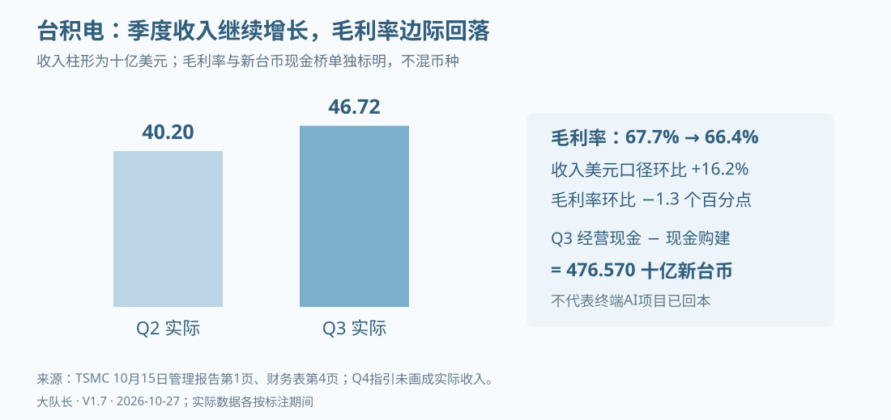
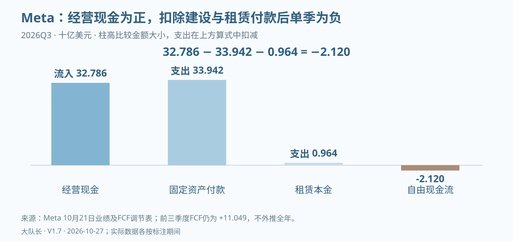
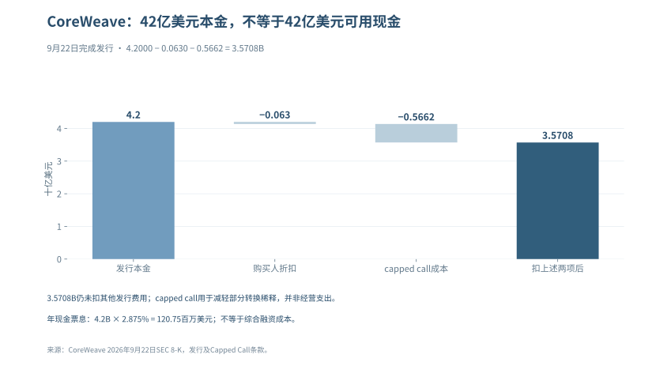
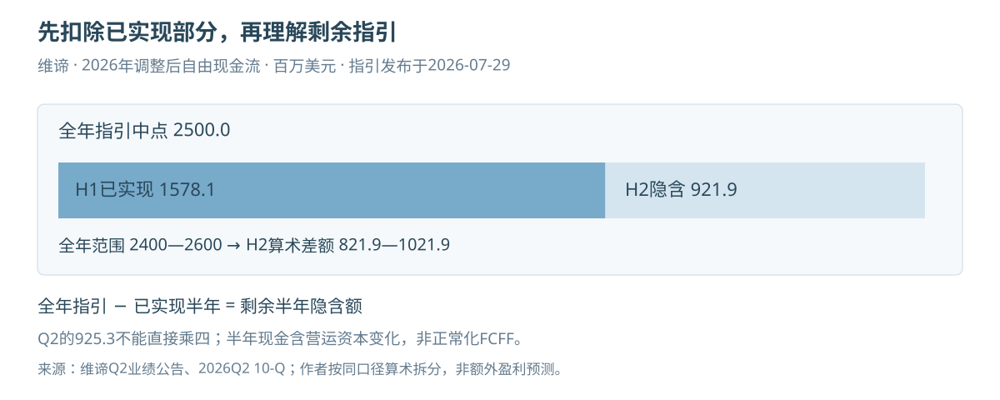
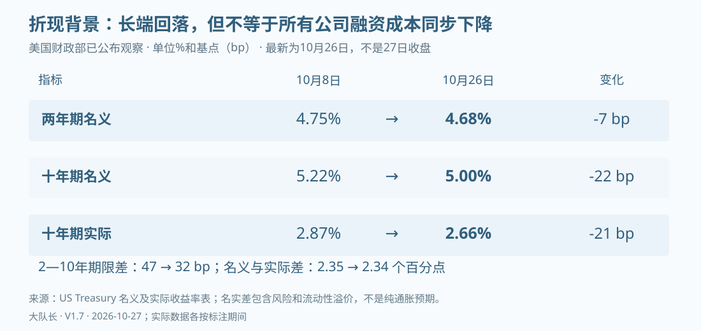

# AI周期与泡沫 · 全景正文

大队长出品 · V1.7 · 2026-10-27

联系邮箱：fqsx@mail.ustc.edu.cn

## 免责声明

本报告为“大队长”基于公开资料形成的个人研究，不代表任何任职机构，不构成个性化投资建议、收益保证或交易指令。研究判断可能错误，公开信息可能随后修订。

资料核验截至2026年10月27日（北京时间），各财务、市场、技术与政策数据使用正文注明的报告期或观察日，并非全部是同日现值。公司指引、条件算例和已实现结果分开；没有证据的输入留空，未完成校准的情景不提供精确概率。

这是按现行判断重新组织的正文，不是历史原页加滚动校注。旧稿独立存档；原预测条件不倒改。段落中的核验范围以具体来源为准，不等于对全部历史事实重新审计。

## 本次更新

1. 把历史原页与校注叠加改为现行正文，原339页中的独有主题保留，重复分册合并；本册不嵌入旧版。

2. 利润篇接入台积电、ASML、Meta三季报与中国存储数据，统一主营、投资重估、营运资本和现金建设口径。

3. 融资和变现篇接入Anthropic公开S-1；合同最低采购、可取消上限、租赁及担保分列，递表不视为融资到账。

4. 中国传导区分正式报表、预告和经营公告；已发生事件退出未来日历，后续电话会采用北京时间。

5. 综合判断采用9月通胀及修订值、10月26日国债观察，保留经营改善和融资可得的反方证据，不生成未经校准的新概率。

6. 重写风险传导、延迟消化和跨境工具章节，撤下确定崩盘时间、自动踩踏系数及个人操作配比。

7. 事实核对按当前论据重组，沿用基线和未核缺口单列；历史审计与预测记分只在独立档案追溯。

8. 目录、书签和页码全部由本册正文重建；变更一条一段，集中列出参考资料，保留淡蓝色图表并加“大队长出品”水印。

<!-- BODY_START -->

## 研究总览：从资本投入到股东回报

截至2026年10月27日，已取得的公开证据支持一个分化的判断：供应商收入、交付和部分经营现金仍在兑现，模型服务的收入与经营表现也有改善；与此同时，先建资产后收回现金的期限差、客户融资安排和长期采购承诺，继续要求按公司与项目分别核算。尚无充分证据确认全行业需求和融资同时崩塌，也没有理由把每个新增订单都当成已实现的投资回报。

这份研究追踪同一笔资本投入怎样经过融资、建设、采购、交付和付费，最后回到可分配现金与每股价值。若资金在产业链内从投资转为采购、再成为设备收入，交易的法律和会计真实性并不因此消失；真正需要识别的是最终付款人、现金来源、风险承担者以及合同能否取消。

### 哪些新事实改变了判断

台积电第三季度美元收入46.72十亿、毛利率66.4%，显示供应端经营兑现；以新台币财务表复算，经营现金扣除固定资产购建为476.570十亿新台币。这个结果反对“上游已经普遍无法回收现金”，却不能替下游模型公司或终端应用证明回本。[台积电季度资料](https://investor.tsmc.com/english/quarterly-results/2026/q3)

Meta第三季度经营现金32.786十亿美元，扣除固定资产付款33.942及融资租赁本金0.964后，公司自由现金流为−2.120十亿美元，前三季度同口径累计仍为正11.049十亿美元。单季建设压力与累计现金韧性应同时进入模型；公司合并数据不等于AI项目独立回报。[Meta第三季度业绩及非GAAP调节表](https://investor.atmeta.com/investor-news/press-release-details/2026/Meta-Reports-Third-Quarter-2026-Results/default.aspx)

Anthropic于10月26日公开S-1，未经审计的上半年收入16.286十亿美元、经营现金3.929十亿美元；第二季度营业利润0.974十亿美元，上半年合计仍营业亏损0.693十亿美元。经营改善是必须接纳的反方证据，净亏损中非现金公允价值计量和多年合同承诺则另行分析，既不能把净亏损称为同额烧钱，也不能把递表当作融资到账。[申请状态](https://www.anthropic.com/news/s1-sec)、[S-1财务与合同披露](https://www.sec.gov/Archives/edgar/data/2130357/000162828026067168/anthropicpbc-sx1.htm)

### 怎样把这些事实用于公司研究

| 问题 | 模型输入 | 需要的反证 |
|---|---|---|
| 需求能否持续 | 客户、量价、交付、利用率、续约和实际收费 | 付费留存改善、投入趋缓而收入增长，可降低回收担忧 |
| 利润是否能转成现金 | 营运资本、折旧、现金建设、租赁和税 | 客户预付减弱后仍有稳定现金，才支持可重复性 |
| 风险落在谁身上 | 股权、债务、采购、担保、残值和取消权 | 融资完成、合同续接和真实回款分别核验 |
| 价格是否预支增长 | 分季度盈利、净债务、股本、倍数和折现率 | 盈利上修未必抵消倍数回落，反之亦然 |

本报告据此展开利润、循环融资、商业化、技术与国际约束、中国传导、公司估值，以及风险传导和有序消化两类情景。情景用于压力测试，不是经统计校准的概率，也不是交易指令。

## 第一部分：哪些是真金白银，哪些是估值游戏？

> 观察截至2026年10月27日，北京时间。金额无特别说明均为十亿美元；台积电、ASML、中国公司及韩国初步值另标本币。各公司财期分别列示，季度财务表与美光全年业绩发布表未经审计，Microsoft、Lumentum及Coherent的全年数据来自已审计10-K。以下区分经营收益、投资收益、会计估计与现金回收，不以其中一种直接替代另一种。

### 从收入走到现金

Alphabet第二季度的稀释每股收益是9.11美元，其中股权证券收益的税后贡献为6.26美元；与此同时，Google Cloud收入与营业利润仍在快速增长。Amazon也同时呈现AWS经营改善和投资重估拉高净利润。仅看净利润，会高估经营改善；把重估全部剔除后说“没有真需求”，又会漏掉已经实现的云业务增长。

本篇沿着一笔收入走到现金：先辨认客户支付的是什么，再把营业利润、持仓收益与税项分开，随后检查回款、资本开支和租赁，最后问新投入能否在设备失去经济竞争力前赚回成本。Oracle FY27Q1把矛盾推得更清楚：云基础设施收入增长121%，资本开支却超过经营现金流，经营现金又得到大额客户预付款支持。当前证据支持“经营兑现与资本回收压力并存”，不支持“五家公司利润都不真实”，也不支持“高增长足以证明任何建设成本都合理”。

| 阅读位置 | 要回答的问题 | 不能偷换的口径 |
|---|---|---|
| 经营与现金拆解 | 哪些经营已兑现，利润如何进入现金？ | 非经营收益不等于假利润，现金支出不等于当期费用 |
| 客户与回款 | NVIDIA的客户和回款发生了什么变化？ | 直接客户、最终客户、应收集中度分开 |
| 估值与历史比较 | 公司好与投资回报好之间差在哪里？ | 估值时点、历史案例与预测概率分开 |
| 后续证据与反方检验 | 下一次财报应怎样推翻或加强判断？ | 观察规则不冒充统计模型，风险不等于交易指令 |

### 1.1 五大巨头：经营兑现与现金回收分开判断

公司利润需要按来源判断：已经交付的产品与服务、非经营收益、仍待收回的应收款，以及支持未来增长的资本投入，回答的是不同问题。下表把经营与现金压力并列，避免把盈利质量压成缺少统一权重的单一评分。

| 公司与统计期 | 已确认的经营 | 本篇重点核查 | 当前判断 |
|---|---|---|---|
| NVIDIA，FY27Q2，截至7/26 | 收入96.221，数据中心89.023；GAAP毛利率75.0% | 经营现金24.077，低于前季50.344；应收周转天数由45天升至60天 | 需求和利润强，回款节奏与支持客户的安排需跟踪 |
| Microsoft，FY26Q4，截至6/30 | 收入90.007，营业利润40.603；Azure及其他云服务收入增43% | 经营现金55.441，现金购置固定资产35.802 | 现金仍厚，不能用OpenAI投资关系否定整个云业务 |
| Alphabet，2026Q2 | Cloud收入24.768、营业利润8.814 | 股权证券收益税前99.031；单季自由现金流−5.855 | 经营和持仓收益均真实入账，但估值不能混用 |
| Amazon，2026Q2 | AWS收入42.232、营业利润16.621 | 其他收益净额53.415，全部非营业税前净额53.396；截至6/30过去12个月FCF−7.604 | AWS增长成立，合并净利润和现金回收需分别解释 |
| Meta，2026Q3，截至9/30 | 收入64.601，其中广告63.061；GAAP净利润9.860 | 经营现金32.786，现金固定资产购置33.942、融资租赁本金0.964；损益含法律和解费用9.89 | 广告继续增长，单季FCF转负；营业利润下降不能全部归因于AI投入 |

资料：[NVIDIA CFO说明](https://www.sec.gov/Archives/edgar/data/1045810/000104581026000073/q2fy27cfocommentary.htm)、[Microsoft财报](https://www.microsoft.com/en-us/Investor/earnings/FY-2026-Q4/press-release-webcast)、[Alphabet财报](https://s206.q4cdn.com/479360582/files/doc_financials/2026/q2/2026q2-alphabet-earnings-release.pdf)、[Amazon财报](https://ir.aboutamazon.com/news-release/news-release-details/2026/Amazon-com-Announces-Second-Quarter-Results/default.aspx)、[Meta10月21日Q3财报](https://investor.atmeta.com/investor-news/press-release-details/2026/Meta-Reports-Third-Quarter-2026-Results/default.aspx)。这不是同期间排名：NVIDIA季度终点不同，Amazon所列FCF为滚动12个月；尚未取得新季报的公司不提前填入预测。

台积电10月15日已发布Q3正式业绩：美元收入46.72B，较Q2的40.20B增长约16.2%；新台币收入1,494.24B，同比增长50.9%，与美元口径的41.2%不能互换。毛利率由67.7%降至66.4%，但归母净利润由706.56B升至763.06B新台币。HPC占收入68%并不等于AI占比，Q4的52.3—54.3B美元收入区间仍是指引。这些实际经营结果反驳即时需求断崖，却不能证明下游每个项目均已回本。[台积电Q3管理报告，第1—2页](https://investor.tsmc.com/english/encrypt/files/encrypt_file/reports/2026-10/f83780000ddc0c3b48e57a87eab6814c4ab35058/3Q26%20ManagementReport.pdf)、[Q3实绩与Q4指引](https://investor.tsmc.com/english/quarterly-results/2026/q3)

### 1.2 从账面利润到可支配现金

#### 1.2.1 持仓重估：单列，不把“非现金”写成“不真实”

持有的股权升值可以按照适用准则进入损益，这一收益有经济含义，但它既不是售出云服务的收入，也不一定在当季变成现金。对投资者的直接影响是：使用含巨额重估的每股收益计算市盈率，可能得到看似便宜、实际不可持续的倍数。

Alphabet官方披露，Q2股权证券收益净额99.031，税后使净利润增加约77.1，每股收益增加6.26。因此9.11减6.26约为2.85美元，这是“只剔除该项影响后的EPS”，并非公司提供的纯经营EPS，更不是已剔净全部一次性项目的标准化盈利。该证券收益也不能全部指认为Anthropic；公司资产组合还包括其他上市及非上市投资，逐项归因要以附注为准。[Alphabet财报附表第9页](https://s206.q4cdn.com/479360582/files/doc_financials/2026/q2/2026q2-alphabet-earnings-release.pdf)

Amazon的Q2净利润62.647与税前项目不能直接相减得到税后“真实净利润”。其中53.415是其他收益净额；加上利息收入、扣除利息费用后的全部非营业税前净额为53.396，不能把两个标签混用。10-Q进一步列出，私营股权可观察价格上调约50.5，主要涉及Anthropic；估值考虑证券权利、流动性事件时间、其他证券类别以及缺乏流动性折价，并不是“最新估值×固定持股比例”。未来融资价格会影响计量，但具体利润贡献仍须等待适用证券与税项的披露。[Amazon Q2 10-Q，利润表及投资附注](https://www.sec.gov/Archives/edgar/data/1018724/000101872426000026/amzn-20260630.htm)

Microsoft也需要做同样拆分。公司Q4非GAAP净利润调整只排除了OpenAI投资的0.480税后收益，但业绩稿另提示当季存在Anthropic投资收益3.2。因此“公司非GAAP”不能自动等同于“已剔除所有投资收益”。NVIDIA当季股权证券净收益约7.8，同样要与GPU经营利润分开看。对所有公司执行相同规则，才能避免只挑支持泡沫判断的项目。

用于比较的利润桥应写成：

> GAAP净利润 − 已披露的税后非经营收益 + 已披露的税后非经营损失 ± 其他明确调整 = 研究口径调整后净利润。

若只拿到税前项目，保留税前利润桥；不以统一21%税率替公司补出“实际税后值”。投资盈利能否重复、能否兑现、能否分配是三个不同问题。即使下一轮融资继续涨价，也不能把未实现持仓收益赋予云服务收入同样的估值倍数。

#### 1.2.2 折旧：会计寿命与经济寿命之间的差距

GPU可以继续开机，并不代表它还能按原租价获得客户。反过来，新一代芯片出现，也不代表旧设备马上归零；旧GPU可能转向价格敏感的推理、内部研发或较低负载任务。检验折旧的对象，应当是特定资产组的可赚取现金，而不是笼统地宣布“GPU都只能用三年”。

服务器、网络设备与数据中心建筑不能使用统一经济寿命。不同公司的设备构成、部署批次和残值判断不同，会计估计变更通常影响未来费用分摊；只有取得违背准则、错误估计或重大减值的证据，才进一步判断是否错报。外部研究者可以提出较短的经济寿命，但其测算仍是敏感性假设，不能直接记成公司已审计报表中的少提费用。

在现有财报上，先检查四件事：固定资产新增何时转为可使用，折旧是否随投产增加，闲置或提前退役是否减值，以及租赁资产和自建资产是否被放在不同费用项目。公司会计政策及未来变更须在原附注逐项核对，不用一张多年旧表替代当前政策。[Microsoft FY2026 10-K](https://www.sec.gov/Archives/edgar/data/789019/000119312526323660/msft-20260630.htm)、[Meta Q2 10-Q](https://www.sec.gov/Archives/edgar/data/1326801/000162828026050705/meta-20260630.htm)

一个可复算的敏感性例子：假设某批设备可折旧基础60亿美元、残值为零，直线法6年折旧每年10亿美元；若经济寿命只有3年，每年经济耗损相当于20亿美元。两种假设相差10亿美元税前费用，但这只是同一设备组、全年在用的演示。不能用全公司固定资产乘这个差额，也不能把它记成某家公司实际少提折旧。

现金流也不能完全解决这个问题。折旧虽在经营现金流中加回，设备最终仍需替换；评价长久期项目应另估维持性资本开支，不能把“经营现金为正”当作“设备全生命周期已经回本”。

#### 1.2.3 自由现金流：先统一计算，再谈压力

| 公司 | 统计期 | 经营现金流 | 扣减项目 | FCF或可比计算 | 口径边界 |
|---|---|---:|---:|---:|---|
| Alphabet | 2026Q2 | 39.069 | 现金固定资产购置44.924 | −5.855 | 公司定义；TTM仍为+53.273，不能把单季转负说成全年无现金 |
| Microsoft | FY26Q4 | 55.441 | 现金固定资产购置35.802 | +19.639 | 本表现金桥；不是“总CapEx约41”再额外扣一遍租赁新增 |
| Meta | 2026Q3 | 32.786 | 固定资产33.942+融资租赁本金0.964 | −2.120 | 公司定义，已包含该租赁本金；前九个月累计仍为+11.049 |
| NVIDIA | FY27Q2 | 24.077 | 固定资产及无形资产2.677+相关本金0.059 | +21.341 | 公司定义，不能仅用PP&E现金购置替代全部扣项 |
| Amazon | 截至6/30的TTM | 161.403 | 净现金购置固定资产169.007 | −7.604 | 公司主FCF，未在这一行额外扣融资租赁本金 |
| Oracle | FY27Q1，截至8/31 | 23.103 | 资本开支28.499 | −5.396 | 经营现金含11.363客户预付款，且公司明确其具有重大融资成分 |

这些数据来自上列各公司财报现金流及非GAAP调节表；前五项算术分别为39.069−44.924、55.441−35.802、32.786−33.942−0.964、24.077−2.677−0.059、161.403−169.007，Oracle为23.103−28.499。不得把季度列与TTM列相加得到“行业FCF”。

Meta的Q2历史值仍有比较价值：经营现金31.862，现金固定资产购置30.116、租赁本金0.962，FCF为+0.784；Q3经营现金增加0.924，而上述两项付款合计增加3.828，单季FCF因而减少2.904至−2.120。Q3期末现金、现金等价物及有价证券合计约82.45，不能由单季转负推成即将出现支付危机；也不能把公司包含租赁本金的135—145全年资本支出指引写成已发生支出。[Meta Q2历史财报](https://investor.atmeta.com/investor-news/press-release-details/2026/Meta-Reports-Second-Quarter-2026-Results/default.aspx)、[Q3现金流及指引](https://investor.atmeta.com/investor-news/press-release-details/2026/Meta-Reports-Third-Quarter-2026-Results/default.aspx)

Oracle FY27Q1总收入19.345、云收入11.607，其中IaaS为7.388、同比增长121%；经营兑现很强，但资金桥不能只看增长率。当季经营现金23.103中，11.363来自具有重大融资成分的客户预付款；资本开支28.499后，自由现金流为−5.396。公司同时完成ATM普通股增发，净到账19.909。客户预付款与股权融资都是真实资金来源，却不是云服务已经赚回成本的证据。[Oracle FY27Q1业绩](https://investor.oracle.com/files/content_files/1q27-pressrelease-September_FINAL.pdf)、[Oracle FY27Q1 10-Q](https://www.sec.gov/Archives/edgar/data/1341439/000119312526389274/orcl-20260831.htm)

这张图也刻意没有把664的剩余履约义务、288的未起租数据中心租赁承诺和当季资本开支相加。约13%的RPO预计未来12个月确认，约37%在第13—36个月、34%在第37—60个月，其余更晚；288的租赁承诺预计FY27Q2至FY29陆续开始，合同通常为15—19年，尚未反映在8月31日资产负债表。它们强化的是未来收入能见度和长期履约约束，不是当期现金、收入或损失。

判断外部融资需求，应先比较经营现金与现金CapEx，再看现金余额、债务到期、股息回购、股权投资和租赁还本。FCF已经扣过CapEx，不能再把两者的大小关系当成资金缺口；即使FCF为正，大额投资和偿债也可能带来融资需求，即使单季为负，也可能由既有现金余额覆盖。

Amazon最能说明这个区别：AWS收入和分部利润显著增长，但合并口径建设付款更快，导致滚动FCF转负。这里既不能说AWS利润“依赖Anthropic重估”，也不能用AWS利润率替整个AI建设项目算回报。零售物流、其他技术基础设施和服务采购都在合并报表中，纯AI回报需要更细的资本和利润归属。

#### 1.2.4 利润高增而现金没有同步：光模块的现实检验

两家A股光模块公司的半年报，把“需求真实但要查现金”落到了可核对的账上。金额单位在本小节改为人民币亿元，统计期均为2026年1—6月，半年报未经审计。

| 公司 | 归母净利润 | 同比 | 经营活动现金流量净额 | 同比 | 现金购建长期资产 |
|---|---:|---:|---:|---:|---:|
| 中际旭创 | 136.51 | +241.70% | 18.00 | −44.08% | 48.02 |
| 新易盛 | 75.29 | +90.98% | 16.16 | +69.67% | 12.64 |

资料：[中际旭创8/22半年报，第8、60页](https://static.cninfo.com.cn/finalpage/2026-08-22/1225491753.PDF)、[新易盛8/25半年报，第7、44页](https://static.cninfo.com.cn/finalpage/2026-08-25/1225499406.PDF)。归母利润与合并经营现金并非完全一致的权益归属口径，表中仅比较量级，不将两者相除标成严格的现金转化率。

中际旭创利润增长没有在同期等比例变成现金，需继续跟踪存货、应收项目与供应商付款；新易盛经营现金同比上升，也不表示每笔订单均已回款。这些差异可能来自交付增长带来的营运资金占用、备货和结算节奏，不能仅由半年CFO较小推出虚假收入。

若按“经营现金−现金购建长期资产”做简单资金桥，中际旭创约−30.02亿元、新易盛约+3.53亿元。它们不是估值模型中的FCFF，也未扣除所有融资与投资支出；用途是找出需要下一期报表解释的资金差额，而不是由一次现金差额推断公司长期价值。

10月23日的经营公告提供了订单和产品进度，却没有补齐Q3现金表：中际旭创披露海外重点客户订单已覆盖2027年，部分客户给出2028年需求指引；新易盛披露800G和1.6T已是主要出货产品，1.6T仍在爬坡。订单、需求指引和已实现收入应分开记录。截至10月27日，证据集中尚未取得两家公司正式Q3报告，故前表保留H1期间，不把经营公告改写成新季报。[中际旭创公告，第1—2页](https://static.cninfo.com.cn/finalpage/2026-10-23/1225617691.pdf)、[新易盛公告，第1页](https://static.cninfo.com.cn/finalpage/2026-10-23/1225617676.pdf)

#### 1.2.5 海外光学供应商：经营改善与融资损失可以同时发生

Lumentum（朗美通）8月11日披露，截至6月27日的FY26Q4收入为10.063亿美元，同比增109.3%；GAAP营业利润率27.8%，非GAAP营业利润率36.6%。但同季GAAP净亏损约72亿美元，主要受约78亿美元非现金债务清偿损失影响，来自可转债股权化，而不是同额设备经营亏损或现金外流。非GAAP净利润3.263亿美元有助于观察调整后的经营，仍不能抹去债务转换对普通股股东的稀释。[Lumentum季度业绩及调节表](https://www.sec.gov/Archives/edgar/data/1633978/000162828026055726/lite_ex991xq4fy26.htm)

现金要另看完整期间：Lumentum FY2026全年经营现金流7.514亿美元、现金固定资产购置4.513亿美元，两项相减为3.001亿美元。它支持全年经营现金覆盖这项建设付款，却不是单季现金转化率，也未扣除所有投资和融资支出。这一案例提醒我们，看到巨额净亏损时先查发生在哪一层，不能直接判定需求或流动性已经崩塌。[Lumentum FY2026 10-K，现金流量表及债务附注](https://www.sec.gov/Archives/edgar/data/1633978/000162828026057358/lite-20260627.htm)

Coherent（高意）的反差在现金端。8月12日披露的FY26Q4收入为20.46亿美元，报告口径同比增33.8%，不与公司另列的备考增速混用；GAAP与非GAAP毛利率分别为38.5%和40.2%，两种利润定义也分别列示。随后提交的FY2026全年10-K显示，经营现金流只有0.79514亿美元，现金固定资产购置11.02909亿美元，两项之差为−10.23395亿美元。年报解释了存货、应收占款及应付抵补；当年获得的NVIDIA股权资金属于融资现金，不是客户买产品产生的经营现金。[Coherent季度业绩](https://www.sec.gov/Archives/edgar/data/820318/000119312526346860/d128030dex991.htm)、[Coherent FY2026 10-K，现金流量表及流动性分析](https://www.sec.gov/Archives/edgar/data/820318/000082031826000020/iivi-20260630.htm)

上述两家全年现金均来自已审计年报，季度业绩仍是未经审计口径，不能将全年现金与单季利润相除。Coherent的负差额表明扩产与营运资金需要资金支持，不足以单独证明收入虚假或公司将发生支付危机；下一步应检查库存何时交付、应收何时回款，以及融资现金能覆盖多久。

#### 1.2.6 整机与芯片：调整后现金需要逐项还原

Dell（戴尔科技）截至7月31日的FY27Q2，AI优化服务器收入为164.01亿美元、同比增100%，AI订单609亿美元、期末在手订单约950亿美元；9月1日公司将全年AI服务器收入指引从600亿提高到740亿美元。收入证明交付，订单和上调指引则还需未来履约，不能合成已经收回的现金。[Dell官方季度业绩，第1—2页](https://investors.delltechnologies.com/node/20956/pdf)

同季Dell合并经营现金流为22.25亿美元，同比下降约13%。公司现金调节表将其扣除12.39亿美元净资本支出后得到9.86亿美元FCF，再加回66.67亿美元融资应收调整及4.96亿美元经营租赁设备调整，得到81.49亿美元调整后FCF。这三个现金指标不能互换，81.49亿美元不是当季实际经营现金流。客户融资、设备交付与回款的时间差应进入研究；仅凭AI服务器收入翻倍，还无法判断客户的算力项目是否赚回资本成本。[Dell业绩现金表及FCF调节，第5、8—9页](https://investors.delltechnologies.com/node/20956/pdf)

HPE（慧与）9月2日发布的FY26Q3同样截至7月31日，合并收入122.13亿美元，“Cloud & AI”分部收入90.42亿美元、分部营业利润率17.0%，但该分部纳入服务器、混合云与金融服务，并非纯AI收入和利润。合并经营现金流16.41亿美元，减去7.45亿美元固定资产及软件投入、加回0.92亿美元资产处置、扣除0.30亿美元汇兑影响，才得到公司定义的9.58亿美元FCF。网络业务还受Juniper并表影响，不能把合并增速全部解释成AI有机增长。[HPE季度业绩及现金调节](https://investors.hpe.com/~/media/Files/H/HP-Enterprise-IR/documents/q3-2026/q3-2026-earnings-press-release.pdf)、[HPE 10-Q，分部及经营分析](https://www.sec.gov/Archives/edgar/data/1645590/000164559026000080/hpe-20260731.htm)

Marvell（迈威尔）8月27日披露截至8月1日的FY27Q2收入27.393亿美元、同比增37%，GAAP净利润3.080亿美元；经营现金流6.055亿美元、现金固定资产购置1.267亿美元，两项相减为4.788亿美元。这是当季利润与现金同时为正的例子，但无晶圆厂模式仍有资本约束：10-Q列示长期产能预付款余额4.870亿美元，年初为2.788亿美元，并披露供应与产能承诺。预付款余额变化不能再次从已含相关现金影响的CFO中扣除；数据中心收入21.715亿美元也包含多类产品，不能都算作终端AI付费。[Marvell季度业绩](https://investor.marvell.com/news-events/press-releases/detail/1031/marvell-technology-inc-reports-second-quarter-of-fiscal-year-2027-financial-results)、[Marvell 10-Q，附注3、9及14](https://investor.marvell.com/sec-filings/all-sec-filings/content/0001835632-26-000025/mrvl-20260801.htm)

这三家季度报表未经审计，现金定义各不相同，也不能与前两家全年值求和得到“行业现金回收率”。研究的落点应是各公司的交付、付款条件和投入回收期，而不是让一张高增长表替代全部判断。

#### 1.2.7 美光：存储利润已兑现为现金，但终端回本仍是另一道题

美光9月30日公布截至9月3日的FY26Q4及全年业绩，本季收入54.229B、GAAP净利润37.701B、经营现金流43.973B；全年收入133.188B、经营现金89.675B。以下财务数据来自公司未经审计的业绩材料，季度与全年分别展示。[美光官方业绩及财务表](https://investors.micron.com/news/press-release/2026/Micron-Technology-Inc--Reports-Record-Fiscal-Fourth-Quarter-and-Full-Year-2026-Results/default.aspx)

| 现金桥（十亿美元） | FY26Q4 | FY2026 |
|---|---:|---:|
| 经营现金流 | 43.973 | 89.675 |
| 现金购建固定资产 | 11.110 | 30.712 |
| 两项相减：本报告简单现金桥 | 32.863 | 58.963 |
| 政府激励款 | 0.327 | 3.316 |
| 固定资产出售回款 | 0.009 | 0.029 |
| 公司净资本支出 | 10.774 | 27.367 |
| 公司调整后自由现金流 | 33.199 | 62.308 |

净资本支出把政府激励和资产出售回款从购建支出中扣除，因此本季公司调整后自由现金流为43.973−11.110＋0.327＋0.009＝33.199B；本报告仅用经营现金减现金购建，得到32.863B。两种口径都为正，却不是同一指标，更不能称其中一种为“GAAP自由现金流”。[官方演示材料，第43、49页现金调节](https://s25.q4cdn.com/621799436/files/doc_financials/2026/q4/Q4-26-Earnings-Deck.pdf)

同比或环比还要核对周数：FY2026有53周，Q4有14周，Q3有13周。本季收入较上季41.456B增长30.81%，机械按周归一后约增长21.47%，但后一个数字仍未剔除价格、产品结构和交付节奏，不是有机增长率。[美光Q3 10-Q，Note 1及MD&A](https://www.sec.gov/Archives/edgar/data/723125/000072312526000015/mu-20260528.htm)

这组现金是对“供应链利润没有经营现金支持”的直接反证。公司披露Q4收取约12.3B客户押金，但其列入融资活动、不增加经营现金或自由现金流，因此不能再从43.973B里重复扣除。长期合同可支持建设，押金也存在满足采购条件后的返还安排，不能当永久收入；供应商现金充裕与云商、模型客户是否收回投资，仍需分别检验。[美光官方讲稿，第8—9页](https://s25.q4cdn.com/621799436/files/doc_financials/2026/q4/Q4-FY26-Prepared-Remarks.pdf)

公司对FY27Q1给出61.5±1.5B收入指引，预计净资本支出约11.5B、上半年约25B且下半年更高。这些是管理层前瞻，不是已发生支出，也不是明确的全年资本支出点值。后续反证重点是存储售价、交付、应收和库存、合同重议以及新增产能投产后的现金回报。

#### 1.2.8 机房交付开始收费，不等于全部收入都是经常租金

Applied Digital于10月7日美东盘后发布FY27Q1业绩，报告期截至8月31日。HPC托管收入262.6百万美元中，基础租金65.8、租户装修服务183.5、费用回收13.3；三项相加与分部收入一致，基础租金仅占约25.1%。装修服务是本期已确认收入，但不能把262.6全部乘四当作稳定年租金，也不能把收入当收现。[公司季度财报，HPC Hosting Update](https://www.globenewswire.com/news-release/2026/10/07/3376854/0/en/applied-digital-reports-fiscal-first-quarter-2027-results.html)

集团GAAP收入341.9百万美元与调整后收入300.4不是同一个范围：后者排除合并子公司ChronoScale。10月1日新增75MW达到可服务状态，使Polaris Forge 1园区已投入运营的关键IT负荷容量达到250MW，这是可服务容量而非实时用电负荷，也是季度末之后的交付，不能倒放进截至8月31日的租金中。它提供了建设转运营的正面证据；项目回本仍须对照运营成本、融资和后续现金。

集团现金表给出的另一面也不能省略：经营现金流63.921百万美元，购建固定资产及其他资产2,074.698百万美元，相减为−2,010.777百万美元；同期净融资现金流1,543.472百万美元。这个简单现金桥不是公司定义的FCF，也不是HPC分部现金流；它说明本季建设远超经营现金支持，却不能仅凭建设期缺口判定项目净现值为负或公司破产。[FY27Q1 10-Q，第5页](https://ir.applieddigital.com/sec-filings/all-sec-filings/content/0001144879-26-000059/apld-20260831.htm)

#### 1.2.9 三星初步利润：能更新方向，不能替代现金表

三星10月8日给出的2026Q3初步合并销售额约195万亿韩元、营业利润约107.4万亿韩元，是K-IFRS估计区间的中点，不是已审计完整财报。公告没有将这组数字拆成HBM利润、经营现金或客户回报；因此只能纳入利润观察，不据此补造现金回收，也不与美元公司的收入直接求和。[三星Q3预披露](https://news.samsung.com/global/samsung-electronics-announces-earnings-guidance-for-third-quarter-2026)

三星完整Q3业绩电话会安排在北京时间10月29日09:00；SK海力士Q3电话会为10月28日08:00。上述时间是公司日程，不是财务结果，截止日尚不能把未来季报的利润和现金填入当前表。[三星投资者日历](https://www.samsung.com/global/ir/ir-events-presentations/events/)、[SK海力士电话会邀请](https://news.skhynix.com/en/q3-2026-earnings-conference-call-invitation/)

#### 1.2.10 台积电与ASML：现金充裕，也要分清重估与预收的影响

台积电Q3的经营现金流为919.776B新台币，固定资产购建现金443.206B，相减为476.570B；两项均来自本季现金流表，不是前三季累计，也不与美元收入直接相除。经营现金高于Q2的783.365B，同时收入与归母利润增长，对“供应链只有账面利润”的说法构成反证。不过，Q2营业外收入95.83B降至Q3的34.59B，包含上一季资产处置及重估因素的消退，解释了净利润为何没有跟收入等幅增长。[台积电财务表，第4页](https://investor.tsmc.com/english/encrypt/files/encrypt_file/reports/2026-10/3a94d1034b9e6b22446b674f7aaf3d088a12a193/FS.pdf)、[管理报告，第1页](https://investor.tsmc.com/english/encrypt/files/encrypt_file/reports/2026-10/f83780000ddc0c3b48e57a87eab6814c4ab35058/3Q26%20ManagementReport.pdf)

ASML于10月14日披露截至9月27日的Q3美国GAAP业绩，以下改用十亿欧元：收入11.6620、营业利润5.1728、净利润4.9604，分别较上年同期增长约55.2%、109.6%和133.5%。利润增长既有设备及升级业务支持，也含0.5097税前股权投资收益，管理层明确主要来自Mistral AI投资估值上升；该项约占税前利润5.7507的8.9%，不能把税前收益直接从税后净利润减去，伪造一个“调整后净利润”。[ASML财务表，第2页](https://investor.asml.com/static-files/d310262b-d037-485d-83b5-92c93cc462f0)、[管理层讲稿，第1页](https://investor.asml.com/static-files/40c56a6b-1460-4f69-9340-6a869560d24b)

同季ASML经营现金11.7976，减去固定资产0.4133与无形资产0.0339，公司定义的FCF为11.3504。现金很强，但资产负债变动贡献7.0090、约占经营现金59.4%，管理层亦说明订单和客户预付款的推动；该总项不全是客户预付款，也不能当成设备已经交付并赚到利润。现金流表已经调回股权估值收益，不再重复扣一次。Q4收入14.2—15.2、全年44—45仍是公司指引，而2029—2030年的客户意向也不能改称已锁定订单。[财务表，第9页](https://investor.asml.com/static-files/d310262b-d037-485d-83b5-92c93cc462f0)、[管理层讲稿，第2页](https://investor.asml.com/static-files/40c56a6b-1460-4f69-9340-6a869560d24b)、[正式业绩稿](https://www.investor.asml.com/news-releases/news-release-details/asml-reports-eu11.7-billion-total-net-sales-and-eu5.0-billion-net-income-q3-2026)

#### 1.2.11 中国存储：利润与备货现金可能走向相反方向

德明利10月26日公开的未经审计三季报，使存储链的现金压力有了新样本，以下均为人民币亿元：Q3收入116.45、归母利润27.29，而前三季累计归母利润87.46、经营现金净额−136.91。不能把累计现金流标成单季；从前三季经营现金再减现金购建长期资产5.00，简单资金桥约为−141.91。同期存货由年末70.58升至289.86，公司解释包括企业级存储备货，净融资现金143.93则属于资金来源，不是经营回款。[德明利2026三季报，第2—4、18—19页](https://disc.static.szse.cn/download/disc/disk03/finalpage/2026-10-26/e8eabd45-e97f-4bed-b05d-27f58665dc50.PDF)

这个样本要求追踪库存交付、收款与新增借款，尚不足以判定收入虚假或即将违约。江波龙10月15日公布的是业绩预告而非正式三季报：前三季预计收入380—400亿元、归母利润140—149亿元；公司称Q3经营现金转正，却未披露数额。其关于DRAM、NAND涨幅收窄的说明，提示售价与利润弹性不能线性外推，但预告不能替代经营现金明细。[江波龙业绩预告，第1—2页](https://static.cninfo.com.cn/finalpage/2026-10-15/1225607002.PDF)

#### 1.2.12 税务折旧：改变现金时点，不改变设备的物理寿命

税务折旧与财务报表中的折旧回答不同问题：前者决定合格投资何时抵减应税所得，后者把资产成本分摊到受益期间。IRS在2026年1月14日发布的Notice 2026-11说明，现行法律一般对2025年1月19日后取得并投入使用的合格资产恢复永久100%的额外首年折旧；具体资格、取得日期、投用时间与选项仍需逐项检查。不能据此把所有AI建设支出都立即扣除，数据中心建筑与设备也不能一概归类。[IRS《额外首年折旧指引》，2026-01-14](https://www.irs.gov/newsroom/treasury-irs-issue-guidance-on-the-additional-first-year-depreciation-deduction-amended-as-part-of-the-one-big-beautiful-bill)、[IRS Publication 946（2025），Special Depreciation Allowance](https://www.irs.gov/publications/p946)

提前抵扣可以改善建设初期的税后现金，却不是政府按设备价格无条件返还固定比例，也不表示设备永久多创造了同额经济利润。只为展示机制，假设设备计税基础100、可抵扣所得足够、边际税率21%，且暂不考虑州税、亏损结转、最低税等限制：首年全部抵扣可使当期税额比“不扣这笔折旧”少21，但如果对照方案是在以后年份逐年抵扣，增量价值主要是税盾提前的现值差，而不是额外获得21的永久收益。实际项目要对照各年税盾，而非从CapEx直接扣一个统一百分比。

有效税率也不能单独作为利润真实性评分。所得税费用除以税前利润是会计指标，现金缴税是付款指标；税收抵免、地域利润结构、一次性税项与递延所得税都可能造成差异。当税前利润含大额投资重估或接近零时，单季有效税率尤其不适合用统一红黄绿阈值比较。

| 检查对象 | 应读取的材料 | 能支持的判断 | 不能直接推出的结论 |
|---|---|---|---|
| 额外首年税务折旧 | 现行法规、资产类别、取得与投用日期 | 哪笔投资可提前形成税盾 | 全部AI投资都获得同一现金补贴 |
| 会计折旧与减值 | 固定资产政策、资产组、使用寿命与减值附注 | 费用分摊是否匹配资产使用 | 税法允许首年扣除，所以会计利润应同额下降 |
| 有效税率 | 税前利润、所得税费用及税率调节表 | 税项如何改变报告净利润 | 税率低就代表收入虚假 |
| 现金税与递延税 | 现金缴税、递延税资产负债及可实现性说明 | 税盾何时转成现金、以后可能怎样回转 | 本期少缴税可永远按同一数额持续 |

税制影响资本预算，是需要保留的机制；但订单提前、供给紧张、关税风险和产品升级也能改变采购时点。没有项目层面的反事实或公司明确归因，不能仅从订单排到远期证明建设由税务激励驱动，更不能把尚未发生的立法逆转设为固定年份的需求断崖。

### 1.3 英伟达的“真客户”分类

#### 1.3.1 先区分三种客户

直接向NVIDIA下单的客户可能是云厂，也可能是整机商、分销商或系统集成商；最终使用GPU的客户可能经多家云采购算力，资金提供者又可能是这些企业的投资人。三者不是同一张名单。把匿名直接客户按猜测填成微软、Meta、Amazon和Google，既放大精确感，也会错算穿透集中度。

截至7月26日的FY27Q2 10-Q披露，有一个直接客户占本季总收入16%，上半年有三个直接客户分别占16%、15%、13%。期末应收的五大直接客户分别占22%、14%、13%、11%、10%，这是应收余额占比，不能当成收入占比。公司还说明一个AI研究与部署企业通过购买其客户的云服务，对NVIDIA收入有重要贡献，但没有提供可直接计算的穿透占比。[NVIDIA Q2 10-Q，客户集中度及信用风险附注](https://www.sec.gov/Archives/edgar/data/1045810/000104581026000075/nvda-20260726.htm)

#### 1.3.2 回款节奏与现金缓冲

Q2收入环比增18%，经营现金却由50.344降至24.077，DSO从45天升至60天；公司解释与对部分投资级大客户延长付款期限、营运资金及现金税款有关。这里值得跟踪的是新增应收何时收回，而不是仅用“投资级”标签忽略账期，也不是一看到DSO增加就宣布坏账。

下一期应同时检验收入、回款和客户支持安排：应收增长若主要因为可解释的大型合同交付，后续能按期收款，则当前担忧会减轻；若反复延长账期，并伴随客户再融资困难、合同变更或应收减值，才构成更强的信用证据。分析中还应剔除季度末交付集中、税款支付和库存准备的影响。

9月28日NVIDIA新增150B股票回购授权，使剩余总授权达到235B；公司预计在FY2028结束前执行。这是潜在现金用途，不是已完成回购，更不是新增产业融资；150B已包含在235B中，不能相加，也不能在估值中预先扣减同额已回购股数。[NVIDIA回购授权公告](https://nvidianews.nvidia.com/news/nvidia-announces-a-150-billion-share-repurchase-authorization-increase)

#### 1.3.3 从卖设备到承担部分下游风险

GPU销售完成并确认收入，不能说明供应商此后没有风险。NVIDIA同时向部分客户提供股权资金、云服务承诺及建设担保，第二部分逐项核对法律状态；这些安排能帮助客户交付，也使供应商暴露于客户的再融资和终端需求。风险取决于合同期限、担保触发和第三方承接能力，不取决于给所有相关收入打一个统一“循环折扣”。

一个反证也要保留：博通9/2发布的FY26Q3业绩中，AI半导体收入16.7、同比增长221%，合并FCF13.665。这说明供应链确有收入和现金同时兑现的环节，不能把行业描述成纯粹的账面循环；但博通合并口径含基础设施软件，也不是云厂AI项目回报率。[博通官方财报](https://investors.broadcom.com/news-releases/news-release-details/broadcom-inc-announces-third-quarter-fiscal-year-2026-financial)

### 1.4 估值层面：现在贵不贵？

截至10月27日，本章没有取得同一交易时点的价格、最新股本和一致盈利预测的完整横截面，因此不给出当前个股PE或行业历史分位的精确排名。财报能够支持盈利结构判断，能否承受某一买入价格还需要一张独立估值表。

对重估收益较大的公司，先用分部营业利润和经营现金检验核心业务，再把投资资产单独估值；对高投入云厂，检查建设项目何时投产、收入如何爬坡、成熟期维持性资本开支是多少。只把当期负FCF永久化会低估增长资产，只把远期利润率套上今天投入又会高估项目。

| 估值对象 | 较合适的起点 | 需要另做的检查 |
|---|---|---|
| 广告、订阅等成熟业务 | 正常化营业利润、现金流 | AI效率收益与新增运营成本是否同时计入 |
| 云与AI基础设施 | 分部利润、投入资本及分阶段现金流 | 新旧资产组、投产率、利用率、资本化费用、租赁 |
| 持有的非上市股权 | 证券类别、交易价格与披露账面值 | 稀释、流动性折价、税与可出售限制 |
| GPU供应商 | 正常化盈利与经营现金 | 周期峰值利润、应收、库存及对客户的支持义务 |

“好公司不等于好股票”仍是本报告保留的判断，但它需要价格和现金流共同支持，不是一张历史崩盘图就能证明。相同增长预期下，估值越依赖多年后的现金，折现率和终局竞争格局的误差越重要。

### 1.5 六大历史泡沫横向对比

#### 1.5.1 横向对比表：比较机制，不平均跌幅

历史案例用于提出问题，不用于从六个样本估计AI崩盘概率。公司股价和市场指数、局部低点和长期低点、价格恢复和投资总回报不能直接合并；本节比较融资与经营机制，不计算跨案例平均跌幅。

| 案例 | 可借鉴的机制 | 不能直接套到AI的部分 |
|---|---|---|
| 南海公司，1720 | 债转股、融资叙事和投资人信心互相加强 | 不能说完全没有业务，更不能由其股价路径推算AI价格 |
| 英国铁路，1840年代 | 建设付款先行，收入爬坡慢；重复建设和竞争侵蚀回报 | 铁路寿命、监管和融资条件与GPU项目不同 |
| 美国，1929—1932 | 保证金和信贷收缩放大资产价格下跌 | 宏观萧条及银行危机不能简化为股市一天造成 |
| 日本，1980年代末 | 抵押品价格、信贷供给与企业资产负债表相互作用 | 土地、银行与人口结构不等于美国云计算行业 |
| 互联网与电信，2000年前后 | 订单预期失真、库存积压、供应商与客户同周期 | 当年盈利公司与亏损初创必须分别比较 |
| 次贷，2007—2009 | 风险转移未必减少总风险，期限和流动性错配会传染 | AI股权投资不等于住房按揭或多层结构化债权 |

#### 1.5.2 南海泡沫：融资能力不是商业回报

南海公司的债转股安排与贸易叙事共同支撑股价，英格兰银行档案也明确记录了公司的奴隶贸易活动。历史上存在业务，不意味着业务现金能解释当时估值；这个区别同样适用于AI，研究者需要追问外部客户愿意付多少钱，而不是在“有业务”与“纯骗局”之间二选一。[英格兰银行档案](https://www.bankofengland.co.uk/CalmView/Record.aspx?id=DS%2FUK%2F633&pos=7&src=CalmView.Persons)

对于当前项目，应把融资额、投资者权利和可分配现金分别登记；融资成功证明资本愿意承受风险，不能直接证明项目净现值为正。

#### 1.5.3 铁路狂热：正确的技术方向也会遇到错误的资本预算

铁路案例保留的重点是现金时序：线路立项、征地和施工先消耗资金，客货流量在通车后才逐步形成；预测越乐观，越容易在多个相近市场重复建设。技术改变社会，与早期投资人获得足够回报，是两件事。Odlyzko的研究还强调需求预测、会计分析和资本市场认知的重要性，适合用来校验建设叙事，而非拿一个旧跌幅机械套到GPU。[Odlyzko铁路狂热研究目录](https://www-users.cse.umn.edu/~odlyzko/doc/bubbles.html)

AI的差异在于设备更新更快、网络互联和电力约束更复杂；机房建筑可能长期使用，具体加速器却可能很快失去单位成本优势。因此模型至少要拆出土建、电力、冷却、服务器和网络设备，不用一个统一寿命代表整个数据中心。

#### 1.5.4 1929：区分估值损失与融资失灵

美联储历史资料记录，道指从1929年9月高点至1932年7月累计跌约89%，价格指数直到1954年才回到旧高点。这个恢复时间不包含股息再投资，也不是通胀调整后的真实购买力回本年限。[美联储历史资料](https://www.federalreservehistory.org/essays/stock-market-crash-of-1929)

对AI更有用的问题是：价格下降时，谁会被要求追加抵押品，谁必须在短期还债，谁可以等待经营恢复。强现金巨头和高负债算力租赁商不该置于同一个风险桶。但也不能反过来说“大公司有现金，所以全系统不可能出风险”；信用敞口可能集中在项目公司、租赁、银行或私人信贷基金。

#### 1.5.5 日本泡沫：资产负债表修复为何拖慢投资

日本央行相关研究把银行对房地产放贷、土地抵押价值和股票价格的共同变化纳入分析，说明资产涨价会反过来扩张融资能力，价格回落后则压缩借款与投资。[日本央行研究](https://www.imes.boj.or.jp/research/abstracts/english/me14-1-6.html)

AI产业可借鉴的是抵押品和现金流之间的反馈，而非“必然失去三十年”。若GPU残值下调导致授信收缩，算力运营商可能减少采购、压低供货商订单；如果它们已经锁定长期客户且不靠短期续贷，反馈就可能较弱。需要合同数据才能区分。

#### 1.5.6 互联网：订单、库存与收入之间可以突然脱节

Cisco在2001财年因需求急降确认约22亿美元额外库存费用，2002年报保留了这一记录。当供应链以强需求为依据备货，而客户突然削减订单，损失会先表现为存货和采购承诺调整，不一定先表现在过去一季的毛利率。[Cisco 2002年报](https://www.cisco.com/c/dam/en_us/about/ac49/ac20/downloads/annualreport/ar2002/pdf/AR.pdf)

商业模式之间不能只比烧钱总额。编程订阅与电商履约的成本结构不同，更有解释力的是每单位业务的收入、服务成本、获客支出和留存，以及固定建设投入能否随需求调整。

#### 1.5.7 次贷：转移风险与消灭风险不是一回事

美联储对次贷危机的回顾强调，住房相关资产损失、金融机构承压和信用收缩相互传导。对AI产业而言，股权出资、项目贷款、租赁与担保可以重新分配风险，但不能只看某一家公司的表内债务减少，就宣布整个网络去杠杆。[美联储次贷危机回顾](https://www.federalreservehistory.org/essays/subprime-mortgage-crisis)

类比也有边界。基础设施贷款的抵押物、借款人、期限与证券化结构必须逐笔查证；没有证据表明某一项目复制了次贷的杠杆层级时，不把“表外”当作“金融危机已重演”。

#### 1.5.8 横向扩展：历史对照落到当前的检查表

| 维度 | 需要的数据 | 哪种证据会加强担忧 | 哪种证据会缓解担忧 |
|---|---|---|---|
| 终端需求 | 付费、留存、实际用量与客户集中度 | 用量减速且客户依赖融资补贴 | 外部客户扩散、价格与用量共同支持收入 |
| 资本时序 | 投产批次、建设付款、延期与取消条款 | 付款不可推迟而收入持续后移 | 可分期建设，已投产资产回款好 |
| 设备残值 | 利用率、租价、转用途、减值 | 租价下降快于成本，续租不畅 | 老设备仍可获得正的增量现金贡献 |
| 融资 | 债务到期、担保、抵押与授信 | 账期延长、抵押折价、再融资成本升 | 合同期覆盖债务且外部资金分散 |

#### 1.5.9 三种调整路径：不是统一的崩盘时间表

融资先出问题时，即便需求仍在，资金不足也可能阻断建设和交付。盈利先落后时，企业可以继续经营，但估值随回报预期下降。技术效率或架构改变时，一些资产回报受损，另一些应用或供应商可能获益。这三条路径可能交叉，不能归纳成“已涵盖所有泡沫”的定律。

市值变化并非所有买卖参与者之间的严格零和结算，企业还能创造利润、分红或毁损资本；物理比喻不能替代现金流模型。

#### 1.5.10 AI与2000年的差异：缓冲与风险同时存在

当下大型平台拥有成熟广告、订阅和软件业务，能够把这些现金投入新业务，这是其缓冲。另一方面，客户支持已从股权出资延伸到长期承诺与担保，风险并未因当期盈利较强而消失。两者应放在同一个资产负债表分析中。

2026年已有收入、现金、融资、应收和资产投入可供验证；未来投产和续租还有自己的窗口。研究需要按数据发生时间逐项结算，不能不断把判断推迟到更远年份。

#### 1.5.11 AI与铁路的相似：同一座设施也要分层估值

土地和机房可以使用较长时间，GPU与网络设备需要持续更新，软件及模型投入又有不同的费用化方式。把整个项目当铁路，会低估技术替代；把整个项目当三年报废的GPU，又会高估土建和电力资产的损耗。

方向正确不保证投资回报，检验需要落到资产组：建设资本由谁承担，客户合同覆盖哪些年份，期满后谁接盘，设备升级需要多少钱，最先亏损的是股东、债权人还是供应商。第二部分沿这条线检查循环投资安排。

### 1.6 下一次财报：怎样把现金桥补完整

每家公司应保留至少连续四季同口径数据；短期波动不直接升级为趋势。

| 检查项 | 截至10月27日已有观察 | 下一次必须补的证据 |
|---|---|---|
| 营业利润→净利润 | Alphabet、Amazon存在大额重估 | 投资类别、税后影响、已实现/未实现变化 |
| 净利润→经营现金 | NVIDIA回款节奏放慢；部分光学供应商营运资金占用大 | 应收账龄、存货、预付款、应付与税项现金桥 |
| 经营现金→可支配现金 | 平台建设支出显著吸收经营现金 | 现金固定资产、租赁本金、股权投资和债务到期分列 |
| 本期投入→远期回报 | 尚缺纯AI项目组的完整回报表 | 项目投产率、利用率、租价、维持性投入和终端付费 |

CoreWeave 9月22日完成4.2可转债提供了一个新的资金分类案例：现金增加来自融资，既不增加当期营业收入，也不证明过去的设备投资已经靠客户付款收回。它可以缓解流动性压力，但财报复查仍须把经营、投资、融资三类现金分开；债务展期带来的生存时间与项目本身的盈利能力，是两个问题。[CoreWeave完成发行8-K](https://www.sec.gov/Archives/edgar/data/1769628/000176962826000432/crwv-20260917.htm)

### 1.7 反方路径表——本报告最可能错在哪里

| 反方证据 | 对本篇判断的影响 | 使用限制 |
|---|---|---|
| 云与AI收入高增，同时经营现金和资本回报连续改善 | 弱化“资本投入可能无法充分回收”的担忧 | 不能只看公司自报run-rate；要有同口径实现收入与现金 |
| 客户来源扩散，应收账期回落且没有减值 | 弱化集中度和融资支持依赖 | 直接客户变多，不自动代表最终资金来源更分散 |
| 老设备持续取得正现金贡献，退役与减值在原预算内 | 支持较长经济寿命假设 | 不等于所有资产都可用同一折旧寿命 |
| 新项目阶段性投入可调整，成熟业务现金覆盖建设与还本 | 降低外部融资断裂风险 | 不同公司分别判断，不用行业总额替代 |
| 应用付费持续增长且服务成本增速低于收入 | 支持商业化兑现快于原设想 | 宏观就业变化不能直接证明AI替代率或客户ROI |

这些是研究重估条件，不是统计模型中的自动阈值。调整情景判断时，应记录证据的持续时间、可比性与传导机制；不能把出现了几条好消息直接换成某个崩盘概率。

### 1.8 我可能错在哪里

本篇最主要的识别困难，是无法从合并财报完整分离纯AI投入及其利润。现金CapEx、云租赁、研发费用和预付算力分散在不同科目，投资回报很可能被低估或高估；模型必须公开分配假设，而不是给“AI资本开支”一个看似精确的总量。

持仓重估可以连续出现，剔除它有利于观察核心业务，却不能否认这部分资产本身有价值。估值时若已经将投资资产单列，再把其收益资本化进主营价值，就会重复计算；反过来全数忽略也会低估公司资产。

现金流的单季变化还受税款、营运资金和交付时点影响。当前最稳妥的结论是：需求与营业利润已获得多家公司支持，而利润能否持续转成足够现金、覆盖长周期投入与客户支持义务，尚需逐季验证。它不是“需求已崩”的结论，也不是全面减仓或做空AI资产的执行信号。

## 第二部分：资本循环网络——出资、采购、融资与担保怎样相互连接

> 观察截至2026年10月27日，北京时间。金额无特别说明均为十亿美元，GW为吉瓦。公告、签约、实际出资、交付与收入确认分别记录；没有执行证据的额度、担保和建设计划保持其原有状态。

### 一笔销售之后，谁还承担风险

NVIDIA在8月签署的OpenAI相关建设担保，风险上限可达105，首批义务预计到FY2029、相应机房具备服务条件并开始租赁后才逐步生效。设备供应商还为客户未来的土地、电力和机房支付提供部分信用支持，希望由此获得长期设备需求；一笔GPU销售完成后，双方的风险联系并没有结束。[NVIDIA 8/17相关8-K](https://www.sec.gov/Archives/edgar/data/1045810/000104581026000069/nvda-20260817.htm)

这不是105已支付，也不是105已违约。真正值得研究的是：建设未完成、客户不能履约、设备迭代或第三方不再承接时，各方分别承担什么义务。股权投资可能损失本金；授信可能尚未提款；多年采购只在履约进度中转成收入；担保有触发条件。把这些加在一起叫“循环融资总额”，会使风险识别失去最关键的期限与状态。

产业内企业互相采购并不异常，融资促成的真实交付也可以按照准则确认收入。研究的难处在于，供应链收入与外部终端付款之间还隔着多少次融资，以及哪一方最终承担项目不能赚回成本的损失。

### 2.1 三大循环关系网络

#### 2.1.1 股权与商业合同：两条方向相反的线

| 资金或义务方向 | 法律/经济内容 | 研究上要问的事 |
|---|---|---|
| 云商、芯片商→模型公司 | 已出资股权或未来资本承诺 | 实际付了多少，何时支付，亏损由谁承担？ |
| 模型公司→云商 | 云服务合同、最低消费或容量协议 | 是否可取消，是否与供给性能或建设里程碑绑定？ |
| 云商/算力运营商→设备供应商 | 设备采购与付款 | 已交付和应收多少，账期是否延长？ |
| 外部客户→模型公司/云商 | 订阅、API、企业服务付费 | 是否覆盖推理、研发、基础设施与资本成本？ |

这张图中最容易被遗漏的是最后一行。前三行可以让建设持续一段时间，却不能单独证明整条链的投资回报。判断循环能否持续，最终要看圈外客户带来的现金，或外部资本是否愿意继续承担亏损与建设风险。

另一方面，不能把前三行每次付款都视为重复收入。芯片、基础设施和模型服务是不同产品，供应链各环节本来会分别确认收入。只有在测算最终市场规模、生态净融资或资本回报时，才需要做合并与抵销，而不是事后给全部合法营业收入贴上“虚假”的标签。

#### 2.1.2 项目融资：设备与合同共同支持借款

算力运营商可以把GPU、客户合同及相关回款质押给贷款方，以贷款支付设备和建设。风险由客户信用、可实现收入、设备残值、利率和期限共同决定。客户信用强，并不保证设备期满续租价格；设备账面价值高，也不保证违约处置时能按账面值出售。

当债务期限长于底层客户合同，贷款便需要依赖续租、转租、其他现金或再融资。CoreWeave的DDTL 5.5贷款提供了具体案例，利率和还款风险应按单份合同分析，不能以某一笔高息贷款代表整个公司的债务。

#### 2.1.3 担保与承购：融资风险向供应商回传

供应商承诺购买客户的未售算力、保证部分租金或支持机房建设，可以降低客户获得融资的难度。若第三方使用量上升，这些义务可能减少；如果使用量不及预期，原本的设备卖方又承担了下游现金支出。

因此，分析应同时保留有利路径与风险路径。前者是支持建设、交付增长、终端需求接上；后者是账面订单继续增长，但终端现金不足，新增投入只能继续由股权、债务或担保支持。区分两者，需要合同执行数据，不能靠几家公司在同一张关系图上互相连线就下结论。

### 2.2 核心交易明细：已执行与未执行分栏

下表不是完整的产业交易普查，只纳入有一手文件支持、且对研究结论重要的安排。不同栏之间不求和，同一交易后续变更也不能再加成一笔新交易。

| 关系/项目 | 可确认事实及统计时点 | 状态与边界 |
|---|---|---|
| Amazon→OpenAI股权 | Q1投入15；Q2再投入13.7；Q2 10-Q披露季后已付剩余21.3 | 合计50为逐笔出资序列；截至6/30已投入28.7，季后部分另列 |
| AWS↔OpenAI商业合同 | 原有38多年合同，Q1宣布扩大100、期限8年 | 商业安排，包含AWS芯片性能义务；不是Q2收入或同期现金回流 |
| Amazon→Anthropic股权 | Q2分别投入Series G 5和Series H 5 | 同期出资分列；不与融资轮总额重复求和 |
| Amazon→Anthropic后续融资 | 上限20，按算力交付里程碑逐步可用；H轮后剩余上限15 | 剩余额度不是已经提款15 |
| AWS↔Anthropic商业合同 | 10/26公开S-1披露：2026/5至2036/4最低消费110，实际使用不足时需按条款补差 | 更新同一合作的合同口径，不与Q2“扩大逾100”重复相加；并非已付现金 |
| NVIDIA→CoreWeave股权 | 1/23已完成2现金出资，每股87.20；1/26官宣 | 发生日与公告日不同，同一笔只计一次 |
| AMD→OpenAI/Meta权证 | 各最多1.6亿股，行权价0.01美元 | 截至6/27均未归属、不可行权；不是已付款或确定稀释 |
| NVIDIA→OpenAI相关建设信用支持 | 8月签约、总上限105；约4.25GW、分期生效 | 或有风险；不等于当期出资105 |
| NVIDIA与六家资本机构→独立算力融资平台 | 8/10宣布签署谅解备忘录，拟长期动员逾500第三方资本 | 目标，不是已募资或已提款；初步安排仍可能不形成最终协议 |
| Oracle FY27Q1扩建资金 | 当季CapEx 28.499；客户预付款11.363；ATM增发净到账19.909 | 预付款、股权资金和经营收入分开；不把融资现金写成项目回报 |
| Broadcom AI XPV | 初始35支持逾1GW；五年租赁Backstop全部部署后最大未折现潜在责任约29 | 29不是已付损失；42条件性可转票据截至8/2尚未发行 |
| Meta/BlackRock El Paso | 宣布80%/20%合资，约14开发成本；Meta租赁并提供残值担保 | 公告安排与交割、租赁开始分开，不能只凭持股20%称风险出表 |
| SoftBank→OpenAI股权 | 10/1第三笔10已执行，该轮30完成；累计出资64.6、约13%持股 | 10包含在30内，30包含在累计额内；不能相加，也不是OpenAI经营现金 |

资料：[Amazon Q2 10-Q](https://www.sec.gov/Archives/edgar/data/1018724/000101872426000026/amzn-20260630.htm)、[CoreWeave 1/23交易8-K](https://www.sec.gov/Archives/edgar/data/1769628/000176962826000044/crwv-20260123.htm)、[NVIDIA 1/26公告](https://nvidianews.nvidia.com/news/nvidia-and-coreweave-strengthen-collaboration-to-accelerate-buildout-of-ai-factories)、[AMD Q2 10-Q](https://www.sec.gov/Archives/edgar/data/2488/000000248826000123/amd-20260627.htm)、[NVIDIA担保8-K](https://www.sec.gov/Archives/edgar/data/1045810/000104581026000069/nvda-20260817.htm)、[Oracle FY27Q1 10-Q](https://www.sec.gov/Archives/edgar/data/1341439/000119312526389274/orcl-20260831.htm)、[Broadcom FY26Q3 10-Q](https://investors.broadcom.com/static-files/96641754-401f-4090-a4ab-210728c83a28)、[Meta项目公告](https://about.fb.com/news/2026/07/meta-announces-new-venture-with-blackrock-to-develop-data-center-in-el-paso/)。

Anthropic的10月26日S-1已使Lambda、SpaceXAI和Nscale的部分合同进入可核范围，见2.7.2；文件披露的是合同义务与取消条件，尚未取得逐笔付款及全部实际交付，不能把这些数改作网络新增现金。Mistral等尚未逐笔核验的关系不列为已核交易，未列入不代表交易不存在。

融资平台一行的来源为[NVIDIA与六家机构8/10联合公告](https://nvidianews.nvidia.com/news/nvidia-partners-with-apollo-blackrock-blackstone-brookfield-goldman-sachs-and-kkr-to-establish-ai-compute-infrastructure-financing-platforms-to-mobilize-over-500-billion-of-third-party-capital)及[NVIDIA 8/26所报10-Q的Recent Developments](https://www.sec.gov/Archives/edgar/data/1045810/000104581026000075/nvda-20260726.htm)。公告与定期报告相互补足的是目标及条款边界，不能算作两次融资；具体风险见2.5.3。

SoftBank10月1日公告确认，第三笔10由9月24日外币高级债融资所得支持，9月30日取消剩余10的未提款桥贷额度，桥贷借款已清偿。股权资金已进入OpenAI，但这不证明OpenAI项目经营回本；债券融资和随后股权出资是同一资金链的两端，不能合计成双倍生态新增资金。[SoftBank执行公告](https://group.softbank/en/news/press/20261001)

### 2.3 交易性质分层：金额为什么不能直接相加

#### 2.3.1 五类义务的计量并不相同

| 类别 | 应记的量 | 不应替代成什么 |
|---|---|---|
| 股权出资 | 实际支付、账面值、未支付资本承诺分别记录 | 不把持仓市值当历史投入，不把额度当现金 |
| 债务/授信 | 已提款本金、未提款额度、利率、抵押和到期表 | 不把新融资额度全部当新增债务余额 |
| 服务/采购合同 | 剩余合同额、当期交付、已收/已付及解约条款 | 不把多年RPO、GW容量当当期收入 |
| 权证等客户激励 | 股数、行权价、归属条件、会计计量 | 不以目标股价×最大股数称当期现金融资 |
| 担保/残值承诺 | 最大风险、触发条件、开始时间和已确认负债 | 不把最大上限当必付损失或当期债务 |

把不同性质、不同期间、可能对应同一底层资产的金额相加，既算不出产业新增现金，也算不出最终损失。完整的风险账本必须先统一统计日、法律主体和计量对象，再决定哪些金额可以合计；目前公开资料不足以支持一个全网络净额。

#### 2.3.2 现金逐笔流转，不等于可以追踪同一张钞票

如果云商投资模型公司，模型公司同时向云商买算力，两笔现金有相反方向，但公开报表通常不能证明“投资款恰好全部回流”。模型公司还可能支付工资、其他供应商、研发和税，资金又与其他投资人出资混合。商业合同可以说明绑定强度，不能自动提供逐笔资金来源的穿透证明。

反之，只要公开文件明确把融资额度与算力交付挂钩，就不能当作彼此完全独立的交易。Amazon对Anthropic安排已提供这样的直接线索：未来资金可用性与交付里程碑有关。风险判断应围绕哪些里程碑、供应商性能责任、终端客户付费以及未用额度的期限展开。

#### 2.3.3 数据底表的最低要求

每条关系至少登记：出资人和最终风险承担者、收款人和法律实体、合同币种、公告日与发生日、已执行金额、剩余额度、期限、担保和退出条件、报表位置及原件链接。报表未披露的行填写“未披露”，不能用媒体摘要或总额差额补全。

只有在同一截止日、同一币种与净额规则下，才能做有限范围合计。例如，Amazon对OpenAI某轮的逐笔股权支付可以对账；它不能与AWS未来云合同再次相加，宣称公司已经产生同额AI新增需求。

### 2.4 合同与融资中的风险集中点

#### 2.4.1 CoreWeave：股权支持之外，续租风险进入债务结构

NVIDIA的2现金出资在1/23已经完成，官方1/26公告把它与2030年前建设逾5GW的合作联系起来。股权交割与未来建设计划属于不同状态，后续资本支持应在各自实际发生时登记。[成交8-K](https://www.sec.gov/Archives/edgar/data/1769628/000176962826000044/crwv-20260123.htm)

更值得纳入当前正文的是8月DDTL 5.5：额度2.6、期限约5年，而底层客户合同平均约3年，利率为SOFR加5.50%。公司明确表示可以续约或转租给其他客户，但要满足信贷合同条件；公司认为这体现贷款人信心，也让它接触更广泛的客户。对研究者而言，这同时意味着合同期满后租价和残值风险进入了还款模型。[8/10融资公告](https://investors.coreweave.com/news/news-details/2026/CoreWeave-Closes-2-6-Billion-Loan-Facility-Expanding-Financing-Flexibility-for-AI-Infrastructure/default.aspx)

10-Q的季后事项披露，这笔额度已提款1.2，不能继续只把2.6当作全部未使用承诺，也不能把额度2.6全部列作新增已提款。文件还区分有追索与非追索安排：DDTL 4.0为附有限例外担保的非追索结构，其他若干贷款受母公司担保，不能统称“已把风险完全放在项目公司”。[CoreWeave Q2 10-Q，债务与季后事项](https://www.sec.gov/Archives/edgar/data/1769628/000176962826000366/crwv-20260630.htm)

分析上的压力测试应保持简单而透明：若三年后原客户不续约，剩余两年需要由新客户净回款、设备处置或其他资金补齐。先估可出租设备的性能、单位租价和维护成本，再测利息、本金与契约约束；没有这些输入，不能仅凭“5年对3年”宣布违约，也不能因贷款超额认购就认定风险消失。

9月17日，公司又披露第三季度新签3—6个月客户合同，相关集群每兆瓦对应的年化收入约4000万美元。这支持短期算力租价仍强，却不是一年已收现金，也不是全公司统一租价；不能乘以全部4.2GW承诺电力来外推集团收入。公告同时重述的逾250亿美元新增承诺及4.2GW电力为8月既有披露，不再计成9月新增。[CoreWeave 9月17日公告](https://investors.coreweave.com/news/news-details/2026/CoreWeave-Continues-to-Contract-New-Compute-Capacity-at-Higher-Prices/default.aspx)

9月22日已完成的可转债总本金为4.2，其中包含全额行使的0.5增购权；扣初始购买人折扣后所得约4.137，减去0.5662的capped call交易成本，余约3.5708，尚未扣其他发行费用。按2.875%票息计算，年现金付息约0.12075；2033年到期及转股条件影响资本结构，低票息不能与普通债直接相比后称为信用风险下降。[CoreWeave完成发行8-K](https://www.sec.gov/Archives/edgar/data/1769628/000176962826000432/crwv-20260917.htm)

这两条消息同时加强短期承接能力，也使期限问题更值得跟踪：3—6个月短约不能直接覆盖多年建设与还债，新增融资不能代替经营回收。上文约5年贷款与约3年客户合同是另一笔融资，不能假定这些新短约全部抵押给它；应分别建表，再看续租、替代客户和残值能否接住长期义务。

10月7日公布的印度项目仍处于计划阶段：CoreWeave拟在Navi Mumbai部署240MW、分三栋各80MW建筑，首期预计2028年中可用，另最多240MW只是扩展机会。不能写成480MW已经运营，也不能把公告重述的8月4.2GW承诺电力再算一次新增。对模型，它增加的是待跟踪的长周期交付与资金需求，公告尚未给融资金额或终端客户现金。[CoreWeave印度项目公告](https://investors.coreweave.com/news/news-details/2026/CoreWeave-Enters-India-Expanding-AI-Cloud-Platform-With-AdaniConneX/default.aspx)

#### 2.4.2 OpenAI—Oracle—NVIDIA：收入能见度与建设信用相互捆绑

Oracle FY27Q1已给出两面证据。IaaS收入7.388、同比增长121%，公司当季新增逾30的AI云合同，RPO由FY2026末638增至664；但664中约13%预计未来12个月确认，约37%在第13—36个月、34%在第37—60个月，其余更晚。RPO说明未来收入能见度，不是近一年现金或利润。[Oracle FY27Q1业绩](https://investor.oracle.com/files/content_files/1q27-pressrelease-September_FINAL.pdf)、[Oracle FY27Q1 10-Q](https://www.sec.gov/Archives/edgar/data/1341439/000119312526389274/orcl-20260831.htm)

建设端更能说明资金循环：当季资本开支28.499，经营现金23.103中包含11.363具有重大融资成分的客户预付款，自由现金流为−5.396；公司又通过ATM增发净募19.909，同时偿还4.202长期债务。8月31日短期借款7.625、长期借款117.712，合计125.337。现金和借款没有在本季形成即时流动性事故，但扩建明显依赖经营现金中的带融资成分客户预付款，以及经营现金之外的股权资金。

Oracle另有约288未起租租赁承诺，基本都是数据中心，预计FY27Q2至FY29开始、通常持续15—19年，尚未反映在8月31日资产负债表。它不能与RPO、当季资本开支或已确认租赁负债相加成“总风险”，却把客户履约、机房交付和资产残值的观察期拉得更长。

NVIDIA的SB Energy担保则把风险延长到建设和租赁阶段：105总上限对应约4.25GW，按不同机房开始服务逐步生效；客户付款后敞口递减，只涵盖明确的部分租金和电力付款，不涵盖整个园区成本。额外约3.8GW信用支持是NVIDIA可自行决定是否行使的选项，不能预先算成已生效担保。未来收入机会与风险上限也不是同一量，不能拿管理层预期的多代GPU销售额直接抵销担保。[担保8-K](https://www.sec.gov/Archives/edgar/data/1045810/000104581026000069/nvda-20260817.htm)

Broadcom 9月10日提交的FY26Q3 10-Q又把同一结构写得更直白：AI XPV以金融伙伴出资、Broadcom提供技术，弥合前沿模型实验室当前现金流与前置投资之间的缺口。初始35安排支持逾1GW；全部机架部署后，五年租赁Backstop最大未折现潜在责任约29，客户违约时按未偿Backstop的85%减处置机架价值计算。该责任公允价值目前不重大且尚无付款，因此29不是当期负债或损失。[Broadcom FY26Q3 10-Q，Note 10及MD&A](https://investors.broadcom.com/static-files/96641754-401f-4090-a4ab-210728c83a28)

同一文件还允许客户在特定条件且有需要时，向Broadcom发行总本金最高42的可转票据，所得只能用于客户的租赁义务；截至8月2日一张也未发行。这是新的条件性融资机制，不是Broadcom已经提供42融资、取得42应收或确认42收入。Broadcom另有126.821不可无罚取消、具法律约束力的采购承诺，主要是库存，其中FY2027为52.674、FY2028为72.952；公司没有披露其中AI占比，而且总额较上一季度略低，不能与29和42相加，也不能写成“本周新增198”。

Oracle、NVIDIA与Broadcom三条线共同提示的是集中度和期限风险，并非某家已经无力履约。对Oracle应观察RPO转收入、回款、建设投入与融资成本；对NVIDIA观察交付后应收、客户支持义务和担保是否触发；对Broadcom观察AI机架部署、租赁付款、票据发行、资产处置与采购承诺消化。公司现金垫能缓冲风险，但不能使一份长期或有义务失去经济意义。

Oracle与STACK于9月30日对Jupiter洪水的联合声明称，洪水到达园区，但关键基础设施未损坏、项目仍按原计划推进。10月23日Oracle进一步披露，截至9月30日已向30家新墨西哥州企业授予超过0.994的合同；10月23日公告另称迄今已支付超过0.160，未单列付款截止日。这比单纯建设目标多了一层实际付款证据，却还不是GPU投产或客户验收；合同授予额、已付款和园区总投资不能相加。[Oracle/STACK洪水声明](https://www.oracle.com/news/announcement/project-jupiter-statement-on-southern-new-mexico-floods-2026-09-30/)、[Oracle工程与付款更新](https://www.oracle.com/news/announcement/project-jupiter-advances-new-mexico-workforce-growth-and-awards-nearly-1-billion-in-contracts-to-local-businesses-2026-10-23/)

供电许可仍是待兑现环节。10月15日Oracle与YGI提交燃料电池微网设计修订，称预计排放下降约35%、IT容量保持不变，但公告明确是对尚待批准空气许可申请的补充，不能写成许可已经获批。10月23日关于就业、投资和经济影响的预测也以空气许可及管线获批为前提；下一步应核许可决定、建设节点和客户接收，不用公司预测替代监管结果。[微网设计与许可状态](https://www.oracle.com/news/announcement/project-jupiter-microgrid-cuts-permitted-emissions-by-35-percent-2026-10-15/)

10月26日Anthropic公开S-1补充了Broadcom交易另一方的设备租赁与母公司担保条款，见2.7.2，但没有据此把上文截至8月2日尚未发行的42条件性票据直接改成已提款。供应商Backstop、客户租金与潜在融资可能涉及同一批设备，必须逐项对账，不能合计成三份独立风险。

#### 2.4.3 AMD—OpenAI/Meta：权证激励不能按目标股价折成现金

AMD分别向OpenAI与Meta发行最多1.6亿股权证，行权价0.01美元，归属与Instinct GPU采购里程碑、股价条件等挂钩。Meta最后一档涉及每股600美元门槛；这不是今天可兑现的每股价值。两份权证截至6/27均未归属或可行权，Q2 10-Q明确称其对当季及半年财务报表没有影响。[AMD Q2 10-Q](https://www.sec.gov/Archives/edgar/data/2488/000000248826000123/amd-20260627.htm)、[Meta权证8-K](https://www.sec.gov/Archives/edgar/data/2488/000000248826000045/amd-20260223.htm)

权证的最大股数、股价门槛与行权价描述不同条件，最大股数乘未来股价不能代表当期融资。芯片商通过权益激励争取大客户，采购扩大若触发权证，会影响后续股权与会计；实际影响要随归属、行权与财务确认逐期更新。

本期没有报表影响，也不等于未来只有股数稀释。AMD披露的处理机制包括相关收入确认时按授予日公允价值冲减收入，以及负债分类期间将公允价值变动计入其他损益；分类条件与当期状态需逐期核对。[AMD 2025Q3 10-Q附注15](https://ir.amd.com/financial-information/sec-filings/content/0000002488-25-000166/amd-20250927.htm)

6GW是合作规模，亦不能无模型换算为900亿或1000亿收入。需要每代产品、交付节奏、单价与合同边界，且部分购买可经第三方进行。缺少正式总价时，本篇只保留官方容量和条件。

#### 2.4.4 美光：锁定采购与客户押金不是同一笔收入

9月30日官方讲稿披露26份战略客户协议（SCA），金融承诺32B，但不是全部现金已收；约150B剩余履约义务（RPO）只计已有价格框架的协议，按承诺数量和最低价格计算。2027日历年HBM绝大部分bit供应已签约、约定价格同比显著上升，是公司的合同披露，不能扩大成全部产品售罄，也不能将RPO、金融承诺和押金相加。[美光讲稿，第3—4、6页](https://s25.q4cdn.com/621799436/files/doc_financials/2026/q4/Q4-FY26-Prepared-Remarks.pdf)

FY2026融资现金流所列客户合同押金流入为12.747B；期末约12.7B客户现金押金与资产负债表12.895B非流动客户合同负债是不同字段。押金按融资分类，并在客户达到最低采购要求后于协议后半段逐步退还；它缓冲供应商建设资金，不增加本期经营现金，也不自动证明终端客户的项目回报。下一步应核合同兑现、返还条件及新产能支出，而不是给押金贴上永久利润的标签。[美光财务表](https://investors.micron.com/news/press-release/2026/Micron-Technology-Inc--Reports-Record-Fiscal-Fourth-Quarter-and-Full-Year-2026-Results/default.aspx)、[官方讲稿，第8—9页](https://s25.q4cdn.com/621799436/files/doc_financials/2026/q4/Q4-FY26-Prepared-Remarks.pdf)

#### 2.4.5 Akamai与Anthropic：七年合同的收入要在建设之后兑现

Akamai 9月24日公开的8-K记录9月18日签订的两份项目计划，Anthropic合计承诺约11.6B，各自从服务开始日起计七年，付款受交付、可用性及终止条款限制。备案在美东9月24日16:14:58被接受，折合北京时间9月25日04:14:58；公开时间与签约时间分别保留。[SEC 8-K，Item 1.01](https://www.sec.gov/Archives/edgar/data/1086222/000119312526401048/d288154d8k.htm)、[备案接受时间](https://www.sec.gov/Archives/edgar/data/1086222/000119312526401048/0001193125-26-401048-index.htm)

公司预计相关总资本支出约5.5B、2026年增加约1.7B，而当年收入指引不变。这是明确的先建设、后确认收入安排，不宜用11.6减5.5当利润，因为运营、融资、税项和现金时序尚未计入；额外最多9B扩展只是潜在合同，并未完成。[Akamai公告](https://www.akamai.com/newsroom/press-release/akamai-announces-11-6-billion-multi-year-agreement-with-anthropic-to-support-growing-demand)

权证首批40%以Plan 3首次付款等条件为归属前提，其余批次与新增合同挂钩，不能写成Anthropic已持有约5%普通股。同一备案还授权Jabil采购约1.7B内存，Jabil收到组件时，Akamai向其支付对应供应商发票金额；它不证明已经付款，也不应再与上述建设增量机械相加。需求承诺增强与供应商先垫资金可以同时成立，后续要核客户付款、实际交付、资金成本和取消条款，而不是只看合同标题。

### 2.5 收入溯源与逐主体现金模型

#### 2.5.1 四层收入之间，不存在天然的一比一关系

终端客户购买应用，应用公司采购模型或云服务，云平台购买设备，每一层都可以有真实收入。但芯片销售常对应未来多年的服务能力，订阅与API付款通常对应当期使用，将设备收入与同年模型订阅直接相比，会把资本存量形成与当期消费流量混在一起。

| 层级 | 客户实际购买什么 | 可核的收入证据 | 需要另外衔接的量 |
|---|---|---|---|
| 终端付费与内部应用 | 订阅、软件交付、广告触达；内部应用则体现成本或效率变化 | 外部客户账单、收入确认、续费与收款 | 内部节约不能当作额外对外销售，广告收入不能全部归AI |
| 模型与应用服务 | API、代理任务、企业部署 | 合同履约、总额/净额确认、产品收入与服务成本 | 云渠道分成、训练投入、推理成本及客户留存 |
| 云与算力运营 | 实际可用的计算、存储、网络和托管 | 已交付服务收入、可用率、回款 | 最低消费、未履约合同、租赁与项目融资 |
| 芯片与基础设施 | 设备、组件、建设及安装服务 | 交付验收、设备销售、应收款 | 投产日期、利用率、更新周期、折旧与残值 |

这是一张分析口径表，不是行业规模估算。资金来自股权、借款还是经营回款，与产品收入发生在哪一层是两条不同的分类轴；备货也可能是对交期的合理反应，不能把库存、关联采购和外部融资分成互不重叠的“虚增收入份额”。因此压力测试应逐主体、逐期建立现金桥，不给未知循环率指定常数后用无限等比级数推导行业收缩幅度。

#### 2.5.2 按主体重建资金桥

可操作的起点是每家企业的现金约束：

> 期末现金 = 期初现金 + 经营现金 + 新股权现金 + 净借款 − 现金资本开支 − 股权投资 − 股息回购 − 未计入前项的租赁及其他支付。

这里“净借款”已扣还本，不能再扣同笔本金；经营现金已经包含的利息与经营租赁，也不能重复扣。模型应直接贴公司现金流表与附注，再为项目投入、合同现金和担保付款建立到期表。

对某一项目，可以另算“现有客户合同覆盖期/债务期限”“未来十二个月可用现金/刚性付款”和“客户集中度”。这些指标能指出资金缺口在哪里，但阈值要由具体契约和风险承受能力确定，不使用跨公司统一的武断及格线。

#### 2.5.3 NVIDIA承诺表：大数的意义在分类

7/26的10-Q将供应与产能承诺列为279、公司自用云服务29、未起租数据中心25、股权投资25和资本支出8，合计366；另列AI云协议36与拟服务第三方的未起租机房20，合计56。担保又单独呈现。这些是公司披露的不同合同类别，不能改名为“向客户循环注资422”。供应承诺主要涉及生产所需组件，亦有部分可取消、改期或调整但可能产生费用。[NVIDIA Q2 10-Q，承诺附注](https://www.sec.gov/Archives/edgar/data/1045810/000104581026000075/nvda-20260726.htm)

AI云协议的结构值得注意：云商购入NVIDIA基础设施，NVIDIA作出云服务承诺；云商可以将资源转售给第三方，NVIDIA义务随使用而减少，满足条件时还可参与收入分成。第三方使用与付款能否接住承诺，直接影响NVIDIA以后实际承担的现金支出。

供应承诺、客户支持和融资本金具有不同的风险含义；将它们除以营业收入，只有在分子性质、期间和执行状态均一致时才有比较意义。承诺规模很大值得关注，风险大小仍取决于执行时间、可调整程度与对手方。

8月10日公布的安排，拟通过融资平台引入更多外部资本。NVIDIA与Apollo、BlackRock、Blackstone、Brookfield、Goldman Sachs和KKR签署谅解备忘录，目标是长期动员逾500的第三方资本，并非六家各承诺500，也不是NVIDIA出资500。8月26日10-Q还限定：资金结构拟由资本机构独立承销和提供，初步安排可能无法形成最终协议；NVIDIA可自行选择，为部分特定项目提供有限残值支持。独立融资可能增加供给，残值支持又可能把部分风险留给供应商，不能把两面简化为“资金已经全部出表”或“全部由NVIDIA兜底”。截至10月27日，尚未核得平台最终协议及实际到账总额。[联合公告](https://nvidianews.nvidia.com/news/nvidia-partners-with-apollo-blackrock-blackstone-brookfield-goldman-sachs-and-kkr-to-establish-ai-compute-infrastructure-financing-platforms-to-mobilize-over-500-billion-of-third-party-capital)、[10-Q平台安排](https://www.sec.gov/Archives/edgar/data/1045810/000104581026000075/nvda-20260726.htm)

这里尤其不能把500目标与105担保直接相加。10-Q及其附件10.1中的105上限对应俄亥俄州Piketon的SB Energy PORTS项目、约4.25GW租赁安排，不是六家平台的统一担保条款；项目是否包含在平台将来支持的资产中，公开资料尚不足以逐项去重。研究底表应先对应项目、法律实体和风险承担者，再分列平台募资目标、实际投入与担保上限，不把同一建设资产的融资和信用支持重复算作新增需求。[10-Q项目说明](https://www.sec.gov/Archives/edgar/data/1045810/000104581026000075/nvda-20260726.htm)、[附件10.1担保文本](https://www.sec.gov/Archives/edgar/data/1045810/000104581026000075/nvda2027q2ex101.htm)

### 2.6 从电信历史到信用与融资窗口

#### 2.6.1 与2000年前后电信设备周期的比较

| 比较维度 | 历史问题 | 当前核查方法 |
|---|---|---|
| 供应商支持客户 | 客户融资能促进设备销售，也可能把信用风险回传 | 股权、应收账期、承购与担保逐项拆分 |
| 长期需求预测 | 行业增长可能被多个主体重复外推 | 去重终端客户与容量，分开已交付与合同上限 |
| 库存和采购承诺 | 客户放缓时，供货商可能来不及调整 | 存货增长、减值、取消成本与延迟交货 |
| 现金缓冲 | 强现金能拖慢风险暴露，但不能替终端付费 | 现金、可变现资产、债务到期与或有义务 |
| 风险转移 | 项目与金融工具会改变谁承担损失 | 法律追索、担保、抵押物和关联交易 |

Cisco2002年报记录，2001年需求下降导致额外库存费用约2.2。它提供的是“订单预期突然失真时资产如何调整”的证据，不是所有设备公司必跌相同幅度的定律。与朗讯、北电比较时，还需单独重建客户贷款、坏账、收入确认和融资期限，不能把性质不同的信用支持压成统一风险倍数。[Cisco历史年报](https://www.cisco.com/c/dam/en_us/about/ac49/ac20/downloads/annualreport/ar2002/pdf/AR.pdf)

当下NVIDIA仍有强经营利润和正自由现金流，但其Q2回款节奏已与Q1不同，且客户支持形式更复杂；把它写成“现金垫绝对安全”或“朗讯翻版”都会丢掉最有价值的信息。历史类比的作用是提醒检查项目，而不是替代当前财报。

容量互换提供了比客户融资更严格的一条会计边界。SEC在2004年10月21日对Qwest的起诉与和解公告中，指控公司利用相互购买长期光纤使用权的交易，提前确认收入，并将一次性交易包装为经常服务收入；起诉书第89—95段具体说明了交换相似资产、提前确认销售收益、购买端资本化以及披露不足的问题。Qwest在不承认也不否认指控的条件下同意和解，不能把监管指控简写成所有行业互购行为都已被认定违法。[SEC公告2004-148](https://www.sec.gov/newsroom/press-releases/2004-148-sec-charges-qwest-communications-international-inc-multi-faceted-accounting-financial-reporting)、[SEC起诉书，第24—25页、第89—95段](https://www.sec.gov/litigation/complaints/comp18936.pdf)

由此检查AI合同，应先问交易是否具有独立商业目的，交付与控制权是否真实转移，是否有隐藏的回购、替换或退款条款，收入确认是否与履约义务一致，再问资金是否由供应商支持。客户融资主要增加信用与资本回收风险，缺乏商业实质或不当确认才进一步涉及会计真实性；二者可能同时存在，但不能从前者直接推定后者。

#### 2.6.2 信用市场：保留价差信号，不制造因果时钟

发行利差、二级债券利差与单名CDS并非同一种价格，不同期限和币种也可能面对不同的流动性。信用跟踪应分别记录基准日期、债券或合约代码、期限、币种、报价来源和买卖价差，再判断变化来自无风险利率、信用还是市场成交条件。截至10月27日，本章未取得可核的同日终端序列，不给出当前CDS或债券价差趋势，也不由一个价差阈值推算违约倒计时。

“AI占投资级新发债约三分之一”也需要样本地域、发行定义、再融资是否重复及AI分类规则。未核到原始数据集之前，不把卖方比例改称一个正式独立信用行业，也不能据此推出养老基金已被动持有同等比例的AI风险。

已经可核的信用证据，是新合同的资金成本、追索与期限：CoreWeave DDTL 5.5按SOFR+5.50%定价，且借款期限覆盖了客户合同之外的年份。相较模糊的“信用裂缝扩大”，这能直接进入现金压力测试。

#### 2.6.3 IPO：融资窗口是变量，不是既定时间表

Anthropic已于10月26日公开提交S-1，拟以ANT代码在Nasdaq Global Select Market上市；官方公告同时明确，发行股数和价格区间未定，注册声明尚未生效。这是公开递表，不是IPO完成或融资到账。OpenAI新一轮融资若仍处谈判阶段，也应等待正式成交与付款披露，不能提前把目标融资额放入可用现金。[Anthropic递表公告](https://www.anthropic.com/news/s1-sec)、[SEC S-1封面](https://www.sec.gov/Archives/edgar/data/2130357/000162828026067168/anthropicpbc-sx1.htm)

上市可能为股东提供后续流动性，IPO募资、老股出售和锁定期又是不同现金流。即使一家模型公司推迟IPO，仍可能通过私募、债务或经营现金融资；相反，完成IPO也不能证明单位经济转正。因此观察栏保留“正式文件、募资与售股结构、锁定安排、实际收入披露”，不把未落定日期当硬触发。

### 2.7 Anthropic：公开递表以后，融资与采购终于可以分账看

#### 2.7.1 私募估值、年化速度与已实现收入

Anthropic在5/28官网宣布H轮融资65、投后估值965，并称当月收入run-rate越过47。公告说明融资总额包含此前云商已承诺的15，其中Amazon为5；同时确认扩大AWS、Google/Broadcom TPU及SpaceX算力合作。该轮融资不是新增65再加云商15，也不是一次IPO。[Anthropic H轮公告](https://www.anthropic.com/news/series-h)

47的run-rate只保留为5月时点的公司指标，不是现金收款或全年GAAP收入；965除以47得到约20.5倍，也只能描述当时私募估值与年化速度的关系。10月26日S-1已披露2025年收入4.585、2026年上半年收入16.286及相应财务表，中期数据未经审计，是新公开的旧期间实际值，不能被写成三季度业绩或当前年化收入；经营表现见第三部分3.3。[SEC S-1，合并经营报表](https://www.sec.gov/Archives/edgar/data/2130357/000162828026067168/anthropicpbc-sx1.htm)

#### 2.7.2 合作伙伴增加，需分辨供应与资本风险

模型公司扩大算力来源，有助于降低单一平台和芯片路线依赖；同时多个供应商成为投资或基础设施伙伴，会让商业关系更紧密。其结果并非单方向：供应更可靠可能加速收入，也可能增加最低采购和建设承诺。

容量协议是否包含融资、租赁、保证采购或担保，要以各方合同附注为准。GW衡量设施规模，只有补齐交付、价格、利用率和合同边界，才能转化为收入或现金预测。

S-1的合同文字比容量口号更能说明现金压力落在哪里。下表来自MD&A第171—173页，反映截至递表时所述安排；有些合同在更早月份签订，10月26日是公开递表日期，不是全都在当天新增。

| 对手方与工具 | 披露金额、期间 | 最影响现金压力测试的条件 |
|---|---|---|
| Microsoft算力服务 | 至少44.9；2026/11—2033/5；2026/10再次修订 | 与实际用量无关的最低消费；未补救重大违约、未交付批次等为例外 |
| Google算力服务 | 至少114.5；2026/4—2033/7 | 未达消费额须按条款补差；另有2028—2031交付TPU预计支出125—150，金额取决于容量、部署和价格，不能当作同质固定承诺 |
| Amazon算力服务 | 至少110；2026/5—2036/4 | 与实际用量无关；存在补差及合同例外，不是当年费用或已付现金 |
| SpaceXAI算力服务 | 最多120.5，期限延伸至2029；全部交付后合计每月约3.1 | 全量交付预计2026/12；初始不可取消期分别至2027/1及2027/3，其后双方可提前90天通知取消 |
| Nscale与Lambda服务 | Nscale最多约44.6，期限延伸至2033；Lambda合计约41.3，期限延伸至2034 | 容量交付且被接收后才起费；融资、设施租约、服务可用性和分批交付各有终止条件；Lambda所列为合计金额，不按披露上限处理 |
| Broadcom五年设备融资租赁 | 租期内不含利息租金合计约161.2 | 通常设备ready-for-service后起付，特定场地延期情形可提前；专用子公司义务由Anthropic母公司担保，并有交叉违约条款 |

来源：[Anthropic S-1，Infrastructure Service Arrangements与Infrastructure Equipment Leases，第171—173页](https://www.sec.gov/Archives/edgar/data/2130357/000162828026067168/anthropicpbc-sx1.htm)。这些金额既有最低额、上限、估计支出，也有不含利息租金，服务与设备安排还可能相关；本篇不合计成一个“不可撤销总账单”，也不与各供应商RPO、担保及融资额度再次相加。

附注13另给出截至6月30日、剩余期限超过一年的未来固定或最低采购承诺约265.6，合同期限为1—20年。这个总口径有明确截止日和排除项，不能再与上表逐项求和；它也不能直接代表10月26日所有租赁、季后新增及可变容量安排。S-1证明长期付款约束已相当具体，但要判断能否覆盖，仍要把各年度实际交付、现金收款和取消条件排进同一张时间表。[S-1附注13，F-59页](https://www.sec.gov/Archives/edgar/data/2130357/000162828026067168/anthropicpbc-sx1.htm)

#### 2.7.3 Amazon持仓重估已经有Q2实数

Amazon Q2 10-Q已经提供实际投资与重估，第一部分据此拆分经营和非经营。私募总估值不能乘一个固定持股比例后线性外推成未来各季净利润，因为融资轮之间的证券权利、稀释与计量方法可能不同。

下一次融资若价格下降，也不一定按持仓比例机械冲减当季利润：证券权利、会计计量、可观察交易、减值与税项共同决定实际结果。可以设置“估值下降会怎样影响净利润”的情景，但必须标明假设，不把它当成公司已经会发生的会计分录。

#### 2.7.4 商业化要验证的不是名义估值本身

Anthropic未经审计的2026年中期报表披露，上半年实现收入16.286、经营亏损0.693，其中Q2经营利润0.974；同期间净亏损80.748，却有经营现金净流入3.929。合并现金流表分别调回72.388的可转票据、衍生负债及SAFE公允价值变动，以及8.720的其他金融工具确认和公允价值变动，因此净亏损不能称为同额现金烧钱。上半年融资现金流110.774属于外部资金来源，投资现金流−17.181包含证券购买，也不能直接标为建设CapEx。[Anthropic S-1，合并经营及现金流量表、MD&A第169—170页](https://www.sec.gov/Archives/edgar/data/2130357/000162828026067168/anthropicpbc-sx1.htm)

单季经营转盈和半年正经营现金是重要的反证，但现金仍受收付款时点影响。判断可持续性，需要将渠道收入确认、训练及推理成本、付费留存和算力交付后的最低付款排入同一时间表，不能拿半年的正现金直接证明未来多年承诺均可覆盖。

同理，不同模型在不同年份的每百万token价格，不能未经能力、输入输出、缓存和推理设置匹配，就称“同等能力价格下降99.7%”。价格竞争仍是机制，但单位经济判断要使用可比任务的收入与全部服务成本。

### 2.8 Alphabet融资：从初始计划更新到实际执行

#### 2.8.1 初始80方案真实，完成值却不是80现金

6/1自由书面招股材料提出总计80的初始权益融资方案：30承销发行、40 ATM市价发行计划和10伯克希尔私募。该方案确有SEC原件，不应因规模大就直接判为假消息；但“宣布”与“已募得”必须分开。[6/1初始方案](https://www.sec.gov/Archives/edgar/data/1652044/000119312526251733/d160205dfwp.htm)

| 项目 | Q2 10-Q披露的执行结果 | 正确解读 |
|---|---|---|
| 6/4公开普通股发行 | 净募集约20.5 | 已完成，净额口径 |
| 6/4伯克希尔关联公司私募 | 募集10.0 | 已完成，不是公司自身“关联方循环回款”的证据 |
| 6/5强制可转换优先股 | 净募集约19.0 | 已完成，有其股息与未来转换条件 |
| ATM计划 | 上限40；截至6/30未发行 | 可用工具，不是已进入银行账户的现金 |

股本附注的分项取整值合计约49.5；现金流表则列普通股发行净额30.499、强制可转优先股发行净额19.063，两项合计49.562，与管理层概述的约49.6一致。不能用已取整的20.5、10.0和19.0反推精确到账，也不能把股东权益变动表的入账额直接当现金收款。[Alphabet Q2 10-Q，现金流表及股本附注](https://www.sec.gov/Archives/edgar/data/1652044/000165204426000071/goog-20260630.htm)

10-Q把ATM潜在募资用途主要描述为员工股权奖励相关税务义务，而普通股和优先股已完成融资用于一般公司用途，包括扩大AI基础设施。8月补充文件新增销售代理，并明确其他条款不变；它没有披露新增40额度，也不是执行完成证明。[ATM补充文件](https://www.sec.gov/Archives/edgar/data/1652044/000119312526336853/d140593d424b5.htm)

#### 2.8.2 外部融资增加，不等于公司濒临现金断裂

Alphabet截至6/30长期债务账面值98.165，年末为46.547；现金及有价证券242.474，但其中可出售限制、市场风险与现金本身不同，不能全部视为随时可用的现金。扩大的融资工具与增长中的建设投入并存，说明公司选择改变资本来源，尚不能单凭发行股票判断被迫续命。

8/6最终债券招股补充文件列示25高级无抵押票据，覆盖2028至2066年到期档，预计8/10交割。它证明融资条款和发行安排已落定，不能仅凭这份事前文件声称已逐美元收到募集资金；后续资产负债表和现金流再确认其执行。此处也不将它与6/30债务余额直接相加作为10月27日精确净债务。[25债券最终文件](https://www.sec.gov/Archives/edgar/data/1652044/000119312526340264/d32286d424b2.htm)

对股东更实在的影响是潜在稀释、优先股股息、债务利息以及这些资金买来的资产能否获得足够回报。股权融资可能改善偿债能力，也可能让现有股东分到更少未来利润；评价融资应同时问价格、资金用途与项目回报，而不是给所有融资贴“顶部动作”的标签。

#### 2.8.3 伯克希尔参与不是循环交易的充分证据

伯克希尔关联公司是外部出资方。仅因其投资Alphabet，就称“超出公允定价的关联性投资”并纳入云生态内部循环，没有合同和公允价值分析支持。持股也不能被直接写成Abel对某家技术路线、其他巨头或未来股价的官方判断。

战略投资人的参与、融资稀释、公司业绩和整体市场环境可能同时影响股价；缺少事件识别模型时，不能给任何一个因素分配精确涨跌贡献，也不能把某几家公司的融资动作当成可靠的市场顶部信号。

### 2.9 事件总判断：风险向哪里移动，而不只是金额变大

#### 2.9.1 Meta El Paso：股权占比不能代替风险占比

7/28公告中的El Paso项目预计2028年起分阶段投入使用，约14开发成本，BlackRock管理资金持80%、Meta持20%；但Meta拟租用整个园区。租赁初期4年、可选延长至20年，同时提供初始阈值约13、随时间递减的残值担保；一定条件下，担保付款与届时资产公允价值不足额有关。BlackRock一侧融资12.5，与Meta担保上限不是同一个项目的两笔独立债务。[Meta项目公告](https://about.fb.com/news/2026/07/meta-announces-new-venture-with-blackrock-to-develop-data-center-in-el-paso/)

这项安排能减少某一主体直接持有的建设资产并引入长期资本，也会留下租赁与残值风险。要判断经济上是否去杠杆，须看交割、会计控制权、租金、担保触发和资产残值，不能因Meta只保留20%就宣布80%风险已转走。截至10月27日，尚未取得独立交割回执，证据状态为公告安排。

Meta Q2 10-Q还披露未起租租赁278.99、不可取消合同承诺349.31和条件性云容量购买义务至多14.72。它们期限与覆盖范围不同，部分可能重叠，不能合计成同一“总债务”，也不能把美元十亿误写成中文十亿美元的十倍。[Meta Q2 10-Q，承诺附注](https://www.sec.gov/Archives/edgar/data/1326801/000162828026050705/meta-20260630.htm)

10月21日Meta随Q3业绩宣布新增无投票权Class C股类，拟于2027年1月19日使修订章程生效，并在条件满足后对每股A、B类股派发一股C类股；股息登记及支付日仍待董事会确定。公司解释新股类可用于后续融资、员工薪酬或并购，但设立股类和派股本身没有带来融资现金，不能把它写成已完成增发募资，更不能据此判断El Paso项目已经交割。[Meta Q3公告，Establishment of New Class C Common Stock](https://investor.atmeta.com/investor-news/press-release-details/2026/Meta-Reports-Third-Quarter-2026-Results/default.aspx)

#### 2.9.2 建设、电力和芯片：不同的锁定程度

电力与长期机房合同可能具有照付不议或终止成本，设备订单则可能在未形成正式采购前调整。Alphabet担保支持交易对手采购长交期电力设备，NVIDIA供应承诺也披露部分可改期；不能把全部CapEx写成绝对不可逆，更不能以物理供给不足推出需求一定持续。

交付受限时，应继续拆分许可、建筑、电力、设备和客户验收：每一环节的延期会把不同付款推后，或产生不同终止成本。只有对应到具体合同，供给约束才进入现金模型；新闻中的投资意向或远期容量不能直接替代这些节点。

HBM等关键组件涨价还会改变链条内部利润分配，但这种传导不是零和恒等式。上游价格上涨可能被GPU供应商转嫁给客户，也可能被产品结构、良率和系统价值提升吸收；同时出现上游与GPU供应商盈利增长，不能单凭某一方涨价便宣布另一方利润被同额夺走。检验利润迁移，需要同代产品的物料成本、采购价格、实际售价及毛利桥，而不是将某个HBM成本占比套在全部AI资本开支上。美光已实现的现金、三星尚属初步估计的利润，以及NVIDIA不同财期的毛利，应各按自己的期间和范围分析。

#### 2.9.3 当前有证据的结论与尚无证据的结论

已有证据表明：模型公司融资与算力供给关系紧密；供应商的下游支持从股权延伸到云协议和建设担保；部分项目借款开始承担合同期外的续租风险；强现金平台也使用股权、债券和合资工具分配建设资本。这些是资本结构复杂化的事实基础。

尚未由公开材料证明的是：整个网络真实净回流率、最终外部客户现金贡献、统一的循环收入占比，以及一个可以可靠预测崩盘的乘数或时间点。本篇不据新增合同自动提高泡沫分数，也不从同一事件同时推导“更快崩盘”和“更晚崩盘”来保证结论永远正确。

后续最有辨识力的证据，是Oracle FY27Q2对增长指引的兑现、288未起租租赁承诺何时开始，Broadcom AI XPV机架部署与42条件性票据是否发行，以及各公司季度回款、新投资实付、AMD权证归属、CoreWeave续租、Meta项目交割和NVIDIA担保生效里程碑。它们可以检验资金是否接上实际交付，单纯扩大公告总额做不到这一点。

### 2.10 我可能错在哪里

公开报表很难把同一模型公司经不同云平台购买的算力完全去重，也难以追踪股权资金与商业付款逐笔对应。这限制了网络量化，不是可以靠估计总额掩盖的小缺口。

合作关系也可能创造效率：更稳定的供给、共享研发和更多客户入口，能使本来独立经营时不可行的项目获得正回报。如果外部付费和现金回收持续增强，融资支持可能是建设期过桥，而不是不可持续需求。相反，若客户用量增长但单位价格和利润不足，融资仍可能掩盖回报压力。

对风险的判断应在证据改善时下降，也应在账期、融资和履约恶化时上升。当前可以说信用联系比单纯买卖更深，不能说它已经证明收入虚假、崩盘必然或任何一家公司会违约。

## 第三部分：AI靠什么赚钱——变现版图与编程TAM

口径截至2026年10月27日（北京时间）。B代表十亿美元，1B等于10亿美元；ARR、run-rate与已确认财报收入分别使用。Anthropic公开S-1和Meta Q3纳入已披露信息，未公布财季保持空缺；产品价格、人口统计和测试采用文中注明的观察日，未作全量当日重测。

### 本篇内容地图与逻辑链

Anthropic在公开S-1中报告2026年第二季度经营利润0.974B，而上半年仍经营亏损0.693B；Meta最新一季广告收入增长26%，自由现金流却转为负数。这两组数字把AI商业化的争论推到更具体的位置：付费需求可以增长，经营可以改善，新建设施的现金回收仍然可能滞后。下文先辨认谁在付钱，再核对这些钱在云、模型和应用之间如何流转，最后检验客户收益与供应商利润能否同时成立。来源见3.2—3.3。

| 研究问题 | 落点 | 结论与边界 |
|---|---|---|
| 谁在付钱，卖的是什么 | 3.1—3.3 | 分清云服务、广告、订阅与API；整体业务收入不冒充纯AI收入 |
| 编程市场到底有多大 | 3.4 | 固定席位与额外用量分别建模，非开发者按实际付费月份计入 |
| 编程以外能否赚钱 | 3.5 | 逐个看合同、续费和交付成本；不从估值推断经营规模 |
| 收入能否消化资本投入 | 3.6—3.8 | 用资产批次、服务成本和现金流建模，收入比不能替代IRR |
| 什么事实会改变判断 | 3.9—3.10 | 观察同口径增长、付费留存、成功任务成本与回收期；未知保留未知 |

本篇没有给出“所有AI收入合计”，因为现有公开披露不足以完成全链条抵销。一个企业给应用公司付款，应用公司向模型公司买API，模型公司再向云厂租算力，三层都可能确认收入，但不能据此认定社会终端支付了三遍钱。这个缺口影响的是总量测算的可信度，不是否认各层真实提供了服务。

### 3.1 14个变现领域：先识别付费方与收费单位

收入、运行率、投资额和公司估值衡量的不是同一件事，不能据此排出统一的变现规模榜。以下14类覆盖从基础设施到终端工作流，每类都先问客户买什么、按什么单位付款，再看成本和续费证据。已经有产品收费，不等于产品利润为正；一家公司的净利润为正，也不能证明其每个AI产品盈利。

| 领域 | 主要付费方与收费单位 | 可用证据 | 不能直接推出什么 |
|---|---|---|---|
| 云算力与模型托管 | 企业、模型公司；算力时长、token及承诺用量 | 云分部收入，部分专项AI run-rate，见3.2 | 云整体收入不是纯AI收入；长期承诺不是已收现金 |
| 广告优化 | 广告主；展示、点击或转化 | 广告收入、展示量与单价；ChatGPT Ads新增披露，见3.2 | 全部广告增长不能归因于AI；广告主流水不是平台收入 |
| 企业生产力 | 企业；席位加额外用量 | M365 Copilot付费席位，见3.3 | 席位×标价不能冒充实际ARR或利润 |
| 聊天订阅与API | 消费者、开发者及企业 | 公司run-rate、API费率，见3.3与3.7 | 年化速度不是已完成全年收入 |
| 编程与开发智能体 | 开发者、工程组织；席位、用量及任务 | 订阅、计费规则、部分收入增速，见3.4 | 注册用户不是付费开发者；生成代码不是验收产出 |
| 客服与CRM | 企业；席位、会话、动作或成功解决量 | Agentforce ARR及口径说明，见3.5 | 计费动作数不等于独立客户数，也不等于成功解决数 |
| 法律科技 | 律所与企业法务；用户、文档或项目 | 具名部署、采购与续费应逐项核查 | 部署公告不能替代合同金额与法律责任成本 |
| 金融研究与信息 | 金融机构及企业；内容订阅和工作流 | AlphaSense公司ARR历史锚，见3.5 | 数据许可、专家网络等收入不全是新增生成式AI收入 |
| 医疗文书与辅助诊断 | 医院、医生或支付方；席位、就诊次序 | 采购合同、实际使用、临床评价 | 签约额不等于已确认收入；节时不等于诊疗质量提高 |
| 音频、视频与内容生成 | 创作者、企业；订阅、时长、生成量 | ElevenLabs公司ARR，见3.5 | 内容全市场规模不等于生成工具可收费规模 |
| 教育 | 学生、家庭、学校；订阅或课程 | 付费留存、考试与学习效果 | 传统教育应用全部收入不属于AI新增收入 |
| 自动驾驶与机器人 | 乘客、物流和工业客户；运量、工时或设备 | 付费运营许可、单位作业成本与交付 | 估值、融资及演示不能替代可复制的经营利润 |
| 科研与生物医药 | 药企、实验室；服务、授权及里程碑 | 已收服务费、研发里程碑和临床结果 | 合同最大里程碑金额不是当前收入 |
| 主权AI与防务 | 政府及承包商；项目和维护合同 | 拨款、签约、履约与验收 | 预算意向不是订单，订单不是当期财政付款 |

后八类缺少足够一致的公开数据来做行业利润排名，不能被统一判为亏损。研究可以先跟踪客户价值和合同兑现，再决定哪些公司值得建立盈利模型，不能用同一个ARR标签把所有场景磨平。

### 3.2 云与广告：最成熟的收费渠道，不等于全部都是AI收入

#### 3.2.1 云分部实际收入与AI专项披露

| 公司及统计期 | 已确认收入或经营指标 | AI归因边界 |
|---|---|---|
| Amazon AWS，2026Q2 | 收入42.232B，营业利润16.621B，利润率复算39.4% | 公司称AI业务run-rate超过25B；它包含在业务体系内，不能与AWS收入再加总 |
| Microsoft Azure，FY2026全年 | 公司披露全年收入超过100B，增长41% | Azure不等于Intelligent Cloud部门，也不等于Microsoft Cloud，更不是纯AI收入 |
| Google Cloud，2026Q2 | 收入24.768B，营业利润8.814B，利润率复算35.6% | 公司把AI基础设施、AI解决方案与核心GCP服务并列为增长来源，没有给出可抵销的纯AI收入表 |

来源：[Amazon第二季度财报](https://ir.aboutamazon.com/news-release/news-release-details/2026/Amazon-com-Announces-Second-Quarter-Results/default.aspx)、[Microsoft官方电话会](https://www.microsoft.com/en-us/investor/events/fy-2026/earnings-fy-2026-q4)、[Alphabet第二季度财报第2页](https://s206.q4cdn.com/479360582/files/doc_financials/2026/q2/2026q2-alphabet-earnings-release.pdf)。三行统计期间不同，刻意不做合计或排名。

这组数字证明平台具备真实收费能力和分部盈利，并不能单独说明本轮新增算力的资本回报率。成熟数据库、存储、网络及既有客户的利润可以与新AI业务共存；如果拿全云分部利润去覆盖新增AI资产，再声称每一批新资产已经回本，会把存量利润垫成新投资的证据。

截至北京时间10月27日，Alphabet、Microsoft与Amazon尚未发布下一财季结果，因此上表仍保留各自已披露期间。Alphabet Q3电话会定于北京时间10月29日04:30，Microsoft FY27Q1为10月29日05:30，Amazon Q3为10月30日05:00；会前的市场预期不能先填入实际收入栏。Meta则已在10月21日发布Q3，不能与三家一并标成“待财报”。[Alphabet 10月6日公告原样分发](https://www.marketscreener.com/news/alphabet-announces-date-of-third-quarter-2026-financial-results-conference-call-ce785dd9dc89f62d)、[Microsoft财报日历公告](https://news.microsoft.com/source/2026/10/07/microsoft-announces-quarterly-earnings-release-date-69/)、[Amazon财报日历公告](https://press.aboutamazon.com/2026/10/amazon-com-to-webcast-third-quarter-2026-financial-results-conference-call)

电话会时刻不是新闻稿精确发布时间；Alphabet原站本轮访问受阻，实际读取的是公司公告分发件。

AWS另行披露AI业务与芯片业务的run-rate都超过25B。芯片业务涵盖的工作负载与AI业务可能交叉，在公司未提供抵销表前，两项不能相加为“50B新增AI收入”。同样，云厂给模型公司提供的融资可能支持客户付云账单，需继续追踪现金来源，但不能因此把客户实际消耗算力的收入一概判为虚假。

#### 3.2.2 广告的两种AI变现方式

Meta在10月21日公布的2026Q3广告收入为63.061B，同比增长26%；广告展示量增长10%、平均单价增长14%。Alphabet尚未公布Q3，本篇仍保留其Q2广告收入81.629B作为历史比较值，不把不同季度相加。Meta的增长提供了真实付费的反证，但仍需分项或实验才能区分AI推荐、客户结构、广告需求与汇率的贡献，不能把63.061B全算作生成式AI收入。[Meta Q3财报，经营指标及分部表](https://investor.atmeta.com/investor-news/press-release-details/2026/Meta-Reports-Third-Quarter-2026-Results/default.aspx)、[Alphabet Q2财报](https://s206.q4cdn.com/479360582/files/doc_financials/2026/q2/2026q2-alphabet-earnings-release.pdf)

收费增长与建设压力在同一份Meta财报里同时出现：Q3经营现金流32.786B，现金购买固定资产33.942B、融资租赁本金0.964B，按公司口径自由现金流为32.786－33.942－0.964＝−2.120B；前九个月FCF仍为正11.049B，期末现金、现金等价物与有价证券合计82.45B，不能拿一个负季度代表全年耗尽现金。公司把全年含租赁本金的CapEx指引由130—145B收窄至135—145B，这仍是全年预测。GAAP营业利润还包含9.89B法律费用，不能把利润降幅全部归给AI投入。[Meta Q3财报，现金流调节表与CFO展望](https://investor.atmeta.com/investor-news/press-release-details/2026/Meta-Reports-Third-Quarter-2026-Results/default.aspx)

一种变现是在原有广告业务里提高转化或降低广告主获客成本；另一种是在新AI入口直接卖广告。OpenAI于2026年8月31日披露，ChatGPT Ads推出不足200天，年化收入运行率达到1B。这是比“AI优化了4000亿美元广告盘子”更直接的新增收费证据，但它仍不是全年广告收入已经达到1B，也没有独立披露广告业务利润。来源：[OpenAI广告业务公告](https://openai.com/index/expanding-access-to-ai-with-chatgpt-ads/)。

广告模式能补贴免费用户的推理成本，也会引入新的约束：广告库存、商业意图和转化测量是否充足，增加商业内容是否损害用户信任，以及新的广告预算是否只是从其他平台转移。对单个平台，抢到份额可以增长；对整个产业，预算转移不能被算成同等规模的新终端需求。

10月5日OpenAI又公布图像生成场景的视觉广告，计划当月稍后在美国Free/Go用户中测试，并扩展归因与增量效果测量合作。这使广告变现具备更多可测试的场景，但新格式并非已全面上线，公告也没有新增广告收入或利润数字；特定广告主的效果案例不能外推成全平台投资回报。[OpenAI广告与测量更新](https://openai.com/index/new-chatgpt-ads-format-and-measurement/)

### 3.3 模型层和企业订阅：公开报表开始检验年化收入叙事

#### 3.3.1 先分清三个“年收入”

财报收入对应已经履约的统计期间。ARR是公司对经常性合同收入所定义的年化指标，定义并不跨公司统一；run-rate则把最近一个月或季度的经营速度外推成年。高速增长企业的期末run-rate通常会高于过去一年的已确认收入，按量业务还会受客户集中采购、季节性和短期活动影响。

因此本篇保留披露日期，宁可把新值列为未决，也不把“目前公开核实到的旧锚”改写成“目前公司只做到这个规模”。

| 主体 | 已披露信息及观察日 | 如何使用 |
|---|---|---|
| OpenAI | 2026-03-31公司公告称每月收入2B | 算术年化约24B，是3月时点经营速度，不是2025全年收入，也不是10月经营现值 |
| Anthropic | 10/26公开S-1：2025全年收入4.585B；2026H1收入16.286B、经营亏损0.693B | 2026H1为未经审计中期报表；5月47B run-rate保留为历史速度，不再代替实际收入和现金流 |
| Claude Code | 2026-02-12公司披露run-rate超过2.5B | 是Anthropic内的产品；不能再与母公司总额相加；不可冒充10月现值 |
| M365 Copilot | 2026-07-29官方电话会称付费席位超过3000万 | 是明确的付费覆盖证据；没有足够信息用统一牌价还原全部合同收入 |
| ChatGPT Ads | 2026-08-31公司披露广告run-rate1B | 新商业渠道的收费证据，不再与OpenAI整体收入机械相加 |

来源：[OpenAI3月公告](https://openai.com/index/accelerating-the-next-phase-ai/)、[Anthropic10月公开S-1](https://www.sec.gov/Archives/edgar/data/2130357/000162828026067168/anthropicpbc-sx1.htm)、[Anthropic5月H轮公告](https://www.anthropic.com/news/series-h)、[Anthropic4月公告](https://www.anthropic.com/news/anthropic-amazon-compute)、[Claude Code2月披露](https://www.anthropic.com/news/anthropic-raises-30-billion-series-g-funding-380-billion-post-money-valuation)、[Microsoft7月电话会](https://www.microsoft.com/en-us/investor/events/fy-2026/earnings-fy-2026-q4)、[OpenAI8月广告公告](https://openai.com/index/expanding-access-to-ai-with-chatgpt-ads/)。

Anthropic的证据已经向前走了一步：10月26日公开S-1披露，Q1、Q2收入分别为4.731B、11.555B，Q2经营利润为0.974B，而上半年仍合计经营亏损0.693B。三者并不矛盾，因为Q1经营亏损1.667B；单季转盈必须进入研究判断，也不能外推成全年、全部模型或全部新增算力已经盈利。文件中的这些中期数字未经审计，不能因它们出现在SEC就改称经审计Q3结果。[Anthropic S-1，合并经营报表及Quarterly Results of Operations](https://www.sec.gov/Archives/edgar/data/2130357/000162828026067168/anthropicpbc-sx1.htm)

最容易误读的是80.748B上半年净亏损。现金流表分别调回72.388B可转票据、衍生负债及SAFE公允价值变动，以及8.720B其他金融工具确认和公允价值变动，因此不能把净亏损直接叫作“半年烧掉807亿美元”。同期经营现金流为正3.929B，公司解释既有剔除非现金项目后的经营改善，也受客户收款和供应商付款时点影响；融资现金净流入110.774B则是另一类现金，不是客户付款。[S-1，Cash Flows及合并现金流量表](https://www.sec.gov/Archives/edgar/data/2130357/000162828026067168/anthropicpbc-sx1.htm)

| 2026H1财务观察，单位B美元 | 已披露数值 | 能回答什么，仍不能回答什么 |
|---|---:|---|
| 按用量确认的收入 | 13.064 | 说明收入结构中用量业务占主要部分，不等于只来自编程 |
| 订阅收入 | 3.222 | 与用量收入合计16.286；不能把订阅运行率再加一遍 |
| Q1经营损益 | −1.667 | 说明半年内并非连续盈利 |
| Q2经营损益 | +0.974 | 单季经营转盈；与Q1相加，H1仍为−0.693 |
| H1净亏损 | −80.748 | 包含大额非现金金融工具项目，不能直接当作现金消耗 |
| H1经营现金流 | +3.929 | 当期经营现金净流入，仍需分解收付时点及未来刚性支出 |

表中中期数均未经审计。收入拆分来自S-1财务附注的Revenue分项，经营损益来自季度经营结果，不能混用调整后经营利润或把它们转换成某一产品毛利。[Anthropic 2026-10-26 S-1，Revenue及Quarterly Results of Operations](https://www.sec.gov/Archives/edgar/data/2130357/000162828026067168/anthropicpbc-sx1.htm)

这使“模型层始终只靠融资、没有经营改善”的判断需要收缩，却还不足以证明长期自给：一次正经营现金流不能证明未来各期能覆盖第二部分列出的最低采购和租赁付款，也不能把投资现金流中的短期证券购买全部当作基础设施资本开支。接下来应把持续客户收款、营运资金、实际设备投入和租赁付款逐季对齐。OpenAI更晚的媒体run-rate与融资谈判仍未在本轮取得同等级正式财务表，不与Anthropic的新报表拼成同口径排名。

#### 3.3.2 收费增长为什么仍不等于单位经济跑通

把用户拉进产品，只解决了第一步。订阅收入相对稳定而使用量迅速增加时，每个付费席位消耗的推理、工具调用和人工支持可能上升，收入增长与产品毛利改善可以分开走；相反，缓存、模型路由和更低成本模型也可能使使用增长快于成本增长，利润不必随API标价下降。

财务模型应逐月跟踪：付费客户和付费席位、每席实际收入、额外用量收入、折扣与赠送额度、活跃率、取消或降档、推理与支持成本。只拿“付费席位×公开月费”计算ARR会忽略大客户折扣、年付时点、不同产品组合和试用安排，M365 Copilot的席位证据不能据此转换成一个未经披露的精确ARR。

判断上，我现在更看重同一客户跨季度的付费用量和毛利，而不是用户总数。增长可能足够快，也可能主要由一批重度用户驱动；没有净收入留存、毛利和现金收款的配套数据，无法仅凭run-rate大小裁决最终赢家。

#### 3.3.3 云渠道总额与净额确认，不等于利润真假

Anthropic公开S-1财务附注F-21—F-22说明，通过云服务商市场分发时，公司仍直接与客户建立合同关系、负责提供智能服务并制定价格，云服务商在服务转给客户前不取得控制权，公司因此按主要责任人采用总额确认。按量服务随着token消耗确认收入，订阅则按相应服务期间确认；这份正式政策提供了检验渠道收入的依据。[Anthropic S-1，Revenue Recognition，F-21—F-22](https://www.sec.gov/Archives/edgar/data/2130357/000162828026067168/anthropicpbc-sx1.htm)

总额法与净额法首先回答谁控制交付的服务，并不是“总额收入不真实、净额收入才真实”的二分法。跨公司比较时，应统一渠道范围、履约责任、收入期间和相关成本；没有对应合同与财务政策，不能给Anthropic收入统一扣除25%—40%，再把剩余值称为与另一家公司可比的真实净ARR。费用可以影响利润，产业链内部支付也需要在终端需求测算中抵销，但这两项调整都不等于随意重写发行人的已确认收入。

### 3.4 编程市场TAM：席位、额外用量与任务收入

#### 3.4.1 人数基数与实际计费边界

3650万专业开发者来自SlashData对2025年初的调查估算，同期总开发者约4720万；SlashData在2026Q1汇编中把总数更新为4840万，但本次未取得同口径更新后的专业开发者分项。以下继续用3650万作历史基数的敏感性测算，不称其为2026年10月精确人口。来源：[SlashData2025人口研究](https://www.slashdata.co/post/global-developer-population-trends-2025-how-many-developers-are-there)、[2026Q1汇编](https://www.slashdata.co/post/14-software-developer-trends-insights-you-need-to-know-in-q1-2026)。

GitHub在Microsoft FY26Q4电话会中披露的平台用户与Copilot用户是另外两种统计对象，不能用注册平台账户替代职业人口，也不能把Copilot用户全算成付费用户。一个工程师同时订阅多个工具时，个人数要去重，但实际支付给不同供应商的费用可以分别记录；工具公司再向上游支付的模型费，则需要在全产业终端市场汇总时抵销。

2026年6月，GitHub开始把Copilot计费转向按token消耗的AI Credits，席位内含额度之外还可追加用量，旧年付合同存在过渡安排。这意味着市场已经不完全遵循“每名程序员每月只买一份固定20美元软件”的约束。来源：[GitHub计费方案公告](https://github.blog/news-insights/company-news/github-copilot-is-moving-to-usage-based-billing/)、[6月上线说明](https://github.blog/changelog/2026-06-01-updates-to-github-copilot-billing-and-plans/)。

#### 3.4.2 席位敏感性：人数×渗透×单价

纯席位市场年收入 = 可触达专业人数N × 付费渗透率s × 月均实际收入P × 12。

下表是机械敏感性，不是市场预测。基数N=3650万，忽略新增非专业用户，假设每人只购一个产品，价格是情景变量而非任一公司的实际平均售价。

| 月均实际收入 | 25%付费渗透 | 50%付费渗透 | 100%付费渗透 |
|---|---:|---:|---:|
| 10美元 | 10.95亿美元 | 21.90亿美元 | 43.80亿美元 |
| 20美元 | 21.90亿美元 | 43.80亿美元 | 87.60亿美元 |
| 30美元 | 32.85亿美元 | 65.70亿美元 | 131.40亿美元 |
| 40美元 | 43.80亿美元 | 87.60亿美元 | 175.20亿美元 |
| 100美元 | 109.50亿美元 | 219.00亿美元 | 438.00亿美元 |

在100%渗透、每月30美元这一格，3650万×30×12＝131.4亿美元，即13.14B。人数、美元和十亿美元之间必须保持量纲一致；这只是单一席位假设下的年收入，不是市场实测值。

席位模型仍然有用：它能问清客户规模、支付能力和份额假设。但它不是一个不受商业模式变化影响的硬天花板。重度企业可能把工具费归入研发预算，按任务或计算用量支付；非开发者可能只在建站、数据清洗或自动化项目期间付费，新增用户也未必全年留存。

#### 3.4.3 扩展模型：不能既算席位又重复算同一笔用量

收入可以写成：基础席位收入＋超过内含额度的按量收入＋独立任务或服务收入－退款与折扣。其中“超过内含额度”很重要，如果某订阅已包含一部分token，再把该部分token价值加一遍，模型就高估收入。

举一个只用于计算的企业情景：有1000万付费席位，平均实际订阅费每月30美元，形成36亿美元年收入；每席全年额外消耗100美元，新增10亿美元，合计46亿美元。若另有100万非开发者每年只购买两个月、每月20美元，新增0.4亿美元，而不是把他们算成全年2.4亿美元订阅。这里的用户数、价格与消耗全是研究假设，没有被写成行业实际值。

任务计费还有另一条边界：用户愿意为完成一次迁移、修复或构建支付多少，取决于替代的总成本，而不是输出了多少代码。代码生成便宜可以扩大需求，但如果需求澄清、测试、上线、合规与维护仍依赖人，应用公司只能获取其中一部分价值。软件外包总市场不能无折扣搬成AI编程工具的收入空间。

#### 3.4.4 当前竞争证据与估值方法

Cursor于2025年11月公司公告披露年化收入超过1B、该轮投后估值29.3B；其官网2026年3月Press索引转引Bloomberg关于2B年化收入的报道，证据性质仍是媒体报道。谈判中的估值不能标作已完成融资估值，2B年化收入也不是全年经审计收入。来源：[Cursor公司融资公告](https://cursor.com/blog/series-d)、[Cursor Press索引](https://cursor.com/blog/topic/press)。

Microsoft7月官方电话会披露GitHub Copilot收入环比增长超过60%，并指出新按量模式对收入和毛利有影响。这是“市场不只靠固定低价席位”的直接反向证据，但仍不足以复原其收入绝对额、利润和全部付费人数。Claude Code的母子产品重复统计也必须避免，不能把Anthropic全部收入再加上Code收入来估编程市场。

估值高于传统席位TAM，不能单独用于判定泡沫：估值是未来现金流存量，TAM是每年收入流量，两者没有必须小于1的关系。真正应问的是未来可服务市场、份额、净利或现金利润率、竞争下的定价、资本消耗与股权稀释；高增长能否使目前的高倍数下降，以及增长放慢后利润能否接上。缺少这些输入，不给出貌似精确的公司合理估值。

#### 3.4.5 生产力：不能把个人感受直接外推为TAM

一个反例值得保留。METR对16名熟悉自己代码库的开源开发者、246项任务做早2025年工具随机试验，允许使用AI时平均完成时间增加19%。这只适用于该工具版本、任务与样本，不能推出今天所有AI编程无效。METR在2026年2月的后续说明又明确指出，不愿在无AI条件下工作的开发者和任务退出实验、并行agent计时等问题，使新实验难以可靠估计加速幅度。来源：[METR原始论文](https://metr.org/Early_2025_AI_Experienced_OS_Devs_Study-paper.pdf)、[后续实验说明](https://metr.org/blog/2026-02-24-uplift-update/)。

无条件的“效率提高5—10倍”不足以支持采购和市场预测。客户采购更适合测一项真实任务从提出到验收的总时间，包括提示词、复核、失败重试、集成和维护，并同时记录缺陷与风险。愿意付费说明客户看到了价值，不代表每个客户都已经把价值准确算成现金收益。

#### 3.4.6 软件需求扩张与岗位替代，可以同时发生

如果同样数量的软件需求用更少工时完成，固定席位数可能承压；如果开发成本下降使原来做不起的项目有了预算，新增项目和非开发者用量又可能扩大。两种机制不能预先相抵，更不能把代码量增长当成付费增长。研究时应分别观察现有客户减少了多少席位、增加了多少额外用量，以及新增客户在试用结束后是否继续付费。

代码更容易生成，也不会让需求判断、系统架构、数据权限、分发和维护责任自动消失。对工具商，应核验它能够收取哪一段价值；对软件企业，应核验客户是否因更便宜的替代品压价，还是仍为数据、集成和可靠服务支付溢价。这里不预设所有软件壁垒必然消失，也不把整个软件服务市场无折扣计入编程工具TAM。

### 3.5 编程之外：按工作流寻找可续费的需求

#### 3.5.1 客服与CRM：看结果，也看计量变化

Salesforce于2026年8月26日披露，Agentforce ARR超过1.5B，与Data360合计接近3.9B；公司同时说明本季Agentforce ARR纳入其AI offerings、Slackbot与Headless360。这比原0.8B更近，但产品口径已变化，不能把所有同比增幅视作同一产品自然增长，更不能将Agentforce、合计值和全公司收入相加。来源：[Salesforce FY27Q2财报](https://www.salesforce.com/news/press-releases/2026/08/26/fy27-q2-earnings/)。

客服是容易形成闭环的场景，因为工单成本、解决率、人工转接率及投诉可以量化。研究时仍要警惕“动作数”指标：一个问题拆成十个动作，平台计费可能上升，但客户没有因此获得十个问题的解决。实际商业价值应落在成功解决、重复联系、处理时长和客户损失上，而不只看agent活跃。

#### 3.5.2 法律与金融研究：付费能力来自责任和内容

Harvey官方新闻室在8—9月持续披露具名律所与企业部署，证明其不是只有演示；但部署公告没有提供足以重建当前ARR、回款或利润的统一财务明细。第三方不同日期的估算不足以拼出一个当前“精确收入”。来源：[Harvey新闻室](https://www.harvey.ai/newsroom)。

法律工作流的价值不只是更快生成文本，还包括引用核验、案例权限、版本留痕和责任分配。金融研究同理，内容许可、专家访谈、公告检索和工作流已经有预算池。AlphaSense在2025年10月官方披露ARR超过0.5B，可作为历史收费锚，但它包括原有信息与工作流业务，不是0.5B纯AI新增收入，也不是10月现值。来源：[AlphaSense公司公告](https://www.alpha-sense.com/press/alphasense-surpasses-500m-in-arr/)。

这些业务可能比通用聊天更有留存，却也承担数据授权、审查和企业销售成本。是否有定价权，要看客户会不会在下一份合同里继续付费、能否用更便宜的通用模型加现有内容替代，以及错误发生后谁承担成本。

#### 3.5.3 音频与内容：把订阅增长和权利成本同时建模

ElevenLabs5月5日公司公告披露，2026年前四个月ARR超过0.5B，2025年末为0.35B。该页面后来标注8月31日更新，但收入句子的统计区间仍是前四个月，不能把它改成“截至8月底0.5B”。来源：[ElevenLabs公司公告](https://elevenlabs.io/blog/500m-arr-and-new-investors)。

这类产品已有明确付费用户，却还要分创作者、企业客服和媒体制作：个人可能按项目订阅又取消，企业可能为低时延、授权声音和服务质量付高价；合成量增长还会带来推理、存储、审核和内容授权成本。不能用生成分钟数推全年订阅收入，也不能假定模型成本下降全部留给应用商。

#### 3.5.4 医疗、教育与物理世界：确认价值的时间更长

医疗文书可以先看记录时长、复核率和病历质量，辅助诊断还需要临床安全与支付方认可；教育要看留存与学习效果，不能将某教育公司的所有订阅收入都贴成AI变现；自动驾驶、机器人则必须把人工接管、设备维护、保险及利用率算入单位作业成本。

科研和新药更容易出现“合同上限很大、近期现金很小”的情况。里程碑付款必须按条件、触发概率与时间拆开，项目合作证明对方愿意试，不等于药品已经上市。主权AI与防务也要区分意向、预算、合同、验收与收款，不能把政治优先级直接变成年收入预测。这些是不同的研究模型，不能用统一的“AI应用ARR”加总代替。

### 3.6 全球资本开支三层拆解与资产回收

算力芯片、数据中心物理层与电力层对应不同资产和付款方式，不能把三层企业收入一加，就当作终端用户投入了同样多的新增资本。芯片卖给服务器厂，服务器卖给云厂，会在不同公司分别形成收入；设备购置、数据中心租赁与电力采购还可能分别落在资本开支、租赁和运营成本中。

| 层级 | 应记录的投入 | 回收与风险变量 | 与本篇变现端怎样对接 |
|---|---|---|---|
| 算力芯片及网络 | 设备购置、服务器和网络配置 | 有效利用率、服务年限、更新替换、单位任务成本 | 转化为可收费算力与成功任务，不以峰值性能直接推收入 |
| 数据中心物理层 | 土建、配电、冷却、机柜及租赁 | 达到可用状态日期、爬坡、建设成本、可转用性 | 未投运部分不能与已上线收入假定同年满产匹配 |
| 电力与接入 | 发电与电网投资、接入、长期购电 | 能否按期交付、价格、最低采购及弃电约束 | 电力瓶颈可能限制收入，也可能推迟开支，不必然导致需求消失 |

全球多年累计资本开支与若干云厂某一年的投资预测，样本、起止年及资产口径不同；没有原始完整模型，不能用两个看似接近的总数证明彼此得到验证。多年预测也不是已经签署的资本承诺，判断投资是否前置需要逐年付款路径，而非只看其中几年的占比。

#### 3.6.1 终点收入不能直接给出资本回收率

把第五年收入乘五，再除以累计资本开支，既没有得到实际累计收入，也没有得到IRR，因为这省略了收入实现路径、运营费用、税、营运资金、投资发生日期和残值。收入不是可还给投资人的现金；折旧也不能在现金投资扣除后再当作现金流出重复扣减。

即使只检查数学，“五年线性达峰”也不能直接用终点乘五。假设年收入从零按连续直线升至R，第五年末达到R，五年累计收入面积为2.5R；若规定五个年末收入分别为0.2R、0.4R、0.6R、0.8R和R，离散合计为3R。两种定义都不是5R。它们只是例题，不能作为对真实AI产业收入的预测。

#### 3.6.2 改用项目或资产批次现金流

在企业自由现金流口径下，FCFF = 税后经营利润＋折旧摊销－资本开支－营运资金增加；企业价值是这些未来FCFF和终值的贴现。项目回报则应按建设期投入、投产爬坡、收入、服务成本、更新资本和退出残值逐期列示。没有完整现金流时，应保留“回报未证实”，不能把粗糙收入比升级为收益率。

这也改变了周期判断的力度：资本开支高、云利润增长与应用收入增长可以同时发生，风险不自动消失；资本开支暂时放缓，也可能是接电和建设约束，不能自动解释为需求崩塌。真正需要跟踪的是已投运批次的收入利用率、服务毛利和回收周期，与下一批投入是否匹配。

### 3.7 API定价与收入方程：降价、用量和成功任务成本

#### 3.7.1 已披露费率按产品、观察日与上下文分档

价格竞争确实存在，但缓存降价、低价新模型和同一模型标准价下降不是同一个事件。以下价格是2026年9月至10月9日已核公告或价目的观察值，本轮未对全部价目重新抓取，因此不标作10月27日实时现价。表中单位均为美元/百万token，标准模式之外的快速模式、工具、缓存写入等费用另计；这些数字也不是厂商实际平均收入。

| 产品与价格观察依据 | 未缓存输入 | 输出 | 缓存读取 | 使用限制 |
|---|---:|---:|---:|---|
| Fable 5.1，9月1日发布 | 10.00 | 50.00 | 0.25 | 缓存写入另收费；与前代缓存1美元的比较只针对该费项 |
| Gemini 3.8 Flash，9月2日公告推广价 | 0.75 | 3.75 | 未在本表列示 | 公告有效期至2026-12-31；2027-01-01拟适用输入1.50、输出7.50 |
| GPT-6 Sol，9月22日公告 | 2.00 | 10.00 | 0.20 | 提示输入不超过272k token |
| GPT-6 Luna，9月22日公告 | 0.10 | 0.50 | 0.01 | 同上；能力层级不同，不作同质量价格比较 |
| Claude Opus 5.5，9月22日发布 | 4.00 | 20.00 | 0.20 | 标准模式，缓存写入及快速模式另计 |
| GPT-6.1 Sol，9月29日发布 | 2.00 | 10.00 | 0.10 | 保留发布时点，缓存项变化不改变无缓存账单 |
| Sonnet 5.5，10月7日调价、10月9日回读 | 2.00 | 10.00 | 0.10 | 9月发布时缓存0.20已被此公告接续 |
| Haiku 5.5，10月7日发布、10月9日回读 | 0.10 | 0.50 | 0.01 | 每条请求提示输入不超过100k token |
| Haiku 5.5，高上下文档 | 0.50 | 2.50 | 0.05 | 每条请求提示输入超过100k token；整条请求按高档计价 |

来源：Anthropic，[Fable/Mythos 5.1发布说明](https://www.anthropic.com/claude-fable-and-mythos-5-1)、[Opus 5.5发布与价目](https://www.anthropic.com/claude-opus-5-5)、[Sonnet 5.5发布](https://www.anthropic.com/claude-sonnet-5-5)、[Haiku 5.5及缓存调价](https://www.anthropic.com/claude-haiku-5-5)、[官方定价与分档](https://platform.claude.com/docs/en/about-claude/pricing)；Google，[9月2日发布及价格脚注](https://blog.google/innovation-and-ai/models-and-research/gemini-models/3-8-flash-and-3-8-flash-cyber/)；OpenAI，[9月22日API变更记录](https://developers.openai.com/api/docs/changelog)、[9月29日GPT-6.1 Sol发布](https://openai.com/index/introducing-gpt-6-1-sol/)。

Opus 5.5相对Opus 5的输入、输出标价由5和25美元降至4和20美元，下降20%；缓存读取由0.50降至0.20美元，下降60%。公司所称典型工作成本降低40%，还包含任务耗用量变化，是厂商工作流测试，不是独立实测，也不意味着毛利提高40%。Sonnet多数智能体任务成本约降20%的声明同样需要保留这一限制。

若一批请求全部满足相应上下文条件，共有100万未缓存输入、20万计费输出token，按表中费率，Sol账单为4美元，Luna为0.20美元，Opus 5.5为8美元；GPT-6.1 Sol与Sonnet 5.5同为4美元。这只是固定用量账单。实际任务可能消耗不同token数，重试、工具及人工复核也不同，不能按账单比例认定真实交付成本同比例下降。

Haiku的门槛按每条请求判断，提示输入包括缓存读写输入，而不是只对超过10万的部分加价。若10条请求各含10万未缓存输入、2万输出，合计100万输入、20万输出，账单为0.20美元；若同样总量拆成5条各20万输入、4万输出的请求，每条进入高档，合计就是1美元。总token相同，分档后的费用并不相同。

开源权重也不能在价格图上记为零成本。它可能免去部分授权费，推理仍需要服务器、能耗、运维和服务质量投入；不同tokenizer对相同文字计数还可能不同。研究价格趋势时，应固定任务、质量、延迟与完整账单，而不是把不同代际、不同能力的最低输入价连成“价格归零”曲线。

商业计费则在向更长任务延伸。Microsoft 9月25日公告将Cowork、Code和Autopilot等长任务纳入按使用量计费，配套预算和消耗管理；Home、Code拟在随后数周经Frontier分批推出，Autopilot计划月底扩大私人预览。这里保留公告状态，本轮未另核实际覆盖范围；按量收费能够使重任务匹配消耗，却尚不能证明客户持续购买或产品毛利为正。[Microsoft 9月25日公告，“Managing AI spend”](https://blogs.microsoft.com/blog/2026/09/25/introducing-the-new-copilot-with-home-code-and-autopilot/)

#### 3.7.2 离散增长要保留交叉项

对一个固定口径的收费品类，收入R=P×Q。若本月平均实际单价变化p、收费量变化q，则收入增长率为：

**g = (1+p)×(1+q)－1 = p＋q＋p×q。**

连续时间的微分近似可以写dR/R=dP/P+dQ/Q，但不能把它直接当较大月变动的精确公式。以下用统一的离散算法比较压力情景，输入不代表市场观测。

| 假设情景，不是观测事实 | 单价月变化p | 收费量月变化q | 收入月变化g |
|---|---:|---:|---:|
| 用量较强 | -15% | +20% | +2.00% |
| 中间压力情景 | -15% | +10% | -6.50% |
| 用量较弱 | -15% | +5% | -10.75% |
| 收入保持不变 | -15% | +17.65% | 约0.00% |

固定-15%降价时，维持收入所需用量增幅为1/0.85－1=17.647%。但本篇没有证据表明所有平台一直处于这个单价和用量组合；公司披露的收费扩张也表明，不能把中间压力情景当成多数平台已经发生的收入轨迹。

多产品公司的收入应写为各品类P×Q之和，再加订阅和其他收入。廉价模型用量占比提高可能拉低混合单价，同时更长的agent任务增加收费量；缓存提高还会改变价格结构。两个时期的混合单价下降，未必意味着同一服务遭遇同等幅度的价格战。

#### 3.7.3 一笔API账单应该怎样复算

以下是按Fable5.1公开价构造的例题，流量不是实际客户数据：未缓存输入100万token、缓存读取1000万token、输出20万token，则三项费用分别为10美元、2.5美元和10美元，合计22.5美元。若只将缓存读取价换成上一代的1美元、其余条件保持不变，则为30美元，账单下降25%，不是75%。

这张简化账单假设缓存已写入，不含新缓存写入、工具、运行环境、地区加价、税费或协议折扣；真实预算要补齐这些项目，并比较任务成功率。价格低25%而失败重试翻倍，成功任务成本仍可能更高；高价模型一次成功，也可能比低价模型反复调用便宜。

### 3.8 单位经济与客户ROI：让利润、现金和价值各归各位

#### 3.8.1 应用商的收入与毛利桥

先看一组假设，不把它冒充任何公司的盈利预测：10万个付费用户，每人每月平均实际付款30美元，月收入为300万美元；月推理与托管成本120万美元，另有60万美元交付成本，包括支持、内容许可和支付费用，则毛利120万美元、毛利率40%。这还没有减研发、销售、管理、利息和税，不能叫净利润率。

若推理与托管单价降30%、总用量增20%，这项成本由120万美元变为100.8万美元；收入与其他交付成本暂时不变时，毛利变为139.2万美元、毛利率46.4%。因此上游API价格下降不必导致下游应用毛利下降。若竞争又迫使应用售价降20%，月收入变为240万美元，同样成本下毛利率则仅33.0%。最后结果取决于节约由用户、应用商还是模型商拿走。

#### 3.8.2 客户值不值得付钱

客户月净收益 = 可兑现的新增毛利或成本节约－工具费用－新增集成与复核成本－错误和合规损失。节省时间只有在释放出有效产能、减少加班或产生新增业务时，才进一步转成财务收益，不能直接把员工工资按分钟乘出来全部视作现金节约。

例如，一项假设工作流每月节约20小时，每小时完全成本200元，其中只有40%能够转化为可兑现产能或成本节约，则月收益先计1600元；若工具及复核每月合计1000元，净收益600元。按该例，以“净收益/本期投入1000元”定义的月度简单ROI为60%；若可兑现比例降到20%，收益只有800元，反而净亏200元。这里没有预测哪家企业能做到这个比例，模型只是把真正需要调研的变量暴露出来。

医疗、法律、金融和生产代码不能只优化这道平均数。一项低概率大损失也可能决定产品必须增加人工复核，所以本篇不把任务自动完成率直接视作可替代人员比例。

#### 3.8.3 从毛利走到资本回报

应用企业的预收款可能先增加现金，收入后确认；云企业资本投入先发生，折旧和收入在以后期间展开；模型公司还需要持续训练和研发。比较各层利润时，需要注明研发处理、内容授权、股权薪酬和租赁口径，并检查是否把某公司的投资收益误当经营利润。

要计算每1美元终端消费最终留在哪一层，需要完整的合同及抵销表。把企业利润率、设备投资与产业链收入切片混在一起，不能得出全球利润分配比例。更可行的办法是选择有账单和合同的单一项目，把终端付款、渠道分成、模型费、云资源费与设备折旧逐项对上，再讨论可复制程度。

### 3.9 2026年余下阶段与2027年的核验表

观察阈值必须能在相同收入、资产和现金口径下解释。年度运行率与年度资本开支不对应相同资产寿命、收入范围或现金流，它们的比值可以提示压力，但不能直接判回本。下面的观察按每家公司下一次正式披露或合同复核滚动进行，不把尚未宣布的日期写成日历事实。

| 要验证什么 | 当前可确认 | 后续需要的证据 | 什么会迫使我改判断 |
|---|---|---|---|
| 编程从席位扩展到用量 | GitHub已调整计费并披露收入增长 | 同口径付费留存、单客消费与毛利 | 用量收入持续增长且留存稳定，应上调固定席位模型之外的空间 |
| 企业AI愿付费而非只试用 | 付费席位和Agentforce ARR已有披露 | 续费、折扣、范围变化与同口径增长 | 合同扩张主要来自降价、合并口径或赠额，应下调收入质量判断 |
| 对话广告是否可复制 | ChatGPT Ads披露1B run-rate | 后续实际收入、客户复投与成本 | 多期增长、复投与产品体验保持，支持新增渠道；只有短期投放则不外推 |
| 模型层是否形成可持续利润 | Anthropic S-1披露Q2经营转盈、H1仍经营亏损但经营现金为正 | 后续季度、分产品成本、营运资金与长期付款兑现 | 持续经营改善应降低纯烧钱判断；单季转盈不等于所有建设回本 |
| API便宜是否降低成功任务成本 | 缓存等具体费项下降 | 固定任务集账单、失败重试和复核 | 成功任务成本下降同时客户净收益改善，扩大可付费场景 |
| 新资产能否回收 | 云分部仍有真实收入与利润 | 资产投产批次、利用率和新增自由现金流 | 新资产回报逐批改善，应收敛资本错配担忧；靠重复融资维持则相反 |

### 3.10 我可能错在哪里

我仍可能低估按任务计费带来的市场扩张。若少量高强度企业用户愿意持续购买昂贵但可靠的工作成果，收入可以超出传统开发者席位模型；但也不能把理论能节省的全部劳动成本默认交给工具公司。

我也可能高估公司指标的可比性。订阅、用量、渠道收入和合同范围一变，增长曲线就会断口径；Anthropic公开S-1改善了公司整体经营与现金的可见度，但其中未经审计的中期表、历史run-rate和分产品毛利仍不是同一种证据。尚未披露的产品成本与后续季度现金，不能靠精确小数填平。

还有一项风险：我可能低估硬件和推理成本下降、计算效率提高对应用商的帮助。如果单位任务成本下降快于售价，收入不必爆发也可能实现更好的利润；若更可靠的模型减少复核，用户的实际投资回报也会提高。对此不能只看标价，而要同时验证质量、用量和费用。

本篇当前判断是：AI收费渠道已经拓宽，收入增长不应被“价格归零”叙事一笔抹去；资本回报仍要逐家公司、逐批资产核验。研究重点由“有没有人在付钱”，转为“谁付的钱没有重复统计，谁在承担交付成本，谁最终留住现金”。

口径截至2026年10月27日（北京时间）。技术测试保留发布时的版本、预算与观察日，政策状态以文中注明日期的已取得文件为依据；本轮抽核GAO法律决定，未完成全部EAR沿革及所有模型的当日重测。历史统计、机构预测与作者情景分别列示。

## 第四部分：AGI何时到来？

9月初的新模型，使“能力还没有进步”越来越难成为谨慎定价的理由。Anthropic 在9月1日发布 Fable 5.1 与 Mythos 5.1，Google 在9月2日发布 Gemini 3.8 Flash 与 Flash Cyber，OpenAI 在9月3日发布 GPT-6 Astra；这些产品既拓展长流程任务，也呈现不同的部署限制。对本报告而言，需要重估的是从任务能力到经济产出的传导速度，而不是因为过去担心泡沫，就维持一个必然推迟的 AGI 时间表。[Anthropic 发布说明](https://www.anthropic.com/claude-fable-and-mythos-5-1)、[Google 发布说明](https://blog.google/innovation-and-ai/models-and-research/gemini-models/3-8-flash-and-3-8-flash-cyber/)、[OpenAI 发布说明](https://openai.com/index/gpt-6-astra/)

模型在某类测试中跨过人类参照线，是技术证据；企业敢不敢交给它连续执行真实业务，要加上可靠性、权限、数据和责任；能力创造的收益最终由模型厂商、应用商、员工还是客户取得，则由竞争和合同决定。把这几层压成一个AGI年份，再让该年份解释估值与市场转折，会漏掉最重要的商业传导。

### 4.1 实验室的时间表，应怎样读

公开预测的价值，在于暴露预测者对技术路径的假设。它不是一组口径一致的测量值。有人讨论能否完成多数高价值工作，有人要求跨领域学习达到人类水平，还有人谈的是远超专家群体的超级智能；把这些年份排在一起取中位数，得到的只是一个数字，并没有得到共同定义下的概率。

Dario Amodei 在2026年1月《The Adolescence of Technology》中继续讨论短时间内出现强大 AI 的可能，并保留时间可能更远的限定。他设想的是具备广泛专业能力、可大规模复制的系统，不只是一个聊天产品升级。本文把它作为实验室负责人提出的风险情景，不作为“2027年已经得到确认”的事实。其商业利益需要识别，技术论证也不能仅因商业利益就被忽略。[Amodei 原文](https://darioamodei.com/essay/the-adolescence-of-technology)

另一种更便于研究的进展，是 Google DeepMind 2026年3月16日公布的认知评估框架：把一般认知能力拆成十类，并要求用有保留测试、有人类参照的任务形成能力画像。这一方法没有解决所有定义争议，却比“某位负责人说还差几年”更适合持续更新，因为可以明确看到某一能力改善、另一能力仍薄弱。[DeepMind 认知框架](https://storage.googleapis.com/deepmind-media/DeepMind.com/Blog/measuring-progress-toward-agi/measuring-progress-toward-agi-a-cognitive-framework.pdf)

实验室管理者与研究者的观点可以提供技术路径和风险假设，却不适合按人物声望加权成一张AGI时间表。引用任何人的预测，都应取得原始访谈、发布日期、定义和限定条件；商业利益值得披露，不能替代对论证本身的检查。

预测市场也遵守同一纪律。要保留一个数字，至少要同时存下问题的结算条件、截止日期、观察时点和聚合方式；“通用智能首次宣布”“多数职业自动化”“超级智能”不能互相替代。未保存这些条件及同期快照的预测市场数字，不进入当前时间判断；交易价格也不能脱离流动性、参与者与结算规则被称为客观共识。

**本篇的时间判断是：能力继续快速改善有证据，通用性和经济替代程度仍须分别验收；暂不提供统一 AGI 到达年份或经校准概率。** 一个可用的时间判断，必须先说明什么算到达，以及什么新证据会使判断前移或后移。

### 4.2 Scaling：从“算得更多”转向“交付同一结果花多少代价”

预训练、后训练、推理时计算和外部工具共同改变系统能力，不能用其中一代模型的表现宣告整条路径结束。某代模型未达预期，不足以证明预训练缩放失效；推理预算增长，也不是“思考越久越好”的普遍规律。预算增加后，某些任务会改善，某些任务可能更早到达收益平台；若增加搜索只是反复走入错误路径，更多计算并不自动变成更可靠的答案。

评估应固定任务、工具和质量门槛，再比较成本，而不是只比每百万 token 的价目表。一项业务的有效成本至少包含模型调用、重试、工具调用、基础设施、人工复核和失败返工。模型 A 单次调用更便宜，若需要多次尝试和大量人工检查，交付一个合格结果未必便宜；模型 B 单次更贵，但能减少流程往返，也可能更有经济性。这是本篇的研究方法，不是对任何厂商成本的实测结论。

9月的公开评测提供了一个具体例子。同一模型发布页上的高分项目和低分项目并存，不能挑最醒目的一个分数代表全部能力。下表仅记录当次发布披露，不制作跨年份“智能总量”曲线。

| 当次披露 | 可核结果及条件 | 应怎样使用 |
|---|---|---|
| OpenAI GPT-6 Astra，9月3日 | FrontierMath Tier 4（v2）97.6%；AutomationBench 41.4%；发布页注明各推理预算中的最高结果，研究/API环境可能不同于产品环境 | 专门数学测试与业务流程测试进展不均，不能用前者代替后者 |
| Anthropic Fable 5.1，9月1日 | OSWorld 2.0 部分计分77.9%、严格计分41.7%；HLE无工具60.9%、有工具65.0%，且有生产防护参与 | 同一模型换验收规则或工具，结论会明显变化；不能与其他设置的分数直接排行 |

来源：[OpenAI 评测表及脚注](https://openai.com/index/gpt-6-astra/)、[Anthropic 评测表及防护说明](https://www.anthropic.com/claude-fable-and-mythos-5-1)。这些是厂商披露，不是本文完成的独立复测。

SWE-bench、HLE、ARC-AGI、GPQA和FrontierMath分别测量不同任务。建立趋势图时，每个观测点应绑定模型版本、数据集版本、工具、尝试次数、预算和测试日期；关键设置变化就另开序列，不能把不同基准的饱和速度画成统一的智能增长曲线。

长任务能力的进展也需要这样读。METR 的50%时间跨度，是根据人类完成任务所需时间拟合出的成功率尺度，不是“AI已能稳定独立工作这么久”。METR 在2026年3月20日说明，修正拟合错误会改变既有结果，任务分布与统计选择也会显著影响估计。因此，时间跨度结果必须连同成功率、样本范围和拟合方法阅读，不能直接改写为若干小时稳定自主工作。[METR 方法与修订](https://metr.org/notes/2026-03-20-impact-of-modelling-assumptions-on-time-horizon-results/)

对 DeepSeek 的讨论回到已公开产品与技术材料。官方透明中心列明 DeepSeek-V4 于2026年4月24日发布，提供模型卡和技术报告入口；模型卡、技术报告和实际部署配置应相互对应，未取得原件支持的模型名称、参数、分数和显存组合不能用作低成本突破的证据。API报价也不等于训练成本，低报价可能包含效率改善、补贴或商业选择，只有完整成本口径才能区分。[DeepSeek 官方透明中心](https://www.deepseek.com/en/transparency/)

我的判断是：**竞争正在从一次回答的能力，延伸到一项工作能否在可接受的预算和风险内结束。** 如果高分没有减少人工检查，企业支付的对象仍然是辅助工具；若任务验收率提高、复核成本下降且能持续复现，应用收入的扩张才有更扎实的基础。

9月22日，OpenAI发布Sol与Luna，Anthropic发布Opus 5.5，竞争继续向不同能力与成本层级展开。Anthropic称Opus 5.5典型工作成本比Opus 5低40%，但其中包含标价与任务耗用量变化；这一厂商声明需用固定任务和验收标准复测，不能直接推出企业人员成本下降40%。这些产品扩大了可选的部署方案，仍没有给出统一AGI到达日期。[OpenAI官方变更记录](https://developers.openai.com/api/docs/changelog)、[Anthropic发布说明](https://www.anthropic.com/claude-opus-5-5)

### 4.3 AGI定义：能力、通用性与自主性不能互相替代

本文保留三类讨论，但不把它们当作已排好先后的三个到达日期。

| 讨论对象 | 真正需要回答的问题 | 不足以单独证明它的证据 |
|---|---|---|
| 经济上有用的强 AI | 在什么行业、质量和总成本条件下，能够完成多少付费工作？ | 竞赛高分、用户数、单次演示 |
| 广泛的人类水平认知能力 | 在未专门准备的新任务上，学习、推理、记忆和迁移是否足够稳定？ | 少数任务超人、长上下文长度、模型自己声称理解 |
| 超级智能与高度自主系统 | 在广泛领域能超越多强的人类参照，且可以多大范围独立行动？ | 更快回答、更多并行实例、某项安全阈值被触发 |

DeepMind 2023年的“Levels of AGI”把表现深度、能力广度与自主性区分开来；2026年6月12日“From AGI to ASI”继续讨论 AGI 之后的多种发展路径，而不是给出一个从当前模型直接通向超级智能的保证。本文采用这一区分，但表中的经济验收问题属于作者用于产业研究的操作化方法。[AGI 层级论文](https://arxiv.org/abs/2311.02462)、[DeepMind 后AGI研究](https://deepmind.google/research/publications/239142/)

安全限制也不能简单当作能力不足。模型可能具备一项潜在能力，但部署方因为风险而限制访问；反过来，移除防护后的研究成绩，也不能等同于客户可购买的生产能力。OpenAI 9月3日称 Astra 达到其内部准备度框架的网络安全 Critical 等级，同时披露监控难度与额外部署防护。这是厂商风险分类及测试结果，并非跨机构共同认可的 AGI 认证，也不能推成现实世界普遍失控已经发生。[OpenAI 安全说明](https://openai.com/index/safety-overview-gpt-6-astra/)

Google 的同次发布提供了另一种对照：3.8 Flash与Flash Cyber使用同一基础智能，但网络安全防护和开放对象不同。前者进入API、企业及订阅产品，后者因网络安全限制更宽松，仅通过Fairwind计划提供给可信防御方。这个差异提醒我们，评估客户实际可用的能力，必须连同产品版本、权限和防护配置记录，不能把受限环境的成绩全部折算为普通客户能够购买的服务。[Google部署与防护说明](https://blog.google/innovation-and-ai/models-and-research/gemini-models/3-8-flash-and-3-8-flash-cyber/)

投资研究需要同时保留这两种方向：能力变强可能拓宽收入来源，防护、审批、责任和数据隔离也可能增加交付成本。把产品受限全部解释成“模型不行”，或把实验室上限全部折算成即期收入，都会误读商业化速度。

### 4.4 算力、电力和数据，怎样约束而非决定时间表

推断AGI时间，需要同时考虑算法、数据、评估方式和组织能力。算力是重要投入，但投入扩张和能力进展之间没有一张经验证的 AGI 年份换算表；同样的硬件规模，可以因利用率、通信、故障和训练方案不同而产出不同结果。

安全工程也会改变训练进度。OpenAI9月1日说明，在此前Hugging Face事件后，曾暂停部分前沿训练两周，其中包含部分Astra训练；某些更大的强化学习运行暂停更久，8月28日已恢复此前暂停的一项大型运行，部分小规模实验仍暂缓。公司同时明确Astra没有参与原事件。这是特定训练流程的暂停与恢复，不能写成所有训练停摆，也不能据此推算AGI统一延期；它说明硬件就绪之后，隔离、监控和安全验收仍可能约束有效研发进度。[OpenAI训练与恢复说明](https://openai.com/index/path-to-astra/)

**先看能够运行的集群，而不是宣布的功率。** 一处站点的公告可能分别提到土地容量、获批供电、已通电容量、已安装服务器及正在提供服务的能力。它们不是五种说法指向同一个数量。从规划功率推算有效训练算力，必须有项目清单、投运节奏与利用率；缺少这条转换链，就不能得到可靠的扩张倍数或AGI年份。

**电力约束是地方性的，也会被重新分配。** 数据中心关心的不只是全国发电量，还有特定节点的变压器、输电、备用电源、许可和可用时间。发电项目排队接入电网的统计，不能直接套给所有新增用电负荷；自备电源也有设备、燃料和监管约束，并非天然快捷通道。第五部分用 IEA 更新说明需求规模，本节只保留机制：某个地点延误，可能带来迁址、降密度、分期投运或推迟交付，不能直接宣布全球技术路线因此延后若干年。

**先进制造约束要穿透到系统交付。** 先进制程、HBM高带宽存储器、先进封装、网络设备和整机集成都可能限制数量，但“封装晶圆/月”不能直接换算成“每年几座训练中心”。需要知道晶圆尺寸、产品组合、良率、每个封装所需资源、芯片互联方式及单站配置。在这条计算链缺失时，封装扩产数量不足以确定能建成多少训练中心，更不能直接推出固定年数的技术延期。

**数据约束应按任务讨论。** 高质量、新颖、可合法使用的数据更有价值，不等于互联网文本已全部用完。可自动验证的数学或代码任务，与依靠现实反馈、隐性知识和复杂评价的任务，获得可靠训练信号的难度不同；合成数据能扩展某些训练，也需要筛选与独立检验。对于未披露训练集的模型，无法据公开文本存量推定它已经消耗了多少比例的可用数据。

下表将能力、部署和定价拆成三种可检验情景，不分配概率，也不据此预测某年到达AGI。

| 情景 | 需要观察到的变化 | 研究含义 | 使该情景失效的证据 |
|---|---|---|---|
| 能力与部署共同加速 | 新任务稳定通过，单位合格任务成本下降，客户从试点扩为持续使用 | 应提高商业化速度假设，复查过度保守的采用率 | 成绩只在特定工具或高预算下成立，客户留存和验收未改善 |
| 能力改善、交付受阻 | 评测提高，但接入、数据治理、责任或供应交付持续拖延 | 延后受影响业务现金流，保留其他已可用场景收入 | 客户在同等合规要求下快速规模部署 |
| 成本改善、价值被竞争让渡 | 替代模型多、降价快，客户获得明显收益而厂商利润率承压 | 区分产业生产率提高与模型供应商的投资回报 | 产品差异和迁移成本使净价格、续约及利润率保持稳定 |

这张表留下的开放问题很具体：下一次能力跃迁，能否让需要反复人工复核的任务真正减少复核？新建算力是先满足增长的付费需求，还是先成为固定成本？这比保留一个看似精确的 AGI 年份更值得跟踪。

### 4.5 从技术时间表到估值：只折现受影响的现金流

AI 公司的现金流可以来自广告效率、云服务、代码工具和企业自动化，不必等到所有人都承认 AGI 已经到达。因此，即便没有统一的AGI认定，既有业务也可以用现金流估值；某些远期估值确实可能依赖尚未验证的大规模采用，必须通过公司模型识别，不能先给整个行业统一贴上一个比例。

没有现有业务、未来业务、资本投入和融资条款的拆分，就无法从一个融资估值倒推出AGI叙事占比，也无法预先给延期套用统一折价。私募不同轮次的权利条款还会影响表面估值的可比性；应先识别被延期的是哪一段现金流。

可以保留的是一个透明的折现计算。假设某一段原本会产生的现金流**整体后移三年，金额与风险不变**，它的新旧现值比为 `1 / (1+r)^3`。这不是任何公司的目标价，也没有纳入额外投入或业务流失。

| 年折现率 r（情景输入） | 该段现金流后移三年的现值保留比例 | 该段现值减少 |
|---|---:|---:|
| 8% | 79.4% | 20.6% |
| 10% | 75.1% | 24.9% |
| 12% | 71.2% | 28.8% |

如果仅有40%的企业价值来自这段被延后的现金流，那么在10%折现率这一简化情景下，企业价值的纯时间损失为 `40% × [1 − 1/(1.1)^3] ≈ 9.95%`，不是24.9%，更不是自动变成40—55%。40%只是演示输入，不能反向称为市场已经给 AGI 分配了40%的价值。

竞争可能进一步降低远期净价格，新增训练或服务支出可能减少净现金流，融资可能稀释普通股权益；这些因素都需要进入对应年度的模型，而不是在纯折现损失之上再随意加一个折价。需求超预期、成本下降或者其他业务改善，也可能部分抵消延期损失。方向必须由模型输入决定。

能力到现金流确有时滞，但不同企业与业务不适用统一的采购周期或投产空窗。应逐场景看付费试点、扩容、续约、合同责任和回款：开发工具的用户可能当天尝试，金融核心流程则可能经过数据权限、审计和多层验收。把两者放进同一个采用率，会高估某些业务，也低估另一些业务。

同理，电力和半导体资产不因 AGI 推迟就天然安全。有明确客户、可执行长约和可承受债务的项目，与依靠未来租约填满的投机性扩建，风险截然不同。能源或设备需求增加，最终还要经过竞争、定价、资本开支和营运资金才到股东回报。本文保留对兑现时间和资本错配的警惕，不提供一个只凭 AGI 判断即可成立的对冲组合。

### 4.6 我可能错在哪里

第一，9月的新模型可能正处于企业采用加速的早期，既有收入与就业数据天然滞后。如果多家客户持续披露同类业务的验收率、人员投入和净收益改善，只用历史落地慢来压低采用率，会低估这一轮变化。

第二，过度强调榜单限制，也可能漏掉真实技术跃迁。标准化评测不是全部，但也不是没有价值；应保留可复现进步，同时用新任务、不同预算和实际交付补充，而不是因为结果与原判断冲突就否定评测。

第三，物理瓶颈和数据瓶颈会随着架构、调度与算法变化而移动。如果同等质量的工作需要明显更少的计算，旧产能可能获得更多产出；若更便宜的能力诱发更多调用，绝对需求又可能上升。不能只选择有利于看多或看空的一半机制。

最后，本篇没有完成 AGI 概率校准，也没有把全部前沿模型放进同一个独立测试。保留缺口意味着暂时少说一个数字，不意味着可以停止研究；后续研究需要优先补真实工作样本，而不是再添一张名人预测时间表。

## 第五部分：AI如何颠覆国际格局？

中美模型的竞争不等于两国完整产业能力已经相同，芯片受限也不等于受限的一方无法做出有价值的应用。AI 对国际格局的影响，要沿着模型、制造、能源、资本、制度和应用扩散分别观察；其中一层收敛，另一层完全可能仍受约束。排行榜接近不能证明所有产业能力等同，某类芯片销售受限也不能代表中国AI市场消失。

### 5.1 中美模型差距：先修正量尺，再讨论追赶

衡量中美模型差距，首先要检查量尺能否支持百分比。Arena 的配对偏好和 Bradley–Terry 类评分反映特定样本中哪种回答更常被选中，分数原点和尺度不提供“智能相差百分之几”的意义；将30分除以某个总分，不能得到30分所代表的能力比例。即使榜单采用不同评分实现，这条“相对评分不等于能力比率”的限制仍然成立。[Arena 评分方法说明](https://arxiv.org/html/2403.04132v1)

Stanford《2026 AI Index》确实认为中美前沿模型表现差距大幅收窄。这支持“竞争更接近”的方向，但报告有统计截点，不能当成10月27日所有模型、所有任务的实时排名，也不能推出成本、长任务、安全和商业化能力全面一致。这是一项有统计截点的收窄判断，不提供可直接用于当前估值的“智能百分比”。[Stanford 2026 AI Index](https://hai.stanford.edu/ai-index/2026-ai-index-report)

要形成一张对投资有用的比较表，我会同时记录任务正确率、同质量成本、响应时延、中文及专业数据适配、部署权限、工具调用和失败恢复。中国模型在中文应用和本地部署上可能更符合某些客户需要，美国模型在另一些复杂任务上可能有优势；两者都应在目标场景里验证，而不是用国别替代模型版本和工作负载。

DeepSeek-V4 的官方发布和华为云2026年4月24日首发适配说明，能够核实模型与国产平台服务适配的进展。这是有意义的工程证据，但模型可在某平台运行，不等于它全部训练阶段都在该平台完成，更不等于所有企业迁移成本已经消失。完整前沿训练的自主供给，需要另取训练配置与系统证据。[DeepSeek 官方透明中心](https://www.deepseek.com/en/transparency/)、[华为云首发适配](https://www.huaweicloud.com/news/2026/20260424172129152.html)

### 5.2 主权AI：比较实际能力，而不是把公告金额相加

主权 AI 的合理诉求包括数据治理、关键服务连续性、本地语言、产业能力和政策自主。买到外国芯片、租到海外模型与拥有本地长期运维能力，满足的是不同层次的需要；国有资本参与也不自动等于项目具有商业回报。

**美国：把 Stargate 的承诺与运行分开。** OpenAI 2026年1月20日官方更新称，Abilene 已在训练和服务前沿系统，同时把2029年10GW目标及超过半程的数量明确称为规划容量。已经提供服务是比签约更强的证据，却不能据此宣布整个10GW都已投运。多年投资目标、各站点预算和供应商合同可能指向同一项目，不应重复加总。[Stargate 官方进展](https://openai.com/index/stargate-community/)

**沙特：首期、五年规划与当地吸收能力不同。** NVIDIA 与 HUMAIN 2025年5月13日公告的范围是未来五年最高500MW、数十万颗GPU的规划，首期为18,000颗GB300系统；这不能写成“已采购50万颗GPU”。芯片到货以后，还要解决机房、电力、网络、运维与客户需求，才形成可出售的计算服务。本轮仍未取得各期验收与利用率的连续一手记录，因此不把旧规划升级成2026年10月27日已验证投运规模。[NVIDIA—HUMAIN 公告](https://nvidianews.nvidia.com/news/saudi-arabia-and-nvidia-to-build-ai-factories-to-power-next-wave-of-intelligence-for-the-age-of-reasoning)

**欧洲：动员投资不是财政已经支出。** 欧盟 InvestAI 的2000亿欧元目标包括动员公共和私人资本，其中200亿欧元用于巨型AI设施的安排也不等于全部资金已拨付。欧委会的具体设施页面强调以欧盟、成员国与金融机构资金降低风险、吸引私营投资。研究时要继续跟踪项目遴选、融资关闭、建设和使用，不把政策目标直接放进年度设备收入。[欧盟AI行动计划](https://eur-lex.europa.eu/legal-content/EN/TXT/?uri=celex%3A52025DC0165)、[欧委会AI Gigafactories](https://commission.europa.eu/topics/competitiveness/competitiveness-coordination-tool-projects/ai-gigafactories_en)

**印度：区分已供给与拟增购。** 印度政府2026年2月17日披露现有38,000颗GPU，并宣布随后增加20,000颗；同一声明中的未来两年超过2000亿美元投资，是预期而不是到账记录。本文保留这些数值的公告日期，不把38,000与20,000相加后称为10月已验证运行的58,000颗。[印度PIB公告](https://www.pib.gov.in/PressReleasePage.aspx?PRID=2229171&lang=1&reg=1)

**中国：应用扩散需要比装机更细的验收。** 国家发展改革委2025年8月26日对国务院“人工智能+”意见的解读，把科学、产业、消费、民生、治理和全球合作列为重点，并强调应用与基础能力供给协同。政策目标应与实际采用分开；也不能从安全可控要求推出所有国资云和政务云拥有同一个全国强制国产比例。[国家发展改革委政策解读](https://www.ndrc.gov.cn/xxgk/jd/jd/202508/t20250826_1400058.html)

英国、日本及阿联酋等地仍是重要观察对象，但本次没有逐个复核其全部项目进度，不再给出缺少边界的“全球主权AI总投入”排名。对这些项目，后续应统一收集投运容量、可用时间、单位成本、外部客户收入和对单一海外供应商的依赖；把地区间可比较的指标补齐，比把各种意向金额汇总成一个更大的数字更有价值。

### 5.3 军事与安全：采购需求、可部署能力和实战效果三层证据

AI 的军用价值不能靠公司估值证明，估值也不能用每一份政府合同总额直接解释。美国国防部2025年5月21日公布 Palantir Maven Smart System 软件许可合同的7.95亿美元修改金额，是可核的采购记录；它不是当年已确认收入，更不提供模型在某次行动中的效果测量。[美国国防部合同公告](https://www.defense.gov/News/Contracts/Contract/Article/4194643/)

军用AI公司的私募估值、资金和调用次数，与可交付能力之间没有固定换算关系；如果没有原始合同条款、客户验收和可公开验证的任务结果，不能写成军事 AI 已全面规模化成熟。

从产业研究角度，可以按证据强度逐步推进：先核正式预算和采购，再核可部署范围、权限与责任，最后才讨论持续服务收入、毛利和续约。某项实验、演习或厂商演示能够说明技术方向，但不能越级成为实战效果的证据。军工客户还可能要求专有集成、离线环境和长周期认证，这些成本不能被“软件毛利率高”的一般印象遮住。

前沿模型的网络安全能力使这一问题更紧迫，但安全发布材料主要说明受控测试和防护边界，不应被用来渲染未经证实的作战能力。对投资者，更可核的影响是客户安全预算、产品可用范围和部署责任怎样变化，而不是凭一次演示押注全部军事格局已经重写。

### 5.4 就业冲击：年轻群体、招聘变化与因果边界

本节采用 Stanford Digital Economy Lab 2026年8月修订的“Canaries in the Coal Mine?”。作者报告：在其分析中，22—25岁、从事AI高暴露职业的年轻人，就业相对较低暴露同龄人的参照路径落后19%；分化主要通过招聘减少而非离职增加体现。同时，研究没有发现全经济范围的普遍岗位替代，作者把这些结果定位为描述性早期信号，不是AI造成失业的因果估计。[Stanford 修订研究](https://digitaleconomy.stanford.edu/publication/canaries-in-the-coal-mine-six-facts-about-the-recent-employment-effects-of-artificial-intelligence/)

这项结果不能改写成“初级程序员岗位下降19%”：年龄不等于工作年限，高暴露职业不只包括程序员，相对参照路径的落后不等于绝对岗位同比下降19%。此外，教育控制、样本选择和部分既有趋势都会影响解释，不能省略这些限制后宣称AI已经消灭了对应比例的岗位。

Anthropic Economic Index 更适合回答用户把什么任务交给模型、如何使用，而不是用来计算全国就业变化。2026年3月24日发布的“Learning curves”研究观察的是2月Claude使用，用户自选样本不等于全部劳动者或企业。使用量上升既可能是自动化，也可能是增强工作，两者对招聘和产出的影响不同。[Anthropic 研究与样本说明](https://www.anthropic.com/research/economic-index-march-2026-report)

IMF此前关于发达经济体约60%岗位可能受AI影响的结论，讨论的是暴露和互补/替代潜力，不是60%岗位消失。其2026年1月的新技能研究继续把劳动市场变化拆为技能需求、工资和机会差异，提示单一失业总量并不能概括转型。[IMF 暴露度原文](https://www.imf.org/en/Blogs/Articles/2024/01/14/ai-will-transform-the-global-economy-lets-make-sure-it-benefits-humanity)、[IMF 2026技能研究](https://www.imf.org/en/blogs/articles/2026/01/14/new-skills-and-ai-are-reshaping-the-future-of-work)

这会怎样进入国际竞争分析？如果入门任务减少而资深人员产出提高，短期生产率和长期人才培养可能朝相反方向走；企业节省的成本，也未必全部转成利润，可能通过降价交给客户。应跟踪招聘结构、岗位职责、单位产出、工资和培训，而不是仅盯一份裁员名单。中国、印度和美国在服务出口、产业结构和人才路径上不同，不能把美国某一年龄组样本直接外推成全球就业预测。

本篇据此提高对年轻劳动者入门机会和组织培养机制的关注，但没有把该研究升级为“AI已经引发宏观衰退”，也没有给出净失业人数预测。

### 5.5 能源格局：采用IEA 2026更新，区分需求与投资回报

IEA 2026年4月16日《Key Questions on Energy and AI》把全球数据中心用电估计更新为2025年485TWh，并在其中心预测中给出2030年约950TWh、约占届时全球用电3%；其中AI导向数据中心用电预计增长更快。这里的485和950均是**全部数据中心**口径，2030数字是预测，不是已经发生的需求。[IEA 2026更新](https://www.iea.org/reports/key-questions-on-energy-and-ai/executive-summary)

IEA 2025年报告的2024年415TWh、2030年945TWh可以用于说明预测沿革，不能与新基年混成一条实际增长序列。全球数据中心、美国数据中心和AI子集的用电范围也不能混用，年度用电量与用电增量占比应另列。[IEA 2025版](https://www.iea.org/reports/energy-and-ai/executive-summary)

| 比较项 | IEA 2025年报告 | IEA 2026年报告 | 可得出的结论 |
|---|---|---|---|
| 全球数据中心基年用电 | 2024年415TWh | 2025年485TWh，IEA2026年估计 | 基年向前推进一年，不能称为原年数值被上修 |
| 全球数据中心2030年用电 | 2025版预测945TWh | 2026版预测950TWh | 中心预测接近；不能据此说全部近期瓶颈已经解决 |

用电增长首先改变的是地区负荷结构。对于已有稳定低成本电源、网络和变压器余量的地区，新增负荷可能提高现有资产利用率；对于本已紧张的地区，新增负荷则需要扩建，建设成本由谁承担、能否收回，会成为居民、监管机构、开发商与公用事业公司的分配问题。因此，“需求更大”与“现有股东赚得更多”之间，还隔着电价机制和资本成本。

核电重启是一个可核的案例，但仍要区分融资与投运。美国能源部2025年11月18日宣布为835MW的 Crane Clean Energy Center 重启项目提供10亿美元贷款；贷款协议完成交割并不代表机组已经重启，更不能从单一项目推算美国2030年前会新增25GW核电。后续应查许可、施工、试验和实际发电，而不是把长期购电协议当成当期电源。[美国能源部项目公告](https://www.energy.gov/articles/energy-department-closes-loan-restart-nuclear-power-plant-pennsylvania)

中东的能源和资本、北欧部分地区的电源与气候、中国东西部的负荷和能源互补，都可能影响选址，但低电价不是完整竞争力。训练、推理与实时交互对延迟要求不同，电费优势可能被数据跨境、网络、人才、设备和低利用率抵消。我们需要的是可用、稳定、合规且有客户的计算服务，不是孤立比较一度电的价格。

能源与电网是重要约束，但电力需求增长不保证所有相关企业受益。能够锁定优质客户、合理分担扩建成本且不承担过量闲置风险的企业，更可能把新增需求变成回报；若项目依赖高利用率才能覆盖债务，而客户仍处于试用阶段，技术乐观反而可能放大财务风险。

### 5.6 从货币到制度：国家议价力来自什么

先进计算资源可以影响谈判，但它不是字面意义上的硬通货。芯片有迭代、故障和使用场景，计算服务有时效和地域限制，无法像统一货币那样直接互换。从某个项目使用美元结算，到美元体系地位变化，还隔着贸易、储备、资产供给和资本流动，不能跳过这些环节建立直接因果。

更值得研究的是控制权落在哪里：模型接口能否被单方面关闭，数据与日志由谁处理，软件更新依赖谁，芯片与备件是否持续可得，关键岗位由本地团队还是外部供应商运行。主权基金可以买股份，也可以买服务或建基础设施，三种行为的现金流、稀释、控制权和政治目标并不一样，不能合并成一个“主权资金托底”的利好。

规则本身也是竞争因素。欧委会2026年7月31日说明，8月2日起开始相关执法及新的透明度要求，包括部分系统告知用户正与AI交互、特定合成内容标识。这些是已进入实施阶段的事项，不再只是未来日历；也不能把这一日期写成所有高风险系统义务在同一天全部生效。[欧委会7月31日说明](https://digital-strategy.ec.europa.eu/en/news/commission-starts-enforcing-ai-act-rules-and-new-transparency-requirements-2-august)

对供应商，这类要求可能增加标识、日志、评估和客户支持成本，也可能让已具备合规能力的企业获得采购信任。究竟形成壁垒还是压缩利润，要看新增成本、可执行的统一标准和客户是否愿意支付，不能预先假定“监管强就必然落后”或“监管强就必然拥有定价权”。具体法律适用仍需按产品、主体及正式文本另行判断，本文不是合规意见。

贸易影响应分开观察服务出口与设备资本流入。代码、翻译和数据处理成本下降，可能压低依赖标准化工时收费的服务出口价格，也可能让企业承接更多项目；建设数据中心带来的进口设备和资本流入，则是另一条现金流，不能自动抵销前者对收入与就业的影响。制造业也需要分别验证自动化投入、单位成本与产品需求，不把劳动力价格优势弱化写成所有新兴经济体必然失去竞争力。这些是传导假设，而非本轮已估计的国别GDP影响。

先进制造的地域集中同样有双重性：既能形成议价力，也使供应中断的影响更集中。所谓“硅盾”不是可以直接代入估值的安全保证，应通过供应商、产能地区、备份能力和关键交付期分析风险。技术地位重要，并不意味着地缘风险已经被技术地位抵消。

### 5.7 模型与硬件：两条曲线保留为可检验框架

9月28—29日Sonnet 5.5和GPT-6.1 Sol继续降低部分工作流的用量或缓存费用，但能力提高、任务成本下降与企业回报仍是三道验证。厂商测试及公开价目支持预算重算，不支持提前给出统一AGI年份或行业利润率。[Sonnet 5.5发布](https://www.anthropic.com/claude-sonnet-5-5)、[GPT-6.1 Sol发布](https://openai.com/index/introducing-gpt-6-1-sol/)

“模型竞争更接近、训练硬件差距仍大、推理替代更快”可以作为研究假设，但不是已经量化确认的统一事实。模型能力、训练集群效率和推理部署成本之间有联系，却没有一一对应关系，需要独立测量。

**前沿训练关注的是系统效率。** 单颗芯片的理论浮点算力只是输入之一。大规模训练还取决于存储带宽、互联、通信算法、编译器、容错、调度、有效利用率与整轮训练能否完成。把某国产芯片说成“H100的70%”，若不说明精度、模型、并行规模、软件栈和功耗，就不足以形成采购或产业判断；用这个百分比再推国家落后几代，更不可靠。

**推理关注的是目标工作负载。** 固定模型、上下文、输出质量和延迟后，比较吞吐、每个合格任务成本和运维投入，才可能判断国产设备在哪些场景具有竞争力。短文本批处理、长上下文检索、低延迟对话和复杂多轮代理，对算力、带宽与存储的要求不同，不能从某一种任务成功迁移推出整个推理市场已完成替代。

**后训练进展不能冒充预训练已全面替代。** 适配、微调、全参数后训练、完整预训练的计算规模和目标不同。例如，910C后训练材料不能替代完整预训练证据；具体科研结果若没有原始论文、配置和独立复现，就不再往前补猜厂商的整套训练来源。

| 研究层 | 验收时应取的证据 | 仍不可直接推出 |
|---|---|---|
| 模型 | 同任务质量、预算、版本和独立复测 | 国家综合AI实力相同 |
| 前沿训练硬件 | 训练日志、集群规模、利用率、故障与实际成本 | 单卡理论算力等于整集群效率 |
| 推理硬件 | 指定服务质量下的吞吐、延迟、能耗和迁移成本 | 一个适配案例覆盖全部企业 |
| 产业兑现 | 交付、客户验收、复购、回款及利润 | 出货规划等于收入或利润 |

国产替代可能提供订单机会，但并非所有环节都能同时获得高利润。下游替代加速时，上游设备、存储或关键材料也可能遭遇限制；进口产品重新进入时，本地客户可能受益而本地供应商面临压价。测算替代率必须明确分母是出货、算力、工作负载还是客户支出，并给出同期一手来源；没有统一分母的百分比不进入模型。

**开放生态的入口也在变化，但交易状态必须说清。** NVIDIA于9月2日签署收购Hugging Face的协议，9月3日向SEC提交披露，预期在2027年上半年完成，仍须监管批准及满足交割条件。因此，截至截至已核证据只能称“已签约”，不能称“已完成收购”。研究意义在于芯片平台与模型、数据集分发入口可能联系更紧；这属于对竞争结构的判断，不是已经实现的排他控制。[交易8-K](https://www.sec.gov/Archives/edgar/data/1045810/000104581026000078/nvda-20260902.htm)、[SEC披露日期](https://www.sec.gov/Archives/edgar/data/1045810/000104581026000078/0001045810-26-000078-index.htm)

NVIDIA承诺继续支持开放模型和数据集，并保留用户对云、框架及不同硬件的选择，不要求使用NVIDIA算力。这是收购方的公开承诺，后续仍须验证平台治理和实际兼容性，不能由承诺推定开放性永久不变，也不能反过来断言中国模型会被自动排除。对国际竞争，值得跟踪的是跨芯片分发、模型可得性和监管适用怎样变化，而不只是交易规模。[NVIDIA开放生态说明](https://blogs.nvidia.com/blog/nvidia-to-acquire-hugging-face/)

本篇的判断是：**中国模型和应用有参与全球竞争的基础，硬件约束须按训练、推理和具体供应环节拆开；研究公司时，最终仍要核客户愿意为哪种可交付能力付多少钱。**

9月16日的MLPerf Inference v6.1提供了一组预览证据：NVIDIA披露Vera Rubin NVL72在Qwen3-VL和DeepSeek-R1上的吞吐最高分别达到GB300的3.7倍和2.5倍，软件栈及负载不同。MLCommons次日分析确认Preview类别；本文未独立复跑，不能把测试倍数当收入或利润倍数。[NVIDIA测试说明](https://blogs.nvidia.com/blog/vera-rubin-nvl72-mlperf-inference/)、[MLCommons方法与分析](https://mlcommons.org/2026/09/chairs-mlperf-inference-v6-1/)

9月30日证据已从预览推进到有限生产使用：CoreWeave称Rubin NVL72向指定客户有限提供，涉及数百颗GPU，Cognition是首个生产客户；其SWE-2推理在相同交互性能条件下，每GPU总token吞吐最高达到GB200 NVL72的4.8倍。这是客户测试、供应商发布，不是本报告独立验收；与前述不同模型、GB300基准的MLPerf不能拼成同一增长序列。设备小时成本及实际利用率尚缺，不能直接把单位成本除以4.8。[CoreWeave工程说明](https://www.coreweave.com/blog/cognition-becomes-first-customer-for-nvidia-vera-rubin-nvl72-on-coreweave-cloud)

NVIDIA同日称CoreWeave的V100仍在运行客户工作负载，反驳了“每次换代旧卡就立即无用途”的极端说法，却没有给出租价、余下成本或项目回收率。仍在使用不等于租金不降，也不等于所有旧卡投资已经回本。[NVIDIA生产部署说明](https://blogs.nvidia.com/blog/coreweave-agentic-ai-vera-rubin/)

对资本回收，效率改善有两面：同样设备投入可能支持更多收费任务，也可能降低旧设备的可承受租价。只有利用率、任务需求、功耗和实际采购成本进入同一模型，才能判断哪一面更强；不能将基准吞吐改善直接换算成全行业算力需求减少。

AMD于10月8日补充解释MI455X相对MI355X的测试：在DeepSeek-V4-Flash、输入输出各1,024 token的单GPU比较中，每用户20 token/秒门槛下总吞吐比为2.47倍，90 token/秒门槛下才达到33.98倍。测试来自AMD于7月使用预发布硬件与软件的厂商测量，不是10月交付验收，也不是对NVIDIA的比较。工作负载和交互门槛一变，倍数随之改变，不能把最高点直接除进全行业推理成本或转成投资回报。[AMD技术说明及测试脚注](https://rocm.blogs.amd.com/software-tools-optimization/mi455x-vs-mi355x/README.html)

### 5.8 出口管制：更新法律和商业事实，不把传闻写成规则

先看法律状态。BIS于2025年5月13日宣布不执行AI Diffusion Rule，并启动正式撤销程序；GAO于2026年5月12日公布的决定援引商务部答复，指出程序完成前规则仍载于CFR。因此，不能把宣布撤销写成已经完成正式废止，也不能不加执行状态说明地沿用旧三层安排。本轮重开GAO决定确认了这项历史法律状态，但未完成截至10月27日的全部EAR修订沿革核验。[GAO B-337935](https://www.gao.gov/products/b-337935)不执行该规则也不等于其他先进计算、最终用途和实体限制一并取消。[BIS 2025年公告](https://www.bis.gov/press-release/department-commerce-rescinds-biden-era-artificial-intelligence-diffusion-rule-strengthens-chip-related)

2026年1月13日还有一项已公布的调整。BIS 对 NVIDIA H200、AMD MI325X 及类似芯片向中国出口的申请改为在安全条件下逐案审查，并提出美国供给、买方合规和第三方检测等要求。这不是全面自由出口，也不是所有买方都已获许可。[BIS 2026年1月13日公告](https://www.bis.gov/press-release/department-commerce-revises-license-review-policy-semiconductors-exported-china)

还要补上2026年5月31日的BIS指引：对于总部或最终母公司总部位于D:5国家组或澳门的主体，即使实体设在其他境外地区，出口属于该指引范围的先进计算物项仍须申请许可，除非适用规定的许可例外。该要求源自2023年，不能把2025年不执行AI Diffusion新增要求理解成一并取消。研究海外供给时，要同时核最终母公司、物项与具体许可，不能只看机房所在地。[BIS 5月31日正式指引](https://www.bis.gov/media/documents/bis-guidance-may-31-2026.pdf)

同一指引也保留存量运行边界：其他活动符合EAR的正常数据中心运营商，在进一步通知前，无须仅因此停止现有物项的使用、存储、处置或维护。它并不是要求所有境外存量机房停运的新禁令，不能省略这项限定后推算全面断供的规模。[BIS指引末段](https://www.bis.gov/media/documents/bis-guidance-may-31-2026.pdf)

商业落地还需另核。NVIDIA 截至2026年7月26日季度的10-Q说明，美方已给予针对特定中国客户的小量H200许可，但中国方面的限制使公司未能出售所有获许可产品；已完成的部分许可项下发货，占最近季度Data Center收入不足1%。8月26日发布的下一季展望仍不假设中国 Data Center compute 收入。这个组合说明少量交货与下一季指引采用什么假设是两件事，不能缩写成“英伟达全部对华营收为零”，更不能说“中国AI需求归零”。[NVIDIA 10-Q](https://www.sec.gov/Archives/edgar/data/1045810/000104581026000075/nvda-20260726.htm)、[NVIDIA 8月26日展望](https://nvidianews.nvidia.com/news/nvidia-announces-financial-results-for-second-quarter-fiscal-2027)

阅读后续消息时，按“正式规则—个别许可—目的地许可—交货验收—收入回款”逐层记录；任何一层未完成，就不能自动标记下一层完成。

| 情景（不赋概率） | 先核的触发证据 | 可能改善的方面 | 可能恶化的方面 |
|---|---|---|---|
| 部分供给限制缓解 | 正式规则或具体许可，随后有可验证交付 | 下游获得更多设备选择，部分建设成本或等待时间下降 | 国产供应商面临进口竞争、价格与订单压力 |
| 限制延续但有个案通道 | 审查政策稳定，个别许可与实际销售分化 | 已完成认证的替代方案可能获得持续订单 | 关键配套仍受限，客户项目可能延误 |
| 限制扩大 | 已生效的规则、清单或正式许可变化 | 部分替代研发和本地采购动机增强 | 上游断供、迁移成本、利用率和资本回收可能同时受损 |

上述政策情景不赋予概率，也不预设每种情景都能产生投资机会。政策带来的情绪交易与公司形成现金流是两件事；没有历史样本和估计程序，这张表只用于压力测试，不能包装成客观概率或直接交易信号。

### 5.9 我可能错在哪里

模型层的收敛可能被下一次架构或数据突破重新拉开，也可能比现有榜单显示得更快。如果只盯公开英语问答榜，既可能忽视某些领域的落后，也可能漏掉中文与企业专有场景的优势。

国产设备的工程改进也可能快于公开证据出现的速度。本篇对未公开配置不补猜，不意味着断言它没有发生；应把这类信息留在待核层，等待可复核的训练、推理或客户验收材料，而不是先写成确定突破再等待来源。

主权项目不完全服从商业资本回报，安全和公共服务目标可能支持较长的投资周期。因此，单用普通企业回收期判断所有项目都会停工，会低估政策投入的持续性；但政策持续投入同样不能证明每一家供应商估值合理。

最后，出口政策、劳动市场和能源数据的变化速度不同。规则可能当天变化，采购与就业统计需要更长时间出现。下一次更新应分别刷新这几条证据链，不以一个新日期给全部旧数据盖章，也不让一个刚发布的模型覆盖仍然未知的产业结果。

### 5.10 技术与国际主题来源索引

以下为正文保留的主题来源入口。除本轮明确注明抽核的GAO决定外，其余材料采用文中列明的发布与观察日，本轮未逐条重新抓取，也未独立复跑厂商测试；原始页面可能后续更新。

- OpenAI：[GPT-6 Astra](https://openai.com/index/gpt-6-astra/)、[9月3日安全说明](https://openai.com/index/safety-overview-gpt-6-astra/)。厂商能力与风险披露。

- Anthropic：[Fable/Mythos 5.1发布](https://www.anthropic.com/claude-fable-and-mythos-5-1)、[官方模型页及9月1日日期](https://www.anthropic.com/claude/fable)、[2026年3月使用研究](https://www.anthropic.com/research/economic-index-march-2026-report)。厂商评测与自选使用样本。

- Dario Amodei：[The Adolescence of Technology](https://darioamodei.com/essay/the-adolescence-of-technology)。作者公开预测与风险论证，不作经校准概率。

- Google DeepMind：[2026年认知评估框架](https://storage.googleapis.com/deepmind-media/DeepMind.com/Blog/measuring-progress-toward-agi/measuring-progress-toward-agi-a-cognitive-framework.pdf)、[Levels of AGI](https://arxiv.org/abs/2311.02462)、[From AGI to ASI](https://deepmind.google/research/publications/239142/)。原作者方法研究。

- METR：[时间跨度拟合与修订说明](https://metr.org/notes/2026-03-20-impact-of-modelling-assumptions-on-time-horizon-results/)。独立评估机构的方法与局限。

- Arena：[Bradley–Terry评分说明](https://arxiv.org/html/2403.04132v1)；Stanford：[2026 AI Index](https://hai.stanford.edu/ai-index/2026-ai-index-report)。分别用于量尺解释和年度趋势，非10月实时统一排行榜。

- DeepSeek：[透明中心](https://www.deepseek.com/en/transparency/)；华为云：[2026年4月24日适配公告](https://www.huaweicloud.com/news/2026/20260424172129152.html)。产品与适配证据，不外推未披露训练来源。

- 主权AI：[OpenAI Stargate](https://openai.com/index/stargate-community/)、[NVIDIA—HUMAIN](https://nvidianews.nvidia.com/news/saudi-arabia-and-nvidia-to-build-ai-factories-to-power-next-wave-of-intelligence-for-the-age-of-reasoning)、[欧盟行动计划](https://eur-lex.europa.eu/legal-content/EN/TXT/?uri=celex%3A52025DC0165)、[欧委会设施安排](https://commission.europa.eu/topics/competitiveness/competitiveness-coordination-tool-projects/ai-gigafactories_en)、[印度PIB](https://www.pib.gov.in/PressReleasePage.aspx?PRID=2229171&lang=1&reg=1)、[国家发展改革委政策解读](https://www.ndrc.gov.cn/xxgk/jd/jd/202508/t20250826_1400058.html)。公告、政策和各自限定的运行口径。

- 安全与就业：[美国国防部合同](https://www.defense.gov/News/Contracts/Contract/Article/4194643/)、[Stanford2026年8月就业修订](https://digitaleconomy.stanford.edu/publication/canaries-in-the-coal-mine-six-facts-about-the-recent-employment-effects-of-artificial-intelligence/)、[IMF暴露度](https://www.imf.org/en/Blogs/Articles/2024/01/14/ai-will-transform-the-global-economy-lets-make-sure-it-benefits-humanity)、[IMF2026技能研究](https://www.imf.org/en/blogs/articles/2026/01/14/new-skills-and-ai-are-reshaping-the-future-of-work)。合同、描述性研究和宏观研究不可互相替代。

- 能源：[IEA2026版](https://www.iea.org/reports/key-questions-on-energy-and-ai/executive-summary)、[IEA2025版](https://www.iea.org/reports/energy-and-ai/executive-summary)、[美国能源部Crane贷款](https://www.energy.gov/articles/energy-department-closes-loan-restart-nuclear-power-plant-pennsylvania)。历史估计、预测与项目融资分别使用。

- 出口与监管：[BIS2025公告](https://www.bis.gov/press-release/department-commerce-rescinds-biden-era-artificial-intelligence-diffusion-rule-strengthens-chip-related)、[BIS2026逐案审查](https://www.bis.gov/press-release/department-commerce-revises-license-review-policy-semiconductors-exported-china)、[NVIDIA10-Q](https://www.sec.gov/Archives/edgar/data/1045810/000104581026000075/nvda-20260726.htm)、[NVIDIA8月26日展望](https://nvidianews.nvidia.com/news/nvidia-announces-financial-results-for-second-quarter-fiscal-2027)、[欧委会7月31日实施说明](https://digital-strategy.ec.europa.eu/en/news/commission-starts-enforcing-ai-act-rules-and-new-transparency-requirements-2-august)。正式公告与公司披露；不把媒体草案传闻视为现行规则。

## 第六部分：对中国投资者的核心启示

海外资本开支与中国公司的利润之间，至少还隔着产品结构、供应商份额、交付节奏和回款四道关。截至2026年10月27日，台积电Q3正式收入与现金都已增长，光模块公司10月23日公告也给出产品及订单进展；但德明利三季报同时显示利润增长与大量备货占款并存。对中国公司的研究重点，是找到产品升级和份额变化，再判断增长占用了多少资金，不能由海外总投资增速直接代替这两项计算。光模块财务表仍保留已核验H1期间，不把经营公告冒充Q3现金表。[台积电Q3业绩](https://investor.tsmc.com/english/quarterly-results/2026/q3)、[德明利三季报](https://disc.static.szse.cn/download/disc/disk03/finalpage/2026-10-26/e8eabd45-e97f-4bed-b05d-27f58665dc50.PDF)

### 6.1 用经营条件识别周期

项目何时形成收入、融资能否续接、投资开支能否主动调整，比年份本身更有解释力。某个季度进入研究日历，只代表需要取得新证据；条件没有成立，就不能因为时间到了而宣布周期转折。

周期判断分别跟踪供应商订单和收入是否减速，客户资本支出是否超过可持续现金创造，以及融资压力是否由个别公司扩散到更多信用主体。强需求能够反驳第一条的即时崩塌，却不能自动消除第二条；单名降级也不能自动证明第三条已经发生。

模型公司的融资窗口也要按真实阶段判断。媒体计划、秘密递交申请、公开递表、注册生效和实际发行不是同一阶段，锁定期及售股安排还要读取正式条款；不能用计划中的IPO日期串出一条必然的资金流出与市场下跌路径。

#### 6.1.1 如果投资周期比预计更长

物理约束可以让交付延期，既可能让供给扩张放缓、改善最终供需，也可能使在建工程和利息占用继续累积。这两个方向不能一开始就合并为“延迟必然放大”，必须逐项目核对：客户付款是否随交付发生，设备能否转售，合同能否取消，以及建设期利息最终由谁承担。

反方压力测试采用条件而不预设概率迁移。如果单位任务成本下降使需求扩张快于价格下降，成熟业务能持续补贴建设，且回款没有恶化，那么原先偏谨慎的现金回收判断应当弱化。相反，若收入尚未起量、维护性资本开支已经到来，同时客户依赖新融资付费，时间延长会增加资本缺口。

这里须区分两种路径：渐进幻灭指回报低于乐观定价，投资和估值分阶段调整；软着陆指收入与效率逐步吸收前期投入，建设节奏有序回落。交付延期可能通向其中任何一种，本节不替它预设概率，也不据此给出加减仓百分比。

### 6.2 A股传导需要逐项拆解

| 环节 | 需要验证的传导变量 | 常见误判 |
|---|---|---|
| 光模块 | 集群规模、端口密度、速率升级、单价、良率、客户份额和回款 | 云厂总CapEx增速直接等于模块收入增速 |
| 存储 | DRAM/NAND价格、企业级产品结构、备货成本、库存跌价与回款 | 海外HBM景气直接等于全部国内存储公司现金增长 |
| 服务器与交换设备 | 平台切换、单机价值量、订单转收入、存货和信用条件 | 订单增加等同于利润和现金增加 |
| 电源与散热 | 功率密度、液冷渗透、工程验收、售后服务与项目延期 | 数据中心用电增长意味着全部设备公司同幅受益 |
| 国产计算与基础软件 | 可交付供给、兼容性、迁移成本、客户预算和使用效率 | 出口限制自动带来所有国产公司的高利润 |
| 电力与能源 | 项目位置、并网、供电合同、实际电价与回报机制 | 美国数据中心扩张直接利好所有中国能源公司 |

这些是研究变量，不是行业评级。实际公司模型应从客户和产品出发，再汇总行业暴露；不能先认定某个板块“极高风险”或“确定受益”，再挑数字证明。

#### 光模块：利润增长与现金占用分别核算

中际旭创与新易盛已分别在8月22日、8月25日公告2026年半年报。下表均为2026年上半年，不混用单季或年化数字；金额按原始人民币元除以一亿元换算。

| 公司 | 营业收入（亿元） | 归母净利润（亿元） | 经营现金流净额（亿元） | 收入/归母利润同比 |
|---|---:|---:|---:|---|
| 中际旭创 | 417.78 | 136.51 | 18.00 | +182.49% / +241.70% |
| 新易盛 | 209.10 | 75.29 | 16.16 | +100.34% / +90.98% |

来源：[中际旭创2026半年报，第8、26页](https://static.cninfo.com.cn/finalpage/2026-08-22/1225491753.PDF)；[新易盛2026半年报，第7、14页](https://static.cninfo.com.cn/finalpage/2026-08-25/1225499406.PDF)。半年度报告未经审计，数字仍须结合其会计附注阅读。

经营兑现已不再只是预期，但现金变化并不一致：中际旭创经营现金流同比下降44.08%，公司解释主要为采购付款增加；新易盛同比增长69.67%，公司解释包括销售回款和税费返还增加。这里比较的是同周期两种财务结果，不能把归母利润与合并经营现金流之比命名为严格的“利润现金转化率”，更不能仅凭差额指控利润失真。

再接上同一合并现金流量表中的“购建固定资产、无形资产和其他长期资产支付的现金”，可以先得到一条不依赖盈利假设的资金简桥。以下均为2026H1、人民币亿元，先用原始元数相减，再四舍五入。

| 公司 | 经营现金流净额 | 现金购建长期资产 | 两项相减 | 这一步能够判断什么 |
|---|---:|---:|---:|---|
| 中际旭创 | 18.00 | 48.02 | −30.02 | 当期经营现金未覆盖该项建设支出 |
| 新易盛 | 16.16 | 12.64 | +3.53 | 当期经营现金覆盖该项支出后仍有余量 |

中际旭创算式为（1,799,674,832.02−4,802,161,195.37）÷1亿；新易盛为（1,616,408,524.15−1,263,841,519.77）÷1亿。新易盛展示数16.16减12.64为3.52，与原值计算后显示3.53相差0.01，来自舍入，不是另加了一项现金。[中际旭创半年报第60页](https://static.cninfo.com.cn/finalpage/2026-08-22/1225491753.PDF)、[新易盛半年报第44页](https://static.cninfo.com.cn/finalpage/2026-08-25/1225499406.PDF)

这不是企业自由现金流（FCFF），也不是全部融资需求：尚未纳入其他投资、分红、偿债和融资支出，负差额可以由存量现金或其他资金支付，正差额也不等于可全部分给股东。现金购建支出已在这里扣除，不能再拿该差额去减同一笔建设支出。

截至10月27日，尚未完成从合并净利润、非现金项目到营运资本变动的逐项调节，也没有把现金购建拆成维护性和扩张性支出。因此暂不能把30.02亿元归因于某一客户拖款，或称3.53亿元为正常化年度现金。下一期应检查应收账龄及期后收款、存货周转与减值、预付款和应付的现金影响；资产负债表期末余额之差还可能含汇兑、并购及非现金变动，不直接充当现金流。

模型的双向调整有具体落点：如果备货随交付下降、应收按合同收回，便降低后续营运资本占用假设；若账龄延长和库存减值持续增加，则下调可收回现金，并重估扩产计划。两种变化都比单看利润与现金的量级差更有解释力。

#### 光模块：订单能见度尚不能代替现金表

10月23日的三份经营公告把产品进展推到更近的观察时点：中际旭创披露海外重点客户订单覆盖2027年，部分客户提供2028年需求指引；新易盛称800G和1.6T已是主要出货产品；天孚通信称用于CPO的FAU、ELS相关产品已稳定量产。这些消息不等于全部订单不可取消，更不等于已经确认收入或收款。天孚2027—2029年股权激励增长目标也不是已实现业绩或公司盈利预测，截至10月27日，证据集中尚未取得三家公司正式Q3财务报告，不据此补齐现金。[中际旭创公告，第1—2页](https://static.cninfo.com.cn/finalpage/2026-10-23/1225617691.pdf)、[新易盛公告](https://static.cninfo.com.cn/finalpage/2026-10-23/1225617676.pdf)、[天孚通信公告，第2页](https://static.cninfo.com.cn/finalpage/2026-10-23/1225617692.pdf)

#### 存储：一份正式季报与一份预告不能合并为行业结论

德明利10月26日公开三季报，Q3收入116.45亿元、归母利润27.29亿元；前三季累计归母利润87.46亿元、经营现金−136.91亿元，期末存货289.86亿元，较年末增加219.28亿元。其前三季经营现金减现金购建长期资产，按原始元数计算为（−13,690,577,650−500,131,017.67）÷1亿＝−141.91亿元；这个缺口表明备货与扩张依赖资金支持，不足以认定虚假利润。合并现金与归母利润不构成严格同权益口径比率，累计现金也不能冒充Q3单季现金。[德明利三季报，第2—4、18—19页](https://disc.static.szse.cn/download/disc/disk03/finalpage/2026-10-26/e8eabd45-e97f-4bed-b05d-27f58665dc50.PDF)

江波龙10月15日则是预告：前三季预计收入380—400亿元、归母利润140—149亿元，公告称Q3经营现金转正但未给出金额，并指出DRAM、NAND涨幅已收窄。前者支持利润方向，后者要求下调线性外推的把握，二者都不能代替正式现金表。由此应把“行业涨价”拆成公司采购价格、库存交付与收款的时间差；德明利和江波龙的不同情况不能简单平均，更不能由美光或韩国HBM业绩给国内全板块统一上修。[江波龙业绩预告，第1—2页](https://static.cninfo.com.cn/finalpage/2026-10-15/1225607002.PDF)

### 6.3 编程工具与软件公司的传导

编程工具按席位收费的收入，只覆盖软件生产工具市场的一部分。若企业把节省的工时用于更多项目、采用按用量计价的代理或采购交付服务，市场边界会改变；反过来，个人用户使用频率低、付费席位流失或高频用户推理成本过高，也会削弱利润。

因此“工具更便宜”既不是外包公司必然受损的证据，也不是工具厂商拥有无限市场的证据。软件公司的模型至少要分合同金额、交付人时、人员成本、工具和算力成本、验收周期，以及客户是否要求分享效率收益。项目毛利可以先按“合同收入−交付人工−工具与算力−其他交付成本”建立，再另扣销售、研发与管理费用；节省工时只有变成新增交付或实际成本下降，才进入盈利，而不从全体开发者人数直接推公司收入。

### 6.4 客户集中与融资暴露

客户集中度、关联投资和收入质量应分栏记录。供应商向客户投资，并不能证明所有后续收入虚假；同样，已经签订采购合同，也不代表客户具备无条件履约的现金能力。

研究底稿应列出具名客户、已确认收入、未履约合同、收款期限、担保或增信、投资余额与取消条件。未披露客户身份的收入不能由研究者擅自分配给某一家云厂，未披露的循环收入占比应保留缺失；客户集中和融资关联可以提示核验方向，不能直接生成行业统一风险排名。

### 6.5 公司估值怎样承接行业判断

先形成产品收入预测，再由毛利、费用、折旧、税和营运资本形成利润及现金流，最后讨论估值倍数。产业判断可以改变这些输入，却不能越过盈利模型直接产生某个精确跌幅。

例如只为说明敏感性的假设公司：基准EBITDA为100、企业价值倍数为20倍，净债务200、稀释股数100，则每股价值为18。若EBITDA增长20%至120、倍数回落25%至15倍，企业价值变成1800，每股价值为16，较18下降11.1%。盈利上涨与股价估值下降完全可能同时发生；这里的数字是教学假设，不是任何真实公司的目标价。

| EBITDA（基准=100） | 15倍 | 20倍 | 25倍 |
|---|---:|---:|---:|
| 80 | 10 | 14 | 18 |
| 100 | 13 | 18 | 23 |
| 120 | 16 | 22 | 28 |

表中每股价值统一按“EBITDA×倍数−200，再除以100”计算。净债务、股数固定只是为了看清两个变量；真实模型须同步处理现金生成、融资和稀释，并用现金流折现检验终值是否承担过多价值。

### 6.6 跨境工具：通道规则不能替代研究

港股通南向交易和大湾区跨境理财通是两种不同制度，不能把市场每日额度当成个人可持有、可积攒的配额。港交所2026年7月6日版常见问题说明，每日额度按净买盘管理、未使用部分不结转；因此持有股票不产生可以保存的个人历史额度。[港交所《互联互通常见问题》，2026-07-06，第15—16页](https://www.hkex.com.hk/-/media/HKEX-Market/Mutual-Market/Stock-Connect/Getting-Started/Information-Booklet-and-FAQ/FAQ/FAQ_Cn.pdf)

场内QDII的溢价必须用同一时点可比净值、汇率和交易价格计算。跨时区净值滞后、停申购和二级流动性会影响结果，未取得同日可比样本时，不能给全市场一个“当前普遍溢价”区间。基金规模增长或市场回撤也不保证某一天溢价必然归零。

本报告不对读者的跨境投资资格、汇款用途或适用产品作个别认定。需要交易时，应另按最新官方规则及产品说明核实，而不是根据研究观点提前安排通道或仓位。

### 6.7 截止日之后，需要取得哪些证据

截至10月27日，Meta、台积电、ASML和德明利已经公开的结果进入相应财务论证，未来日历只保留尚待发生的官方节点。电话会时间不等于新闻稿精确发布时间，预约也不是业绩承诺；以下统一为北京时间，海外公司原日程仍可能调整。

| 北京时间 | 官方未来节点 | 需要核验的变量 | 对中国公司的传导限制 |
|---|---|---|---|
| 10月28日08:00 | SK海力士Q3电话会，新闻稿在此前发布 | HBM与一般存储、现金、资本支出 | 产品结构和客户不同，不能替国内公司确认利润 |
| 10月28日23:00 | Vertiv Q3电话会，财报美股开盘前发布 | 订单、现金、液冷交付与验收 | 海外资格认证、订单与中国供应商收入不同 |
| 10月29日02:00 | FOMC决议，02:30发布会 | 利率决策与融资条件 | 影响折现率和需求预算，不直接决定供应商订单 |
| 10月29日04:30 | Alphabet Q3电话会 | Cloud经营、资本支出、证券重估 | 需继续核具体采购产品和供应商份额 |
| 10月29日05:30 | Microsoft FY27Q1电话会 | Azure、现金CapEx、租赁、经营现金 | 总投资包含多类资产，不能等比例推光模块收入 |
| 10月29日09:00 | 三星Q3完整业绩电话会 | 分部盈利、经营现金、资本支出 | 初步合并利润不等于HBM独立利润 |
| 10月30日05:00 | Amazon Q3电话会 | AWS、非营业收益、滚动自由现金流 | 投资重估与真实云采购分开处理 |

来源：[SK海力士10月21日邀请函](https://news.skhynix.com/en/q3-2026-earnings-conference-call-invitation/)、[Vertiv10月14日日程](https://investors.vertiv.com/news/news-details/2026/Vertiv-Announces-Date-of-Third-Quarter-2026-Earnings-Release-and-Conference-Call/)、[美联储2026年10月日历](https://www.federalreserve.gov/newsevents/2026-october.htm)、[Microsoft10月7日日程](https://news.microsoft.com/source/2026/10/07/microsoft-announces-quarterly-earnings-release-date-69/)、[三星IR日历](https://www.samsung.com/global/ir/ir-events-presentations/events/)、[Amazon10月15日日程](https://press.aboutamazon.com/2026/10/amazon-com-to-webcast-third-quarter-2026-financial-results-conference-call)。Alphabet时间采用[10月6日公司原样分发稿](https://www.marketscreener.com/news/alphabet-announces-date-of-third-quarter-2026-financial-results-conference-call-ce785dd9dc89f62d)：原站访问受阻，分发稿不是独立第二来源，证据状态为部分一手访问。

没有确切发布日期的国内公司，不填写来自预约传闻的精确时刻。光模块下一份正式季报应重点核验应收、存货、回款、现金购建及合同负债；存储公司则需要进一步核对采购价格与库存变现速度。对照表的目的，是让新证据改变收入、利润或现金假设，不是每逢财报就机械调整仓位。

台积电Q3收入46.72B美元、毛利率66.4%，新台币经营现金919.776B与现金购建443.206B相减为476.570B，说明其自身需求和现金已经兑现；HPC收入占比68%却不能作为纯AI占比。Q4收入52.3—54.3B美元仍为指引，不能从供应商的强现金一步跳到中国光模块、设备或存储公司的盈利上修，仍要回到产品、份额、价格和回款。[台积电10月15日Q3管理报告，第1—2页](https://investor.tsmc.com/english/encrypt/files/encrypt_file/reports/2026-10/f83780000ddc0c3b48e57a87eab6814c4ab35058/3Q26%20ManagementReport.pdf)、[Q3现金流表，第4页](https://investor.tsmc.com/english/encrypt/files/encrypt_file/reports/2026-10/3a94d1034b9e6b22446b674f7aaf3d088a12a193/FS.pdf)

### 6.8 政策冲击的归因

出口管制影响可采购产品、部署地点和技术迁移成本，资本市场监管影响交易通道，两者不能合并成一个“AI风险事件”。对具体公司，依次核对产品是否在规则范围、许可证条件、实际可交付时间与替代方案，再调整销量、成本和交期。政策讨论稿不等于生效规则，获准采购也不等于已经交付；涉及处罚金额、产品禁令和实施日期时，必须保留对应监管文件，不把未核实的金额写入风险损失。

### 6.9 本章可能判断错在哪里

供应商份额提升和产品升级可能抵消行业投资减速，这是宏观外推最容易漏掉的反方；营运资本也有季节性，仅看半年现金不足以给全年结论。与此同时，增长真实不能保护过高的买入估值，政策支持也不能保证单一公司的产品被采用。下一次核验应允许这些方向同时进入模型，而不是只寻找支持原观点的数字。

## 第七部分：公司分化——经营韧性不等于估值安全

维谛的设备销售与现金都在增长，但这还不足以直接回答股票值多少钱：有多少现金来自本期交付，有多少来自客户先付款，下一批订单又要占用多少营运资本？同一轮人工智能投资，云厂、设备商和模型公司承担的资产与合同不同，公司研究应先把这些差异落到报表，再讨论价格。

### 7.1 用商业模式分组，不给企业预判结局

| 研究组 | 代表公司 | 基本盘与投入位置 | 首要核验问题 |
|---|---|---|---|
| 综合云与应用 | Alphabet、Microsoft、Amazon | 云、广告或软件现金创造与AI建设并存 | 成熟业务现金是否足以承担新增投资，AI贡献能否从整体业务中识别 |
| 广告及终端应用 | Meta、Apple | 广告或终端/服务变现，并含自建或外采AI投入 | 效率收益能否覆盖新增研发、算力与折旧，价格和使用变化是否可归因于AI |
| 计算平台与芯片 | NVIDIA、Broadcom及其他芯片供应商 | 当前销售、软件生态、研发、供应承诺与客户融资关系 | 盈利兑现与回款、客户集中、替代架构和承诺暴露如何变化 |
| 云基础设施与专用算力 | Oracle、CoreWeave等 | 容量建设先投入，收入和租约随交付展开 | 客户信用、合同取消、未起租项目与再融资是否形成错配 |
| 物理设备与系统 | 维谛技术、服务器及网络设备供应商 | 电源散热、系统交付与服务 | 订单能否转收入与现金，增长来自数量、价格还是产品结构 |

公司可以跨组，分组不是风险等级。Tesla的汽车、自动驾驶和机器人需要独立建模，不能因其通常被列入“七巨头”，就把其他公司的云投资风险直接移植过去；表中也不把Oracle、CoreWeave混称为七巨头成员。

### 7.2 把财报拆成五张小表

第一张记录经营结果：分部收入、营业利润和毛利，标注财季、是否非GAAP、是否包含传统业务。第二张记录现金：经营现金流、现金资本支出和融资租赁付款，统一期间。第三张记录资产与合同：折旧、在建工程、采购承诺、租约、担保、应收和集中度。第四张记录估值：预测年份、净债务与股数、倍数或折现率。第五张记录反证：什么数据会使当前判断失效。

这五张表的数不能任意互换。营业利润和持仓重估应分别进入主营价值与投资资产价值，不能重复资本化；客户投资和增信安排也要核对具体合同，不能据此把该客户全部收入定义成虚假收入。下面用维谛的正式披露走一遍这条计算链，其他公司仍须分别重建自己的输入。

公司经营现金流强，仍可能以过高价格交易；公司现金流暂时为负，也可能因有价值的建设项目而具有正净现值。需要分析的是未来现金收支及其不确定性，不是把一个季度的正负号直接翻译为公司生死。

### 7.3 企业价值与股权价值的桥

采用企业价值/息税折旧摊销前利润（EV/EBITDA）时，先用目标年度EBITDA乘以可比倍数，得到企业价值，再减去同一估值时点净债务及其他应扣权益项目，除以稀释股数。少数股东权益、租赁负债、养老金或非经营资产是否调整，要与可比公司倍数口径一致。

EV/EBITDA并不自动比市盈率更正确。折旧反映资产消耗，设备需要更新，EBITDA加回折旧后并没有替股东支付这些更新支出；因此资本密集型公司还要看自由现金流。采用企业自由现金流（FCFF）折现时，基本式为税后营业利润加折旧摊销，减资本支出和营运资本增加，再按加权平均资本成本折现。不得同时重复扣除折旧与资本支出，也不能漏掉租赁付款造成的可比性问题。

对于维谛技术这类设备企业，关键是订单转收入、增量利润率、营运资本和维护性投资；对于云商，还要区分服务器、网络、建筑和土地的折旧与经济寿命。拿同一个终值倍数套两类公司，会抹掉研究最重要的差异。

#### 7.3.1 维谛案例：先锁定实际值和公司指引

以下采用维谛技术（Vertiv，VRT）7月29日发布的2026年第二季度结果及6月30日10-Q。第三季度电话会安排在北京时间10月28日23:00，截至本版核验尚未发生，因此下表仍是有明确财季的Q2基线，不代表10月实时经营数据。金额为百万美元，EPS另为美元/股；实际值与前瞻不混为一列。[第三季度官方日程](https://investors.vertiv.com/news/news-details/2026/Vertiv-Announces-Date-of-Third-Quarter-2026-Earnings-Release-and-Conference-Call/)

| 项目 | 已实现 | 公司全年2026指引或边界 |
|---|---:|---|
| 营业收入 | Q2为3274.3；H1为5923.8 | 13800—14200，尚未实现 |
| 营业利润 | Q2 GAAP为637.9 | 调整后全年3285—3365，不与左列直接同比 |
| 调整后营业利润率 | Q2为22.6% | 全年23.3%—24.3% |
| 经营现金流 | Q2为1099.8；H1为1866.6 | 不能直接乘四作为预测 |
| 调整后自由现金流 | Q2为925.3；H1复算1578.1 | 全年2400—2600 |
| 稀释EPS | Q2 GAAP为1.27，调整后1.52 | 全年GAAP为5.82—5.92，调整后6.65—6.75 |

来源：[维谛7月29日业绩公告，SEC附件第1—2、5、7页及现金调节表](https://www.sec.gov/Archives/edgar/data/1674101/000162828026050323/q22026exhibit991vrt07292026.htm)、[维谛2026Q2 10-Q，现金流量表第5页及MD&A](https://www.sec.gov/Archives/edgar/data/1674101/000162828026050609/vrt-20260630.htm)。调整后指标不是GAAP，也不是本报告已经得到的FCFF；后者还须统一利息、税、租赁和资本支出口径。

9月21日NVIDIA公布DSX Ready资格计划，维谛列入CDU（冷却液分配单元）参与方，初期覆盖储能系统与液冷设备。资格计划是产品进入生态的证据，不能替代具体场站设计、客户订单或验收，更不能据此上调上述收入和EPS指引；下一步应取得订单、交付及毛利信息，再落入模型。[NVIDIA DSX Ready说明](https://blogs.nvidia.com/blog/dsx-ready-ai-factories-power-cooling/)

#### 7.3.2 现金强在哪里，又有多少可以重复

H1公司口径调整后自由现金流可复算为1866.6−285.9−2.6=1578.1，后两项分别为资本支出和资本化软件投入。若全年2400—2600的公司指引成立，下半年隐含贡献是821.9—1021.9，而不是把Q2的925.3乘四得到3701.2。这是原指引的算术拆解，不是我们另做了一份预测。

10-Q现金流量表说明了强现金的一部分来源：上半年营运资本净提供678.8，其中递延收入变化贡献1822.7，应收账款和存货分别占用644.2及1048.0，应付账款提供685.3；其他科目合计后才得到净额。客户先付款可以降低公司的外部融资需要，后续交货与服务仍要支付成本，因此这笔支持不能当成每年固定增加的利润。报表并没有把所有递延收入都标为AI项目订金，也不能把存货增加全判为滞销。[维谛10-Q现金流量表第5页、收入附注第10—11页及MD&A](https://www.sec.gov/Archives/edgar/data/1674101/000162828026050609/vrt-20260630.htm)

收入端也要过一次算术检验：全年中点14000减去H1的5923.8，隐含H2收入8076.2。模型下一步应按项目验收、产品组合、供应交付和可确认收入拆季度，而不是把全年31%的有机增长指引平均分摊。若交付延后但收款已经发生，收入和现金可能短期反向移动，届时须判断是时间差还是订单取消。

#### 7.3.3 从盈利锚到估值输入，不抢先报目标价

在完整2027年模型尚未建立时，可以先检验一张透明的条件表：用公司2026年调整后EPS指引中点6.70，乘作者假设的25/30/35倍市盈率，得到167.50/201.00/234.50美元。三个倍数没有经过可比公司与历史分位校准，表中数值只说明定价敏感性，**不是合理价值区间、价格预测或买卖点**。

| 假设调整后市盈率 | 25倍 | 30倍 | 35倍 |
|---|---:|---:|---:|
| 6.70美元调整后EPS对应的条件价格 | 167.50 | 201.00 | 234.50 |

若改用同次公司GAAP EPS中点5.87，30倍对应176.10美元。两者差异首先来自盈利定义，不是自动形成两套可比估值；同行采用的摊销、股权激励与一次性项目调整必须一致。市盈率已经对应股权盈利，不能再从结果扣一次净债务；EV/EBITDA则要先完成企业价值到股权价值的桥，两套算式不能混用。

形成正式估值前，还要补齐2027年的产品收入、正常化利润率、营运资本和维护性投入，再用现金折现检查终值，并取得有日期的现价、净债务和稀释股本。只有这一套输入完整，才有依据把上面的条件演示升级为公司估值结论。当前模型最值得追问的是：预收支持减弱后，交付利润能否继续产生现金，而不只是当前订单是否很多。

### 7.4 增长能否抵消倍数回落

在净债务与股数暂时不变的简化条件下，企业价值变化倍数等于“盈利变化倍数×估值倍数变化倍数”。例如EBITDA上修20%，估值倍数由20倍降至15倍，企业价值变成基准的90%；当净债务为正且企业价值仍高于净债务时，股权价值跌幅会被放大，净现金公司不适用这一方向。条件式为“每股价值＝（目标期EBITDA×同口径倍数−净债务及其他应扣项目）÷稀释股数”，若有应加非经营资产则另加，不能把企业价值的跌幅直接当成股价跌幅。

这比从历史泡沫类比直接指定个股跌幅更可复核。真实目标价仍需要预测期盈利、资本结构、同口径可比以及明确的情景假设；评价预期涨跌幅还需注明起点价格，采用概率加权时另披露权重依据。本轮不把7月或8月的旧股价重新标成10月27日现价，也不在缺这些输入时给出新的买卖价位。

截至10月27日核验，财政部最新已公布观察日为10月26日：十年期国债收益率5.00%，较10月8日5.22%下降22个基点；对应实际十年收益率2.66%，较2.87%下降21个基点。市场折现基准回落是需要纳入的反方证据，但公司的信用利差、资本结构与项目风险未必同步改善，不等于所有公司WACC同幅下降，更不追溯改变存量固定票息。没有完整的新盈利模型和同日现价，便不能据此给出新目标价。[财政部名义收益率，10月26日行](https://home.treasury.gov/resource-center/data-chart-center/interest-rates/TextView?field_tdr_date_value_month=202610&type=daily_treasury_yield_curve)、[实际收益率，10月26日行](https://home.treasury.gov/resource-center/data-chart-center/interest-rates/TextView?field_tdr_date_value_month=202610&type=daily_treasury_real_yield_curve)

### 7.5 历史比较能说明什么

互联网、电信设备和页岩油的经验说明，技术扩散与股东回报可以分离，融资条件变化也可能让设备订单急转。但各行业的资产再利用能力、客户现金储备、合同期限和竞争结构不同，历史上某家公司跌了多少，不能作为今天另一家公司同幅下跌的估值模型。

历史类比适合比较传导机制，并检查类比失效的条件。指数回撤则必须按各成分权重、其余公司表现和再平衡计算，不能只列出几个个股跌幅区间就声称已算出指数回撤。

### 7.6 会改变本章结论的证据

若客户无需新增融资也能稳定付费，未履约订单持续转成现金，供应商扩产同时保持回款与定价，风险应下调；若公司营收仍增长，但依赖更长付款期、客户担保和持续资本注入，增长质量就需要更严的折现或情景假设。两者不宜合成一个不透明的“综合现金流厚度”得分。

本章的结论是公司之间必须分化研究，不是认定某一组股票一定比另一组涨得好。估值起点和后续证据都能推翻这种简单排序。

## 第八部分：把经营、资本回收与金融条件分别判断

### 8.1 六个维度，不再用红灯数量代替模型

| 维度 | 当前正文采用的判断方式 | 不能从中直接推出什么 |
|---|---|---|
| 需求与交付 | 按公司已实现收入、产品出货、订单转化及利用率核查；供应商已披露业绩支持经营增长 | 全产业链所有项目满载、未来需求永久成立 |
| 盈利与现金 | 合法非经营收益与经营利润分栏，现金与营运资本逐项对账 | 非现金收益就是造假、现金暂弱就是需求崩溃 |
| 资本与信用 | 现有债务、未来承诺、租赁与担保分开，观察客户付款来源 | 把不同项目相加成“AI总债务” |
| 估值 | 预测盈利、倍数、折现率、净债务和股数有据可算 | 由行业故事直接得出精确跌幅 |
| 技术与商业化 | 任务能力、单位成本、生产部署和付费收益逐层验证 | 基准进步就是AGI、整体云收入就是AI收入 |
| 宏观与国际约束 | 按最新统计修订和生效政策判断，区分单名风险与系统扩散 | 就业行业变化可单独归因于AI、出口限制必然强化所有国产公司 |

现金回收须以企业或项目为边界，分别记录初始投资、历年经营现金、后续资本支出与残值，再对时间和风险折现。报表经营现金已包含营运资本变化，不能再扣一遍；若从税后营业利润重建企业自由现金流，才另加非现金折旧、减资本支出和营运资本增加。资本开支形成多年资产，收入来自多种业务，产业链内部销售还需抵销；一年的资本开支与某类消费者订阅收入相除，不能代替这个回收模型。

#### 当前证据怎样进入下一次判断

证据检索截止2026年10月27日，金额中的B为十亿美元。下表按各公司的报告期或公告日列示已核证据，不能因为总截止日较新，就把较早财季当作同日实绩。各主体不求和，也不按事件数量折成风险分；复查窗口为下一次正式业绩或融资披露，方向变化应在随后可比披露中解释季节性与口径变化，不能将“连续两次”本身包装成统计检验。

| 主体与基线 | 当前能够支持的判断 | 降低担忧的证据 | 提高担忧的证据与模型动作 |
|---|---|---|---|
| 美光，FY26Q4截至9月3日：收入54.229B、经营现金43.973B、现金购建11.110B | 供应商利润有实质现金支持；客户押金另列融资，不需从经营现金再扣一次 | 价格、交付及现金在新增供给投产后仍可持续：降低对存储端回收的担忧 | 售价或交付转弱、合同重议、库存应收持续积压：下调利润与回收，不将合并现金替终端客户证明ROI |
| Akamai，9月24日公开Anthropic七年合同11.6B；预计相关建设5.5B、年内增加1.7B | 合同增强需求可见性，先期投入与后期回款仍有时间差；金额不可相加 | 按期交付并收到约定付款：缩小建设期资金缺口 | 延期、服务中断或客户付款不足：延后收入现金、增加融资与履约压力 |
| NVIDIA，FY27Q2截至7月26日：收入96.221B，经营现金24.077B；前季经营现金50.344B，应收周转由45天升至60天 | 销售强、回款时点需要单独检查；不是已确认坏账 | 新增应收按约收回，扣除税款与交付时点影响后现金改善：降低营运资本占用假设 | 反复延长账期，叠加客户融资困难或应收减值：下调可收回现金，扩大压力情景 |
| Alphabet，2026Q2：Cloud营业利润8.814B，集团经营现金39.069B、现金购建44.924B | 云经营盈利与集团单季建设占用同时存在；不能据此计算AI项目回报 | 建设增速趋缓、经营现金增长，且服务续用和盈利保持：上调现金回收 | 投入继续扩大而交付、利用或回款落后：推迟现金流、增加建设压力；不把全部差额归因AI |
| Meta，10月21日公布2026Q3：经营现金32.786B、PP&E现金购建33.942B、融资租赁本金0.964B，公司FCF −2.120B | 单季经营现金未覆盖这两项资产付款；前三季度同口径FCF仍为+11.049B | 后续经营现金增长，建设和租赁付款趋于可承受：降低集团资金缺口假设 | 持续建设超支或现金生成落后：扩大压力情景；不将集团缺口全部归因AI |
| Anthropic，10月26日宣布已提交拟IPO的公开S-1；声明尚未生效，股数与价格区间未定 | 公开上市申请进入可观察阶段；尚不是已成交融资 | 后续生效、定价、交割及净到账得到正式文件确认：更新融资能力 | 延期、缩量或未完成：保留资金缺口；不能预填IPO收入或用申请确认经营回本 |
| GitHub Copilot：6月转向按量计费，7月官方电话会披露收入环比增逾60% | 固定低价席位不是唯一收入来源；尚无完整利润和现金披露 | 同口径用量收入、续费与毛利改善：上调席位之外的收入和利润假设 | 增长主要来自口径变动、低留存或成本更快上升：下调单客现金贡献 |
| CoreWeave，8月DDTL 5.5：额度2.6B，贷款约5年、底层客户合同平均约3年 | 部分还款依赖续租、转租或其他资金，须做期限压力测试；并非已违约 | 后续合同净回款可覆盖剩余债务及维护投入：降低续租与残值折价 | 续租价格或利用率低于原模型，并影响偿债覆盖：下调剩余期现金及残值 |
| CoreWeave，9月17日短约及9月22日融资：新签3—6个月合同；完成4.2B可转债 | 短期算力价格及融资仍有支持，但短约收入与多年债务期限不同 | 短约到期后仍能续接，建设按期投运且净现金覆盖债务：改善流动性判断 | 续约降价、利用率下降或融资消耗快于现金生成：收紧租金、期限与稀释假设 |
| Oracle，FY27Q1截至8月31日：IaaS 7.388B、同比+121%；CapEx 28.499B、FCF −5.396B | 需求兑现；经营现金含11.363B客户预付款，同期完成19.909B ATM净募资 | RPO按期转收入和回款，后续建设由主营现金覆盖：上调回收并降低融资依赖 | 预付款、增发或新融资继续快于可支配现金，288B未起租租赁进入执行：提高期限与稀释压力 |
| Broadcom AI XPV，截至8月2日：初始35B；Backstop全部部署后最大未折现潜在责任约29B | 融资平台仍可支持扩张；风险由客户经租赁与担保转给金融伙伴和供应商 | 客户按期付租、机架残值稳定、42B条件性票据无需发行：降低或有损失 | 票据发行、租赁违约或处置折价出现：计入信用损失、残值和现金流压力 |
| 台积电，10月15日公布2026Q3：美元收入46.72B、同比+41.2%、环比+16.2%；毛利率66.4% | 季度经营增长已兑现，不再只是月报相加；合并收入不是纯AI收入，毛利率环比仍下降1.3个百分点 | 后续订单、利润和现金继续接续，新增产能获得可持续回报：改善供应端回收判断 | 利润率、现金或订单转弱：按产品、客户、投产批次与汇率拆解，不直接推断全链条拐点 |
| Applied Digital，FY27Q1截至8月31日：HPC收入262.6百万美元，基础租金65.8；集团简单现金桥−2.010777B | 租赁开始兑现，建设仍重；分部收入不能与集团现金混成项目回报 | 后续投产带动可重复租金，现金增长快于维护与后续投入：改善回收 | 装修收入退坡、建设超支或客户回款迟滞：重估租金与融资需求；不凭建设期负现金判破产 |

来源：[NVIDIA CFO说明及现金披露](https://www.sec.gov/Archives/edgar/data/1045810/000104581026000073/q2fy27cfocommentary.htm)、[Alphabet Q2财报](https://s206.q4cdn.com/479360582/files/doc_financials/2026/q2/2026q2-alphabet-earnings-release.pdf)、[GitHub计费上线说明](https://github.blog/changelog/2026-06-01-updates-to-github-copilot-billing-and-plans/)、[Microsoft 7月官方电话会](https://www.microsoft.com/en-us/investor/events/fy-2026/earnings-fy-2026-q4)、[CoreWeave 8月10日贷款公告](https://investors.coreweave.com/news/news-details/2026/CoreWeave-Closes-2-6-Billion-Loan-Facility-Expanding-Financing-Flexibility-for-AI-Infrastructure/default.aspx)、[Oracle FY27Q1 10-Q](https://www.sec.gov/Archives/edgar/data/1341439/000119312526389274/orcl-20260831.htm)、[Broadcom FY26Q3 10-Q](https://investors.broadcom.com/static-files/96641754-401f-4090-a4ab-210728c83a28)。这是对已核证据的研究应用，不是新增已命中的预测记分。

近期财务原件：[台积电Q3业绩公告及脚注](https://www.sec.gov/Archives/edgar/data/1046179/000104617926000726/a3q26e_withguidancexfinal.htm)、[台积电Q3业绩演示](https://www.sec.gov/Archives/edgar/data/1046179/000104617926000726/a3q26presentatione.htm)、[Meta Q3现金流及非GAAP调节表](https://investor.atmeta.com/investor-news/press-release-details/2026/Meta-Reports-Third-Quarter-2026-Results/default.aspx)、[Anthropic S-1公告](https://www.anthropic.com/news/s1-sec)。台积电公告注明该季数字尚未经董事会批准；Meta季度报表未经审计，FCF为公司非GAAP口径，不直接等同FCFF。

### 8.2 当前合并判断与反方证据

截至2026年10月27日，当前判断是：**供应商经营增长仍在兑现，资本回收压力则因公司和项目而异；9月通胀加速与长端收益率回落同时发生，全国就业尚无新一期，现有证据仍不足以确认AI泡沫全面破裂。** 台积电Q3美元收入46.72B、毛利率66.4%是供应端经营兑现，Meta单季负FCF是集团资产付款超过当季经营现金；Anthropic公开S-1同时提供了上半年经营现金为正、Q2经营转盈的反证，但其IPO申请尚未生效。经营改善与融资完成是两个判断，不能把三家公司不同期间的结果相加成同一个融资、盈利或崩盘指标。[台积电Q3公告](https://www.sec.gov/Archives/edgar/data/1046179/000104617926000726/a3q26e_withguidancexfinal.htm)、[Meta Q3公告](https://investor.atmeta.com/investor-news/press-release-details/2026/Meta-Reports-Third-Quarter-2026-Results/default.aspx)、[Anthropic S-1财务表](https://www.sec.gov/Archives/edgar/data/2130357/000162828026067168/anthropicpbc-sx1.htm)、[申请状态公告](https://www.anthropic.com/news/s1-sec)

台积电Q3财务表的经营现金为919,776百万新台币，购建PP&E现金为443,206百万新台币，两项相减为476,570百万、即476.570十亿新台币，供应端自身建设仍有现金覆盖。这是应当承认的正面证据，但该简单资金桥没有纳入全部投资、融资和股东分配，不能当作可全部分配现金，也不能由晶圆供应商的现金替终端客户证明回本。本版统一采用财务表原值复算，不与美元收入或演示稿的低精度展示值混算。[台积电Q3财务表，第4页](https://investor.tsmc.com/english/encrypt/files/encrypt_file/reports/2026-10/3a94d1034b9e6b22446b674f7aaf3d088a12a193/FS.pdf)

Meta的公司口径FCF须按32.786−33.942−0.964＝−2.120B复算，最后一项是融资租赁本金；只减PP&E现金购建所得−1.156B不是该公司披露的FCF。前三季度同口径仍为+11.049B，不能把单季缺口永久化，也不能把集团现金全部归入AI项目。Anthropic的未经审计中期报表披露H1经营现金+3.929B、Q2经营利润+0.974B，而H1仍经营亏损0.693B；改善是真实披露，经营现金也受收付款时点影响，不能外推为全年或全部长期算力承诺已可自给。其发行股数与价格区间仍未确定，不能把这些截至6月的经营表现与10月递表混成IPO完成或融资到账。[Meta现金流及FCF定义](https://investor.atmeta.com/investor-news/press-release-details/2026/Meta-Reports-Third-Quarter-2026-Results/default.aspx)、[Anthropic S-1季度损益与现金流](https://www.sec.gov/Archives/edgar/data/2130357/000162828026067168/anthropicpbc-sx1.htm)、[Anthropic申请状态](https://www.anthropic.com/news/s1-sec)

10月9日至27日没有新一期全国就业报告，最新仍是10月2日BLS公布的9月非农新增2.9万人、失业率4.2%；7月由+2.1万下修至−1.0万，8月由+16.2万下修至+13.3万，合计下修6.0万。这个偏弱基线应保留，但不能再算作本轮新增恶化，更不能凭一个月认定衰退或归因于AI。下一期全国就业报告定于11月6日北京时间21:30发布，州就业统计不替代全国月报。[BLS 10月2日就业报告及下期日程](https://www.bls.gov/news.release/archives/empsit_10022026.htm)、[BLS 10月日历](https://www.bls.gov/schedule/2026/10_sched.htm)

10月14日公布的9月CPI季调环比0.6%、未季调同比3.7%，核心为0.3%和2.6%；总项月涨幅超过一半来自汽油，不能把全部加速归因AI。10月15日公布的9月最终需求PPI环比1.3%、同比6.3%，剔除食品、能源和贸易服务后为0.5%、5.0%。同版PPI已将8月总项更新为0.5%/5.6%、上述剔除项更新为0.3%/4.8%，当前比较必须采用这组修订值，原0.4%/5.4%和4.7%仅属于9月发布时的历史记录。通胀加速提高了成本和政策不确定性，却不能替代下一次FOMC决议。[BLS 9月CPI，Table A](https://www.bls.gov/news.release/archives/cpi_10142026.htm)、[BLS 9月PPI，Table A及修订脚注](https://www.bls.gov/news.release/archives/ppi_10152026.htm)

美联储9月16日将联邦基金目标区间上调25个基点至3.75%—4.00%，对应北京时间9月17日02:00。同期经济预测中，2026年及2027年末政策利率中位数均为4.1%，2026年核心PCE通胀中位数为3.4%。预测中位数既不是承诺，也不是当前目标区间，更不能直接当作公司的融资利率。[FOMC正式决议](https://www.federalreserve.gov/newsevents/pressreleases/monetary20260916a.htm)、[9月经济预测表](https://www.federalreserve.gov/monetarypolicy/fomcprojtabl20260916.htm)

下一次FOMC决议安排在北京时间10月29日02:00，02:30举行发布会，对应美国10月28日14:00、14:30东部夏令时。会议日历不是政策结果，截至10月27日不能预填这次决议的利率方向。[Fed 10月官方日历](https://www.federalreserve.gov/newsevents/2026-october.htm)

财政部最新已取得的观察日为10月26日：两年期4.68%、十年期5.00%、十年实际收益率2.66%。相对10月8日4.75%、5.22%、2.87%，分别下降7、22、21个基点；不能在通胀上行后就把所有金融条件概括为持续收紧，也不能把10月26日观察冒充10月27日收盘。[财政部名义收益率，10月26日行](https://home.treasury.gov/resource-center/data-chart-center/interest-rates/TextView?field_tdr_date_value_month=202610&type=daily_treasury_yield_curve)、[实际收益率，10月26日行](https://home.treasury.gov/resource-center/data-chart-center/interest-rates/TextView?field_tdr_date_value_month=202610&type=daily_treasury_real_yield_curve)

2—10年期限差由10月8日的47收窄至32个基点，十年名义与实际差由2.35降至2.34个百分点；这里记录曲线变化，不识别其全部原因，也不把名实差等同纯通胀预期。相对9月22日较早基线，两年名义已低3个基点，十年名义与实际仍分别高4、3个基点，不能笼统写成“利率全部高于旧基线”。企业资金成本还受信用利差、重定价日和对冲影响，不应把国债变动直接平移到所有公司的加权平均资本成本。[财政部9月名义表](https://home.treasury.gov/resource-center/data-chart-center/interest-rates/TextView?field_tdr_date_value_month=202609&type=daily_treasury_yield_curve)、[9月实际表](https://home.treasury.gov/resource-center/data-chart-center/interest-rates/TextView?field_tdr_date_value_month=202609&type=daily_treasury_real_yield_curve)

10月7日公布的9月15—16日FOMC纪要显示，当时多数与会者认为年内再加息可能合适，同时强调以后各次决策依赖新增资料。它记录的是9月会议判断，先于10月2日新就业报告，不能读成10月已经决定加息。纪要还描述会议时公司债发行活跃、AI大云厂利差较前次会议略收窄，这反对“当时融资已全面封闭”，但不能冒充10月27日单名信用现值。[FOMC纪要，第5、9页](https://www.federalreserve.gov/monetarypolicy/files/fomcminutes20260916.pdf)

10月14日褐皮书另提供了项目端的双向观察：数据中心建设仍拉动部分地区制造、运输与建设，受访者同时反映技术工短缺、成本上涨，以及地方暂停措施造成个别项目取消或延期。这份资料截至10月5日，属于定性联系人信息，不是全行业利用率或本版独立查证过的地方政策清单；它要求对具体项目的投产时间和成本做压力测试，而不足以确认需求或融资全面崩塌。[Fed褐皮书，印刷页18—19、25—26、46](https://www.federalreserve.gov/monetarypolicy/files/BeigeBook_20261014.pdf)

9月30日BEA发布的8月PCE价格指数同比3.4%、环比0.3%，核心同比3.0%、环比0.2%；同一修订版本中7月两项环比均为0.1%，不支持“全面降温”。这次年度修订追溯至2021年1月，月度比较须使用同一修订版本，不能拿7月旧初值与8月新版相减，也不能由单月数据推定后续降息。[BEA 8月个人收入与支出](https://www.bea.gov/news/2026/personal-income-and-outlays-august-2026)

信用端还要区分公开交易与许可受限的市场序列。本公开版不复载ICE BofA期权调整利差的精确点位。CoreWeave的SEC文件确认9月22日已完成4.2B可转债；扣初始购买人折扣后的所得约4.137B，再扣0.5662B capped call交易成本，余约3.5708B，尚未扣其他发行费用。新增融资缓冲近期流动性，却不是客户付费或经营利润，2.875%的现金票息也不是包含股权期权和交易成本的综合融资成本。[CoreWeave完成发行8-K](https://www.sec.gov/Archives/edgar/data/1769628/000176962826000432/crwv-20260917.htm)、[FRED许可说明](https://fred.stlouisfed.org/series/BAMLH0A0HYM2)

SoftBank已于10月1日执行对OpenAI该轮第三笔10B出资，该轮30B出资全部完成，是融资尚可接续的直接证据，却不是客户经营付费。它与CoreWeave9月已完成融资一道，仍不支持融资窗口全面关闭；就业转弱和高利率值得提高警惕，但多主体信用、订单与现金同步恶化尚缺充分证据，不能确认系统性信用风险已扩散。[SoftBank执行公告](https://group.softbank/en/news/press/20261001)

反方证据必须保留在正文：如果未来两个季度，投入与折旧的增速趋缓、客户持续付费、同口径现金创造改善，原先对资本回收的谨慎判断就应下调。不能把盈利强解释为“泡沫继续加码”、盈利弱解释为“泡沫证实”，让同一个假说对任何结果都成立。

### 8.3 情景定义与证据门槛

| 情景 | 研究含义 | 应出现的观察 | 与其他情景的区别 |
|---|---|---|---|
| A 渐进幻灭 | 回报低于乐观定价，投资调整与估值消化分阶段发生 | 增速回落、盈利预测或倍数下修，未必出现系统违约 | 不是软着陆的同义词 |
| B 技术颠覆 | 架构或成本变化重新分配产业利润 | 相同任务更低成本、客户迁移、供应商定价变化 | 可利好应用、利空部分硬件；不全是看空 |
| C 宏观共振 | 经营压力叠加融资或宏观收缩 | 多类信用、融资与订单同步恶化 | 不能仅靠一次股价回撤确认 |
| D 软着陆 | 收入与效率吸收前期投入，资本开支有序调整 | 回收改善、客户续用、融资无需恶化 | 不需要所有股票上涨 |

这些情景尚未建立互斥事件定义、足够的历史样本和样本外校准，因此不给出当前概率分配。技术颠覆可能与估值消化同时发生，也可能帮助应用实现软着陆；把几个情景的主观权重相加，不能得到统计意义上的崩盘概率。风险升降应通过下表的可观察条件表达，不能用一个精确百分比掩盖缺失数据。

| 判断层次 | 所需证据 | 当前边界 |
|---|---|---|
| 个别项目回收受压 | 项目收款推迟或价格下降，成本、融资与合同条件能够相互对账 | 需项目或公司文件，集团负现金流只提供线索 |
| 产业盈利下修 | 多家可比公司在相近期间下调订单、交付、利润或现金指引 | 个别客户延迟或一个财季毛利回落不够 |
| 系统性风险扩散 | 多主体融资可得性、抵押品/担保、续约和经营同时恶化，并有传导证据 | 公开资料尚不足以确认，不能由股价波动代替信用与现金核查 |
| 有序消化与软着陆 | 利用率与付费保持，成本下降，资本开支增速放缓而现金回收改善 | 应主动接纳这些反证，不能将其重新解释为必然的泡沫加深 |

六维看板、情景权重和固定事件记分承担不同任务。前者是检查框架，情景用于讨论可能路径，固定记分用于复核事前条件；三者不能未经建模就互相换算，更不能由“两个灯亮”直接给出交易动作。

### 8.4 判断如何结算与纠错

在事件发生前，记录观察对象、指标定义、阈值、截止日和原始依据；结算时只检查这组条件，不因后来出现有利数据就更换分母或顺延窗口。财报验证、股价反应和融资完成是三个事件，必须分别记录。正式半年报已经发布，并不能补齐更早业绩预告日的市场反应窗口；融资宣布也不能替代资金交割。

已经发生的信用事件用于建立规则时属于基准状态，不算规则建立后的预测命中；几条彼此相关的判断也不能作为相互独立的概率样本。历史E记分及原条件保存在独立档案中，本章只给现行结算方法，不把过去的汇总数当作今天的崩盘概率或长期胜率。

### 8.5 还缺哪些能够推翻本报告的证据

目前最关键的缺口，是终端客户为AI持续支付多少钱、单位任务成本下降后谁保留利润，以及多年资本承诺怎样与可获得的经营现金对上。公开分部披露不足时，应保留缺口；不能拿整个云或广告收入填满，也不能把缺披露自动判定成亏损。

台积电10月15日公布的Q3美元收入增长与毛利率环比回落应同时进入后续判断，合并利润仍不替下游客户证明资本回收；接下来要核对订单、交付和现金，不能把后续指引提前算作兑现。Anthropic则要继续核申请生效、定价、交割与净到账，10月26日提交申请尚不能结算成已完成融资。[台积电Q3公告](https://www.sec.gov/Archives/edgar/data/1046179/000104617926000726/a3q26e_withguidancexfinal.htm)、[Anthropic公开申请](https://www.anthropic.com/news/s1-sec)

后续继续核对CoreWeave短约续接与资金消耗、Oracle预付款和未起租租赁上表、Broadcom XPV租赁付款及条件性票据状态。模型价格下降和推理效率提高，应先进入成功任务成本与旧资产租价，再验证客户用量能否抵消价格压力；不能直接折算成全行业收入或毛利变化。每项只改变对应模型输入，不把事件数量折成概率。

## 专题一：风险传导剧本——从经营偏离到资产重定价

一家公司股价下跌，不足以证明AI资本周期开始出清；供应商收入创新高，也不足以证明下游项目已经回本。本章把两句话之间缺失的过程展开：哪一种变化先发生，谁的利润、资产和现金受影响，融资能把问题缓冲多久，又在什么条件下才会扩散。以下是条件压力测试，不是崩盘日期、指数目标位或已经拟合的概率预测。

### 一、先辨认起点，避免把不同冲击写成一场危机

需求不及预期、技术效率提高、资金变贵和项目无法交付，都可能压低某些资产的价格，但对产业的含义不同。客户不再愿意支付，意味着收入端受损；客户愿意支付却无法获得电力和设备，意味着回收时点推迟；同样任务更便宜，可能损害旧资产租金，也可能让应用商获得更大的市场。把它们统称为“AI需求崩塌”，会错过真正承担损失的主体。

| 条件情景 | 最初偏离 | 先检查哪项公司变量 | 可能中止传导的证据 |
|---|---|---|---|
| 收入追赶缓慢 | 付费留存、扩张或客户项目收益不及预算 | 合同续约、净收入留存、应收及客户现金毛利 | 收费使用扩大，回款与单位利润同步改善 |
| 效率驱动重定价 | 新技术降低同质量任务成本，旧产品收费承压 | 旧设备租金、产品组合、更新资本开支 | 新需求吸收产能，旧设备转用后仍有正现金 |
| 融资与宏观共振 | 利率、信用利差或授信条件恶化 | 未来付款、到期结构、受限现金及抵押余量 | 长期融资落实，经营改善使借新依赖下降 |
| 交付或规则冲击 | 并网、验收、出口许可或客户迁移受阻 | 在建工程、预付款、违约责任、收入起算日 | 工程恢复、客户验收、替代供给具有经济性 |
| 投入逐步被消化 | 需求与现金回收快于新增投入 | 可比现金毛利、资产周转、维护投资与资本回报 | 这是悲观假说的反证，不能再改称风险“只是延后” |

这些情景可以重叠，但重叠不等于概率相加。例如效率改善先压低旧GPU租金，继而削弱抵押价值，最后收紧借款，这是一条连续因果链，不能在损失模型中把三段各算一次完整冲击。

### 二、第一条路径：客户预算先松动，财报未必立即变差

这一情景的起点，是终端客户在相同质量和服务范围下减少付费，或续约时要求更低价格。免费用户、试用请求和Token总量可能仍然增长，因此需要把付费用量、合同折扣、退款、套餐迁移和续费放在一起看；只有用量下滑而无价格资料，或只有挂牌降价而无客户结构，都不足以确认可回收收入下降。

利润表的最早变化可能出现在毛利而非收入：预先签约的收入仍在确认，服务成本却因推理深度、支持人员或促销补贴上升。应用商因此减少可自由调节的计算采购，云商先承受利用率和单位收费变化，设备厂商则可能在后续订单、交期或库存中看见影响。合同最低采购和客户预付款可以拉开这些变化的时间，不能假定链条上的所有公司会同季转弱。

资产负债表通常补充另外一半信息：应收增长是否快于收入，合同资产能否转成账款，预付款是否正在消耗，客户是否需要新的外部融资才能支付旧账。现金流量表则检验这些变化究竟只是账期安排，还是已经形成经营资金缺口。收入确认在前、收款在后本身并非异常，持续偏离又缺少期后收款才值得下调回收假设。

NVIDIA截至2026年7月26日的FY27Q2就是需要分层核对的观察点：收入环比增长18%，经营现金由前季50.344B美元降至24.077B美元，应收周转由45天升至60天；公司同时解释了大客户付款条款、营运资金与现金税款影响。它支持继续检查期后收款，不支持把新增应收直接认定为坏账，也不支持仅用销售增长排除现金压力。[NVIDIA，FY27Q2 CFO commentary](https://www.sec.gov/Archives/edgar/data/1045810/000104581026000073/q2fy27cfocommentary.htm)

这条传导的中止点并不神秘：客户按约付款，续约扩大，服务成本下降，而且新增收入不再依赖更大补贴。如果这些证据出现，便应修正需求或现金判断；不能因为原先预期下滑，就把每笔新收入都预先归为循环融资。

### 三、第二条路径：需求仍在增长，旧资产却赚得更少

更便宜的模型和硬件可能让使用量继续增加，同时压低既有资产的单位收益。这里的核心问题是价格下降能否被用量和成本改善抵消，而不是技术进步到底属于“利好”还是“利空”。对应用客户而言，单位任务更便宜可能提高采用；对高价购入设备并锁定长期负债的运营商而言，同一变化却可能压缩有竞争力的使用窗口，使投资更难收回。

假设服务原来每单位收费1、变动成本0.6，提供100单位，则贡献毛利为40。若收费降至0.8、成本降至0.45、用量升至130，贡献毛利变为45.5；如果成本只降至0.55，贡献毛利为32.5。两种情况下收入都从100升至104，但单位经济性结论相反。这是未计固定费用、税和再投资的示意，不能当作任何公司的实际毛利。

利润表可能先表现为折扣扩大和毛利下降，之后才是折旧估计调整或资产减值；资产负债表中的账面价值未必立即变化，二手设备、再出租价格和抵押估值却可能已经重定价。现金端还要承担维护、能源、租金和原定本金偿付，停止部分负载只能节约可变成本，不能自动解除全部合同。

经济寿命、会计折旧年限和融资期限必须分开。新产品上市不会让旧设备当天报废；旧设备能否转向批处理、时延要求较低的任务或另一客户，需要验证软件兼容、能效、内存和改造成本。若转用后的现金覆盖仍然充足，便应减弱“旧资产快速归零”的假设。相反，即便会计上尚未减值，续租收入已无法覆盖维护与债务，也应承认经济价值下降。

### 四、第三条路径：再融资失去缓冲，经营压力转为偿付压力

资金冲击最先伤到的通常是必须在特定日期付款、却尚未形成足够回款的主体；这是一条分析条件，并非已证明所有新兴算力公司都比大型云商危险。研究需要比较可动用现金、已满足提款条件的额度、客户预付款与未来硬付款，不能只按债务余额排序。

CoreWeave于2026年8月10日披露的DDTL 5.5贷款期限约五年，底层客户合同平均约三年，说明部分偿付依赖续租、转租或其他资金来源。这不等于第四、第五年必定无收入，但要求把续约价格、资产残值、客户集中度和再融资条件同时放进压力表。[CoreWeave，26亿美元贷款公告，2026-08-10](https://investors.coreweave.com/news/news-details/2026/CoreWeave-Closes-2-6-Billion-Loan-Facility-Expanding-Financing-Flexibility-for-AI-Infrastructure/default.aspx)

融资承压时，利润和现金可能朝不同方向走。延长债务期限可以降低近期还本，发行股权也可以带来现金，但利息、摊薄和附加限制会改变每股价值；如果融资只是支付继续扩张的不可撤销支出，净缓冲未必改善。合同金额很大同样不保证授信可提款，贷款可能附带资产交付、抵押覆盖或客户信用等条件。

宏观输入不能只读一个方向。截至本报告取证日，美联储最近一次已公布决议为9月16日上调目标区间25个基点至3.75%—4.00%；美国财政部10月26日的两年名义、十年名义、十年实际收益率分别为4.68%、5.00%、2.66%，较10月8日又有所下降。政策利率、国债收益率、企业信用利差和存量固定票息是四个不同变量，不能统一写成“所有融资成本正在同幅上升”。[美联储，2026-09-16决议](https://www.federalreserve.gov/newsevents/pressreleases/monetary20260916a.htm)；[美国财政部，2026年10月名义收益率](https://home.treasury.gov/resource-center/data-chart-center/interest-rates/TextView?field_tdr_date_value_month=202610&type=daily_treasury_yield_curve)及[实际收益率](https://home.treasury.gov/resource-center/data-chart-center/interest-rates/TextView?field_tdr_date_value_month=202610&type=daily_treasury_real_yield_curve)

9月22日CoreWeave仍完成42亿美元可转债发行，也说明融资窗口尚可使用；但募集资金与资本回收是两个问题，发行成功不能替代设备与客户的盈利验证。[CoreWeave，2026-09-22发行完成备案](https://www.sec.gov/Archives/edgar/data/1769628/000176962826000432/crwv-20260917.htm)

若要确认信用扩散，需要看到不同客户和不同融资方受到共同影响，例如多家公司的借款条款、抵押折扣、续贷或付款同时恶化。单家公司信用利差上升，尤其报价稀疏或债务期限变化时，不能自动转换成统一违约概率。没有完整持有人和担保链，就不能断言风险止于科技企业，也不能宣称必定进入银行危机。

### 五、风险如何经过三张表

| 冲击 | 利润表 | 资产负债表 | 现金流与资金来源 | 核查时容易误判的地方 |
|---|---|---|---|---|
| 客户缩单或降价 | 收入、毛利或未来指引下调 | 应收、存货、合同资产变化 | 收款减少，营运资本占用 | 当季备货和账期变化不等于坏账 |
| 起租或验收推迟 | 收入推迟，费用确认时点改变 | 在建工程、预付款增加 | 已付款未开始回收 | 工程付款不等于已投产 |
| 旧设备租金下降 | 毛利下降，可能调整折旧或计提减值 | 资产与抵押价值承压 | 再出租回款减少、追加抵押要求 | 减值非当日现金流出，但可能影响融资 |
| 被投公司估值下降 | 按会计分类形成重估损益或其他变化 | 投资账面价值调整 | 若无出售或出资，不必同额流出现金 | 税前项目不能直接除以税后净利 |
| 借款或股权融资 | 利息和每股指标可能变化 | 现金、债务或股本增加 | 到账暂时缓冲缺口 | 递表、签约、交割、现金到账是不同节点 |
| 保底、担保被触发 | 可能确认费用或拨备 | 或有责任转为负债 | 达到支付条件才出现现金支出 | 名义上限不是当前损失 |

这张表是模型接口，不是给所有公司贴同一风险标签。Meta 2026Q3公司口径自由现金流为−2.120B美元，计算已扣现金购建和融资租赁本金；前三季度累计仍为+11.049B美元。单季转负值得追踪，但再用CapEx减一次FCF会夸大缺口，法律费用和上年税项也不能全部解释为AI经营恶化。[Meta，2026-10-21 Q3业绩及非GAAP调节表](https://investor.atmeta.com/investor-news/press-release-details/2026/Meta-Reports-Third-Quarter-2026-Results/default.aspx)

Anthropic的2026年10月26日公开S-1则提供相反约束：其上半年确认收入16.286B美元、经营现金流3.929B美元，显示收入与经营回款已有实绩；同一文件的巨大净亏损含非现金融资重估，不能等额称为现金消耗。长期采购、取消权和设备租赁仍需逐期匹配，这两面的信息必须同时进入模型。[Anthropic，S-1，MD&A现金流及第171—173页合同承诺](https://www.sec.gov/Archives/edgar/data/2130357/000162828026067168/anthropicpbc-sx1.htm)

### 六、从公司到股票，再到指数：把算术做闭合

盈利变化不等于股价变化。对正盈利且采用同一口径的公司，可先用 `股价变动倍数＝每股收益变动倍数×市盈率变动倍数` 做第一层近似；每股收益还要反映增发、回购与非经营项目，亏损公司则不能机械使用市盈率。

纯示意：每股收益下降20%、市盈率下降25%，价格倍数为 `0.80×0.75＝0.60`，即下跌40%，而不是把两者直接相加为45%。这个式子只能说明给定假设的价格敏感性，不能证明假设必会发生。折现率上升若已经用于压低倍数，就不再单独追加一个完整“利率冲击跌幅”。

指数近似收益可按期初权重计算为 `Σ w_i×r_i`，并说明观察期间和是否忽略调仓、股息及公司行动。例如一组公司假设占指数30%，价格下跌40%，其他成分下跌10%，指数为 `30%×(−40%)+70%×(−10%)＝−19%`。30%只是算例输入，不是当前任何指数的已核权重。若要推导更大跌幅，需要明确改变其他成分的盈利或估值假设，不能把同一财富效应再加到已经含有它的价格路径上。

市值加权指数中某股下跌，其权重随价格变化，并不因此要求完全复制基金额外卖出该股。形成额外卖压需要净赎回、现金结算、衍生品对冲、杠杆限制或投资者风险调整等行为证据；ETF份额在二级市场换手也不等于基金同额抛售成分股。集中度意味着共同风险暴露，不能单凭指数化持有推导“被动投资必然踩踏”。

私募资产又有另一种时间节奏。融资轮定价不是连续成交价格，优先权、清算条件与老股交易折价也会影响估值比较；下一轮降估值可能改变上市股东的账面价值，但金额、税项和确认时间要按对应会计处理，而非估值下调多少、利润就必然同额蒸发。相反，顺利上市可以改善价格发现与融资，并不自动证明发行估值合理。

### 七、何时才会从行业调整变成宏观共振

公司削减资本开支，会影响设备、工程、能源与就业；股票财富下降也可能改变消费。但股市市值损失不是同期GDP损失，企业收入之间存在中间投入，境外生产的设备还涉及进口扣除。没有国内增加值口径、受冲击部门和资金流向，就不能拿全球资本开支大数直接除以美国GDP来估计衰退幅度。

进一步扩散需要新的连接：债权人损失侵蚀资本，基金赎回迫使处置不相关资产，抵押品下跌触发追加担保，或银行因信用恶化减少其他贷款。这些是需要调查的路径，而非本章确认已经发生的事实。成熟平台的广告、软件和其他云收入可以缓冲AI项目压力；非银信贷、项目融资和担保链也可能把损失传到平台之外。只有一侧的材料，不足以判断系统风险的上限。

主权投资者同样不能统一视为不会退出的资金。股权、财政采购、贷款、担保和政策意向有不同兑现方式，战略目标可以延长考核期，却不消除预算、技术许可、项目建设与客户需求约束。跟踪的应是已付款、提款条件和项目里程碑；国家级项目名称不替代担保文件。

如果一轮调整真正发生，后果也未必只是全行业缩小。融资较弱的运营者可能出售资产，现金与客户资源较强的企业可能整合产能，较低的计算价格可能提高应用采用；同一项变化能够使消费者受益，却使旧资产出资人承担损失。不能因此提前指定赢家，因为收购价格、改造成本、合同负担与竞争仍决定现金回报。

区域分化同样需要逐项论证。不同经济体的客户预算、技术可得性、能源成本与政策支持，可能使调整不在同一时间发生；它们既不保证某一地区自然获得优势，也不保证本地股市不受全球资金变化影响。指数中的企业构成可能随竞争变化，但这与“指数投资逻辑从此失效”不是同一结论，后者还需要关于分散化、成本和长期回报的独立证据。

### 八、领先、同步与滞后：按证据更新，而不是按剧本等时间

| 观察层 | 较早可能出现的变化 | 后续验证 | 不应预设的时差 |
|---|---|---|---|
| 客户经营 | 试用转付费、续约折扣、客户预算调整 | 收入确认、期后回款、现金毛利 | 所有客户同季缩单 |
| 资产交付 | 工程节点、接电和设备验收 | 起租、收费利用率、运维成本 | 宣布投运就立即满载 |
| 融资条件 | 新借款报价、抵押要求、契约调整 | 实际提款、到期续贷、偿付 | CDS固定领先股价若干月 |
| 会计报表 | 账期、资本化及估计变化 | 减值、损益确认、现金支付 | 会计确认日就是经济损失起点 |
| 市场定价 | 预期和风险溢价变化 | 订单、现金和融资是否跟上 | 股价先跌便证明基本面预测正确 |

同一事件至少记录原预期、实际结果、所改参数和反证，不以“任意两个信号”自动宣布系统危机。预测没有在原窗口发生，按原条件结算；之后的新风险需要新的论证，不能把时钟向后拨。

截至2026年10月27日，已披露的供应链收入、部分模型公司经营现金与仍可获得的融资，对全面崩塌叙事构成实质约束；账期、硬付款和长期资本回收又没有因此消失。当前最值得检验的是哪些项目开始靠终端回款运转、哪些仍需要持续外部支持，以及这些差异是否扩大到跨公司融资和订单。没有这样的证据链，就不把局部压力写成系统危机已经到来。

## 专题二：延迟与消化——多出来的时间究竟改变了什么

一个项目晚半年投产，一家模型公司晚一年上市，一个高估值行业又上涨几个季度，都可以被称为“延迟”，但三者并没有共同的现金后果。决定风险的，是多出来的时间里谁继续付款、谁推迟收款、资产还能否使用，以及新的需求是否足以补偿等待。延期可能扩大缺口，也可能让过早建设的产能得到消化；研究必须允许两个结局。

### 一、四种延迟，四张不同的现金表

**工程延迟**发生在土地、设备、供电、施工和验收之间。如果设备已经交款、债务开始计息、客户尚未起租，等待会增加资本占用；如果尚未下单的扩建可以推迟，或客户预付款承担了部分支出，现金压力又可能较小。工程延期不必然等于客户需求下降，更不能把计划MW全部按满额已投资处理。

**客户部署延迟**发生在试验与正式采购之间。试验有价值，不等于采购部门已给长期预算；模型能力达到要求，也可能卡在权限、数据、可靠性、责任和既有系统迁移。这里要区分没有需求、需求尚未证明、需求存在但交付困难，三者对应的收入与费用假设不同。

**技术成熟延迟**影响的是可收费任务范围。能力改善若比投资计划慢，继续训练、招聘和迭代会消耗资金；但成熟较晚也可能让企业采用更便宜的硬件和更有效率的架构，避免过早锁定技术。演示成绩、公开基准和生产验收需要分别记录，不以某一模型发布日期作为行业现金回收日。

**融资延迟**首先改变流动性。尚未完成的融资或IPO不能支付今天的账单；即便融资后来完成，也要看净所得、用途限制、利息和稀释。如果项目本身有正净现值，期限匹配可能解决问题；如果项目在合理成本和需求下仍无法回本，只延长偿债期便是把损失往后放，而非消化损失。

四种延迟可以同时发生，却不能每一种都重复增加同一笔设备支出。模型应保存原计划和最新计划，对每一笔付款、验收与收入起算分别移动日期，再检查现金谷底和剩余回报。

### 二、延迟如何放大风险：不是因为时间本身有害

最直接的机制是收入晚、支出不晚。设备和工程已经付款，项目又必须支付保管、维护、租金或必要人员费用，待起租时还可能面对新一代设备竞争。此时即便最终名义收入不变，现金流折现值也会下降；若客户因此要求降价或取消，经营损失会进一步增加。

第二种机制是承诺继续增加。企业为了维持规模目标，在已有项目尚未证明回报时又锁定下一批设备、电力和机房，未来不可取消付款的增长快于可动用资金与终端回款。真正的风险变量是新增净义务及可撤回程度，不是新闻中宣布了多少总投资额。不同合同之间有取消权、替代采购、押金和互相担保时，需要逐笔去重。

第三种机制是价值与融资相互牵连。旧设备租价下降导致抵押价值降低，贷款人要求更多权益资金，项目为了续建再发行股权；即使融资成功，原股东也可能承受更高摊薄。若担保方与设备供应方相同，原本被认为已完成的一笔销售又可能留下远期信用责任。是否形成闭环，要看担保触发和客户付款，而不能从投资关系图直接认定收入虚假。

第四种机制是好看的会计利润遮住了较长的现金回收期。延长折旧年限可以改变费用节奏，却不会改变已经支付的设备价格；投资重估可能抬高净利润，却未必带来经营现金。这个机制需要核对资产类别和会计估计，不能因为折旧年限长便宣告造假，也不能把折旧年限结束写成某年必然爆发的统一危机。

如果上述条件没有出现，只因市场仍未下跌就宣布“风险积累得更深”，这套判断将永远无法被推翻。

### 三、延迟也可能帮助消化：关键是损失承担与新增选择

假如扩建尚可取消，企业可以用较慢的建设速度等待客户付费验证，减少短期供给集中释放。即使资本开支增速下降，已有资产利用率仍可能提高；这是一种消化路径，不必先经历终端需求崩塌。检查重点是取消成本、现有客户承诺和维持竞争力所需投入，而不是把所有减CapEx都定义为坏消息。

技术效率也能改变同一批资产的回收。模型路由、缓存、量化或任务分配若使相同硬件服务更多付费任务，旧设备的收入寿命可能延长；如果效率收益大部分被竞争降价拿走，客户获得福利，运营商的现金回报则未必提高。只有用量、有效收费与单位成本合在一起，才能判定效率是在消化投资，还是在淘汰旧资产。

客户付费逐渐成熟，是最强的反证之一。需要观察同一批客户的真实续费、部署规模与现金贡献，而不是把新获融资、免费额度和短期促销全部计为持续需求。模型商新增收入若来自客户经营预算，云商投资回收便拥有不同于股东注资的来源；供应商融资可以是过桥，而非永续需求来源，这种可能应留在模型中。

长期资本还可能帮助跨过建设期。若资金期限覆盖工程和运营爬坡，既有投资有机会完成收费转换；但更长期并非更便宜、更无条件。主权资本、政策性支持和企业内部现金，都要核实实际出资、风险分担和退出条款。公告中的战略定位，只能说明意图，不能视为所有损失都会被承担。

### 四、一个可复算的等待模型

以下算例以货币单位计，未使用任何真实公司的预测。设今天投入100，原计划第一、第二年末各收净现金60，无终值，贴现率10%；净现金已包含经营成本与税，采用不含融资利息的项目口径。

| 情景 | 现金时序 | NPV | 解释 |
|---|---|---:|---|
| 原计划 | t=0付100；t=1、2各收60 | 4.13 | `−100+60/1.1+60/1.1²` |
| 只有回款晚一年 | t=0付100；t=2、3各收60 | −5.33 | 收入未减少，价值因等待下降9.47 |
| 支出和回款全部晚一年 | t=1付100；t=2、3各收60 | 3.76 | 项目整体推迟，不能仅移动收入制造损失 |
| 等待使设备投入降至90 | t=1付90；t=2、3各收60 | 12.85 | 仅为采购降价足以补偿等待的示意，不代表现实会如此 |

这张表也提醒我们，延期时的现金需求与价值损失不是一个数字。第一个延期情景中，企业仍可能没有到期债务而安然等待；第三个情景净现值为正，也可能因支出时点早于融资到账而面临流动性问题。项目回报模型与偿债表应同时存在。

若另计等待期间的维护支出，需按发生日扣除；若借款利息已在股东现金流中扣除，不再用包含同一融资负担的方式重复处理。真实项目还应加入租约、税盾、违约补偿与残值，不能用本算例的10%贴现率代替所有公司的资本成本。

### 五、当前项目证据怎样约束延迟叙事

Akamai于2026年9月披露与Anthropic的七年11.6B美元协议及预计相关资本支出5.5B美元，说明建设支出和收入需要跨期匹配。11.6减5.5不能等于项目利润，因为合同服务成本、收付时点、税和折现尚未进入运算；大合同可以支持建设，也会要求先承担履约投入。[Akamai，相关8-K及协议公告，2026-09](https://www.sec.gov/Archives/edgar/data/1086222/000119312526401048/d288154d8k.htm)

APLD在2026年10月7日披露10月1日新增75MW达到可服务状态，是不能忽略的交付进展；但其截至8月31日FY27Q1的HPC收入仍含装修和成本回收，投运容量不等于收费利用率，更不等于已取得全年稳定租金。工程节点、起租结构和集团现金应放在三条记录中。[Applied Digital，FY27Q1业绩，2026-10-07](https://www.globenewswire.com/news-release/2026/10/07/3376854/0/en/applied-digital-reports-fiscal-first-quarter-2027-results.html)

Oracle与STACK关于Jupiter的2026年9月30日声明称洪水未损害关键设施、项目仍按计划推进；10月23日Oracle又披露工程合同和已付款进度。两者是当事方的工程信息，不能写成独立验收，但也不允许只看洪水新闻便认定项目必然延期。取得设备上线、供电测试和客户验收材料之前，付款与GPU投产仍是不同状态。[Oracle与STACK，2026-09-30声明](https://www.oracle.com/news/announcement/project-jupiter-statement-on-southern-new-mexico-floods-2026-09-30/)；[Oracle，2026-10-23工程进度](https://www.oracle.com/news/announcement/project-jupiter-advances-new-mexico-workforce-growth-and-awards-nearly-1-billion-in-contracts-to-local-businesses-2026-10-23/)

Anthropic公开S-1中的最低采购、含取消权合同和设备租赁，也不能合并成当天到期的同质债务。它们会在不同年份与收入、融资相遇；公开递表改善了研究可见度，但没有完成发行定价、交割和募集现金到账。[Anthropic，2026-10-26 S-1，合同承诺及融资章节](https://www.sec.gov/Archives/edgar/data/2130357/000162828026067168/anthropicpbc-sx1.htm)

上述案例的共同意义，是把“延迟是否危险”变成可核查的问题，而非证明行业整体会沿同一日历发展。供应商财报很强、部分项目交付改善，与其他项目现金被占用可以同时存在。

### 六、电力、政策与技术叙事为何会改变等待长度

电力约束可能使新供给较慢落地，保护已经接电的产能短期利用率，同时加重未投产项目的现金占用。全国用电预测无法区分这两种主体，必须落到项目所在电网、许可、接入设备、备用和用电合同。更远期的核能或聚变计划可以影响长期能源选择，却不能提前替代今天可用的电源；发电协议、建设融资、商业运行和可靠供电需要分别验证。

货币政策也存在双向影响。较低融资成本可能提高项目净现值、降低近期偿债压力；它也可能鼓励继续投资回报尚未证明的资产。较高利率会提高融资门槛，但若抑制低效新增建设，也可能帮助已有资产消化供给。政策效果取决于企业的反应，不能预设“宽松必放大泡沫、收紧必触发崩盘”。

技术叙事的变化更容易被误读。能力提高、新任务进入、机器人或其他实体应用扩展，确实可能让原先偏保守的需求模型失效；然而从能力演示到客户合同，还要经过可靠性、成本、监管和交付。另一方面，研究者也不能把所有新产品都当成转移注意力：若续费与现金证明新增用途，原有市场边界就应扩大。具体技术证据由AGI与变现章节核查，本章不把发布次数转换成概率分值。

### 七、历史提供的约束，而非“晚破一定跌得更多”

历史市场峰谷可以观察，但“如果当时不救助就只跌多少”不能从实际价格直接读出。拿这种未经识别的反事实跌幅作分母，所得放大倍数并不是统计规律；不同危机中的债务、银行体系、人口、产业和政策条件，也不能浓缩为统一的延迟年数。

同样，价格指数回到旧高点不等于每个投资者回本。总回报是否含股息、初始买入日、汇率、费用、税和通胀都会改变结果；指数更换成分后回到高点，也不意味着当年每家公司恢复。历史恢复期可以提醒人们不要把长期资产匹配短期资金需求，不能据此指定这一轮何时抄底、何时必然回本。

### 八、用一张项目表判断正在消化，还是继续累积

| 项目字段 | 更接近消化的方向 | 更接近累积的方向 | 缺失时的处理 |
|---|---|---|---|
| 已付款与未来硬付款 | 未承诺支出可调整，取消代价可承受 | 新增不可取消义务快于资金来源 | 不用新闻总投资替代 |
| 工程与起租 | 接电、验收、付费起租逐步完成 | 重复推迟但设备与维护继续付款 | 标记尚未验收，不把计划记实绩 |
| 终端客户 | 续费和付费扩张带来现金 | 回款依赖下一轮融资或更大补贴 | 不把ARR等同现金收入 |
| 资产用途 | 旧设备转用有真实客户和净现金 | 续租降价、改造成本与电耗侵蚀价值 | 保留残值区间，不设统一报废年限 |
| 融资期限 | 付款与偿债落在可见回收期之后 | 近期到期、抵押余量收窄 | 区分已签额度与可提款金额 |
| 股东回报 | 现金改善没有被维护投入和稀释抵销 | 项目活着但每股价值不断被摊薄 | 不以“未破产”替代投资成功 |

判断延迟的方向，应比较这些字段的净变化。延期伴随资金缺口收窄、终端付费改善和可选择支出增加时，应承认消化正在发生；延期伴随不可撤销义务、融资依赖和经济过时加重时，才有理由认为风险扩大。两种方向都还缺数据时，结论就是尚不能判定，不能靠重复一个更远的年份补足证据。

## 附篇A：研究框架与方法论

### AI 产业周期研究框架：融资关联、物理交付与资本回收

本框架追踪的不是一张越来越大的资本开支支票，而是一组要按期完成的转换：融资到账之后能否买到设备，设备能否接电并交付，交付能否形成收费使用，收费使用能否留下足够现金。只要其中一环变慢，前面确认的订单和收入就可能与后面的资本回报脱节；反过来，某个环节出现压力，也不能直接证明整个产业的终端需求已经消失。

本篇以财务结构、供应链交付和资本回收为主线；公司事实采用截至2026年10月27日取得的文件，各自报告期仍分别保留。历史案例只用于检验机制，文中给出原始年份，不充当当期行业统计。这是一套研究工具，并非经过频率校准的“AI崩盘概率模型”。

### 一、研究方法论

#### 证据来源和命题性质分开标注

一份公司文件可以同时包含已确认收入、尚未付款的合同、管理层未来指引和风险提示，不能因为文件来自证券监管系统，就把四者都标成已经发生的事实。每项核心数字应保留两个标签：来源是否可追溯，以及命题属于事实、预测、假设还是判断。

局部短约的每兆瓦年化收入不能乘全部承诺电力，因为合同期、投运率和客户价格不同；可转债本金、扣折扣后所得和再扣对冲交易成本后的可用现金，也不能互相替代。先确定分子、分母和现金分类，再做算术，避免得到精确但无意义的总量。

| 命题性质 | 应保存的原始信息 | 不能替代什么 |
|---|---|---|
| 已发生事实 | 报告期、会计口径、币种、附注或公告条款 | 不能把单季结果直接当未来全年结果 |
| 公司计划或指引 | 发布日、适用期、范围、条件和后续修订 | 不能当成已经付款或已经交付 |
| 外部预测 | 机构、模型样本、期间、情景、关键假设 | 不能升级为公司承诺或市场事实 |
| 作者判断 | 所依据的事实、推导、反证和缺失变量 | 不能用来源数量替代推导的正确性 |

原始合同、监管文件、官方财报和统计机构资料优先用于确认条款和已发生数据；媒体和研究机构提供事件线索、专家解释与预测参照。可追溯的一手来源优先，但公开披露也未必足以看穿最终付款方、客户毛利或项目回收期，这些缺失必须明确留白。

跨机构对账的门槛不是“都属于三星证据”，而是主体、期间、币种、现金与非现金分类、总额与净额，以及交易边界一致。三家机构可能采用同一组公司指引，不能把三篇引用共同信息的预测当成三份独立证据。

#### 先拆财务性质，再统计暴露

| 类型 | 必须核对的条款 | 台账中的位置 |
|---|---|---|
| 股权和贷款 | 实付额、分期交割、未提款余额、到期与回收条件 | 已支付资产与未支付承诺分列 |
| 设备采购、云消费 | 最低购买量、取消权、交付验收、结算进度 | 合同义务与实际采购、付款分列 |
| 预付款 | 是否可退、是否抵未来账单、收款方用途限制 | 现金已到位，但不等于已确认收入 |
| 残值担保、信用支持 | 触发条件、最高责任、期限、补偿权与抵押物 | 或有暴露，不并入当期现金支出 |
| 认股权证 | 归属和行权条件、公允价值、会计分类、潜在稀释 | 与采购优惠、财务报表影响一起审查 |

股权投资可能多年分期到账，云合同也可能跨多个硬件更新周期。买方的资本开支与卖方的设备收入是同一笔交易的两侧，若还要纳入终端客户的应用付费，必须先画清产业边界，否则同一笔钱经过三个环节，会被误认成三份独立需求。

### 二、融资关联网络：从“大数”改为现金依赖与或有责任

#### 关联结构不等于虚假交易

供应商向客户投资、客户购买该供应商设备，首先说明融资和业务关系交织；它既可能降低采购不确定性、加快真实产能建设，也可能让销售增长依赖持续融资。双向合同、相近金额和身份重叠足以触发审查，却不足以证明注资已经完整回流，更不能据此推断欺诈。

研究要分清三层：已经披露的关系网络、能够逐笔核对的资金流，以及发生客户违约后由谁承担损失。只有付款、回款、合同履约和最终外部客户收入能接起来，才能判断终端现金是否足以支撑这张网络。

#### 两个已核实案例：担保与认股权证不能当成现金投资

英伟达 2026 年 8 月 17 日的 8-K 披露，在 SB Energy 的 Portsmouth 项目中，OpenAI 为租户，初始残值担保涉及约 4.25GW IT 负荷，累计付款责任上限为 1050 亿美元，受项目达到可服务条件等约束，相关条件预计自 2028 年起满足。担保针对违约后的约定最低价值与替代出租或出售回收之间的差额，文件还载有补偿与终止条件；因此，它是要跟踪的长期或有责任，不是英伟达当期已支付的 1050 亿美元投资，也不是同额预期损失。[英伟达 2026-08-17 8-K](https://www.sec.gov/Archives/edgar/data/1045810/000104581026000069/nvda-20260817.htm)

AMD 与 OpenAI 的安排则体现了采购和股权激励的结合。2025 年 10 月披露的最高 1.6 亿股、每股 0.01 美元认股权证，分批归属条件包括采购里程碑、股价与技术商业条件；文件明确的初始约束采购承诺为 1GW，达到全部归属需要最高 6GW 对应采购等条件，不能把最终目标全部当作已经交付的订单。[AMD 2025-10-06 8-K](https://ir.amd.com/financial-information/sec-filings/content/0001193125-25-230895/d28189d8k.htm)

会计上也不能只说“没有现金、只有未来稀释”。AMD 2025 年第三季度文件说明，该认股权证授予日公允价值会在相关收入确认时冲减收入，负债分类期间的公允价值变动进入其他收益或费用；2026 年第二季度文件则披露，截至 6 月 27 日，OpenAI 与 Meta 各自最高 1.6 亿股的权证均未归属、未可行权，当季及上半年尚无报表影响，且在满足股权分类条件前按负债分类处理。前者是处理机制，后者是截至报告期末的状态，均不能延伸成“永远不影响收入”。[AMD 2025Q3 10-Q，附注15](https://ir.amd.com/financial-information/sec-filings/content/0000002488-25-000166/amd-20250927.htm)；[AMD 2026Q2 10-Q，Warrants](https://ir.amd.com/financial-information/sec-filings/content/0000002488-26-000123/amd-20260627.htm)

这两个案例要求模型新增两张表：一张按季度记录合同现金流，另一张记录在特定条件下才发生的支付和股权变化。不能用“当期尚无影响”排除未来风险，也不能用“未来上限很大”证明当期已经发生损失。

#### 三个风险集中点

**第一，客户的采购能力是否依赖下一轮融资。** 跟踪非融资性质的客户回款、经营消耗、可用现金、已承诺授信和未来十二个月必须支付的采购及债务。新增融资能缓解流动性，却不能代替客户单位经济性改善；若付款依靠股东继续投入，研究应记录这种依赖，而非把所有新增订单都视作成熟终端需求。

**第二，设备和项目能否在融资期限内变成可收费产能。** 设备付款、机房建设、接电、验收和客户起租可能由不同公司承担，建设延误未必取消最终需求，却会拉长现金流缺口。GPU、冷却设备、土地、电力接入权和租约的可回收价值也不同，不能用一个折旧年限统一替代。

**第三，出现违约时风险是否回到上游。** 承购、担保、预付款、回购或补偿条款可能把客户信用风险传回设备商。压力分析要列出违约触发、可替代出租、抵押物回收和补偿权的可实现性，区分合同名义上限、会计确认金额和情景损失。

例如一个纯示意的差额担保，若约定保障金额为 G、违约后可实现的净回收为 R、责任上限为 L，可先估算条件支付额为 `min(L, max(0, G − R))`；实际合同还须加入已支付额度、履约条件和终止条款。不能直接用责任上限乘某个未经校准的概率，生成看似精确的行业损失预测。

#### 与电信设备融资周期的比较保留什么

与电信设备融资周期比较时，研究对象应是供应商融资、客户信用与设备残值之间的关系。融资分子必须区分贷款、股权、承购和担保，营收分母必须对应相同主体和期间；没有统一样本，规模倍数便不能衡量危机程度。

真正应比较的是：客户由谁付款、收入是否以交付验收为前提、上游是否承担兜底责任、债务何时到期、设备能否转卖，以及核心业务现金流能支撑多少新增项目。云商成熟业务现金流和新兴算力运营商的融资条件明显不同，应分层研究，不能由最弱参与者的融资压力推导全行业同步违约。

### 三、供应链物理层：用可交付产能解释收入时点

#### HBM 与封装：不同分母不能互相替代

高带宽内存（HBM）的单位容量、带宽、良率和供货条件，会影响加速器成本和交付节奏；但单颗 GPU 的物料成本占比、服务器采购价格构成与云商全部资本开支结构是三个不同问题。公开资料尚不足以复原统一的全行业物料成本和纯AI资本开支分母，因此本框架不提供一个貌似精确的HBM全行业占比。

保留以下成本传导模型，而不预先指定利润一定流向谁：

`单台服务器采购成本 = 加速器及配套板卡 + CPU/内存 + 网络 + 机柜和其他部件`。

`项目资本支出 = 服务器及网络采购 + 机房、电气和冷却建设 + 应资本化的其他项目成本`。

如果加速器采购价格已经包含 HBM 与先进封装，就不能在项目投资中再次加上存储厂和封装厂的销售额。判断 HBM 厂商能否扩大收益，要分别检查产品组合、议价方式、单位成本和新增产能，而非只看总营收或全公司毛利率。物理瓶颈可以重新分配供应链利润，但它本身不是循环融资的证据。

#### 电力约束：单位与地域边界

美国劳伦斯伯克利国家实验室 2026 年 6 月发布的《美国数据中心能源使用报告：2025 更新版》，给出的 2030 年参考情景为年用电 649TWh、约占美国总用电 11.8%；综合不确定性区间为 521–843TWh、9.5%–15.3%。这是包含不同类型数据中心的预测，不是纯 AI 的实际消耗，也不是已经签约的电力需求。其参考情景依赖设备出货、运行与冷却等模型输入，不能把报告名称中的“2025”当成统计终点已经全部实现。[LBNL 官方报告页面，2026年6月](https://datacenters.lbl.gov/publications/united-states-data-center-energy-2025)

TWh 是一段期间的用电量，GW 是功率：649TWh 若按一年 8760 小时折算，平均负荷约为 74.1GW，但这仍不是机房铭牌功率、IT 设备容量或可并网容量。机房峰谷、利用率、冷却开销和当地可靠性要求会影响所需容量，不能将不同定义的功率简单相减为全国缺口。

上述美国预测与IEA全球2030年950TWh中心预测，出自不同机构、发布时间和模型假设，尚未形成地区分项对账。不能直接以649除以950推算美国份额，或将两者拼成一套地区总表；前者用于观察美国敏感情景，后者用于讨论全球方向，差异本身应保留为模型核对项。[IEA 2026年4月预测](https://www.iea.org/reports/key-questions-on-energy-and-ai/executive-summary)

全国总量只告诉我们需求可能很大，项目能否如期交付还要看所在电网。按项目记录五个日期更有解释力：供电协议落实、关键设备交付、建设完工、接电验收、客户开始计费。表后发电（BTM）、储能或跨区域调度可以缓解部分问题，但还涉及燃料、排放许可、备用和系统可靠性，不能把备用燃机装机容量全部当作全年可供电能力。

电价上升也不必然一比一传导至 API 价格。运营商可能用效率改善、模型路由和产品组合消化成本，也可能以利润率下降承担压力；只有具备需求和议价基础时，才能稳定转嫁给客户。应同时看同质量任务的收费、单位任务能耗和履约成本。

#### 先进封装：从“全行业排队”改为分技术交付

CoWoS 等先进封装的重要性不变，但必须分别记录技术类型、产能定义、实际产量、良率、客户认证与产品尺寸；晶圆片数、封装件数和可交付加速器数量不是同一个单位。大尺寸产品占用的工艺资源可能更多，月度名义产能增长也未必同比例变成交付量。

产能预订、交付等待与停止接单是不同状态。拿不到原始订单规则、适用产品及产线时，不能由一个客户的排期推出全行业停止接单，第三方产能预测也不能标成台积电的已实现产量。

对于每一家受影响公司，模型改问四件事：已锁定哪一种封装、交付瓶颈在哪里、延迟会影响哪个季度的收入、是否有替代工艺或客户验收条件。库存增加若来自交付前备货，含义与成品滞销不同；客户预付款、供应商预付款和设备到货则帮助判断双方是否真正进入执行阶段。

### 四、资本开支三层拆解与现金回收模型

#### 三层结构与去重

| 层级 | 研究的资产 | 必须剔除的重复 | 现金回收线索 |
|---|---|---|---|
| 计算与网络 | 加速器、服务器、网络和配套存储 | 芯片内部HBM和封装若已含在售价，不再叠加 | 可计费利用率、有效单价、单位成本和更新频率 |
| 数据中心物理设施 | 建筑、电气、冷却、机柜等 | 租入资产与出租方同一建设支出不重复统计 | 已接电容量、起租、入住率和维护资本开支 |
| 外部能源与接入 | 发电、输配电、接入及相关设施 | 云商资本开支与公用事业投资分主体；PPA不直接全部当CapEx | 投产、购电合同、资本回报安排和费用承担者 |

全球投资总盘仍未核定。即使机构预测各有出处，也要统一时间窗口、国家、是否包含电力及建设、现金购买和租赁资产确认后再对照。若没有原始报告和分项附表，就保留“未核定”，不以三家机构方向一致补足金额证据。

自下而上核算时，从每家公司的现金流量表、租赁附注、指引和项目公告建立桥接表。现金购建资产可以用于现金融资需求，新增融资租赁资产用于经济投入规模，两者若在不同期间发生，必须避免把资产初始确认与未来租赁本金再次相加。不同公司的“资本开支”若包含不同项目，先展示差异，再提供可比子集。

#### TAM 是需求空间，不是归属于出资人的现金

可寻址市场（TAM）是某一价格、用户和渗透率假设下的潜在年度需求，既不等于实际确认收入，更不等于设备采购者能够取得的自由现金流。终端客户付给应用商的钱，可能又被用于云计算、模型接口和设备采购；跨产业链总收入不能反复相加后拿去覆盖某一层资本投入。

同一终端年度收入目标，不同爬坡过程会产生不同累计收入。下面设终端年收入为100个货币单位，仅演示时间路径，不代表AI市场规模预测。

| 假定的收入路径 | 五年累计收入 | 终端年收入为100的算例 |
|---|---|---|
| 五年每年从一开始都达到终端年收入R_T | `5 × R_T` | 500 |
| 连续五年从零线性升至R_T | `2.5 × R_T` | 250 |
| 五个年度分别为终端值的20%、40%、60%、80%、100% | `3 × R_T` | 300 |

如果初始年度收入不为零，必须把初始值一起写进模型。连续线性路径的一般式为 `累计收入 = 期间长度 × (初始年化收入 + 终端年化收入) / 2`；若按年度离散记录，就逐年相加，不能混用连续面积和年末数值。

#### 回报率必须从逐期现金流算出来

收入除以累计资本开支，最多是两个同币种金额的粗略比值，没有扣除运营成本、税费和再投资，也没有时间价值，不能命名为资本回收倍数，更不能据此断言内部收益率（IRR）为负。完整模型应以同一公司或项目为边界，记录每期真实可归属的经营收益与投入。

采用企业自由现金流时，可用：

`FCFF_t = EBIT_t × (1 − 税率_t) + 折旧摊销_t − 资本开支_t − 营运资本增加_t`。

税项在亏损、递延税或有税盾时要单独建模，不能机械套用正利润税率。折旧先在营业利润中扣除，再作为非现金项目加回；资本开支已经扣过，就不能再把折旧作为第二次现金投资扣除。FCFF 口径不再扣融资利息，融资成本通过与该现金流相匹配的折现率反映；若改用股东现金流，则须另建债务与利息表。

净现值（NPV）按 `Σ CF_t / (1+k)^t` 计算，包含初始投入及后续现金流；IRR 是使该净现值等于零的折现率。对于多次正负转换的现金流，IRR 还可能不唯一或不存在，应优先展示给定资本成本下的 NPV。期末仍可使用的资产和经营业务可以有终值，但不能既计入继续经营终值，又重复加入同一资产的变卖价值。

纯示意：若初始投入 100，随后五年每年末取得项目净现金流入 25，期末无残值，则未折现累计流入为125、相对初始投入为1.25倍；在10%资本成本下，NPV约为 −5.23，IRR约为7.93%。这说明“累计现金大于投入”也不等于达到资本成本，更不用说仅凭累计收入判断回报。

若初始投入仍在今天支付，这五笔25的回款却全部延后一年，在没有新增收入、成本、残值或违约变化的假设下，NPV进一步变为约−13.85。未折现累计收入或现金都没有减少，价值仍损失约8.62；若延迟还伴随维持项目的现金支出，必须另扣。这个差额来自收款时间，不需要先假定终端需求归零，也不是对真实AI项目回报率的估计。

#### 现金缺口、RPO 与折旧分别看

资本开支/经营现金流（CapEx/OCF）在同一期间且 OCF 为正时，可以衡量经营现金对投资的覆盖压力；它不是违约概率。如果分母为负或接近零，应直接展示现金缺口，避免一个巨大的比率遮蔽实际规模。比较时同时列出现金余额、未来到期债务、资本支出、分红回购和已落实融资。

`简化期末可用现金 = 期初可用现金 + OCF − 现金资本开支 − 到期债务本金 − 分红回购 + 已落实新增融资 + 其他净现金流`。

这里的“已落实”需要区分签约额度与实际可提款条件。利息若已经计入所用 OCF，不再重复扣除；融资租赁本金如未包含在现金资本开支中，应在其他融资流出中单列。未受限现金和受限现金也不能等量抵消近期付款需求。

剩余履约义务（RPO）主要是尚待确认收入的合同存量，不是可立即动用的现金。RPO 除以年度 OCF 具有年数含义，若除以单季 OCF，还要说明是否年化；本篇没有可核实的通用自动降级阈值。评级判断需要具体公司、期限、现金覆盖和评级方法，不能把某项比率搬给另一项指标使用。

更有用的 RPO 分析是看合同确认时间、履约成本、预付款、取消或续约条款和交易对手信用；折旧分析则看资产寿命、更新速度、减值和维护投入。CapEx 与折旧接近既不能证明建设见顶，也不能证明必须依赖外部融资，它只是需要放回资产与现金流上下文的一项信息。

### 五、框架如何使用，何时承认它不够用

#### 同一张监测表保留三种可能

| 要检验的路径 | 需要共同出现的证据 | 不能单独定性的信号 |
|---|---|---|
| 投资逐步被消化 | 可计费利用率、客户留存与现金毛利改善，融资依赖下降 | 只有CapEx继续增加 |
| 需求存在但回报承压 | 使用量上升，单位收费或有效利润率下降，更新投入持续 | 只有API降价或Token增加 |
| 信用和供给收缩 | 付款/起租延迟、融资条件恶化、订单取消或硬支出削减相互印证 | 单个交易日股价下跌 |

每次更新至少回答：新事实改变的是收入、成本、时间，还是融资结构；应调整哪一个模型参数；原有判断的哪一条反证被触发。这样才能避免同时看到好财报和融资风险时，只选择与既有立场一致的一侧。

证据表还应分开记录“报告期”和“最近核对日”。9月重新读取6月季报，只提高这条旧数据的可追溯性，不把它变成9月实绩；融资MOU的后续状态没有取得时，沿用的是最后已核阶段，不是默认已经交割。事实状态、模型参数变化与情景权重调整各留一条记录，防止补到一份旧公告就被重复记作新的预测命中。

#### 适用边界与待补证据

该框架适合比较项目回收路径、公司盈利对需求和价格的敏感度，以及不同参与者的现金和期限错配；它不能仅凭公共资料完整识别私人公司的单位成本、最终客户预算、合同取消权或银行授信约束。

中国与美国生态的融资方式、产品限制、能源配置和客户结构不同，不能直接沿用同一组比例。政府支持、主权资本和长期战略采购可能改变融资期限，但要逐笔验证是财政支出、股权投资、贷款、保证还是政策意向，不能默认所有“国家级项目”都获得无限兜底。

仍需补齐的是交易去重后的资金台账、可比客户现金毛利、项目分季度起租与设备更换数据，以及同时间同期限的信用利差序列。缺失这些数据时，可以提出条件化风险判断，不应给出单一的行业回收率、危机日期或交易指令。

## 附篇C：页岩油周期类比——技术扩散、资本约束与回报分化

### 一、技术扩散与资本回报的历史证据

#### 这段历史能回答什么

页岩油提供的有效参照，是技术进步、资本投入与资本回报可能不同步：生产能力提高，可以改变行业供给和竞争，却不保证每一批股权、债权或设备投资都获得相称收益。这不意味着页岩油和 AI “完全同构”，更不意味着 AI 必须按同一时间表进入衰退。

研究应问的是：技术改善后，价值由消费者、设备商、资产持有者还是融资方取得；价格下降时，谁的成本能跟着下降；行业出现现金缺口后，谁必须停止再投资。历史类比只有落到这些约束上，才比一句“技术是真的，但会有泡沫”更有用。

#### 从融资缺口到整合：几个可核查节点

| 时段或日期 | 已核查事实 | 对本篇类比的意义 |
|---|---|---|
| 2012年至2013年初 | EIA所研究的美国陆上原油生产商样本中，经营现金流约为资本开支的一半 | 技术扩张需要外部资金，不代表当时所有企业都无法回收投资 |
| 2014年后至2016Q1 | 油价下降压低现金流；样本公司投资缩减更快，融资缺口改善，但产量也受现有油田递减和新井减少影响 | 自由现金流改善可能来自削减再投资，而非需求或经营恢复 |
| 2018年 | 美国成为最大原油生产国，但当年仍为原油净进口国 | 生产技术成功、贸易结构与“无需进口”不能混为一谈 |
| 2020-06-28 | Chesapeake申请Chapter11重组 | 不能错放入2014–2016年破产名单 |
| 2024-05-03 | ExxonMobil完成收购Pioneer | 整合是另一个阶段的事实，不能再把两者列为当今独立竞争者 |

上述现金流样本为 EIA 2016 年文章中的39家美国陆上原油生产商，2016Q1产量约210万桶/日，占美国本土48州产量约30%，不是所有美国勘探生产公司，更不是全球能源业。[EIA：陆上油企资本投资与经营现金流，2016-07-18](https://www.eia.gov/todayinenergy/detail.php?id=27112)

产量地位与贸易结论分别见 [EIA 2018年原油生产回顾](https://www.eia.gov/todayinenergy/detail.php?id=37820)、[EIA 2018年能源生产与进出口](https://www.eia.gov/todayinenergy/detail.php?id=39392)。Chesapeake 日期来自 [公司2020-06-28 SEC公告](https://www.sec.gov/Archives/edgar/data/895126/000110465920077745/tm2023599d1_ex99-1.htm)，Pioneer 整合日期来自 [ExxonMobil完成收购公告](https://corporate.exxonmobil.com/news/news-releases/2024/0503_ExxonMobil-completes-acquisition-of-Pioneer-Natural-Resources)。

破产统计尤其容易混入不同样本。Cobalt于2017年12月14日进入Chapter11，其业务以深水油气为主，不能用来说明2014—2016年纯页岩油公司的破产情况；行业破产数量与债券回报都须先锁定公司名单、期间及资产类别。[Cobalt 2017年10-K](https://www.sec.gov/Archives/edgar/data/1471261/000156459018004275/cie-10k_20171231.htm)

### 二、六个比较维度：相似机制不等于相同结果

| 维度 | 页岩油观察 | AI研究中的对应问题 | 不能直接类推之处 |
|---|---|---|---|
| 技术与供给 | 生产效率提高，新增供给影响市场平衡 | 算力与模型效率改善，更多任务可被服务 | 桶油较易标准化，AI任务质量、时延和可靠性不同 |
| 投资与现金时差 | 新井先投入，后依产量和价格回收 | 设备、机房、电力先投入，后形成收费使用 | 云商成熟业务可提供交叉资金，融资结构不一 |
| 资产消耗与更新 | 油井有物理产量递减 | 芯片存在物理损耗和经济过时，机房能源资产寿命又更长 | 不能给两者套同一折旧曲线和剩余寿命 |
| 成本与价格 | 原油价格下跌可能快于成本下降 | 同质量任务价格、单位推理成本和用量共同变化 | API降价不自动意味着利润下降，需看成本与弹性 |
| 融资与残值 | 抵押、债券、对冲及到期结构影响承压能力 | 企业债、租赁、担保、预付款与股权融资交织 | 投资级集团与新兴算力商不能用一个违约模型 |
| 价值分配 | 消费者、低成本企业、油服和债权人收益不同 | 应用、云、芯片、能源和终端客户竞争收益 | 业务赢家不必是任何价格下的股票赢家 |

美国E&P资本开支峰值与四家云商预算并列表面直观，实际上样本、资产范围、价格水平和年份都不同，不能因此估算同等泡沫程度。若要做规模比较，应统一币值年份和产业边界，并把新增投资与替换投资分开；在此之前，不为增强类比效果补一个未经验证的大数。

### 三、“卖铲子”不是免疫周期的商业模式

#### 油服自身就是反例

油服收服务费并不意味着不受油价影响：当生产商减少钻井，服务量、设备利用率和议价能力都会变化。SLB披露的2016年收入为278.10亿美元，低于2015年的354.75亿美元，下降约22%；公司披露口径的税前经营利润由65.10亿美元降至32.73亿美元，下降约50%。2016年还包含收购Cameron后九个月的业务，不能把该降幅当成纯同口径有机降幅，却足以推翻“无论油价高低都能稳定赚钱”的断言。[SLB 2016全年业绩公告](https://www.slb.com/newsroom/press-release/2017/pr-2017-0120-q4-earnings)

管道业务也要区分合同。有最低付款、长期运量或信用支持的合同，与主要按实际运输量收费的合同，在客户破产和产量下降时表现不同；即使现金收费相对稳定，杠杆、项目建设成本和买入估值仍会影响投资者回报。没有完整同期间总回报样本，就不能断言整个油服或中游板块一定比生产商赚钱。

#### 英伟达与油服：应比较订单依赖，而非职业比喻

英伟达的硬件、软件生态、互联和开发工具构成了一组与传统油服不同的竞争因素，它不是只按工作时长收费的钻井承包商；但如果下游减少设备预算、改变架构或延迟机房投产，上游仍会受影响。卖的是关键设备，也不能自动免除客户现金回收失败带来的订单风险。

客户集中度要看披露定义：直接客户可能是分销商或整机厂，终端使用者可能是云商，也可能通过专用算力运营商采购。不把直接客户比例当终端客户比例，也不在主体与期间未对齐时计算英伟达风险高于某家油服企业多少。

检验顺序是：终端建设计划有没有调整，交付与付款有没有变化，替代架构是否侵蚀单位价值，供应商是否通过融资安排继续支持采购。本章所述残值担保和采购权证说明，上游的收益和下游信用之间可以存在设备销售之外的连接；这比单纯比较谁是“卖铲子者”更接近风险承担的实质。

### 四、技术效率、价格与更新速度：类比最容易失效的地方

#### 原油的量价不等于Token的量价

油价是重要的统一市场信号，AI服务价格却与任务、模型质量、输入输出比例、缓存、批处理、推理深度和时延要求相关。同样一百万Token可能不是同样的工作成果，不宜只拿最便宜的挂牌价格判断整个应用市场已商品化。

模型效率改善可以降低单位成本、扩大使用，也可以引发竞争降价；总收入和利润的方向取决于两者的相对速度。示意地说，若可比任务单价下降15%、付费用量增长20%，收入变动为 `0.85 × 1.20 − 1 = +2%`；若用量仅增长10%，收入变动为−6.5%。这些是情景算术，不是已经观测到的行业需求弹性。收入之外，还要扣成本，才能讨论利润。

开源和新模型可以成为竞争压力的证据，但某次训练所用的计算账单不是企业全部研发、数据、实验、人员和运营成本，也不能仅据一个基准成绩推断所有商业任务的替代已经完成。用量、可靠性与客户迁移成本没有验证之前，技术演示不能直接变成收入损失率。

#### 资产替换并非同一种“衰减”

油井的产量递减会推动持续钻井需求；AI加速器即便仍能正常工作，也可能因为单位任务成本、内存、互联或软件兼容性变化而经济性下降。旧设备可以转向不同负载，是否真正过时需要看二级使用、出租价格和电力成本，而不是到某个会计年限便必然报废。

同一AI项目中的土地、电网接入、建筑、冷却系统和芯片不能共用一条残值曲线。机房和电力资产可能服务多轮设备更新，也可能因区域供给过剩或无法匹配新功率密度而需要改造。现金流模型要同时允许“效率改善延长经济用途”和“新架构加快更新”两条路径，不能只保留支持泡沫判断的那一条。

#### 政策与国家战略：改变约束，不保证回报

页岩油也受土地、水、排放、管道和运输条件影响；AI也受电力、数据、出口与产品合规限制。两者都存在可能改变项目成本、开工时间和可销售范围的政策变量，不能把监管尾部风险说成只有AI才有。

国家战略重视可能通过研发支持、许可、能源建设、采购或融资工具改变项目条件，却不等于政府对每家公司的全部投资兜底。研究需要把政府政策、私人股权资金、企业承诺和主权资本逐笔区分，尤其不能只因项目被冠以国家战略名称，就把其投资额记作已经发生的财政支出。

这也意味着周期并不一定按一个统一市场清算时点结束：一些项目可能因战略需求继续推进，另一些项目仍会受到收益率和债务期限约束。支持力度可以改变情景权重，但只有取得金额、期限和条件，才适合进入定量模型。

### 五、从历史类比得到三条研究任务

#### 把技术成功、经营成功和投资成功分别验证

技术成功看任务能力、采用和生产率；经营成功看付费留存、现金毛利、资本回报和竞争位置；投资成功还要考虑买入估值、融资成本、稀释以及持有期间。三层可能依次兑现，也可能由不同主体取得收益，不能用一层的证据替代另外两层。

因此，“技术真实”只能反驳技术完全无用的断言，不能自动反驳估值过高；“有人亏损”也不能证明整个技术扩散失败。判断自己的观点是否被验证，应事先写清究竟预测了哪一层，以及使用何种数据评分。

#### 区分三条压力传导路径

**需求路径**：付费留存或客户回报不及预期，影响新增采购与实际使用，随后才可能传导至运营商收入和新建设备订单。需要客户、合同或收费使用数据，不能只凭股价推断。

**价格与效率路径**：使用量继续增加，但同质量收费下降快于成本改善，利润和设备经济寿命承压。这条路径不要求需求崩塌，也不保证供应商同步受损，必须分层看量价和单位成本。

**融资与交付路径**：接电、建设、验收或起租延误，拖长现金流缺口；若再融资收紧，部分项目可能推迟或重组。客户长期需求仍可能存在，最先受影响的是期限错配和融资缓冲较弱的参与者。

这三条路径可以相互强化，也可以被留存增长、成本改善、合同保障或外部资金缓解。把它们分开，有助于解释为什么同一季度可以同时出现强劲订单、积极建设计划和个别公司的信用压力。

#### 用反证约束类比

如果终端现金收益持续改善、非补贴付费扩大、客户融资依赖下降、上游在没有新增兜底的情况下仍获得稳定回款，那么“主要由融资推动、终端回报不足”的判断就应减弱。

如果使用量增长但收费质量、客户留存和现金利润没有同步提高，或者自由现金流改善主要来自急剧削减必要再投资，则不能轻率宣称资本回收已经完成。页岩油历史里“投资缩得比现金流更快”的样本，提醒我们每次都要拆开现金改善的原因，而不是把现金流转正一概当成复苏。

### 六、谁能留下收益：四类角色仍须逐笔检验

“低成本经营者”对应可在较低售价下持续产生现金的企业，而不是任何一家已知龙头的永久头衔。客户留存、交付可靠性、存量业务现金和单位任务成本能够支持这一角色，但买入估值仍可能把经营优势全部透支。宏大叙事与增长考核最危险的结合，是产能、Token或ARR持续上升，却没有人解释为维持增长还要追加多少现金。

“整合者”需要可动用现金，也需要有能力识别能够接入自己业务的资产。便宜的GPU若缺电、缺客户或需要昂贵迁移，未必是便宜的可运营算力；低价收购也可能附带租约、担保、环境和拆迁责任。拥有现金只能获得选择权，不能保证并购回报。

“稀缺基础设施提供者”可能包括晶圆制造、设备、供电、接入和冷却环节，但收费权的价值取决于合同：按量收费、最低付款、保底承购、政府核定回报与客户信用，并非同一种风险。停止计算负载可以节约部分电耗，却未必终止PPA、机房租金和偿债义务；若客户违约，合同中的权利还要经过追索才能变成现金。电力或晶圆产能因此不能被称为无风险的“地权”。

ASML于2026年10月14日披露的Q3收入与经营现金表现强劲，是供应链正在兑现收益的反证；但公司现金流含营运资本变化，不能把单季现金全部年化，也不能从设备商当季赚钱推导所有客户项目都将回本。[ASML Q3 2026 US GAAP财务表，利润表及现金流量表](https://www.sec.gov/Archives/edgar/data/937966/000162828026065813/financial_statementsxusx.htm)

“持有流动性的出资者”可以等待条件改善，不过等待本身也有机会成本。公司掌握的经营现金、基金受投资约束的资金、政府预算和主权基金承诺，不能一律视作随时能进入AI项目的现金池，更不能据此指定最终赢家名单。

### 七、反方检验不能只允许泡沫晚一点破裂

本框架必须允许五种足以改变原判断的情况：终端付费比基础设施更快兑现；同质量任务成本下降后需求扩大且现金毛利提高；供应商投资帮助客户跨过建设期、随后客户不再依赖注资；政策或长期资本改善期限结构而没有继续扩大低回报支出；技术能力提高使原先不可收费的任务成为稳定业务。前四种不需要先宣布AGI到来，第五种也需要任务、生产部署和付费留存的证据，单个基准分数不能完成论证。

这些反证分别作用于收入、成本、资金来源、期限或资产用途，不能相互替代。股价上涨和顺利融资主要说明市场还愿意提供资金；客户现金毛利与续约改善才更接近项目经济性。若反证持续成立，就应降低相应回收风险判断，而不是一律解释为“托得越久，最后越危险”。

历史类比没有可迁移的统一相似度、放大系数或出清年数。AI项目最后能否回收资本，要回到自己的收费使用、成本曲线、交付进度、融资条件与竞争格局；历史提供的问题，仍需用这些公司的现金回答。

## 附篇D：Alphabet融资案例——从计划额度到每股价值

口径截至2026年10月27日（北京时间）。本篇金额均为十亿美元，股价及每股收益为美元。公司Q2中期财报未经审计，本轮重开10-Q核对已完成股份发行及截至6月30日的ATM状态；Q3业绩尚未公布，8月债券交割未另取得实收确认。公告计划、已完成发行、实际现金与未来可选额度分别列示。

### D.1 800亿美元方案真实存在，但它不是800亿美元一次到账

Alphabet这轮融资需要沿着计划、发行与到账分别对账：6/1初始方案上限80，6月已完成的普通股与优先股融资净现金49.562，截至6/30另有40的ATM额度尚未使用。这三个数字各有含义；只有进一步核对资金用途、投资回报与股数变化，才能讨论融资是否为原股东创造了价值。

6/1正式备案列出的结构是承销发行30、ATM40和伯克希尔关联方私募10，其中承销部分包含普通股和强制可转换优先股。这份文件证明当时的融资计划，不能证明全部执行，更不能证明管理层认定未来三年经营现金不足。[6/1初始融资文件](https://www.sec.gov/Archives/edgar/data/1652044/000119312526251733/d160205dfwp.htm)

| 文件或发生时间 | 发生了什么 | 对账时怎样处理 |
|---|---|---|
| 6/1初始方案 | 30承销发行、40 ATM、10私募 | 计划结构，不直接记现金；最终发行规模可变 |
| 6/4普通股完成 | 公开发行A、C类各2900万股；伯克希尔私募各1400万股 | 公开发行净额约20.5，私募10；新发行普通股共8600万股 |
| 6/5优先股完成 | 6.25%强制可转换优先股 | 附注披露净额约19.0；未来转换和股息另做模型 |
| 上半年现金流表 | 普通股净现金30.499，优先股净现金19.063 | 合计49.562；这是融资现金，不是营业收入 |
| 截至6/30 ATM状态 | 40额度下尚未发行股份 | 未用额度，不是已到账或确定未来稀释 |
| 8月ATM补充文件 | 增加销售代理，其他条款不变 | 不是再新增40，也不证明已执行 |
| 8/6债券最终文件 | 25高级无抵押票据，预计8/10交割 | 已核发行条款；本轮未另取交割回执，不把预计到账写成实收 |

来源：[Alphabet Q2 10-Q，现金流表、附注11和流动性部分](https://www.sec.gov/Archives/edgar/data/1652044/000165204426000071/goog-20260630.htm)、[ATM补充文件](https://www.sec.gov/Archives/edgar/data/1652044/000119312526336853/d140593d424b5.htm)、[8/6债券最终招股文件](https://www.sec.gov/Archives/edgar/data/1652044/000119312526340264/d32286d424b2.htm)。

现金流表49.562与附注分项取整和49.5存在展示精度差异，而非遗漏一笔“神秘融资”。普通股、优先股、员工股份和股东权益变动表还各有核算范围，因此这里使用现金流表对现金、使用发行附注对股数，不交叉拼成一个自定义精确值。

这份对账截至6月30日，没有覆盖其后的全部融资现金变化。Alphabet Q3电话会已公告为北京时间10月29日04:30，截至10月27日尚未公布该季结果；电话会时间不等于新闻稿精确发布时间。其原站公告本轮访问受阻，日期采用10月6日公司公告原样分发，证据状态为部分一手访问，而非两个独立信源相互验证。[Alphabet公告原站](https://abc.xyz/investor/news/news-details/2026/Alphabet-Announces-Date-of-Third-Quarter-2026-Financial-Results-Conference-Call-2026-8tpGZsLS6v/default.aspx)、[公司公告原样分发](https://www.marketscreener.com/news/alphabet-announces-date-of-third-quarter-2026-financial-results-conference-call-ce785dd9dc89f62d)

### D.2 要问“融来的钱做什么”，也要核“旧的钱是什么”

Alphabet截至6/30的现金、现金等价物和有价证券合计242.474，其中现金及现金等价物55.911，其余并不都等同于随时可支配现金。某些股权有出售限制或价格风险；未上市投资、长期受限资产和短期现金不能放在同一个“现金储备”口袋。分析融资动机时应采用这套同期期末余额，不能混用现金、证券及其他投资的单位与分类。[Q2 10-Q，资产负债表及投资附注](https://www.sec.gov/Archives/edgar/data/1652044/000165204426000071/goog-20260630.htm)

经营端确有资金时序压力：Q2经营现金39.069、现金资本开支44.924，单季FCF为−5.855；但过去十二个月FCF仍为+53.273。一个负季度说明本季建设付款超过经营现金，不等于公司已没有资金，更不等于这些项目最终亏损。对长周期投资，必须跟踪建设批次与未来回款，而不是把单季差额永久化。[Q2官方财报现金流调节表](https://s206.q4cdn.com/479360582/files/doc_financials/2026/q2/2026q2-alphabet-earnings-release.pdf)

募集用途也并非一成不变。Q2 10-Q将已完成普通股及优先股资金列为一般公司用途，包括扩大AI基础设施；ATM的潜在资金则主要拟用于员工股权奖励相关税务义务。因此，本篇不把40 ATM全部列作新增AI项目资本，也不声称已经知道每一美元对应哪个机房。

融资可能同时服务于建设、现金管理、并购与资本结构选择。只有把这些用途与现金余额、债务到期、运营支出和股东回报对齐，才可能判断融资是主动增加余裕，还是为不可推迟的付款补缺口。发行股票本身不能给出唯一答案。

### D.3 对原股东，真正需要计算的是每股价值

融资扩大公司资产，也增加新股东或优先权利人的索取权。单看融了多少或股数增加多少，只能看到其中一面；检验应该是资金买来的未来现金，能否超过新增权利及融资成本。

#### D.3.1 普通股：增加股数不自动等于价值毁损

对不含优先股的简化模型，设融资前普通股价值为V₀、股数为N₀，发行净现金为C、新发股数为ΔN，新增项目在扣除投入后创造的净现值为NPV，则：

> 融资后每股价值 =（V₀ + C + NPV）/（N₀ + ΔN）。

若资金仍留在账上，先把它按现金计入；若用于项目，项目NPV必须已经扣除投入，不能把现金和同一笔项目资产再算两次。发行费用、税和控制权差异也应纳入，不直接用融资额除市场总市值宣称永久损失百分比。

一个纯演示：原价值1000、股数10，融资前每股100；按每股100新发0.1股，获得现金10，若项目NPV为零，则融资后1010/10.1仍为每股100。虽然每股拥有的公司比例下降，却没有在这个无费用假设下损失价值；若新增项目NPV为−5，每股约99.50，若为+5，每股约100.50。这不是Alphabet目标价，只用来说明应把融资价格与项目回报一起计算。

Alphabet已完成普通股公开发行与私募合计8600万股，可作为股数桥的一项，但不能再与整个季度普通股净增量叠加，因为后者还包含员工股份等事项。Q2加权平均股数又受到发行时间影响，不能拿期末新增股数直接反推当季EPS影响。

#### D.3.2 强制可转优先股：先核股息与转换条款

本次优先股股息率为6.25%，可按公司选择以现金、普通股或两者支付；通常于2029年5月强制转换，转换股数取决于相应股类的价格区间及反稀释条款。公司还为capped call支付约1.0，以降低部分转换稀释。它不是无成本资金，也不能笼统称作“当期不稀释、永远不增加负担”。[Q2 10-Q，附注11及每股收益附注](https://www.sec.gov/Archives/edgar/data/1652044/000165204426000071/goog-20260630.htm)

研究模型应分开列当前优先股股息、转换时股数、capped call的作用区间及费用，并遵循EPS附注的反稀释处理。缺少逐档模型时，无法给出可靠的永久稀释或未来EPS变化区间。

| 融资工具 | 先列的权利与现金 | 原股东模型中的位置 |
|---|---|---|
| 普通股 | 净募集现金、新发股数、发行价格及费用 | 现金或项目价值进入分子，新增股数进入分母 |
| 强制可转换优先股 | 累计股息、转换日期、价格区间、反稀释及capped call | 逐期股息与未来转换股数，另核对EPS规则 |
| ATM额度 | 实际发行时间、股数、净额及剩余额度 | 未执行时不计已收现金，不一次性假设全部稀释 |
| 固定息债券 | 净收款、票息、到期和契约 | 利息、偿债现金及融资再定价，不直接增加普通股 |
| 浮息贷款 | 基准利率、利差、重定价日及余额 | 按合同日期传导利率变化，不直接套用政策利率 |

债券融资则增加利息与到期本金，但不直接增加普通股数。不能给普通股、优先股和债券排一个放之四海皆准的“从便宜到昂贵”顺序：融资时点、发行价格、税盾、评级约束和投资回报，都会改变实际成本。

### D.4 外部投资者参与的证据边界

本轮回读Q2 10-Q附注11，确认伯克希尔关联方参与10的私募。它是外部资金来源，不能因为其投资Alphabet，就把该资金划成云厂与模型公司之间的内部循环，更不能在没有定价比较的情况下称“超公允价格背书”。

这笔投资只说明机构接受了相应价格与权利，不能证明它看好全部AI资产，也不能代替Alphabet项目回报测算。谁参与决策、为何选择这一家公司、是否同时减持其他公司，均需要各自的公开原话或持仓证据；从单笔私募反推某位个人已经判断其他巨头将崩盘，不属于可验证结论。

若继续研究伯克希尔，应另取各季13F，核股类、股数和报告日期，将买入量与持仓市值变化分开；季度末披露仍不等于10月27日实时仓位，也不能从市值差额反推实际投入。这里不把未完成核验的持仓轨迹放进本篇论证。

### D.5 历史对照应比较权利结构，而非猜测顶部

历史融资比较首先要回答工具是否相同：普通股的剩余索取权、优先股的股息与转换条款、附带权证的上行参与，以及债务的到期偿付，承担不同的风险。融资时的估值、对手方流动性及投资人的谈判地位也须同时比较；优先权利不等于无风险保护，普通股参与也不等于缺乏投资价值。

若要研究融资行为的择时能力，需逐笔核实发行原件，补入没有发生崩盘的发行案例，统一事件窗口、价格或总回报、市场基准与样本筛选。只从已经崩盘的公司倒找融资，是选择偏差，不能推出Alphabet融资以后也会走同一路径。

可以保留的教训是：融资解决付款能力，不自动解决投资回报；强势投资人参与不能免除后续资本损失；权益融资也可能改善偿债能力，使建设更能承受波动。究竟帮助老股东还是摊薄老股东，应由发行价格、资金用途和现金回收共同裁决。

9月16日美联储加息25个基点至3.75%—4.00%，截至本轮仍是最近一次正式政策决议；下一次决议安排在北京时间10月29日02:00，02:30举行发布会，结果尚未公布。存量固定票息、浮息安排、未来融资与股权折现率有不同机制，不能把政策区间或国债变化直接加到Alphabet每笔已发行债务上，也不能提前用会议日历改写上表已发生现金或股数。[FOMC正式决议](https://www.federalreserve.gov/newsevents/pressreleases/monetary20260916a.htm)、[Fed 10月官方日历](https://www.federalreserve.gov/newsevents/2026-october.htm)

### D.6 下一份财报怎样改变本篇结论

| 后续证据 | 更新位置 | 不应做的推断 |
|---|---|---|
| ATM实际发行金额、股数与费用 | 将未使用额度改成已执行和剩余额度 | 不把新增销售代理当新增资金 |
| 债券交割、实际净收款及债务余额 | 借款现金与到期表 | 不把最终条款书当收款回执 |
| AI资产投产、Cloud利润与营运资金 | 新项目现金回收模型 | 不把Cloud全部利润归给当季新建资产 |
| 优先股股息、转换和capped call变化 | 股数与每股收益桥 | 不把所有最大稀释一次计入当期 |
| 已投产资产现金持续超过预算 | 提高项目净现值或缩短回收期 | 不据一次融资维持永久看空结论 |
| 收入延期而刚性付款和融资成本上升 | 下调项目净现值，重估流动性 | 不直接宣布公司已经违约 |

本篇的结论是：融资金额越大，越需要从宏大建设叙事退回到股类、现金、项目回报和每股价值。现在可以确认资本来源扩张和部分实际执行，不能确认整个初始方案已经到账，也不能由此推导统一的崩盘时间窗或个股回撤区间。

财政部截至本轮最新已公布的10月26日十年名义收益率为5.00%，较10月8日5.22%下降22个基点；十年实际收益率为2.66%，较2.87%下降21个基点。这是市场折现基准的变化，不是Alphabet已锁定的新增融资成本，更不改变已发行固定债的票息。这些市场利率不能更新Q2财务期间；后续正式财务文件仍需核实际净收款、资本支出与股数。[财政部名义收益率，10月26日行](https://home.treasury.gov/resource-center/data-chart-center/interest-rates/TextView?field_tdr_date_value_month=202610&type=daily_treasury_yield_curve)、[实际收益率，10月26日行](https://home.treasury.gov/resource-center/data-chart-center/interest-rates/TextView?field_tdr_date_value_month=202610&type=daily_treasury_real_yield_curve)

## 附篇F：聚变能源能改变什么，不能替代什么

口径截至2026年10月27日（北京时间）。本轮重开Helion Orion项目页，确认其仍区分2028年初期运营目标与至少50MW设施设计供电能力；CFS、Oracle及其他项目保留文中所列的披露与观察日期，未作逐站验收。新电源可以改变建设约束和成本曲线，但是否改善AI资本回收，仍要经过商业供电、系统成本、竞争传导和客户付费四道检验。

### F.1 先分开三个时钟

一是实验装置达到物理目标的时间，二是电站持续向电网交付净电力的时间，三是电力在需要的地点以可竞争价格交付给数据中心的时间。第一只时钟走快，值得提高对后两只时钟的关注，却不能直接把未来的低价电写入今年的推理成本。

示范装置、首座电站与大规模复制必须分别制定验证条件。项目延误或提前都可能发生，但在缺少工程进度、合同验收条款与独立概率模型时，不能预判某份购电协议必然履行或大概率违约；建设公告也不等于商业投产。

### F.2 两条路线的已披露节点

| 路线 | 公司披露及观察边界 | 尚不能当作完成的事项 |
|---|---|---|
| Helion Orion | 公司项目页列出2025年场地施工、2026年发电机厂房施工；初期运营目标设于2028年，设施设计供电能力至少50MW，用于履行Microsoft购电协议；不把初期运营等同完整供电能力验收 | 连续净发电、合同供电验收、可用率、运维成本及后续复制速度 |
| CFS SPARC | 官方技术页仍把2027年Q>1列为目标；这是为后续电站验证技术的装置 | Q>1不是已有商业电站向电网售电，也不是已经跨过全部工程经济门槛 |
| CFS ARC | 第一座电站目标在2030年代初向电网提供约400MW；2026年6月发布物理基础论文，8月报告设计和工程里程碑进展 | 物理设计论文和里程碑审核不等于400MW已交付，最终资本成本与售电经济性仍待兑现 |

来源：[Helion Orion项目页](https://www.helionenergy.com/orion)、[CFS SPARC技术说明](https://www.cfs.energy/technology/sparc/)、[ARC项目说明](https://cfs.energy/technology/arc/)、[2026年6月物理基础论文公告](https://www.cfs.energy/news-and-media/commonwealth-fusion-systems-builds-on-learnings-from-sparc-to-publish-five-peer-reviewed-papers-validating-the-physics-of-the-arc-fusion-power-plant/)、[2026年8月工程进展](https://blog.cfs.energy/sparc-progress-doe-milestone-approvals-reflect-cfs-power-plant-maturity/)。目标来自项目方，不是独立成功概率预测。

衡量Q时还要写明系统边界：聚变释放能量与等离子体加热输入的比，不等于全厂输出电量与全部耗电之比。即使物理增益达到目标，辅助系统、转换效率、停机维护和材料寿命仍会影响可出售的电量。不能把这几个口径共同简写成“净发电已验证”。

另一个更近端的工程节点是NVIDIA 9月21日推出DSX Ready计划，初期覆盖BESS（电池储能系统）与CDU（冷却液分配单元），维谛等参与液冷设备资格流程。它有助于检查部件是否满足要求，但不能替代场站工程设计，更不是聚变电站商业供电的证据；应将部件资格、整站验收和客户实际付费分开。[NVIDIA DSX Ready说明](https://blogs.nvidia.com/blog/dsx-ready-ai-factories-power-cooling/)

9月28日Crusoe确认其为Google在得州Armstrong County园区的开发商，项目于2025年6月开工、目前仍在建设，不能记成这周新开工。供电方案包括直连两座各265.5MW的风场，其中一座运行、另一座在建；额定风电装机531MW不是已通电的数据中心IT负荷，更不是连续可用电力。公告未给项目投资额或现金回收期，不新增到已实现资本开支表，也不将其当聚变路线突破。[Crusoe项目公告](https://www.crusoe.ai/resources/newsroom/crusoe-developing-data-center-campus-in-armstrong-county-texas)

10月2日Oracle宣布计划认购Point Beach现有核电站部分购电安排，预计替当地居民吸收约3亿美元能源成本；仍须威斯康星州公共服务委员会批准。它提醒研究者将能源与当地配套责任纳入机房成本，却不是已付款、已获批供电或新增核电产能；具体年限和分年付款表未披露，不直接从本季自由现金流扣3亿美元，更不将裂变核电安排当成聚变落地。[Oracle Point Beach公告](https://www.oracle.com/news/announcement/oracle-announces-commitment-to-absorb-rising-point-beach-energy-costs-2026-10-02/)

### F.3 便宜电力如何进入一张成本表

推理服务的成本不仅有电费，还有加速器及机房的折旧、网络与存储、人员、软件、备件、融资和其他运维。各企业的成本结构、设备利用率和会计分类不同，训练、推理及不同机房也没有统一的电费占比。应以目标设施的电费、有效用量及总成本为分母建模，不用一个行业百分比代替项目数据。

更可靠的做法是给出一个明确的假设算例。假设某项服务收入100，服务成本60，其中电力成本12，那么电力占服务成本20%，原毛利率40%。如果电力价格下降一半，其他变量不变，成本由60降至54，毛利率升至46%，改善6个百分点。若电力成本极端降为零，毛利率变为52%，而不是把“电费占成本20%”直接加到毛利率40%上，算出60%。

| 电价相对基准 | 电力成本 | 总服务成本 | 毛利率 |
|---:|---:|---:|---:|
| 100% | 12 | 60 | 40% |
| 75% | 9 | 57 | 43% |
| 50% | 6 | 54 | 46% |
| 0%（极端敏感性） | 0 | 48 | 52% |

表中全为教学假设，不代表任何聚变项目电价或云厂真实毛利率。真实模型还要加入新电源接入、输配电、备用电力和改造成本，不能只降低电价而把为获得该电价付出的资本投入遗漏。

还可以把这张成本表往现金推进一步：若收入100与原电费12都指每年，电价减半对应每年节省6，但为取得低价电源需在期初追加投入10；暂不计税、融资、维护差异及残值，假设节省连续五年在年末收到，以10%折现，则新增项目净现值约为12.74。若竞争降价把节省全部让给客户，服务商保留的增量现金变为零，这笔额外投入在上述假设下就是−10。两个数都只是边界清楚的示例，实际电价、运行年限和客户定价没有验证之前，不据此给聚变供电项目估值。

项目层面还需计算平准化电力成本：在相同折现率和寿命范围内，将建设、运营、燃料、维护及退役等成本现值，除以可交付净电量现值。这个分母必须扣除自耗与停机影响，不能使用反应装置的瞬时功率代替年售电量。接网点之后的输配电、备用和数据中心改造费用，则要在客户到厂成本里继续补齐；即使某条路线燃料便宜，也不代表用电客户的完整账单接近零。

### F.4 利润归谁，与成本下降同样重要

如果低价电力只在少数地点可得，掌握电源和并网资源的业主可能保留部分收益；如果竞争者都能获得同样电价，云服务和API的降价可能把节省额让给客户。产业产出可以因此增长，但供给方利润率不必同步提高。

上述算例若价格也从100降至94，成本54，毛利额仍为40，毛利率约42.6%；客户得到了更低价格，服务商却没有获得前一种情景的全部利润提升。这不是说降价对服务商一定不利：若使用量、客户留存和固定成本摊薄改善，总利润仍可能增加，必须把量价和单位成本一起计算。

因此，聚变供电可能缓解物理瓶颈，也可能推动新增供给和新一轮价格竞争。对AI估值的影响取决于收益最终落在发电方、云厂、应用公司还是终端客户，不能统一标为利多或利空。

### F.5 能源突破不等于AGI已经实现

更多、更便宜的电力可以扩大可负担的训练与推理预算，但不会直接证明模型能够稳定处理长任务、识别错误、遵守权限或在陌生环境中可靠行动。能力、可靠性和经济性是相关而不同的变量，应分别验证。

反过来，也没有充分证据据此认定算法已经撞上固定天花板、可用数据已经耗尽。算法改进、数据质量提升、推理时计算和任务分解，都可能改变获得某种能力所需的电量。若计算效率显著改善，新增电力仍有价值，但其稀缺程度和租金分配可能发生变化。

### F.6 它与股权融资分别改变哪一环

聚变若商业化，主要改变可用电力、建设地点和服务成本；股权融资主要改变现金来源、债务压力及每股权益的分配。两者都可能延长项目的可执行时间，但都不能单凭自身证明项目的净现值为正。

股权融资不是“资本回报失败”的充分证据。若新股所得投入高回报项目，原股东即便被摊薄，也可能增加每股价值；若新资金只是维持没有终端回款的扩张，现金余额改善与价值创造就会分离。Alphabet实际融资状态见循环投资篇2.8，计划额度、已发行证券和到账净额分开核对，不在这里重复整份财报。

### F.7 为什么不能把下一轮泡沫年份写死

新技术可能吸引叙事和资金，仍不足以推出“2028—2029年必然轮到聚变泡沫”。研究应观察融资估值、工程节点、客户付款、发电成本和可退出渠道是否背离，而不是为资本轮动预设日历。

聚变公司的估值比较需要当期融资原件和资本结构，IPO日期需要正式申报及发行安排，不能以技术里程碑代替。估值即使真实，也不能代替技术完成度；工程进展即使真实，也不能保证公开市场流动性。

在研究覆盖上，Helion与CFS已有本章列示的项目材料；TAE Technologies、Tokamak Energy、Pacific Fusion继续作为原报告关注的路线候选，不沿用未经当期复核的公司估值、调试日期或IPO年份。将它们升级为正式公司研究前，应先取得设备配置、独立测量、工程成本和客户合同，而不是等一个预设的“下一轮泡沫”年份。

| 研究对象 | 本章可采用的信息 | 尚缺的决定性证据 |
|---|---|---|
| Helion / Orion | 公司项目页的在建状态、初期运营目标与设计供电能力 | 实际连续净电量、商业验收、成本与可用率 |
| CFS / SPARC、ARC | 公司分别披露的实验增益目标与首座电站规划 | Q边界、全厂净电力、工期、资本成本及售电条件 |
| TAE、Tokamak Energy、Pacific Fusion | 保留为待核路线候选；不填当前估值和投产年 | 原始工程资料、已完成里程碑及独立复核 |

### F.8 后续证据账簿

| 要记录的证据 | 为什么影响判断 | 不能替代它的材料 |
|---|---|---|
| 可复核的连续净电量、运行时长与停机记录 | 区分单次物理成绩与可用电源 | 新闻标题、模型渲染图 |
| 全厂资本成本、融资成本、维护与材料更换成本 | 计算平准化电力成本及压力情景 | 仅燃料成本或实验能量增益 |
| 并网进度与实际可交付位置 | 判断能否服务具体数据中心 | 全国总发电潜力 |
| 客户合同的价格、期限、最低采购与验收条件 | 看谁承担技术和交付风险 | 合同宣布的最大MW数 |
| 云服务价格、使用量与毛利变化 | 判断节省额如何分配 | 单独一个电价降幅 |
| 新AI资产的现金回收期 | 检验电力改进是否进入股东回报 | 公司整体股价或新的融资额 |

### F.9 什么会改变判断

若项目提前完成商业供电、可靠性和成本验收，应前移可用电力情景，并重新测算受益机房，而不是固守原来的时间表；若电力已交付，但接入与备用成本抵销主要节省额，就不能把名义发电成本降幅照搬到云服务成本。

若低价电力使成功任务成本显著下降、终端付费扩大，而且新增现金流足以覆盖建设和维护投入，应提高商业回收改善的判断；若扩容很快、价格传导更快而利润没有留在供应商，则应重新分配产业链收益，而不是笼统下调整个AI产业价值。

本章的结论是有条件的：能源创新能够改变AI产业约束，资本市场也能够改变建设的融资条件；只有这些变化最终进入可持续现金流，它们才会改变资产价值。不能以“泡沫必然破裂”预先否决新证据，也不能以“聚变即将成功”跳过现金回收。

<!-- REFERENCES_START -->

## 参考资料索引

本册按URL去重收录196项参考资料，保留正文中的就近链接，下面按首次引用顺序集中列出完整网址，便于打印后追溯。名称采用已核对的公司、报告期与文档类型或正文来源简称，并非一律为官方原标题；资料的期间、核验程度和访问限制以对应段落为准，不表示全部旧引文都在本轮重新取得原件。

1. [Q3实绩与Q4指引](https://investor.tsmc.com/english/quarterly-results/2026/q3) · investor.tsmc.com

    https://investor.tsmc.com/english/quarterly-results/2026/q3

2. [Meta Platforms：2026年第三季度业绩公告及非GAAP调节表](https://investor.atmeta.com/investor-news/press-release-details/2026/Meta-Reports-Third-Quarter-2026-Results/default.aspx) · investor.atmeta.com  2026-10-21；正文另引用同一公告中的Class C事项，不作为另一份独立证据。

    https://investor.atmeta.com/investor-news/press-release-details/2026/Meta-Reports-Third-Quarter-2026-Results/default.aspx

3. [Anthropic：公开递交S-1的公司公告](https://www.anthropic.com/news/s1-sec) · www.anthropic.com  2026-10-26；发行状态以原公告与申报文件为准。

    https://www.anthropic.com/news/s1-sec

4. [Anthropic PBC：公开Form S-1注册声明](https://www.sec.gov/Archives/edgar/data/2130357/000162828026067168/anthropicpbc-sx1.htm) · www.sec.gov  2026-10-26；含未经审计中期财务。申请文件不等于发行生效、定价或交割。

    https://www.sec.gov/Archives/edgar/data/2130357/000162828026067168/anthropicpbc-sx1.htm

5. [NVIDIA，FY27Q2 CFO commentary](https://www.sec.gov/Archives/edgar/data/1045810/000104581026000073/q2fy27cfocommentary.htm) · www.sec.gov

    https://www.sec.gov/Archives/edgar/data/1045810/000104581026000073/q2fy27cfocommentary.htm

6. [Microsoft财报](https://www.microsoft.com/en-us/Investor/earnings/FY-2026-Q4/press-release-webcast) · www.microsoft.com

    https://www.microsoft.com/en-us/Investor/earnings/FY-2026-Q4/press-release-webcast

7. [Alphabet第二季度财报第2页](https://s206.q4cdn.com/479360582/files/doc_financials/2026/q2/2026q2-alphabet-earnings-release.pdf) · s206.q4cdn.com

    https://s206.q4cdn.com/479360582/files/doc_financials/2026/q2/2026q2-alphabet-earnings-release.pdf

8. [Amazon第二季度财报](https://ir.aboutamazon.com/news-release/news-release-details/2026/Amazon-com-Announces-Second-Quarter-Results/default.aspx) · ir.aboutamazon.com

    https://ir.aboutamazon.com/news-release/news-release-details/2026/Amazon-com-Announces-Second-Quarter-Results/default.aspx

9. [台积电：2026年第三季度管理报告](https://investor.tsmc.com/english/encrypt/files/encrypt_file/reports/2026-10/f83780000ddc0c3b48e57a87eab6814c4ab35058/3Q26%20ManagementReport.pdf) · investor.tsmc.com  2026-10-15；季度经营数据。

    https://investor.tsmc.com/english/encrypt/files/encrypt_file/reports/2026-10/f83780000ddc0c3b48e57a87eab6814c4ab35058/3Q26%20ManagementReport.pdf

10. [Amazon Q2 10-Q，利润表及投资附注](https://www.sec.gov/Archives/edgar/data/1018724/000101872426000026/amzn-20260630.htm) · www.sec.gov

    https://www.sec.gov/Archives/edgar/data/1018724/000101872426000026/amzn-20260630.htm

11. [Microsoft FY2026 10-K](https://www.sec.gov/Archives/edgar/data/789019/000119312526323660/msft-20260630.htm) · www.sec.gov

    https://www.sec.gov/Archives/edgar/data/789019/000119312526323660/msft-20260630.htm

12. [Meta Q2 10-Q，承诺附注](https://www.sec.gov/Archives/edgar/data/1326801/000162828026050705/meta-20260630.htm) · www.sec.gov

    https://www.sec.gov/Archives/edgar/data/1326801/000162828026050705/meta-20260630.htm

13. [Meta Platforms：2026年第二季度业绩公告](https://investor.atmeta.com/investor-news/press-release-details/2026/Meta-Reports-Second-Quarter-2026-Results/default.aspx) · investor.atmeta.com  历史比较基线，不是本季度新披露。

    https://investor.atmeta.com/investor-news/press-release-details/2026/Meta-Reports-Second-Quarter-2026-Results/default.aspx

14. [Oracle FY27Q1业绩](https://investor.oracle.com/files/content_files/1q27-pressrelease-September_FINAL.pdf) · investor.oracle.com

    https://investor.oracle.com/files/content_files/1q27-pressrelease-September_FINAL.pdf

15. [Oracle FY27Q1 10-Q](https://www.sec.gov/Archives/edgar/data/1341439/000119312526389274/orcl-20260831.htm) · www.sec.gov

    https://www.sec.gov/Archives/edgar/data/1341439/000119312526389274/orcl-20260831.htm

16. [中际旭创8/22半年报，第8、60页](https://static.cninfo.com.cn/finalpage/2026-08-22/1225491753.PDF) · static.cninfo.com.cn

    https://static.cninfo.com.cn/finalpage/2026-08-22/1225491753.PDF

17. [新易盛8/25半年报，第7、44页](https://static.cninfo.com.cn/finalpage/2026-08-25/1225499406.PDF) · static.cninfo.com.cn

    https://static.cninfo.com.cn/finalpage/2026-08-25/1225499406.PDF

18. [中际旭创公告，第1—2页](https://static.cninfo.com.cn/finalpage/2026-10-23/1225617691.pdf) · static.cninfo.com.cn

    https://static.cninfo.com.cn/finalpage/2026-10-23/1225617691.pdf

19. [新易盛公告，第1页](https://static.cninfo.com.cn/finalpage/2026-10-23/1225617676.pdf) · static.cninfo.com.cn

    https://static.cninfo.com.cn/finalpage/2026-10-23/1225617676.pdf

20. [Lumentum季度业绩及调节表](https://www.sec.gov/Archives/edgar/data/1633978/000162828026055726/lite_ex991xq4fy26.htm) · www.sec.gov

    https://www.sec.gov/Archives/edgar/data/1633978/000162828026055726/lite_ex991xq4fy26.htm

21. [Lumentum FY2026 10-K，现金流量表及债务附注](https://www.sec.gov/Archives/edgar/data/1633978/000162828026057358/lite-20260627.htm) · www.sec.gov

    https://www.sec.gov/Archives/edgar/data/1633978/000162828026057358/lite-20260627.htm

22. [Coherent（高意）：FY2026第四季度业绩公告](https://www.sec.gov/Archives/edgar/data/820318/000119312526346860/d128030dex991.htm) · www.sec.gov  2026-08-12披露；公司财年季度。

    https://www.sec.gov/Archives/edgar/data/820318/000119312526346860/d128030dex991.htm

23. [Coherent FY2026 10-K，现金流量表及流动性分析](https://www.sec.gov/Archives/edgar/data/820318/000082031826000020/iivi-20260630.htm) · www.sec.gov

    https://www.sec.gov/Archives/edgar/data/820318/000082031826000020/iivi-20260630.htm

24. [Dell业绩现金表及FCF调节，第5、8—9页](https://investors.delltechnologies.com/node/20956/pdf) · investors.delltechnologies.com

    https://investors.delltechnologies.com/node/20956/pdf

25. [HPE季度业绩及现金调节](https://investors.hpe.com/~/media/Files/H/HP-Enterprise-IR/documents/q3-2026/q3-2026-earnings-press-release.pdf) · investors.hpe.com

    https://investors.hpe.com/~/media/Files/H/HP-Enterprise-IR/documents/q3-2026/q3-2026-earnings-press-release.pdf

26. [HPE 10-Q，分部及经营分析](https://www.sec.gov/Archives/edgar/data/1645590/000164559026000080/hpe-20260731.htm) · www.sec.gov

    https://www.sec.gov/Archives/edgar/data/1645590/000164559026000080/hpe-20260731.htm

27. [Marvell：FY2027第二季度业绩公告](https://investor.marvell.com/news-events/press-releases/detail/1031/marvell-technology-inc-reports-second-quarter-of-fiscal-year-2027-financial-results) · investor.marvell.com  截至2026-08-01季度。

    https://investor.marvell.com/news-events/press-releases/detail/1031/marvell-technology-inc-reports-second-quarter-of-fiscal-year-2027-financial-results

28. [Marvell 10-Q，附注3、9及14](https://investor.marvell.com/sec-filings/all-sec-filings/content/0001835632-26-000025/mrvl-20260801.htm) · investor.marvell.com

    https://investor.marvell.com/sec-filings/all-sec-filings/content/0001835632-26-000025/mrvl-20260801.htm

29. [美光官方业绩及财务表](https://investors.micron.com/news/press-release/2026/Micron-Technology-Inc--Reports-Record-Fiscal-Fourth-Quarter-and-Full-Year-2026-Results/default.aspx) · investors.micron.com

    https://investors.micron.com/news/press-release/2026/Micron-Technology-Inc--Reports-Record-Fiscal-Fourth-Quarter-and-Full-Year-2026-Results/default.aspx

30. [Micron（美光）：FY2026第四季度业绩演示材料](https://s25.q4cdn.com/621799436/files/doc_financials/2026/q4/Q4-26-Earnings-Deck.pdf) · s25.q4cdn.com  正文现金调节引用第43、49页。

    https://s25.q4cdn.com/621799436/files/doc_financials/2026/q4/Q4-26-Earnings-Deck.pdf

31. [美光Q3 10-Q，Note 1及MD&A](https://www.sec.gov/Archives/edgar/data/723125/000072312526000015/mu-20260528.htm) · www.sec.gov

    https://www.sec.gov/Archives/edgar/data/723125/000072312526000015/mu-20260528.htm

32. [Micron（美光）：FY2026第四季度管理层预备讲稿](https://s25.q4cdn.com/621799436/files/doc_financials/2026/q4/Q4-FY26-Prepared-Remarks.pdf) · s25.q4cdn.com  正文相关引文见第8—9页。

    https://s25.q4cdn.com/621799436/files/doc_financials/2026/q4/Q4-FY26-Prepared-Remarks.pdf

33. [Applied Digital，FY27Q1业绩，2026-10-07](https://www.globenewswire.com/news-release/2026/10/07/3376854/0/en/applied-digital-reports-fiscal-first-quarter-2027-results.html) · www.globenewswire.com  新闻分发或转载平台，不能视为新增独立经营证据。

    https://www.globenewswire.com/news-release/2026/10/07/3376854/0/en/applied-digital-reports-fiscal-first-quarter-2027-results.html

34. [FY27Q1 10-Q，第5页](https://ir.applieddigital.com/sec-filings/all-sec-filings/content/0001144879-26-000059/apld-20260831.htm) · ir.applieddigital.com

    https://ir.applieddigital.com/sec-filings/all-sec-filings/content/0001144879-26-000059/apld-20260831.htm

35. [三星Q3预披露](https://news.samsung.com/global/samsung-electronics-announces-earnings-guidance-for-third-quarter-2026) · news.samsung.com

    https://news.samsung.com/global/samsung-electronics-announces-earnings-guidance-for-third-quarter-2026

36. [三星投资者日历](https://www.samsung.com/global/ir/ir-events-presentations/events/) · www.samsung.com

    https://www.samsung.com/global/ir/ir-events-presentations/events/

37. [SK海力士10月21日邀请函](https://news.skhynix.com/en/q3-2026-earnings-conference-call-invitation/) · news.skhynix.com

    https://news.skhynix.com/en/q3-2026-earnings-conference-call-invitation/

38. [台积电：2026年第三季度财务报表](https://investor.tsmc.com/english/encrypt/files/encrypt_file/reports/2026-10/3a94d1034b9e6b22446b674f7aaf3d088a12a193/FS.pdf) · investor.tsmc.com  现金流核对见原表第4页；财务报表使用新台币百万元。

    https://investor.tsmc.com/english/encrypt/files/encrypt_file/reports/2026-10/3a94d1034b9e6b22446b674f7aaf3d088a12a193/FS.pdf

39. [ASML财务表，第2页](https://investor.asml.com/static-files/d310262b-d037-485d-83b5-92c93cc462f0) · investor.asml.com

    https://investor.asml.com/static-files/d310262b-d037-485d-83b5-92c93cc462f0

40. [管理层讲稿，第1页](https://investor.asml.com/static-files/40c56a6b-1460-4f69-9340-6a869560d24b) · investor.asml.com

    https://investor.asml.com/static-files/40c56a6b-1460-4f69-9340-6a869560d24b

41. [ASML：2026年第三季度业绩新闻稿](https://www.investor.asml.com/news-releases/news-release-details/asml-reports-eu11.7-billion-total-net-sales-and-eu5.0-billion-net-income-q3-2026) · www.investor.asml.com

    https://www.investor.asml.com/news-releases/news-release-details/asml-reports-eu11.7-billion-total-net-sales-and-eu5.0-billion-net-income-q3-2026

42. [德明利2026三季报，第2—4、18—19页](https://disc.static.szse.cn/download/disc/disk03/finalpage/2026-10-26/e8eabd45-e97f-4bed-b05d-27f58665dc50.PDF) · disc.static.szse.cn

    https://disc.static.szse.cn/download/disc/disk03/finalpage/2026-10-26/e8eabd45-e97f-4bed-b05d-27f58665dc50.PDF

43. [江波龙业绩预告，第1—2页](https://static.cninfo.com.cn/finalpage/2026-10-15/1225607002.PDF) · static.cninfo.com.cn

    https://static.cninfo.com.cn/finalpage/2026-10-15/1225607002.PDF

44. [IRS《额外首年折旧指引》，2026-01-14](https://www.irs.gov/newsroom/treasury-irs-issue-guidance-on-the-additional-first-year-depreciation-deduction-amended-as-part-of-the-one-big-beautiful-bill) · www.irs.gov

    https://www.irs.gov/newsroom/treasury-irs-issue-guidance-on-the-additional-first-year-depreciation-deduction-amended-as-part-of-the-one-big-beautiful-bill

45. [IRS Publication 946（2025），Special Depreciation Allowance](https://www.irs.gov/publications/p946) · www.irs.gov

    https://www.irs.gov/publications/p946

46. [NVIDIA 8/26所报10-Q的Recent Developments](https://www.sec.gov/Archives/edgar/data/1045810/000104581026000075/nvda-20260726.htm) · www.sec.gov

    https://www.sec.gov/Archives/edgar/data/1045810/000104581026000075/nvda-20260726.htm

47. [NVIDIA回购授权公告](https://nvidianews.nvidia.com/news/nvidia-announces-a-150-billion-share-repurchase-authorization-increase) · nvidianews.nvidia.com

    https://nvidianews.nvidia.com/news/nvidia-announces-a-150-billion-share-repurchase-authorization-increase

48. [Broadcom（博通）：FY2026第三季度财务业绩公告](https://investors.broadcom.com/news-releases/news-release-details/broadcom-inc-announces-third-quarter-fiscal-year-2026-financial) · investors.broadcom.com

    https://investors.broadcom.com/news-releases/news-release-details/broadcom-inc-announces-third-quarter-fiscal-year-2026-financial

49. [英格兰银行档案](https://www.bankofengland.co.uk/CalmView/Record.aspx?id=DS%2FUK%2F633&pos=7&src=CalmView.Persons) · www.bankofengland.co.uk

    https://www.bankofengland.co.uk/CalmView/Record.aspx?id=DS%2FUK%2F633&amp;pos=7&amp;src=CalmView.Persons

50. [Odlyzko铁路狂热研究目录](https://www-users.cse.umn.edu/~odlyzko/doc/bubbles.html) · www-users.cse.umn.edu

    https://www-users.cse.umn.edu/~odlyzko/doc/bubbles.html

51. [美联储历史资料](https://www.federalreservehistory.org/essays/stock-market-crash-of-1929) · www.federalreservehistory.org

    https://www.federalreservehistory.org/essays/stock-market-crash-of-1929

52. [日本央行研究](https://www.imes.boj.or.jp/research/abstracts/english/me14-1-6.html) · www.imes.boj.or.jp

    https://www.imes.boj.or.jp/research/abstracts/english/me14-1-6.html

53. [Cisco 2002年报](https://www.cisco.com/c/dam/en_us/about/ac49/ac20/downloads/annualreport/ar2002/pdf/AR.pdf) · www.cisco.com

    https://www.cisco.com/c/dam/en_us/about/ac49/ac20/downloads/annualreport/ar2002/pdf/AR.pdf

54. [美联储次贷危机回顾](https://www.federalreservehistory.org/essays/subprime-mortgage-crisis) · www.federalreservehistory.org

    https://www.federalreservehistory.org/essays/subprime-mortgage-crisis

55. [CoreWeave，2026-09-22发行完成备案](https://www.sec.gov/Archives/edgar/data/1769628/000176962826000432/crwv-20260917.htm) · www.sec.gov

    https://www.sec.gov/Archives/edgar/data/1769628/000176962826000432/crwv-20260917.htm

56. [英伟达 2026-08-17 8-K](https://www.sec.gov/Archives/edgar/data/1045810/000104581026000069/nvda-20260817.htm) · www.sec.gov

    https://www.sec.gov/Archives/edgar/data/1045810/000104581026000069/nvda-20260817.htm

57. [CoreWeave 1/23交易8-K](https://www.sec.gov/Archives/edgar/data/1769628/000176962826000044/crwv-20260123.htm) · www.sec.gov

    https://www.sec.gov/Archives/edgar/data/1769628/000176962826000044/crwv-20260123.htm

58. [NVIDIA 1/26公告](https://nvidianews.nvidia.com/news/nvidia-and-coreweave-strengthen-collaboration-to-accelerate-buildout-of-ai-factories) · nvidianews.nvidia.com

    https://nvidianews.nvidia.com/news/nvidia-and-coreweave-strengthen-collaboration-to-accelerate-buildout-of-ai-factories

59. [AMD Q2 10-Q](https://www.sec.gov/Archives/edgar/data/2488/000000248826000123/amd-20260627.htm) · www.sec.gov

    https://www.sec.gov/Archives/edgar/data/2488/000000248826000123/amd-20260627.htm

60. [Broadcom FY26Q3 10-Q，Note 10及MD&A](https://investors.broadcom.com/static-files/96641754-401f-4090-a4ab-210728c83a28) · investors.broadcom.com

    https://investors.broadcom.com/static-files/96641754-401f-4090-a4ab-210728c83a28

61. [Meta项目公告](https://about.fb.com/news/2026/07/meta-announces-new-venture-with-blackrock-to-develop-data-center-in-el-paso/) · about.fb.com

    https://about.fb.com/news/2026/07/meta-announces-new-venture-with-blackrock-to-develop-data-center-in-el-paso/

62. [NVIDIA与六家机构8/10联合公告](https://nvidianews.nvidia.com/news/nvidia-partners-with-apollo-blackrock-blackstone-brookfield-goldman-sachs-and-kkr-to-establish-ai-compute-infrastructure-financing-platforms-to-mobilize-over-500-billion-of-third-party-capital) · nvidianews.nvidia.com

    https://nvidianews.nvidia.com/news/nvidia-partners-with-apollo-blackrock-blackstone-brookfield-goldman-sachs-and-kkr-to-establish-ai-compute-infrastructure-financing-platforms-to-mobilize-over-500-billion-of-third-party-capital

63. [SoftBank执行公告](https://group.softbank/en/news/press/20261001) · group.softbank

    https://group.softbank/en/news/press/20261001

64. [CoreWeave，26亿美元贷款公告，2026-08-10](https://investors.coreweave.com/news/news-details/2026/CoreWeave-Closes-2-6-Billion-Loan-Facility-Expanding-Financing-Flexibility-for-AI-Infrastructure/default.aspx) · investors.coreweave.com

    https://investors.coreweave.com/news/news-details/2026/CoreWeave-Closes-2-6-Billion-Loan-Facility-Expanding-Financing-Flexibility-for-AI-Infrastructure/default.aspx

65. [CoreWeave Q2 10-Q，债务与季后事项](https://www.sec.gov/Archives/edgar/data/1769628/000176962826000366/crwv-20260630.htm) · www.sec.gov

    https://www.sec.gov/Archives/edgar/data/1769628/000176962826000366/crwv-20260630.htm

66. [CoreWeave 9月17日公告](https://investors.coreweave.com/news/news-details/2026/CoreWeave-Continues-to-Contract-New-Compute-Capacity-at-Higher-Prices/default.aspx) · investors.coreweave.com

    https://investors.coreweave.com/news/news-details/2026/CoreWeave-Continues-to-Contract-New-Compute-Capacity-at-Higher-Prices/default.aspx

67. [CoreWeave印度项目公告](https://investors.coreweave.com/news/news-details/2026/CoreWeave-Enters-India-Expanding-AI-Cloud-Platform-With-AdaniConneX/default.aspx) · investors.coreweave.com

    https://investors.coreweave.com/news/news-details/2026/CoreWeave-Enters-India-Expanding-AI-Cloud-Platform-With-AdaniConneX/default.aspx

68. [Oracle与STACK，2026-09-30声明](https://www.oracle.com/news/announcement/project-jupiter-statement-on-southern-new-mexico-floods-2026-09-30/) · www.oracle.com

    https://www.oracle.com/news/announcement/project-jupiter-statement-on-southern-new-mexico-floods-2026-09-30/

69. [Oracle，2026-10-23工程进度](https://www.oracle.com/news/announcement/project-jupiter-advances-new-mexico-workforce-growth-and-awards-nearly-1-billion-in-contracts-to-local-businesses-2026-10-23/) · www.oracle.com

    https://www.oracle.com/news/announcement/project-jupiter-advances-new-mexico-workforce-growth-and-awards-nearly-1-billion-in-contracts-to-local-businesses-2026-10-23/

70. [微网设计与许可状态](https://www.oracle.com/news/announcement/project-jupiter-microgrid-cuts-permitted-emissions-by-35-percent-2026-10-15/) · www.oracle.com

    https://www.oracle.com/news/announcement/project-jupiter-microgrid-cuts-permitted-emissions-by-35-percent-2026-10-15/

71. [Meta权证8-K](https://www.sec.gov/Archives/edgar/data/2488/000000248826000045/amd-20260223.htm) · www.sec.gov

    https://www.sec.gov/Archives/edgar/data/2488/000000248826000045/amd-20260223.htm

72. [AMD 2025Q3 10-Q，附注15](https://ir.amd.com/financial-information/sec-filings/content/0000002488-25-000166/amd-20250927.htm) · ir.amd.com

    https://ir.amd.com/financial-information/sec-filings/content/0000002488-25-000166/amd-20250927.htm

73. [Akamai，相关8-K及协议公告，2026-09](https://www.sec.gov/Archives/edgar/data/1086222/000119312526401048/d288154d8k.htm) · www.sec.gov

    https://www.sec.gov/Archives/edgar/data/1086222/000119312526401048/d288154d8k.htm

74. [备案接受时间](https://www.sec.gov/Archives/edgar/data/1086222/000119312526401048/0001193125-26-401048-index.htm) · www.sec.gov

    https://www.sec.gov/Archives/edgar/data/1086222/000119312526401048/0001193125-26-401048-index.htm

75. [Akamai公告](https://www.akamai.com/newsroom/press-release/akamai-announces-11-6-billion-multi-year-agreement-with-anthropic-to-support-growing-demand) · www.akamai.com

    https://www.akamai.com/newsroom/press-release/akamai-announces-11-6-billion-multi-year-agreement-with-anthropic-to-support-growing-demand

76. [附件10.1担保文本](https://www.sec.gov/Archives/edgar/data/1045810/000104581026000075/nvda2027q2ex101.htm) · www.sec.gov

    https://www.sec.gov/Archives/edgar/data/1045810/000104581026000075/nvda2027q2ex101.htm

77. [SEC公告2004-148](https://www.sec.gov/newsroom/press-releases/2004-148-sec-charges-qwest-communications-international-inc-multi-faceted-accounting-financial-reporting) · www.sec.gov

    https://www.sec.gov/newsroom/press-releases/2004-148-sec-charges-qwest-communications-international-inc-multi-faceted-accounting-financial-reporting

78. [SEC起诉书，第24—25页、第89—95段](https://www.sec.gov/litigation/complaints/comp18936.pdf) · www.sec.gov

    https://www.sec.gov/litigation/complaints/comp18936.pdf

79. [Anthropic5月H轮公告](https://www.anthropic.com/news/series-h) · www.anthropic.com

    https://www.anthropic.com/news/series-h

80. [6/1初始融资文件](https://www.sec.gov/Archives/edgar/data/1652044/000119312526251733/d160205dfwp.htm) · www.sec.gov

    https://www.sec.gov/Archives/edgar/data/1652044/000119312526251733/d160205dfwp.htm

81. [Alphabet Q2 10-Q，现金流表、附注11和流动性部分](https://www.sec.gov/Archives/edgar/data/1652044/000165204426000071/goog-20260630.htm) · www.sec.gov

    https://www.sec.gov/Archives/edgar/data/1652044/000165204426000071/goog-20260630.htm

82. [ATM补充文件](https://www.sec.gov/Archives/edgar/data/1652044/000119312526336853/d140593d424b5.htm) · www.sec.gov

    https://www.sec.gov/Archives/edgar/data/1652044/000119312526336853/d140593d424b5.htm

83. [8/6债券最终招股文件](https://www.sec.gov/Archives/edgar/data/1652044/000119312526340264/d32286d424b2.htm) · www.sec.gov

    https://www.sec.gov/Archives/edgar/data/1652044/000119312526340264/d32286d424b2.htm

84. [Microsoft 7月官方电话会](https://www.microsoft.com/en-us/investor/events/fy-2026/earnings-fy-2026-q4) · www.microsoft.com

    https://www.microsoft.com/en-us/investor/events/fy-2026/earnings-fy-2026-q4

85. [Alphabet 10月6日公告原样分发](https://www.marketscreener.com/news/alphabet-announces-date-of-third-quarter-2026-financial-results-conference-call-ce785dd9dc89f62d) · www.marketscreener.com  新闻分发或转载平台，不能视为新增独立经营证据。

    https://www.marketscreener.com/news/alphabet-announces-date-of-third-quarter-2026-financial-results-conference-call-ce785dd9dc89f62d

86. [Microsoft10月7日日程](https://news.microsoft.com/source/2026/10/07/microsoft-announces-quarterly-earnings-release-date-69/) · news.microsoft.com

    https://news.microsoft.com/source/2026/10/07/microsoft-announces-quarterly-earnings-release-date-69/

87. [Amazon10月15日日程](https://press.aboutamazon.com/2026/10/amazon-com-to-webcast-third-quarter-2026-financial-results-conference-call) · press.aboutamazon.com

    https://press.aboutamazon.com/2026/10/amazon-com-to-webcast-third-quarter-2026-financial-results-conference-call

88. [OpenAI广告业务公告](https://openai.com/index/expanding-access-to-ai-with-chatgpt-ads/) · openai.com

    https://openai.com/index/expanding-access-to-ai-with-chatgpt-ads/

89. [OpenAI广告与测量更新](https://openai.com/index/new-chatgpt-ads-format-and-measurement/) · openai.com

    https://openai.com/index/new-chatgpt-ads-format-and-measurement/

90. [OpenAI3月公告](https://openai.com/index/accelerating-the-next-phase-ai/) · openai.com

    https://openai.com/index/accelerating-the-next-phase-ai/

91. [Anthropic4月公告](https://www.anthropic.com/news/anthropic-amazon-compute) · www.anthropic.com

    https://www.anthropic.com/news/anthropic-amazon-compute

92. [Claude Code2月披露](https://www.anthropic.com/news/anthropic-raises-30-billion-series-g-funding-380-billion-post-money-valuation) · www.anthropic.com

    https://www.anthropic.com/news/anthropic-raises-30-billion-series-g-funding-380-billion-post-money-valuation

93. [SlashData2025人口研究](https://www.slashdata.co/post/global-developer-population-trends-2025-how-many-developers-are-there) · www.slashdata.co

    https://www.slashdata.co/post/global-developer-population-trends-2025-how-many-developers-are-there

94. [2026Q1汇编](https://www.slashdata.co/post/14-software-developer-trends-insights-you-need-to-know-in-q1-2026) · www.slashdata.co

    https://www.slashdata.co/post/14-software-developer-trends-insights-you-need-to-know-in-q1-2026

95. [GitHub计费方案公告](https://github.blog/news-insights/company-news/github-copilot-is-moving-to-usage-based-billing/) · github.blog

    https://github.blog/news-insights/company-news/github-copilot-is-moving-to-usage-based-billing/

96. [GitHub计费上线说明](https://github.blog/changelog/2026-06-01-updates-to-github-copilot-billing-and-plans/) · github.blog

    https://github.blog/changelog/2026-06-01-updates-to-github-copilot-billing-and-plans/

97. [Cursor公司融资公告](https://cursor.com/blog/series-d) · cursor.com

    https://cursor.com/blog/series-d

98. [Cursor Press索引](https://cursor.com/blog/topic/press) · cursor.com

    https://cursor.com/blog/topic/press

99. [METR原始论文](https://metr.org/Early_2025_AI_Experienced_OS_Devs_Study-paper.pdf) · metr.org

    https://metr.org/Early_2025_AI_Experienced_OS_Devs_Study-paper.pdf

100. [后续实验说明](https://metr.org/blog/2026-02-24-uplift-update/) · metr.org

    https://metr.org/blog/2026-02-24-uplift-update/

101. [Salesforce FY27Q2财报](https://www.salesforce.com/news/press-releases/2026/08/26/fy27-q2-earnings/) · www.salesforce.com

    https://www.salesforce.com/news/press-releases/2026/08/26/fy27-q2-earnings/

102. [Harvey：公司新闻室索引](https://www.harvey.ai/newsroom) · www.harvey.ai  动态索引，不是特定日期的一篇公告。

    https://www.harvey.ai/newsroom

103. [AlphaSense：ARR超过5亿美元的公司公告](https://www.alpha-sense.com/press/alphasense-surpasses-500m-in-arr/) · www.alpha-sense.com  正文采用2025年10月披露口径；ARR不是同期已确认收入。

    https://www.alpha-sense.com/press/alphasense-surpasses-500m-in-arr/

104. [ElevenLabs：5亿美元ARR及新投资者公告](https://elevenlabs.io/blog/500m-arr-and-new-investors) · elevenlabs.io  2026-05-05公告，页面后标8/31更新；正文数据仍指前四个月。

    https://elevenlabs.io/blog/500m-arr-and-new-investors

105. [Fable/Mythos 5.1发布说明](https://www.anthropic.com/claude-fable-and-mythos-5-1) · www.anthropic.com

    https://www.anthropic.com/claude-fable-and-mythos-5-1

106. [Opus 5.5发布与价目](https://www.anthropic.com/claude-opus-5-5) · www.anthropic.com

    https://www.anthropic.com/claude-opus-5-5

107. [Sonnet 5.5发布](https://www.anthropic.com/claude-sonnet-5-5) · www.anthropic.com

    https://www.anthropic.com/claude-sonnet-5-5

108. [Haiku 5.5及缓存调价](https://www.anthropic.com/claude-haiku-5-5) · www.anthropic.com

    https://www.anthropic.com/claude-haiku-5-5

109. [官方定价与分档](https://platform.claude.com/docs/en/about-claude/pricing) · platform.claude.com

    https://platform.claude.com/docs/en/about-claude/pricing

110. [Google部署与防护说明](https://blog.google/innovation-and-ai/models-and-research/gemini-models/3-8-flash-and-3-8-flash-cyber/) · blog.google

    https://blog.google/innovation-and-ai/models-and-research/gemini-models/3-8-flash-and-3-8-flash-cyber/

111. [9月22日API变更记录](https://developers.openai.com/api/docs/changelog) · developers.openai.com

    https://developers.openai.com/api/docs/changelog

112. [9月29日GPT-6.1 Sol发布](https://openai.com/index/introducing-gpt-6-1-sol/) · openai.com

    https://openai.com/index/introducing-gpt-6-1-sol/

113. [Microsoft 9月25日公告，“Managing AI spend”](https://blogs.microsoft.com/blog/2026/09/25/introducing-the-new-copilot-with-home-code-and-autopilot/) · blogs.microsoft.com

    https://blogs.microsoft.com/blog/2026/09/25/introducing-the-new-copilot-with-home-code-and-autopilot/

114. [OpenAI 评测表及脚注](https://openai.com/index/gpt-6-astra/) · openai.com

    https://openai.com/index/gpt-6-astra/

115. [The Adolescence of Technology](https://darioamodei.com/essay/the-adolescence-of-technology) · darioamodei.com

    https://darioamodei.com/essay/the-adolescence-of-technology

116. [DeepMind 认知框架](https://storage.googleapis.com/deepmind-media/DeepMind.com/Blog/measuring-progress-toward-agi/measuring-progress-toward-agi-a-cognitive-framework.pdf) · storage.googleapis.com

    https://storage.googleapis.com/deepmind-media/DeepMind.com/Blog/measuring-progress-toward-agi/measuring-progress-toward-agi-a-cognitive-framework.pdf

117. [时间跨度拟合与修订说明](https://metr.org/notes/2026-03-20-impact-of-modelling-assumptions-on-time-horizon-results/) · metr.org

    https://metr.org/notes/2026-03-20-impact-of-modelling-assumptions-on-time-horizon-results/

118. [DeepSeek 官方透明中心](https://www.deepseek.com/en/transparency/) · www.deepseek.com

    https://www.deepseek.com/en/transparency/

119. [Levels of AGI](https://arxiv.org/abs/2311.02462) · arxiv.org

    https://arxiv.org/abs/2311.02462

120. [DeepMind 后AGI研究](https://deepmind.google/research/publications/239142/) · deepmind.google

    https://deepmind.google/research/publications/239142/

121. [OpenAI 安全说明](https://openai.com/index/safety-overview-gpt-6-astra/) · openai.com

    https://openai.com/index/safety-overview-gpt-6-astra/

122. [OpenAI训练与恢复说明](https://openai.com/index/path-to-astra/) · openai.com

    https://openai.com/index/path-to-astra/

123. [Bradley–Terry评分说明](https://arxiv.org/html/2403.04132v1) · arxiv.org

    https://arxiv.org/html/2403.04132v1

124. [Stanford 2026 AI Index](https://hai.stanford.edu/ai-index/2026-ai-index-report) · hai.stanford.edu

    https://hai.stanford.edu/ai-index/2026-ai-index-report

125. [2026年4月24日适配公告](https://www.huaweicloud.com/news/2026/20260424172129152.html) · www.huaweicloud.com

    https://www.huaweicloud.com/news/2026/20260424172129152.html

126. [OpenAI Stargate](https://openai.com/index/stargate-community/) · openai.com

    https://openai.com/index/stargate-community/

127. [NVIDIA—HUMAIN 公告](https://nvidianews.nvidia.com/news/saudi-arabia-and-nvidia-to-build-ai-factories-to-power-next-wave-of-intelligence-for-the-age-of-reasoning) · nvidianews.nvidia.com

    https://nvidianews.nvidia.com/news/saudi-arabia-and-nvidia-to-build-ai-factories-to-power-next-wave-of-intelligence-for-the-age-of-reasoning

128. [欧盟AI行动计划](https://eur-lex.europa.eu/legal-content/EN/TXT/?uri=celex%3A52025DC0165) · eur-lex.europa.eu

    https://eur-lex.europa.eu/legal-content/EN/TXT/?uri=celex%3A52025DC0165

129. [欧委会AI Gigafactories](https://commission.europa.eu/topics/competitiveness/competitiveness-coordination-tool-projects/ai-gigafactories_en) · commission.europa.eu

    https://commission.europa.eu/topics/competitiveness/competitiveness-coordination-tool-projects/ai-gigafactories_en

130. [印度PIB公告](https://www.pib.gov.in/PressReleasePage.aspx?PRID=2229171&lang=1&reg=1) · www.pib.gov.in

    https://www.pib.gov.in/PressReleasePage.aspx?PRID=2229171&amp;lang=1&amp;reg=1

131. [国家发展改革委政策解读](https://www.ndrc.gov.cn/xxgk/jd/jd/202508/t20250826_1400058.html) · www.ndrc.gov.cn

    https://www.ndrc.gov.cn/xxgk/jd/jd/202508/t20250826_1400058.html

132. [美国国防部合同公告](https://www.defense.gov/News/Contracts/Contract/Article/4194643/) · www.defense.gov

    https://www.defense.gov/News/Contracts/Contract/Article/4194643/

133. [Stanford2026年8月就业修订](https://digitaleconomy.stanford.edu/publication/canaries-in-the-coal-mine-six-facts-about-the-recent-employment-effects-of-artificial-intelligence/) · digitaleconomy.stanford.edu

    https://digitaleconomy.stanford.edu/publication/canaries-in-the-coal-mine-six-facts-about-the-recent-employment-effects-of-artificial-intelligence/

134. [Anthropic 研究与样本说明](https://www.anthropic.com/research/economic-index-march-2026-report) · www.anthropic.com

    https://www.anthropic.com/research/economic-index-march-2026-report

135. [IMF 暴露度原文](https://www.imf.org/en/Blogs/Articles/2024/01/14/ai-will-transform-the-global-economy-lets-make-sure-it-benefits-humanity) · www.imf.org

    https://www.imf.org/en/Blogs/Articles/2024/01/14/ai-will-transform-the-global-economy-lets-make-sure-it-benefits-humanity

136. [IMF 2026技能研究](https://www.imf.org/en/blogs/articles/2026/01/14/new-skills-and-ai-are-reshaping-the-future-of-work) · www.imf.org

    https://www.imf.org/en/blogs/articles/2026/01/14/new-skills-and-ai-are-reshaping-the-future-of-work

137. [IEA 2026年4月预测](https://www.iea.org/reports/key-questions-on-energy-and-ai/executive-summary) · www.iea.org

    https://www.iea.org/reports/key-questions-on-energy-and-ai/executive-summary

138. [IEA 2025版](https://www.iea.org/reports/energy-and-ai/executive-summary) · www.iea.org

    https://www.iea.org/reports/energy-and-ai/executive-summary

139. [美国能源部Crane贷款](https://www.energy.gov/articles/energy-department-closes-loan-restart-nuclear-power-plant-pennsylvania) · www.energy.gov

    https://www.energy.gov/articles/energy-department-closes-loan-restart-nuclear-power-plant-pennsylvania

140. [欧委会7月31日实施说明](https://digital-strategy.ec.europa.eu/en/news/commission-starts-enforcing-ai-act-rules-and-new-transparency-requirements-2-august) · digital-strategy.ec.europa.eu

    https://digital-strategy.ec.europa.eu/en/news/commission-starts-enforcing-ai-act-rules-and-new-transparency-requirements-2-august

141. [交易8-K](https://www.sec.gov/Archives/edgar/data/1045810/000104581026000078/nvda-20260902.htm) · www.sec.gov

    https://www.sec.gov/Archives/edgar/data/1045810/000104581026000078/nvda-20260902.htm

142. [SEC披露日期](https://www.sec.gov/Archives/edgar/data/1045810/000104581026000078/0001045810-26-000078-index.htm) · www.sec.gov

    https://www.sec.gov/Archives/edgar/data/1045810/000104581026000078/0001045810-26-000078-index.htm

143. [NVIDIA开放生态说明](https://blogs.nvidia.com/blog/nvidia-to-acquire-hugging-face/) · blogs.nvidia.com

    https://blogs.nvidia.com/blog/nvidia-to-acquire-hugging-face/

144. [NVIDIA测试说明](https://blogs.nvidia.com/blog/vera-rubin-nvl72-mlperf-inference/) · blogs.nvidia.com

    https://blogs.nvidia.com/blog/vera-rubin-nvl72-mlperf-inference/

145. [MLCommons方法与分析](https://mlcommons.org/2026/09/chairs-mlperf-inference-v6-1/) · mlcommons.org

    https://mlcommons.org/2026/09/chairs-mlperf-inference-v6-1/

146. [CoreWeave工程说明](https://www.coreweave.com/blog/cognition-becomes-first-customer-for-nvidia-vera-rubin-nvl72-on-coreweave-cloud) · www.coreweave.com

    https://www.coreweave.com/blog/cognition-becomes-first-customer-for-nvidia-vera-rubin-nvl72-on-coreweave-cloud

147. [NVIDIA生产部署说明](https://blogs.nvidia.com/blog/coreweave-agentic-ai-vera-rubin/) · blogs.nvidia.com

    https://blogs.nvidia.com/blog/coreweave-agentic-ai-vera-rubin/

148. [AMD技术说明及测试脚注](https://rocm.blogs.amd.com/software-tools-optimization/mi455x-vs-mi355x/README.html) · rocm.blogs.amd.com

    https://rocm.blogs.amd.com/software-tools-optimization/mi455x-vs-mi355x/README.html

149. [GAO B-337935](https://www.gao.gov/products/b-337935) · www.gao.gov

    https://www.gao.gov/products/b-337935

150. [BIS 2025年公告](https://www.bis.gov/press-release/department-commerce-rescinds-biden-era-artificial-intelligence-diffusion-rule-strengthens-chip-related) · www.bis.gov

    https://www.bis.gov/press-release/department-commerce-rescinds-biden-era-artificial-intelligence-diffusion-rule-strengthens-chip-related

151. [BIS 2026年1月13日公告](https://www.bis.gov/press-release/department-commerce-revises-license-review-policy-semiconductors-exported-china) · www.bis.gov

    https://www.bis.gov/press-release/department-commerce-revises-license-review-policy-semiconductors-exported-china

152. [BIS 5月31日正式指引](https://www.bis.gov/media/documents/bis-guidance-may-31-2026.pdf) · www.bis.gov

    https://www.bis.gov/media/documents/bis-guidance-may-31-2026.pdf

153. [NVIDIA 8月26日展望](https://nvidianews.nvidia.com/news/nvidia-announces-financial-results-for-second-quarter-fiscal-2027) · nvidianews.nvidia.com

    https://nvidianews.nvidia.com/news/nvidia-announces-financial-results-for-second-quarter-fiscal-2027

154. [官方模型页及9月1日日期](https://www.anthropic.com/claude/fable) · www.anthropic.com

    https://www.anthropic.com/claude/fable

155. [天孚通信公告，第2页](https://static.cninfo.com.cn/finalpage/2026-10-23/1225617692.pdf) · static.cninfo.com.cn

    https://static.cninfo.com.cn/finalpage/2026-10-23/1225617692.pdf

156. [港交所《互联互通常见问题》，2026-07-06，第15—16页](https://www.hkex.com.hk/-/media/HKEX-Market/Mutual-Market/Stock-Connect/Getting-Started/Information-Booklet-and-FAQ/FAQ/FAQ_Cn.pdf) · www.hkex.com.hk

    https://www.hkex.com.hk/-/media/HKEX-Market/Mutual-Market/Stock-Connect/Getting-Started/Information-Booklet-and-FAQ/FAQ/FAQ_Cn.pdf

157. [Vertiv10月14日日程](https://investors.vertiv.com/news/news-details/2026/Vertiv-Announces-Date-of-Third-Quarter-2026-Earnings-Release-and-Conference-Call/) · investors.vertiv.com

    https://investors.vertiv.com/news/news-details/2026/Vertiv-Announces-Date-of-Third-Quarter-2026-Earnings-Release-and-Conference-Call/

158. [美联储2026年10月日历](https://www.federalreserve.gov/newsevents/2026-october.htm) · www.federalreserve.gov

    https://www.federalreserve.gov/newsevents/2026-october.htm

159. [维谛7月29日业绩公告，SEC附件第1—2、5、7页及现金调节表](https://www.sec.gov/Archives/edgar/data/1674101/000162828026050323/q22026exhibit991vrt07292026.htm) · www.sec.gov

    https://www.sec.gov/Archives/edgar/data/1674101/000162828026050323/q22026exhibit991vrt07292026.htm

160. [维谛10-Q现金流量表第5页、收入附注第10—11页及MD&A](https://www.sec.gov/Archives/edgar/data/1674101/000162828026050609/vrt-20260630.htm) · www.sec.gov

    https://www.sec.gov/Archives/edgar/data/1674101/000162828026050609/vrt-20260630.htm

161. [NVIDIA DSX Ready说明](https://blogs.nvidia.com/blog/dsx-ready-ai-factories-power-cooling/) · blogs.nvidia.com

    https://blogs.nvidia.com/blog/dsx-ready-ai-factories-power-cooling/

162. [美国财政部，2026年10月名义收益率](https://home.treasury.gov/resource-center/data-chart-center/interest-rates/TextView?field_tdr_date_value_month=202610&type=daily_treasury_yield_curve) · home.treasury.gov

    https://home.treasury.gov/resource-center/data-chart-center/interest-rates/TextView?field_tdr_date_value_month=202610&amp;type=daily_treasury_yield_curve

163. [实际收益率，10月26日行](https://home.treasury.gov/resource-center/data-chart-center/interest-rates/TextView?field_tdr_date_value_month=202610&type=daily_treasury_real_yield_curve) · home.treasury.gov

    https://home.treasury.gov/resource-center/data-chart-center/interest-rates/TextView?field_tdr_date_value_month=202610&amp;type=daily_treasury_real_yield_curve

164. [台积电Q3业绩公告及脚注](https://www.sec.gov/Archives/edgar/data/1046179/000104617926000726/a3q26e_withguidancexfinal.htm) · www.sec.gov

    https://www.sec.gov/Archives/edgar/data/1046179/000104617926000726/a3q26e_withguidancexfinal.htm

165. [台积电Q3业绩演示](https://www.sec.gov/Archives/edgar/data/1046179/000104617926000726/a3q26presentatione.htm) · www.sec.gov

    https://www.sec.gov/Archives/edgar/data/1046179/000104617926000726/a3q26presentatione.htm

166. [BLS 10月2日就业报告及下期日程](https://www.bls.gov/news.release/archives/empsit_10022026.htm) · www.bls.gov

    https://www.bls.gov/news.release/archives/empsit_10022026.htm

167. [BLS 10月日历](https://www.bls.gov/schedule/2026/10_sched.htm) · www.bls.gov

    https://www.bls.gov/schedule/2026/10_sched.htm

168. [BLS 9月CPI，Table A](https://www.bls.gov/news.release/archives/cpi_10142026.htm) · www.bls.gov

    https://www.bls.gov/news.release/archives/cpi_10142026.htm

169. [BLS 9月PPI，Table A及修订脚注](https://www.bls.gov/news.release/archives/ppi_10152026.htm) · www.bls.gov

    https://www.bls.gov/news.release/archives/ppi_10152026.htm

170. [美联储，2026-09-16决议](https://www.federalreserve.gov/newsevents/pressreleases/monetary20260916a.htm) · www.federalreserve.gov

    https://www.federalreserve.gov/newsevents/pressreleases/monetary20260916a.htm

171. [9月经济预测表](https://www.federalreserve.gov/monetarypolicy/fomcprojtabl20260916.htm) · www.federalreserve.gov

    https://www.federalreserve.gov/monetarypolicy/fomcprojtabl20260916.htm

172. [财政部9月名义表](https://home.treasury.gov/resource-center/data-chart-center/interest-rates/TextView?field_tdr_date_value_month=202609&type=daily_treasury_yield_curve) · home.treasury.gov

    https://home.treasury.gov/resource-center/data-chart-center/interest-rates/TextView?field_tdr_date_value_month=202609&amp;type=daily_treasury_yield_curve

173. [9月实际表](https://home.treasury.gov/resource-center/data-chart-center/interest-rates/TextView?field_tdr_date_value_month=202609&type=daily_treasury_real_yield_curve) · home.treasury.gov

    https://home.treasury.gov/resource-center/data-chart-center/interest-rates/TextView?field_tdr_date_value_month=202609&amp;type=daily_treasury_real_yield_curve

174. [FOMC纪要，第5、9页](https://www.federalreserve.gov/monetarypolicy/files/fomcminutes20260916.pdf) · www.federalreserve.gov

    https://www.federalreserve.gov/monetarypolicy/files/fomcminutes20260916.pdf

175. [Fed褐皮书，印刷页18—19、25—26、46](https://www.federalreserve.gov/monetarypolicy/files/BeigeBook_20261014.pdf) · www.federalreserve.gov

    https://www.federalreserve.gov/monetarypolicy/files/BeigeBook_20261014.pdf

176. [BEA 8月个人收入与支出](https://www.bea.gov/news/2026/personal-income-and-outlays-august-2026) · www.bea.gov

    https://www.bea.gov/news/2026/personal-income-and-outlays-august-2026

177. [FRED许可说明](https://fred.stlouisfed.org/series/BAMLH0A0HYM2) · fred.stlouisfed.org

    https://fred.stlouisfed.org/series/BAMLH0A0HYM2

178. [AMD 2025-10-06 8-K](https://ir.amd.com/financial-information/sec-filings/content/0001193125-25-230895/d28189d8k.htm) · ir.amd.com

    https://ir.amd.com/financial-information/sec-filings/content/0001193125-25-230895/d28189d8k.htm

179. [AMD 2026Q2 10-Q，Warrants](https://ir.amd.com/financial-information/sec-filings/content/0000002488-26-000123/amd-20260627.htm) · ir.amd.com

    https://ir.amd.com/financial-information/sec-filings/content/0000002488-26-000123/amd-20260627.htm

180. [LBNL 官方报告页面，2026年6月](https://datacenters.lbl.gov/publications/united-states-data-center-energy-2025) · datacenters.lbl.gov

    https://datacenters.lbl.gov/publications/united-states-data-center-energy-2025

181. [EIA：陆上油企资本投资与经营现金流，2016-07-18](https://www.eia.gov/todayinenergy/detail.php?id=27112) · www.eia.gov

    https://www.eia.gov/todayinenergy/detail.php?id=27112

182. [EIA 2018年原油生产回顾](https://www.eia.gov/todayinenergy/detail.php?id=37820) · www.eia.gov

    https://www.eia.gov/todayinenergy/detail.php?id=37820

183. [EIA 2018年能源生产与进出口](https://www.eia.gov/todayinenergy/detail.php?id=39392) · www.eia.gov

    https://www.eia.gov/todayinenergy/detail.php?id=39392

184. [公司2020-06-28 SEC公告](https://www.sec.gov/Archives/edgar/data/895126/000110465920077745/tm2023599d1_ex99-1.htm) · www.sec.gov

    https://www.sec.gov/Archives/edgar/data/895126/000110465920077745/tm2023599d1_ex99-1.htm

185. [ExxonMobil完成收购公告](https://corporate.exxonmobil.com/news/news-releases/2024/0503_ExxonMobil-completes-acquisition-of-Pioneer-Natural-Resources) · corporate.exxonmobil.com

    https://corporate.exxonmobil.com/news/news-releases/2024/0503_ExxonMobil-completes-acquisition-of-Pioneer-Natural-Resources

186. [Cobalt 2017年10-K](https://www.sec.gov/Archives/edgar/data/1471261/000156459018004275/cie-10k_20171231.htm) · www.sec.gov

    https://www.sec.gov/Archives/edgar/data/1471261/000156459018004275/cie-10k_20171231.htm

187. [SLB 2016全年业绩公告](https://www.slb.com/newsroom/press-release/2017/pr-2017-0120-q4-earnings) · www.slb.com

    https://www.slb.com/newsroom/press-release/2017/pr-2017-0120-q4-earnings

188. [ASML：2026年第三季度US GAAP财务报表](https://www.sec.gov/Archives/edgar/data/937966/000162828026065813/financial_statementsxusx.htm) · www.sec.gov  截至2026-09-27季度；SEC所载公司申报，不代表SEC认可研究结论。

    https://www.sec.gov/Archives/edgar/data/937966/000162828026065813/financial_statementsxusx.htm

189. [Alphabet：2026年第三季度财报电话会日期公告（原站定位）](https://abc.xyz/investor/news/news-details/2026/Alphabet-Announces-Date-of-Third-Quarter-2026-Financial-Results-Conference-Call-2026-8tpGZsLS6v/default.aspx) · abc.xyz  本轮原站访问受阻；实际核对使用正文注明的公司公告分发件，不宣称本轮已取得原站正文。

    https://abc.xyz/investor/news/news-details/2026/Alphabet-Announces-Date-of-Third-Quarter-2026-Financial-Results-Conference-Call-2026-8tpGZsLS6v/default.aspx

190. [Helion Orion项目页](https://www.helionenergy.com/orion) · www.helionenergy.com

    https://www.helionenergy.com/orion

191. [CFS SPARC技术说明](https://www.cfs.energy/technology/sparc/) · www.cfs.energy

    https://www.cfs.energy/technology/sparc/

192. [ARC项目说明](https://cfs.energy/technology/arc/) · cfs.energy

    https://cfs.energy/technology/arc/

193. [2026年6月物理基础论文公告](https://www.cfs.energy/news-and-media/commonwealth-fusion-systems-builds-on-learnings-from-sparc-to-publish-five-peer-reviewed-papers-validating-the-physics-of-the-arc-fusion-power-plant/) · www.cfs.energy

    https://www.cfs.energy/news-and-media/commonwealth-fusion-systems-builds-on-learnings-from-sparc-to-publish-five-peer-reviewed-papers-validating-the-physics-of-the-arc-fusion-power-plant/

194. [2026年8月工程进展](https://blog.cfs.energy/sparc-progress-doe-milestone-approvals-reflect-cfs-power-plant-maturity/) · blog.cfs.energy

    https://blog.cfs.energy/sparc-progress-doe-milestone-approvals-reflect-cfs-power-plant-maturity/

195. [Crusoe项目公告](https://www.crusoe.ai/resources/newsroom/crusoe-developing-data-center-campus-in-armstrong-county-texas) · www.crusoe.ai

    https://www.crusoe.ai/resources/newsroom/crusoe-developing-data-center-campus-in-armstrong-county-texas

196. [Oracle Point Beach公告](https://www.oracle.com/news/announcement/oracle-announces-commitment-to-absorb-rising-point-beach-energy-costs-2026-10-02/) · www.oracle.com

    https://www.oracle.com/news/announcement/oracle-announces-commitment-to-absorb-rising-point-beach-energy-costs-2026-10-02/
