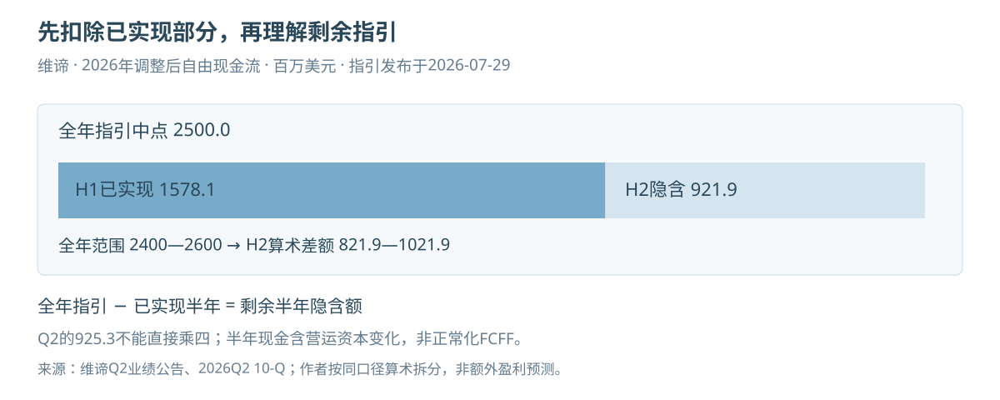
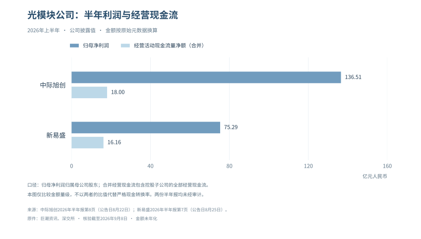
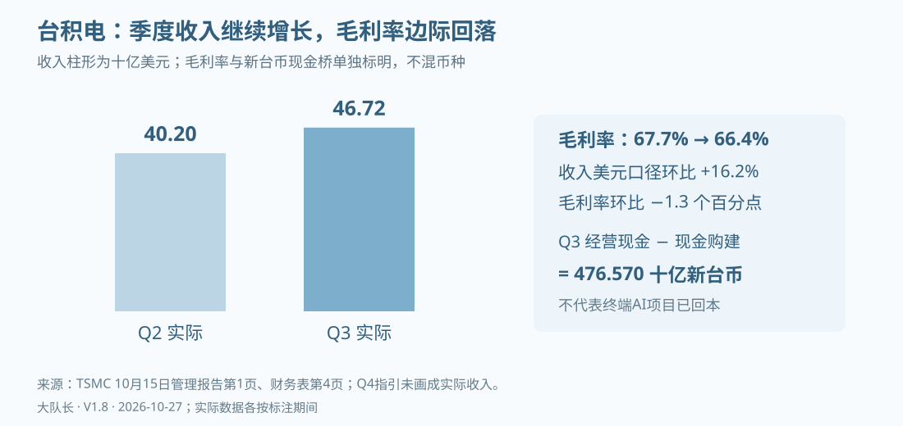

# AI周期与泡沫 · 投资者版

大队长出品 · V1.8 · 2026-10-31

联系邮箱：fqsx@mail.ustc.edu.cn

## 免责声明

本报告为“大队长”基于公开资料形成的个人研究，不代表任何任职机构，不构成个性化投资建议、收益保证或交易指令。研究判断可能错误，公开信息可能随后修订。

资料核验截至2026年10月31日（北京时间），各财务、市场、技术与政策数据使用正文注明的报告期或观察日，并非全部是同日现值。公司指引、条件算例和已实现结果分开；没有证据的输入留空，未完成校准的情景不提供精确概率。

这是按现行判断重新组织的正文，不是历史原页加滚动校注。旧稿独立存档；原预测条件不倒改。段落中的核验范围以具体来源为准，不等于对全部历史事实重新审计。

## 本次更新

1. 在V1.7现行正文上更新证据，保留原研究主题；旧版独立归档，本册不叠加旧页与重复校注。

2. 中国光模块、存储与维谛的新披露进入当前现金模型；已发生财报退出未来日历，转存件和未核缺口明确标注。

3. 接入10月28日FOMC、9月PCE和10月30日国债观察；保留增长与回收分化，不生成未经校准的概率。

4. 目录、书签和页码全部由本册正文重建；变更一条一段，集中列出参考资料，保留淡蓝色图表并加“大队长出品”水印。

<!-- BODY_START -->

## 投资者导读：公司增长与买入价格分别核验

企业收入增长，并不保证股票回报；资本开支增速下降，也不意味着每家公司都会同步衰退。先拆份额、价格、产品和客户，再讨论现金与估值，才不会把产业标签当成公司模型。

10月30日披露的光模块季报使原有半年报基线得到更新：中际旭创单Q3现金回收改善，新易盛同季经营现金为负，说明“订单强”并不是通用的现金结论。存储、冷却及云厂也须保留各自期间和资金占用差异。没有完整同日股价、净债务、股本和盈利模型，本册不补造目标价。

AI视频短剧新增了可收费的内容消费场景，也可能把降本收益让给观众、广告渠道和平台。投资观察优先看有可核收入、授权IP、付费留存和稳定结算的环节，不能把“参与AI短剧”自动转换为利润弹性。专题三给出中美市场证据和验证条件。

编程的收费边界扩大，不等于任意公司估值合理；其他应用有真实收入，也存在高成本和持续融资依赖。旧席位TAM不能单独决定买卖，收入增长也不能替代每股现金和买入价格。完整复盘见专题四、五。

## 第七部分：公司分化——经营韧性不等于估值安全

截至2026年10月31日，维谛10月28日发布的Q3结果进一步确认设备销售与现金增长，但这还不足以直接回答股票值多少钱：有多少现金来自本期交付，有多少来自客户先付款，下一批订单又要占用多少营运资本？同一轮人工智能投资，云厂、设备商和模型公司承担的资产与合同不同，公司研究应先把这些差异落到报表，再讨论价格。

### 7.1 用商业模式分组，不给企业预判结局

| 研究组 | 代表公司 | 基本盘与投入位置 | 首要核验问题 |
|---|---|---|---|
| 综合云与应用 | Alphabet、Microsoft、Amazon | 云、广告或软件现金创造与AI建设并存 | 成熟业务现金是否足以承担新增投资，AI贡献能否从整体业务中识别 |
| 广告及终端应用 | Meta、Apple | 广告或终端/服务变现，并含自建或外采AI投入 | 效率收益能否覆盖新增研发、算力与折旧，价格和使用变化是否可归因于AI |
| 计算平台与芯片 | NVIDIA、Broadcom及其他芯片供应商 | 当前销售、软件生态、研发、供应承诺与客户融资关系 | 盈利兑现与回款、客户集中、替代架构和承诺暴露如何变化 |
| 云基础设施与专用算力 | Oracle、CoreWeave等 | 容量建设先投入，收入和租约随交付展开 | 客户信用、合同取消、未起租项目与再融资是否形成错配 |
| 物理设备与系统 | 维谛技术、服务器及网络设备供应商 | 电源散热、系统交付与服务 | 订单能否转收入与现金，增长来自数量、价格还是产品结构 |

公司可以跨组，分组不是风险等级。Tesla的汽车、自动驾驶和机器人需要独立建模，不能因其通常被列入“七巨头”，就把其他公司的云投资风险直接移植过去；表中也不把Oracle、CoreWeave混称为七巨头成员。

### 7.2 把财报拆成五张小表

第一张记录经营结果：分部收入、营业利润和毛利，标注财季、是否非GAAP、是否包含传统业务。第二张记录现金：经营现金流、现金资本支出和融资租赁付款，统一期间。第三张记录资产与合同：折旧、在建工程、采购承诺、租约、担保、应收和集中度。第四张记录估值：预测年份、净债务与股数、倍数或折现率。第五张记录反证：什么数据会使当前判断失效。

这五张表的数不能任意互换。营业利润和持仓重估应分别进入主营价值与投资资产价值，不能重复资本化；客户投资和增信安排也要核对具体合同，不能据此把该客户全部收入定义成虚假收入。下面用维谛的正式披露走一遍这条计算链，其他公司仍须分别重建自己的输入。

公司经营现金流强，仍可能以过高价格交易；公司现金流暂时为负，也可能因有价值的建设项目而具有正净现值。需要分析的是未来现金收支及其不确定性，不是把一个季度的正负号直接翻译为公司生死。

### 7.3 企业价值与股权价值的桥

采用企业价值/息税折旧摊销前利润（EV/EBITDA）时，先用目标年度EBITDA乘以可比倍数，得到企业价值，再减去同一估值时点净债务及其他应扣权益项目，除以稀释股数。少数股东权益、租赁负债、养老金或非经营资产是否调整，要与可比公司倍数口径一致。

EV/EBITDA并不自动比市盈率更正确。折旧反映资产消耗，设备需要更新，EBITDA加回折旧后并没有替股东支付这些更新支出；因此资本密集型公司还要看自由现金流。采用企业自由现金流（FCFF）折现时，基本式为税后营业利润加折旧摊销，减资本支出和营运资本增加，再按加权平均资本成本折现。不得同时重复扣除折旧与资本支出，也不能漏掉租赁付款造成的可比性问题。

对于维谛技术这类设备企业，关键是订单转收入、增量利润率、营运资本和维护性投资；对于云商，还要区分服务器、网络、建筑和土地的折旧与经济寿命。拿同一个终值倍数套两类公司，会抹掉研究最重要的差异。

#### 7.3.1 维谛案例：先锁定实际值和公司指引

以下采用维谛技术（Vertiv，VRT）10月28日发布的截至9月30日Q3业绩，替代10月27日版本使用的Q2基线。金额为百万美元，EPS另为美元/股；未经审计实际数与公司前瞻分别列示。

| 项目 | 已实现 | 公司全年2026指引或边界 |
|---|---:|---|
| 营业收入 | Q3为4312.8；前三季10236.6 | 14450—14850，原13800—14200 |
| 营业利润 | Q3 GAAP为983.8 | 调整后全年3475—3555，不与左列混算 |
| 调整后营业利润率 | Q3为25.2% | 全年23.5%—24.5% |
| 经营现金流 | Q3为794.0；前三季2660.6 | 不能直接乘四作为预测 |
| 调整后自由现金流 | Q3为652.2；前三季2230.3 | 全年2600—2800，原2400—2600 |
| 稀释EPS | Q3 GAAP为1.95，调整后2.21 | 全年GAAP中点6.29，调整后7.10—7.20 |

来源：[维谛10月28日官方业绩及现金调节表](https://investors.vertiv.com/news/news-details/2026/Vertiv-Reports-Strong-Third-Quarter-2026-with-Net-Sales-Growth-of-61-Organic-Orders-Growth-over-100-and-Diluted-EPS-Growth-of-91-Adjusted-Diluted-EPS-Growth-of-78-Raises-Full-Year-2026-Guidance-Across-All-Key-Metrics/default.aspx)。[独立财经报道](https://finance.yahoo.com/markets/stocks/articles/vertiv-raises-2026-outlook-third-145400193.html)对收入增速和Q3现金在百万美元精度下复核一致；累计现金与详细科目仍为公司披露单源。调整后指标不是GAAP，也不是已完成统一利息、税和资本投入口径的FCFF。

9月21日NVIDIA公布DSX Ready资格计划，维谛列入CDU（冷却液分配单元）参与方，初期覆盖储能系统与液冷设备。资格计划是产品进入生态的证据，不能替代具体场站设计、客户订单或验收，更不能据此自行上调收入和EPS；本次上调采用的是10月28日公司的正式指引，须继续由订单、交付及毛利实现来验证。[NVIDIA DSX Ready说明](https://blogs.nvidia.com/blog/dsx-ready-ai-factories-power-cooling/)

#### 7.3.2 现金强在哪里，又有多少可以重复

前三季公司口径调整后FCF为2660.6−425.0−5.3=2230.3，后两项为资本支出和资本化软件投入。全年指引升至2600—2800后，隐含Q4贡献为369.7—569.7，不能把Q3的652.2乘四得到2608.8并当成预测。上调全年指引是经营韧性的证据，剩余季现金低于当前季也不自动意味着需求下滑，可能包含季节性、备货和付款节奏。

旧图仍是7月Q2发布时的H1/全年指引桥，只保留作观察历史；本版当前现金桥以前段新指引复算为准。

Q3营运资本净占用138.3，而前三季累计净提供540.5；前三季递延收入贡献2312.9，应收和存货分别占用1276.1、1814.9，应付提供1409.0，其他科目共同构成净额。客户预付款继续支持现金，但本季增量已不能完全覆盖交付所需的营运资本。这既不意味着所有递延收入都是AI订金，也不证明库存滞销；关键是后续交付成本及预收能否重复。

收入端也过一次算术检验：全年中点14650减前三季10236.6，隐含Q4为4413.4，与公司单季指引中点约4413在舍入内一致。新中点较7月的14000增加650，应来自正式交付与利润模型，不能只因订单同比超过100%就把往后几年等比例外推。若交付延后但收款已发生，收入与现金会短期反向移动，须继续区分时间差和取消。

#### 7.3.3 从盈利锚到估值输入，不抢先报目标价

在完整2027年模型尚未建立时，可以先检验一张透明的条件表：用10月28日公司2026年调整后EPS指引中点7.15，乘作者假设的25/30/35倍市盈率，得到178.75/214.50/250.25美元。三个倍数没有经过可比公司与历史分位校准，表中数值只说明定价敏感性，**不是合理价值区间、价格预测或买卖点**。

| 假设调整后市盈率 | 25倍 | 30倍 | 35倍 |
|---|---:|---:|---:|
| 7.15美元调整后EPS对应的条件价格 | 178.75 | 214.50 | 250.25 |

若改用同次公司GAAP EPS中点6.29，30倍对应188.70美元。旧版调整后EPS中点6.70及对应条件价格仅适用于7月指引，不能继续标作最新。两者差异首先来自盈利定义，不是自动形成两套可比估值；同行采用的摊销、股权激励与一次性项目调整必须一致。市盈率已经对应股权盈利，不能再从结果扣一次净债务；EV/EBITDA则要先完成企业价值到股权价值的桥，两套算式不能混用。

形成正式估值前，还要补齐2027年的产品收入、正常化利润率、营运资本和维护性投入，再用现金折现检查终值，并取得有日期的现价、净债务和稀释股本。只有这一套输入完整，才有依据把上面的条件演示升级为公司估值结论。当前模型最值得追问的是：预收支持减弱后，交付利润能否继续产生现金，而不只是当前订单是否很多。

### 7.4 增长能否抵消倍数回落

在净债务与股数暂时不变的简化条件下，企业价值变化倍数等于“盈利变化倍数×估值倍数变化倍数”。例如EBITDA上修20%，估值倍数由20倍降至15倍，企业价值变成基准的90%；当净债务为正且企业价值仍高于净债务时，股权价值跌幅会被放大，净现金公司不适用这一方向。条件式为“每股价值＝（目标期EBITDA×同口径倍数−净债务及其他应扣项目）÷稀释股数”，若有应加非经营资产则另加，不能把企业价值的跌幅直接当成股价跌幅。

这比从历史泡沫类比直接指定个股跌幅更可复核。真实目标价仍需要预测期盈利、资本结构、同口径可比以及明确的情景假设；评价预期涨跌幅还需注明起点价格，采用概率加权时另披露权重依据。本轮不把7月或8月的旧股价重新标成10月31日现价，也不在缺这些输入时给出新的买卖价位。

截至10月31日核验，财政部10月30日十年期名义收益率4.94%、实际收益率2.60%，较旧观察日10月26日的5.00%、2.66%均下降6个基点。折现基准继续回落，构成高估值压力的一项缓解因素；但信用利差、资本结构及项目风险未必同幅改善，不能把无风险利率变动直接当成公司WACC变动，也不追溯改变固定票息。没有完整新盈利模型和同日现价，本章不因指引上调或利率回落而升级为买入目标价。[财政部名义收益率10月30日行](https://home.treasury.gov/resource-center/data-chart-center/interest-rates/TextView?field_tdr_date_value_month=202610&type=daily_treasury_yield_curve)、[实际收益率10月30日行](https://home.treasury.gov/resource-center/data-chart-center/interest-rates/TextView?field_tdr_date_value_month=202610&type=daily_treasury_real_yield_curve)

### 7.5 历史比较能说明什么

互联网、电信设备和页岩油的经验说明，技术扩散与股东回报可以分离，融资条件变化也可能让设备订单急转。但各行业的资产再利用能力、客户现金储备、合同期限和竞争结构不同，历史上某家公司跌了多少，不能作为今天另一家公司同幅下跌的估值模型。

历史类比适合比较传导机制，并检查类比失效的条件。指数回撤则必须按各成分权重、其余公司表现和再平衡计算，不能只列出几个个股跌幅区间就声称已算出指数回撤。

### 7.6 会改变本章结论的证据

若客户无需新增融资也能稳定付费，未履约订单持续转成现金，供应商扩产同时保持回款与定价，风险应下调；若公司营收仍增长，但依赖更长付款期、客户担保和持续资本注入，增长质量就需要更严的折现或情景假设。两者不宜合成一个不透明的“综合现金流厚度”得分。

本章的结论是公司之间必须分化研究，不是认定某一组股票一定比另一组涨得好。估值起点和后续证据都能推翻这种简单排序。

## 第六部分：对中国投资者的核心启示

海外资本开支与中国公司的利润之间，至少还隔着产品结构、供应商份额、交付节奏和回款四道关。截至2026年10月31日，Microsoft、Alphabet和Amazon新季云收入继续增长；国内正式三季报却给出不同现金路径：中际旭创Q3现金回升，新易盛Q3经营现金转负，天孚通信前三季现金购建后仍有余量，江波龙单季转正但累计为负。增长已经兑现，资金回收仍须逐家公司核算，海外总CapEx不能直接代替中国公司的盈利模型。[中际旭创Q3](https://static.cninfo.com.cn/finalpage/2026-10-30/1225643953.PDF)、[新易盛Q3](https://static.cninfo.com.cn/finalpage/2026-10-30/1225642947.PDF)、[天孚通信Q3](https://static.cninfo.com.cn/finalpage/2026-10-29/1225634414.PDF)

### 6.1 用经营条件识别周期

项目何时形成收入、融资能否续接、投资开支能否主动调整，比年份本身更有解释力。某个季度进入研究日历，只代表需要取得新证据；条件没有成立，就不能因为时间到了而宣布周期转折。

周期判断分别跟踪供应商订单和收入是否减速，客户资本支出是否超过可持续现金创造，以及融资压力是否由个别公司扩散到更多信用主体。强需求能够反驳第一条的即时崩塌，却不能自动消除第二条；单名降级也不能自动证明第三条已经发生。

模型公司的融资窗口也要按真实阶段判断。媒体计划、秘密递交申请、公开递表、注册生效和实际发行不是同一阶段，锁定期及售股安排还要读取正式条款；不能用计划中的IPO日期串出一条必然的资金流出与市场下跌路径。

#### 6.1.1 如果投资周期比预计更长

物理约束可以让交付延期，既可能让供给扩张放缓、改善最终供需，也可能使在建工程和利息占用继续累积。这两个方向不能一开始就合并为“延迟必然放大”，必须逐项目核对：客户付款是否随交付发生，设备能否转售，合同能否取消，以及建设期利息最终由谁承担。

反方压力测试采用条件而不预设概率迁移。如果单位任务成本下降使需求扩张快于价格下降，成熟业务能持续补贴建设，且回款没有恶化，那么原先偏谨慎的现金回收判断应当弱化。相反，若收入尚未起量、维护性资本开支已经到来，同时客户依赖新融资付费，时间延长会增加资本缺口。

这里须区分两种路径：渐进幻灭指回报低于乐观定价，投资和估值分阶段调整；软着陆指收入与效率逐步吸收前期投入，建设节奏有序回落。交付延期可能通向其中任何一种，本节不替它预设概率，也不据此给出加减仓百分比。

### 6.2 A股传导需要逐项拆解

| 环节 | 需要验证的传导变量 | 常见误判 |
|---|---|---|
| 光模块 | 集群规模、端口密度、速率升级、单价、良率、客户份额和回款 | 云厂总CapEx增速直接等于模块收入增速 |
| 存储 | DRAM/NAND价格、企业级产品结构、备货成本、库存跌价与回款 | 海外HBM景气直接等于全部国内存储公司现金增长 |
| 服务器与交换设备 | 平台切换、单机价值量、订单转收入、存货和信用条件 | 订单增加等同于利润和现金增加 |
| 电源与散热 | 功率密度、液冷渗透、工程验收、售后服务与项目延期 | 数据中心用电增长意味着全部设备公司同幅受益 |
| 国产计算与基础软件 | 可交付供给、兼容性、迁移成本、客户预算和使用效率 | 出口限制自动带来所有国产公司的高利润 |
| 电力与能源 | 项目位置、并网、供电合同、实际电价与回报机制 | 美国数据中心扩张直接利好所有中国能源公司 |

这些是研究变量，不是行业评级。实际公司模型应从客户和产品出发，再汇总行业暴露；不能先认定某个板块“极高风险”或“确定受益”，再挑数字证明。

#### 光模块：利润增长与现金占用分别核算

中际旭创、新易盛10月30日公告的三季报与天孚通信10月29日公告的三季报，已将10月27日的H1基线推进到9月末。下表均为2026年前三季累计、人民币亿元；数字按原始元数换算，季度报告未经审计。

| 公司 | 营业收入 | 归母净利润 | 经营现金流净额 | 收入/归母利润同比 |
|---|---:|---:|---:|---|
| 中际旭创 | 695.47 | 222.38 | 80.08 | +178.13% / +211.81% |
| 新易盛 | 318.50 | 113.72 | 14.64 | +92.97% / +79.74% |
| 天孚通信 | 47.51 | 20.83 | 14.62 | +21.25% / +42.18% |

来源：[中际旭创正式季报](https://static.cninfo.com.cn/finalpage/2026-10-30/1225643953.PDF)、[新易盛正式季报](https://static.cninfo.com.cn/finalpage/2026-10-30/1225642947.PDF)、[天孚通信正式季报](https://static.cninfo.com.cn/finalpage/2026-10-29/1225634414.PDF)。收入、归母利润及经营现金与[经济参考报](https://www.jjckb.cn/20261030/d1aaf74f7891450cbe54a641ed7efc0b/c.html)、[中国证券报天孚财讯](https://finance.eastmoney.com/a/202610283913873750.html)等独立编辑报道在显示精度内一致；它们仍以公司报表为基础，不能视作客户付款的独立经济证据。

经营兑现已不再只是预期，但现金变化出现分化：中际旭创前三季经营现金同比+46.81%，新易盛−68.42%，天孚+8.75%。不宜把归母利润与合并经营现金之比命名为严格“利润现金转化率”，也不宜仅凭差额指控利润失真。

接上同一合并现金表的购建固定资产、无形资产及其他长期资产付款，可得到下列资金简桥。先用原始元数相减，再四舍五入；这不是FCFF，也没有包含其他投资、分红、偿债和融资。

| 公司 | 前三季经营现金 | 前三季现金购建 | 前三季差额 | Q3经营现金（9M−H1） | Q3差额（9M桥−H1桥） |
|---|---:|---:|---:|---:|---:|
| 中际旭创 | 80.08 | 91.61 | −11.52 | +62.09 | +18.50 |
| 新易盛 | 14.64 | 18.06 | −3.42 | −1.52 | −6.94 |
| 天孚通信 | 14.62 | 4.91 | +9.71 | 本表未复核H1差额 | 本表未复核H1差额 |

中际旭创累计算式为（8,008,444,194.49−9,160,875,564.49）÷1亿；新易盛为（1,464,429,142.65−1,806,016,532.89）÷1亿；天孚为（1,461,851,321.62−491,017,854.77）÷1亿。Q3差额使用已核H1原始数而非四舍五入后的表格相减。[中际旭创H1现金表](https://static.cninfo.com.cn/finalpage/2026-08-22/1225491753.PDF)、[新易盛H1现金表](https://static.cninfo.com.cn/finalpage/2026-08-25/1225499406.PDF)

旧H1图保留为历史对照，不能用它覆盖本次反向变化：中际旭创上半年−30.02亿元的资金差额已收窄，新易盛上半年+3.53亿元的余量已消失。累计为负可以由已有现金或融资支付，单季为正也不等于扩产全生命周期回本。

截至10月31日，本轮尚未完成三家公司从合并净利润、非现金项目到营运资本的完整调节，也未把购建拆成维护性和扩张性投入。因此不能把差额归因于某一客户拖款，或直接年化为正常化现金。后续需核对账龄和期后收款、存货交付和减值、预付款及应付的现金影响；资产负债表余额变化可能含汇兑、并购及非现金项目，不直接充当现金流。

模型的双向调整有具体落点：备货随交付下降、应收按合同收回时，降低后续营运资本占用假设；账龄延长、库存减值持续增加时，下调可回收现金并重估扩产。中际旭创本季改善是必须纳入的反证，新易盛本季压力也不能被行业高景气掩盖。

#### 光模块：订单能见度尚不能代替现金表

10月23日的三份经营公告把产品进展推到更近的观察时点：中际旭创披露海外重点客户订单覆盖2027年，部分客户提供2028年需求指引；新易盛称800G和1.6T已是主要出货产品；天孚通信称用于CPO的FAU、ELS相关产品已稳定量产。这些消息不等于全部订单不可取消，更不等于已经确认收入或收款。天孚2027—2029年股权激励增长目标也不是已实现业绩或公司盈利预测。三家公司正式Q3财报已进入上表；经营进度与财务兑现分别记录，产品已量产仍须检验良率、定价与回款。[中际旭创公告，第1—2页](https://static.cninfo.com.cn/finalpage/2026-10-23/1225617691.pdf)、[新易盛公告](https://static.cninfo.com.cn/finalpage/2026-10-23/1225617676.pdf)、[天孚通信公告，第2页](https://static.cninfo.com.cn/finalpage/2026-10-23/1225617692.pdf)

#### 存储：单季改善与累计占款分别判断

德明利10月26日公开三季报，Q3收入116.45亿元、归母利润27.29亿元；前三季累计归母利润87.46亿元、经营现金−136.91亿元，期末存货289.86亿元，较年末增加219.28亿元。其前三季经营现金减现金购建长期资产，按原始元数计算为（−13,690,577,650−500,131,017.67）÷1亿＝−141.91亿元；这个缺口表明备货与扩张依赖资金支持，不足以认定虚假利润。合并现金与归母利润不构成严格同权益口径比率，累计现金也不能冒充Q3单季现金。[德明利三季报，第2—4、18—19页](https://disc.static.szse.cn/download/disc/disk03/finalpage/2026-10-26/e8eabd45-e97f-4bed-b05d-27f58665dc50.PDF)

本节旧版“一份正式季报与一份预告”的证据边界已推进：江波龙10月30日正式季报转存原文给出前三季收入387.18亿元、归母利润143.22亿元、经营现金−22.74亿元；公司说明Q3单季经营现金+8.77亿元。单季转正是缓解担忧的证据，累计为负仍提示备货占款，不能只选其中一项。巨潮/交易所原站直链和现金购建明细尚未在本轮完整交叉核验，故来源状态保留为“公告转存件”，不据此形成精确正常化FCF。10月15日预告关于DRAM、NAND涨幅收窄的判断仍需后续售价验证。[三季报转存原文](https://money.finance.sina.com.cn/corp/view/vCB_AllBulletinDetail.php?id=12680548&stockid=301308)、[每经报道](https://www.nbd.com.cn/articles/2026-10-29/4628749.html)

由此应把“行业涨价”拆成公司采购价格、库存交付与收款的时间差。德明利的累计现金占用与江波龙单季改善不能简单平均，也不能由美光或韩国HBM业绩给国内全板块统一上修。

### 6.3 编程工具与软件公司的传导

编程工具按席位收费的收入，只覆盖软件生产工具市场的一部分。若企业把节省的工时用于更多项目、采用按用量计价的代理或采购交付服务，市场边界会改变；反过来，个人用户使用频率低、付费席位流失或高频用户推理成本过高，也会削弱利润。

因此“工具更便宜”既不是外包公司必然受损的证据，也不是工具厂商拥有无限市场的证据。软件公司的模型至少要分合同金额、交付人时、人员成本、工具和算力成本、验收周期，以及客户是否要求分享效率收益。项目毛利可以先按“合同收入−交付人工−工具与算力−其他交付成本”建立，再另扣销售、研发与管理费用；节省工时只有变成新增交付或实际成本下降，才进入盈利，而不从全体开发者人数直接推公司收入。

### 6.4 客户集中与融资暴露

客户集中度、关联投资和收入质量应分栏记录。供应商向客户投资，并不能证明所有后续收入虚假；同样，已经签订采购合同，也不代表客户具备无条件履约的现金能力。

研究底稿应列出具名客户、已确认收入、未履约合同、收款期限、担保或增信、投资余额与取消条件。未披露客户身份的收入不能由研究者擅自分配给某一家云厂，未披露的循环收入占比应保留缺失；客户集中和融资关联可以提示核验方向，不能直接生成行业统一风险排名。

### 6.5 公司估值怎样承接行业判断

先形成产品收入预测，再由毛利、费用、折旧、税和营运资本形成利润及现金流，最后讨论估值倍数。产业判断可以改变这些输入，却不能越过盈利模型直接产生某个精确跌幅。

例如只为说明敏感性的假设公司：基准EBITDA为100、企业价值倍数为20倍，净债务200、稀释股数100，则每股价值为18。若EBITDA增长20%至120、倍数回落25%至15倍，企业价值变成1800，每股价值为16，较18下降11.1%。盈利上涨与股价估值下降完全可能同时发生；这里的数字是教学假设，不是任何真实公司的目标价。

| EBITDA（基准=100） | 15倍 | 20倍 | 25倍 |
|---|---:|---:|---:|
| 80 | 10 | 14 | 18 |
| 100 | 13 | 18 | 23 |
| 120 | 16 | 22 | 28 |

表中每股价值统一按“EBITDA×倍数−200，再除以100”计算。净债务、股数固定只是为了看清两个变量；真实模型须同步处理现金生成、融资和稀释，并用现金流折现检验终值是否承担过多价值。

### 6.6 跨境工具：通道规则不能替代研究

港股通南向交易和大湾区跨境理财通是两种不同制度，不能把市场每日额度当成个人可持有、可积攒的配额。港交所2026年7月6日版常见问题说明，每日额度按净买盘管理、未使用部分不结转；因此持有股票不产生可以保存的个人历史额度。[港交所《互联互通常见问题》，2026-07-06，第15—16页](https://www.hkex.com.hk/-/media/HKEX-Market/Mutual-Market/Stock-Connect/Getting-Started/Information-Booklet-and-FAQ/FAQ/FAQ_Cn.pdf)

场内QDII的溢价必须用同一时点可比净值、汇率和交易价格计算。跨时区净值滞后、停申购和二级流动性会影响结果，未取得同日可比样本时，不能给全市场一个“当前普遍溢价”区间。基金规模增长或市场回撤也不保证某一天溢价必然归零。

本报告不对读者的跨境投资资格、汇款用途或适用产品作个别认定。需要交易时，应另按最新官方规则及产品说明核实，而不是根据研究观点提前安排通道或仓位。

### 6.7 截止日之后，需要取得哪些证据

10月28—30日的Microsoft、Alphabet、Amazon、Vertiv及国内光模块财报已由“待披露”转为本版输入；三星、SK海力士季度现金摘要及Intel业绩也已补核，详见利润章。Meta、台积电、ASML和德明利则是10月27日已知基线。披露层级仍分正式公告、演示摘要及完整报表，下一步应检验新收入能否继续形成现金，而非财报一出就机械调仓。

| 北京时间 | 官方未来节点 | 需要核验的变量 | 对中国公司的传导限制 |
|---|---|---|---|
| 11月3日23:00 | 美国9月JOLTS | 职位空缺、招聘和离职 | 不是AI替代人数统计 |
| 11月4日06:00 | AMD 2026Q3电话会；业绩于美东3日盘后公布 | 数据中心与非AI业务、现金和指引 | 未公布前不预填结果；CPU与GPU收入不全部归为AI |
| 11月5日21:30 | 美国Q3生产率初值 | 产出、工时、单位劳动成本 | 季度总量不能直接归因于AI |
| 11月6日21:30 | 美国10月就业报告 | 招聘、失业、工时 | 需区分周期、行业和AI影响 |
| 11月10日21:30 | 美国10月CPI | 通胀与利率预期 | 影响折现率，不直接确认供应商订单 |
| 11月13日21:30 | 美国10月PPI | 上游价格与成本 | 不能代替特定元器件成交价 |
| 11月18日06:00 | NVIDIA FY27Q3电话会；结果预计稍早公布 | 收入、应收、付款期限、客户支持和现金 | 季度终点10月25日；不与云厂9月季机械相加 |

日历来源：[美国劳工统计局11月日程](https://www.bls.gov/schedule/2026/11_sched.htm)、[AMD10月6日官方公告](https://ir.amd.com/news-events/press-releases/detail/1300/amd-to-report-fiscal-third-quarter-2026-financial-results)、[NVIDIA10月28日官方公告](https://nvidianews.nvidia.com/news/nvidia-sets-conference-call-for-third-quarter-financial-results-6928873)。11月所列美国时点使用冬令时EST，北京加13小时；电话会时间与财报稿精确发布时间分开，日程仍可能调整。没有正式日期的公司，不填写预约传闻时刻。

国内下一次核验以应收、存货、期后收款、预付款及资本购建为重点。海外新季云收入强，是支持交付的证据；Alphabet Cloud还包含TPU系统销售，Microsoft亦改了分部口径，不能把增长率全部解释为同一种可重复算力租金，更不能等比例上推中国供应商收入。

台积电Q3收入46.72B美元、毛利率66.4%，新台币经营现金919.776B与现金购建443.206B相减为476.570B，说明其自身需求和现金已经兑现；HPC收入占比68%却不能作为纯AI占比。Q4收入52.3—54.3B美元仍为指引，不能从供应商的强现金一步跳到中国光模块、设备或存储公司的盈利上修，仍要回到产品、份额、价格和回款。[台积电10月15日Q3管理报告，第1—2页](https://investor.tsmc.com/english/encrypt/files/encrypt_file/reports/2026-10/f83780000ddc0c3b48e57a87eab6814c4ab35058/3Q26%20ManagementReport.pdf)、[Q3现金流表，第4页](https://investor.tsmc.com/english/encrypt/files/encrypt_file/reports/2026-10/3a94d1034b9e6b22446b674f7aaf3d088a12a193/FS.pdf)

### 6.8 政策冲击的归因

出口管制影响可采购产品、部署地点和技术迁移成本，资本市场监管影响交易通道，两者不能合并成一个“AI风险事件”。对具体公司，依次核对产品是否在规则范围、许可证条件、实际可交付时间与替代方案，再调整销量、成本和交期。政策讨论稿不等于生效规则，获准采购也不等于已经交付；涉及处罚金额、产品禁令和实施日期时，必须保留对应监管文件，不把未核实的金额写入风险损失。

### 6.9 本章可能判断错在哪里

供应商份额提升和产品升级可能抵消行业投资减速，这是宏观外推最容易漏掉的反方；营运资本也有季节性，仅看一个季度或累计前三季现金不足以给全年结论。与此同时，增长真实不能保护过高的买入估值，政策支持也不能保证单一公司的产品被采用。下一次核验应允许这些方向同时进入模型，而不是只寻找支持原观点的数字。

<!-- REFERENCES_START -->

## 参考资料索引

本册按URL去重收录24项参考资料，保留正文中的就近链接，下面按首次引用顺序集中列出完整网址，便于打印后追溯。名称采用已核对的公司、报告期与文档类型或正文来源简称，并非一律为官方原标题；资料的期间、核验程度和访问限制以对应段落为准，不表示全部旧引文都在本轮重新取得原件。

1. [维谛10月28日官方业绩及现金调节表](https://investors.vertiv.com/news/news-details/2026/Vertiv-Reports-Strong-Third-Quarter-2026-with-Net-Sales-Growth-of-61-Organic-Orders-Growth-over-100-and-Diluted-EPS-Growth-of-91-Adjusted-Diluted-EPS-Growth-of-78-Raises-Full-Year-2026-Guidance-Across-All-Key-Metrics/default.aspx) · investors.vertiv.com

    https://investors.vertiv.com/news/news-details/2026/Vertiv-Reports-Strong-Third-Quarter-2026-with-Net-Sales-Growth-of-61-Organic-Orders-Growth-over-100-and-Diluted-EPS-Growth-of-91-Adjusted-Diluted-EPS-Growth-of-78-Raises-Full-Year-2026-Guidance-Across-All-Key-Metrics/default.aspx

2. [独立财经报道](https://finance.yahoo.com/markets/stocks/articles/vertiv-raises-2026-outlook-third-145400193.html) · finance.yahoo.com

    https://finance.yahoo.com/markets/stocks/articles/vertiv-raises-2026-outlook-third-145400193.html

3. [NVIDIA DSX Ready说明](https://blogs.nvidia.com/blog/dsx-ready-ai-factories-power-cooling/) · blogs.nvidia.com

    https://blogs.nvidia.com/blog/dsx-ready-ai-factories-power-cooling/

4. [财政部名义收益率10月30日行](https://home.treasury.gov/resource-center/data-chart-center/interest-rates/TextView?field_tdr_date_value_month=202610&type=daily_treasury_yield_curve) · home.treasury.gov

    https://home.treasury.gov/resource-center/data-chart-center/interest-rates/TextView?field_tdr_date_value_month=202610&amp;type=daily_treasury_yield_curve

5. [实际收益率10月30日行](https://home.treasury.gov/resource-center/data-chart-center/interest-rates/TextView?field_tdr_date_value_month=202610&type=daily_treasury_real_yield_curve) · home.treasury.gov

    https://home.treasury.gov/resource-center/data-chart-center/interest-rates/TextView?field_tdr_date_value_month=202610&amp;type=daily_treasury_real_yield_curve

6. [中际旭创正式季报](https://static.cninfo.com.cn/finalpage/2026-10-30/1225643953.PDF) · static.cninfo.com.cn

    https://static.cninfo.com.cn/finalpage/2026-10-30/1225643953.PDF

7. [新易盛正式季报](https://static.cninfo.com.cn/finalpage/2026-10-30/1225642947.PDF) · static.cninfo.com.cn

    https://static.cninfo.com.cn/finalpage/2026-10-30/1225642947.PDF

8. [天孚通信正式季报](https://static.cninfo.com.cn/finalpage/2026-10-29/1225634414.PDF) · static.cninfo.com.cn

    https://static.cninfo.com.cn/finalpage/2026-10-29/1225634414.PDF

9. [经济参考报](https://www.jjckb.cn/20261030/d1aaf74f7891450cbe54a641ed7efc0b/c.html) · www.jjckb.cn

    https://www.jjckb.cn/20261030/d1aaf74f7891450cbe54a641ed7efc0b/c.html

10. [中国证券报天孚财讯](https://finance.eastmoney.com/a/202610283913873750.html) · finance.eastmoney.com

    https://finance.eastmoney.com/a/202610283913873750.html

11. [中际旭创H1现金表](https://static.cninfo.com.cn/finalpage/2026-08-22/1225491753.PDF) · static.cninfo.com.cn

    https://static.cninfo.com.cn/finalpage/2026-08-22/1225491753.PDF

12. [新易盛H1现金表](https://static.cninfo.com.cn/finalpage/2026-08-25/1225499406.PDF) · static.cninfo.com.cn

    https://static.cninfo.com.cn/finalpage/2026-08-25/1225499406.PDF

13. [中际旭创公告，第1—2页](https://static.cninfo.com.cn/finalpage/2026-10-23/1225617691.pdf) · static.cninfo.com.cn

    https://static.cninfo.com.cn/finalpage/2026-10-23/1225617691.pdf

14. [新易盛公告](https://static.cninfo.com.cn/finalpage/2026-10-23/1225617676.pdf) · static.cninfo.com.cn

    https://static.cninfo.com.cn/finalpage/2026-10-23/1225617676.pdf

15. [天孚通信公告，第2页](https://static.cninfo.com.cn/finalpage/2026-10-23/1225617692.pdf) · static.cninfo.com.cn

    https://static.cninfo.com.cn/finalpage/2026-10-23/1225617692.pdf

16. [德明利三季报，第2—4、18—19页](https://disc.static.szse.cn/download/disc/disk03/finalpage/2026-10-26/e8eabd45-e97f-4bed-b05d-27f58665dc50.PDF) · disc.static.szse.cn

    https://disc.static.szse.cn/download/disc/disk03/finalpage/2026-10-26/e8eabd45-e97f-4bed-b05d-27f58665dc50.PDF

17. [三季报转存原文](https://money.finance.sina.com.cn/corp/view/vCB_AllBulletinDetail.php?id=12680548&stockid=301308) · money.finance.sina.com.cn

    https://money.finance.sina.com.cn/corp/view/vCB_AllBulletinDetail.php?id=12680548&amp;stockid=301308

18. [每经报道](https://www.nbd.com.cn/articles/2026-10-29/4628749.html) · www.nbd.com.cn

    https://www.nbd.com.cn/articles/2026-10-29/4628749.html

19. [港交所《互联互通常见问题》，2026-07-06，第15—16页](https://www.hkex.com.hk/-/media/HKEX-Market/Mutual-Market/Stock-Connect/Getting-Started/Information-Booklet-and-FAQ/FAQ/FAQ_Cn.pdf) · www.hkex.com.hk

    https://www.hkex.com.hk/-/media/HKEX-Market/Mutual-Market/Stock-Connect/Getting-Started/Information-Booklet-and-FAQ/FAQ/FAQ_Cn.pdf

20. [美国劳工统计局11月日程](https://www.bls.gov/schedule/2026/11_sched.htm) · www.bls.gov

    https://www.bls.gov/schedule/2026/11_sched.htm

21. [AMD10月6日官方公告](https://ir.amd.com/news-events/press-releases/detail/1300/amd-to-report-fiscal-third-quarter-2026-financial-results) · ir.amd.com

    https://ir.amd.com/news-events/press-releases/detail/1300/amd-to-report-fiscal-third-quarter-2026-financial-results

22. [NVIDIA10月28日官方公告](https://nvidianews.nvidia.com/news/nvidia-sets-conference-call-for-third-quarter-financial-results-6928873) · nvidianews.nvidia.com

    https://nvidianews.nvidia.com/news/nvidia-sets-conference-call-for-third-quarter-financial-results-6928873

23. [台积电：2026年第三季度管理报告](https://investor.tsmc.com/english/encrypt/files/encrypt_file/reports/2026-10/f83780000ddc0c3b48e57a87eab6814c4ab35058/3Q26%20ManagementReport.pdf) · investor.tsmc.com  2026-10-15；季度经营数据。

    https://investor.tsmc.com/english/encrypt/files/encrypt_file/reports/2026-10/f83780000ddc0c3b48e57a87eab6814c4ab35058/3Q26%20ManagementReport.pdf

24. [台积电：2026年第三季度财务报表](https://investor.tsmc.com/english/encrypt/files/encrypt_file/reports/2026-10/3a94d1034b9e6b22446b674f7aaf3d088a12a193/FS.pdf) · investor.tsmc.com  现金流核对见原表第4页；财务报表使用新台币百万元。

    https://investor.tsmc.com/english/encrypt/files/encrypt_file/reports/2026-10/3a94d1034b9e6b22446b674f7aaf3d088a12a193/FS.pdf
