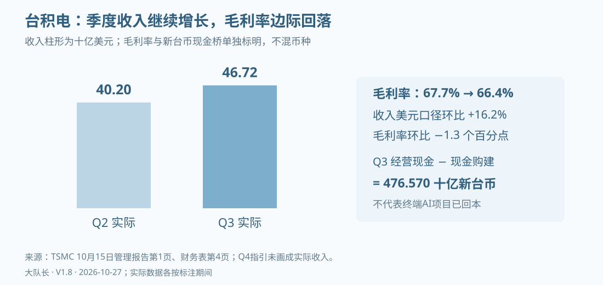
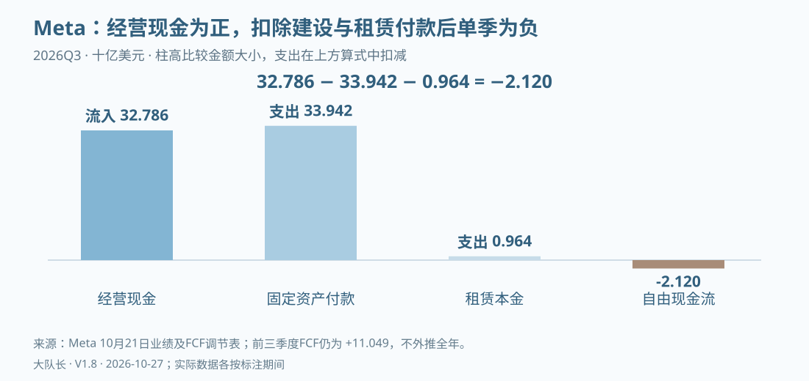
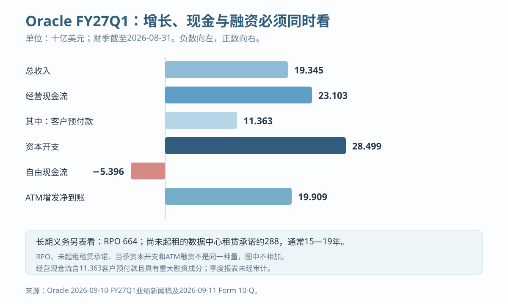
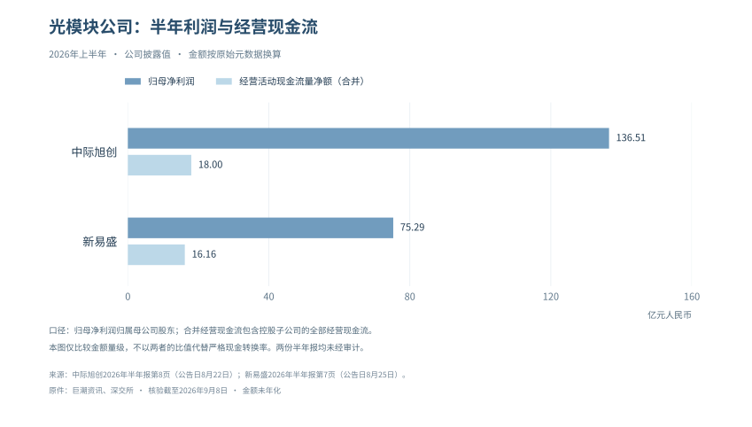
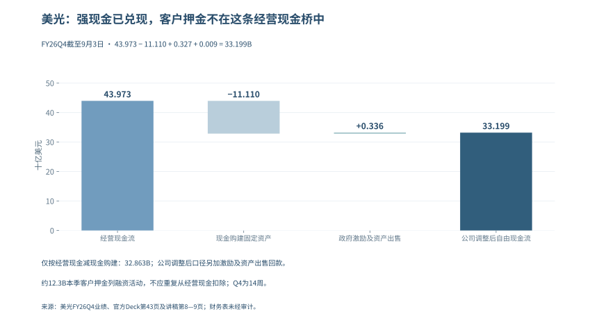
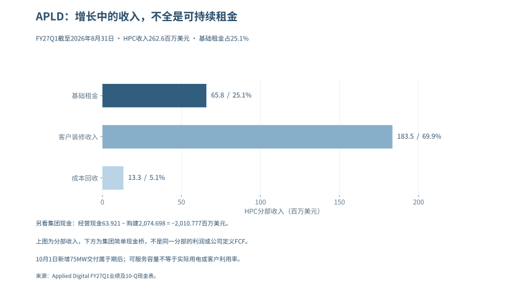
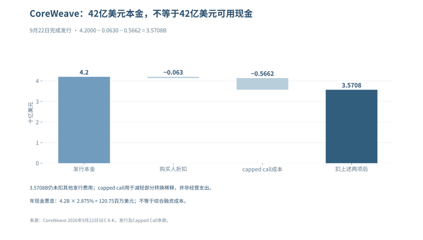
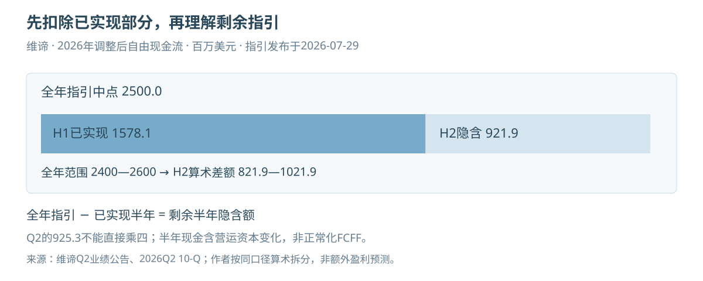

# AI周期与泡沫 · 全景正文

大队长出品 · V1.8 · 2026-10-31

联系邮箱：fqsx@mail.ustc.edu.cn

## 免责声明

本报告为“大队长”基于公开资料形成的个人研究，不代表任何任职机构，不构成个性化投资建议、收益保证或交易指令。研究判断可能错误，公开信息可能随后修订。

资料核验截至2026年10月31日（北京时间），各财务、市场、技术与政策数据使用正文注明的报告期或观察日，并非全部是同日现值。公司指引、条件算例和已实现结果分开；没有证据的输入留空，未完成校准的情景不提供精确概率。

这是按现行判断重新组织的正文，不是历史原页加滚动校注。旧稿独立存档；原预测条件不倒改。段落中的核验范围以具体来源为准，不等于对全部历史事实重新审计。

## 本次更新

1. 按原版本复盘AI编程市场预估，区分预测、条件敏感性和单位错误；按实际收费、额外用量、任务与用户去重重建市场边界。

2. 补查编程和视频之外的AI应用，按付款方、收费单位、已实现指标及完整成本辨别商业化；用户、试点、合同和收入不相加。

3. 新增AI视频短剧中美市场专题，区分整体短剧与AI生成子集，核对获客、制作、分成及版权边界；预测和公司样本不外推为行业已实现利润。

4. 在V1.7现行正文上更新证据，保留原研究主题；旧版独立归档，本册不叠加旧页与重复校注。

5. 更新Microsoft、Alphabet、Amazon及中国供应链财报；各项资料保留自身期间，经营、投资重估、现金建设和租赁分别核算。

6. 合同现金义务、可取消上限、租赁及担保按性质区分；单源信息与核验缺口单列。

7. 中国光模块、存储与维谛的新披露进入当前现金模型；已发生财报退出未来日历，转存件和未核缺口明确标注。

8. 补入新模型、赠额与企业/科研合作；厂商能力宣称、访问条件、已发布功能和未来计划分别记录。

9. 接入10月28日FOMC、9月PCE和10月30日国债观察；保留增长与回收分化，不生成未经校准的概率。

10. 保留条件风险情景并更新关键财务和金融输入；历史工具与法律基线不因版本换日自动变为重新核验。

11. 事实核对按当前论据重组，沿用基线和未核缺口单列；历史审计与预测记分只在独立档案追溯。

12. 目录、书签和页码全部由本册正文重建；变更一条一段，集中列出参考资料，保留淡蓝色图表并加“大队长出品”水印。

<!-- BODY_START -->

## 研究总览：增长仍在，现金回收的分化扩大

资料核验截至2026年10月31日（北京时间），市场利率观察截至美国10月30日。V1.8把已公布财报和宏观结果放回模型，新增中美AI视频短剧、AI编程旧预测复盘和其他应用商业化三个专题，并更新模型、能源、许可与国际约束。统计期、公告日与取证日分别保留；尚未披露或未取得的项目不因版本日期改变而补成现值。

当前证据支持三个层次的判断：云服务与部分供应链的经营增长仍在兑现；若干公司的建设支出持续超过同期经营现金；新应用正在扩大AI可收费的任务范围，但并未证明所有新增基础设施都能获得足够回报。因此，本版提高对现金覆盖和新增硬付款的关注，同时保留需求扩展、项目交付和单位成本下降的反方证据，不确认全行业融资与需求已经同时崩塌。

### 新财报改变了什么

下表除中国公司行另用人民币亿元外，单位为十亿美元。不同币种和期间不相加，也不据此给公司排名。

| 对象与期间 | 已披露经营信号 | 现金回收信号 | 对判断的影响 |
|---|---|---|---|
| Microsoft FY27Q1，截至9月30日 | 收入92.279、营业利润45.915；新分部与Azure口径须使用重述比较数 | 经营现金58.000减现金购建39.367为18.633；再扣融资租赁本金1.000为17.633 | 仍有现金缓冲；不能把租赁新增额再重复扣成现金支出 |
| Alphabet 2026Q3 | Cloud收入30.709、营业利润11.121；股权证券税前损失8.664另列 | 当季42.290−51.355＝−9.065；TTM仍为+19.747 | 单季建设缺口扩大与滚动年度正现金并存；非现金重估不等于主业倒退 |
| Amazon 2026Q3及截至9月30日TTM | AWS收入45.984、营业利润17.773 | TTM经营现金168.300减净现金购建210.657＝−42.357 | 云增长没有同步变成集团自由现金；缺口不等于当日到期债务 |
| 中国光模块，2026前三季度 | 中际旭创与新易盛均有经营增长，需分别核客户与产品 | 中际旭创经营现金80.0844亿元，新易盛14.6443亿元；各自再扣建设后的简单现金桥仍为负 | 同一产业标签下回款方向不同；中际单Q3改善不能替新易盛作证 |

原始依据：[Microsoft FY27Q1](https://www.microsoft.com/en-us/Investor/earnings/FY-2027-Q1/press-release-webcast)、[Alphabet Q3业绩](https://s206.q4cdn.com/479360582/files/doc_financials/2026/q3/2026q3-alphabet-earnings-release.pdf)、[Amazon Q3业绩](https://ir.aboutamazon.com/news-release/news-release-details/2026/Amazon-com-Announces-Third-Quarter-Results/default.aspx)。租赁本金、中国公司原件及逐项现金公式见利润与中国传导章节。公司公告的转载只能核对摘录，不能当成另一套独立账簿。

### 新应用为何需要单独研究

AI视频短剧值得进入商业化框架，因为观众可以按内容或订阅付费，广告主也可以为观看注意力付款，收入来源比笼统的“模型能力提升”更容易追踪。但真人短剧大盘、AI辅助制作、主要由AI生成的短剧、模型工具收入，是四个不同口径。新增专题比较中国与美国的分发、付费、获客、IP和版权，并用条件算例检验：制作更便宜以后，节约额由谁获得，是否又被投流、返工和竞争降价消耗。市场预测、平台自报和行业已实现收入分开，不用短剧总收入替代AI收入。

新增证据已不止播放量：兑吧2026H1单列AI短剧收入2.22629亿元人民币，但集团同期仍亏损2532.6万元，不能倒推出AI业务独立净利率。中文在线披露部分海外短剧转为AI制作带来降本，其累计与单季现金方向却不同。这使研究更重视已发生的收费，也更需要保留失败作品、获客和回款周期的完整账本。具体财期、原件及算式见专题三。[兑吧中期报告](https://yun.duiba.com.cn/corp/report/content/1/2026%E4%B8%AD%E6%9C%9F%E5%A0%B1%E5%91%8A.3f87c290d81d43e1b87da58f7eaf9818.pdf)、[中文在线三季报](https://static.cninfo.com.cn/finalpage/2026-10-26/1225620142.PDF)

### 编程复盘与其他应用怎样改变判断

编程旧预估不能统一判成“预测正确”。3650万专业开发者×30美元×12得到13.14B，是条件算术；把固定低价席位覆盖全部收入，已被按量收费、多档套餐和非专业用途打破。早期原稿自身还存在高价情景与“绝对上限”矛盾、$131B量纲错误；V1.5已撤回硬上限，本轮用历史原件补齐逐项裁决。公开产品指标仍不足以证明去重后的纯编程市场已超过13.14B，不能以修正模型冒充新市场实绩。依据及未来验证窗口见专题四。

其他应用延续旧报告十四领域框架，补齐正反两面经营证据：AlphaSense Q2公司ARR超过0.7B；Duolingo完整产品有正现金，不能全归AI功能；Character.ai进入法院监督出售程序，当时服务继续运行。阿里模型与应用混合分部、Tempus与自动驾驶也必须分清收入、非经营收益和经营亏损。新增专题五不加总这些异质指标，而是逐项检验付款方、完整成本与回收。[AlphaSense原始披露](https://www.alpha-sense.com/press/alphasense-named-the-only-leader-in-market-and-competitive-intelligence-platforms/)、[Character.ai官方状态](https://blog.character.ai/an-update-on-character-ai/)。

### 金融条件与后续核验

10月28日美联储维持政策利率3.75%—4.00%；10月30日十年期国债名义与实际收益率为4.94%和2.60%，较10月26日均下降6基点。9月PCE价格同比+3.6%、核心+3.1%仍要求关注通胀。政策利率不变与国债回落可以同时发生，企业信用成本又可能不同，不能从一个宏观变量直接推导新的崩盘概率。[Fed决议](https://www.federalreserve.gov/newsevents/pressreleases/monetary20261028a.htm)、[BEA 9月收入与支出](https://www.bea.gov/news/2026/personal-income-and-outlays-september-2026)、[财政部名义曲线](https://home.treasury.gov/resource-center/data-chart-center/interest-rates/TextView?field_tdr_date_value_month=202610&type=daily_treasury_yield_curve)、[实际曲线](https://home.treasury.gov/resource-center/data-chart-center/interest-rates/TextView?field_tdr_date_value_month=202610&type=daily_treasury_real_yield_curve)。

| 问题 | 需要进入模型的证据 | 会使判断改变的反证 |
|---|---|---|
| 需求能否持续 | 付费留存、客户预算、净收费与回款 | 补贴退出后仍有稳定复购和现金贡献 |
| 增长能否覆盖投资 | 同期间经营现金、现金建设、租赁本金及未来硬付款 | 投入放缓而收入和利润持续增长 |
| 新应用能否形成利润 | 编程、短剧和其他应用的完整成本、获客、退款及结算 | 可重复的低获客成本、高留存与正现金，而非单一案例 |
| 融资风险是否扩散 | 已到账资金、提款条件、抵押余量和到期付款 | 融资落实且对借新还旧的依赖下降 |
| 股价是否具有安全边际 | 可持续盈利、净债务、稀释及有日期的市场价格 | 盈利兑现和估值要求相匹配，而非只看行业增长 |

## 第一部分：哪些是真金白银，哪些是估值游戏？

> 观察截至2026年10月31日，北京时间。本轮新增核验10月28—30日公告；早期财报保留原财期和发布日期。金额无特别说明均为十亿美元；台积电、ASML、中国公司及韩国公司另标本币。各公司财期分别列示，季度财务表与美光全年业绩发布表未经审计，Microsoft、Lumentum及Coherent的全年数据来自已审计10-K。以下区分经营收益、投资收益、会计估计与现金回收，不以其中一种直接替代另一种。

### 从收入走到现金

10月28—29日的新财报把经营与重估的分离变成双向检验：Alphabet Q3股权证券损失压低EPS，Cloud收入和营业利润却继续增长；Amazon Q3净利润同比下降，AWS营业利润仍增长。与此同时，Alphabet连续第二季FCF为负，Amazon滚动FCF流出扩大，Microsoft仍有正现金结余。判断因此更具体：真实需求尚强，资本回收压力和投资损益波动也更明显，不能只用净利润的升降替整个产业下结论。

本篇沿着一笔收入走到现金：先辨认客户支付的是什么，再把营业利润、持仓收益与税项分开，随后检查回款、资本开支和租赁，最后问新投入能否在设备失去经济竞争力前赚回成本。Oracle FY27Q1把矛盾推得更清楚：云基础设施收入增长121%，资本开支却超过经营现金流，经营现金又得到大额客户预付款支持。当前证据支持“经营兑现与资本回收压力并存”，不支持“五家公司利润都不真实”，也不支持“高增长足以证明任何建设成本都合理”。

| 阅读位置 | 要回答的问题 | 不能偷换的口径 |
|---|---|---|
| 经营与现金拆解 | 哪些经营已兑现，利润如何进入现金？ | 非经营收益不等于假利润，现金支出不等于当期费用 |
| 客户与回款 | NVIDIA的客户和回款发生了什么变化？ | 直接客户、最终客户、应收集中度分开 |
| 估值与历史比较 | 公司好与投资回报好之间差在哪里？ | 估值时点、历史案例与预测概率分开 |
| 后续证据与反方检验 | 下一次财报应怎样推翻或加强判断？ | 观察规则不冒充统计模型，风险不等于交易指令 |

### 1.1 五大巨头：经营兑现与现金回收分开判断

公司利润需要按来源判断：已经交付的产品与服务、非经营收益、仍待收回的应收款，以及支持未来增长的资本投入，回答的是不同问题。下表把经营与现金压力并列，避免把盈利质量压成缺少统一权重的单一评分。

| 公司与统计期 | 已确认的经营 | 本篇重点核查 | 当前判断 |
|---|---|---|---|
| NVIDIA，FY27Q2，截至7/26 | 收入96.221，数据中心89.023；GAAP毛利率75.0% | 经营现金24.077，低于前季50.344；应收周转天数由45天升至60天 | 需求和利润强，回款节奏与支持客户的安排需跟踪 |
| Microsoft，FY27Q1，截至9/30 | 收入92.279，营业利润45.915；新口径Azure收入33.165、增长48% | 经营现金58.000，现金购置固定资产39.367 | 现金结余仍正；第三方容量延迟不能直接认定需求减少 |
| Alphabet，2026Q3 | Cloud收入30.709、营业利润11.121 | 股权证券税前损失8.664；单季FCF−9.065 | Cloud经营增长与投资损失并存；现金回收压力加深 |
| Amazon，2026Q3 | AWS收入45.984、营业利润17.773 | 其他损失净额0.703；截至9/30的TTM FCF−42.357 | AWS增长继续兑现，合并建设付款更快吞噬现金 |
| Meta，2026Q3，截至9/30 | 收入64.601，其中广告63.061；GAAP净利润9.860 | 经营现金32.786，现金固定资产购置33.942、融资租赁本金0.964；损益含法律和解费用9.89 | 广告继续增长，单季FCF转负；营业利润下降不能全部归因于AI投入 |

资料：[NVIDIA CFO说明](https://www.sec.gov/Archives/edgar/data/1045810/000104581026000073/q2fy27cfocommentary.htm)、[Microsoft10月28日财报](https://www.microsoft.com/en-us/Investor/earnings/FY-2027-Q1/press-release-webcast)、[Alphabet10月28日财报](https://s206.q4cdn.com/479360582/files/doc_financials/2026/q3/2026q3-alphabet-earnings-release.pdf)、[Amazon10月29日财报](https://ir.aboutamazon.com/news-release/news-release-details/2026/Amazon-com-Announces-Third-Quarter-Results/default.aspx)、[Meta10月21日Q3财报](https://investor.atmeta.com/investor-news/press-release-details/2026/Meta-Reports-Third-Quarter-2026-Results/default.aspx)。这不是同期间排名：NVIDIA季度终点不同，Amazon所列FCF为滚动12个月；Meta Q3及NVIDIA FY27Q2沿用10月27日已核基线，并非本轮新披露。Microsoft新分部已重述历史值；旧“Azure及其他云服务”+43%与新口径Azure上季+42%不直接拼接。

台积电10月15日已发布Q3正式业绩：美元收入46.72B，较Q2的40.20B增长约16.2%；新台币收入1,494.24B，同比增长50.9%，与美元口径的41.2%不能互换。毛利率由67.7%降至66.4%，但归母净利润由706.56B升至763.06B新台币。HPC占收入68%并不等于AI占比，Q4的52.3—54.3B美元收入区间仍是指引。这些实际经营结果反驳即时需求断崖，却不能证明下游每个项目均已回本。[台积电Q3管理报告，第1—2页](https://investor.tsmc.com/english/encrypt/files/encrypt_file/reports/2026-10/f83780000ddc0c3b48e57a87eab6814c4ab35058/3Q26%20ManagementReport.pdf)、[Q3实绩与Q4指引](https://investor.tsmc.com/english/quarterly-results/2026/q3)

### 1.2 从账面利润到可支配现金

#### 1.2.1 持仓重估：单列，不把“非现金”写成“不真实”

持有的股权升值可以按照适用准则进入损益，这一收益有经济含义，但它既不是售出云服务的收入，也不一定在当季变成现金。对投资者的直接影响是：使用含巨额重估的每股收益计算市盈率，可能得到看似便宜、实际不可持续的倍数。

Alphabet Q3的股权证券税前损失为8.664，披露税后净利润影响约−6.7、EPS影响−0.55；2.12+0.55=2.67美元，只表示剔除这一项后的EPS，不能命名为已完全正常化的经营EPS。Q2的9.11−6.26=2.85仍作为历史对照：重估能推高，也能压低报表利润，调整规则必须对称。Q3总净利润26.468与归普通股股东26.170还隔着0.298优先股股息，不应混写。[Alphabet Q3财报第5、8页](https://s206.q4cdn.com/479360582/files/doc_financials/2026/q3/2026q3-alphabet-earnings-release.pdf)

Amazon Q3净利润20.685，营业利润28.076；其他损失净额0.703，加上利息收入并扣利息费用后，全部非营业税前净额为−1.207。旧Q2其他收益53.415和非营业净额53.396不再代表当前季。Q3利润同比下降包含上年同期Anthropic投资收益的基数影响，不能据此判定AWS经营恶化；税前项目也不能直接从税后净利润扣减。[Amazon Q3利润表与投资附注](https://www.sec.gov/Archives/edgar/data/1018724/000101872426000040/amzn-20260930.htm)

Microsoft FY27Q1的GAAP净利润36.629，剔除OpenAI投资税后收益0.207后为36.422；公司非GAAP口径仍只承诺这一项调整。FY26Q4另有Anthropic收益的旧案例说明，不能把“公司非GAAP”自动当成已剔除全部非经营收益。NVIDIA FY27Q2的证券收益亦保留原期判断；在新财报发布前，不填入FY27Q3利润。[Microsoft Q1调节表](https://www.microsoft.com/en-us/Investor/earnings/FY-2027-Q1/press-release-webcast)

用于比较的利润桥应写成：

> GAAP净利润 − 已披露的税后非经营收益 + 已披露的税后非经营损失 ± 其他明确调整 = 研究口径调整后净利润。

若只拿到税前项目，保留税前利润桥；不以统一21%税率替公司补出“实际税后值”。投资盈利能否重复、能否兑现、能否分配是三个不同问题。即使下一轮融资继续涨价，也不能把未实现持仓收益赋予云服务收入同样的估值倍数。

#### 1.2.2 折旧：会计寿命与经济寿命之间的差距

GPU可以继续开机，并不代表它还能按原租价获得客户。反过来，新一代芯片出现，也不代表旧设备马上归零；旧GPU可能转向价格敏感的推理、内部研发或较低负载任务。检验折旧的对象，应当是特定资产组的可赚取现金，而不是笼统地宣布“GPU都只能用三年”。

服务器、网络设备与数据中心建筑不能使用统一经济寿命。不同公司的设备构成、部署批次和残值判断不同，会计估计变更通常影响未来费用分摊；只有取得违背准则、错误估计或重大减值的证据，才进一步判断是否错报。外部研究者可以提出较短的经济寿命，但其测算仍是敏感性假设，不能直接记成公司已审计报表中的少提费用。

在现有财报上，先检查四件事：固定资产新增何时转为可使用，折旧是否随投产增加，闲置或提前退役是否减值，以及租赁资产和自建资产是否被放在不同费用项目。公司会计政策及未来变更须在原附注逐项核对，不用一张多年旧表替代当前政策。[Microsoft FY2026 10-K](https://www.sec.gov/Archives/edgar/data/789019/000119312526323660/msft-20260630.htm)、[Meta Q2 10-Q](https://www.sec.gov/Archives/edgar/data/1326801/000162828026050705/meta-20260630.htm)

一个可复算的敏感性例子：假设某批设备可折旧基础60亿美元、残值为零，直线法6年折旧每年10亿美元；若经济寿命只有3年，每年经济耗损相当于20亿美元。两种假设相差10亿美元税前费用，但这只是同一设备组、全年在用的演示。不能用全公司固定资产乘这个差额，也不能把它记成某家公司实际少提折旧。

现金流也不能完全解决这个问题。折旧虽在经营现金流中加回，设备最终仍需替换；评价长久期项目应另估维持性资本开支，不能把“经营现金为正”当作“设备全生命周期已经回本”。

#### 1.2.3 自由现金流：先统一计算，再谈压力

| 公司 | 统计期 | 经营现金流 | 扣减项目 | FCF或可比计算 | 口径边界 |
|---|---|---:|---:|---:|---|
| Alphabet | 2026Q3 | 42.290 | 现金固定资产购置51.355 | −9.065 | 公司定义；TTM仍为+19.747，前三季累计−4.804 |
| Microsoft | FY27Q1 | 58.000 | 现金固定资产购置39.367 | +18.633 | 公司现金FCF口径；另扣融资租赁本金1.000后为+17.633 |
| Meta | 2026Q3 | 32.786 | 固定资产33.942+融资租赁本金0.964 | −2.120 | 公司定义，已包含该租赁本金；前九个月累计仍为+11.049 |
| NVIDIA | FY27Q2 | 24.077 | 固定资产及无形资产2.677+相关本金0.059 | +21.341 | 公司定义，不能仅用PP&E现金购置替代全部扣项 |
| Amazon | 截至9/30的TTM | 168.300 | 净现金购置固定资产210.657 | −42.357 | 公司主FCF，未在这一行额外扣融资租赁本金 |
| Oracle | FY27Q1，截至8/31 | 23.103 | 资本开支28.499 | −5.396 | 经营现金含11.363客户预付款，且公司明确其具有重大融资成分 |

这些数据来自上列各公司财报现金流及非GAAP调节表；前五项算术分别为42.290−51.355、58.000−39.367、32.786−33.942−0.964、24.077−2.677−0.059、168.300−210.657，Oracle为23.103−28.499。不得把季度列与TTM列相加得到“行业FCF”。

较10月27日基线，Alphabet季度FCF由−5.855变为−9.065，Amazon TTM由−7.604变为−42.357；后者是滚动窗口变化，不能全部说成Q3现金流出。Amazon Q3单季为42.422−(77.259−1.381)=−33.456。Microsoft现金桥仍正，但从前季19.639降至18.633。三者合起来支持“投入回收压力扩大、公司间仍有分化”，尚不足以证明每笔建设均毁损价值。

Microsoft电话会披露总CapEx45.2、融资租赁7.4，10-Q另列以租赁义务换取的融资租赁使用权资产5.192，不能把这些不同指标与现金购置39.367任意拼接。现金还本1.000与已进经营现金的租赁利息0.769须分开；截至9/30另有364.6未起租承诺，预计FY27—FY34起租，也不是本季付款。管理层把部分投资延后归因于第三方容量交付延迟，未提供完整科目调节前，本报告不以差额证明“降CapEx=需求走弱”。[Microsoft电话会](https://www.microsoft.com/en-us/Investor/events/fy-2027/earnings-fy-2027-q1)、[Q1 10-Q租赁附注](https://www.sec.gov/Archives/edgar/data/789019/000119312526436133/msft-20260930.htm)

Meta的Q2历史值仍有比较价值：经营现金31.862，现金固定资产购置30.116、租赁本金0.962，FCF为+0.784；Q3经营现金增加0.924，而上述两项付款合计增加3.828，单季FCF因而减少2.904至−2.120。Q3期末现金、现金等价物及有价证券合计约82.45，不能由单季转负推成即将出现支付危机；也不能把公司包含租赁本金的135—145全年资本支出指引写成已发生支出。[Meta Q2历史财报](https://investor.atmeta.com/investor-news/press-release-details/2026/Meta-Reports-Second-Quarter-2026-Results/default.aspx)、[Q3现金流及指引](https://investor.atmeta.com/investor-news/press-release-details/2026/Meta-Reports-Third-Quarter-2026-Results/default.aspx)

Oracle FY27Q1总收入19.345、云收入11.607，其中IaaS为7.388、同比增长121%；经营兑现很强，但资金桥不能只看增长率。当季经营现金23.103中，11.363来自具有重大融资成分的客户预付款；资本开支28.499后，自由现金流为−5.396。公司同时完成ATM普通股增发，净到账19.909。客户预付款与股权融资都是真实资金来源，却不是云服务已经赚回成本的证据。[Oracle FY27Q1业绩](https://investor.oracle.com/files/content_files/1q27-pressrelease-September_FINAL.pdf)、[Oracle FY27Q1 10-Q](https://www.sec.gov/Archives/edgar/data/1341439/000119312526389274/orcl-20260831.htm)

这张图也刻意没有把664的剩余履约义务、288的未起租数据中心租赁承诺和当季资本开支相加。约13%的RPO预计未来12个月确认，约37%在第13—36个月、34%在第37—60个月，其余更晚；288的租赁承诺预计FY27Q2至FY29陆续开始，合同通常为15—19年，尚未反映在8月31日资产负债表。它们强化的是未来收入能见度和长期履约约束，不是当期现金、收入或损失。

判断外部融资需求，应先比较经营现金与现金CapEx，再看现金余额、债务到期、股息回购、股权投资和租赁还本。FCF已经扣过CapEx，不能再把两者的大小关系当成资金缺口；即使FCF为正，大额投资和偿债也可能带来融资需求，即使单季为负，也可能由既有现金余额覆盖。

Amazon最能说明这个区别：AWS收入和分部利润显著增长，但合并口径建设付款更快，导致滚动FCF转负。这里既不能说AWS利润“依赖Anthropic重估”，也不能用AWS利润率替整个AI建设项目算回报。零售物流、其他技术基础设施和服务采购都在合并报表中，纯AI回报需要更细的资本和利润归属。

#### 1.2.4 利润高增而现金没有同步：光模块的现实检验

10月30日公告的正式三季报已替代H1成为当前观察：中际旭创经营现金明显回升，新易盛却下降。下表为2026年1—9月，单位人民币亿元，均未经审计，不能把累计数当成单季。

| 公司 | 归母净利润 | 同比 | 经营现金流净额 | 同比 | 现金购建长期资产 | 简单现金桥 |
|---|---:|---:|---:|---:|---:|---:|
| 中际旭创 | 222.38 | +211.81% | 80.08 | +46.81% | 91.61 | −11.52 |
| 新易盛 | 113.72 | +79.74% | 14.64 | −68.42% | 18.06 | −3.42 |

资料：[中际旭创三季报第2、13页](https://static.cninfo.com.cn/finalpage/2026-10-30/1225643953.PDF)、[新易盛三季报第2、10—11页](https://static.cninfo.com.cn/finalpage/2026-10-30/1225642947.PDF)。现金桥按原始元数先相减再换算；归母利润与合并现金权益归属不同，不据此生成严格现金转化率。收入、利润与经营现金已由[经济参考报](https://www.jjckb.cn/20261030/d1aaf74f7891450cbe54a641ed7efc0b/c.html)等独立编辑报道复核，购建及单季差额仍为公告单源复算。

用9M减H1可见拐点并不相同：中际旭创Q3经营现金约62.09亿元，扣同季购建后约+18.50亿元，使累计缺口较H1的−30.02收窄；新易盛Q3经营现金约−1.52亿元，扣购建后约−6.94亿元，使H1的+3.53转为累计−3.42。增长的现金质量要逐家公司追踪，不能把整个光模块板块标成同一方向。上述差额尚未包含其他投资、分红与融资，不是FCFF。

下图只保留为8月披露的H1历史对照；当前判断以上表和Q3差额为准。备货、预付、应收和结算节奏仍需附注及期后交付检验，现金压力本身不能证明虚假收入。

10月23日披露的2027订单覆盖、2028需求指引与1.6T爬坡继续作为经营线索，不能替代本次现金表；有订单也不等于不需要营运资金，更不保证订单不可取消。[中际旭创经营公告](https://static.cninfo.com.cn/finalpage/2026-10-23/1225617691.pdf)、[新易盛经营公告](https://static.cninfo.com.cn/finalpage/2026-10-23/1225617676.pdf)

#### 1.2.5 海外光学供应商：经营改善与融资损失可以同时发生

Lumentum（朗美通）8月11日披露，截至6月27日的FY26Q4收入为10.063亿美元，同比增109.3%；GAAP营业利润率27.8%，非GAAP营业利润率36.6%。但同季GAAP净亏损约72亿美元，主要受约78亿美元非现金债务清偿损失影响，来自可转债股权化，而不是同额设备经营亏损或现金外流。非GAAP净利润3.263亿美元有助于观察调整后的经营，仍不能抹去债务转换对普通股股东的稀释。[Lumentum季度业绩及调节表](https://www.sec.gov/Archives/edgar/data/1633978/000162828026055726/lite_ex991xq4fy26.htm)

现金要另看完整期间：Lumentum FY2026全年经营现金流7.514亿美元、现金固定资产购置4.513亿美元，两项相减为3.001亿美元。它支持全年经营现金覆盖这项建设付款，却不是单季现金转化率，也未扣除所有投资和融资支出。这一案例提醒我们，看到巨额净亏损时先查发生在哪一层，不能直接判定需求或流动性已经崩塌。[Lumentum FY2026 10-K，现金流量表及债务附注](https://www.sec.gov/Archives/edgar/data/1633978/000162828026057358/lite-20260627.htm)

Coherent（高意）的反差在现金端。8月12日披露的FY26Q4收入为20.46亿美元，报告口径同比增33.8%，不与公司另列的备考增速混用；GAAP与非GAAP毛利率分别为38.5%和40.2%，两种利润定义也分别列示。随后提交的FY2026全年10-K显示，经营现金流只有0.79514亿美元，现金固定资产购置11.02909亿美元，两项之差为−10.23395亿美元。年报解释了存货、应收占款及应付抵补；当年获得的NVIDIA股权资金属于融资现金，不是客户买产品产生的经营现金。[Coherent季度业绩](https://www.sec.gov/Archives/edgar/data/820318/000119312526346860/d128030dex991.htm)、[Coherent FY2026 10-K，现金流量表及流动性分析](https://www.sec.gov/Archives/edgar/data/820318/000082031826000020/iivi-20260630.htm)

上述两家全年现金均来自已审计年报，季度业绩仍是未经审计口径，不能将全年现金与单季利润相除。Coherent的负差额表明扩产与营运资金需要资金支持，不足以单独证明收入虚假或公司将发生支付危机；下一步应检查库存何时交付、应收何时回款，以及融资现金能覆盖多久。

#### 1.2.6 整机与芯片：调整后现金需要逐项还原

Dell（戴尔科技）截至7月31日的FY27Q2，AI优化服务器收入为164.01亿美元、同比增100%，AI订单609亿美元、期末在手订单约950亿美元；9月1日公司将全年AI服务器收入指引从600亿提高到740亿美元。收入证明交付，订单和上调指引则还需未来履约，不能合成已经收回的现金。[Dell官方季度业绩，第1—2页](https://investors.delltechnologies.com/node/20956/pdf)

同季Dell合并经营现金流为22.25亿美元，同比下降约13%。公司现金调节表将其扣除12.39亿美元净资本支出后得到9.86亿美元FCF，再加回66.67亿美元融资应收调整及4.96亿美元经营租赁设备调整，得到81.49亿美元调整后FCF。这三个现金指标不能互换，81.49亿美元不是当季实际经营现金流。客户融资、设备交付与回款的时间差应进入研究；仅凭AI服务器收入翻倍，还无法判断客户的算力项目是否赚回资本成本。[Dell业绩现金表及FCF调节，第5、8—9页](https://investors.delltechnologies.com/node/20956/pdf)

HPE（慧与）9月2日发布的FY26Q3同样截至7月31日，合并收入122.13亿美元，“Cloud & AI”分部收入90.42亿美元、分部营业利润率17.0%，但该分部纳入服务器、混合云与金融服务，并非纯AI收入和利润。合并经营现金流16.41亿美元，减去7.45亿美元固定资产及软件投入、加回0.92亿美元资产处置、扣除0.30亿美元汇兑影响，才得到公司定义的9.58亿美元FCF。网络业务还受Juniper并表影响，不能把合并增速全部解释成AI有机增长。[HPE季度业绩及现金调节](https://investors.hpe.com/~/media/Files/H/HP-Enterprise-IR/documents/q3-2026/q3-2026-earnings-press-release.pdf)、[HPE 10-Q，分部及经营分析](https://www.sec.gov/Archives/edgar/data/1645590/000164559026000080/hpe-20260731.htm)

Marvell（迈威尔）8月27日披露截至8月1日的FY27Q2收入27.393亿美元、同比增37%，GAAP净利润3.080亿美元；经营现金流6.055亿美元、现金固定资产购置1.267亿美元，两项相减为4.788亿美元。这是当季利润与现金同时为正的例子，但无晶圆厂模式仍有资本约束：10-Q列示长期产能预付款余额4.870亿美元，年初为2.788亿美元，并披露供应与产能承诺。预付款余额变化不能再次从已含相关现金影响的CFO中扣除；数据中心收入21.715亿美元也包含多类产品，不能都算作终端AI付费。[Marvell季度业绩](https://investor.marvell.com/news-events/press-releases/detail/1031/marvell-technology-inc-reports-second-quarter-of-fiscal-year-2027-financial-results)、[Marvell 10-Q，附注3、9及14](https://investor.marvell.com/sec-filings/all-sec-filings/content/0001835632-26-000025/mrvl-20260801.htm)

这三家季度报表未经审计，现金定义各不相同，也不能与前两家全年值求和得到“行业现金回收率”。研究的落点应是各公司的交付、付款条件和投入回收期，而不是让一张高增长表替代全部判断。

#### 1.2.7 美光：存储利润已兑现为现金，但终端回本仍是另一道题

美光9月30日公布截至9月3日的FY26Q4及全年业绩，本季收入54.229B、GAAP净利润37.701B、经营现金流43.973B；全年收入133.188B、经营现金89.675B。以下财务数据来自公司未经审计的业绩材料，季度与全年分别展示。[美光官方业绩及财务表](https://investors.micron.com/news/press-release/2026/Micron-Technology-Inc--Reports-Record-Fiscal-Fourth-Quarter-and-Full-Year-2026-Results/default.aspx)

| 现金桥（十亿美元） | FY26Q4 | FY2026 |
|---|---:|---:|
| 经营现金流 | 43.973 | 89.675 |
| 现金购建固定资产 | 11.110 | 30.712 |
| 两项相减：本报告简单现金桥 | 32.863 | 58.963 |
| 政府激励款 | 0.327 | 3.316 |
| 固定资产出售回款 | 0.009 | 0.029 |
| 公司净资本支出 | 10.774 | 27.367 |
| 公司调整后自由现金流 | 33.199 | 62.308 |

净资本支出把政府激励和资产出售回款从购建支出中扣除，因此本季公司调整后自由现金流为43.973−11.110＋0.327＋0.009＝33.199B；本报告仅用经营现金减现金购建，得到32.863B。两种口径都为正，却不是同一指标，更不能称其中一种为“GAAP自由现金流”。[官方演示材料，第43、49页现金调节](https://s25.q4cdn.com/621799436/files/doc_financials/2026/q4/Q4-26-Earnings-Deck.pdf)

同比或环比还要核对周数：FY2026有53周，Q4有14周，Q3有13周。本季收入较上季41.456B增长30.81%，机械按周归一后约增长21.47%，但后一个数字仍未剔除价格、产品结构和交付节奏，不是有机增长率。[美光Q3 10-Q，Note 1及MD&A](https://www.sec.gov/Archives/edgar/data/723125/000072312526000015/mu-20260528.htm)

这组现金是对“供应链利润没有经营现金支持”的直接反证。公司披露Q4收取约12.3B客户押金，但其列入融资活动、不增加经营现金或自由现金流，因此不能再从43.973B里重复扣除。长期合同可支持建设，押金也存在满足采购条件后的返还安排，不能当永久收入；供应商现金充裕与云商、模型客户是否收回投资，仍需分别检验。[美光官方讲稿，第8—9页](https://s25.q4cdn.com/621799436/files/doc_financials/2026/q4/Q4-FY26-Prepared-Remarks.pdf)

公司对FY27Q1给出61.5±1.5B收入指引，预计净资本支出约11.5B、上半年约25B且下半年更高。这些是管理层前瞻，不是已发生支出，也不是明确的全年资本支出点值。后续反证重点是存储售价、交付、应收和库存、合同重议以及新增产能投产后的现金回报。

#### 1.2.8 机房交付开始收费，不等于全部收入都是经常租金

Applied Digital于10月7日美东盘后发布FY27Q1业绩，报告期截至8月31日。HPC托管收入262.6百万美元中，基础租金65.8、租户装修服务183.5、费用回收13.3；三项相加与分部收入一致，基础租金仅占约25.1%。装修服务是本期已确认收入，但不能把262.6全部乘四当作稳定年租金，也不能把收入当收现。[公司季度财报，HPC Hosting Update](https://www.globenewswire.com/news-release/2026/10/07/3376854/0/en/applied-digital-reports-fiscal-first-quarter-2027-results.html)

集团GAAP收入341.9百万美元与调整后收入300.4不是同一个范围：后者排除合并子公司ChronoScale。10月1日新增75MW达到可服务状态，使Polaris Forge 1园区已投入运营的关键IT负荷容量达到250MW，这是可服务容量而非实时用电负荷，也是季度末之后的交付，不能倒放进截至8月31日的租金中。它提供了建设转运营的正面证据；项目回本仍须对照运营成本、融资和后续现金。

集团现金表给出的另一面也不能省略：经营现金流63.921百万美元，购建固定资产及其他资产2,074.698百万美元，相减为−2,010.777百万美元；同期净融资现金流1,543.472百万美元。这个简单现金桥不是公司定义的FCF，也不是HPC分部现金流；它说明本季建设远超经营现金支持，却不能仅凭建设期缺口判定项目净现值为负或公司破产。[FY27Q1 10-Q，第5页](https://ir.applieddigital.com/sec-filings/all-sec-filings/content/0001144879-26-000059/apld-20260831.htm)

#### 1.2.9 三星与SK海力士：从预告推进到季度现金证据

三星10月29日公布的2026Q3业绩，替代10月8日预告成为当前依据：集团收入195.3万亿韩元、营业利润107.4万亿；DS半导体部门收入147.1万亿、营业利润106.5万亿，DX部门却亏损0.8万亿。同一集团内部的分化，不支持把“AI受益”当成全部产品共同增长。[三星正式业绩公告](https://news.samsung.com/global/samsung-electronics-announces-third-quarter-2026-results)、[AP报道对收入与营业利润的复核](https://apnews.com/article/295ba99532e93f2706b7abff95e0ff15)

本轮已取得三星及SK海力士业绩演示现金摘要。下表为2026Q3，单位**万亿韩元**，只做同期间简单相减；演示材料不是已审计年度报表，也未提供纯HBM现金流。

| 公司 | 经营现金流 | 现金购建PP&E | 简单现金桥 | 额外边界 |
|---|---:|---:|---:|---|
| 三星 | 98.6 | 26.9 | +71.7 | 演示材料仅至一位小数；另有其他投资、分红及回购付款 |
| SK海力士 | 54.781 | 12.670 | +42.111 | 再扣演示所列租赁负债偿还0.136，为41.975；仍不是完整可分配现金 |

来源：[三星Q3演示，第15页](https://images.samsung.com/is/content/samsung/assets/global/ir/docs/2026_3Q_conference_eng.pdf)、[SK海力士Q3演示，第16页](https://mis-prod-koce-homepage-cdn-01-blob-ep.azureedge.net/web/attach/21435786328187801.pdf)。两表的期末“现金”定义还包含短期金融工具，不能直接等同报表现金及现金等价物；SK另有30.845万亿韩元长期金融投资变动现金流出。简单桥用于检验经营能否覆盖这项建设，不宣称所有现金已经可以派给股东。三星完整审阅季报的附注与租赁桥仍待补齐，不能用已有摘要声称所有原缺口均已解决。

SK海力士10月28日公告Q3收入104.6155万亿韩元、营业利润83.3338万亿、净利润39.7756万亿，并注明独立审阅尚未完成。营业利润增长和净利润环比下降并存，不能从净利单项判定存储需求转弱。公司称长期协议覆盖2027—2028年逾半产能，价格在约定范围内随市场变化；这改善数量可见性，却不是固定收入、不可取消订单或已收净现金。其供应短缺延续至2030年的说法仍是管理层前瞻。[SK海力士正式公告及限制](https://news.skhynix.com/en/q3-2026-business-results/)

#### 1.2.10 台积电与ASML：现金充裕，也要分清重估与预收的影响

台积电Q3的经营现金流为919.776B新台币，固定资产购建现金443.206B，相减为476.570B；两项均来自本季现金流表，不是前三季累计，也不与美元收入直接相除。经营现金高于Q2的783.365B，同时收入与归母利润增长，对“供应链只有账面利润”的说法构成反证。不过，Q2营业外收入95.83B降至Q3的34.59B，包含上一季资产处置及重估因素的消退，解释了净利润为何没有跟收入等幅增长。[台积电财务表，第4页](https://investor.tsmc.com/english/encrypt/files/encrypt_file/reports/2026-10/3a94d1034b9e6b22446b674f7aaf3d088a12a193/FS.pdf)、[管理报告，第1页](https://investor.tsmc.com/english/encrypt/files/encrypt_file/reports/2026-10/f83780000ddc0c3b48e57a87eab6814c4ab35058/3Q26%20ManagementReport.pdf)

ASML于10月14日披露截至9月27日的Q3美国GAAP业绩，以下改用十亿欧元：收入11.6620、营业利润5.1728、净利润4.9604，分别较上年同期增长约55.2%、109.6%和133.5%。利润增长既有设备及升级业务支持，也含0.5097税前股权投资收益，管理层明确主要来自Mistral AI投资估值上升；该项约占税前利润5.7507的8.9%，不能把税前收益直接从税后净利润减去，伪造一个“调整后净利润”。[ASML财务表，第2页](https://investor.asml.com/static-files/d310262b-d037-485d-83b5-92c93cc462f0)、[管理层讲稿，第1页](https://investor.asml.com/static-files/40c56a6b-1460-4f69-9340-6a869560d24b)

同季ASML经营现金11.7976，减去固定资产0.4133与无形资产0.0339，公司定义的FCF为11.3504。现金很强，但资产负债变动贡献7.0090、约占经营现金59.4%，管理层亦说明订单和客户预付款的推动；该总项不全是客户预付款，也不能当成设备已经交付并赚到利润。现金流表已经调回股权估值收益，不再重复扣一次。Q4收入14.2—15.2、全年44—45仍是公司指引，而2029—2030年的客户意向也不能改称已锁定订单。[财务表，第9页](https://investor.asml.com/static-files/d310262b-d037-485d-83b5-92c93cc462f0)、[管理层讲稿，第2页](https://investor.asml.com/static-files/40c56a6b-1460-4f69-9340-6a869560d24b)、[正式业绩稿](https://www.investor.asml.com/news-releases/news-release-details/asml-reports-eu11.7-billion-total-net-sales-and-eu5.0-billion-net-income-q3-2026)

#### 1.2.11 中国存储：利润与备货现金可能走向相反方向

德明利10月26日公开的未经审计三季报，使存储链的现金压力有了新样本，以下均为人民币亿元：Q3收入116.45、归母利润27.29，而前三季累计归母利润87.46、经营现金净额−136.91。不能把累计现金流标成单季；从前三季经营现金再减现金购建长期资产5.00，简单资金桥约为−141.91。同期存货由年末70.58升至289.86，公司解释包括企业级存储备货，净融资现金143.93则属于资金来源，不是经营回款。[德明利2026三季报，第2—4、18—19页](https://disc.static.szse.cn/download/disc/disk03/finalpage/2026-10-26/e8eabd45-e97f-4bed-b05d-27f58665dc50.PDF)

这个样本要求追踪库存交付、收款与新增借款，尚不足以判定收入虚假或即将违约。江波龙10月30日三季报转存原文已给出前三季收入387.18亿元、归母利润143.22亿元、经营现金−22.74亿元，并披露Q3单季经营现金+8.77亿元。原10月15日预告由此转为历史预测：单季改善成立，累计资金占用却尚未消失，不能将“Q3转正”改写为全年已回本。本轮取得的是公告转存件，巨潮/交易所原站直链及完整现金购建交叉复核尚待补齐，精确数列不进入全行业加总。[江波龙三季报转存原文](https://money.finance.sina.com.cn/corp/view/vCB_AllBulletinDetail.php?id=12680548&stockid=301308)、[独立报道](https://www.nbd.com.cn/articles/2026-10-29/4628749.html)

#### 1.2.12 税务折旧：改变现金时点，不改变设备的物理寿命

税务折旧与财务报表中的折旧回答不同问题：前者决定合格投资何时抵减应税所得，后者把资产成本分摊到受益期间。IRS在2026年1月14日发布的Notice 2026-11说明，现行法律一般对2025年1月19日后取得并投入使用的合格资产恢复永久100%的额外首年折旧；具体资格、取得日期、投用时间与选项仍需逐项检查。不能据此把所有AI建设支出都立即扣除，数据中心建筑与设备也不能一概归类。[IRS《额外首年折旧指引》，2026-01-14](https://www.irs.gov/newsroom/treasury-irs-issue-guidance-on-the-additional-first-year-depreciation-deduction-amended-as-part-of-the-one-big-beautiful-bill)、[IRS Publication 946（2025），Special Depreciation Allowance](https://www.irs.gov/publications/p946)

提前抵扣可以改善建设初期的税后现金，却不是政府按设备价格无条件返还固定比例，也不表示设备永久多创造了同额经济利润。只为展示机制，假设设备计税基础100、可抵扣所得足够、边际税率21%，且暂不考虑州税、亏损结转、最低税等限制：首年全部抵扣可使当期税额比“不扣这笔折旧”少21，但如果对照方案是在以后年份逐年抵扣，增量价值主要是税盾提前的现值差，而不是额外获得21的永久收益。实际项目要对照各年税盾，而非从CapEx直接扣一个统一百分比。

有效税率也不能单独作为利润真实性评分。所得税费用除以税前利润是会计指标，现金缴税是付款指标；税收抵免、地域利润结构、一次性税项与递延所得税都可能造成差异。当税前利润含大额投资重估或接近零时，单季有效税率尤其不适合用统一红黄绿阈值比较。

| 检查对象 | 应读取的材料 | 能支持的判断 | 不能直接推出的结论 |
|---|---|---|---|
| 额外首年税务折旧 | 现行法规、资产类别、取得与投用日期 | 哪笔投资可提前形成税盾 | 全部AI投资都获得同一现金补贴 |
| 会计折旧与减值 | 固定资产政策、资产组、使用寿命与减值附注 | 费用分摊是否匹配资产使用 | 税法允许首年扣除，所以会计利润应同额下降 |
| 有效税率 | 税前利润、所得税费用及税率调节表 | 税项如何改变报告净利润 | 税率低就代表收入虚假 |
| 现金税与递延税 | 现金缴税、递延税资产负债及可实现性说明 | 税盾何时转成现金、以后可能怎样回转 | 本期少缴税可永远按同一数额持续 |

税制影响资本预算，是需要保留的机制；但订单提前、供给紧张、关税风险和产品升级也能改变采购时点。没有项目层面的反事实或公司明确归因，不能仅从订单排到远期证明建设由税务激励驱动，更不能把尚未发生的立法逆转设为固定年份的需求断崖。

#### 1.2.13 Intel：服务器增长、PC压力与调整后现金分开

Intel10月29日披露截至9月26日的Q3收入16.5B美元，DCAI分部约7.3B、同比+78%，客户端及物理AI分部约8.1B、同比−5%。DCAI不等于纯AI收入；分部含内部交易，不能把Foundry收入再加一次当集团外部需求。公司Q4收入指引15—16B为未来范围，不能记成已发生收入。[Intel Q3业绩及分部脚注](https://www.intc.com/news-events/press-releases/detail/1786/intel-reports-third-quarter-2026-financial-results)

当季现金调节表更值得细看，单位B美元：经营现金5.082减现金购建4.219，再扣融资租赁付款0.119，为本报告定义的简单差额0.744。公司调整后FCF为1.639，另加了资本相关政府激励0.048和合作方净出资0.847。两种桥都有用途，但1.639不能全部归为客户经营回款。10-Q同时显示本次股权发行净所得22.617B，增强流动性却属于融资；GAAP利润中的托管股份负债公允价值收益也不能当CPU营业利润。[Intel调节表](https://www.intc.com/news-events/press-releases/detail/1786/intel-reports-third-quarter-2026-financial-results)、[Q3 10-Q，现金流及权益附注](https://www.intc.com/filings-reports/all-sec-filings/content/0000050863-26-000191/0000050863-26-000191.pdf)

管理层在正式发言中同时报告服务器供给不足与PC需求转弱，并将后者联系到存储价格、可得性和IT预算；这提供了一个值得观察的传导路径：AI相关上游涨价可能挤压其他终端，而非所有半导体环节同步受益。但这仍是公司经营解释，不能推成AI已造成全行业衰退。[Intel官方电话会书面发言，第1—2页](https://d1io3yog0oux5.cloudfront.net/_47986fe477a6ac84fe34efbcbf38dd13/intel/db/887/9273/prepared_remarks/Q3%2726_Prepared_Remarks.pdf)

### 1.3 英伟达的“真客户”分类

#### 1.3.1 先区分三种客户

直接向NVIDIA下单的客户可能是云厂，也可能是整机商、分销商或系统集成商；最终使用GPU的客户可能经多家云采购算力，资金提供者又可能是这些企业的投资人。三者不是同一张名单。把匿名直接客户按猜测填成微软、Meta、Amazon和Google，既放大精确感，也会错算穿透集中度。

NVIDIA于10月28日确认FY27Q3（截至10月25日）的业绩电话会为11月17日美东17:00，即北京时间11月18日06:00。截止本版尚未发布，故客户与回款仍采用FY27Q2，而非把已结束财季当成已披露财季。[公司新日程](https://nvidianews.nvidia.com/news/nvidia-sets-conference-call-for-third-quarter-financial-results-6928873)

截至7月26日的FY27Q2 10-Q披露，有一个直接客户占本季总收入16%，上半年有三个直接客户分别占16%、15%、13%。期末应收的五大直接客户分别占22%、14%、13%、11%、10%，这是应收余额占比，不能当成收入占比。公司还说明一个AI研究与部署企业通过购买其客户的云服务，对NVIDIA收入有重要贡献，但没有提供可直接计算的穿透占比。[NVIDIA Q2 10-Q，客户集中度及信用风险附注](https://www.sec.gov/Archives/edgar/data/1045810/000104581026000075/nvda-20260726.htm)

#### 1.3.2 回款节奏与现金缓冲

Q2收入环比增18%，经营现金却由50.344降至24.077，DSO从45天升至60天；公司解释与对部分投资级大客户延长付款期限、营运资金及现金税款有关。这里值得跟踪的是新增应收何时收回，而不是仅用“投资级”标签忽略账期，也不是一看到DSO增加就宣布坏账。

下一期应同时检验收入、回款和客户支持安排：应收增长若主要因为可解释的大型合同交付，后续能按期收款，则当前担忧会减轻；若反复延长账期，并伴随客户再融资困难、合同变更或应收减值，才构成更强的信用证据。分析中还应剔除季度末交付集中、税款支付和库存准备的影响。

9月28日NVIDIA新增150B股票回购授权，使剩余总授权达到235B；公司预计在FY2028结束前执行。这是潜在现金用途，不是已完成回购，更不是新增产业融资；150B已包含在235B中，不能相加，也不能在估值中预先扣减同额已回购股数。[NVIDIA回购授权公告](https://nvidianews.nvidia.com/news/nvidia-announces-a-150-billion-share-repurchase-authorization-increase)

#### 1.3.3 从卖设备到承担部分下游风险

GPU销售完成并确认收入，不能说明供应商此后没有风险。NVIDIA同时向部分客户提供股权资金、云服务承诺及建设担保，第二部分逐项核对法律状态；这些安排能帮助客户交付，也使供应商暴露于客户的再融资和终端需求。风险取决于合同期限、担保触发和第三方承接能力，不取决于给所有相关收入打一个统一“循环折扣”。

一个反证也要保留：博通9/2发布的FY26Q3业绩中，AI半导体收入16.7、同比增长221%，合并FCF13.665。这说明供应链确有收入和现金同时兑现的环节，不能把行业描述成纯粹的账面循环；但博通合并口径含基础设施软件，也不是云厂AI项目回报率。[博通官方财报](https://investors.broadcom.com/news-releases/news-release-details/broadcom-inc-announces-third-quarter-fiscal-year-2026-financial)

### 1.4 估值层面：现在贵不贵？

截至10月31日，本章没有取得同一交易时点的价格、最新股本和一致盈利预测的完整横截面，因此不给出当前个股PE或行业历史分位的精确排名。财报能够支持盈利结构判断，能否承受某一买入价格还需要一张独立估值表。

对重估收益较大的公司，先用分部营业利润和经营现金检验核心业务，再把投资资产单独估值；对高投入云厂，检查建设项目何时投产、收入如何爬坡、成熟期维持性资本开支是多少。只把当期负FCF永久化会低估增长资产，只把远期利润率套上今天投入又会高估项目。

| 估值对象 | 较合适的起点 | 需要另做的检查 |
|---|---|---|
| 广告、订阅等成熟业务 | 正常化营业利润、现金流 | AI效率收益与新增运营成本是否同时计入 |
| 云与AI基础设施 | 分部利润、投入资本及分阶段现金流 | 新旧资产组、投产率、利用率、资本化费用、租赁 |
| 持有的非上市股权 | 证券类别、交易价格与披露账面值 | 稀释、流动性折价、税与可出售限制 |
| GPU供应商 | 正常化盈利与经营现金 | 周期峰值利润、应收、库存及对客户的支持义务 |

“好公司不等于好股票”仍是本报告保留的判断，但它需要价格和现金流共同支持，不是一张历史崩盘图就能证明。相同增长预期下，估值越依赖多年后的现金，折现率和终局竞争格局的误差越重要。

### 1.5 六大历史泡沫横向对比

#### 1.5.1 横向对比表：比较机制，不平均跌幅

历史案例用于提出问题，不用于从六个样本估计AI崩盘概率。公司股价和市场指数、局部低点和长期低点、价格恢复和投资总回报不能直接合并；本节比较融资与经营机制，不计算跨案例平均跌幅。

| 案例 | 可借鉴的机制 | 不能直接套到AI的部分 |
|---|---|---|
| 南海公司，1720 | 债转股、融资叙事和投资人信心互相加强 | 不能说完全没有业务，更不能由其股价路径推算AI价格 |
| 英国铁路，1840年代 | 建设付款先行，收入爬坡慢；重复建设和竞争侵蚀回报 | 铁路寿命、监管和融资条件与GPU项目不同 |
| 美国，1929—1932 | 保证金和信贷收缩放大资产价格下跌 | 宏观萧条及银行危机不能简化为股市一天造成 |
| 日本，1980年代末 | 抵押品价格、信贷供给与企业资产负债表相互作用 | 土地、银行与人口结构不等于美国云计算行业 |
| 互联网与电信，2000年前后 | 订单预期失真、库存积压、供应商与客户同周期 | 当年盈利公司与亏损初创必须分别比较 |
| 次贷，2007—2009 | 风险转移未必减少总风险，期限和流动性错配会传染 | AI股权投资不等于住房按揭或多层结构化债权 |

#### 1.5.2 南海泡沫：融资能力不是商业回报

南海公司的债转股安排与贸易叙事共同支撑股价，英格兰银行档案也明确记录了公司的奴隶贸易活动。历史上存在业务，不意味着业务现金能解释当时估值；这个区别同样适用于AI，研究者需要追问外部客户愿意付多少钱，而不是在“有业务”与“纯骗局”之间二选一。[英格兰银行档案](https://www.bankofengland.co.uk/CalmView/Record.aspx?id=DS%2FUK%2F633&pos=7&src=CalmView.Persons)

对于当前项目，应把融资额、投资者权利和可分配现金分别登记；融资成功证明资本愿意承受风险，不能直接证明项目净现值为正。

#### 1.5.3 铁路狂热：正确的技术方向也会遇到错误的资本预算

铁路案例保留的重点是现金时序：线路立项、征地和施工先消耗资金，客货流量在通车后才逐步形成；预测越乐观，越容易在多个相近市场重复建设。技术改变社会，与早期投资人获得足够回报，是两件事。Odlyzko的研究还强调需求预测、会计分析和资本市场认知的重要性，适合用来校验建设叙事，而非拿一个旧跌幅机械套到GPU。[Odlyzko铁路狂热研究目录](https://www-users.cse.umn.edu/~odlyzko/doc/bubbles.html)

AI的差异在于设备更新更快、网络互联和电力约束更复杂；机房建筑可能长期使用，具体加速器却可能很快失去单位成本优势。因此模型至少要拆出土建、电力、冷却、服务器和网络设备，不用一个统一寿命代表整个数据中心。

#### 1.5.4 1929：区分估值损失与融资失灵

美联储历史资料记录，道指从1929年9月高点至1932年7月累计跌约89%，价格指数直到1954年才回到旧高点。这个恢复时间不包含股息再投资，也不是通胀调整后的真实购买力回本年限。[美联储历史资料](https://www.federalreservehistory.org/essays/stock-market-crash-of-1929)

对AI更有用的问题是：价格下降时，谁会被要求追加抵押品，谁必须在短期还债，谁可以等待经营恢复。强现金巨头和高负债算力租赁商不该置于同一个风险桶。但也不能反过来说“大公司有现金，所以全系统不可能出风险”；信用敞口可能集中在项目公司、租赁、银行或私人信贷基金。

#### 1.5.5 日本泡沫：资产负债表修复为何拖慢投资

日本央行相关研究把银行对房地产放贷、土地抵押价值和股票价格的共同变化纳入分析，说明资产涨价会反过来扩张融资能力，价格回落后则压缩借款与投资。[日本央行研究](https://www.imes.boj.or.jp/research/abstracts/english/me14-1-6.html)

AI产业可借鉴的是抵押品和现金流之间的反馈，而非“必然失去三十年”。若GPU残值下调导致授信收缩，算力运营商可能减少采购、压低供货商订单；如果它们已经锁定长期客户且不靠短期续贷，反馈就可能较弱。需要合同数据才能区分。

#### 1.5.6 互联网：订单、库存与收入之间可以突然脱节

Cisco在2001财年因需求急降确认约22亿美元额外库存费用，2002年报保留了这一记录。当供应链以强需求为依据备货，而客户突然削减订单，损失会先表现为存货和采购承诺调整，不一定先表现在过去一季的毛利率。[Cisco 2002年报](https://www.cisco.com/c/dam/en_us/about/ac49/ac20/downloads/annualreport/ar2002/pdf/AR.pdf)

商业模式之间不能只比烧钱总额。编程订阅与电商履约的成本结构不同，更有解释力的是每单位业务的收入、服务成本、获客支出和留存，以及固定建设投入能否随需求调整。

#### 1.5.7 次贷：转移风险与消灭风险不是一回事

美联储对次贷危机的回顾强调，住房相关资产损失、金融机构承压和信用收缩相互传导。对AI产业而言，股权出资、项目贷款、租赁与担保可以重新分配风险，但不能只看某一家公司的表内债务减少，就宣布整个网络去杠杆。[美联储次贷危机回顾](https://www.federalreservehistory.org/essays/subprime-mortgage-crisis)

类比也有边界。基础设施贷款的抵押物、借款人、期限与证券化结构必须逐笔查证；没有证据表明某一项目复制了次贷的杠杆层级时，不把“表外”当作“金融危机已重演”。

#### 1.5.8 横向扩展：历史对照落到当前的检查表

| 维度 | 需要的数据 | 哪种证据会加强担忧 | 哪种证据会缓解担忧 |
|---|---|---|---|
| 终端需求 | 付费、留存、实际用量与客户集中度 | 用量减速且客户依赖融资补贴 | 外部客户扩散、价格与用量共同支持收入 |
| 资本时序 | 投产批次、建设付款、延期与取消条款 | 付款不可推迟而收入持续后移 | 可分期建设，已投产资产回款好 |
| 设备残值 | 利用率、租价、转用途、减值 | 租价下降快于成本，续租不畅 | 老设备仍可获得正的增量现金贡献 |
| 融资 | 债务到期、担保、抵押与授信 | 账期延长、抵押折价、再融资成本升 | 合同期覆盖债务且外部资金分散 |

#### 1.5.9 三种调整路径：不是统一的崩盘时间表

融资先出问题时，即便需求仍在，资金不足也可能阻断建设和交付。盈利先落后时，企业可以继续经营，但估值随回报预期下降。技术效率或架构改变时，一些资产回报受损，另一些应用或供应商可能获益。这三条路径可能交叉，不能归纳成“已涵盖所有泡沫”的定律。

市值变化并非所有买卖参与者之间的严格零和结算，企业还能创造利润、分红或毁损资本；物理比喻不能替代现金流模型。

#### 1.5.10 AI与2000年的差异：缓冲与风险同时存在

当下大型平台拥有成熟广告、订阅和软件业务，能够把这些现金投入新业务，这是其缓冲。另一方面，客户支持已从股权出资延伸到长期承诺与担保，风险并未因当期盈利较强而消失。两者应放在同一个资产负债表分析中。

2026年已有收入、现金、融资、应收和资产投入可供验证；未来投产和续租还有自己的窗口。研究需要按数据发生时间逐项结算，不能不断把判断推迟到更远年份。

#### 1.5.11 AI与铁路的相似：同一座设施也要分层估值

土地和机房可以使用较长时间，GPU与网络设备需要持续更新，软件及模型投入又有不同的费用化方式。把整个项目当铁路，会低估技术替代；把整个项目当三年报废的GPU，又会高估土建和电力资产的损耗。

方向正确不保证投资回报，检验需要落到资产组：建设资本由谁承担，客户合同覆盖哪些年份，期满后谁接盘，设备升级需要多少钱，最先亏损的是股东、债权人还是供应商。第二部分沿这条线检查循环投资安排。

### 1.6 下一次财报：怎样把现金桥补完整

每家公司应保留至少连续四季同口径数据；短期波动不直接升级为趋势。

| 检查项 | 截至10月31日已有观察 | 下一次必须补的证据 |
|---|---|---|
| 营业利润→净利润 | Alphabet重估由Q2收益转Q3损失；Amazon Q3营业与净利分化 | 投资类别、税后影响、已实现/未实现变化 |
| 净利润→经营现金 | NVIDIA仍待新季；中际旭创与新易盛Q3现金方向分化 | 应收账龄、存货、预付款、应付与税项现金桥 |
| 经营现金→可支配现金 | 平台建设支出显著吸收经营现金 | 现金固定资产、租赁本金、股权投资和债务到期分列 |
| 本期投入→远期回报 | 尚缺纯AI项目组的完整回报表 | 项目投产率、利用率、租价、维持性投入和终端付费 |

CoreWeave 9月22日完成4.2可转债提供了一个新的资金分类案例：现金增加来自融资，既不增加当期营业收入，也不证明过去的设备投资已经靠客户付款收回。它可以缓解流动性压力，但财报复查仍须把经营、投资、融资三类现金分开；债务展期带来的生存时间与项目本身的盈利能力，是两个问题。[CoreWeave完成发行8-K](https://www.sec.gov/Archives/edgar/data/1769628/000176962826000432/crwv-20260917.htm)

### 1.7 反方路径表——本报告最可能错在哪里

| 反方证据 | 对本篇判断的影响 | 使用限制 |
|---|---|---|
| 云与AI收入高增，同时经营现金和资本回报连续改善 | 弱化“资本投入可能无法充分回收”的担忧 | 不能只看公司自报run-rate；要有同口径实现收入与现金 |
| 客户来源扩散，应收账期回落且没有减值 | 弱化集中度和融资支持依赖 | 直接客户变多，不自动代表最终资金来源更分散 |
| 老设备持续取得正现金贡献，退役与减值在原预算内 | 支持较长经济寿命假设 | 不等于所有资产都可用同一折旧寿命 |
| 新项目阶段性投入可调整，成熟业务现金覆盖建设与还本 | 降低外部融资断裂风险 | 不同公司分别判断，不用行业总额替代 |
| 应用付费持续增长且服务成本增速低于收入 | 支持商业化兑现快于原设想 | 宏观就业变化不能直接证明AI替代率或客户ROI |

这些是研究重估条件，不是统计模型中的自动阈值。调整情景判断时，应记录证据的持续时间、可比性与传导机制；不能把出现了几条好消息直接换成某个崩盘概率。

### 1.8 我可能错在哪里

本篇最主要的识别困难，是无法从合并财报完整分离纯AI投入及其利润。现金CapEx、云租赁、研发费用和预付算力分散在不同科目，投资回报很可能被低估或高估；模型必须公开分配假设，而不是给“AI资本开支”一个看似精确的总量。

持仓重估可以连续出现，剔除它有利于观察核心业务，却不能否认这部分资产本身有价值。估值时若已经将投资资产单列，再把其收益资本化进主营价值，就会重复计算；反过来全数忽略也会低估公司资产。

现金流的单季变化还受税款、营运资金和交付时点影响。当前最稳妥的结论是：需求与营业利润已获得多家公司支持，而利润能否持续转成足够现金、覆盖长周期投入与客户支持义务，尚需逐季验证。它不是“需求已崩”的结论，也不是全面减仓或做空AI资产的执行信号。

## 第二部分：资本循环网络——出资、采购、融资与担保怎样相互连接

> 观察截至2026年10月31日，北京时间。金额无特别说明均为十亿美元，GW为吉瓦。公告、签约、实际出资、交付与收入确认分别记录；没有执行证据的额度、担保和建设计划保持其原有状态。

### 一笔销售之后，谁还承担风险

NVIDIA在8月签署的OpenAI相关建设担保，风险上限可达105，首批义务预计到FY2029、相应机房具备服务条件并开始租赁后才逐步生效。设备供应商还为客户未来的土地、电力和机房支付提供部分信用支持，希望由此获得长期设备需求；一笔GPU销售完成后，双方的风险联系并没有结束。[NVIDIA 8/17相关8-K](https://www.sec.gov/Archives/edgar/data/1045810/000104581026000069/nvda-20260817.htm)

这不是105已支付，也不是105已违约。真正值得研究的是：建设未完成、客户不能履约、设备迭代或第三方不再承接时，各方分别承担什么义务。股权投资可能损失本金；授信可能尚未提款；多年采购只在履约进度中转成收入；担保有触发条件。把这些加在一起叫“循环融资总额”，会使风险识别失去最关键的期限与状态。

产业内企业互相采购并不异常，融资促成的真实交付也可以按照准则确认收入。研究的难处在于，供应链收入与外部终端付款之间还隔着多少次融资，以及哪一方最终承担项目不能赚回成本的损失。

### 2.1 三大循环关系网络

#### 2.1.1 股权与商业合同：两条方向相反的线

| 资金或义务方向 | 法律/经济内容 | 研究上要问的事 |
|---|---|---|
| 云商、芯片商→模型公司 | 已出资股权或未来资本承诺 | 实际付了多少，何时支付，亏损由谁承担？ |
| 模型公司→云商 | 云服务合同、最低消费或容量协议 | 是否可取消，是否与供给性能或建设里程碑绑定？ |
| 云商/算力运营商→设备供应商 | 设备采购与付款 | 已交付和应收多少，账期是否延长？ |
| 外部客户→模型公司/云商 | 订阅、API、企业服务付费 | 是否覆盖推理、研发、基础设施与资本成本？ |

这张图中最容易被遗漏的是最后一行。前三行可以让建设持续一段时间，却不能单独证明整条链的投资回报。判断循环能否持续，最终要看圈外客户带来的现金，或外部资本是否愿意继续承担亏损与建设风险。

另一方面，不能把前三行每次付款都视为重复收入。芯片、基础设施和模型服务是不同产品，供应链各环节本来会分别确认收入。只有在测算最终市场规模、生态净融资或资本回报时，才需要做合并与抵销，而不是事后给全部合法营业收入贴上“虚假”的标签。

#### 2.1.2 项目融资：设备与合同共同支持借款

算力运营商可以把GPU、客户合同及相关回款质押给贷款方，以贷款支付设备和建设。风险由客户信用、可实现收入、设备残值、利率和期限共同决定。客户信用强，并不保证设备期满续租价格；设备账面价值高，也不保证违约处置时能按账面值出售。

当债务期限长于底层客户合同，贷款便需要依赖续租、转租、其他现金或再融资。CoreWeave的DDTL 5.5贷款提供了具体案例，利率和还款风险应按单份合同分析，不能以某一笔高息贷款代表整个公司的债务。

#### 2.1.3 担保与承购：融资风险向供应商回传

供应商承诺购买客户的未售算力、保证部分租金或支持机房建设，可以降低客户获得融资的难度。若第三方使用量上升，这些义务可能减少；如果使用量不及预期，原本的设备卖方又承担了下游现金支出。

因此，分析应同时保留有利路径与风险路径。前者是支持建设、交付增长、终端需求接上；后者是账面订单继续增长，但终端现金不足，新增投入只能继续由股权、债务或担保支持。区分两者，需要合同执行数据，不能靠几家公司在同一张关系图上互相连线就下结论。

### 2.2 核心交易明细：已执行与未执行分栏

下表不是完整的产业交易普查，只纳入有一手文件支持、且对研究结论重要的安排。不同栏之间不求和，同一交易后续变更也不能再加成一笔新交易。

| 关系/项目 | 可确认事实及统计时点 | 状态与边界 |
|---|---|---|
| Amazon→OpenAI股权 | Q3 10-Q确认本季支付剩余21.3；连同Q1的15和Q2的13.7，截至9/30累计50已投入 | 原Q2季后事项转为Q3已执行；50不是本季新增额，也不与AWS合同再相加 |
| AWS↔OpenAI商业合同 | 原有38多年合同，Q1宣布扩大100、期限8年 | 商业安排，包含AWS芯片性能义务；不是Q2收入或同期现金回流 |
| Amazon→Anthropic股权 | Q2分别投入Series G 5和Series H 5 | 同期出资分列；不与融资轮总额重复求和 |
| Amazon→Anthropic后续融资 | Q3 10-Q继续列示剩余上限15的资金承诺，受算力交付里程碑等条款约束 | 截至9/30的可用承诺，不是已支付15或无条件现金 |
| AWS↔Anthropic商业合同 | 10/26公开S-1披露：2026/5至2036/4最低消费110，实际使用不足时需按条款补差 | 更新同一合作的合同口径，不与Q2“扩大逾100”重复相加；并非已付现金 |
| NVIDIA→CoreWeave股权 | 1/23已完成2现金出资，每股87.20；1/26官宣 | 发生日与公告日不同，同一笔只计一次 |
| AMD→OpenAI/Meta权证 | 各最多1.6亿股，行权价0.01美元 | 截至6/27均未归属、不可行权；不是已付款或确定稀释 |
| NVIDIA→OpenAI相关建设信用支持 | 8月签约、总上限105；约4.25GW、分期生效 | 或有风险；不等于当期出资105 |
| NVIDIA与六家资本机构→独立算力融资平台 | 8/10宣布签署谅解备忘录，拟长期动员逾500第三方资本 | 目标，不是已募资或已提款；初步安排仍可能不形成最终协议 |
| Oracle FY27Q1扩建资金 | 当季CapEx 28.499；客户预付款11.363；ATM增发净到账19.909 | 预付款、股权资金和经营收入分开；不把融资现金写成项目回报 |
| Broadcom AI XPV | 初始35支持逾1GW；五年租赁Backstop全部部署后最大未折现潜在责任约29 | 29不是已付损失；42条件性可转票据截至8/2尚未发行 |
| Meta/BlackRock El Paso | 宣布80%/20%合资，约14开发成本；Meta租赁并提供残值担保 | 公告安排与交割、租赁开始分开，不能只凭持股20%称风险出表 |
| SoftBank→OpenAI股权 | 10/1第三笔10已执行，该轮30完成；累计出资64.6、约13%持股 | 10包含在30内，30包含在累计额内；不能相加，也不是OpenAI经营现金 |

资料：[Amazon Q3 10-Q](https://www.sec.gov/Archives/edgar/data/1018724/000101872426000040/amzn-20260930.htm)、[Amazon Q2 10-Q，历史合同及出资](https://www.sec.gov/Archives/edgar/data/1018724/000101872426000026/amzn-20260630.htm)、[CoreWeave 1/23交易8-K](https://www.sec.gov/Archives/edgar/data/1769628/000176962826000044/crwv-20260123.htm)、[NVIDIA 1/26公告](https://nvidianews.nvidia.com/news/nvidia-and-coreweave-strengthen-collaboration-to-accelerate-buildout-of-ai-factories)、[AMD Q2 10-Q](https://www.sec.gov/Archives/edgar/data/2488/000000248826000123/amd-20260627.htm)、[NVIDIA担保8-K](https://www.sec.gov/Archives/edgar/data/1045810/000104581026000069/nvda-20260817.htm)、[Oracle FY27Q1 10-Q](https://www.sec.gov/Archives/edgar/data/1341439/000119312526389274/orcl-20260831.htm)、[Broadcom FY26Q3 10-Q](https://investors.broadcom.com/static-files/96641754-401f-4090-a4ab-210728c83a28)、[Meta项目公告](https://about.fb.com/news/2026/07/meta-announces-new-venture-with-blackrock-to-develop-data-center-in-el-paso/)。

Anthropic的10月26日S-1已使Lambda、SpaceXAI和Nscale的部分合同进入可核范围，见2.7.2；文件披露的是合同义务与取消条件，尚未取得逐笔付款及全部实际交付，不能把这些数改作网络新增现金。Mistral等尚未逐笔核验的关系不列为已核交易，未列入不代表交易不存在。

融资平台一行的来源为[NVIDIA与六家机构8/10联合公告](https://nvidianews.nvidia.com/news/nvidia-partners-with-apollo-blackrock-blackstone-brookfield-goldman-sachs-and-kkr-to-establish-ai-compute-infrastructure-financing-platforms-to-mobilize-over-500-billion-of-third-party-capital)及[NVIDIA 8/26所报10-Q的Recent Developments](https://www.sec.gov/Archives/edgar/data/1045810/000104581026000075/nvda-20260726.htm)。公告与定期报告相互补足的是目标及条款边界，不能算作两次融资；具体风险见2.5.3。

SoftBank10月1日公告确认，第三笔10由9月24日外币高级债融资所得支持，9月30日取消剩余10的未提款桥贷额度，桥贷借款已清偿。股权资金已进入OpenAI，但这不证明OpenAI项目经营回本；债券融资和随后股权出资是同一资金链的两端，不能合计成双倍生态新增资金。[SoftBank执行公告](https://group.softbank/en/news/press/20261001)

### 2.3 交易性质分层：金额为什么不能直接相加

#### 2.3.1 五类义务的计量并不相同

| 类别 | 应记的量 | 不应替代成什么 |
|---|---|---|
| 股权出资 | 实际支付、账面值、未支付资本承诺分别记录 | 不把持仓市值当历史投入，不把额度当现金 |
| 债务/授信 | 已提款本金、未提款额度、利率、抵押和到期表 | 不把新融资额度全部当新增债务余额 |
| 服务/采购合同 | 剩余合同额、当期交付、已收/已付及解约条款 | 不把多年RPO、GW容量当当期收入 |
| 权证等客户激励 | 股数、行权价、归属条件、会计计量 | 不以目标股价×最大股数称当期现金融资 |
| 担保/残值承诺 | 最大风险、触发条件、开始时间和已确认负债 | 不把最大上限当必付损失或当期债务 |

把不同性质、不同期间、可能对应同一底层资产的金额相加，既算不出产业新增现金，也算不出最终损失。完整的风险账本必须先统一统计日、法律主体和计量对象，再决定哪些金额可以合计；目前公开资料不足以支持一个全网络净额。

#### 2.3.2 现金逐笔流转，不等于可以追踪同一张钞票

如果云商投资模型公司，模型公司同时向云商买算力，两笔现金有相反方向，但公开报表通常不能证明“投资款恰好全部回流”。模型公司还可能支付工资、其他供应商、研发和税，资金又与其他投资人出资混合。商业合同可以说明绑定强度，不能自动提供逐笔资金来源的穿透证明。

反之，只要公开文件明确把融资额度与算力交付挂钩，就不能当作彼此完全独立的交易。Amazon对Anthropic安排已提供这样的直接线索：未来资金可用性与交付里程碑有关。风险判断应围绕哪些里程碑、供应商性能责任、终端客户付费以及未用额度的期限展开。

#### 2.3.3 数据底表的最低要求

每条关系至少登记：出资人和最终风险承担者、收款人和法律实体、合同币种、公告日与发生日、已执行金额、剩余额度、期限、担保和退出条件、报表位置及原件链接。报表未披露的行填写“未披露”，不能用媒体摘要或总额差额补全。

只有在同一截止日、同一币种与净额规则下，才能做有限范围合计。例如，Amazon对OpenAI某轮的逐笔股权支付可以对账；它不能与AWS未来云合同再次相加，宣称公司已经产生同额AI新增需求。

### 2.4 合同与融资中的风险集中点

#### 2.4.1 CoreWeave：股权支持之外，续租风险进入债务结构

NVIDIA的2现金出资在1/23已经完成，官方1/26公告把它与2030年前建设逾5GW的合作联系起来。股权交割与未来建设计划属于不同状态，后续资本支持应在各自实际发生时登记。[成交8-K](https://www.sec.gov/Archives/edgar/data/1769628/000176962826000044/crwv-20260123.htm)

更值得纳入当前正文的是8月DDTL 5.5：额度2.6、期限约5年，而底层客户合同平均约3年，利率为SOFR加5.50%。公司明确表示可以续约或转租给其他客户，但要满足信贷合同条件；公司认为这体现贷款人信心，也让它接触更广泛的客户。对研究者而言，这同时意味着合同期满后租价和残值风险进入了还款模型。[8/10融资公告](https://investors.coreweave.com/news/news-details/2026/CoreWeave-Closes-2-6-Billion-Loan-Facility-Expanding-Financing-Flexibility-for-AI-Infrastructure/default.aspx)

10-Q的季后事项披露，这笔额度已提款1.2，不能继续只把2.6当作全部未使用承诺，也不能把额度2.6全部列作新增已提款。文件还区分有追索与非追索安排：DDTL 4.0为附有限例外担保的非追索结构，其他若干贷款受母公司担保，不能统称“已把风险完全放在项目公司”。[CoreWeave Q2 10-Q，债务与季后事项](https://www.sec.gov/Archives/edgar/data/1769628/000176962826000366/crwv-20260630.htm)

分析上的压力测试应保持简单而透明：若三年后原客户不续约，剩余两年需要由新客户净回款、设备处置或其他资金补齐。先估可出租设备的性能、单位租价和维护成本，再测利息、本金与契约约束；没有这些输入，不能仅凭“5年对3年”宣布违约，也不能因贷款超额认购就认定风险消失。

9月17日，公司又披露第三季度新签3—6个月客户合同，相关集群每兆瓦对应的年化收入约4000万美元。这支持短期算力租价仍强，却不是一年已收现金，也不是全公司统一租价；不能乘以全部4.2GW承诺电力来外推集团收入。公告同时重述的逾250亿美元新增承诺及4.2GW电力为8月既有披露，不再计成9月新增。[CoreWeave 9月17日公告](https://investors.coreweave.com/news/news-details/2026/CoreWeave-Continues-to-Contract-New-Compute-Capacity-at-Higher-Prices/default.aspx)

9月22日已完成的可转债总本金为4.2，其中包含全额行使的0.5增购权；扣初始购买人折扣后所得约4.137，减去0.5662的capped call交易成本，余约3.5708，尚未扣其他发行费用。按2.875%票息计算，年现金付息约0.12075；2033年到期及转股条件影响资本结构，低票息不能与普通债直接相比后称为信用风险下降。[CoreWeave完成发行8-K](https://www.sec.gov/Archives/edgar/data/1769628/000176962826000432/crwv-20260917.htm)

这两条消息同时加强短期承接能力，也使期限问题更值得跟踪：3—6个月短约不能直接覆盖多年建设与还债，新增融资不能代替经营回收。上文约5年贷款与约3年客户合同是另一笔融资，不能假定这些新短约全部抵押给它；应分别建表，再看续租、替代客户和残值能否接住长期义务。

10月7日公布的印度项目仍处于计划阶段：CoreWeave拟在Navi Mumbai部署240MW、分三栋各80MW建筑，首期预计2028年中可用，另最多240MW只是扩展机会。不能写成480MW已经运营，也不能把公告重述的8月4.2GW承诺电力再算一次新增。对模型，它增加的是待跟踪的长周期交付与资金需求，公告尚未给融资金额或终端客户现金。[CoreWeave印度项目公告](https://investors.coreweave.com/news/news-details/2026/CoreWeave-Enters-India-Expanding-AI-Cloud-Platform-With-AdaniConneX/default.aspx)

#### 2.4.2 OpenAI—Oracle—NVIDIA：收入能见度与建设信用相互捆绑

Oracle FY27Q1已给出两面证据。IaaS收入7.388、同比增长121%，公司当季新增逾30的AI云合同，RPO由FY2026末638增至664；但664中约13%预计未来12个月确认，约37%在第13—36个月、34%在第37—60个月，其余更晚。RPO说明未来收入能见度，不是近一年现金或利润。[Oracle FY27Q1业绩](https://investor.oracle.com/files/content_files/1q27-pressrelease-September_FINAL.pdf)、[Oracle FY27Q1 10-Q](https://www.sec.gov/Archives/edgar/data/1341439/000119312526389274/orcl-20260831.htm)

建设端更能说明资金循环：当季资本开支28.499，经营现金23.103中包含11.363具有重大融资成分的客户预付款，自由现金流为−5.396；公司又通过ATM增发净募19.909，同时偿还4.202长期债务。8月31日短期借款7.625、长期借款117.712，合计125.337。现金和借款没有在本季形成即时流动性事故，但扩建明显依赖经营现金中的带融资成分客户预付款，以及经营现金之外的股权资金。

Oracle另有约288未起租租赁承诺，基本都是数据中心，预计FY27Q2至FY29开始、通常持续15—19年，尚未反映在8月31日资产负债表。它不能与RPO、当季资本开支或已确认租赁负债相加成“总风险”，却把客户履约、机房交付和资产残值的观察期拉得更长。

NVIDIA的SB Energy担保则把风险延长到建设和租赁阶段：105总上限对应约4.25GW，按不同机房开始服务逐步生效；客户付款后敞口递减，只涵盖明确的部分租金和电力付款，不涵盖整个园区成本。额外约3.8GW信用支持是NVIDIA可自行决定是否行使的选项，不能预先算成已生效担保。未来收入机会与风险上限也不是同一量，不能拿管理层预期的多代GPU销售额直接抵销担保。[担保8-K](https://www.sec.gov/Archives/edgar/data/1045810/000104581026000069/nvda-20260817.htm)

Broadcom 9月10日提交的FY26Q3 10-Q又把同一结构写得更直白：AI XPV以金融伙伴出资、Broadcom提供技术，弥合前沿模型实验室当前现金流与前置投资之间的缺口。初始35安排支持逾1GW；全部机架部署后，五年租赁Backstop最大未折现潜在责任约29，客户违约时按未偿Backstop的85%减处置机架价值计算。该责任公允价值目前不重大且尚无付款，因此29不是当期负债或损失。[Broadcom FY26Q3 10-Q，Note 10及MD&A](https://investors.broadcom.com/static-files/96641754-401f-4090-a4ab-210728c83a28)

同一文件还允许客户在特定条件且有需要时，向Broadcom发行总本金最高42的可转票据，所得只能用于客户的租赁义务；截至8月2日一张也未发行。这是新的条件性融资机制，不是Broadcom已经提供42融资、取得42应收或确认42收入。Broadcom另有126.821不可无罚取消、具法律约束力的采购承诺，主要是库存，其中FY2027为52.674、FY2028为72.952；公司没有披露其中AI占比，而且总额较上一季度略低，不能与29和42相加，也不能写成“本周新增198”。

Oracle、NVIDIA与Broadcom三条线共同提示的是集中度和期限风险，并非某家已经无力履约。对Oracle应观察RPO转收入、回款、建设投入与融资成本；对NVIDIA观察交付后应收、客户支持义务和担保是否触发；对Broadcom观察AI机架部署、租赁付款、票据发行、资产处置与采购承诺消化。公司现金垫能缓冲风险，但不能使一份长期或有义务失去经济意义。

Oracle与STACK于9月30日对Jupiter洪水的联合声明称，洪水到达园区，但关键基础设施未损坏、项目仍按原计划推进。10月23日Oracle进一步披露，截至9月30日已向30家新墨西哥州企业授予超过0.994的合同；10月23日公告另称迄今已支付超过0.160，未单列付款截止日。这比单纯建设目标多了一层实际付款证据，却还不是GPU投产或客户验收；合同授予额、已付款和园区总投资不能相加。[Oracle/STACK洪水声明](https://www.oracle.com/news/announcement/project-jupiter-statement-on-southern-new-mexico-floods-2026-09-30/)、[Oracle工程与付款更新](https://www.oracle.com/news/announcement/project-jupiter-advances-new-mexico-workforce-growth-and-awards-nearly-1-billion-in-contracts-to-local-businesses-2026-10-23/)

供电许可仍是待兑现环节。10月15日Oracle与YGI提交燃料电池微网设计修订，称预计排放下降约35%、IT容量保持不变，但公告明确是对尚待批准空气许可申请的补充，不能写成许可已经获批。10月23日关于就业、投资和经济影响的预测也以空气许可及管线获批为前提；下一步应核许可决定、建设节点和客户接收，不用公司预测替代监管结果。[微网设计与许可状态](https://www.oracle.com/news/announcement/project-jupiter-microgrid-cuts-permitted-emissions-by-35-percent-2026-10-15/)

10月26日Anthropic公开S-1补充了Broadcom交易另一方的设备租赁与母公司担保条款，见2.7.2，但没有据此把上文截至8月2日尚未发行的42条件性票据直接改成已提款。供应商Backstop、客户租金与潜在融资可能涉及同一批设备，必须逐项对账，不能合计成三份独立风险。

#### 2.4.3 AMD—OpenAI/Meta：权证激励不能按目标股价折成现金

AMD分别向OpenAI与Meta发行最多1.6亿股权证，行权价0.01美元，归属与Instinct GPU采购里程碑、股价条件等挂钩。Meta最后一档涉及每股600美元门槛；这不是今天可兑现的每股价值。两份权证截至6/27均未归属或可行权，Q2 10-Q明确称其对当季及半年财务报表没有影响。[AMD Q2 10-Q](https://www.sec.gov/Archives/edgar/data/2488/000000248826000123/amd-20260627.htm)、[Meta权证8-K](https://www.sec.gov/Archives/edgar/data/2488/000000248826000045/amd-20260223.htm)

权证的最大股数、股价门槛与行权价描述不同条件，最大股数乘未来股价不能代表当期融资。芯片商通过权益激励争取大客户，采购扩大若触发权证，会影响后续股权与会计；实际影响要随归属、行权与财务确认逐期更新。

本期没有报表影响，也不等于未来只有股数稀释。AMD披露的处理机制包括相关收入确认时按授予日公允价值冲减收入，以及负债分类期间将公允价值变动计入其他损益；分类条件与当期状态需逐期核对。[AMD 2025Q3 10-Q附注15](https://ir.amd.com/financial-information/sec-filings/content/0000002488-25-000166/amd-20250927.htm)

6GW是合作规模，亦不能无模型换算为900亿或1000亿收入。需要每代产品、交付节奏、单价与合同边界，且部分购买可经第三方进行。缺少正式总价时，本篇只保留官方容量和条件。

#### 2.4.4 美光：锁定采购与客户押金不是同一笔收入

9月30日官方讲稿披露26份战略客户协议（SCA），金融承诺32B，但不是全部现金已收；约150B剩余履约义务（RPO）只计已有价格框架的协议，按承诺数量和最低价格计算。2027日历年HBM绝大部分bit供应已签约、约定价格同比显著上升，是公司的合同披露，不能扩大成全部产品售罄，也不能将RPO、金融承诺和押金相加。[美光讲稿，第3—4、6页](https://s25.q4cdn.com/621799436/files/doc_financials/2026/q4/Q4-FY26-Prepared-Remarks.pdf)

FY2026融资现金流所列客户合同押金流入为12.747B；期末约12.7B客户现金押金与资产负债表12.895B非流动客户合同负债是不同字段。押金按融资分类，并在客户达到最低采购要求后于协议后半段逐步退还；它缓冲供应商建设资金，不增加本期经营现金，也不自动证明终端客户的项目回报。下一步应核合同兑现、返还条件及新产能支出，而不是给押金贴上永久利润的标签。[美光财务表](https://investors.micron.com/news/press-release/2026/Micron-Technology-Inc--Reports-Record-Fiscal-Fourth-Quarter-and-Full-Year-2026-Results/default.aspx)、[官方讲稿，第8—9页](https://s25.q4cdn.com/621799436/files/doc_financials/2026/q4/Q4-FY26-Prepared-Remarks.pdf)

#### 2.4.5 Akamai与Anthropic：七年合同的收入要在建设之后兑现

Akamai 9月24日公开的8-K记录9月18日签订的两份项目计划，Anthropic合计承诺约11.6B，各自从服务开始日起计七年，付款受交付、可用性及终止条款限制。备案在美东9月24日16:14:58被接受，折合北京时间9月25日04:14:58；公开时间与签约时间分别保留。[SEC 8-K，Item 1.01](https://www.sec.gov/Archives/edgar/data/1086222/000119312526401048/d288154d8k.htm)、[备案接受时间](https://www.sec.gov/Archives/edgar/data/1086222/000119312526401048/0001193125-26-401048-index.htm)

公司预计相关总资本支出约5.5B、2026年增加约1.7B，而当年收入指引不变。这是明确的先建设、后确认收入安排，不宜用11.6减5.5当利润，因为运营、融资、税项和现金时序尚未计入；额外最多9B扩展只是潜在合同，并未完成。[Akamai公告](https://www.akamai.com/newsroom/press-release/akamai-announces-11-6-billion-multi-year-agreement-with-anthropic-to-support-growing-demand)

权证首批40%以Plan 3首次付款等条件为归属前提，其余批次与新增合同挂钩，不能写成Anthropic已持有约5%普通股。同一备案还授权Jabil采购约1.7B内存，Jabil收到组件时，Akamai向其支付对应供应商发票金额；它不证明已经付款，也不应再与上述建设增量机械相加。需求承诺增强与供应商先垫资金可以同时成立，后续要核客户付款、实际交付、资金成本和取消条款，而不是只看合同标题。

### 2.5 收入溯源与逐主体现金模型

#### 2.5.1 四层收入之间，不存在天然的一比一关系

终端客户购买应用，应用公司采购模型或云服务，云平台购买设备，每一层都可以有真实收入。但芯片销售常对应未来多年的服务能力，订阅与API付款通常对应当期使用，将设备收入与同年模型订阅直接相比，会把资本存量形成与当期消费流量混在一起。

| 层级 | 客户实际购买什么 | 可核的收入证据 | 需要另外衔接的量 |
|---|---|---|---|
| 终端付费与内部应用 | 订阅、软件交付、广告触达；内部应用则体现成本或效率变化 | 外部客户账单、收入确认、续费与收款 | 内部节约不能当作额外对外销售，广告收入不能全部归AI |
| 模型与应用服务 | API、代理任务、企业部署 | 合同履约、总额/净额确认、产品收入与服务成本 | 云渠道分成、训练投入、推理成本及客户留存 |
| 云与算力运营 | 实际可用的计算、存储、网络和托管 | 已交付服务收入、可用率、回款 | 最低消费、未履约合同、租赁与项目融资 |
| 芯片与基础设施 | 设备、组件、建设及安装服务 | 交付验收、设备销售、应收款 | 投产日期、利用率、更新周期、折旧与残值 |

这是一张分析口径表，不是行业规模估算。资金来自股权、借款还是经营回款，与产品收入发生在哪一层是两条不同的分类轴；备货也可能是对交期的合理反应，不能把库存、关联采购和外部融资分成互不重叠的“虚增收入份额”。因此压力测试应逐主体、逐期建立现金桥，不给未知循环率指定常数后用无限等比级数推导行业收缩幅度。

#### 2.5.2 按主体重建资金桥

可操作的起点是每家企业的现金约束：

> 期末现金 = 期初现金 + 经营现金 + 新股权现金 + 净借款 − 现金资本开支 − 股权投资 − 股息回购 − 未计入前项的租赁及其他支付。

这里“净借款”已扣还本，不能再扣同笔本金；经营现金已经包含的利息与经营租赁，也不能重复扣。模型应直接贴公司现金流表与附注，再为项目投入、合同现金和担保付款建立到期表。

对某一项目，可以另算“现有客户合同覆盖期/债务期限”“未来十二个月可用现金/刚性付款”和“客户集中度”。这些指标能指出资金缺口在哪里，但阈值要由具体契约和风险承受能力确定，不使用跨公司统一的武断及格线。

#### 2.5.3 NVIDIA承诺表：大数的意义在分类

7/26的10-Q将供应与产能承诺列为279、公司自用云服务29、未起租数据中心25、股权投资25和资本支出8，合计366；另列AI云协议36与拟服务第三方的未起租机房20，合计56。担保又单独呈现。这些是公司披露的不同合同类别，不能改名为“向客户循环注资422”。供应承诺主要涉及生产所需组件，亦有部分可取消、改期或调整但可能产生费用。[NVIDIA Q2 10-Q，承诺附注](https://www.sec.gov/Archives/edgar/data/1045810/000104581026000075/nvda-20260726.htm)

AI云协议的结构值得注意：云商购入NVIDIA基础设施，NVIDIA作出云服务承诺；云商可以将资源转售给第三方，NVIDIA义务随使用而减少，满足条件时还可参与收入分成。第三方使用与付款能否接住承诺，直接影响NVIDIA以后实际承担的现金支出。

供应承诺、客户支持和融资本金具有不同的风险含义；将它们除以营业收入，只有在分子性质、期间和执行状态均一致时才有比较意义。承诺规模很大值得关注，风险大小仍取决于执行时间、可调整程度与对手方。

8月10日公布的安排，拟通过融资平台引入更多外部资本。NVIDIA与Apollo、BlackRock、Blackstone、Brookfield、Goldman Sachs和KKR签署谅解备忘录，目标是长期动员逾500的第三方资本，并非六家各承诺500，也不是NVIDIA出资500。8月26日10-Q还限定：资金结构拟由资本机构独立承销和提供，初步安排可能无法形成最终协议；NVIDIA可自行选择，为部分特定项目提供有限残值支持。独立融资可能增加供给，残值支持又可能把部分风险留给供应商，不能把两面简化为“资金已经全部出表”或“全部由NVIDIA兜底”。本轮仍未取得平台最终协议及实际到账总额，不用10月31日检索截止日给8月目标补上执行状态。[联合公告](https://nvidianews.nvidia.com/news/nvidia-partners-with-apollo-blackrock-blackstone-brookfield-goldman-sachs-and-kkr-to-establish-ai-compute-infrastructure-financing-platforms-to-mobilize-over-500-billion-of-third-party-capital)、[10-Q平台安排](https://www.sec.gov/Archives/edgar/data/1045810/000104581026000075/nvda-20260726.htm)

这里尤其不能把500目标与105担保直接相加。10-Q及其附件10.1中的105上限对应俄亥俄州Piketon的SB Energy PORTS项目、约4.25GW租赁安排，不是六家平台的统一担保条款；项目是否包含在平台将来支持的资产中，公开资料尚不足以逐项去重。研究底表应先对应项目、法律实体和风险承担者，再分列平台募资目标、实际投入与担保上限，不把同一建设资产的融资和信用支持重复算作新增需求。[10-Q项目说明](https://www.sec.gov/Archives/edgar/data/1045810/000104581026000075/nvda-20260726.htm)、[附件10.1担保文本](https://www.sec.gov/Archives/edgar/data/1045810/000104581026000075/nvda2027q2ex101.htm)

### 2.6 从电信历史到信用与融资窗口

#### 2.6.1 与2000年前后电信设备周期的比较

| 比较维度 | 历史问题 | 当前核查方法 |
|---|---|---|
| 供应商支持客户 | 客户融资能促进设备销售，也可能把信用风险回传 | 股权、应收账期、承购与担保逐项拆分 |
| 长期需求预测 | 行业增长可能被多个主体重复外推 | 去重终端客户与容量，分开已交付与合同上限 |
| 库存和采购承诺 | 客户放缓时，供货商可能来不及调整 | 存货增长、减值、取消成本与延迟交货 |
| 现金缓冲 | 强现金能拖慢风险暴露，但不能替终端付费 | 现金、可变现资产、债务到期与或有义务 |
| 风险转移 | 项目与金融工具会改变谁承担损失 | 法律追索、担保、抵押物和关联交易 |

Cisco2002年报记录，2001年需求下降导致额外库存费用约2.2。它提供的是“订单预期突然失真时资产如何调整”的证据，不是所有设备公司必跌相同幅度的定律。与朗讯、北电比较时，还需单独重建客户贷款、坏账、收入确认和融资期限，不能把性质不同的信用支持压成统一风险倍数。[Cisco历史年报](https://www.cisco.com/c/dam/en_us/about/ac49/ac20/downloads/annualreport/ar2002/pdf/AR.pdf)

当下NVIDIA仍有强经营利润和正自由现金流，但其Q2回款节奏已与Q1不同，且客户支持形式更复杂；把它写成“现金垫绝对安全”或“朗讯翻版”都会丢掉最有价值的信息。历史类比的作用是提醒检查项目，而不是替代当前财报。

容量互换提供了比客户融资更严格的一条会计边界。SEC在2004年10月21日对Qwest的起诉与和解公告中，指控公司利用相互购买长期光纤使用权的交易，提前确认收入，并将一次性交易包装为经常服务收入；起诉书第89—95段具体说明了交换相似资产、提前确认销售收益、购买端资本化以及披露不足的问题。Qwest在不承认也不否认指控的条件下同意和解，不能把监管指控简写成所有行业互购行为都已被认定违法。[SEC公告2004-148](https://www.sec.gov/newsroom/press-releases/2004-148-sec-charges-qwest-communications-international-inc-multi-faceted-accounting-financial-reporting)、[SEC起诉书，第24—25页、第89—95段](https://www.sec.gov/litigation/complaints/comp18936.pdf)

由此检查AI合同，应先问交易是否具有独立商业目的，交付与控制权是否真实转移，是否有隐藏的回购、替换或退款条款，收入确认是否与履约义务一致，再问资金是否由供应商支持。客户融资主要增加信用与资本回收风险，缺乏商业实质或不当确认才进一步涉及会计真实性；二者可能同时存在，但不能从前者直接推定后者。

#### 2.6.2 信用市场：保留价差信号，不制造因果时钟

发行利差、二级债券利差与单名CDS并非同一种价格，不同期限和币种也可能面对不同的流动性。信用跟踪应分别记录基准日期、债券或合约代码、期限、币种、报价来源和买卖价差，再判断变化来自无风险利率、信用还是市场成交条件。截至10月31日，本章未取得可核的同日终端序列，不给出当前CDS或债券价差趋势，也不由一个价差阈值推算违约倒计时。

“AI占投资级新发债约三分之一”也需要样本地域、发行定义、再融资是否重复及AI分类规则。未核到原始数据集之前，不把卖方比例改称一个正式独立信用行业，也不能据此推出养老基金已被动持有同等比例的AI风险。

已经可核的信用证据，是新合同的资金成本、追索与期限：CoreWeave DDTL 5.5按SOFR+5.50%定价，且借款期限覆盖了客户合同之外的年份。相较模糊的“信用裂缝扩大”，这能直接进入现金压力测试。

#### 2.6.3 IPO：融资窗口是变量，不是既定时间表

Anthropic已于10月26日公开提交S-1，拟以ANT代码在Nasdaq Global Select Market上市；公告明确发行股数和价格区间未定、注册声明尚未生效。本轮回读公司新闻与SEC原件，尚未取得其后生效、定价、最终招股或交割文件，现行证据状态仍是已递表；不能把媒体预期的估值或11月窗口填入现金。OpenAI的新一轮融资同样尚未取得正式成交与付款证据，IPO时间和私募谈判分别保持待核；下文SoftBank已完成出资则独立保留。[Anthropic递表公告](https://www.anthropic.com/news/s1-sec)、[SEC S-1封面](https://www.sec.gov/Archives/edgar/data/2130357/000162828026067168/anthropicpbc-sx1.htm)、[公司新闻入口](https://www.anthropic.com/news)

上市可能为股东提供后续流动性，IPO募资、老股出售和锁定期又是不同现金流。即使一家模型公司推迟IPO，仍可能通过私募、债务或经营现金融资；相反，完成IPO也不能证明单位经济转正。因此观察栏保留“正式文件、募资与售股结构、锁定安排、实际收入披露”，不把未落定日期当硬触发。

### 2.7 Anthropic：公开递表以后，融资与采购终于可以分账看

#### 2.7.1 私募估值、年化速度与已实现收入

Anthropic在5/28官网宣布H轮融资65、投后估值965，并称当月收入run-rate越过47。公告说明融资总额包含此前云商已承诺的15，其中Amazon为5；同时确认扩大AWS、Google/Broadcom TPU及SpaceX算力合作。该轮融资不是新增65再加云商15，也不是一次IPO。[Anthropic H轮公告](https://www.anthropic.com/news/series-h)

47的run-rate只保留为5月时点的公司指标，不是现金收款或全年GAAP收入；965除以47得到约20.5倍，也只能描述当时私募估值与年化速度的关系。10月26日S-1已披露2025年收入4.585、2026年上半年收入16.286及相应财务表，中期数据未经审计，是新公开的旧期间实际值，不能被写成三季度业绩或当前年化收入；经营表现见第三部分3.3。[SEC S-1，合并经营报表](https://www.sec.gov/Archives/edgar/data/2130357/000162828026067168/anthropicpbc-sx1.htm)

#### 2.7.2 合作伙伴增加，需分辨供应与资本风险

模型公司扩大算力来源，有助于降低单一平台和芯片路线依赖；同时多个供应商成为投资或基础设施伙伴，会让商业关系更紧密。其结果并非单方向：供应更可靠可能加速收入，也可能增加最低采购和建设承诺。

容量协议是否包含融资、租赁、保证采购或担保，要以各方合同附注为准。GW衡量设施规模，只有补齐交付、价格、利用率和合同边界，才能转化为收入或现金预测。

S-1的合同文字比容量口号更能说明现金压力落在哪里。下表来自MD&A第171—173页，反映截至递表时所述安排；有些合同在更早月份签订，10月26日是公开递表日期，不是全都在当天新增。

| 对手方与工具 | 披露金额、期间 | 最影响现金压力测试的条件 |
|---|---|---|
| Microsoft算力服务 | 至少44.9；2026/11—2033/5；2026/10再次修订 | 与实际用量无关的最低消费；未补救重大违约、未交付批次等为例外 |
| Google算力服务 | 至少114.5；2026/4—2033/7 | 未达消费额须按条款补差；另有2028—2031交付TPU预计支出125—150，金额取决于容量、部署和价格，不能当作同质固定承诺 |
| Amazon算力服务 | 至少110；2026/5—2036/4 | 与实际用量无关；存在补差及合同例外，不是当年费用或已付现金 |
| SpaceXAI算力服务 | 最多120.5，期限延伸至2029；全部交付后合计每月约3.1 | 全量交付预计2026/12；初始不可取消期分别至2027/1及2027/3，其后双方可提前90天通知取消 |
| Nscale与Lambda服务 | Nscale最多约44.6，期限延伸至2033；Lambda合计约41.3，期限延伸至2034 | 容量交付且被接收后才起费；融资、设施租约、服务可用性和分批交付各有终止条件；Lambda所列为合计金额，不按披露上限处理 |
| Broadcom五年设备融资租赁 | 租期内不含利息租金合计约161.2 | 通常设备ready-for-service后起付，特定场地延期情形可提前；专用子公司义务由Anthropic母公司担保，并有交叉违约条款 |

来源：[Anthropic S-1，Infrastructure Service Arrangements与Infrastructure Equipment Leases，第171—173页](https://www.sec.gov/Archives/edgar/data/2130357/000162828026067168/anthropicpbc-sx1.htm)。这些金额既有最低额、上限、估计支出，也有不含利息租金，服务与设备安排还可能相关；本篇不合计成一个“不可撤销总账单”，也不与各供应商RPO、担保及融资额度再次相加。

附注13另给出截至6月30日、剩余期限超过一年的未来固定或最低采购承诺约265.6，合同期限为1—20年。这个总口径有明确截止日和排除项，不能再与上表逐项求和；它也不能直接代表10月26日所有租赁、季后新增及可变容量安排。S-1证明长期付款约束已相当具体，但要判断能否覆盖，仍要把各年度实际交付、现金收款和取消条件排进同一张时间表。[S-1附注13，F-59页](https://www.sec.gov/Archives/edgar/data/2130357/000162828026067168/anthropicpbc-sx1.htm)

#### 2.7.3 Amazon持仓重估已接至Q3，经营与投资继续分账

Amazon Q3 10-Q把这条资本联系更新到9月30日：Anthropic非投票优先股账面值92.5，可转债公允价值146.2；后者包含140.3计入其他综合收益的未实现收益。这些是不同证券的期末计量，不是当季新增现金投入，也不能全计作当期营业或净利润。Q3“Other income (expense), net”为−0.703，已不能继续用Q2的大额正重估代表当前利润结构。[Amazon Q3 10-Q，投资与非经营附注](https://www.sec.gov/Archives/edgar/data/1018724/000101872426000040/amzn-20260930.htm)

文件同时说明IPO转换后的股类、持股上限与锁定条件。上市可能改变证券形式和流动性，却不等于全部持仓可以当日按账面值出售。私募总估值不能乘一个固定持股比例后线性外推未来各季净利润，因为融资轮之间的证券权利、稀释与计量方法可能不同。

下一次融资若价格下降，也不一定按持仓比例机械冲减当季利润：证券权利、会计计量、可观察交易、减值与税项共同决定实际结果。可以设置“估值下降会怎样影响净利润”的情景，但必须标明假设，不把它当成公司已经会发生的会计分录。

#### 2.7.4 商业化要验证的不是名义估值本身

Anthropic未经审计的2026年中期报表披露，上半年实现收入16.286、经营亏损0.693，其中Q2经营利润0.974；同期间净亏损80.748，却有经营现金净流入3.929。合并现金流表分别调回72.388的可转票据、衍生负债及SAFE公允价值变动，以及8.720的其他金融工具确认和公允价值变动，因此净亏损不能称为同额现金烧钱。上半年融资现金流110.774属于外部资金来源，投资现金流−17.181包含证券购买，也不能直接标为建设CapEx。[Anthropic S-1，合并经营及现金流量表、MD&A第169—170页](https://www.sec.gov/Archives/edgar/data/2130357/000162828026067168/anthropicpbc-sx1.htm)

单季经营转盈和半年正经营现金是重要的反证，但现金仍受收付款时点影响。判断可持续性，需要将渠道收入确认、训练及推理成本、付费留存和算力交付后的最低付款排入同一时间表，不能拿半年的正现金直接证明未来多年承诺均可覆盖。

同理，不同模型在不同年份的每百万token价格，不能未经能力、输入输出、缓存和推理设置匹配，就称“同等能力价格下降99.7%”。价格竞争仍是机制，但单位经济判断要使用可比任务的收入与全部服务成本。

### 2.8 Alphabet融资：从初始计划更新到实际执行

#### 2.8.1 初始80方案真实，Q3开始执行ATM

6/1自由书面招股材料提出总计80的初始权益融资方案：30承销发行、40 ATM市价发行计划和10伯克希尔私募。该方案确有SEC原件，不应因规模大就直接判为假消息；但“宣布”与“已募得”必须分开。[6/1初始方案](https://www.sec.gov/Archives/edgar/data/1652044/000119312526251733/d160205dfwp.htm)

| 项目 | 截至Q3已披露的执行结果 | 正确解读 |
|---|---|---|
| 6/4公开普通股发行 | 净募集约20.5 | 已完成，净额口径 |
| 6/4伯克希尔关联公司私募 | 募集10.0 | 已完成，不是公司自身“关联方循环回款”的证据 |
| 6/5强制可转换优先股 | 净募集约19.0 | 已完成，有其股息与未来转换条件 |
| ATM计划 | Q3发行A类1200万股、C类2400万股；现金流表净额12.371，9/30剩余额度约27.6 | 由未执行转为部分执行；40既不能全当到账，也不能继续全当未用 |

股本附注的分项取整值合计约49.5；现金流表则列普通股发行净额30.499、强制可转优先股发行净额19.063，两项合计49.562，与管理层概述的约49.6一致。不能用已取整的20.5、10.0和19.0反推精确到账，也不能把股东权益变动表的入账额直接当现金收款。[Alphabet Q2 10-Q，现金流表及股本附注](https://www.sec.gov/Archives/edgar/data/1652044/000165204426000071/goog-20260630.htm)

10-Q把ATM潜在募资用途主要描述为员工股权奖励相关税务义务，而普通股和优先股已完成融资用于一般公司用途，包括扩大AI基础设施。8月补充文件新增销售代理，并明确其他条款不变；它没有披露新增40额度，也不是执行完成证明。[ATM补充文件](https://www.sec.gov/Archives/edgar/data/1652044/000119312526336853/d140593d424b5.htm)

Q3更新的关键不再是“能否使用ATM”，而是已经使用。12.371净现金与6月普通股及优先股净额49.562相加，前九个月这两类权益融资净现金共61.933；这是按现金流表做的期间桥，不是把最初80方案视为一次交割。Q3高级无抵押票据净募集约28.7，覆盖美元与澳元发行；全部债务发行净现金28.996还包括其他借款，不能与票据净额重复相加。[Alphabet Q3 10-Q](https://www.sec.gov/Archives/edgar/data/1652044/000165204426000084/goog-20260930.htm)、[Q3财报融资与现金流](https://s206.q4cdn.com/479360582/files/doc_financials/2026/q3/2026q3-alphabet-earnings-release.pdf)

#### 2.8.2 外部融资增加，不等于公司濒临现金断裂

Alphabet截至9/30长期债务账面值125.102，现金及现金等价物56.334、有价证券208.764，合计265.098。证券包含90.384股权投资，其中75.2为有短期出售限制的SpaceX股份，不能把265.098全当成可随时支付建设账单的现金。融资和建设同时扩大，说明公司正在改变资本来源；单凭发行股票仍不足以判断被迫续命。[Q3 10-Q，资产负债表及投资附注](https://www.sec.gov/Archives/edgar/data/1652044/000165204426000084/goog-20260930.htm)

前版8月最终债券文件只能确认发行安排，本轮Q3财报已提供季度实收与期末余额：美元固定及浮息发行、多币种票据、其他债务融资和偿债应按附注分别对账。不能只把8月计划25加到6月债务上当作10月31日净债务，也不能在已有Q3融资现金时继续把整季票据执行状态写成未知。Q3经营现金42.290、现金购建51.355，FCF为−9.065；Cloud利润11.121与集团建设缺口并存，融资解决的是时序与资金来源，项目回报仍需以后现金验收。[Q3融资与FCF调节表](https://s206.q4cdn.com/479360582/files/doc_financials/2026/q3/2026q3-alphabet-earnings-release.pdf)

对股东更实在的影响是潜在稀释、优先股股息、债务利息以及这些资金买来的资产能否获得足够回报。股权融资可能改善偿债能力，也可能让现有股东分到更少未来利润；评价融资应同时问价格、资金用途与项目回报，而不是给所有融资贴“顶部动作”的标签。

#### 2.8.3 伯克希尔参与不是循环交易的充分证据

伯克希尔关联公司是外部出资方。仅因其投资Alphabet，就称“超出公允定价的关联性投资”并纳入云生态内部循环，没有合同和公允价值分析支持。持股也不能被直接写成Abel对某家技术路线、其他巨头或未来股价的官方判断。

战略投资人的参与、融资稀释、公司业绩和整体市场环境可能同时影响股价；缺少事件识别模型时，不能给任何一个因素分配精确涨跌贡献，也不能把某几家公司的融资动作当成可靠的市场顶部信号。

### 2.9 事件总判断：风险向哪里移动，而不只是金额变大

#### 2.9.1 Meta El Paso：股权占比不能代替风险占比

7/28公告中的El Paso项目预计2028年起分阶段投入使用，约14开发成本，BlackRock管理资金持80%、Meta持20%；但Meta拟租用整个园区。租赁初期4年、可选延长至20年，同时提供初始阈值约13、随时间递减的残值担保；一定条件下，担保付款与届时资产公允价值不足额有关。BlackRock一侧融资12.5，与Meta担保上限不是同一个项目的两笔独立债务。[Meta项目公告](https://about.fb.com/news/2026/07/meta-announces-new-venture-with-blackrock-to-develop-data-center-in-el-paso/)

这项安排能减少某一主体直接持有的建设资产并引入长期资本，也会留下租赁与残值风险。要判断经济上是否去杠杆，须看交割、会计控制权、租金、担保触发和资产残值，不能因Meta只保留20%就宣布80%风险已转走。本轮仍未取得该项目独立交割回执，证据状态保留为公告安排，不因Meta Q3业绩已公布而自动升级。

作为较早合同基线，Meta Q2 10-Q披露未起租租赁278.99、不可取消合同承诺349.31和条件性云容量购买义务至多14.72。它们期限与覆盖范围不同，部分可能重叠，不能合计成同一“总债务”，也不能把美元十亿误写成中文十亿美元的十倍。[Meta Q2 10-Q，承诺附注](https://www.sec.gov/Archives/edgar/data/1326801/000162828026050705/meta-20260630.htm)

10月21日Meta随Q3业绩宣布新增无投票权Class C股类，拟于2027年1月19日使修订章程生效，并在条件满足后对每股A、B类股派发一股C类股；股息登记及支付日仍待董事会确定。公司解释新股类可用于后续融资、员工薪酬或并购，但设立股类和派股本身没有带来融资现金，不能把它写成已完成增发募资，更不能据此判断El Paso项目已经交割。[Meta Q3公告，Establishment of New Class C Common Stock](https://investor.atmeta.com/investor-news/press-release-details/2026/Meta-Reports-Third-Quarter-2026-Results/default.aspx)

#### 2.9.2 建设、电力和芯片：不同的锁定程度

电力与长期机房合同可能具有照付不议或终止成本，设备订单则可能在未形成正式采购前调整。Alphabet担保支持交易对手采购长交期电力设备，NVIDIA供应承诺也披露部分可改期；不能把全部CapEx写成绝对不可逆，更不能以物理供给不足推出需求一定持续。

交付受限时，应继续拆分许可、建筑、电力、设备和客户验收：每一环节的延期会把不同付款推后，或产生不同终止成本。只有对应到具体合同，供给约束才进入现金模型；新闻中的投资意向或远期容量不能直接替代这些节点。

HBM等关键组件涨价还会改变链条内部利润分配，但这种传导不是零和恒等式。上游价格上涨可能被GPU供应商转嫁给客户，也可能被产品结构、良率和系统价值提升吸收；同时出现上游与GPU供应商盈利增长，不能单凭某一方涨价便宣布另一方利润被同额夺走。检验利润迁移，需要同代产品的物料成本、采购价格、实际售价及毛利桥，而不是将某个HBM成本占比套在全部AI资本开支上。美光、三星与NVIDIA的经营和利润披露，应各按自己的财期、合并范围和最终报告状态分析，不再由先前初步估计的标签覆盖新文件。

#### 2.9.3 当前有证据的结论与尚无证据的结论

已有证据表明：模型公司融资与算力供给关系紧密；供应商的下游支持从股权延伸到云协议和建设担保；部分项目借款开始承担合同期外的续租风险；强现金平台也使用股权、债券和合资工具分配建设资本。这些是资本结构复杂化的事实基础。

尚未由公开材料证明的是：整个网络真实净回流率、最终外部客户现金贡献、统一的循环收入占比，以及一个可以可靠预测崩盘的乘数或时间点。本篇不据新增合同自动提高泡沫分数，也不从同一事件同时推导“更快崩盘”和“更晚崩盘”来保证结论永远正确。

后续最有辨识力的证据，是Oracle FY27Q2对增长指引的兑现、288未起租租赁承诺何时开始，Broadcom AI XPV机架部署与42条件性票据是否发行，以及各公司季度回款、新投资实付、AMD权证归属、CoreWeave续租、Meta项目交割和NVIDIA担保生效里程碑。它们可以检验资金是否接上实际交付，单纯扩大公告总额做不到这一点。

### 2.10 我可能错在哪里

公开报表很难把同一模型公司经不同云平台购买的算力完全去重，也难以追踪股权资金与商业付款逐笔对应。这限制了网络量化，不是可以靠估计总额掩盖的小缺口。

合作关系也可能创造效率：更稳定的供给、共享研发和更多客户入口，能使本来独立经营时不可行的项目获得正回报。如果外部付费和现金回收持续增强，融资支持可能是建设期过桥，而不是不可持续需求。相反，若客户用量增长但单位价格和利润不足，融资仍可能掩盖回报压力。

对风险的判断应在证据改善时下降，也应在账期、融资和履约恶化时上升。当前可以说信用联系比单纯买卖更深，不能说它已经证明收入虚假、崩盘必然或任何一家公司会违约。

## 第三部分：AI靠什么赚钱——变现版图与编程TAM

口径截至2026年10月31日（北京时间）。B代表十亿美元，1B等于10亿美元；ARR、run-rate与已确认财报收入分别使用。Anthropic公开S-1及云厂最新财季按各自统计期间列示；新增核对10月26—30日产品价格、渠道合作与免费额度。人口统计、历史产品价格和测试仍采用各自观察日，未作全量当日重测。

### 本篇内容地图与逻辑链

Anthropic在公开S-1中报告2026年第二季度经营利润0.974B，而上半年仍经营亏损0.693B；Meta最新一季广告收入增长26%，自由现金流却转为负数。这两组数字把AI商业化的争论推到更具体的位置：付费需求可以增长，经营可以改善，新建设施的现金回收仍然可能滞后。下文先辨认谁在付钱，再核对这些钱在云、模型和应用之间如何流转，最后检验客户收益与供应商利润能否同时成立。来源见3.2—3.3。

| 研究问题 | 落点 | 结论与边界 |
|---|---|---|
| 谁在付钱，卖的是什么 | 3.1—3.3 | 分清云服务、广告、订阅与API；整体业务收入不冒充纯AI收入 |
| 以前的编程预估是否正确 | 3.4及专题四 | 算式有条件成立，固定低价席位上限应撤回；全市场实绩仍缺同口径统计 |
| 编程以外能否赚钱 | 3.5及专题五 | 部分应用已有收入与现金证据，也有重组和亏损反例；逐项核验归因与完整成本 |
| 收入能否消化资本投入 | 3.6—3.8 | 用资产批次、服务成本和现金流建模，收入比不能替代IRR |
| 什么事实会改变判断 | 3.9—3.10 | 观察同口径增长、付费留存、成功任务成本与回收期；未知保留未知 |

本篇没有给出“所有AI收入合计”，因为现有公开披露不足以完成全链条抵销。一个企业给应用公司付款，应用公司向模型公司买API，模型公司再向云厂租算力，三层都可能确认收入，但不能据此认定社会终端支付了三遍钱。这个缺口影响的是总量测算的可信度，不是否认各层真实提供了服务。

### 3.1 14个变现领域：先识别付费方与收费单位

收入、运行率、投资额和公司估值衡量的不是同一件事，不能据此排出统一的变现规模榜。以下14类覆盖从基础设施到终端工作流，每类都先问客户买什么、按什么单位付款，再看成本和续费证据。已经有产品收费，不等于产品利润为正；一家公司的净利润为正，也不能证明其每个AI产品盈利。

| 领域 | 主要付费方与收费单位 | 可用证据 | 不能直接推出什么 |
|---|---|---|---|
| 云算力与模型托管 | 企业、模型公司；算力时长、token及承诺用量 | 云分部收入，部分专项AI run-rate，见3.2 | 云整体收入不是纯AI收入；长期承诺不是已收现金 |
| 广告优化 | 广告主；展示、点击或转化 | 广告收入、展示量与单价；ChatGPT Ads新增披露，见3.2 | 全部广告增长不能归因于AI；广告主流水不是平台收入 |
| 企业生产力 | 企业；席位加额外用量 | M365 Copilot付费席位，见3.3 | 席位×标价不能冒充实际ARR或利润 |
| 聊天订阅与API | 消费者、开发者及企业 | 公司run-rate、API费率，见3.3与3.7 | 年化速度不是已完成全年收入 |
| 编程与开发智能体 | 开发者、工程组织；席位、用量及任务 | 订阅、计费规则、部分收入增速，见3.4 | 注册用户不是付费开发者；生成代码不是验收产出 |
| 客服与CRM | 企业；席位、会话、动作或成功解决量 | Agentforce ARR及口径说明，见3.5 | 计费动作数不等于独立客户数，也不等于成功解决数 |
| 法律科技 | 律所与企业法务；用户、文档或项目 | 具名部署、采购与续费应逐项核查 | 部署公告不能替代合同金额与法律责任成本 |
| 金融研究与信息 | 金融机构及企业；内容订阅和工作流 | AlphaSense Q2 ARR更新，见3.5及专题五 | 数据许可、专家网络等收入不全是新增生成式AI收入 |
| 医疗文书与辅助诊断 | 医院、医生或支付方；席位、就诊次序 | 采购合同、实际使用、临床评价 | 签约额不等于已确认收入；节时不等于诊疗质量提高 |
| 音频、视频与内容生成 | 创作者、企业；订阅、时长、生成量 | ElevenLabs公司ARR，见3.5 | 内容全市场规模不等于生成工具可收费规模 |
| 教育 | 学生、家庭、学校；订阅或课程 | 付费留存、考试与学习效果 | 传统教育应用全部收入不属于AI新增收入 |
| 自动驾驶与机器人 | 乘客、物流和工业客户；运量、工时或设备 | 付费运营许可、单位作业成本与交付 | 估值、融资及演示不能替代可复制的经营利润 |
| 科研与生物医药 | 药企、实验室；服务、授权及里程碑 | 已收服务费、研发里程碑和临床结果 | 合同最大里程碑金额不是当前收入 |
| 主权AI与防务 | 政府及承包商；项目和维护合同 | 拨款、签约、履约与验收 | 预算意向不是订单，订单不是当期财政付款 |

后八类缺少足够一致的公开数据来做行业利润排名，不能被统一判为亏损。研究可以先跟踪客户价值和合同兑现，再决定哪些公司值得建立盈利模型，不能用同一个ARR标签把所有场景磨平。

### 3.2 云与广告：最成熟的收费渠道，不等于全部都是AI收入

#### 3.2.1 云分部实际收入与AI专项披露

| 公司及统计期 | 已确认收入或经营指标 | AI归因边界 |
|---|---|---|
| Amazon AWS，2026Q3 | 收入45.984B，营业利润17.773B，利润率复算38.7% | AWS仍包含传统云与AI服务，不能把全部收入归为纯AI；AI run-rate另按公司披露时点使用 |
| Microsoft Azure，FY2027Q1截至9/30 | Azure收入33.165B，同比+48%；集团经营现金58.000B另属集团口径 | 本季按新Azure定义披露且重述比较期；不能与旧“Azure及其他云服务”直接拼接，也不等于Microsoft Cloud或集团收入 |
| Google Cloud，2026Q3 | 收入30.709B，营业利润11.121B，利润率复算36.2% | 同时含云服务、Workspace及TPU系统产品销售，不能全当持续算力租金或纯AI收入；分部利润不能替每批AI资产证明回本 |

来源：[Amazon第三季度财报](https://ir.aboutamazon.com/news-release/news-release-details/2026/Amazon-com-Announces-Third-Quarter-Results/default.aspx)、[Microsoft FY27Q1财报](https://www.microsoft.com/en-us/Investor/earnings/FY-2027-Q1/press-release-webcast)、[Alphabet第三季度财报](https://s206.q4cdn.com/479360582/files/doc_financials/2026/q3/2026q3-alphabet-earnings-release.pdf)。本轮三家公司均已公布截至9月30日的季度，财年名称及业务口径仍不同，不能合计为终端AI市场。

这组数字证明平台具备真实收费能力和分部盈利，并不能单独说明本轮新增算力的资本回报率。成熟数据库、存储、网络及既有客户的利润可以与新AI业务共存；如果拿全云分部利润去覆盖新增AI资产，再声称每一批新资产已经回本，会把存量利润垫成新投资的证据。

前版列为待验证的三份财报现已公布。新的实绩继续支持云服务收费和盈利，现金面却更分化：Microsoft集团经营现金减现金PP&E为18.633B；Alphabet公司FCF为−9.065B；Amazon过去十二个月FCF为−42.357B。这些期间、资本开支与租赁口径不同，不作高低排名。它们要求把旧业务现金垫、当期新增资产付款和未来回收分开，不能只用“云收入创高”或“集团FCF负”作一个方向的裁决。[Microsoft Q1 10-Q](https://www.sec.gov/Archives/edgar/data/789019/000119312526436133/msft-20260930.htm)、[Alphabet Q3 10-Q](https://www.sec.gov/Archives/edgar/data/1652044/000165204426000084/goog-20260930.htm)、[Amazon Q3 10-Q](https://www.sec.gov/Archives/edgar/data/1018724/000101872426000040/amzn-20260930.htm)

作为前版历史锚，AWS在Q2分别披露AI业务与芯片业务的run-rate超过25B；本节不把这两个旧时点指标冒充Q3现值。芯片业务涵盖的工作负载与AI业务可能交叉，在公司未提供抵销表前，两项不能相加为“50B新增AI收入”。同样，云厂给模型公司提供的融资可能支持客户付云账单，需继续追踪现金来源，但不能因此把客户实际消耗算力的收入一概判为虚假。

#### 3.2.2 广告的两种AI变现方式

Meta在10月21日公布的2026Q3广告收入为63.061B，同比增长26%；广告展示量增长10%、平均单价增长14%。Alphabet新公布的同期广告收入为82.012B，由Search 63.350B、YouTube 11.207B及Network 7.455B构成，接替此前Q2的81.629B历史锚。实际付款证明广告渠道有变现能力，却仍需分项或实验区分AI推荐、客户结构、广告需求与汇率的贡献，不能把两家公司整个广告盘子记为生成式AI新增收入。[Meta Q3财报](https://investor.atmeta.com/investor-news/press-release-details/2026/Meta-Reports-Third-Quarter-2026-Results/default.aspx)、[Alphabet Q3广告分项](https://s206.q4cdn.com/479360582/files/doc_financials/2026/q3/2026q3-alphabet-earnings-release.pdf)

收费增长与建设压力在同一份Meta财报里同时出现：Q3经营现金流32.786B，现金购买固定资产33.942B、融资租赁本金0.964B，按公司口径自由现金流为32.786－33.942－0.964＝−2.120B；前九个月FCF仍为正11.049B，期末现金、现金等价物与有价证券合计82.45B，不能拿一个负季度代表全年耗尽现金。公司把全年含租赁本金的CapEx指引由130—145B收窄至135—145B，这仍是全年预测。GAAP营业利润还包含9.89B法律费用，不能把利润降幅全部归给AI投入。[Meta Q3财报，现金流调节表与CFO展望](https://investor.atmeta.com/investor-news/press-release-details/2026/Meta-Reports-Third-Quarter-2026-Results/default.aspx)

一种变现是在原有广告业务里提高转化或降低广告主获客成本；另一种是在新AI入口直接卖广告。OpenAI于2026年8月31日披露，ChatGPT Ads推出不足200天，年化收入运行率达到1B。这是比“AI优化了4000亿美元广告盘子”更直接的新增收费证据，但它仍不是全年广告收入已经达到1B，也没有独立披露广告业务利润。来源：[OpenAI广告业务公告](https://openai.com/index/expanding-access-to-ai-with-chatgpt-ads/)。

广告模式能补贴免费用户的推理成本，也会引入新的约束：广告库存、商业意图和转化测量是否充足，增加商业内容是否损害用户信任，以及新的广告预算是否只是从其他平台转移。对单个平台，抢到份额可以增长；对整个产业，预算转移不能被算成同等规模的新终端需求。

10月5日OpenAI又公布图像生成场景的视觉广告，计划当月稍后在美国Free/Go用户中测试，并扩展归因与增量效果测量合作。这使广告变现具备更多可测试的场景，但新格式并非已全面上线，公告也没有新增广告收入或利润数字；特定广告主的效果案例不能外推成全平台投资回报。[OpenAI广告与测量更新](https://openai.com/index/new-chatgpt-ads-format-and-measurement/)

10月21日官方工程说明又披露，自推出以来已有超过10万广告主投放广告；它是累计参与者口径，不是当月活跃、持续复投或独立利润指标。该文文末同时重申当时广告运行率超过1B，未给新的精确金额或已确认财报收入，不与8月数相加。本轮也未取得更晚同等级整体收入原件来替换3月OpenAI整体收入锚。[ChatGPT广告系统说明](https://openai.com/index/building-chatgpt-ad-stack/)。

### 3.3 模型层和企业订阅：公开报表开始检验年化收入叙事

#### 3.3.1 先分清三个“年收入”

财报收入对应已经履约的统计期间。ARR是公司对经常性合同收入所定义的年化指标，定义并不跨公司统一；run-rate则把最近一个月或季度的经营速度外推成年。高速增长企业的期末run-rate通常会高于过去一年的已确认收入，按量业务还会受客户集中采购、季节性和短期活动影响。

因此本篇保留披露日期，宁可把新值列为未决，也不把“目前公开核实到的旧锚”改写成“目前公司只做到这个规模”。

| 主体 | 已披露信息及观察日 | 如何使用 |
|---|---|---|
| OpenAI | 2026-03-31公司公告称每月收入2B | 算术年化约24B，是3月时点经营速度，不是2025全年收入，也不是10月经营现值 |
| Anthropic | 10/26公开S-1：2025全年收入4.585B；2026H1收入16.286B、经营亏损0.693B | 2026H1为未经审计中期报表；5月47B run-rate保留为历史速度，不再代替实际收入和现金流 |
| Claude Code | 2026-02-12公司披露run-rate超过2.5B | 是Anthropic内的产品；不能再与母公司总额相加；不可冒充10月现值 |
| M365 Copilot | 2026-07-29官方电话会称付费席位超过3000万；10月FY27Q1电话会未更新付费席位数 | 保留7月付费锚，不能按活跃或自动化任务增长外推10月付费席位与ARR |
| ChatGPT Ads | 2026-08-31公司披露广告run-rate1B | 新商业渠道的收费证据，不再与OpenAI整体收入机械相加 |

来源：[OpenAI3月公告](https://openai.com/index/accelerating-the-next-phase-ai/)、[Anthropic10月公开S-1](https://www.sec.gov/Archives/edgar/data/2130357/000162828026067168/anthropicpbc-sx1.htm)、[Anthropic5月H轮公告](https://www.anthropic.com/news/series-h)、[Anthropic4月公告](https://www.anthropic.com/news/anthropic-amazon-compute)、[Claude Code2月披露](https://www.anthropic.com/news/anthropic-raises-30-billion-series-g-funding-380-billion-post-money-valuation)、[Microsoft7月电话会](https://www.microsoft.com/en-us/investor/events/fy-2026/earnings-fy-2026-q4)、[OpenAI8月广告公告](https://openai.com/index/expanding-access-to-ai-with-chatgpt-ads/)。

Anthropic的证据已经向前走了一步：10月26日公开S-1披露，Q1、Q2收入分别为4.731B、11.555B，Q2经营利润为0.974B，而上半年仍合计经营亏损0.693B。三者并不矛盾，因为Q1经营亏损1.667B；单季转盈必须进入研究判断，也不能外推成全年、全部模型或全部新增算力已经盈利。文件中的这些中期数字未经审计，不能因它们出现在SEC就改称经审计Q3结果。[Anthropic S-1，合并经营报表及Quarterly Results of Operations](https://www.sec.gov/Archives/edgar/data/2130357/000162828026067168/anthropicpbc-sx1.htm)

最容易误读的是80.748B上半年净亏损。现金流表分别调回72.388B可转票据、衍生负债及SAFE公允价值变动，以及8.720B其他金融工具确认和公允价值变动，因此不能把净亏损直接叫作“半年烧掉807亿美元”。同期经营现金流为正3.929B，公司解释既有剔除非现金项目后的经营改善，也受客户收款和供应商付款时点影响；融资现金净流入110.774B则是另一类现金，不是客户付款。[S-1，Cash Flows及合并现金流量表](https://www.sec.gov/Archives/edgar/data/2130357/000162828026067168/anthropicpbc-sx1.htm)

| 2026H1财务观察，单位B美元 | 已披露数值 | 能回答什么，仍不能回答什么 |
|---|---:|---|
| 按用量确认的收入 | 13.064 | 说明收入结构中用量业务占主要部分，不等于只来自编程 |
| 订阅收入 | 3.222 | 与用量收入合计16.286；不能把订阅运行率再加一遍 |
| Q1经营损益 | −1.667 | 说明半年内并非连续盈利 |
| Q2经营损益 | +0.974 | 单季经营转盈；与Q1相加，H1仍为−0.693 |
| H1净亏损 | −80.748 | 包含大额非现金金融工具项目，不能直接当作现金消耗 |
| H1经营现金流 | +3.929 | 当期经营现金净流入，仍需分解收付时点及未来刚性支出 |

表中中期数均未经审计。收入拆分来自S-1财务附注的Revenue分项，经营损益来自季度经营结果，不能混用调整后经营利润或把它们转换成某一产品毛利。[Anthropic 2026-10-26 S-1，Revenue及Quarterly Results of Operations](https://www.sec.gov/Archives/edgar/data/2130357/000162828026067168/anthropicpbc-sx1.htm)

这使“模型层始终只靠融资、没有经营改善”的判断需要收缩，却还不足以证明长期自给：一次正经营现金流不能证明未来各期能覆盖第二部分列出的最低采购和租赁付款，也不能把投资现金流中的短期证券购买全部当作基础设施资本开支。接下来应把持续客户收款、营运资金、实际设备投入和租赁付款逐季对齐。OpenAI更晚的媒体run-rate与融资谈判仍未在本轮取得同等级正式财务表，不与Anthropic的新报表拼成同口径排名。

本轮回读还补上前版遗漏的9月经营指标：S-1披露截至9月30日净收入留存约900%，基期为一年前的三个月，只纳入基期有至少1美元收入的客户，并排除Pro、Max固定价订阅用户；本期收入与同一批客户基期收入相比。因此它支持存量企业/用量客户显著扩张，却不是900%的客户留存率，也不保证下一年重复。文件说明此类指标来自内部系统，未经第三方独立验证；完整中期财务表仍截至6月，不能用这个9月指标补造Q3损益表。[S-1指标定义、风险限定及9月客户扩张](https://www.sec.gov/Archives/edgar/data/2130357/000162828026067168/anthropicpbc-sx1.htm)

#### 3.3.2 收费增长为什么仍不等于单位经济跑通

把用户拉进产品，只解决了第一步。订阅收入相对稳定而使用量迅速增加时，每个付费席位消耗的推理、工具调用和人工支持可能上升，收入增长与产品毛利改善可以分开走；相反，缓存、模型路由和更低成本模型也可能使使用增长快于成本增长，利润不必随API标价下降。

财务模型应逐月跟踪：付费客户和付费席位、每席实际收入、额外用量收入、折扣与赠送额度、活跃率、取消或降档、推理与支持成本。只拿“付费席位×公开月费”计算ARR会忽略大客户折扣、年付时点、不同产品组合和试用安排，M365 Copilot的席位证据不能据此转换成一个未经披露的精确ARR。

判断上，我现在更看重同一客户跨季度的付费用量和毛利，而不是用户总数。Anthropic新披露的净收入留存减少了一个信息缺口，但产品级毛利、客户现金收款和后续持续性仍未齐备；其他公司也不能借用这项指标。高增长可能由一批重度用户驱动，仍无法仅凭run-rate大小裁决最终赢家。

Microsoft最新电话会仍没有更新M365 Copilot付费席位。使用活跃、自动化任务和产品模式选择有助于观察采用，但不能替代付费合同或每席实收；本文保留7月3000万的历史锚，既不把它冒充10月现值，也不因缺少更新就断言席位没有增长。[Microsoft FY27Q1电话会](https://www.microsoft.com/en-us/Investor/events/fy-2027/earnings-fy-2027-q1)

#### 3.3.3 云渠道总额与净额确认，不等于利润真假

Anthropic公开S-1财务附注F-21—F-22说明，通过云服务商市场分发时，公司仍直接与客户建立合同关系、负责提供智能服务并制定价格，云服务商在服务转给客户前不取得控制权，公司因此按主要责任人采用总额确认。按量服务随着token消耗确认收入，订阅则按相应服务期间确认；这份正式政策提供了检验渠道收入的依据。[Anthropic S-1，Revenue Recognition，F-21—F-22](https://www.sec.gov/Archives/edgar/data/2130357/000162828026067168/anthropicpbc-sx1.htm)

总额法与净额法首先回答谁控制交付的服务，并不是“总额收入不真实、净额收入才真实”的二分法。跨公司比较时，应统一渠道范围、履约责任、收入期间和相关成本；没有对应合同与财务政策，不能给Anthropic收入统一扣除25%—40%，再把剩余值称为与另一家公司可比的真实净ARR。费用可以影响利润，产业链内部支付也需要在终端需求测算中抵销，但这两项调整都不等于随意重写发行人的已确认收入。

### 3.4 编程市场TAM：复盘旧预测，再重建收费边界

**旧预估的裁决是：条件乘法成立，把它称为全市场绝对上限不成立，行业实际总额是否已超过旧值仍未得到验证。** 本轮对照Git历史原件发现，V1.0提交快照的原分册一边列100美元以上月费对应438亿美元，一边称40美元对应175亿美元为“绝对上限”；主报告还曾把131亿美元写成$131B。内部假设冲突与十倍量纲错误不能被市场后来增长掩盖。V1.5已撤回硬上限并改成敏感性，本轮延续该修正；原稿位置、逐条裁决及验证窗口详见专题四19.1、19.4。

#### 3.4.1 人数基数与实际计费边界

3650万专业开发者来自SlashData对2025年初的调查估算，同期总开发者约4720万。人口页当前显示4840万总开发者，但更新期明确为2025年第三季度；2026Q1文章引用它，不等于开展了新一期人口调查。本次未取得同口径更新后的专业开发者分项，以下继续用3650万作历史敏感性基数，不称其为2026年10月精确人口。来源：[SlashData2025人口研究](https://www.slashdata.co/post/global-developer-population-trends-2025-how-many-developers-are-there)、[人口口径页](https://www.slashdata.co/research/developer-population)。

GitHub在Microsoft FY26Q4电话会中披露的平台用户与Copilot用户是另外两种统计对象，不能用注册平台账户替代职业人口，也不能把Copilot用户全算成付费用户。一个工程师同时订阅多个工具时，个人数要去重，但实际支付给不同供应商的费用可以分别记录；工具公司再向上游支付的模型费，则需要在全产业终端市场汇总时抵销。

2026年6月，GitHub开始把Copilot计费转向按token消耗的AI Credits，席位内含额度之外还可追加用量，旧年付合同存在过渡安排。这意味着市场已经不完全遵循“每名程序员每月只买一份固定20美元软件”的约束。来源：[GitHub计费方案公告](https://github.blog/news-insights/company-news/github-copilot-is-moving-to-usage-based-billing/)、[6月上线说明](https://github.blog/changelog/2026-06-01-updates-to-github-copilot-billing-and-plans/)。

#### 3.4.2 席位敏感性：人数×渗透×单价

纯席位市场年收入 = 可触达专业人数N × 付费渗透率s × 月均实际收入P × 12。

下表是机械敏感性，不是市场预测。基数N=3650万，忽略新增非专业用户，假设每人只购一个产品，价格是情景变量而非任一公司的实际平均售价。

| 月均实际收入 | 25%付费渗透 | 50%付费渗透 | 100%付费渗透 |
|---|---:|---:|---:|
| 10美元 | 10.95亿美元 | 21.90亿美元 | 43.80亿美元 |
| 20美元 | 21.90亿美元 | 43.80亿美元 | 87.60亿美元 |
| 30美元 | 32.85亿美元 | 65.70亿美元 | 131.40亿美元 |
| 40美元 | 43.80亿美元 | 87.60亿美元 | 175.20亿美元 |
| 100美元 | 109.50亿美元 | 219.00亿美元 | 438.00亿美元 |

在100%渗透、每月30美元这一格，3650万×30×12＝131.4亿美元，即13.14B。人数、美元和十亿美元之间必须保持量纲一致；这只是单一席位假设下的年收入，不是市场实测值。

席位模型仍然有用：它能问清客户规模、支付能力和份额假设。但它不是一个不受商业模式变化影响的硬天花板。重度企业可能把工具费归入研发预算，按任务或计算用量支付；非开发者可能只在建站、数据清洗或自动化项目期间付费，新增用户也未必全年留存。

#### 3.4.3 扩展模型：不能既算席位又重复算同一笔用量

收入可以写成：基础席位收入＋超过内含额度的按量收入＋独立任务或服务收入－退款与折扣。其中“超过内含额度”很重要，如果某订阅已包含一部分token，再把该部分token价值加一遍，模型就高估收入。

举一个只用于计算的企业情景：有1000万付费席位，平均实际订阅费每月30美元，形成36亿美元年收入；每席全年额外消耗100美元，新增10亿美元，合计46亿美元。若另有100万非开发者每年只购买两个月、每月20美元，新增0.4亿美元，而不是把他们算成全年2.4亿美元订阅。这里的用户数、价格与消耗全是研究假设，没有被写成行业实际值。

任务计费还有另一条边界：用户愿意为完成一次迁移、修复或构建支付多少，取决于替代的总成本，而不是输出了多少代码。代码生成便宜可以扩大需求，但如果需求澄清、测试、上线、合规与维护仍依赖人，应用公司只能获取其中一部分价值。软件外包总市场不能无折扣搬成AI编程工具的收入空间。

专题四19.6把专业付费人月、额外按量、非专业付费月份及不重叠任务合同放入2027自然年条件模型，给出3.94B与11.66B两个演算结果。输入尚未用行业实测校准，二者不是预测区间或置信上下界。整包订阅还需分摊编程用途，托管与非编程工作不能全算入；厂商自己的API采购也不能在终端账单之外重复相加。

#### 3.4.4 当前竞争证据与估值方法

Cursor于2025年11月公司公告披露年化收入超过1B、该轮投后估值29.3B，这已是历史融资锚。2026年8月14日公司正式宣布被SpaceX收购完成，公告未披露对价，不能继续把旧融资估值写成当前独立公司估值，也不能以谈判传闻补齐收购价格。当前套餐还包含编程之外的功能，整包收入并非纯编程收入。[历史融资公告](https://cursor.com/blog/series-d)、[收购完成公告](https://cursor.com/blog/joining-spacex)、[当前价目](https://cursor.com/pricing)。

Microsoft7月官方电话会披露GitHub Copilot收入环比增长超过60%，并指出新按量模式对收入和毛利有影响；10月披露代理功能credit消耗超过翻倍，却没有新的产品收入绝对额。Anthropic S-1的Q3重度Code用户支出分布支持高用量存在，不代表全部用户平均支出；Code仍不能与母公司收入再相加。Codex的官方活跃人数不是付费人数，Replit年末1B运行率目标截至本日尚未到期。把这些不同期间、单位和状态的数字相加，会得到无法审计的市场总额。[微软7月电话会](https://www.microsoft.com/en-us/Investor/events/fy-2026/earnings-fy-2026-q4)、[10月电话会](https://www.microsoft.com/en-us/Investor/events/fy-2027/earnings-fy-2027-q1)、[Anthropic S-1](https://www.sec.gov/Archives/edgar/data/2130357/000162828026067168/anthropicpbc-sx1.htm)、[Replit目标公告](https://replit.com/blog/replit-raises-400-million-dollars)。各产品原件与缺口见专题四19.3。

估值高于传统席位TAM，不能单独用于判定泡沫：估值是未来现金流存量，TAM是每年收入流量，两者没有必须小于1的关系。真正应问的是未来可服务市场、份额、净利或现金利润率、竞争下的定价、资本消耗与股权稀释；高增长能否使目前的高倍数下降，以及增长放慢后利润能否接上。缺少这些输入，不给出貌似精确的公司合理估值。

#### 3.4.5 生产力：不能把个人感受直接外推为TAM

正面证据应一并纳入。2026年发表的三项企业现场随机实验覆盖4867名开发者，合并估计完成任务数提高26.08%，标准误10.3个百分点；研究有企业与微软研究人员参与，任务和采用差异限制外推。增加任务数不是同比例工资节省，也不是最新代理的统一提效倍数。专题四19.8同时比较企业实验、维护者验收与长任务重建，19.9再把人工复核和失败补救计入同质量交付成本。[《Management Science》研究原文](https://pubsonline.informs.org/doi/10.1287/mnsc.2025.00535)。

一个反例值得保留。METR对16名熟悉自己代码库的开源开发者、246项任务做早2025年工具随机试验，允许使用AI时平均完成时间增加19%。这只适用于该工具版本、任务与样本，不能推出今天所有AI编程无效。METR在2026年2月的后续说明又明确指出，不愿在无AI条件下工作的开发者和任务退出实验、并行agent计时等问题，使新实验难以可靠估计加速幅度。来源：[METR原始论文](https://metr.org/Early_2025_AI_Experienced_OS_Devs_Study-paper.pdf)、[后续实验说明](https://metr.org/blog/2026-02-24-uplift-update/)。

无条件的“效率提高5—10倍”不足以支持采购和市场预测。客户采购更适合测一项真实任务从提出到验收的总时间，包括提示词、复核、失败重试、集成和维护，并同时记录缺陷与风险。愿意付费说明客户看到了价值，不代表每个客户都已经把价值准确算成现金收益。

#### 3.4.6 软件需求扩张与岗位替代，可以同时发生

如果同样数量的软件需求用更少工时完成，固定席位数可能承压；如果开发成本下降使原来做不起的项目有了预算，新增项目和非开发者用量又可能扩大。两种机制不能预先相抵，更不能把代码量增长当成付费增长。研究时应分别观察现有客户减少了多少席位、增加了多少额外用量，以及新增客户在试用结束后是否继续付费。

代码更容易生成，也不会让需求判断、系统架构、数据权限、分发和维护责任自动消失。对工具商，应核验它能够收取哪一段价值；对软件企业，应核验客户是否因更便宜的替代品压价，还是仍为数据、集成和可靠服务支付溢价。这里不预设所有软件壁垒必然消失，也不把整个软件服务市场无折扣计入编程工具TAM。

### 3.5 编程之外：按工作流寻找可续费的需求

#### 3.5.1 客服与CRM：看结果，也看计量变化

Salesforce于2026年8月26日披露，Agentforce ARR超过1.5B，与Data360合计接近3.9B；公司同时说明本季Agentforce ARR纳入其AI offerings、Slackbot与Headless360。这比原0.8B更近，但产品口径已变化，不能把所有同比增幅视作同一产品自然增长，更不能将Agentforce、合计值和全公司收入相加。来源：[Salesforce FY27Q2财报](https://www.salesforce.com/news/press-releases/2026/08/26/fy27-q2-earnings/)。

客服是容易形成闭环的场景，因为工单成本、解决率、人工转接率及投诉可以量化。研究时仍要警惕“动作数”指标：一个问题拆成十个动作，平台计费可能上升，但客户没有因此获得十个问题的解决。实际商业价值应落在成功解决、重复联系、处理时长和客户损失上，而不只看agent活跃。

10月28日OpenAI与ServiceNow扩大合作，是从“生成回答”进入有权限的企业行动的新增证据。当天可用的是ServiceNow MCP插件，增强功能、语音、安全和Codex工作流分别还有后续计划或预览状态；公告未披露新增合同金额、保底采购、已确认收入或利润。本文将其计为渠道与工作流扩展，不把员工覆盖计划当已付席位，也不把双方互相使用产品视作已证明循环现金。[OpenAI—ServiceNow公告及可用时间](https://openai.com/index/openai-servicenow-partnership-expansion/)

#### 3.5.2 法律与金融研究：付费能力来自责任和内容

Harvey7月28日公司公告披露，首次有一个季度新增ARR超过0.1B；9月公告称80%的Am Law 100律所使用其产品。新增ARR不是总ARR或当季收入，律所使用不等于所有律师已付费；本轮仍未取得可统一重建10月底总ARR、回款与利润的原始财务明细。[Harvey7月公告](https://www.harvey.ai/blog/harvey-announces-strategic-investment-from-goldman-sachs-and-jp-morgan)、[9月公告](https://www.harvey.ai/blog/harvey-raises-dollar550m-at-a-dollar155b-valuation-to-help-legal-teams-own-their-intelligence)。

法律工作流的价值不只是更快生成文本，还包括引用核验、案例权限、版本留痕和责任分配。金融研究同理，内容许可、专家访谈、公告检索和工作流已经有预算池。AlphaSense8月27日原始发布称，2026Q2 ARR已超过0.7B，接替旧0.5B观察锚；该数仍包含原有信息与工作流，不是当季收入或纯AI增量。10月的投行子业务增长与新增用户也不能反推出新的整个平台总ARR。[AlphaSense Q2 ARR披露](https://www.alpha-sense.com/press/alphasense-named-the-only-leader-in-market-and-competitive-intelligence-platforms/)、[10月投行业务披露](https://www.alpha-sense.com/press/alphasense-adds-over-10000-investment-banking-users-in-most-recent-quarter/)。

这些业务可能比通用聊天更有留存，却也承担数据授权、审查和企业销售成本。是否有定价权，要看客户会不会在下一份合同里继续付费、能否用更便宜的通用模型加现有内容替代，以及错误发生后谁承担成本。

#### 3.5.3 音频与内容：把订阅增长和权利成本同时建模

ElevenLabs5月5日公司公告披露，2026年前四个月ARR超过0.5B，2025年末为0.35B。页面维护日期不改变收入句子的统计区间，不能把它改成10月当前收入。来源：[ElevenLabs公司公告](https://elevenlabs.io/blog/500m-arr-and-new-investors)。

9月30日的新公告称企业占公司收入55%、ElevenAgents每周对话超过1500万；自2月以来达到原来三倍以上的是ElevenAgents ARR，并非全公司ARR。公告未给最新总ARR绝对值，不能拿不同业务与基期的0.5B去乘三，股份要约也不是客户收入。[ElevenLabs9月公告](https://elevenlabs.io/blog/tender-22bn)。

AI视频短剧的中美比较见专题三。

这类产品已有明确付费用户，却还要分创作者、企业客服和媒体制作：个人可能按项目订阅又取消，企业可能为低时延、授权声音和服务质量付高价；合成量增长还会带来推理、存储、审核和内容授权成本。不能用生成分钟数推全年订阅收入，也不能假定模型成本下降全部留给应用商。

#### 3.5.4 医疗、教育与物理世界：确认价值的时间更长

本轮新增的财报已经能区分具体模式，而不必统称“尚无商业化”。Duolingo Q2收入0.298454B、公司定义FCF为0.078630B，证明完整教育产品可以产生现金，但不能拆成AI功能净贡献。Tempus同期收入0.382486B，营业亏损0.075913B而净利润0.005642B，包含0.0985B证券未实现收益；净利润转正不能独立证明医疗AI经营盈利。Pony.ai Q2 Robotaxi服务收入约0.0121B，含联合部署相关收入，不全是乘客车费；同期集团仍经营亏损。三例均按自身业务口径使用，不合计为一个AI应用市场。[Duolingo Q2 10-Q](https://www.sec.gov/Archives/edgar/data/1562088/000162828026053603/duol-20260630.htm)、[Tempus Q2财报](https://investors.tempus.com/files/doc_news/2026/07/Tempus-Reports-Second-Quarter-2026-Results.pdf)、[Pony.ai Q2财报](https://ir.pony.ai/news-releases/news-release-details/pony-ai-inc-reports-second-quarter-2026-financial-results-total)。完整成本、数据期间与反方解释见专题五20.7—20.9。

医疗文书可以先看记录时长、复核率和病历质量，辅助诊断还需要临床安全与支付方认可；教育要看留存与学习效果，不能将某教育公司的所有订阅收入都贴成AI变现；自动驾驶、机器人则必须把人工接管、设备维护、保险及利用率算入单位作业成本。

科研和新药更容易出现“合同上限很大、近期现金很小”的情况。里程碑付款必须按条件、触发概率与时间拆开，项目合作证明对方愿意试，不等于药品已经上市。主权AI与防务也要区分意向、预算、合同、验收与收款，不能把政治优先级直接变成年收入预测。这些是不同的研究模型，不能用统一的“AI应用ARR”加总代替。

10月27—30日的新证据把这条边界进一步具体化。Anthropic披露与六家药研机构合作，明确大部分工作仍在临床前；次日扩大的AI for Science计划向科研机构提供免费额度。OpenAI10月30日推出GPT-6 Rosalind，限定获批机构的内部研究；标准API输入/输出价格为每百万token 15/75美元，存在收费产品，却没有披露客户量、已实现收入或独立药研回报。技术进入科研流程、免费支持、付费调用与最终药物收入必须分账，不能相加成一个已兑现的医疗TAM。[Anthropic药研阶段](https://www.anthropic.com/research/early-progress-drug-development)、[科研额度计划](https://www.anthropic.com/news/ai-for-science-expands-foundations-research-institutions)、[OpenAI10月30日发布记录](https://developers.openai.com/api/docs/changelog)、[Rosalind价目与适用范围](https://developers.openai.com/api/docs/pricing)、[访问范围](https://help.openai.com/en/articles/20001193-gpt-rosalind-for-life-sciences-research)

政府收费同样需要区别名义预算和消费。Anthropic10月27日宣布对政府客户的Enterprise、Government及API给出40%折扣，直采立即适用，云渠道在随后数月推进；公司明确没有最低消费承诺。约500家政府组织使用及估计节省10亿美元均为公司披露，后者不是10亿美元订单。折扣可能促进采用，也会降低同等用量下的收入，只有后续使用、续购和成本能判断净效果。[Anthropic—GSA协议说明](https://www.anthropic.com/news/expanding-partnership-gsa)

#### 3.5.5 消费应用与中国混合分部：收入增长不保证持续经营

Character.ai于10月12日进入自愿Chapter 11法院监督出售程序，当时服务继续运行，不等于已经停服或出售完成。法院CEO证词披露8月收入约530万美元、净现金消耗约820万美元，并说明法律、人员与融资压力；不能单独归因为算力成本，更不能外推所有陪伴产品失败。这个案例使研究必须同时检查收入、完整服务成本和融资依赖。[官方公告](https://blog.character.ai/an-update-on-character-ai/)、[法院Doc 18，第4—5、11—12页](https://cases.stretto.com/public/x936/14939/PLEADINGS/1493910132680000000119.pdf)。

中国也应按业务边界判断。百度Q2公司内部管理口径AI Applications收入25亿元、AI原生营销收入26亿元，分别同比+3%和基本持平；阿里6月季报新设AI Labs and Applications分部收入33.38亿元、调整后EBITA亏损138.61亿元，包含模型实验室及应用，不能全算成某个消费者App的亏损。前者表明具名AI收费已经存在，后者表明混合业务仍需资金支持，均不是中国AI应用全行业利润结论。[百度Q2财报及脚注](https://www.sec.gov/Archives/edgar/data/1329099/000119312526355431/d112854dex991.htm)、[阿里6月季报](https://data.alibabagroup.com/ecms-files/1532295521/fa5d65fc-9b3e-4e82-a8fc-4ce1c3e2c407/Alibaba%20Group%20Announces%20June%20Quarter%202026%20Results.pdf)。

因此，“应用缺少真实付款”不能作为统一解释；本报告原有十四领域已承认多种收费渠道，本轮补齐新经营数字与反例，继续检验需求、利润归属、资本回收和估值是否匹配。编程、短剧和其余应用的专题分别给出检验方法，既不以一个成功产品证明全行业回本，也不以一家重组公司证明技术无价值。

### 3.6 全球资本开支三层拆解与资产回收

算力芯片、数据中心物理层与电力层对应不同资产和付款方式，不能把三层企业收入一加，就当作终端用户投入了同样多的新增资本。芯片卖给服务器厂，服务器卖给云厂，会在不同公司分别形成收入；设备购置、数据中心租赁与电力采购还可能分别落在资本开支、租赁和运营成本中。

| 层级 | 应记录的投入 | 回收与风险变量 | 与本篇变现端怎样对接 |
|---|---|---|---|
| 算力芯片及网络 | 设备购置、服务器和网络配置 | 有效利用率、服务年限、更新替换、单位任务成本 | 转化为可收费算力与成功任务，不以峰值性能直接推收入 |
| 数据中心物理层 | 土建、配电、冷却、机柜及租赁 | 达到可用状态日期、爬坡、建设成本、可转用性 | 未投运部分不能与已上线收入假定同年满产匹配 |
| 电力与接入 | 发电与电网投资、接入、长期购电 | 能否按期交付、价格、最低采购及弃电约束 | 电力瓶颈可能限制收入，也可能推迟开支，不必然导致需求消失 |

全球多年累计资本开支与若干云厂某一年的投资预测，样本、起止年及资产口径不同；没有原始完整模型，不能用两个看似接近的总数证明彼此得到验证。多年预测也不是已经签署的资本承诺，判断投资是否前置需要逐年付款路径，而非只看其中几年的占比。

#### 3.6.1 终点收入不能直接给出资本回收率

把第五年收入乘五，再除以累计资本开支，既没有得到实际累计收入，也没有得到IRR，因为这省略了收入实现路径、运营费用、税、营运资金、投资发生日期和残值。收入不是可还给投资人的现金；折旧也不能在现金投资扣除后再当作现金流出重复扣减。

即使只检查数学，“五年线性达峰”也不能直接用终点乘五。假设年收入从零按连续直线升至R，第五年末达到R，五年累计收入面积为2.5R；若规定五个年末收入分别为0.2R、0.4R、0.6R、0.8R和R，离散合计为3R。两种定义都不是5R。它们只是例题，不能作为对真实AI产业收入的预测。

#### 3.6.2 改用项目或资产批次现金流

在企业自由现金流口径下，FCFF = 税后经营利润＋折旧摊销－资本开支－营运资金增加；企业价值是这些未来FCFF和终值的贴现。项目回报则应按建设期投入、投产爬坡、收入、服务成本、更新资本和退出残值逐期列示。没有完整现金流时，应保留“回报未证实”，不能把粗糙收入比升级为收益率。

这也改变了周期判断的力度：资本开支高、云利润增长与应用收入增长可以同时发生，风险不自动消失；资本开支暂时放缓，也可能是接电和建设约束，不能自动解释为需求崩塌。真正需要跟踪的是已投运批次的收入利用率、服务毛利和回收周期，与下一批投入是否匹配。

### 3.7 API定价与收入方程：降价、用量和成功任务成本

#### 3.7.1 已披露费率按产品、观察日与上下文分档

价格竞争确实存在，但缓存降价、低价新模型和同一模型标准价下降不是同一个事件。下表较早产品保留2026年9月至10月9日公告观察，10月31日回读Terra、Rosalind、Haiku、Argon及DeepSeek当前价目；补入前版遗漏的Argon与DeepSeek不代表它们全在最近四天发布。未重抓的旧行不冒充实时现价。表中单位均为美元/百万token，标准模式之外的快速模式、工具、缓存写入等费用另计；这些数字也不是厂商实际平均收入。

| 产品与价格观察依据 | 未缓存输入 | 输出 | 缓存读取 | 使用限制 |
|---|---:|---:|---:|---|
| Fable 5.1，9月1日发布 | 10.00 | 50.00 | 0.25 | 缓存写入另收费；与前代缓存1美元的比较只针对该费项 |
| Gemini 3.8 Flash，9月2日公告推广价 | 0.75 | 3.75 | 未在本表列示 | 公告有效期至2026-12-31；2027-01-01拟适用输入1.50、输出7.50 |
| GPT-6 Sol，9月22日公告 | 2.00 | 10.00 | 0.20 | 提示输入不超过272k token |
| GPT-6 Luna，9月22日公告 | 0.10 | 0.50 | 0.01 | 同上；能力层级不同，不作同质量价格比较 |
| Claude Opus 5.5，9月22日发布 | 4.00 | 20.00 | 0.20 | 标准模式，缓存写入及快速模式另计 |
| GPT-6.1 Sol，9月29日发布 | 2.00 | 10.00 | 0.10 | 保留发布时点，缓存项变化不改变无缓存账单 |
| Sonnet 5.5，10月7日调价、10月9日回读 | 2.00 | 10.00 | 0.10 | 9月发布时缓存0.20已被此公告接续 |
| Haiku 5.5，10月7日发布、10月9日回读 | 0.10 | 0.50 | 0.01 | 每条请求提示输入不超过100k token |
| Haiku 5.5，高上下文档 | 0.50 | 2.50 | 0.05 | 每条请求提示输入超过100k token；整条请求按高档计价 |
| GPT-6.1 Terra，10月26日发布、10月31日回读 | 1.00 | 5.00 | 0.05 | 标准API；与Sol能力和任务耗用量不同，不能只据半价推成本减半 |
| GPT-6 Rosalind，10月30日发布、10月31日回读 | 15.00 | 75.00 | 1.50 | 限经审批研究用途；缓存写入、工具及其他服务另计 |
| Gemini 4 Argon，10月13日发布、10月31日回读 | 2.00 | 10.00 | 0.10 | 已开放API的发布促销价；公告脚注明11月30日促销结束，之后4/20 |
| DeepSeek V4.1-Flash-1017，10月31日价目，峰时 | 0.30 | 1.20 | 0.006 | 谷时0.15/0.60/0.003；上下文和工具账单另核 |
| DeepSeek V4-Pro-0813，10月31日价目，峰时 | 1.32 | 3.96 | 0.044 | 谷时0.66/1.98/0.022；不与Flash能力等同 |

来源：Anthropic，[Fable/Mythos 5.1发布说明](https://www.anthropic.com/claude-fable-and-mythos-5-1)、[Opus 5.5发布与价目](https://www.anthropic.com/claude-opus-5-5)、[Sonnet 5.5发布](https://www.anthropic.com/claude-sonnet-5-5)、[Haiku 5.5及缓存调价](https://www.anthropic.com/claude-haiku-5-5)、[官方定价与分档](https://platform.claude.com/docs/en/about-claude/pricing)；Google，[9月2日发布及价格脚注](https://blog.google/innovation-and-ai/models-and-research/gemini-models/3-8-flash-and-3-8-flash-cyber/)；OpenAI，[9月22日API变更记录](https://developers.openai.com/api/docs/changelog)、[9月29日GPT-6.1 Sol发布](https://openai.com/index/introducing-gpt-6-1-sol/)。

新增两行来源：[GPT-6.1 Terra发布价](https://openai.com/index/introducing-gpt-6-1-terra/)、[10月30日Rosalind发布记录](https://developers.openai.com/api/docs/changelog)、[OpenAI标准API价目，短上下文档](https://developers.openai.com/api/docs/pricing)。价目页有Standard、Flex/Batch、Fast等不同模式，不能误把半价批量模式读作全体标准价。本轮未重建各长上下文档，超出适用范围的请求应另查原表。

补入来源：[Gemini 4 Argon发布与促销脚注](https://blog.google/innovation-and-ai/models-and-research/gemini-models/introducing-gemini-4-argon/)、[DeepSeek官方价目及别名说明](https://api-docs.deepseek.com/quick_start/pricing/)。DeepSeek峰时为周一至周五UTC 01:00—04:00、06:00—10:00，中国法定节假日除外；其他时段含周末为谷时。旧Flash别名仍被接受，但请求已转到V4.1-Flash-1017，不能沿别名假定仍在调用原模型。Search/Fetch另按成功请求收费；截至本版截止日，相关服务端调用尚免费，页面列明11月1日北京时间00:00开始计费，不能提前当作10月已收收入。

Gemini 4 Carbon的10月28日公告也列出促销费率，但首批适用网络防御者和获批准的计划参与者，普通开发者、企业和消费者访问仍为后续安排。因此它没有被放入普遍可购买的当前价目行，受限访问与已发布价格是两个条件。[Carbon发布及访问范围](https://blog.google/innovation-and-ai/models-and-research/gemini-models/introducing-gemini-4-carbon/)

Opus 5.5相对Opus 5的输入、输出标价由5和25美元降至4和20美元，下降20%；缓存读取由0.50降至0.20美元，下降60%。公司所称典型工作成本降低40%，还包含任务耗用量变化，是厂商工作流测试，不是独立实测，也不意味着毛利提高40%。Sonnet多数智能体任务成本约降20%的声明同样需要保留这一限制。

若一批请求全部满足相应上下文条件，共有100万未缓存输入、20万计费输出token，按表中费率，Sol账单为4美元，Luna为0.20美元，Opus 5.5为8美元；GPT-6.1 Sol与Sonnet 5.5同为4美元。这只是固定用量账单。实际任务可能消耗不同token数，重试、工具及人工复核也不同，不能按账单比例认定真实交付成本同比例下降。

Haiku的门槛按每条请求判断，提示输入包括缓存读写输入，而不是只对超过10万的部分加价。若10条请求各含10万未缓存输入、2万输出，合计100万输入、20万输出，账单为0.20美元；若同样总量拆成5条各20万输入、4万输出的请求，每条进入高档，合计就是1美元。总token相同，分档后的费用并不相同。

开源权重也不能在价格图上记为零成本。它可能免去部分授权费，推理仍需要服务器、能耗、运维和服务质量投入；不同tokenizer对相同文字计数还可能不同。研究价格趋势时，应固定任务、质量、延迟与完整账单，而不是把不同代际、不同能力的最低输入价连成“价格归零”曲线。

商业计费则在向更长任务延伸。Microsoft 9月25日公告将Cowork、Code和Autopilot等长任务纳入按使用量计费，配套预算和消耗管理；Home、Code拟在随后数周经Frontier分批推出，Autopilot计划月底扩大私人预览。这里保留公告状态，本轮未另核实际覆盖范围；按量收费能够使重任务匹配消耗，却尚不能证明客户持续购买或产品毛利为正。[Microsoft 9月25日公告，“Managing AI spend”](https://blogs.microsoft.com/blog/2026/09/25/introducing-the-new-copilot-with-home-code-and-autopilot/)

10月28日起，符合条件的ChatGPT Pro与Business订阅可领取API额度，最高每月500美元；Business按付费席位计算且受工作区上限约束。这是订阅内附权益，不是客户又支付同额API现金。推断上，它可能促进试用和跨产品留存，同时降低部分开发者的增量付款；分析token用量时必须分开赠额消耗、已购额度与账面收入，不能把额度面值直接加进终端需求。[发布记录](https://developers.openai.com/api/docs/changelog)、[额度规则与有效期](https://developers.openai.com/api/docs/guides/chatgpt-api-credits)

#### 3.7.2 离散增长要保留交叉项

对一个固定口径的收费品类，收入R=P×Q。若本月平均实际单价变化p、收费量变化q，则收入增长率为：

**g = (1+p)×(1+q)－1 = p＋q＋p×q。**

连续时间的微分近似可以写dR/R=dP/P+dQ/Q，但不能把它直接当较大月变动的精确公式。以下用统一的离散算法比较压力情景，输入不代表市场观测。

| 假设情景，不是观测事实 | 单价月变化p | 收费量月变化q | 收入月变化g |
|---|---:|---:|---:|
| 用量较强 | -15% | +20% | +2.00% |
| 中间压力情景 | -15% | +10% | -6.50% |
| 用量较弱 | -15% | +5% | -10.75% |
| 收入保持不变 | -15% | +17.65% | 约0.00% |

固定-15%降价时，维持收入所需用量增幅为1/0.85－1=17.647%。但本篇没有证据表明所有平台一直处于这个单价和用量组合；公司披露的收费扩张也表明，不能把中间压力情景当成多数平台已经发生的收入轨迹。

多产品公司的收入应写为各品类P×Q之和，再加订阅和其他收入。廉价模型用量占比提高可能拉低混合单价，同时更长的agent任务增加收费量；缓存提高还会改变价格结构。两个时期的混合单价下降，未必意味着同一服务遭遇同等幅度的价格战。

#### 3.7.3 一笔API账单应该怎样复算

以下是按Fable5.1公开价构造的例题，流量不是实际客户数据：未缓存输入100万token、缓存读取1000万token、输出20万token，则三项费用分别为10美元、2.5美元和10美元，合计22.5美元。若只将缓存读取价换成上一代的1美元、其余条件保持不变，则为30美元，账单下降25%，不是75%。

这张简化账单假设缓存已写入，不含新缓存写入、工具、运行环境、地区加价、税费或协议折扣；真实预算要补齐这些项目，并比较任务成功率。价格低25%而失败重试翻倍，成功任务成本仍可能更高；高价模型一次成功，也可能比低价模型反复调用便宜。

### 3.8 单位经济与客户ROI：让利润、现金和价值各归各位

#### 3.8.1 应用商的收入与毛利桥

先看一组假设，不把它冒充任何公司的盈利预测：10万个付费用户，每人每月平均实际付款30美元，月收入为300万美元；月推理与托管成本120万美元，另有60万美元交付成本，包括支持、内容许可和支付费用，则毛利120万美元、毛利率40%。这还没有减研发、销售、管理、利息和税，不能叫净利润率。

若推理与托管单价降30%、总用量增20%，这项成本由120万美元变为100.8万美元；收入与其他交付成本暂时不变时，毛利变为139.2万美元、毛利率46.4%。因此上游API价格下降不必导致下游应用毛利下降。若竞争又迫使应用售价降20%，月收入变为240万美元，同样成本下毛利率则仅33.0%。最后结果取决于节约由用户、应用商还是模型商拿走。

#### 3.8.2 客户值不值得付钱

客户月净收益 = 可兑现的新增毛利或成本节约－工具费用－新增集成与复核成本－错误和合规损失。节省时间只有在释放出有效产能、减少加班或产生新增业务时，才进一步转成财务收益，不能直接把员工工资按分钟乘出来全部视作现金节约。

例如，一项假设工作流每月节约20小时，每小时完全成本200元，其中只有40%能够转化为可兑现产能或成本节约，则月收益先计1600元；若工具及复核每月合计1000元，净收益600元。按该例，以“净收益/本期投入1000元”定义的月度简单ROI为60%；若可兑现比例降到20%，收益只有800元，反而净亏200元。这里没有预测哪家企业能做到这个比例，模型只是把真正需要调研的变量暴露出来。

医疗、法律、金融和生产代码不能只优化这道平均数。一项低概率大损失也可能决定产品必须增加人工复核，所以本篇不把任务自动完成率直接视作可替代人员比例。

#### 3.8.3 从毛利走到资本回报

应用企业的预收款可能先增加现金，收入后确认；云企业资本投入先发生，折旧和收入在以后期间展开；模型公司还需要持续训练和研发。比较各层利润时，需要注明研发处理、内容授权、股权薪酬和租赁口径，并检查是否把某公司的投资收益误当经营利润。

要计算每1美元终端消费最终留在哪一层，需要完整的合同及抵销表。把企业利润率、设备投资与产业链收入切片混在一起，不能得出全球利润分配比例。更可行的办法是选择有账单和合同的单一项目，把终端付款、渠道分成、模型费、云资源费与设备折旧逐项对上，再讨论可复制程度。

### 3.9 2026年余下阶段与2027年的核验表

观察阈值必须能在相同收入、资产和现金口径下解释。年度运行率与年度资本开支不对应相同资产寿命、收入范围或现金流，它们的比值可以提示压力，但不能直接判回本。下面的观察按每家公司下一次正式披露或合同复核滚动进行，不把尚未宣布的日期写成日历事实。

| 要验证什么 | 当前可确认 | 后续需要的证据 | 什么会迫使我改判断 |
|---|---|---|---|
| 编程从席位扩展到用量 | GitHub已调整计费并披露收入增长 | 同口径付费留存、单客消费与毛利 | 用量收入持续增长且留存稳定，应上调固定席位模型之外的空间 |
| 企业AI愿付费而非只试用 | 付费席位、Agentforce ARR及Anthropic特定客户口径净收入留存已有披露；部分新增渠道仍含赠额和折扣 | 续费、折扣、范围变化与同口径增长 | 合同扩张主要来自降价、合并口径或赠额，应下调收入质量判断 |
| 对话广告是否可复制 | ChatGPT Ads披露1B run-rate | 后续实际收入、客户复投与成本 | 多期增长、复投与产品体验保持，支持新增渠道；只有短期投放则不外推 |
| 模型层是否形成可持续利润 | Anthropic S-1披露Q2经营转盈、H1仍经营亏损但经营现金为正 | 后续季度、分产品成本、营运资金与长期付款兑现 | 持续经营改善应降低纯烧钱判断；单季转盈不等于所有建设回本 |
| API便宜是否降低成功任务成本 | 缓存等具体费项下降 | 固定任务集账单、失败重试和复核 | 成功任务成本下降同时客户净收益改善，扩大可付费场景 |
| 新资产能否回收 | 云分部仍有真实收入与利润 | 资产投产批次、利用率和新增自由现金流 | 新资产回报逐批改善，应收敛资本错配担忧；靠重复融资维持则相反 |

### 3.10 我可能错在哪里

我仍可能低估按任务计费带来的市场扩张。若少量高强度企业用户愿意持续购买昂贵但可靠的工作成果，收入可以超出传统开发者席位模型；但也不能把理论能节省的全部劳动成本默认交给工具公司。新加入的API赠额、政府折扣和科研免费资源还要求核对增长中有多少是新增现金付款。

我也可能高估公司指标的可比性。订阅、用量、渠道收入和合同范围一变，增长曲线就会断口径；Anthropic公开S-1改善了公司整体经营与现金的可见度，但其中未经审计的中期表、历史run-rate和分产品毛利仍不是同一种证据。尚未披露的产品成本与后续季度现金，不能靠精确小数填平。

还有一项风险：我可能低估硬件和推理成本下降、计算效率提高对应用商的帮助。如果单位任务成本下降快于售价，收入不必爆发也可能实现更好的利润；若更可靠的模型减少复核，用户的实际投资回报也会提高。对此不能只看标价，而要同时验证质量、用量和费用。

本篇当前判断是：AI收费渠道已经拓宽，收入增长不应被“价格归零”叙事一笔抹去；资本回报仍要逐家公司、逐批资产核验。研究重点由“有没有人在付钱”，转为“谁付的钱没有重复统计，谁在承担交付成本，谁最终留住现金”。

## 专题四：AI编程——旧预测复盘与市场重估

本篇口径截至2026年10月31日（北京时间），历史原稿冻结，按当时写下的数字与条件复盘。B为十亿美元，1B＝10亿美元。公司年化收入、ARR、财报收入、付费人数和活跃用户分别列示；本篇没有可核验的全行业2026年收入总数，也不把条件算例包装成新的市场预测。未上市产品的关键经营数字多为运营商自报，未取得独立客户账单或产品审计，均按单源处理。

早期报告真正需要修正的是“市场上限”的定义。3650万专业开发者每月付20美元，全年确实得到8.76B；每月30美元得到13.14B。但这只回答一组人数和价格条件下的席位收入。到本次观察日，席位内额度、额外推理、长任务、代码审查、非专业人员和多功能套餐已经共同决定账单，旧式单一席位模型明显不够。另一方面，公开资料仍不能证明去重后的纯编程收入已经超过13.14B，更不能由活跃用户暴增推算出同幅度付费增长。

这两句话可以同时成立：**我们早期把可收费范围看窄了；我们尚不能把这种结构性低估换算成一个已实现的全市场金额。** V1.5已经开始纠正，本篇补齐原稿证据、最新商业边界及今后如何检验。

### 19.1 先恢复原稿，不能事后替换预测对象

本次在Git历史找到V1.0提交快照中的原始分册和主报告。提交为`8caf2c1`，时间是2026年6月12日17:06:53 UTC，即北京时间6月13日01:06:53；所附PDF页脚仍写“V0.8.2·2026/06/03”，分册正文标注研究数据截至2026年5月。因此，下表称“V1.0提交快照原分册”，不把提交日期说成所有内容的首次写作日期。页码为PDF物理页，原文件路径、完整提交与对象校验值见独立取证记录。

| 版本与位置 | 原文实际说了什么 | 当时假设与验证期 | 本次如何处理 |
|---|---|---|---|
| V1.0提交快照原分册，p21 | “全球专业开发者3650万人”；20美元月费对应“88亿/年”，30—40美元对应“131—175亿/年” | 100%专业开发者、每人一个固定价格产品；没有目标年份 | 保留为条件算术，不计算预测命中率 |
| 同分册p21—22 | p21同时列100美元以上月费“438亿/年”，p22却称40美元月费、175亿美元为“绝对上限” | 高价使用情景已在自己的假设集合里；上限缺乏一致定义 | 撤回绝对上限，错误并非等到2026年10月才出现 |
| 同分册p21—22 | 2026年市场“已增长至约128亿”；主要工具付费收入14.4—19.5亿美元，再称加企业和API后“接近120—130亿/年” | 当期规模估计；未给完整企业/API桥接、去重方法或统一收入期间 | 无法审计，不把它当已经验证的行业实绩 |
| 同分册p24、主报告p52—53 | “真实TAM（按传统开发者席位逻辑）约为88—175亿美元/年”；公民开发者“可能>300亿” | 一边限定席位，一边扩展用户；大市场没有明确期限和付费假设 | 限定条件下的席位范围仍可算；扩展方向有证据，金额不可检验 |
| V1.0快照主报告p48、p53、p68；V1.4正文对应段 | 同时出现“$131B”“$50—80B上限”和“131亿美元” | 单位与市场边界不一致，没有可共同验证的单一预测 | $131B为十倍量纲错误；另外两种数字不能事后任选其一充当正确预测 |
| V1.4合成源3.4及摘要，滚动核验截至2026年8月9日 | 仍用100%渗透、30美元月费131亿美元论证“远不足以支撑Cursor的500亿美元估值” | 旧席位算式、谈判估值；没有利润率、份额、增长或折现桥 | 保留历史错误记录；不能把全年销售流量直接同股权价值存量比较 |
| V1.5第3篇，2026年9月8日10:00；V1.7第3篇，10月27日 | 明写“机械敏感性，不是市场预测”，撤回绝对上限；引入额外按量、非专业用户、毛利与生产力限制 | 3650万仅作历史基数；没有承诺某年达到表中任何一格 | 本轮延续并细化，不把条件情景误记成失败或成功的预测 |

原分册还在同一页把3650万×30×12写成约110亿美元；正确值是131.4亿美元。V1.5已统一纠正。它也曾把Cursor的2B年化收入和“2026年0.6B营收预测”放在同一论证中，未说明不同统计时间或口径，不能据此复原可靠市销率。旧版本中没有找到一个边界、期限、指标均明确的“我们预测2027年AI编程收入只有10B”。本篇不会替原稿创造一个更容易检验的命题。

这一复盘暴露的主要问题不是乘法本身，而是把条件算例、第三方行业预测、运营商年化指标与作者判断混在一起。首页写“上限”，正文承认上限之外的用户和支出，不能算作有约束力的预测；后来只保留扩展情景，也不能声称早已准确预见市场。

### 19.2 人数分母：职业人口、账户、活跃和付费不能互换

3650万来自SlashData对2025年初的专业开发者估算，同期开发者总数约4720万，原主报告归因GitHub有误。当前SlashData人口页面显示4840万，但明确标注更新期为2025年第三季度；2026Q1文章再次引用，并不使其变为2026Q1新调查，更不是2026年10月的职业开发者人数。本次未取得同口径更新的专业开发者分项，继续使用3650万只能是复盘旧算式。[SlashData原人口研究](https://www.slashdata.co/post/global-developer-population-trends-2025-how-many-developers-are-there)、[人口口径页](https://www.slashdata.co/research/developer-population)。

市场模型至少有四种不同分母：职业人员存量、使用过工具的账户、某周/月活跃人员、实际付费的人月。一个人可以同时用Copilot、Cursor和Claude Code；一个企业账户可以给多人分配额度；一名非技术人员可能只在做网站的一个月付费。把所有产品用户相加会重复计算人，把所有职业人员乘全年费用又会夸大留存月数。反过来，一个人让多个代理执行任务，支出可超过一个低价席位，不能假设“一个人只能买20美元”。

正确处理不是在旧分母上任意加人：职业与非职业用户按同一期间分别计量；跨产品去重人数，保留其真实总支出；免费用户和促销额度单列；工作流从编程扩展到幻灯片、研究或销售时，再拆分用途。若无法分拆，报告整包业务与编程业务两个区间，不能全部归给编程。

### 19.3 截至观察日，五类产品究竟披露了什么

下表是一张证据表，不是可相加的市场份额表。每行保留数据原始日期；“未取得”表示本轮证据边界，不表示公司绝无更多非公开数据。

| 产品 | 可核验的商业与使用证据 | 收费与买单方 | 本轮仍不能核验的关键项 |
|---|---|---|---|
| GitHub Copilot | 7月29日微软电话会称收入环比增长超过60%；10月28日称GitHub代理功能credit消耗自按量计费推出后超过翻倍 | 个人与企业开发预算；订阅内含额度加追加用量，代码审查还可能消耗Actions分钟 | 最新产品收入绝对额、独立毛利、同口径付费人数；credit消耗不能直接等于新增现金收入 |
| Cursor | 2025年11月13日公司披露年化收入超过1B，2.3B融资、29.3B投后估值；2026年8月14日官方宣布已被SpaceX收购 | 开发者、企业与更广泛套餐购买者；当前价目包含编程、Grok及其他功能，第三方模型另收费 | 收购价格与完整条款、10月独立收入和现金流、当前套餐可归属编程的收入比例 |
| Claude Code | 2月12日公司披露run-rate超过2.5B，企业使用占Code收入过半；10月26日公开S-1提供第三季度Enterprise重度使用者支出分布 | 个人订阅、企业订阅/按量、直接API或云渠道；重度用户支出尾部较长 | 最新独立Code财报收入、付费人数、产品毛利；Anthropic合并收入不能全部归Code |
| Codex | 6月2日官方披露超过500万周活，约20%为知识工作者；10月29日官方调整Work与Codex套餐额度 | ChatGPT个人/企业套餐与追加用量等；同一套餐服务多种工作 | 最新可比的独立编程付费人数、收入、毛利；活跃不等于付费，套餐收入不能全部归Codex |
| Replit | 3月11日公司披露0.4B融资、9B估值，目标2026年末达到1B收入运行率；按工作复杂度消耗额度的模式已公开 | 个人、非技术团队与企业；Agent、托管、存储等可共用credit | 截至10月实际达到的同口径收入、纯编程占比、复购留存及独立毛利；年末目标尚未到期 |

GitHub的反向证据最直接：4月27日公告说明6月1日起用AI Credits取代按请求次数计费，订阅内额度可以追加购买，旧年付合同有过渡。7月电话会随后报告收入增长，并明确新计费模式改善当季后段毛利。这证明重度任务能够形成新增收费，也说明过去的低价套餐可能承担了不足以覆盖的推理成本。它没有披露可供本篇计算的产品毛利率。10月电话会另称代理生成PR数量在半年内变为约6倍，代理发起超过三分之一的GitHub PR；创建PR不等于合入生产代码，整个GitHub也不等于Copilot付费人群。M365的3000万付费席位、广义Copilot客户增长和GitHub Advanced Security收入都不移入编程人数或收入。[GitHub计费公告](https://github.blog/news-insights/company-news/github-copilot-is-moving-to-usage-based-billing/)、[微软7月电话会](https://www.microsoft.com/en-us/Investor/events/fy-2026/earnings-fy-2026-q4)、[微软10月电话会](https://www.microsoft.com/en-us/Investor/events/fy-2027/earnings-fy-2027-q1)。

Cursor的变化要求停止把它仅作为“独立IDE公司”的旧估值案例。收购完成是官方已确认事实，但该公告未披露对价；不能用早先谈判传闻填空。其官网转引2026年3月媒体有关2B年化收入的报道，仍是媒体口径，不能因为链接出现在官网就升级为经审计收入。10月31日价目快照列出8、30、100、200美元月档位，同时包含Grok聊天、图像视频及部分社交权益，第三方模型使用另计。这个快照支持多档与按量收费已存在，却削弱“全套餐金额＝纯编程ARPU”的假设。[Cursor融资原稿](https://cursor.com/blog/series-d)、[收购完成公告](https://cursor.com/blog/joining-spacex)、[当前价目](https://cursor.com/pricing)。

Claude Code的2.5B是2月的运行率下限，不能平移成10月当前值，也不能把全年收入写成2.5B。更新的S-1说明：第三季度未使用Code的Claude Enterprise用户月均支出不足75美元，而使用Code的前5%重度用户约为前一群体均值的20倍。由于基准是“不足75”，不能精确写成1500美元；由于只选前5%，不能推广成全部Code用户平均花费。它是重度使用分布的证据，不是Code导致20倍支出的因果试验，也未给出Code整体收入桥。[2月公司公告](https://www.anthropic.com/news/anthropic-raises-30-billion-series-g-funding-380-billion-post-money-valuation)、[公开S-1，印刷页195—196](https://www.sec.gov/Archives/edgar/data/2130357/000162828026067168/anthropicpbc-sx1.htm)。

本轮还核到10月27日Anthropic政府合作公告：约500个政府组织使用Claude，扩围协议提供40%折扣，并无最低消费承诺。组织使用、折扣估计节约额和采购框架都不能列为已签收入。此例也提醒，公开标价不是实际ARPU，企业客户数量不能直接乘个人套餐价。[政府合作公告](https://www.anthropic.com/news/expanding-partnership-gsa)。

Codex的官方6月数据证明用户用途已越过软件开发。社区另转引8月“2000万活跃用户”、10月“Work与Codex合计4000万”的说法，但本轮未能回读原始社交公告及完整统计定义，不把它们升级为本表的可比付费人数。即便以后核实，也不能把合计口径当独立编程人数。最新10月29日的额度扩充说明产品供给在变，无法仅据套餐标价反推收入或每任务毛利。[6月官方公告](https://openai.com/index/codex-for-knowledge-work/)、[10月官方更新记录](https://help.openai.com/en/articles/6825453-chatgpt-release-notes)。

Replit的1B是公司3月给出的年末目标，10月31日尚未到期；“85%的财富500强有用户”也不是85%签了企业付费合同。当前账单文档明确Agent与云托管、存储、数据库共用额度，部分第三方API按供应商公开价消耗额度。于是，Replit整家公司收入既不能全部叫AI编程收入，也不能在算过Replit终端账单后，再把其向模型商的采购加一遍。[融资及目标原稿](https://replit.com/blog/replit-raises-400-million-dollars)、[Agent账单文档](https://docs.replit.com/billing/ai-billing)。

这些公开指标足以说明商业模式扩展，仍不足以拼出可靠的行业规模。把Cursor的某月年化数、Code的2月运行率、GitHub的增长率及Replit的未来目标相加，既没有共同日期，也没有共同会计口径，更没有排除模型采购和套餐交叉。它产生的是一个很具体的假数字。

### 19.4 逐条裁决：哪些成立，哪些必须撤回

| 历史命题 | 截至10月31日裁决 | 依据与剩余边界 |
|---|---|---|
| 3650万人×20/30美元×12＝约88/131亿美元 | 已支持，仅指算术 | 精确值8.76/13.14B；人数是2025年初估算，100%付费和全年留存不是实绩 |
| 每名专业开发者一个20—40美元席位约束全部市场 | 被反证，指约束前提失效 | 额外按量、多档套餐、任务与非专业用户均有产品证据；不是宣称行业收入已超过17.52B |
| 2026年行业已达到12—13B | 不可检验 | 旧稿没有完整来源、统一期间及去重桥；本轮未取得可替换的全行业财报统计 |
| 非专业人员将扩展编程工具市场 | 部分成立 | Codex用途扩展和Replit产品购买路径支持方向；不自动验证“>30B”金额和长期留存 |
| 公民开发者>30B、另一个50—80B上限 | 不可检验 | 缺乏明确验证时间、转化率、用途分配与收入定义；不因方向正确而宣布数字命中 |
| 股权估值大于一年TAM，因此估值不能成立 | 被反证，指论证无效 | 缺少份额、利润、资本需求、增长和折现；撤回推理并不证明任何具体交易价格合理 |
| API降价必然导致收入下降 | 被反证，指无条件命题 | 收入由实际价格、量与产品组合共同决定；固定降价假设下的条件乘法仍成立 |
| AI普遍令开发效率提高5—10倍 | 不可检验，撤回普遍量化断言 | 原稿未定义任务、质量、复核和时间；正负实验及长任务成果均不支持普遍套用该倍数 |
| V1.5/V1.7敏感性表中的某一格将成为市场收入 | 不属于原稿预测，不能评分 | 原文明确排除这种解释；本轮不事后给它补目标年 |
| 旧稿2027年应用ARR相对AI资本开支的验证窗口；Replit年末1B目标 | 未到期，且分别处理 | 前者不是纯编程预测且需先重定口径，后者是公司目标；均不以10月数据提前结算 |

这里的“被反证”有两类：固定席位唯一收费的经验前提已被现实打破；存量估值与一年流量直接比较则是逻辑错误，本来就不能推出结论。它们都不同于“已证明全行业收入超过旧值”。我们撤回无效论证，同时保留对高估值、低留存和推理成本的怀疑。

### 19.5 重估先定边界：每一美元终端支出只记一次

本篇将待测市场定义为：某一自然年最终客户为代码生成、修改、测试、审查和软件工程代理服务支付、可归属该用途的净金额，扣除折扣、退款和间接税。它包括职业与非职业客户，也包括企业不按人头采购的任务合同；不包括普通云托管、广告、非编程知识工作，也不包括供应链内部的同一笔转付。此定义衡量终端支出，不等同任何一家公司的会计收入；需要另做总额/净额确认、预收和收入递延的桥。

一笔100美元终端账单，假设应用商付给模型商30美元，再付其他运行成本10美元；模型商在30美元中付给云商18美元。100、30、18可以分别构成不同公司的收入，但终端编程需求仍是100，而不是148美元。应用商剩60美元也还不是净利润，仍要支付支持、安全、销售、研发等。模型商收到的30美元既可能直接来自客户，也可能来自其他编程工具，判断是否重复必须看交易路径，不是看公司名字。

相反，同一个企业分别买30美元工具和额外20美元直接API，且后者不在前者账单中，终端支出应记50美元；去重人数不等于删除真实多工具消费。对套餐内含额度，应记录套餐中可归属编程的收入一次，额度消耗用于解释成本与使用强度；只有追加付费超过已计套餐、且不属于另一个已计渠道时，才加到新增用量收入。将内含credits消耗按标价再相加，会把一次付款变成两次销售。

因此，市场应保留三张互相对账的表：最终付款人的支出表，应用—模型—云的交易表，上市或私有公司各自的利润现金表。终端需求增长回答用户是否买单，供应链收入回答价值在哪里确认，利润现金回答投资者能否得到回报，三个问题不能靠一个TAM数字代替。

### 19.6 一套可以逐季更新的市场模型

以下明确以**2027自然年**为条件测算窗口，参数在2026年10月31日登记，尚未用行业实测数据校准，不是2027年预测区间。年度终端支出模型为：

`R＝专业付费人月×月均可归属编程的净订阅支出＋专业用户额外净按量支出＋非专业付费人月×对应净支出＋未被前项覆盖的任务合同支出。`

模型中“专业人数”是跨产品去重的人，月均订阅支出则是该人所有产品的合计；不能把去重人数配上单个厂商均价。“额外按量”排除内含额度和已计套餐；非专业与专业人月互斥，年中身份变化按月份归类。任务合同按不重复的工作量及净单价计算，企业信用池只能放一个位置。退款、渠道净额和套餐编程归属比例均应保留原始数据，无法取得时留区间。

| 参数/金额 | 条件算例A | 条件算例B | 未来应取得的校准证据 |
|---|---:|---:|---|
| 全年持续付费专业人员 | 800万人 | 1200万人 | 去重付费人月；此处假定每人12个月 |
| 人均月净编程订阅支出 | 25美元 | 40美元 | 多工具合计、扣折扣及非编程分摊 |
| 专业人员年额外净用量 | 150美元 | 400美元 | 套餐外追加、可归属编程的实收，不是标价token量 |
| 专业订阅收入 | 2.40B | 5.76B | 人数×12×月支出 |
| 专业追加用量 | 1.20B | 4.80B | 人数×年额外支出 |
| 非专业付费人、年付费月、月支出 | 400万×3×20美元 | 800万×4×25美元 | 不能把注册用户视为全年订阅 |
| 非专业收入 | 0.24B | 0.80B | 上述三项相乘 |
| 不重叠任务合同 | 50万任务×200美元 | 100万任务×300美元 | 最终客户新增付款，排除人月内已经覆盖的任务 |
| 任务合同收入 | 0.10B | 0.30B | 单价与合同验收口径一致 |
| 合计终端支出 | 3.94B | 11.66B | 四个不重叠收入项相加 |

全部输入都是假设，不代表行业实际人数、平均收费或主观概率。B只用1200万持续付费专业人员就可超过旧20美元、100%渗透对应的8.76B，原因是每人真实支出与计费单位改变，而非数学凭空创造用户。它仍低于13.14B；不能据此得出“旧上限已经被实际收入击穿”。A与B也不是悲观/乐观置信区间，区间外结果完全可能。

V1.5已有另一个条件例：1000万付费者×30美元×12，加每人100美元额外用量，再加100万非专业用户×2个月×20美元，合计4.64B。它展示的是拆项方法，不能拿今天新闻中的活跃用户替换其中一个参数，其余参数不变，就宣布历史预测被验证。

实际更新时，每季度先填“实收净额、已确认收入、递延、付费人月、超额用量、退款、编程归属比例”七栏，再给出缺项对总量的影响。若公司只披露ARR，保留某日的ARR栏；若只给增长率，保留增长率栏。不以同比增速反推未知绝对额，也不把季末运行率乘一年当全年收入。少数大型产品的公开数据可以构成观察样本，却不是行业普查；未披露企业采购和中国工具也不能凭零披露按零收入处理。

### 19.7 为什么整个软件劳动成本不能直接当TAM

代码生产只是软件价值的一部分。企业还要判断做什么、取得数据权限、设计架构、处理遗留系统、验收、部署、应对事故并承担责任。工具帮助完成某段工作，不意味着客户会把全部工资预算交给工具商；省下的时间可能变成更快交付，也可能变成排队等待业务决策。若没有减少现金支出或创造新增收入，节省工时并不自动等于当期利润。

从劳动价值池走到可收费收入，至少需要一座桥：

`可支付的新增工具预算≤相关劳动成本×可处理任务比例×真实净节省比例×节省可兑现比例×供应商可捕获份额。`

每一项都应按客户类型测量，不能默认为100%。真实净节省已扣复核、返工、集成和失败成本；可兑现比例区分产能释放与预算节省；供应商份额反映客户保留的收益、替代方案和竞争。新需求可另列，但同样要有付款人、购买频率与留存，不能用“人人都能编程”替代。

同样，旧稿所谓5000亿美元以上软件开发价值池，并不全是可以转为编程代理销售的预算；本篇未将其重新核定为当前市场统计。上游模型的收入也可能服务广告、研究、客服或图像，不能因为模型擅长代码就全部列入编程。基础模型能力提升可把利润移到上游，也可因开源、内部模型、路由和价格竞争把价值留给客户。**能力的适用范围、客户创造的价值和供应商确认的收入，是三种不同的边界。**

对估值，应先问能拿到哪一种利润。使用量快速增长但单位推理支出更快增长，收入可以好看而贡献利润恶化；提高套餐额度也可能是效率改善或竞争让利，缺少成本数据无法区分。前沿模型商、IDE入口、部署平台、安全审查产品各有不同资本需求，不能统一套用传统低边际成本软件倍数。

### 19.8 生产力：把真实任务、基准测试与客户故事分开

支持AI价值的证据并不少。发表于2026年2月27日《Management Science》的三项企业现场随机实验，覆盖Microsoft、Accenture及一家匿名财富100强的4867名开发者；合并估计完成任务数提高26.08%，标准误10.3个百分点，经验较少者采用与收益较高。研究有企业参与及微软研究人员，不是完全独立于厂商的样本；单项噪声、任务定义与采用差异限制外推。任务数增加不能直接换算为26.08%工资节省，更不能直接等于2026年最新代理的回报。[研究原文](https://pubsonline.informs.org/doi/10.1287/mnsc.2025.00535)。

反向证据同样保留。METR早2025年实验让16名熟悉自己开源仓库的开发者处理246项真实任务，AI条件下完成时间增加19%，置信区间约+2%至+39%。这支持“某些熟悉代码库的工作，解释与核查可能抵消生成收益”，不支持“所有开发者都被拖慢”。2026年2月后续说明承认选择偏差：不愿无AI工作的人员退出、更低报酬改变招募、并行代理使计时困难，无法可靠估计当前加速幅度。不能把新原始点估计当作旧结论已被精确推翻，也不能冻结旧模型结果否定更新后的工具。[METR原始研究](https://metr.org/Early_2025_AI_Experienced_OS_Devs_Study-paper.pdf)、[2026年后续说明](https://metr.org/blog/2026-02-24-uplift-update/)。

2026年3月METR维护者评审又提供质量边界：4名维护者、3个仓库评审296个AI PR，涉及95个SWE-bench任务；约半数通过测试的AI提交仍不会直接合入。样本使用2024—2025年的模型、单次提交且无维护者反馈，不是2026年最新模型的总体合入率。它说明测试通过漏掉了可维护性、代码风格和意图等验收条件，不能把其比例直接塞进全市场失败率。[维护者评审研究](https://metr.org/notes/2026-03-10-many-swe-bench-passing-prs-would-not-be-merged-into-main/)。

更长任务上，Epoch与METR共同开发的MirrorCode在4月报告，Claude Opus 4.6可在无原源码、可执行目标及明确测试的条件下重建约1.6万行的gotree工具。研究者估计人类需2—17周，但没有完成同任务的人类长期基线，因此不能宣称已测得多少倍提效。任务有精确可检查规格，不代表普通需求不清的企业项目；同一研究也记录更大任务未完成。这是能力边界向外扩展的正面证据，与质量和经济性仍需逐任务核验并不矛盾。[MirrorCode研究](https://epoch.ai/publications/mirrorcode-preliminary-results)。

厂商案例可提供实施线索，证据等级更低。Anthropic10月政府公告中的34名开发者试点，以四周后自报节省时间为主要指标；没有随机对照、失败项目分布及完整采购费用，不能从中推出公共部门的平均现金ROI。微软PR生成增速和Codex用户活跃同样属于活动指标。本篇既不拿一个失败故事证明行业无效，也不拿一个成功案例外推全部软件劳动。

### 19.9 任务经济：便宜token不等于便宜的合格交付

采购方真正比较的是：相同验收标准下，AI辅助的全部成本是否低于原流程，以及更快完成是否具有经济价值。下例以一次最终可接受交付为单位，所有输入均为作者条件假设；失败后由人工补救至同等交付，不能只计成功尝试而删除失败尝试。

| 每项合格交付的成本 | 条件A | 条件B |
|---|---:|---:|
| 无AI基线：4小时×60美元 | 240美元 | 240美元 |
| 模型/工具增量费用，含本轮自动重试 | 12美元 | 12美元 |
| 人工提示、检查及整合 | 1.2小时×60＝72美元 | 3小时×60＝180美元 |
| 检查后仍需额外人工补救的期望成本 | 20%×2小时×60＝24美元 | 40%×4小时×60＝96美元 |
| 其他运行与治理增量成本 | 8美元 | 8美元 |
| AI辅助总成本 | 116美元 | 296美元 |
| 相对无AI流程的净节省 | 124美元 | −56美元 |

检查工时不含表中额外补救，12美元已包括自动重试，避免重复计算。还未量化的事故尾部损失必须另估，不应默认不存在。A展示可形成付费空间的任务，B展示低token价也会亏经济账的任务；两者都不是行业平均失败率，也不是对某产品的实测评判。

由A得到的124美元不是供应商可以全部收走的提价空间。客户承担切换、学习、预算和输出责任，还可以换模型或自己部署。工具商若为了提高成功率使用更多推理，客户可能更满意，但工具商毛利未必更高。最值得跟踪的指标是每项被接受交付的净收费、全成本、返工次数与续约，代码行数和token数只能解释这些指标的变化。

同理，旧API算式在条件内成立：若同口径实际单价每月降15%、销量增10%，收入倍率为0.85×1.10＝0.935，即下降6.5%；销量需增17.647%才打平。但原稿并未证明这种价格跌幅会永久持续，也不能用不同代模型、缓存价和标准价拼成同一产品的降价轨迹。任务更难、上下文更长、并行代理更多，都会改变“量”；效率提高又可能降低每任务token。应同时测每合格任务收入和成本，而非凭单个token标价判断死亡螺旋。

### 19.10 投资含义：扩大的市场不保证同一家拿到利润

早期遗漏的不是一个更大的漂亮数字，而是不同购买路径的经济性。专业开发团队可从现有研发预算购买可反复使用的工具；非技术用户通常按项目需求购买，留存和支持负担不同；企业自动化合同可能有更大预算，却要跨过权限、验收和责任边界。三者不应共用一个转化率或ARPU。

| 位置 | 可能收取的价值 | 最强反方解释 | 应要求的下一条证据 |
|---|---|---|---|
| 工作流入口与IDE | 上下文、集成、协作与分发带来的持续付费 | 用户多工具并用，基础模型或平台套餐压低独立收费 | 去重付费人月、退款/留存、推理成本后的贡献利润 |
| 前沿模型与直接代理 | 困难任务完成率、重度用量与企业部署 | 训练与推理成本高；工具客户转用自研、开源或更便宜路由 | 编程用途收入桥、渠道去重、按任务毛利和现金回收 |
| 应用搭建与托管 | 从想法到部署的完整交付 | 一次性项目多，后续托管收入被误称AI编程，支持成本上升 | Agent与托管拆分、付费月数、成功上线率与后续留存 |
| 审查、安全与治理 | 企业愿为可接受、可追责的交付买单 | 只是原有安全软件改名，新增成本未获预算 | 增量合同、实际事故/返工变化、独立收益归因 |

对空仓研究者，目前不宜按不透明的私有公司估值、全年TAM或增长传闻给出精确买入价。可以优先研究已有可审计现金流的上市承载主体，再检验编程对集团收入和利润究竟是否重大；买母公司并不等于取得纯编程敞口。对已有相关敞口者，不能仅因本篇撤回旧上限就上调估值，也不能用旧13.14B算式直接下达卖出指令，应回到可得份额、净利润、再投资需求与支付价格。

下一轮复盘登记三个观察窗口：2026年末检验Replit公司目标是否给出同口径实绩，届时未披露仍标未能验证；未来两次主要厂商财报/正式经营披露检验付费增长能否伴随单位经济改善；2027年自然年结束后，只有在终端支付与产品归属数据足够时才对19.6模型校准。不得把单项收入增长率达到某阈值解释为整个AI资本开支已获回报。

**本次结论是有边界的修正：固定低价席位覆盖全部AI编程需求的假设应撤回，按量与新用户扩大收费范围已有证据；行业真实规模、持续利润与股权回报仍需分别验证。** 对这一结构判断的置信度高于对全市场收入的置信度，更高于对任何私有公司当前估值合理性的判断。原件位置、公式复算、来源缺口和互审结果另见《V1.8_AI编程复盘取证_20261031》及对应交叉评审记录。

## 专题三：AI视频短剧——中美市场与资本回收

资料截至2026年10月31日北京时间。本专题把“短剧已有观众付费”“AI已参与制作”“AI主生成作品能够赚钱”“上游AI资本可以获得足够回报”分为四个需要分别证明的命题。它们之间存在联系，却不能互相替代。

2026年出现了值得提高研究权重的新证据：中国已有上市公司单列AI短剧收入，美国市场相关运营商开始披露AI剧与真人剧的付费行为比较。AI视频因此应从单纯的技术展示，进入本报告的商业化观察名单。但目前更适合研究的对象，是可持续的内容生产与发行系统；一条爆款、一个播放榜单或一项模型提速，都还不能独立回答资本回收问题。

### 18.1 先把三种生意分开

本专题所说的短剧，是以连续故事吸引观众反复观看的短篇幅剧集；研究重点是移动端竖屏剧，同时包括采用类似分发与变现方式的AI漫剧。它不包括所有AI广告片、单条创意短视频，也不把传统长篇动画都归入短剧。中国现行《微短剧发展管理办法》的法定定义还包括单集少于二十分钟等条件，明显宽于海外应用常见的一两分钟竖屏剧，跨国统计不能直接换算。[国家广电总局《微短剧发展管理办法》](https://www.nrta.gov.cn/art/2026/7/31/art_1588_73827.html)

| 制作类型 | 核心生产方式 | AI可能改变什么 | 应避免的统计错误 |
|---|---|---|---|
| 传统真人短剧 | 演员、场景、摄影和人工后期为主体 | 可以先作为比较基准 | 把其全部收入计入AI生成市场 |
| AI辅助真人短剧 | 真人拍摄为主体，AI参与剧本、预演、配音、字幕、特效或广告素材 | 缩短部分流程，增加测试版本，改善本地化效率 | 因为用了一个AI工具，就把整部剧认定为AI主生成 |
| AI主生成短剧 | 大部分关键画面由模型生成，人工负责故事、角色设定、取舍、剪辑和审核 | 降低部分场景、演员及视效约束，扩大可试验题材 | 把模型输出秒数当成可售成片秒数，或把“主生成”等同无人制作 |

AI主生成还要分动漫化、动态漫与仿真人。动漫化作品可以采用风格化动作与剪辑；仿真人作品需要观众接受角色表情、动作和镜头连续性。两者的观感、返工原因和版权资产不同，不能用一部低运动量动态漫的成本，推算所有仿真人短剧的成本。这是生产机制判断，不是两种类型的行业成本排名。

真正的生意可以浓缩为一句话：**观众为下一段故事付费，或者把注意力交给广告；企业必须以足够低的完整成本，持续找到愿意回来的人。**模型能降低内容供给成本，却不会自动增加一个人的时间、娱乐预算和复购意愿。

### 18.2 市场确实在扩张，但没有一个数字可以叫作“中美AI短剧总盘子”

下表保留能够回读的原始口径。“估计”表示统计机构估算，“预测”表示未来或全年判断，“公司披露”表示经营主体提供的数据；它们都不自动等于独立审计结果。

| 来源与观察期 | 可引用的结果 | 能说明什么 | 不能说明什么 |
|---|---|---|---|
| Sensor Tower，2026年第一季度，全球短剧应用 | 下载超过8.5亿次，同比约+140%；应用内购收入估计约7.5亿美元，同比约+20% | 独立应用的获取用户与内购活动继续增长 | 不是AI专属；不是美国全年；下载不是去重付费人数，内购不等于企业净现金 |
| Omdia，2026年2月发布 | 预测2026年全球微短剧收入140亿美元，中国以外30亿美元，其中美国15亿美元 | 美国是值得单独研究的海外收入市场 | 全年预测不是全年实绩；包含不同制作方式，不能全部分给AI |
| QuestMobile，2026年2月国内用户观察 | 短剧行业月活用户约7.18亿，红果免费短剧月活约3.04亿 | 国内短剧已有庞大消费场景，平台分发值得重视 | 用户规模不是收入；不能当AI用户规模，也不能把各平台月活简单相加 |
| 兑吧，2026年上半年 | 公司单列AI短剧业务收入2.22629亿元人民币 | 已出现AI短剧商业收入的正式财务披露 | 不代表中国全市场，也不代表纯模型生成收入或独立分部净利润 |

来源：[Sensor Tower 2026短剧应用报告](https://sensortower.com/blog/state-of-short-drama-apps-2026-report)、[Omdia 2026年预测](https://omdia.tech.informa.com/pr/2026/feb/microdramas-overtake-streamers-on-mobile-engagement-says-omdia)、[QuestMobile原始报告](https://www.questmobile.com.cn/research/report/2041710682848727041/)、[兑吧2026中期报告，第4、30页](https://yun.duiba.com.cn/corp/report/content/1/2026%E4%B8%AD%E6%9C%9F%E5%A0%B1%E5%91%8A.3f87c290d81d43e1b87da58f7eaf9818.pdf)。兑吧数字为公司未经审核中期披露；媒体转述不是另一份独立财务验证。

这些数字不能相加。应用内购与行业总体收入的覆盖范围不同，市场预测与收入实绩不同，用户规模与货币规模更不同。尤其不能用“全球短剧市场×一个未经验证的AI渗透率”得出精确的美国AI短剧收入，再给模型公司分配份额。

Sensor Tower的下载增速快于内购增速，是一个需要解释的信号，不是盈利崩溃的证据。可能原因包括免费模式扩大、新增用户所在地区变化，以及新用户尚未成熟。其原文还显示，当季下载增长集中在东南亚、拉美和印度；因此全球下载爆发不能被写成美国高付费用户同步爆发。反过来，季度内购仍然增长，也不应被忽略。[Sensor Tower报告及方法说明](https://sensortower.com/blog/state-of-short-drama-apps-2026-report)

本轮没有将媒体转述的“国内短剧加漫剧1210亿元”“AI短剧400亿元”等预测纳入核心市场规模计算。一些材料把内容收入、广告交易、制作服务和模型服务分别列为市场，但这些钱可能沿同一条价值链流动。即使某个预测最终准确，制作方付给模型商的钱，也不能再与终端内容收入相加，冒充新增消费者需求。当前证据不足以给中美AI主生成短剧各自一个可靠的总收入、利润率和市场份额。

### 18.3 中国：免费分发与内容工业化，开始出现可以查账的样本

中国市场至少有三条不同路径：独立短剧应用通过广告或付费变现；短视频平台与小程序承接内容和交易；制作方把成片、版权或承制服务卖给平台。AI进入每条路径后的收益分配并不相同。

在免费模式里，观众未必直接付钱，广告主才是主要付款方。平台掌握推荐、广告展示、结算规则与用户关系，制作方可能取得保底、分成或固定承制费。制作成本下降可以增加平台可选择的内容，也可能降低平台向制作方支付的价格。对一家依靠单个平台分账的工作室而言，更大的观看量未必对应更强的议价权。

点众在2026年4月的中国网络视听大会上公布AIGC共创计划，包含国内外剧本、成片和承制方的不同保底与分成方案。这说明采购和发行正在围绕AI内容建立产品化合作方式。那些金额属于招募方案和评级上限，不能当每个团队都能拿到的报价，更不能当已支付收入或行业均价。本专题不把“最高保底”“最高分成”代入盈利测算。[中国网络视听大会对点众共创计划的原始报道](https://www.vidchina.cn/show/201)

兑吧提供了更直接的收入证据。其2026年中期报告单列AI短剧收入2.22629亿元，占集团收入约51.2%；集团同期仍有2532.6万元亏损。报告只设一个可报告经营分部，不能从集团损益倒推出AI短剧的独立净利率。10月14日的港交所公告进一步称，根据未经审核管理账目的初步评估，预期AI短剧业务在7、8、9月连续单月录得纯利，但没有披露利润金额，并明确未经核数师审核或审阅。这是积极的经营信号，其证明强度仍低于经核验、可连续比较的分部利润和现金流。[兑吧中期报告](https://yun.duiba.com.cn/corp/report/content/1/2026%E4%B8%AD%E6%9C%9F%E5%A0%B1%E5%91%8A.3f87c290d81d43e1b87da58f7eaf9818.pdf)、[兑吧10月14日正式公告](https://www.hkexnews.hk/listedco/listconews/sehk/2026/1014/2026101400004_c.pdf)

中文在线则说明，生产降本与上市公司盈利不能合并判断。其上半年短剧及IP衍生品业务收入为4.11260亿元，但该类别包含不同内容与衍生业务，不是AI收入。10月26日披露的三季报把营业成本下降的重要原因归于部分海外短剧转为AI制作，同时披露前三季度集团收入8.32732亿元、归母净亏损1.32051亿元，经营现金净流入4279.60万元。AI应用、成本下降、整体亏损可以同时存在。[中文在线2026半年报，第22页](https://static.cninfo.com.cn/finalpage/2026-08-26/1225504423.PDF)、[中文在线2026三季报，第2—4页](https://static.cninfo.com.cn/finalpage/2026-10-26/1225620142.PDF)

还有一项容易被正面叙事漏掉的现金变化：中文在线上半年经营现金净流入1.26802亿元，前三季度累计仅4279.60万元，二者相减，第三季度单季经营现金净流出约8400.57万元。这是集团口径的算术结果，不能全部归因于AI短剧；但它足以否定“上半年转正，所以此后可以稳定自我造血”的直线外推。同期收入下降、旧业务调整、回款与付款时点，都需要继续拆解。[半年报现金流量表](https://static.cninfo.com.cn/finalpage/2026-08-26/1225504423.PDF)、[三季报现金流量表](https://static.cninfo.com.cn/finalpage/2026-10-26/1225620142.PDF)

这两家公司应并列看：一个出现明确命名的AI业务收入和初步月度盈利信号，另一个说明AI降本没有立即消除集团亏损及现金波动。选择其中一个证明全行业成功或失败，都会放大样本偏差。

### 18.4 美国：付费意愿的新证据，更接近用户，也更容易被过度解读

美国市场的核心问题不是能否制作英文短剧，而是能否用可承担的成本取得付费用户，并让其在第一部剧之后继续消费。ReelShort、DramaBox等产品的全球表现不能直接当美国收入；美国受众也不能与这些产品的经营主体注册地、出资方国籍混为一谈。中国企业开发面向美国的产品，仍然需要美国市场层面的用户、价格与回款证据。

HOLYWATER与Owl & Co在2026年7月发布的报告摘要，是本轮最值得新增、也最需要克制使用的材料。其AI剧应用My Muse的付费转化率为23.6%，真人剧应用My Drama为23.9%；摘要同时引用对2737名My Drama用户的调查。该数据来自运营商自身产品，公开发布稿没有提供足以复现比较的完整用户分母、各国构成、获客来源、价格和观测窗口。本轮访问了55页报告入口，但未取得可逐页检查的完整正文，因此只使用能在正式发布稿核对的结果。[HOLYWATER报告入口](https://www.holywater.tech/report)、[HOLYWATER与Owl & Co正式发布稿](https://www.globenewswire.com/fr/news-release/2026/07/23/3332522/0/en/holywater-tech-and-owl-co-publish-first-industry-report-on-the-vertical-series-audience.html)

23.6%与23.9%相差0.3个百分点，不能据此宣布AI和真人“统计等效”。愿意进入AI应用的人，可能本来就更接受这种表现方式；两款应用也可能有不同的免费入口、付费墙、流量定向和内容类型。2737名某应用用户不能代表全体美国观众，更不能拿这份问卷样本量，替代两款应用转化率各自的样本量。这里最稳妥的结论是：运营商观察到了某些AI内容用户的实际付费行为；“观众不会为AI剧付钱”已经不是一个可以不加检验地采用的前提。

同一发布稿称，My Muse旗舰作品的付费订阅者中，约九成在累计观看100分钟后仍在观看。这个条件是“旗舰作品＋已经付费的观众＋特定累计时长”，不是所有下载者的完播率，更不是全站90%留存。观看某一部剧、次日回访、第二部剧转化、三个月续订，分别回答不同的问题。对资本回收最关键的，往往是后两项及其对应的净收入，而非某个最好的观看节点。[HOLYWATER正式发布稿](https://www.globenewswire.com/fr/news-release/2026/07/23/3332522/0/en/holywater-tech-and-owl-co-publish-first-industry-report-on-the-vertical-series-audience.html)

Google Cloud客户案例补充了制作机制：HOLYWATER用角色与场景设定、分镜、图像和视频生成组织流程，公司称制作速度约为传统竖屏视频生产的8倍，My Muse采用新流程后的ARR约为此前的10倍。案例没有给出绝对收入基数、可比投入与完整利润表，且是供应商发布的客户成功材料，不是对运营商结果的独立审计。它支持“已有团队把模型装进持续生产流程”的判断，不能证明收入变化由模型单独造成，也不能把ARR当已经确认的年度收入或现金。[Google Cloud的HOLYWATER案例](https://cloud.google.com/customers/holywater)

10月29日，HOLYWATER研发负责人在书面访谈中谈到大量广告素材测试，以及先观察首日广告回报，再结合长期价值和留存决定是否继续获客。这项访谈的价值是解释工作方式；其成本、回本周期及盈利表述仍是受访者单源，不能给全行业套用。尤其不能因首日投放回报改善，就假定所有未来续费已经到账。[Streaming Radar对HOLYWATER的访谈](https://www.streaming-radar.com/p/interview-with-illia-berestovskyi-holywater-tech)

中国与美国的差别因此不是“一个免费、一个付费”的绝对划分。两边都有混合模式。现阶段更值得比较的是：谁掌握用户关系、谁承担试错和投流、广告或订阅净收益怎样结算，以及内容能否在本地语境中获得第二次消费。中国团队的制作经验是可迁移能力，美国用户的付费行为仍须重新验证。

### 18.5 从IP到现金：五个环节，五次价值分配

| 环节 | 实际交付与付款 | 可能留下价值的能力 | 最容易漏掉的成本或约束 |
|---|---|---|---|
| IP与选题 | 小说、原创剧本、改编权、角色或品牌授权 | 可持续产出的故事源；授权链完整；理解哪些读者会变成观众 | 改编地域、期限、语言、续集与衍生权；失败选题；作者分成 |
| 生成与制作 | 分镜、关键画面、视频、配音、剪辑、审片 | 稳定完片、角色资产复用、可追踪的人机工作流 | 多次生成、废片、人工修复、音画连续性、失败项目分摊 |
| 本地化 | 翻译、配音、口型、字幕、情节与文化调整 | 对本地情绪和叙事节奏的理解；稳定交付 | 直译造成的转化损失；声音和肖像授权；多版本审核 |
| 分发与获客 | 自有应用、平台、广告素材和投流 | 能重复找到付费或广告价值高的用户；跨剧推荐 | 广告竞价、素材疲劳、渠道集中、自然流量机会成本 |
| 结算与复购 | 付费、广告或授权对账及到账 | 退款后净收入、透明分账、复购与现金周转 | 支付与渠道费用、退款、拒付、税费、账期、保底回收条款 |

同一家公司可能横跨几个环节，但产业收入不能因此重复计算。消费者付款100元，平台留下部分再付给版权方和制作方，制作方再付模型API费用；这不是消费者创造了三次100元需求。研究公司价值时可以逐层看收入，研究终端市场和AI资本回收时必须消除内部交易。

不同变现方式也必须分别建账：

| 方式 | 基本收入逻辑 | 最有用的经营指标 |
|---|---|---|
| 按集、按剧解锁 | 用户为继续观看付费，可能通过代币消耗确认收入 | 去重付费率、实付客单价、未消费余额、退款与跨剧复购 |
| 订阅 | 用户按周、月或年取得观看权益 | 实际续费率、取消率、净收入留存、服务期与现金预收差异 |
| 广告 | 广告主为有效展示或约定效果付费 | 有效广告展示、填充率、净eCPM、内容方分账比例、无效流量扣款 |
| 授权与承制 | 平台、发行商或品牌为权利或成品付款 | 可执行合同、验收、保底是否可回收、收入确认与到账进度 |
| 模型订阅与API | 制作团队为生成能力付款 | 净付费客户留存、可用成片成本、推理贡献毛利、免费额度与补贴依赖 |

其中eCPM是每千次有效广告展示带来的收入，不是每千次视频播放的收入；净eCPM还必须写明已扣哪些费用。代币充值也不必等于当期已提供服务的收入。中文在线的会计政策把预收会员费和储值先列为合同负债，随后按服务提供或代币消耗等条件确认，这正说明用户支付、会计收入与可自由支配利润是三件事。[中文在线2026半年报收入确认政策，第140页](https://static.cninfo.com.cn/finalpage/2026-08-26/1225504423.PDF)

### 18.6 三组纯假设算例：降本如何被返工、获客和账期重新分配

以下全部数字都是用于解释机制的假设，不是报价、行业均值、任何公司的内部数据或市场预测。人民币和美元各自计算，不作汇率换算。各算例以项目贡献或成本为结果，均不等于上市公司净利润。

**算例一：模型生成费减半，完整制作成本只下降7.5%。**

假设交付60分钟可用成片，即3600秒；模型按实际生成秒计费，每秒假设0.50元；可用率定义为最终采用秒数除以全部付费生成秒数。生成可用率20%时，需要付费生成18000秒，模型费用9000元。除此之外，人力25000元、后期及本地化10000元、版权和合规6000元、未上线项目分摊10000元，完整成本合计60000元。

| 条件 | 付费生成秒数 | 生成费用 | 完整制作成本 | 每分钟可用成片成本 |
|---|---:|---:|---:|---:|
| 可用率20% | 18000 | 9000元 | 60000元 | 1000元 |
| 可用率40%，其他成本不变 | 9000 | 4500元 | 55500元 | 925元 |

可用率翻倍后，模型费下降50%，完整成本下降4500÷60000＝7.5%。提高生成质量仍然有价值，但如果同时需要更多人工挑片、修复和版本维护，收益还会变化。宣传中的“单秒价格”既没有包含废片，也没有包含未成为爆款甚至未上线的作品。投资者真正需要的生产指标是：在相同交付标准下，每分钟验收成片的总成本，以及整个项目池每元成本最终产生多少净回款。

**算例二：中国广告分账项目，播放热度很高仍可能亏损。**

假设一个内容项目池累计获得1亿次广告展示机会，填充率80%，实际有效广告展示为8000万次；每千次有效展示收入12元，内容方取得40%。这里的1亿不是视频播放次数，不能从某剧“破亿播放”直接代入。

内容方分账收入＝100000000÷1000×80%×12×40%＝384000元。假设成片制作120000元，失败作品及返工40000元，内容方获客100000元，发行、人工运营及其他项目支出60000元，合计320000元，则项目贡献为64000元，尚未扣总部固定费用、融资成本与所得税。

若其他条件不变，eCPM由12元降到9元，内容方收入变成288000元，项目贡献转为−32000元。盈亏平衡需要eCPM达到10元，或在原来12元条件下取得约8333.33万次广告展示机会。若制作节省了20000元，但同期广告价格、有效流量或分账条件恶化，节省未必留得住。

这里还隐含一个合同问题：平台展示的分账比例，是对广告总收入、扣除渠道费后的净收入，还是扣除投流与保底回收后的余额计算？四成乘以不同分母，可以得到完全不同的到账金额。必须先核合同，再讨论“高分成”。

**算例三：面向美国的付费应用，几毛钱获客差异足以改变结果。**

假设同一批100000名新用户均由付费渠道获取，每名新用户成本1.50美元，合计150000美元。90天内4%用户付费，即4000名；每名付费用户在这90天累计支付60美元；退款5%，支付及渠道综合费用假设为退款后收入的20%。分配给该用户群的内容成本20000美元，包含失败作品，服务和运营成本10000美元。

90天净收＝100000×4%×60×95%×80%＝182400美元。项目贡献＝182400−150000−20000−10000＝2400美元。按新用户定义的获客成本是1.50美元，按付费用户定义则是37.50美元；二者不能都简称CAC而不说明分母。60美元也不是订阅月价，而是已观察90天窗口中的累计付款假设。

| 90天付费率 | 每名新用户获客成本1.00美元 | 1.50美元 | 2.00美元 |
|---|---:|---:|---:|
| 3% | +6800美元 | −43200美元 | −93200美元 |
| 4% | +52400美元 | +2400美元 | −47600美元 |
| 5% | +98000美元 | +48000美元 | −2000美元 |

表中只改变付费率和获客成本，其余假设固定。基准方案盈亏平衡的付费率约3.947%；或者在4%付费率下，90天付费用户累计支付至少约59.21美元。由4%提高到5%的付费转化，在此例中的影响大于把20000美元内容成本再砍一半。这并非认定所有公司投流最重要，而是要求先检查真实成本结构，再决定技术改进的财务权重。

如果开支先发生、收入分期到账，最终贡献为正仍需要营运资金。假设上述180000美元项目支出在第30天前已付清，同时只收到上述净收的35%，到账63840美元，尚未回收的项目支出为116160美元。实际最大资金缺口须按每天付款与回款重建，不能由一个“LTV/CAC大于1”代替。90天以后的续费，在验证之前只能列为额外情景，不能提前记作现金收益。

### 18.7 AI带来的机会，先在完整流程里找

第一种机会是更便宜、更快的题材测试。AI可能降低制作样片和题材测试的投入，帮助决定是否继续；其增量价值须与传统样片、分镜及广告测试流程比较，不能假定过去只能整部拍完才获得反馈。它的价值是减少错误资本投入，而不只是让正确项目更便宜。但是，测试版受众可能不同于最终真人版受众，广告点击率也可能与正片付款率相反。只有测试信号能够稳定预测最终净回款，这个流程才具有经济价值。

第二种机会是过去成本过高的场景与风格。奇幻、科幻、历史想象和动漫化叙事，可以尝试用生成画面替代部分高成本资产。但“更容易拍”只解决供给限制，消费者是否喜欢、是否愿意买、平台是否愿意给流量仍需分别验证。新的类别可能扩大市场，也可能只是把原有小说、游戏和短视频的时间迁移过来。

第三种机会是本地化与广告素材的快速试验。同一IP可以产生多种语言、开场和投放创意，缩短寻找合适用户的周期。但翻译准确不等于情绪准确，口型一致不等于表演可信；低成本产生一万条素材也不等于一万次有效学习。真正有用的系统能把“广告承诺吸引了谁”“正片满足了谁”“谁在退款后继续付费”连起来，并防止只优化点击而损伤留存。

第四种机会是给外部客户提供可靠制作与工具。承制商若收取有验收标准、付款节点的合同款，可能比自营付费应用更少承担投流风险；代价是客户会压价，项目收入未必重复。模型商可能获得跨工作室需求，代价则是替代模型、降价和客户多模型采购。两种商业模式都需要自己的利润表，不能因为站在“卖铲子”的位置就默认高回报。

### 18.8 护城河不是“会用模型”，而是别人复制后仍然留下什么

| 候选优势 | 形成持续优势的条件 | 可以推翻判断的观察 |
|---|---|---|
| IP及角色资产 | 授权清晰，跨剧、续季和跨媒介复购形成持续回款 | 版权库很大但改编成功率和实际回款低；权利到期即失去作品 |
| 人机生产流程 | 同等质量下稳定缩短交期，减少返工，资产复用不牺牲差异性 | 竞争对手用同一模型很快追平；人力与失败成本抵消生成降价 |
| 用户与推荐关系 | 第一部剧后持续观看其他剧，自然回访降低后续获客支出 | 每一部新剧仍需重新买用户；停止投流后收入快速消失 |
| 数据与投放能力 | 能区分广告、故事与受众问题，跨题材仍有可复现改善 | 只在少数爆款或短期流量红利期有效；扩量后回报恶化 |
| 版权、合规与交付信誉 | 让平台少承担下架、侵权和交付风险，形成重复采购 | 成本不能转化为订单、价格或留存优势；单一客户随时换供应商 |

这些是检验条件，不是已经确认的公司护城河评分。模型生成能力普及，可能削弱单纯制作技巧的差异；大型平台的渠道优势，也可能被更专业的内容品牌或新的分发入口挑战。生产端更分散与利润向渠道集中可以同时发生，不能根据工作室数量增加就断言利润更分散。

最有希望积累价值的，是IP、内容判断、生产资产、用户反馈和结算数据能相互改进的经营系统。判断它是否存在，应看跨作品和跨季度表现，而不是公司画出的流程图。还要观察管理层是否在内容供给突然增加时继续扩大低回报投放，是否把补贴当持久优势，以及是否愿意停止不能回款的项目。

### 18.9 平台与上市公司敞口：先核归属，再谈价值

下表是研究路径，不是股票推荐，也不是所有参与者的完整名单。本轮没有进行这些证券的当前价格和估值核查，不给目标价、买入区间或仓位。

| 平台或能力 | 可核验的经营与资本关系 | 研究时应保留的边界 |
|---|---|---|
| 红果、抖音等国内分发场景 | 可在QuestMobile等原始研究中观察用户与渠道表现 | 平台用户、真人剧和漫剧不能都计入AI；未取得可独立验证的AI分部财务 |
| 河马剧场、DramaBox | 点众在官方行业大会发布材料中将两者列为自有渠道 | 不据未经核实的参股传闻，把其收入映射给某家上市公司 |
| ReelShort、Crazy Maple Studio（CMS） | ReelShort由CMS运营；中文在线半年报列CMS为参股企业，间接持股49.24%，权益法核算 | 不是中文在线全资并表产品；49.24%不是收入并表比例，更不是现金分红比例 |
| FlareFlow | 中文在线披露的自身出海短剧平台 | 与ReelShort区分；全球经营不等于美国经营，AI与真人收入尚不能完整拆开 |
| My Drama、My Muse | HOLYWATER分别经营真人与AI相关内容应用；FOX Entertainment已宣布股权投资 | FOX公告未披露投资比例和足以拆算的财务；不能把HOLYWATER全部业绩归于FOX |
| 兑吧（01753.HK）AI短剧业务 | 有单列业务收入及后续初步经营公告 | 公司自身收入是可观察敞口；仍缺连续、独立可比的AI业务净利润与现金流 |
| 快手（01024.HK）可灵 | 快手2026Q2官方披露可灵收入超过8.5亿元人民币 | 包含多类视频生成需求，不是短剧专属；更不是AI短剧制作方利润 |
| Alphabet／Google Cloud相关模型与云服务 | 有HOLYWATER客户案例，显示工具进入生产流程 | 案例不能证明可归属的短剧收入规模、模型利润或新增资本回报 |

归属及业务来源：[CMS官方声明](https://crazymaplestudios.com/statement)、[中文在线半年报，第6、15、157页](https://static.cninfo.com.cn/finalpage/2026-08-26/1225504423.PDF)、[点众大会发布材料](https://www.vidchina.cn/show/201)、[FOX股权投资公告](https://www.foxcorporation.com/news/business/2025/fox-entertainment-deepens-creative-content-portfolio-and-audience-reach-with-strategic-investment-in-vertical-video-technology-platform-holywater/)、[快手2026Q2业绩](https://ir.kuaishou.com/zh-hans/news-releases/news-release-details/kuaishoukejifabu2026niandierjidujizhongqiweijingshenhecaiwuyeji)、[Google Cloud客户案例](https://cloud.google.com/customers/holywater)。

CMS还有一个重要时间口径：中文在线三季报说明，本期CMS股权投资收益仅含2026年1—3月数据，不含4—9月。不能因为披露文件标题写着“三季度报告”，就把其中CMS数值视作完整前三季度经营结果。媒体常见的49.16%是较早口径，本专题采用已回读半年报中的49.24%，并保留对应披露日期。[中文在线2026三季报，第4页](https://static.cninfo.com.cn/finalpage/2026-10-26/1225620142.PDF)

对中国投资者而言，“海外应用排名上升→参股公司收入上升→上市公司投资收益上升→现金分红增加→当前股价仍便宜”是一条很长的链。每一步都有独立条件：真实经营利润、权益法调整、治理权、分红决策及购买价格。只识别出某个热门应用的股东，还没有完成投资研究。

### 18.10 版权和监管进入成本表，而不是附录里的免责声明

中国2026年9月1日起施行的正式办法，按投资额度与题材分类管理，第一、二类存在不同审核许可要求，第三类由符合条件的播出单位进行播前审核并标注编号；AI生成、制作的微短剧还须按规定在每集明显位置添加提示标识。该办法正文没有直接给出可普遍套用的固定金额门槛，因此这里不把历史“30万元、100万元”等旧分类数字移植成新办法现行界限。[国家广电总局正式办法，第五、十七、三十四条](https://www.nrta.gov.cn/art/2026/7/31/art_1588_73827.html)

经济含义是：低制作成本不意味着可以跳过审核、权利清理和版本管理。生成后需要修改的人物、台词与情节，可能牵动多个镜头；版本越多，追踪授权、标识和投放素材的工作越多。合规能力如果减少返工和下架，可能形成交付优势；但不能预先给它一个没有合同和订单支持的估值溢价。

美国版权局2025年1月29日发布的Part 2报告区分人类创作与纯AI生成材料：使用AI辅助不当然排除保护，人类原创表达、具有创意的选择编排和修改可获相应保护；纯AI生成材料或人类控制不足的表达则不同。其提示词判断针对当时一般可得技术，认为提示词本身不足以提供对输出表达的充分控制，具体作者性仍须逐案判断。这是现有版权框架的分析，不是2026年新增法律；不能简化成“AI视频都没有版权”，也不能认为只要付了模型费就取得完整排他权。[美国版权局AI报告页面](https://www.copyright.gov/ai/)、[Part 2结论](https://www.copyright.gov/ai/Copyright-and-Artificial-Intelligence-Part-2-Copyrightability-Report.pdf)

因此，制作方应区分原著改编权、剧本著作权、最终画面中人类创作部分、声音和肖像授权、音乐与素材许可。模型服务允许商业使用，不能替代这整套权利链。是否拥有成片版权，也不同于使用他人材料是否侵权。对投资研究最实际的问题，是一部成功作品能否合法续作、授权和维权，以及合同是否把相关责任留给资本实力不足的工作室。

### 18.11 最强反方：内容更便宜，可能让赚取利润更难

反方不需要否认模型能力。它可以承认AI视频会显著增加、有人愿意看、个别企业会赚钱，然后提出更严厉的资本回报问题：当所有人都能用同一批模型迅速生产时，供给扩张可能快于观众时间和支付预算，制作端的成本红利被内容价格下降与广告竞价吃掉；平台得到更多选择，模型客户频繁切换，工作室持续为下一部剧重新投流。

在这个路径里，消费者福利与产业生产率都可能提高，而内容制作商、应用投资者乃至部分模型供应商的回报并不好。爆款可以真实，亏损也可以真实；新增收入可以来自另一种娱乐消费的迁移，而非足够大的全新增量。仅凭“AI内容终端有收入”，还无法解决是谁保留利润、需要投入多少资本的问题。

| 失败路径 | 损害如何发生 | 应观察的证据 |
|---|---|---|
| 供给过剩 | 同质作品增加，单部收入及平台采购价下降 | 同质量作品的净回款下降，扩产后失败作品占比提高 |
| 投流吞噬降本 | 竞争者共同提高竞价，素材疲劳加快 | 同一用户群净收入不变而获客成本上升，扩量后的回收期延长 |
| 只有首部剧有效 | 用户被单个情节吸引，但不接受平台其他内容 | 第二部剧付费率低、自然回访弱、长期净收入低于早期预测 |
| 平台集中与账期 | 单一客户改变采购、分成或结算规则 | 应收增长快于收入、到账延迟、需加大保底和投流垫款 |
| 质量与权利问题 | 下架、索赔、返工或无法再次授权 | 验收失败率提高、版权凭证缺失、退款与投诉抬升 |
| 模型需求虚胖 | 免费额度或补贴维持用量，提价即流失 | 生成量增长但净付费留存弱，客户利润无法支持持续采购 |

目前没有足够的统一样本，为这些失败路径赋予可靠概率，本报告不填貌似精确的百分比。最容易犯的研究错误，是把头部运营商主动公布的最佳作品和最快增长阶段，当成新进入者通常能够实现的结果。相反，也不能把目前缺少行业统计，写成全行业不可能盈利。

### 18.12 对AI泡沫论文，究竟改了哪几条

第一，AI视频短剧提高了“非编程领域存在真实消费者需求”的证据强度。兑吧的业务收入披露，以及HOLYWATER的付费观察，都应进入报告；继续把视频概括为只有演示、没有商业消费，会低估现状。这里承认的是具体业务与样本，不是整个市场已经被完整计量。

第二，AI价值可以先通过降本、题材测试、本地化和广告素材效率体现，不必等待AI主生成完全替代真人。传统真人、AI辅助与AI主生成可以并存。产业转型若呈混合结构，模型需求与内容收入仍可能增长，替代率不是唯一应观察的变量。

第三，应用端有价值，使“全部AI投资必然落空”的判断更难成立，却没有证明任意价格、任意资本开支都合理。终端付款还须经过平台、渠道、IP、制作、模型与云服务的分配，模型及基础设施只得到其中一部分；其收入还要扣推理成本、研发、折旧与融资等支出。视频计算密集意味着可能产生算力需求，也意味着经营者可能积极减少无效生成。不能只计算需求上升，不计算效率改善与价格竞争。

第四，这个行业反而更适合检验“使用增长与投资回报脱节”的核心风险。它可以同时出现：消费者看得更多，模型生成得更多，内容更便宜，但工作室利润更薄、应用回款更慢。中文在线的集团现金波动与兑吧初步盈利信号并列，正好提醒研究者用多维数据更新，而不是寻找单一胜负证据。

下一轮应优先补齐五项材料：至少两个完整回收周期的获客用户群数据；包含失败作品的项目池成本与回款；AI与真人在相近流量、价格和题材下的比较；按退款、渠道和税费调整后的结算；模型服务在减少补贴后仍能保持的付费留存与贡献毛利。这些不是人为设定的行业门槛，而是把“有人看”连接到“资本赚到钱”所需的证据。

因此，本轮将AI视频短剧提升为重点商业化观察专题，并保留三层不同置信度：对产业活动和部分真实收入，证据较强；对若干运营商的可持续盈利，证据仍有限；对中美AI短剧行业利润池及其足以支撑多少上游资本开支，当前不能判定。**值得更新的是商业化证据，不能随之自动上调的是所有相关资产的估值。**

本专题的关键财务数据、旧股权口径纠错、模型算式及未采用材料，另见《V1.8_AI视频短剧取证_20261031》。公司自报、供应商案例和同源转载均未包装成独立交叉验证。

## 专题五：AI应用——从采用到现金回收

**资料截止：2026年10月31日，北京时间。** 本专题覆盖编程和视频之外的应用商业化；编程见专题四，视频短剧见专题三。这里的“AI应用”包括在原有软件、信息服务和实体运营中增加AI的业务，也包括以AI为核心的新产品。两者都可能创造价值，但不能合并称为生成式AI新增收入。

### 20.1 本轮应当修改什么判断

本报告旧稿已承认云、广告、企业订阅及多个垂直领域存在收费，本轮更新的是规模、利润与失败反例。企业办公出现大规模付费席位，CRM披露具名AI产品ARR，垂直信息平台持续扩张，教育公司有真实订阅和现金流，医疗数据及自动驾驶服务也有确认收入。但这些证据同样不支持“用户增长已经普遍转化为可持续利润”。Character.ai进入Chapter 11出售程序；阿里的模型与应用混合分部仍有显著亏损；自动驾驶公司的服务收入增长与经营亏损并存。支持商业化和反对无条件乐观的材料来自同一轮原始资料，具体口径见下文。

对第3章原有十四领域框架，本轮作三项更新：**补齐部分领域的可核收费及现金数据；把订阅、广告和实体服务的资金回收路径分别建账；把高使用量而无法持续运营的反例纳入正文。** 不把应用市场的方向性进展直接换成一个全球收入总数，也不借此判定所有AI基础设施投资都能收回。若任何市场估计把全部办公薪资、广告支出、医疗支出或汽车出行支出视为供应商可以取得的AI收入，分母仍然过大。

本轮还有一个明确的旧锚修正：AlphaSense不应继续停在2025年10月“超过5亿美元ARR”。公司2026年8月27日原始发布称，第二季度ARR已超过7亿美元。它是整个平台的公司自报经常性收入指标，包含内容、检索和工作流价值；并非7亿美元当季收入，更不是生成式AI单独增加的收入。[AlphaSense原始发布，增长段](https://www.alpha-sense.com/press/alphasense-named-the-only-leader-in-market-and-competitive-intelligence-platforms/)

### 20.2 先把五种证据分开

采用、收费和回报之间至少隔着五道检验。第一，有人在试用或使用；第二，有明确付款方和收费条件；第三，企业确认收入或披露有效经常性合同；第四，交付后的完整成本能够被覆盖；第五，回款足以承担后续获客、研发、资本投入和履约责任。某项业务可以跨过前三道，同时尚未跨过后两道。

| 看到的指标 | 可以说明什么 | 不能直接说明什么 |
|---|---|---|
| 用户、席位、对话、任务、里程 | 覆盖或使用规模；须分免费与付费 | 实现收入、客户节省现金、公司利润 |
| ARR、ACV、年化运行率 | 特定时点、特定定义下的年度化规模 | 当期已确认收入、已收现金、未来必然续费 |
| Bookings、RPO、合同总额 | 已签或剩余履约机会，依定义而异 | 合同上限全部兑现、当期收入、不可撤销回款 |
| 收入、毛利、经营利润 | 对应期间的会计经营结果 | 收入全部到账、增长全部由AI带来 |
| 经营现金、自由现金流 | 对应期间的现金生成及部分资本支出后余额 | 股权激励没有代价、每个AI产品均盈利 |

AI专属收入、包含AI的产品收入和整家公司收入也必须分开。把传统CRM改名为Agentforce Apps，或者把原有订阅加上AI功能，都不会使历史收入自动变成新增AI市场。反过来，如果AI以免费附加功能留住订阅客户，它可能有经济价值，即使没有单列AI收入。此时应检验续费、价格、流失和服务成本相对基线的变化，而不是因为缺少一个“AI收入”科目就判定价值为零。

同样，一笔终端订阅款可以成为应用公司的收入，其中一部分又成为模型API收入，再成为云收入。分别研究各层公司的经营没有问题；把这三笔相加来声称终端市场扩大三倍，则重复计算了同一笔资金。

### 20.3 应用商业化矩阵：谁付钱，证据走到了哪里

下表的日期是本轮取得的最新相关原件日期或所述业绩期间，并不保证每家公司所有披露均已穷尽。收费单位是分析业务的观察口径，不是统一报价。详细来源与限制在随后各节就近列出。

| 领域 | 付款方与收费单位 | 本轮已核指标 | 结论与主要缺口 |
|---|---|---|---|
| 企业办公 | 企业；席位、套件、用量 | M365 Copilot FY2026超过3000万付费席位；10月更新更多活动指标 | 收费采用已成规模；新一季独立收入、净留存与利润未拆 |
| CRM、客服及企业agent | 企业；席位、消费量、工作流或结果 | Salesforce FY27Q2 Agentforce ARR超过15亿美元；ServiceNow 10月披露生产消费增长 | 必须核ARR定义、计费任务与成功结果；客户现金ROI仍缺统一证据 |
| 搜索、广告 | 广告主；展示、点击、转化 | Meta Q3广告收入；百度Q2具名AI原生营销收入 | 有明确付款方；整体广告与AI增量不可混同 |
| 电商与购物agent | 商家、平台、消费者；佣金、广告、软件 | 阿里6月季报披露购物助手与商家工作流，未单列其增量利润 | GMV不是平台收入；须看扣除退款、补贴后的增量贡献 |
| 消费订阅与陪伴 | 个人及广告主；月费、内购、广告 | Character.ai法院文件披露8月收入及现金消耗，10月进入出售程序 | 有收费不等于能自我维持；不可外推所有陪伴产品失败 |
| 语音与交互 | 企业、开发者；订阅、时长、调用 | ElevenLabs 9月公告：企业占收入55%，每周对话超过1500万 | 公司单源；对话不是付费解决量，未公布最新总ARR绝对值 |
| 法律 | 律所、法务；席位、企业合同 | Harvey 7月披露曾有单季新增超过1亿美元ARR；10月仍有具名部署 | 新增ARR不是总ARR或当季收入；律师复核与责任成本不能省略 |
| 金融研究与知识服务 | 金融机构、企业；平台及内容合同 | AlphaSense Q2 ARR超过7亿美元；10月更新投行用户 | 含内容授权与传统服务；尚无公开完整AI增量利润桥 |
| 教育 | 学习者、家庭、机构；订阅、考试 | Duolingo Q2收入、付费用户及FCF均可核 | 全产品财务；学习效果、AI增量收入与续订贡献须另证 |
| 医疗文书、检测及数据 | 医疗机构、支付方、药企；席位、检测、数据授权 | Microsoft医疗使用量；Tempus Q2检测及数据收入 | 文书使用不等于诊断获批；净利润需剔看非经营性波动 |
| 科研与药物发现 | 药企、研究机构；服务、里程碑、授权 | 10月药研合作与免费科研额度扩展 | 多数合作仍处临床前；免费使用与药品销售收入分开 |
| 自动驾驶、机器人与工业 | 乘客、运营商、工厂；行程、设备、服务 | Pony.ai Q2服务/产品收入；Amazon累计制造机器人数量 | 收费服务、车辆运营与制造分别成立；总体盈利、通用替人仍未证明 |

各领域需要补齐的成本也不相同。办公和客服要计模型调用、接入、权限治理、人工升级处理及客户成功人员；法律和金融要计数据库授权、核验、保密与责任；消费产品要计免费用户算力、渠道、获客、退款和内容治理；教育医疗要计教学或临床质量验证、专家监督及工作流接入；机器人要计硬件折旧、停机、远程协助、维护和保险。只拿token价格解释所有产品的利润，通常遗漏最影响现金回收的项目。

### 20.4 案例一：办公和企业agent已有付款，但要穿过套件与指标改名

Microsoft年度报告确认，FY2026的M365 Copilot已超过3000万付费席位。这比“多少企业正在试点”强得多。10月28日电话会又披露，自动化任务自7月以来接近翻倍，日活用户环比增长接近50%，但这几个数字回答的是不同问题。任务和日活不能更新为新的付费席位总数，也不能用3000万乘一个公开目录价格来重建实际收入：企业折扣、席位上线时点、套件分摊与计费方式都可能改变实现价格。[Microsoft 2026年报](https://www.microsoft.com/investor/reports/ar26/)、[FY27Q1电话会](https://www.microsoft.com/en-us/Investor/events/fy-2027/earnings-fy-2027-q1)

Salesforce提供了更直接的产品财务指标：截至7月31日的FY27Q2，Agentforce ARR超过15亿美元，与Data 360合计接近39亿美元。关键限制写在同一公告内：本季度起Agentforce ARR包含AI offerings、Slackbot和Headless 360。研究者可以报告新的披露规模，但比较旧口径增长时必须提示范围变化；不能把合计ARR全称为自主agent收入。季度交付32亿AWU也不是32亿个成功解决且已收费的客户问题。[Salesforce FY27Q2财报](https://investor.salesforce.com/news/news-details/2026/Salesforce-Delivers-Record-Second-Quarter-Fiscal-2027-Results/default.aspx)

ServiceNow的10月28日财报则展示另一种边界：公司把2026年末AI年度合同价值目标提高到17亿美元，并称年初以来生产环境消费量达到上年同期的13倍以上。这支持“使用已进入生产环境”的公司主张，但17亿美元是年末目标，13倍是消费增长而无绝对金额；两者都不能直接写成已确认AI收入。同期39.88亿美元订阅收入是整家公司业务，不能替代缺失的AI分部收入。[ServiceNow Q3财报](https://investor.servicenow.com/news/news-details/2026/ServiceNow-Reports-Third-Quarter-2026-Financial-Results/default.aspx)

这类公司可能具有的优势，是客户已有数据、身份权限、审批流程、分发渠道和续费关系。模型变得更便宜时，它们不必拥有最强模型，也可能凭接入和可靠交付收费。但这不是永久护城河：如果模型平台能够以更低价完成相同任务，或者新agent减少需要购买的传统席位，原有软件的收入也可能被侵蚀。AI收入增长与老席位缩水必须在客户层面一起看，不能只汇报新增一侧。

从客户角度，最有用的单位不是“完成多少动作”，而是“合格闭环结果的总成本”。客服应比较同类来电中的首次解决、转人工、重复来电、赔付和客户流失；销售agent应比较最终成交的毛利，而非邮件数量。供应商按对话或动作收费时，客户仍承担失败后返工；供应商按结果收费时，失败成本更多留在供应商。因此同一技术成功率，可能形成不同的利润归属。

语音是这条链路的一个独立收费入口。ElevenLabs在9月30日公告中称企业占收入55%，ElevenAgents每周处理超过1500万次对话，ElevenAgents的ARR自2月以来达到原来的三倍以上；后者不是ElevenLabs整公司的ARR增长率。公告没有给出最新总ARR绝对值；3亿美元员工股份要约属于股权交易，也不是客户收入。其部署工程师模式提醒我们：电话听起来像真人与接通企业系统、正确退款、留痕和人工接管之间，仍有交付工作。[ElevenLabs公司公告](https://elevenlabs.io/blog/tender-22bn)

**可复算的客户现金ROI假设。** 假设一家企业1000名员工，每人每月节省4小时作业时间，此数尚未扣除下列复核返工，全年48000小时；可归属人工成本每小时50美元，则“时间价值”为240万美元。假设只有25%的时间能兑现为减少加班、外包或避免新增招聘，现金收益为60万美元；年订阅36万美元、接入治理15万美元、复核返工12万美元，总成本63万美元，年度现金净收益为−3万美元。若其他条件不变，现金兑现比例达到26.25%才保本；达到50%时净收益57万美元。这些均是纯假设，不是M365客户均值，也没有把员工时间直接等同于裁员收益。若节省的时间变成新增销售，应计新增贡献毛利并避免再次计入同一批节省工时。

### 20.5 搜索广告、电商与垂直信息：有现金入口，也有归因问题

广告有一个优势：付款方和反馈周期相对清楚。Meta在2026Q3确认广告收入630.61亿美元，同比增长26%，展示量和平均单价分别增长10%和14%。它证明广告平台能够获得真实商业收入，但不能证明这630.61亿美元全部是AI收入，或者26%的增长全部由AI造成。广告需求、库存、客户组合和定价都在变化，研究AI增量仍需要可比实验或更细分披露。[Meta Q3财报](https://investor.atmeta.com/investor-news/press-release-details/2026/Meta-Reports-Third-Quarter-2026-Results/default.aspx)

新AI入口也有更直接的收费信号。OpenAI8月31日披露ChatGPT Ads达到10亿美元年化收入运行率；10月21日工程文回顾这项历史里程碑，并披露上线以来累计超过10万广告主曾投放。文末同时重申当时年化运行率超过10亿美元，但未给出新的精确收入额。累计广告主不等于当前活跃或持续复投客户，年化运行率也不是10月实际收入。10月5日公布的视觉广告仍以计划当月在美国测试描述，本轮未取得足以更新为全面上线及新增收入的原始材料。[8月收入里程碑](https://openai.com/index/expanding-access-to-ai-with-chatgpt-ads/)、[10月21日工程更新](https://openai.com/index/building-chatgpt-ad-stack/)、[10月5日广告公告](https://openai.com/index/new-chatgpt-ads-format-and-measurement/)

中国已有更具名的披露，但标签仍需保留。百度8月18日公告称，Q2 AI Applications收入25亿元，同比增长3%；AI-native Marketing Services收入26亿元，同比基本持平。两项来自公司未经审计的内部管理记录，不能变成所有中国AI应用的收入或增速。它们尤其说明：有AI收费科目，不意味着每项都高速增长；文库、网盘等产品加入AI以后，整项收入也不能自动解释成新功能的增量。[百度Q2财报，业务指标及脚注2](https://www.sec.gov/Archives/edgar/data/1329099/000119312526355431/d112854dex991.htm)

电商更容易高估市场。购物agent帮助用户下单，平台可能赚佣金、广告或商家软件费；成交商品的全部货值仍主要属于商品交易。阿里截至6月30日季度报告介绍了购物助手和商家agent流程，同时披露新设AI Labs and Applications分部收入33.38亿元、调整后EBITA亏损138.61亿元。该分部同时含模型实验室、Qwen消费者业务及QwenWork，不能把亏损全部归给购物助手、Qwen App或纯应用层；它仍是“采用扩张尚需资金支持”的有力混合业务证据。[阿里6月季报，第2、6—9页](https://data.alibabagroup.com/ecms-files/1532295521/fa5d65fc-9b3e-4e82-a8fc-4ce1c3e2c407/Alibaba%20Group%20Announces%20June%20Quarter%202026%20Results.pdf)

对购物和广告应用，最严格的检验是同类用户的增量净贡献：扣除退款、优惠补贴、支付成本、履约、客服与算力后，是否多赚了钱。若只是把用户从原有搜索框带到新聊天框，可能改善体验，也可能仅改变流量入口，不能把被迁移的订单全记作新增市场。对一家平台而言，抢到另一家的广告预算是增长；对整个产业而言，则不能再把同一笔预算作为新终端支出计算。

垂直知识服务提供了另一种路径。AlphaSense的7亿美元ARR锚提高了商业化证据强度；10月6日公司又称Q3新增超过一万名投行用户、投行业务ARR同比增长75%。后一个增长率只属于投行子业务，新增用户也没有被逐个证明是新增付费席位。本报告不以它反推最新总ARR。[AlphaSense 10月发布](https://www.alpha-sense.com/press/alphasense-adds-over-10000-investment-banking-users-in-most-recent-quarter/)

这类产品的潜在护城河不是“会生成一篇报告”，而是合法内容供给、可追溯来源、企业内部权限和工作流。它们能减少搜索、整理和重复核验的成本，但是否增加投资收益或赢得交易，仍是另一条因果链。内容供应商也可能因AI使用提高授权价格；客户仍需要核验高风险判断。如果授权成本与人工复核随使用增长，平台应证明每份合格成果的贡献毛利改善，而非只宣传token消耗量上升。

法律业务也应适用相同标准。Harvey7月28日的原始公告称，公司首次有一个季度新增ARR超过1亿美元；9月融资公告称80%的Am Law 100律所使用其产品。它们比单一演示更强，但新增ARR不能当总ARR、融资不能当收入，律所“使用”也不意味着所有律师均已付费。由于本轮未取得可统一重建截至10月底总ARR、回款及利润的原始财务明细，保留这一缺口，不用媒体估算补成精确值。[Harvey7月公告](https://www.harvey.ai/blog/harvey-announces-strategic-investment-from-goldman-sachs-and-jp-morgan)、[9月公告](https://www.harvey.ai/blog/harvey-raises-dollar550m-at-a-dollar155b-valuation-to-help-legal-teams-own-their-intelligence)

### 20.6 案例二：Character.ai——有收入增长，仍可能无法持续运营

消费陪伴最值得更新的不是用户规模预测，而是一组能够同时看到收入与支出的资料。Character.ai在10月12日宣布进入自愿Chapter 11程序，寻求法院监督的出售；公司当时表示服务继续运行，若无法取得可行报价则会终止平台。这个状态既不能写成“已经停服”，也不能写成出售已经完成。[Character.ai官方公告及FAQ](https://blog.character.ai/an-update-on-character-ai/)

10月13日提交法院的CEO宣誓证词披露：2026年8月收入约530万美元，其中订阅约280万美元、广告约250万美元；当时每月经营亏损约800万—900万美元。8月经营开支约1330万美元，且该数不含律师费；净现金消耗约820万美元。1—8月计算费用约5610万美元，约占同期经营开支45%。这些是债务人向法院提交的证词数据，证据强于匿名传闻，但仍不是独立审计后的完整月度财务报表。[法院Doc 18，第4—5、11—12页](https://cases.stretto.com/public/x936/14939/PLEADINGS/1493910132680000000119.pdf)

这里可以确认三件事。产品并非完全没有收入；增加订阅与广告后，公司仍存在明显支出缺口；降低算力成本也没有自动消除经营问题。证词还记录了人员流失、法律及监管负担和融资障碍，因此不能将结果单独归因于模型推理成本，也不能据此推断所有陪伴产品必败。对这家公司，用户价值、股东价值和持续服务能力已出现分离。

陪伴产品的商业难点，是最愿意使用的人未必最愿意付钱，而最重度的免费用户可能带来更多算力和治理成本。订阅费固定、使用量可变，重度使用会侵蚀贡献毛利；广告需要足够商业意图和适当库存，互动时长本身不是广告收益。更强的年龄与内容保护会改变可服务用户、产品体验和成本，但不能简单把必要保护当作可随意删除的费用。

可持续模式应同时跟踪付费队列的续订、退款、单位使用成本及免费转化，而不是用月活乘目录价格估算市场。本轮不使用证词中的用户量去除以另一个月份收入生成“每用户收入”，也不把8月收入乘12当成全年实绩。该案例改变的是风险权重：当融资补贴退去，收入是否覆盖服务义务，必须作为应用评估的前置问题。

### 20.7 案例三：Duolingo——付费产品能盈利，AI功能贡献仍需单列

截至10月31日，本轮可核最新季度为2026Q2；Q3结果计划11月3日发布，不提前使用。Q2公司收入2.98454亿美元，期末付费订阅者1270万；经营现金流8826万美元，按公司定义扣除资本化开发等273.4万美元及固定资产购置689.6万美元，自由现金流7863万美元。这是完整教育产品的收费和现金证据，不是AI功能收入。[Duolingo Q2 10-Q，第24—27页及现金流表](https://www.sec.gov/Archives/edgar/data/1562088/000162828026053603/duol-20260630.htm)、[公司投资者关系日程](https://investors.duolingo.com/)

同一季度，收入同比增长18%，但总bookings只增长8%；公司披露的FCF同比下降9%。不能只挑一个增速判断整个产品。股东信称，大多数新Super订阅用户已可使用Video Call，Q2毛利率72.6%好于此前预期，与AI功能推出节奏及AI成本效率有关。这里能看到AI进入既有付费套餐，也能看到成本管理；仍不能把毛利率全部变化归因于AI，或者把课程订阅全算为AI辅导市场。[Duolingo Q2股东信，第4、8—10页](https://www.sec.gov/Archives/edgar/data/1562088/000162828026053299/q2fy26duolingo6-30x26share.htm)

教育应用有两个不同的成功标准。公司要获得续订和现金，学习者要真正学会。提高练习次数与留存可能帮助两者，但并不天然等价。AI对话如果使学习者更愿意练习，可能提高订阅价值；如果回答不准确、难度不合适或反馈误导，使用时间增长也可能掩盖学习效率下降。商业研究应要求按水平和课程分组的学习结果，而不能以聊天时长替代教学效果。

在单位经济上，教育平台的优势可能来自课程结构、学习反馈、品牌和分发，而不只来自生成答案。完整成本包括课程及内容质量、教师或语言专家、平台渠道、支持、AI调用与获客。把AI功能纳入较低档套餐可以扩大使用，也可能削弱单独高价档的差异化。应看整体续订和每用户贡献变化，不能机械地认定免费扩展功能必然压低利润，或功能增加必然提高收入。

这一案例对原论文的修正是有限而实在的：加入AI的消费教育产品可以在整体层面产生正现金；但尚不能从公开资料拆出“没有这些AI功能时，公司本来会赚多少”，也无法把一个成熟产品的获客与品牌优势转移给所有AI教育初创公司。

### 20.8 案例四：医疗——文书、检测、数据授权和药品销售是不同生意

医疗应用不能用一个“AI医疗市场”概括。文书系统主要由医院或诊所为工作流付费；检测通常涉及医疗支付方或客户；临床数据及模型服务由药企等机构采购；药物研发则可能通过研发合同、里程碑、许可和远期销售回收资金。文书节省时间，不等于系统获准独立诊断；研究合作，也不等于药品进入市场。

Microsoft10月电话会称，当季其医疗方案处理了3000万次患者就诊记录相关流程，同比增长70%；十家提供方年初以来各自超过100万次。它们说明使用已进入大规模医疗流程，但没有给出对应AI收入、医院节省的净现金或临床结果。应继续追踪医生复核时间、错误修正、病历系统接入成本和合同续费。[Microsoft FY27Q1电话会，医疗段](https://www.microsoft.com/en-us/Investor/events/fy-2027/earnings-fy-2027-q1)

Tempus提供了更完整的财务切面。2026Q2收入3.82486亿美元，其中Diagnostics约2.893亿美元，Data and Applications约9320万美元。公司当季营业亏损7591.3万美元，而净利润564.2万美元；公告说明净利润包含9850万美元有价证券未实现收益。因此，“医疗AI公司已经净盈利”如果省略经营亏损和投资收益来源，会误导读者。它的检测和数据服务有真实收入，并不意味着全部收入都由生成式AI直接产生。[Tempus Q2财报，第1—2页](https://investors.tempus.com/files/doc_news/2026/07/Tempus-Reports-Second-Quarter-2026-Results.pdf)

同份公告的约2亿美元新增Data and Applications授权，是新签业务量而非当季另外实现的收入；不能加到上述3.82486亿美元之上。对医疗数据合作，最终需检查授权期限、可选项、履约里程碑、收入确认与收款。研发伙伴愿意支付数据与工具费用，是商业价值信号；临床有效性、支付方报销和最终患者获益则需各自的证据，不因合作金额大而自动成立。

医疗的完整成本不仅是推理。采样、实验室、医生审核、数据整理、合规与安全、临床验证、回款周期以及维护客户接口，可能决定业务的资本需求。某个模型降低报告撰写成本，并不等于整项检测成本同比下降，也不等于药企整体研发预算同步减少。研究中应分别问“软件供应商赚了什么”“医院减少了什么支出”“患者结果改善了什么”，不要用其中一个回答替代其他两个。

科研一端，本轮核到Anthropic10月27日与六家药研机构的合作介绍，明确多数仍在临床前；次日扩大的科研计划提供免费额度。它们支持AI更深入研究流程，尚不足以更新为已实现药品销售利润。免费额度可以促进探索，不能计为机构实付收入；一个候选物进展也不能直接证明整个研发管线成功概率提高。[Anthropic药研合作原文](https://www.anthropic.com/research/early-progress-drug-development)、[科研额度计划](https://www.anthropic.com/news/ai-for-science-expands-foundations-research-institutions)

### 20.9 案例五：自动驾驶与工业——收费和部署已经出现，资本回收另算

自动驾驶是AI从数字世界进入实体服务的重要商业检验，但要同时分清四件事：测试车、正式运营车辆、载客行程和有收入的行程。公司出售车辆或提供技术服务，也不同于自己经营车辆并收取车费。前者可以更早确认产品收入，后者则必须承担持续车队成本和利用率风险。

Pony.ai8月18日公布的Q2原始财报显示，总收入3622万美元，其中Robotaxi服务收入约1210万美元，同比增长691.2%；同期产品收入约1680万美元，增长主要来自联合部署模式下更多Robotaxi车辆交付。公司称6月底车队1975辆，而年末超过3500辆仍为目标。1210万美元的服务口径包含联合部署相关收入，不能全部视为乘客车费；更不能把车辆产品收入和未来多年车费当成同一批已实现终端收入。[Pony.ai Q2财报](https://ir.pony.ai/news-releases/news-release-details/pony-ai-inc-reports-second-quarter-2026-financial-results-total)

同一季度公司整体毛利率17.5%，营业亏损约6570万美元。它说明实际商业化向前推进，同时尚未完成公司层面的经营盈利。整体毛利率不能替代Robotaxi单独的贡献毛利；公司亏损也不能证明每条成熟路线都亏。要判断复制能力，需要同城同车型的收入、折旧、电费、维护、远程协助、保险、事故及空驶成本，并把新城开拓成本与成熟运营区分开。

还要识别补贴由谁承担。乘客支付10元、平台另补10元，与乘客独立支付20元，可能形成相同的运营方收入，却有不同的需求可持续性。若车辆由合作伙伴出资，技术公司资本开支下降，也不等于整个系统不再需要资本：风险可能转移给车队业主。应同时检查合作方能否在合理利用率下收回车辆与运营投入，否则轻资产模式的续约基础仍不稳。

工业机器人则应区分已部署的专用自动化与通用机器人预期。Amazon2026年9月制造设施公告称，其已在美国制造超过100万台机器人；这是生产累计数量，不是当月新增部署，也不能称为100万台人形机器人。新工厂的投资及未来产能属于另一阶段，不应提前记作交付或收益。[Amazon9月24日制造设施公告](https://press.aboutamazon.com/job-creation-and-investment/2026/9/amazon-to-create-300-high-paying-jobs-at-new-advanced-manufacturing-facility-in-greenwood-indiana)

更一般的工业评估应以特定工序为单位。节拍更快还要经过良率、停机、维护、换线、现场集成和安全要求检验；内部部署给企业节省成本，不必出现对外“机器人收入”。本轮没有取得足以把通用人形机器人的试验、意向订单和短期展示提升为跨工况长期盈利的同口径数据，维持阶段性结论，不以热度或设备售价乘计划产量补出TAM。

### 20.10 对旧市场预估的复核：方向可以对，收入分母仍可能错

本轮不是把旧估计整体上调或下调，而是修正不同预测的兑现层级。办公、客服与垂直知识工具的付费采用明显更强；教育及医疗相关公司提供了可读的经营报表；消费陪伴、模型与应用混合分部以及自动驾驶提醒我们，收入和利润可能朝不同方向走。编程市场的旧量化预估由专题四逐项复核，此处不以非编程数字替代其验算。

| 待检验命题或估算方法 | 本轮裁决 | 后续能改变判断的证据 |
|---|---|---|
| 外部常见命题：只有编程能够变现 | 不成立，且并非本报告旧稿立场；企业产品ARR、教育订阅、检测及自动驾驶服务均有原件 | 多期收入、续约、实际回款继续扩张 |
| 有用户和生产用量就会很快盈利 | 不成立；使用量与成本可同步放大 | 扣除免费服务、获客、复核及研发后的持续现金贡献 |
| 全部知识劳动薪资都是AI软件TAM | 高估可取得收入；客户只会支付可兑现价值的一部分 | 由预算归属、付费渗透、实际合同价和竞争替代重建 |
| 增加AI功能就能提高软件价格 | 不能预设；可能捆绑、让利或侵蚀旧席位 | 同客户同口径的总支出、留存与利润变化 |
| 医疗和机器人尚无商业化 | 过强；具体服务已有收入或部署 | 但临床、泛化、监管及规模盈利仍需分别验证 |
| 某产品失败说明整个应用方向无价值 | 不成立；须分析经营、资本及责任结构 | 跨企业、跨队列且可比的持续结果 |

更可靠的收入估计，应从实际付款方与可服务工作量出发：可采购客户数×真实采用率×实现年收入，再校验续订和多产品重叠。结果计费业务应改用合格结果数×实现收费，并扣除失败、重试与升级处理成本。广告业务应受真实广告预算约束，电商应受可取得佣金或服务费约束，实体应用还需车辆或设备利用率约束。市场巨大不能消除这些约束。

本轮也不建立“全部AI应用收入”加总。上述披露既有美元又有人民币，既有季度收入又有ARR和目标，还包含模型、内容、传统软件与硬件。把这些数字统一换汇后相加，仍不会得到一个一致的市场规模；汇率转换解决不了定义重叠和供应链重复计数。

### 20.11 哪些机会值得继续跟踪，什么条件会使判断失败

较有证据支持的机会集中在能够把AI嵌入已有付款流程的环节：权限受控的企业工作流，具有授权内容与追溯能力的知识服务，能保留用户并控制调用成本的成熟订阅产品，以及能够在限定场景中计量产出的医疗或实体服务。它们共同拥有清楚的付款方与验收标准，而不只是一个模型演示。

但每项优势都有对应的失败条件。工作流厂商若无法减少实施和人工复核，收入增长可能带来更多服务人员；知识平台若拿不到稳定内容授权，生成能力越强也可能越依赖外部供给；消费订阅若重度使用者成本高而续费弱，规模会放大缺口；机器人若需要大量远程人工或持续补贴，车辆扩张会增加资金需求。所谓护城河应在竞争和真实交付成本下检验，而不只在演示效果下检验。

最强的乐观论点是：客户已经为部分应用付钱，模型成本下降和工作流成熟可能使同一份收入覆盖更多成本，垂直领域会逐渐产生可复制利润。最强的反方论点是：通用能力竞争、套件捆绑、免费补贴和客户自己搭建会压低价格；与此同时，AI把原来主要随人员变动的服务成本，部分变成持续调用和责任成本。两种力量可能同时成立，结果取决于具体产品，而非一个统一的“AI应用利润率”。

本轮进一步支持旧稿已经承认的付费需求，同时把泡沫判断集中到需求、利润归属、资本回收速度与估值可能错配的问题。应用付费证据增加，有利于证明技术价值，也可能提高模型和云的需求；但如果终端现金尚不能覆盖产业各层投入，或者利润主要留在原有分发和数据平台，就不能推导所有模型公司、算力供应商和应用股东均能获得合理回报。

下一轮最值得等待的不是更多采用新闻，而是五类材料：同口径的续订与退款队列；扣除失败和人工接管后的单位贡献；客户实际减少的现金支出或增加的贡献毛利；合同到收入再到现金的转换；扩张后资本回收周期。它们会决定本轮已有收费信号能否成为长期商业模式。未经这些检验，也未经当前证券价格与资本结构核查，本专题不据此提出买入、目标价或仓位结论。

口径截至2026年10月31日（北京时间）。本轮在10月26—30日增量基础上，逐节回读模型与代理、开放权重、物理AI、能源及出口规则；补入此前遗漏的9—10月材料，也明确仍停留在旧观察期的主题。厂商测试、独立研究、产品可用状态和作者推断分别使用，未独立重测模型。5.10列明逐节观察范围；本篇不是全模型排行、全部项目或全部EAR沿革的审计。

## 第四部分：AGI何时到来？

从9月初到10月下旬，新的公开证据使“能力还没有进步”越来越难成为谨慎定价的理由。Anthropic 在9月1日发布 Fable 5.1 与 Mythos 5.1，Google 在9月2日发布 Gemini 3.8 Flash 与 Flash Cyber，OpenAI 在9月3日发布 GPT-6 Astra；这些产品既拓展长流程任务，也呈现不同的部署限制。对本报告而言，需要重估的是从任务能力到经济产出的传导速度，而不是因为过去担心泡沫，就维持一个必然推迟的 AGI 时间表。[Anthropic 发布说明](https://www.anthropic.com/claude-fable-and-mythos-5-1)、[Google 发布说明](https://blog.google/innovation-and-ai/models-and-research/gemini-models/3-8-flash-and-3-8-flash-cyber/)、[OpenAI 发布说明](https://openai.com/index/gpt-6-astra/)

模型在某类测试中跨过人类参照线，是技术证据；企业敢不敢交给它连续执行真实业务，要加上可靠性、权限、数据和责任；能力创造的收益最终由模型厂商、应用商、员工还是客户取得，则由竞争和合同决定。把这几层压成一个AGI年份，再让该年份解释估值与市场转折，会漏掉最重要的商业传导。

### 4.1 实验室的时间表，应怎样读

公开预测的价值，在于暴露预测者对技术路径的假设。它不是一组口径一致的测量值。有人讨论能否完成多数高价值工作，有人要求跨领域学习达到人类水平，还有人谈的是远超专家群体的超级智能；把这些年份排在一起取中位数，得到的只是一个数字，并没有得到共同定义下的概率。

Dario Amodei 在2026年1月《The Adolescence of Technology》中继续讨论短时间内出现强大 AI 的可能，并保留时间可能更远的限定。他设想的是具备广泛专业能力、可大规模复制的系统，不只是一个聊天产品升级。本文把它作为实验室负责人提出的风险情景，不作为“2027年已经得到确认”的事实。其商业利益需要识别，技术论证也不能仅因商业利益就被忽略。[Amodei 原文](https://darioamodei.com/essay/the-adolescence-of-technology)

另一种更便于研究的进展，是 Google DeepMind 2026年3月16日公布的认知评估框架：把一般认知能力拆成十类，并要求用有保留测试、有人类参照的任务形成能力画像。这一方法没有解决所有定义争议，却比“某位负责人说还差几年”更适合持续更新，因为可以明确看到某一能力改善、另一能力仍薄弱。[DeepMind 认知框架](https://storage.googleapis.com/deepmind-media/DeepMind.com/Blog/measuring-progress-toward-agi/measuring-progress-toward-agi-a-cognitive-framework.pdf)

实验室管理者与研究者的观点可以提供技术路径和风险假设，却不适合按人物声望加权成一张AGI时间表。引用任何人的预测，都应取得原始访谈、发布日期、定义和限定条件；商业利益值得披露，不能替代对论证本身的检查。

预测市场也遵守同一纪律。要保留一个数字，至少要同时存下问题的结算条件、截止日期、观察时点和聚合方式；“通用智能首次宣布”“多数职业自动化”“超级智能”不能互相替代。未保存这些条件及同期快照的预测市场数字，不进入当前时间判断；交易价格也不能脱离流动性、参与者与结算规则被称为客观共识。

**本篇的时间判断是：能力继续快速改善有证据，通用性和经济替代程度仍须分别验收；暂不提供统一 AGI 到达年份或经校准概率。** 一个可用的时间判断，必须先说明什么算到达，以及什么新证据会使判断前移或后移。

### 4.2 Scaling：从“算得更多”转向“交付同一结果花多少代价”

预训练、后训练、推理时计算和外部工具共同改变系统能力，不能用其中一代模型的表现宣告整条路径结束。某代模型未达预期，不足以证明预训练缩放失效；推理预算增长，也不是“思考越久越好”的普遍规律。预算增加后，某些任务会改善，某些任务可能更早到达收益平台；若增加搜索只是反复走入错误路径，更多计算并不自动变成更可靠的答案。

评估应固定任务、工具和质量门槛，再比较成本，而不是只比每百万 token 的价目表。一项业务的有效成本至少包含模型调用、重试、工具调用、基础设施、人工复核和失败返工。模型 A 单次调用更便宜，若需要多次尝试和大量人工检查，交付一个合格结果未必便宜；模型 B 单次更贵，但能减少流程往返，也可能更有经济性。这是本篇的研究方法，不是对任何厂商成本的实测结论。

9月的公开评测提供了一个具体例子。同一模型发布页上的高分项目和低分项目并存，不能挑最醒目的一个分数代表全部能力。下表仅记录当次发布披露，不制作跨年份“智能总量”曲线。

| 当次披露 | 可核结果及条件 | 应怎样使用 |
|---|---|---|
| OpenAI GPT-6 Astra，9月3日 | FrontierMath Tier 4（v2）97.6%；AutomationBench 41.4%；发布页注明各推理预算中的最高结果，研究/API环境可能不同于产品环境 | 专门数学测试与业务流程测试进展不均，不能用前者代替后者 |
| Anthropic Fable 5.1，9月1日 | OSWorld 2.0 部分计分77.9%、严格计分41.7%；HLE无工具60.9%、有工具65.0%，且有生产防护参与 | 同一模型换验收规则或工具，结论会明显变化；不能与其他设置的分数直接排行 |

来源：[OpenAI 评测表及脚注](https://openai.com/index/gpt-6-astra/)、[Anthropic 评测表及防护说明](https://www.anthropic.com/claude-fable-and-mythos-5-1)。这些是厂商披露，不是本文完成的独立复测。

SWE-bench、HLE、ARC-AGI、GPQA和FrontierMath分别测量不同任务。建立趋势图时，每个观测点应绑定模型版本、数据集版本、工具、尝试次数、预算和测试日期；关键设置变化就另开序列，不能把不同基准的饱和速度画成统一的智能增长曲线。

长任务能力的进展也需要这样读。METR 的50%时间跨度，是根据人类完成任务所需时间拟合出的成功率尺度，不是“AI已能稳定独立工作这么久”。METR 在2026年3月20日说明，修正拟合错误会改变既有结果，任务分布与统计选择也会显著影响估计。因此，时间跨度结果必须连同成功率、样本范围和拟合方法阅读，不能直接改写为若干小时稳定自主工作。[METR 方法与修订](https://metr.org/notes/2026-03-20-impact-of-modelling-assumptions-on-time-horizon-results/)

独立研究也呈现两种方向。METR于3月10日公布的一项初步研究发现，在其受检样本中，约一半通过SWE-bench自动测试的AI补丁，仍达不到维护者合并标准。样本只有四位维护者、三个仓库、95道题，使用的是2024—2025年模型，且没有正常协作中的迭代反馈；它说明测试通过与工程验收存在差距，不能把这一比例当作2026年10月模型的失败率。[METR维护者验收研究及样本限制](https://metr.org/notes/2026-03-10-many-swe-bench-passing-prs-would-not-be-merged-into-main/)

另一方面，Epoch与METR共同开发的MirrorCode在4月10日公布初步结果：Opus 4.6完成了约1.6万行Go项目gotree的重实现，作者对人类工期的估计跨度为两至十七周；同一研究的Pkl项目却在很高预算下仍未成功。前者是能力进展，后者说明预算与任务结构仍能决定结果。项目有可执行参照程序、测试和较精确的规格，人类工期是估计值，不能推广为所有软件工作已可无监督交付，也不能换算成实际工资节省。[Epoch/METR MirrorCode原始研究](https://epoch.ai/publications/mirrorcode-preliminary-results)

中国模型的观察也不能继续停在4月。DeepSeek于9月10日发布V4.1-Flash，公布新的编码器—解码器设计及缓存效率改进；这些是厂商技术声明，缓存占用下降并不等于整个推理系统总成本同比例下降。9月公告不能替代当前服务配置：10月31日回读API文档，`deepseek-flash`已对应V4.1-Flash-1017，旧Flash及vision-exp别名也转向1017；`deepseek-v4-pro`则对应V4-Pro-0813。因此复测必须保存模型快照与实际服务版本，不能只留下可能改变指向的API名称。开放权重与许可边界见5.1。[9月架构发布](https://deepseek.com/en/news/deepseek-v4-1-flash/)、[10月31日服务版本观察](https://api-docs.deepseek.com/quick_start/pricing/)

我的判断是：**竞争正在从一次回答的能力，延伸到一项工作能否在可接受的预算和风险内结束。** 如果高分没有减少人工检查，企业支付的对象仍然是辅助工具；若任务验收率提高、复核成本下降且能持续复现，应用收入的扩张才有更扎实的基础。

9月22日，OpenAI发布Sol与Luna，Anthropic发布Opus 5.5，竞争继续向不同能力与成本层级展开。Anthropic称Opus 5.5典型工作成本比Opus 5低40%，但其中包含标价与任务耗用量变化；这一厂商声明需用固定任务和验收标准复测，不能直接推出企业人员成本下降40%。这些产品扩大了可选的部署方案，仍没有给出统一AGI到达日期。[OpenAI官方变更记录](https://developers.openai.com/api/docs/changelog)、[Anthropic发布说明](https://www.anthropic.com/claude-opus-5-5)

10月26日发布的GPT-6.1 Terra把计算机操作、视觉理解和成本放在同一产品定位中，标准API输入/输出价格为每百万token 1/5美元；厂商Terminal-Bench 4.0测试在最大推理强度下为50.3%，前代已公布值为21.5%。这是本轮补入的10月27日基线遗漏，并非10月28日之后才发生的新事件；发布页同时保留复杂编程任务更适合Sol/Astra的限定。因此应检验它能否降低具体视觉工作流的验收成本，不把一个专用任务成绩写成通用智能跃迁。[GPT-6.1 Terra发布与测试条件](https://openai.com/index/introducing-gpt-6-1-terra/)、[API变更记录，10月26日](https://developers.openai.com/api/docs/changelog)

10月7日Haiku 5.5把摘要、上下文压缩、分类及编程子任务作为主要定位，并允许选择推理强度；这支持按任务分配模型的成本路径，不代表最便宜的模型已经适合所有复杂代理工作。其OSWorld成绩采用2.1版的离线子集，不能与上表2.0版的部分或严格计分直接连成进步曲线。小模型降本需要与更强模型、人工验收及失败重试合并核算。[Haiku 5.5定位与测试条件](https://www.anthropic.com/claude-haiku-5-5)

### 4.3 AGI定义：能力、通用性与自主性不能互相替代

本文保留三类讨论，但不把它们当作已排好先后的三个到达日期。

| 讨论对象 | 真正需要回答的问题 | 不足以单独证明它的证据 |
|---|---|---|
| 经济上有用的强 AI | 在什么行业、质量和总成本条件下，能够完成多少付费工作？ | 竞赛高分、用户数、单次演示 |
| 广泛的人类水平认知能力 | 在未专门准备的新任务上，学习、推理、记忆和迁移是否足够稳定？ | 少数任务超人、长上下文长度、模型自己声称理解 |
| 超级智能与高度自主系统 | 在广泛领域能超越多强的人类参照，且可以多大范围独立行动？ | 更快回答、更多并行实例、某项安全阈值被触发 |

DeepMind 2023年的“Levels of AGI”把表现深度、能力广度与自主性区分开来；2026年6月12日“From AGI to ASI”继续讨论 AGI 之后的多种发展路径，而不是给出一个从当前模型直接通向超级智能的保证。本文采用这一区分，但表中的经济验收问题属于作者用于产业研究的操作化方法。[AGI 层级论文](https://arxiv.org/abs/2311.02462)、[DeepMind 后AGI研究](https://deepmind.google/research/publications/239142/)

安全限制也不能简单当作能力不足。模型可能具备一项潜在能力，但部署方因为风险而限制访问；反过来，移除防护后的研究成绩，也不能等同于客户可购买的生产能力。OpenAI 9月3日称 Astra 达到其内部准备度框架的网络安全 Critical 等级，同时披露监控难度与额外部署防护。这是厂商风险分类及测试结果，并非跨机构共同认可的 AGI 认证，也不能推成现实世界普遍失控已经发生。[OpenAI 安全说明](https://openai.com/index/safety-overview-gpt-6-astra/)

Google 的同次发布提供了另一种对照：3.8 Flash与Flash Cyber使用同一基础智能，但网络安全防护和开放对象不同。前者进入API、企业及订阅产品，后者因网络安全限制更宽松，仅通过Fairwind计划提供给可信防御方。这个差异提醒我们，评估客户实际可用的能力，必须连同产品版本、权限和防护配置记录，不能把受限环境的成绩全部折算为普通客户能够购买的服务。[Google部署与防护说明](https://blog.google/innovation-and-ai/models-and-research/gemini-models/3-8-flash-and-3-8-flash-cyber/)

10月的新增变化进一步放大了这种区别。Google于10月13日把Gemini 4 Argon开放到开发者API与相应企业、订阅产品；10月28日公布Carbon时，却先面向部分网络防御方，再逐步扩展可信合作方，普通开发者和消费者仍被列为后续开放。Google所称Carbon在内部连续运行数天，是公司使用观察；部分网络安全基准明确未启用防护，均不能视为普通客户生产环境中的统一成功率。[Argon可用范围](https://blog.google/innovation-and-ai/models-and-research/gemini-models/introducing-gemini-4-argon/)、[Carbon发布与限制](https://blog.google/innovation-and-ai/models-and-research/gemini-models/introducing-gemini-4-carbon/)

投资研究需要同时保留这两种方向：能力变强可能拓宽收入来源，防护、审批、责任和数据隔离也可能增加交付成本。把产品受限全部解释成“模型不行”，或把实验室上限全部折算成即期收入，都会误读商业化速度。

10月30日，OpenAI的API变更记录新增GPT-6 Rosalind，面向获批机构的生命科学研究；帮助中心明确，Research与API需要相应审批，当前不允许把这项API访问用于面向外部客户的商业应用。其系统卡称沿用受信任访问结构，没有因本次发布普遍扩大资格。能力、可访问范围与可收费市场由此更明显地分开：专门生物研究模型的推出可以扩大高价值科研工作，但本轮没有取得独立的药研产出、客户付款或模型利润证据，不据此前移统一AGI年份。[10月30日API发布记录](https://developers.openai.com/api/docs/changelog)、[访问与用途范围](https://help.openai.com/en/articles/20001193-gpt-rosalind-for-life-sciences-research)、[系统卡与部署边界](https://deploymentsafety.openai.com/gpt-rosalind-6)

### 4.4 算力、电力和数据，怎样约束而非决定时间表

推断AGI时间，需要同时考虑算法、数据、评估方式和组织能力。算力是重要投入，但投入扩张和能力进展之间没有一张经验证的 AGI 年份换算表；同样的硬件规模，可以因利用率、通信、故障和训练方案不同而产出不同结果。

安全工程也会改变训练进度。OpenAI9月1日说明，在此前Hugging Face事件后，曾暂停部分前沿训练两周，其中包含部分Astra训练；某些更大的强化学习运行暂停更久，8月28日已恢复此前暂停的一项大型运行，部分小规模实验仍暂缓。公司同时明确Astra没有参与原事件。这是特定训练流程的暂停与恢复，不能写成所有训练停摆，也不能据此推算AGI统一延期；它说明硬件就绪之后，隔离、监控和安全验收仍可能约束有效研发进度。[OpenAI训练与恢复说明](https://openai.com/index/path-to-astra/)

**先看能够运行的集群，而不是宣布的功率。** 一处站点的公告可能分别提到土地容量、获批供电、已通电容量、已安装服务器及正在提供服务的能力。它们不是五种说法指向同一个数量。从规划功率推算有效训练算力，必须有项目清单、投运节奏与利用率；缺少这条转换链，就不能得到可靠的扩张倍数或AGI年份。

**电力约束是地方性的，也会被重新分配。** 数据中心关心的不只是全国发电量，还有特定节点的变压器、输电、备用电源、许可和可用时间。发电项目排队接入电网的统计，不能直接套给所有新增用电负荷；自备电源也有设备、燃料和监管约束，并非天然快捷通道。第五部分用 IEA 更新说明需求规模，本节只保留机制：某个地点延误，可能带来迁址、降密度、分期投运或推迟交付，不能直接宣布全球技术路线因此延后若干年。

**先进制造约束要穿透到系统交付。** 先进制程、HBM高带宽存储器、先进封装、网络设备和整机集成都可能限制数量，但“封装晶圆/月”不能直接换算成“每年几座训练中心”。需要知道晶圆尺寸、产品组合、良率、每个封装所需资源、芯片互联方式及单站配置。在这条计算链缺失时，封装扩产数量不足以确定能建成多少训练中心，更不能直接推出固定年数的技术延期。

**数据约束应按任务讨论。** 高质量、新颖、可合法使用的数据更有价值，不等于互联网文本已全部用完。可自动验证的数学或代码任务，与依靠现实反馈、隐性知识和复杂评价的任务，获得可靠训练信号的难度不同；合成数据能扩展某些训练，也需要筛选与独立检验。对于未披露训练集的模型，无法据公开文本存量推定它已经消耗了多少比例的可用数据。

10月27日Anthropic公布与六家药研机构的合作及自身早期药物研发，明确大部分仍在临床前阶段；10月28日扩大的AI for Science计划则包含向研究者提供免费Claude额度，并将实验室硬件标准列为研究预览。这些材料补强了模型进入真实研究流程的证据，也提醒我们物理实验、验证与监管不会因代码生成加速而消失。免费额度和合作数量不等于收费规模，小鼠结果亦不等于人体疗效或药品收入。[药研进展与阶段限定](https://www.anthropic.com/research/early-progress-drug-development)、[科研计划与免费额度](https://www.anthropic.com/news/ai-for-science-expands-foundations-research-institutions)

**物理AI要分别验收空间推理、仿真和真实动作。** Google于10月13日披露Argon的ERQA空间推理成绩，并演示Spot和机械臂执行任务。前者不是机器人长期运行可靠性；后者使用数字孪生、相机标定、已有动作技能或控制接口与视觉反馈，属于整套系统的演示，不能归功于语言模型单独控制所有电机。应进一步取得未挑选任务的成功率、人工接管频率、碰撞与停机记录。[Google机器人技术演示及系统配置](https://developers.googleblog.com/gemini-4-argon-for-robotics/)

10月27日Genie 4进入可信测试者研究预览，结合Argon展示的Apollo下棋属于实时世界模拟，并非真实Apollo硬件已经可靠完成同一任务。逼真视频可帮助生成训练场景和测试假设，却仍需验证物理一致性与从仿真迁移到真实设备的表现；模型发布页也把它称为早期实验系统。[Genie 4研究预览](https://deepmind.google/blog/genie-4-a-new-generation-of-world-simulation/)

10月21日NVIDIA宣布Isaac Lab 3.0正式可用，并推出运行时与参考工作流；同篇中的Agile ONE SN研究用人形参考平台则计划2027年初提供，部分安全集成仍是计划。软件已发布、硬件计划供应与客户生产线验收是不同阶段。本篇据此提高对机器人研发效率的关注，但没有新增通用机器人大规模替岗或项目已回本的结论；应用收入与部署案例另见非编程应用专题。[NVIDIA机器人平台公告](https://nvidianews.nvidia.com/news/nvidia-advances-isaac-platform-for-general-purpose-robotics-with-new-reference-humanoid-frameworks-simulation-pipelines-and-data/)

下表将能力、部署和定价拆成三种可检验情景，不分配概率，也不据此预测某年到达AGI。

| 情景 | 需要观察到的变化 | 研究含义 | 使该情景失效的证据 |
|---|---|---|---|
| 能力与部署共同加速 | 新任务稳定通过，单位合格任务成本下降，客户从试点扩为持续使用 | 应提高商业化速度假设，复查过度保守的采用率 | 成绩只在特定工具或高预算下成立，客户留存和验收未改善 |
| 能力改善、交付受阻 | 评测提高，但接入、数据治理、责任或供应交付持续拖延 | 延后受影响业务现金流，保留其他已可用场景收入 | 客户在同等合规要求下快速规模部署 |
| 成本改善、价值被竞争让渡 | 替代模型多、降价快，客户获得明显收益而厂商利润率承压 | 区分产业生产率提高与模型供应商的投资回报 | 产品差异和迁移成本使净价格、续约及利润率保持稳定 |

这张表留下的开放问题很具体：下一次能力跃迁，能否让需要反复人工复核的任务真正减少复核？新建算力是先满足增长的付费需求，还是先成为固定成本？这比保留一个看似精确的 AGI 年份更值得跟踪。

### 4.5 从技术时间表到估值：只折现受影响的现金流

AI 公司的现金流可以来自广告效率、云服务、代码工具和企业自动化，不必等到所有人都承认 AGI 已经到达。因此，即便没有统一的AGI认定，既有业务也可以用现金流估值；某些远期估值确实可能依赖尚未验证的大规模采用，必须通过公司模型识别，不能先给整个行业统一贴上一个比例。

没有现有业务、未来业务、资本投入和融资条款的拆分，就无法从一个融资估值倒推出AGI叙事占比，也无法预先给延期套用统一折价。私募不同轮次的权利条款还会影响表面估值的可比性；应先识别被延期的是哪一段现金流。

可以保留的是一个透明的折现计算。假设某一段原本会产生的现金流**整体后移三年，金额与风险不变**，它的新旧现值比为 `1 / (1+r)^3`。这不是任何公司的目标价，也没有纳入额外投入或业务流失。

| 年折现率 r（情景输入） | 该段现金流后移三年的现值保留比例 | 该段现值减少 |
|---|---:|---:|
| 8% | 79.4% | 20.6% |
| 10% | 75.1% | 24.9% |
| 12% | 71.2% | 28.8% |

如果仅有40%的企业价值来自这段被延后的现金流，那么在10%折现率这一简化情景下，企业价值的纯时间损失为 `40% × [1 − 1/(1.1)^3] ≈ 9.95%`，不是24.9%，更不是自动变成40—55%。40%只是演示输入，不能反向称为市场已经给 AGI 分配了40%的价值。

竞争可能进一步降低远期净价格，新增训练或服务支出可能减少净现金流，融资可能稀释普通股权益；这些因素都需要进入对应年度的模型，而不是在纯折现损失之上再随意加一个折价。需求超预期、成本下降或者其他业务改善，也可能部分抵消延期损失。方向必须由模型输入决定。

能力到现金流确有时滞，但不同企业与业务不适用统一的采购周期或投产空窗。应逐场景看付费试点、扩容、续约、合同责任和回款：开发工具的用户可能当天尝试，金融核心流程则可能经过数据权限、审计和多层验收。把两者放进同一个采用率，会高估某些业务，也低估另一些业务。

同理，电力和半导体资产不因 AGI 推迟就天然安全。有明确客户、可执行长约和可承受债务的项目，与依靠未来租约填满的投机性扩建，风险截然不同。能源或设备需求增加，最终还要经过竞争、定价、资本开支和营运资金才到股东回报。本文保留对兑现时间和资本错配的警惕，不提供一个只凭 AGI 判断即可成立的对冲组合。

### 4.6 我可能错在哪里

第一，9—10月的新模型可能正处于企业采用加速的早期，既有收入与就业数据天然滞后。如果多家客户持续披露同类业务的验收率、人员投入和净收益改善，只用历史落地慢来压低采用率，会低估这一轮变化。

第二，过度强调榜单限制，也可能漏掉真实技术跃迁。标准化评测不是全部，但也不是没有价值；应保留可复现进步，同时用新任务、不同预算和实际交付补充，而不是因为结果与原判断冲突就否定评测。

第三，物理瓶颈和数据瓶颈会随着架构、调度与算法变化而移动。如果同等质量的工作需要明显更少的计算，旧产能可能获得更多产出；若更便宜的能力诱发更多调用，绝对需求又可能上升。不能只选择有利于看多或看空的一半机制。

最后，本篇没有完成 AGI 概率校准，也没有把全部前沿模型放进同一个独立测试。保留缺口意味着暂时少说一个数字，不意味着可以停止研究；后续研究需要优先补真实工作样本，而不是再添一张名人预测时间表。

## 第五部分：AI如何颠覆国际格局？

中美模型的竞争不等于两国完整产业能力已经相同，芯片受限也不等于受限的一方无法做出有价值的应用。AI 对国际格局的影响，要沿着模型、制造、能源、资本、制度和应用扩散分别观察；其中一层收敛，另一层完全可能仍受约束。排行榜接近不能证明所有产业能力等同，某类芯片销售受限也不能代表中国AI市场消失。

### 5.1 中美模型差距：先修正量尺，再讨论追赶

衡量中美模型差距，首先要检查量尺能否支持百分比。Arena 的配对偏好和 Bradley–Terry 类评分反映特定样本中哪种回答更常被选中，分数原点和尺度不提供“智能相差百分之几”的意义；将30分除以某个总分，不能得到30分所代表的能力比例。即使榜单采用不同评分实现，这条“相对评分不等于能力比率”的限制仍然成立。[Arena 评分方法说明](https://arxiv.org/html/2403.04132v1)

Stanford《2026 AI Index》确实认为中美前沿模型表现差距大幅收窄。这支持“竞争更接近”的方向，但报告有统计截点，不能当成10月31日所有模型、所有任务的实时排名，也不能推出成本、长任务、安全和商业化能力全面一致。这是一项有统计截点的收窄判断，不提供可直接用于当前估值的“智能百分比”。[Stanford 2026 AI Index](https://hai.stanford.edu/ai-index/2026-ai-index-report)

要形成一张对投资有用的比较表，我会同时记录任务正确率、同质量成本、响应时延、中文及专业数据适配、部署权限、工具调用和失败恢复。中国模型在中文应用和本地部署上可能更符合某些客户需要，美国模型在另一些复杂任务上可能有优势；两者都应在目标场景里验证，而不是用国别替代模型版本和工作负载。

DeepSeek-V4 的官方发布和华为云2026年4月24日首发适配说明，能够核实模型与国产平台服务适配的进展。这是有意义的工程证据，但模型可在某平台运行，不等于它全部训练阶段都在该平台完成，更不等于所有企业迁移成本已经消失。完整前沿训练的自主供给，需要另取训练配置与系统证据。[DeepSeek 官方透明中心](https://www.deepseek.com/en/transparency/)、[华为云首发适配](https://www.huaweicloud.com/news/2026/20260424172129152.html)

DeepSeek的9月10日V4.1-Flash开放材料与10月31日托管1017快照，分别提供架构和当前服务的观察点，不能默认两者配置完全相同。官方模型卡与代码仓库采用MIT许可，扩大了自行部署和修改的可行空间，但不说明全部训练数据、完整训练过程和成本均已公开。开放权重降低了对单一托管API的依赖，仍需承担硬件、运维、版本升级、评测与许可合规成本。[DeepSeek官方模型卡及许可](https://huggingface.co/deepseek-ai/DeepSeek-V4.1-Flash)

中国供给也并非只有DeepSeek。10月31日回读Qwen官方仓库，可确认Qwen3.8-2.4T-A95B权重与配置已提供；模型卡同时说明托管Qwen3.8-Max还包含视觉、非思考模式和内建工具等差异，因此不能把开放权重版和云服务视为相同产品。其专用许可还规定：从事模型即服务或AI工作助手业务的主体及关联方，合计连续十二个月收入超过5,000万美元时，商业使用需另获许可；符合条件的纯内部使用有例外。因此开放权重不自动意味着所有编码平台都能免许可费经营，不能套用DeepSeek的MIT权利。阿里云9月2日通知还宣布9月5日起Max别名升级到0902快照，再次说明版本锁定的重要性。这些证据支持中国模型与部署选择继续扩展，尚不足以建立所有中美模型同任务、同预算的实时胜负表。[Qwen官方模型卡](https://huggingface.co/Qwen/Qwen3.8-2.4T-A95B)、[Qwen许可全文](https://huggingface.co/Qwen/Qwen3.8-2.4T-A95B/blob/main/LICENSE)、[阿里云版本更新通知](https://www.alibabacloud.com/en/notice/model_studio_update_notice_for_qwen38max_models_863)

### 5.2 主权AI：比较实际能力，而不是把公告金额相加

主权 AI 的合理诉求包括数据治理、关键服务连续性、本地语言、产业能力和政策自主。买到外国芯片、租到海外模型与拥有本地长期运维能力，满足的是不同层次的需要；国有资本参与也不自动等于项目具有商业回报。

**美国：把 Stargate 的承诺与运行分开。** OpenAI 2026年1月20日官方更新称，Abilene 已在训练和服务前沿系统，同时把2029年10GW目标及超过半程的数量明确称为规划容量。已经提供服务是比签约更强的证据，却不能据此宣布整个10GW都已投运。多年投资目标、各站点预算和供应商合同可能指向同一项目，不应重复加总。[Stargate 官方进展](https://openai.com/index/stargate-community/)

**沙特：首期、五年规划与当地吸收能力不同。** NVIDIA 与 HUMAIN 2025年5月13日公告的范围是未来五年最高500MW、数十万颗GPU的规划，首期为18,000颗GB300系统；这不能写成“已采购50万颗GPU”。芯片到货以后，还要解决机房、电力、网络、运维与客户需求，才形成可出售的计算服务。本轮仍未取得各期验收与利用率的连续一手记录，因此不把旧规划升级成2026年10月31日已验证投运规模。[NVIDIA—HUMAIN 公告](https://nvidianews.nvidia.com/news/saudi-arabia-and-nvidia-to-build-ai-factories-to-power-next-wave-of-intelligence-for-the-age-of-reasoning)

**欧洲：动员投资不是财政已经支出。** 欧盟 InvestAI 的2000亿欧元目标包括动员公共和私人资本，其中200亿欧元用于巨型AI设施的安排也不等于全部资金已拨付。欧委会的具体设施页面强调以欧盟、成员国与金融机构资金降低风险、吸引私营投资。研究时要继续跟踪项目遴选、融资关闭、建设和使用，不把政策目标直接放进年度设备收入。[欧盟AI行动计划](https://eur-lex.europa.eu/legal-content/EN/TXT/?uri=celex%3A52025DC0165)、[欧委会AI Gigafactories](https://commission.europa.eu/topics/competitiveness/competitiveness-coordination-tool-projects/ai-gigafactories_en)

**印度：区分已供给与拟增购。** 印度政府2026年2月17日披露现有38,000颗GPU，并宣布随后增加20,000颗；同一声明中的未来两年超过2000亿美元投资，是预期而不是到账记录。本文保留这些数值的公告日期，不把38,000与20,000相加后称为10月已验证运行的58,000颗。[印度PIB公告](https://www.pib.gov.in/PressReleasePage.aspx?PRID=2229171&lang=1&reg=1)

**中国：应用扩散需要比装机更细的验收。** 国家发展改革委2025年8月26日对国务院“人工智能+”意见的解读，把科学、产业、消费、民生、治理和全球合作列为重点，并强调应用与基础能力供给协同。政策目标应与实际采用分开；也不能从安全可控要求推出所有国资云和政务云拥有同一个全国强制国产比例。[国家发展改革委政策解读](https://www.ndrc.gov.cn/xxgk/jd/jd/202508/t20250826_1400058.html)

英国、日本及阿联酋等地仍是重要观察对象，但本次没有逐个复核其全部项目进度，不再给出缺少边界的“全球主权AI总投入”排名。对这些项目，后续应统一收集投运容量、可用时间、单位成本、外部客户收入和对单一海外供应商的依赖；把地区间可比较的指标补齐，比把各种意向金额汇总成一个更大的数字更有价值。

### 5.3 军事与安全：采购需求、可部署能力和实战效果三层证据

AI 的军用价值不能靠公司估值证明，估值也不能用每一份政府合同总额直接解释。美国国防部2025年5月21日公布 Palantir Maven Smart System 软件许可合同的7.95亿美元修改金额，是可核的采购记录；它不是当年已确认收入，更不提供模型在某次行动中的效果测量。[美国国防部合同公告](https://www.defense.gov/News/Contracts/Contract/Article/4194643/)

军用AI公司的私募估值、资金和调用次数，与可交付能力之间没有固定换算关系；如果没有原始合同条款、客户验收和可公开验证的任务结果，不能写成军事 AI 已全面规模化成熟。

从产业研究角度，可以按证据强度逐步推进：先核正式预算和采购，再核可部署范围、权限与责任，最后才讨论持续服务收入、毛利和续约。某项实验、演习或厂商演示能够说明技术方向，但不能越级成为实战效果的证据。军工客户还可能要求专有集成、离线环境和长周期认证，这些成本不能被“软件毛利率高”的一般印象遮住。

前沿模型的网络安全能力使这一问题更紧迫，但安全发布材料主要说明受控测试和防护边界，不应被用来渲染未经证实的作战能力。对投资者，更可核的影响是客户安全预算、产品可用范围和部署责任怎样变化，而不是凭一次演示押注全部军事格局已经重写。

安全保证同样需要日期。METR与Redwood于10月22日公开的独立红队记录，观察的是7月21日状态下的内部代理监控系统，实际工作持续至8月11日；研究发现了缺口，OpenAI之后称多数已修复，但研究方没有独立验证后续修补与覆盖情况。因此，既不能将旧测试直接称为当前所有产品均有同样缺陷，也不能把公司修复声明写成独立安全认证。这项材料补充的是安全工程的证据边界，不是军事任务效果。[METR红队研究、观察期及修复限定](https://metr.org/blog/2026-10-22-red-teaming-openai-agent-monitoring/)

### 5.4 就业冲击：年轻群体、招聘变化与因果边界

本节于10月31日回读 Stanford Digital Economy Lab 的“Canaries in the Coal Mine?”，所取仍是8月12日修订、使用截至6月ADP数据的版本；页面的回读日不把就业观察期推进到10月。作者报告：在其分析中，22—25岁、从事AI高暴露职业的年轻人，就业相对较低暴露同龄人的参照路径落后19%；分化主要通过招聘减少而非离职增加体现。同时，研究没有发现全经济范围的普遍岗位替代，作者把这些结果定位为描述性早期信号，不是AI造成失业的因果估计。[Stanford 修订研究](https://digitaleconomy.stanford.edu/publication/canaries-in-the-coal-mine-six-facts-about-the-recent-employment-effects-of-artificial-intelligence/)

这项结果不能改写成“初级程序员岗位下降19%”：年龄不等于工作年限，高暴露职业不只包括程序员，相对参照路径的落后不等于绝对岗位同比下降19%。此外，教育控制、样本选择和部分既有趋势都会影响解释，不能省略这些限制后宣称AI已经消灭了对应比例的岗位。

Anthropic Economic Index 更适合回答用户把什么任务交给模型、如何使用，而不是用来计算全国就业变化。2026年3月24日发布的“Learning curves”研究观察的是2月Claude使用，用户自选样本不等于全部劳动者或企业。使用量上升既可能是自动化，也可能是增强工作，两者对招聘和产出的影响不同。[Anthropic 研究与样本说明](https://www.anthropic.com/research/economic-index-march-2026-report)

IMF此前关于发达经济体约60%岗位可能受AI影响的结论，讨论的是暴露和互补/替代潜力，不是60%岗位消失。其2026年1月的新技能研究继续把劳动市场变化拆为技能需求、工资和机会差异，提示单一失业总量并不能概括转型。[IMF 暴露度原文](https://www.imf.org/en/Blogs/Articles/2024/01/14/ai-will-transform-the-global-economy-lets-make-sure-it-benefits-humanity)、[IMF 2026技能研究](https://www.imf.org/en/blogs/articles/2026/01/14/new-skills-and-ai-are-reshaping-the-future-of-work)

这会怎样进入国际竞争分析？如果入门任务减少而资深人员产出提高，短期生产率和长期人才培养可能朝相反方向走；企业节省的成本，也未必全部转成利润，可能通过降价交给客户。应跟踪招聘结构、岗位职责、单位产出、工资和培训，而不是仅盯一份裁员名单。中国、印度和美国在服务出口、产业结构和人才路径上不同，不能把美国某一年龄组样本直接外推成全球就业预测。

本篇据此提高对年轻劳动者入门机会和组织培养机制的关注，但没有把该研究升级为“AI已经引发宏观衰退”，也没有给出净失业人数预测。

### 5.5 能源格局：采用IEA 2026更新，区分需求与投资回报

IEA 2026年4月16日《Key Questions on Energy and AI》把全球数据中心用电估计更新为2025年485TWh，并在其中心预测中给出2030年约950TWh、约占届时全球用电3%；其中AI导向数据中心用电预计增长更快。这里的485和950均是**全部数据中心**口径，2030数字是预测，不是已经发生的需求。[IEA 2026更新](https://www.iea.org/reports/key-questions-on-energy-and-ai/executive-summary)

IEA 2025年报告的2024年415TWh、2030年945TWh可以用于说明预测沿革，不能与新基年混成一条实际增长序列。全球数据中心、美国数据中心和AI子集的用电范围也不能混用，年度用电量与用电增量占比应另列。[IEA 2025版](https://www.iea.org/reports/energy-and-ai/executive-summary)

| 比较项 | IEA 2025年报告 | IEA 2026年报告 | 可得出的结论 |
|---|---|---|---|
| 全球数据中心基年用电 | 2024年415TWh | 2025年485TWh，IEA2026年估计 | 基年向前推进一年，不能称为原年数值被上修 |
| 全球数据中心2030年用电 | 2025版预测945TWh | 2026版预测950TWh | 中心预测接近；不能据此说全部近期瓶颈已经解决 |

用电增长首先改变的是地区负荷结构。对于已有稳定低成本电源、网络和变压器余量的地区，新增负荷可能提高现有资产利用率；对于本已紧张的地区，新增负荷则需要扩建，建设成本由谁承担、能否收回，会成为居民、监管机构、开发商与公用事业公司的分配问题。因此，“需求更大”与“现有股东赚得更多”之间，还隔着电价机制和资本成本。

10月14日IEA《Powering Artificial Intelligence》进一步把重点放在电力系统与合同：研究覆盖34个司法辖区、约九成全球数据中心容量，指出连接申请可能重复、推测性较强，实际负荷也通常逐步爬坡。故并网队列既不能全算确定需求，也不能因有重复申请就断定全部负荷虚假。该报告补充政策与交付机制，不将前述2030年中心预测升级为实际用电。[IEA 10月政策与电力研究](https://www.iea.org/reports/powering-artificial-intelligence/executive-summary)

IEA讨论长期最低付款、退出费用及抵押品等机制，以分配低利用、提前退出或最终未接入的风险。对投资研究的推断是：同样的容量公告，合同由谁承担闲置成本，可能比总GW更能解释项目融资质量。自备电源也可能受燃机、配套设备和许可交付限制，不能作为全国电网瓶颈已经解决的证据。

核电重启是一个可核的案例，但仍要区分融资与投运。美国能源部2025年11月18日宣布为835MW的 Crane Clean Energy Center 重启项目提供10亿美元贷款；贷款协议完成交割并不代表机组已经重启，更不能从单一项目推算美国2030年前会新增25GW核电。后续应查许可、施工、试验和实际发电，而不是把长期购电协议当成当期电源。[美国能源部项目公告](https://www.energy.gov/articles/energy-department-closes-loan-restart-nuclear-power-plant-pennsylvania)

中东的能源和资本、北欧部分地区的电源与气候、中国东西部的负荷和能源互补，都可能影响选址，但低电价不是完整竞争力。训练、推理与实时交互对延迟要求不同，电费优势可能被数据跨境、网络、人才、设备和低利用率抵消。我们需要的是可用、稳定、合规且有客户的计算服务，不是孤立比较一度电的价格。

能源与电网是重要约束，但电力需求增长不保证所有相关企业受益。能够锁定优质客户、合理分担扩建成本且不承担过量闲置风险的企业，更可能把新增需求变成回报；若项目依赖高利用率才能覆盖债务，而客户仍处于试用阶段，技术乐观反而可能放大财务风险。

### 5.6 从货币到制度：国家议价力来自什么

先进计算资源可以影响谈判，但它不是字面意义上的硬通货。芯片有迭代、故障和使用场景，计算服务有时效和地域限制，无法像统一货币那样直接互换。从某个项目使用美元结算，到美元体系地位变化，还隔着贸易、储备、资产供给和资本流动，不能跳过这些环节建立直接因果。

更值得研究的是控制权落在哪里：模型接口能否被单方面关闭，数据与日志由谁处理，软件更新依赖谁，芯片与备件是否持续可得，关键岗位由本地团队还是外部供应商运行。主权基金可以买股份，也可以买服务或建基础设施，三种行为的现金流、稀释、控制权和政治目标并不一样，不能合并成一个“主权资金托底”的利好。

规则本身也是竞争因素。欧委会2026年7月31日说明，8月2日起开始相关执法及新的透明度要求，包括部分系统告知用户正与AI交互、特定合成内容标识。这些是已进入实施阶段的事项，不再只是未来日历；也不能把这一日期写成所有高风险系统义务在同一天全部生效。[欧委会7月31日说明](https://digital-strategy.ec.europa.eu/en/news/commission-starts-enforcing-ai-act-rules-and-new-transparency-requirements-2-august)

对供应商，这类要求可能增加标识、日志、评估和客户支持成本，也可能让已具备合规能力的企业获得采购信任。究竟形成壁垒还是压缩利润，要看新增成本、可执行的统一标准和客户是否愿意支付，不能预先假定“监管强就必然落后”或“监管强就必然拥有定价权”。具体法律适用仍需按产品、主体及正式文本另行判断，本文不是合规意见。

10月30日OpenAI宣布将在未来数月实施robots.txt中的通用AI训练偏好信号，既有爬虫控制继续适用。这是企业的自愿实施承诺，并非当日已完成的技术切换或新法律；同日关于fair use的文章属于诉讼立场及支持意见展示，不是法院已作出的终局判决。对估值的实际问题是未来可用数据、许可成本、执行范围与潜在责任怎样改变，本轮不把公司表态写成版权风险已解除。[训练偏好公告](https://openai.com/index/helping-websites-express-ai-training-preferences/)、[公司版权立场](https://openai.com/index/fair-use-benefits-everyone/)

贸易影响应分开观察服务出口与设备资本流入。代码、翻译和数据处理成本下降，可能压低依赖标准化工时收费的服务出口价格，也可能让企业承接更多项目；建设数据中心带来的进口设备和资本流入，则是另一条现金流，不能自动抵销前者对收入与就业的影响。制造业也需要分别验证自动化投入、单位成本与产品需求，不把劳动力价格优势弱化写成所有新兴经济体必然失去竞争力。这些是传导假设，而非本轮已估计的国别GDP影响。

先进制造的地域集中同样有双重性：既能形成议价力，也使供应中断的影响更集中。所谓“硅盾”不是可以直接代入估值的安全保证，应通过供应商、产能地区、备份能力和关键交付期分析风险。技术地位重要，并不意味着地缘风险已经被技术地位抵消。

### 5.7 模型与硬件：两条曲线保留为可检验框架

9月28—29日Sonnet 5.5和GPT-6.1 Sol继续降低部分工作流的用量或缓存费用，但能力提高、任务成本下降与企业回报仍是三道验证。厂商测试及公开价目支持预算重算，不支持提前给出统一AGI年份或行业利润率。[Sonnet 5.5发布](https://www.anthropic.com/claude-sonnet-5-5)、[GPT-6.1 Sol发布](https://openai.com/index/introducing-gpt-6-1-sol/)

“模型竞争更接近、训练硬件差距仍大、推理替代更快”可以作为研究假设，但不是已经量化确认的统一事实。模型能力、训练集群效率和推理部署成本之间有联系，却没有一一对应关系，需要独立测量。

**前沿训练关注的是系统效率。** 单颗芯片的理论浮点算力只是输入之一。大规模训练还取决于存储带宽、互联、通信算法、编译器、容错、调度、有效利用率与整轮训练能否完成。把某国产芯片说成“H100的70%”，若不说明精度、模型、并行规模、软件栈和功耗，就不足以形成采购或产业判断；用这个百分比再推国家落后几代，更不可靠。

**推理关注的是目标工作负载。** 固定模型、上下文、输出质量和延迟后，比较吞吐、每个合格任务成本和运维投入，才可能判断国产设备在哪些场景具有竞争力。短文本批处理、长上下文检索、低延迟对话和复杂多轮代理，对算力、带宽与存储的要求不同，不能从某一种任务成功迁移推出整个推理市场已完成替代。

**后训练进展不能冒充预训练已全面替代。** 适配、微调、全参数后训练、完整预训练的计算规模和目标不同。例如，910C后训练材料不能替代完整预训练证据；具体科研结果若没有原始论文、配置和独立复现，就不再往前补猜厂商的整套训练来源。

| 研究层 | 验收时应取的证据 | 仍不可直接推出 |
|---|---|---|
| 模型 | 同任务质量、预算、版本和独立复测 | 国家综合AI实力相同 |
| 前沿训练硬件 | 训练日志、集群规模、利用率、故障与实际成本 | 单卡理论算力等于整集群效率 |
| 推理硬件 | 指定服务质量下的吞吐、延迟、能耗和迁移成本 | 一个适配案例覆盖全部企业 |
| 产业兑现 | 交付、客户验收、复购、回款及利润 | 出货规划等于收入或利润 |

国产替代可能提供订单机会，但并非所有环节都能同时获得高利润。下游替代加速时，上游设备、存储或关键材料也可能遭遇限制；进口产品重新进入时，本地客户可能受益而本地供应商面临压价。测算替代率必须明确分母是出货、算力、工作负载还是客户支出，并给出同期一手来源；没有统一分母的百分比不进入模型。

**开放生态的入口也在变化，但交易状态必须说清。** NVIDIA于9月2日签署收购Hugging Face的协议，9月3日向SEC提交披露，预期在2027年上半年完成，仍须监管批准及满足交割条件。因此，截至本轮已核证据只能称“已签约”，不能称“已完成收购”。研究意义在于芯片平台与模型、数据集分发入口可能联系更紧；这属于对竞争结构的判断，不是已经实现的排他控制。[交易8-K](https://www.sec.gov/Archives/edgar/data/1045810/000104581026000078/nvda-20260902.htm)、[SEC披露日期](https://www.sec.gov/Archives/edgar/data/1045810/000104581026000078/0001045810-26-000078-index.htm)

NVIDIA承诺继续支持开放模型和数据集，并保留用户对云、框架及不同硬件的选择，不要求使用NVIDIA算力。这是收购方的公开承诺，后续仍须验证平台治理和实际兼容性，不能由承诺推定开放性永久不变，也不能反过来断言中国模型会被自动排除。对国际竞争，值得跟踪的是跨芯片分发、模型可得性和监管适用怎样变化，而不只是交易规模。[NVIDIA开放生态说明](https://blogs.nvidia.com/blog/nvidia-to-acquire-hugging-face/)

本篇的判断是：**中国模型和应用有参与全球竞争的基础，硬件约束须按训练、推理和具体供应环节拆开；研究公司时，最终仍要核客户愿意为哪种可交付能力付多少钱。**

9月16日的MLPerf Inference v6.1提供了一组预览证据：NVIDIA披露Vera Rubin NVL72在Qwen3-VL和DeepSeek-R1上的吞吐最高分别达到GB300的3.7倍和2.5倍，软件栈及负载不同。MLCommons次日分析确认Preview类别；本文未独立复跑，不能把测试倍数当收入或利润倍数。[NVIDIA测试说明](https://blogs.nvidia.com/blog/vera-rubin-nvl72-mlperf-inference/)、[MLCommons方法与分析](https://mlcommons.org/2026/09/chairs-mlperf-inference-v6-1/)

9月30日证据已从预览推进到有限生产使用：CoreWeave称Rubin NVL72向指定客户有限提供，涉及数百颗GPU，Cognition是首个生产客户；其SWE-2推理在相同交互性能条件下，每GPU总token吞吐最高达到GB200 NVL72的4.8倍。这是客户测试、供应商发布，不是本报告独立验收；与前述不同模型、GB300基准的MLPerf不能拼成同一增长序列。设备小时成本及实际利用率尚缺，不能直接把单位成本除以4.8。[CoreWeave工程说明](https://www.coreweave.com/blog/cognition-becomes-first-customer-for-nvidia-vera-rubin-nvl72-on-coreweave-cloud)

NVIDIA同日称CoreWeave的V100仍在运行客户工作负载，反驳了“每次换代旧卡就立即无用途”的极端说法，却没有给出租价、余下成本或项目回收率。仍在使用不等于租金不降，也不等于所有旧卡投资已经回本。[NVIDIA生产部署说明](https://blogs.nvidia.com/blog/coreweave-agentic-ai-vera-rubin/)

10月27日NVIDIA与Oracle公告又向前推进一层：Vera Rubin NVL72与Vera CPU已在OCI正式提供，但扩至多GW和引入HGX Rubin NVL8仍是计划。云平台可购买不代表全部规划容量已通电，本文也没有取得对应规模的客户利用率和净现金回报。CPU负责工具执行、代码测试等环节，还说明代理成本不能只数模型GPU时间。[NVIDIA与Oracle可用状态及扩展计划](https://nvidianews.nvidia.com/news/nvidia-and-oracle-expand-nvidia-vera-rubin-to-multi-gigawatt-scale-and-bring-nvidia-vera-cpu-to-oracle-cloud-infrastructure)

对资本回收，效率改善有两面：同样设备投入可能支持更多收费任务，也可能降低旧设备的可承受租价。只有利用率、任务需求、功耗和实际采购成本进入同一模型，才能判断哪一面更强；不能将基准吞吐改善直接换算成全行业算力需求减少。

AMD于10月8日补充解释MI455X相对MI355X的测试：在DeepSeek-V4-Flash、输入输出各1,024 token的单GPU比较中，每用户20 token/秒门槛下总吞吐比为2.47倍，90 token/秒门槛下才达到33.98倍。测试来自AMD于7月使用预发布硬件与软件的厂商测量，不是10月交付验收，也不是对NVIDIA的比较。工作负载和交互门槛一变，倍数随之改变，不能把最高点直接除进全行业推理成本或转成投资回报。[AMD技术说明及测试脚注](https://rocm.blogs.amd.com/software-tools-optimization/mi455x-vs-mi355x/README.html)

### 5.8 出口管制：更新法律和商业事实，不把传闻写成规则

先看法律状态。BIS于2025年5月13日宣布不执行AI Diffusion Rule，并启动正式撤销程序；GAO于2026年5月12日公布的决定援引商务部答复，指出程序完成前规则仍载于CFR。因此，不能把宣布撤销写成已经完成正式废止，也不能不加执行状态说明地沿用旧三层安排。本轮重新打开GAO原件，并抽核BIS同步的现行条文；这可更新部分条款的观察时点，仍不是全部EAR修订沿革核验，不能把“未检得其他新规则”理解成“其他规则确定未变”。[GAO B-337935](https://www.gao.gov/products/b-337935)不执行该规则也不等于其他先进计算、最终用途和实体限制一并取消。[BIS 2025年公告](https://www.bis.gov/press-release/department-commerce-rescinds-biden-era-artificial-intelligence-diffusion-rule-strengthens-chip-related)

2026年1月13日还有一项已公布的调整。BIS 对 NVIDIA H200、AMD MI325X 及类似芯片向中国出口的申请改为在安全条件下逐案审查，并提出美国供给、买方合规和第三方检测等要求。这不是全面自由出口，也不是所有买方都已获许可。[BIS 2026年1月13日公告](https://www.bis.gov/press-release/department-commerce-revises-license-review-policy-semiconductors-exported-china)

为避免只引用1月新闻稿，本轮还核对了BIS标明截至10月30日美国东部时间1:45从eCFR同步的§742.6(b)(10)(iii)(A)(1)及第748部分附录2(dd)。其中，中国或澳门指定先进计算物项须同时满足TPP小于21,000、总DRAM带宽小于6,500GB/s及相关证明要求，才进入该项逐案审查；这不是仅符合性能阈值就自动获准。供给不挤占美国订单、受限最终用途及用户、远程访问、第三方检测等条件仍须核实；具体交易还可能受其他条款约束。[BIS现行742条文](https://www.bis.gov/regulations/ear/742)、[BIS现行748附录证明要求](https://www.bis.gov/regulations/ear/748)

还要补上2026年5月31日的BIS指引：对于总部或最终母公司总部位于D:5国家组或澳门的主体，即使实体设在其他境外地区，出口属于该指引范围的先进计算物项仍须申请许可，除非适用规定的许可例外。该要求源自2023年，不能把2025年不执行AI Diffusion新增要求理解成一并取消。研究海外供给时，要同时核最终母公司、物项与具体许可，不能只看机房所在地。[BIS 5月31日正式指引](https://www.bis.gov/media/documents/bis-guidance-may-31-2026.pdf)

同一指引也保留存量运行边界：其他活动符合EAR的正常数据中心运营商，在进一步通知前，无须仅因此停止现有物项的使用、存储、处置或维护。它并不是要求所有境外存量机房停运的新禁令，不能省略这项限定后推算全面断供的规模。[BIS指引末段](https://www.bis.gov/media/documents/bis-guidance-may-31-2026.pdf)

商业落地还需另核。NVIDIA 截至2026年7月26日季度的10-Q说明，美方已给予针对特定中国客户的小量H200许可，但中国方面的限制使公司未能出售所有获许可产品；已完成的部分许可项下发货，占最近季度Data Center收入不足1%。8月26日发布的下一季展望仍不假设中国 Data Center compute 收入。这个组合说明少量交货与下一季指引采用什么假设是两件事，不能缩写成“英伟达全部对华营收为零”，更不能说“中国AI需求归零”。[NVIDIA 10-Q](https://www.sec.gov/Archives/edgar/data/1045810/000104581026000075/nvda-20260726.htm)、[NVIDIA 8月26日展望](https://nvidianews.nvidia.com/news/nvidia-announces-financial-results-for-second-quarter-fiscal-2027)

阅读后续消息时，按“正式规则—个别许可—目的地许可—交货验收—收入回款”逐层记录；任何一层未完成，就不能自动标记下一层完成。

| 情景（不赋概率） | 先核的触发证据 | 可能改善的方面 | 可能恶化的方面 |
|---|---|---|---|
| 部分供给限制缓解 | 正式规则或具体许可，随后有可验证交付 | 下游获得更多设备选择，部分建设成本或等待时间下降 | 国产供应商面临进口竞争、价格与订单压力 |
| 限制延续但有个案通道 | 审查政策稳定，个别许可与实际销售分化 | 已完成认证的替代方案可能获得持续订单 | 关键配套仍受限，客户项目可能延误 |
| 限制扩大 | 已生效的规则、清单或正式许可变化 | 部分替代研发和本地采购动机增强 | 上游断供、迁移成本、利用率和资本回收可能同时受损 |

上述政策情景不赋予概率，也不预设每种情景都能产生投资机会。政策带来的情绪交易与公司形成现金流是两件事；没有历史样本和估计程序，这张表只用于压力测试，不能包装成客观概率或直接交易信号。

### 5.9 我可能错在哪里

模型层的收敛可能被下一次架构或数据突破重新拉开，也可能比现有榜单显示得更快。如果只盯公开英语问答榜，既可能忽视某些领域的落后，也可能漏掉中文与企业专有场景的优势。

国产设备的工程改进也可能快于公开证据出现的速度。本篇对未公开配置不补猜，不意味着断言它没有发生；应把这类信息留在待核层，等待可复核的训练、推理或客户验收材料，而不是先写成确定突破再等待来源。

主权项目不完全服从商业资本回报，安全和公共服务目标可能支持较长的投资周期。因此，单用普通企业回收期判断所有项目都会停工，会低估政策投入的持续性；但政策持续投入同样不能证明每一家供应商估值合理。

最后，出口政策、劳动市场和能源数据的变化速度不同。规则可能当天变化，采购与就业统计需要更长时间出现。下一次更新应分别刷新这几条证据链，不以一个新日期给全部旧数据盖章，也不让一个刚发布的模型覆盖仍然未知的产业结果。

### 5.10 技术与国际主题来源索引

以下先列本轮逐节观察范围，所有“回读”均指2026年10月31日检视来源，不代表该来源的数据也截至当日。未列为本轮回读的旧链接保留原观察日；没有独立复跑厂商测试，也没有完成全球项目或全套法规审计。

| 节次 | 本轮观察与保留基线 | 仍未取得的关键证据 |
|---|---|---|
| 4.1 时间表 | 保留1月负责人论证、3月认知框架；未取得可统一口径的新AGI到达测量 | 统一定义、可校准概率与结算规则 |
| 4.2 任务能力与成本 | 新核DeepSeek 9月架构/10月31日1017服务、10月Haiku；补3月METR与4月MirrorCode；保留10月26日Terra | 同一任务、预算下覆盖全部10月前沿模型的独立复测 |
| 4.3 通用性与可用性 | 新核10月13日Argon、28日Carbon；保留30日Rosalind审批边界 | 受限模型普遍开放及大样本生产结果 |
| 4.4 供给与物理AI | 新核10月13日机器人、21日Isaac、27日Genie；保留27—28日药研阶段 | 无挑选的真实机器人成功率、接管率和安全记录 |
| 4.5 估值 | 复算纯折现示例；8%—12%仍是情景输入 | 具体公司AGI相关现金流占比，不从融资估值倒推 |
| 4.6 反证 | 根据本轮新能力与部署边界更新待证条件 | 统一AGI概率与全模型独立比较 |
| 5.1 中美模型 | 新核DeepSeek V4.1/1017、Qwen权重/许可/服务区别及9月快照通知 | 同预算实时比较、全部训练来源与总成本 |
| 5.2 主权项目 | 维持各国公告日期；欧盟设施页本轮抓取失败，其他项目未取得连续验收序列 | 各期通电、利用率与外部客户收入；不提供全球总和 |
| 5.3 军事与安全 | 采购例仍为2025年5月；新核10月发布、7—8月实施的红队研究 | 新的可公开实战效果、修复后独立再验收 |
| 5.4 就业 | 重读8月12日修订、截至6月数据的Stanford研究 | 10月同口径就业样本与因果识别 |
| 5.5 电力 | 新核10月14日IEA政策报告；4月用电预测与2025年Crane融资仍是旧基线 | 地区实时负荷、项目投运与合同现金兑现 |
| 5.6 制度 | 重读欧委会7月31日实施说明；保留10月30日训练偏好承诺 | 全部产品法律适用、训练偏好实施及版权终局结果 |
| 5.7 硬件与生态 | 新核10月27日OCI可用性；保留9月预览/有限生产及10月8日AMD测试 | 同负载采购成本、利用率、跨代资本回收 |
| 5.8 出口 | 新核BIS截至10月30日同步的742/748指定条款、重读GAO；商业基线为NVIDIA7月季度/8月指引 | 全部修法链与具体买方许可、交货、回款 |
| 5.9 反证 | 将模型、供给、政策与结果的不同更新频率保留 | 不把缺少公开材料当作没有进展 |

以下为较早材料的主题入口；新增原件已就近链接在正文，详细新旧差异与访问缺口见本轮技术国际格局核验记录。

- OpenAI：[GPT-6 Astra](https://openai.com/index/gpt-6-astra/)、[9月3日安全说明](https://openai.com/index/safety-overview-gpt-6-astra/)。厂商能力与风险披露。

- Anthropic：[Fable/Mythos 5.1发布](https://www.anthropic.com/claude-fable-and-mythos-5-1)、[官方模型页及9月1日日期](https://www.anthropic.com/claude/fable)、[2026年3月使用研究](https://www.anthropic.com/research/economic-index-march-2026-report)。厂商评测与自选使用样本。

- Dario Amodei：[The Adolescence of Technology](https://darioamodei.com/essay/the-adolescence-of-technology)。作者公开预测与风险论证，不作经校准概率。

- Google DeepMind：[2026年认知评估框架](https://storage.googleapis.com/deepmind-media/DeepMind.com/Blog/measuring-progress-toward-agi/measuring-progress-toward-agi-a-cognitive-framework.pdf)、[Levels of AGI](https://arxiv.org/abs/2311.02462)、[From AGI to ASI](https://deepmind.google/research/publications/239142/)。原作者方法研究。

- METR：[时间跨度拟合与修订说明](https://metr.org/notes/2026-03-20-impact-of-modelling-assumptions-on-time-horizon-results/)。独立评估机构的方法与局限。

- Arena：[Bradley–Terry评分说明](https://arxiv.org/html/2403.04132v1)；Stanford：[2026 AI Index](https://hai.stanford.edu/ai-index/2026-ai-index-report)。分别用于量尺解释和年度趋势，非10月实时统一排行榜。

- DeepSeek：[透明中心](https://www.deepseek.com/en/transparency/)；华为云：[2026年4月24日适配公告](https://www.huaweicloud.com/news/2026/20260424172129152.html)。产品与适配证据，不外推未披露训练来源。

- 主权AI：[OpenAI Stargate](https://openai.com/index/stargate-community/)、[NVIDIA—HUMAIN](https://nvidianews.nvidia.com/news/saudi-arabia-and-nvidia-to-build-ai-factories-to-power-next-wave-of-intelligence-for-the-age-of-reasoning)、[欧盟行动计划](https://eur-lex.europa.eu/legal-content/EN/TXT/?uri=celex%3A52025DC0165)、[欧委会设施安排](https://commission.europa.eu/topics/competitiveness/competitiveness-coordination-tool-projects/ai-gigafactories_en)、[印度PIB](https://www.pib.gov.in/PressReleasePage.aspx?PRID=2229171&lang=1&reg=1)、[国家发展改革委政策解读](https://www.ndrc.gov.cn/xxgk/jd/jd/202508/t20250826_1400058.html)。公告、政策和各自限定的运行口径。

- 安全与就业：[美国国防部合同](https://www.defense.gov/News/Contracts/Contract/Article/4194643/)、[Stanford2026年8月就业修订](https://digitaleconomy.stanford.edu/publication/canaries-in-the-coal-mine-six-facts-about-the-recent-employment-effects-of-artificial-intelligence/)、[IMF暴露度](https://www.imf.org/en/Blogs/Articles/2024/01/14/ai-will-transform-the-global-economy-lets-make-sure-it-benefits-humanity)、[IMF2026技能研究](https://www.imf.org/en/blogs/articles/2026/01/14/new-skills-and-ai-are-reshaping-the-future-of-work)。合同、描述性研究和宏观研究不可互相替代。

- 能源：[IEA2026版](https://www.iea.org/reports/key-questions-on-energy-and-ai/executive-summary)、[IEA2025版](https://www.iea.org/reports/energy-and-ai/executive-summary)、[美国能源部Crane贷款](https://www.energy.gov/articles/energy-department-closes-loan-restart-nuclear-power-plant-pennsylvania)。历史估计、预测与项目融资分别使用。

- 出口与监管：[BIS2025公告](https://www.bis.gov/press-release/department-commerce-rescinds-biden-era-artificial-intelligence-diffusion-rule-strengthens-chip-related)、[BIS2026逐案审查](https://www.bis.gov/press-release/department-commerce-revises-license-review-policy-semiconductors-exported-china)、[NVIDIA10-Q](https://www.sec.gov/Archives/edgar/data/1045810/000104581026000075/nvda-20260726.htm)、[NVIDIA8月26日展望](https://nvidianews.nvidia.com/news/nvidia-announces-financial-results-for-second-quarter-fiscal-2027)、[欧委会7月31日实施说明](https://digital-strategy.ec.europa.eu/en/news/commission-starts-enforcing-ai-act-rules-and-new-transparency-requirements-2-august)。正式公告与公司披露；不把媒体草案传闻视为现行规则。

## 第六部分：对中国投资者的核心启示

海外资本开支与中国公司的利润之间，至少还隔着产品结构、供应商份额、交付节奏和回款四道关。截至2026年10月31日，Microsoft、Alphabet和Amazon新季云收入继续增长；国内正式三季报却给出不同现金路径：中际旭创Q3现金回升，新易盛Q3经营现金转负，天孚通信前三季现金购建后仍有余量，江波龙单季转正但累计为负。增长已经兑现，资金回收仍须逐家公司核算，海外总CapEx不能直接代替中国公司的盈利模型。[中际旭创Q3](https://static.cninfo.com.cn/finalpage/2026-10-30/1225643953.PDF)、[新易盛Q3](https://static.cninfo.com.cn/finalpage/2026-10-30/1225642947.PDF)、[天孚通信Q3](https://static.cninfo.com.cn/finalpage/2026-10-29/1225634414.PDF)

### 6.1 用经营条件识别周期

项目何时形成收入、融资能否续接、投资开支能否主动调整，比年份本身更有解释力。某个季度进入研究日历，只代表需要取得新证据；条件没有成立，就不能因为时间到了而宣布周期转折。

周期判断分别跟踪供应商订单和收入是否减速，客户资本支出是否超过可持续现金创造，以及融资压力是否由个别公司扩散到更多信用主体。强需求能够反驳第一条的即时崩塌，却不能自动消除第二条；单名降级也不能自动证明第三条已经发生。

模型公司的融资窗口也要按真实阶段判断。媒体计划、秘密递交申请、公开递表、注册生效和实际发行不是同一阶段，锁定期及售股安排还要读取正式条款；不能用计划中的IPO日期串出一条必然的资金流出与市场下跌路径。

#### 6.1.1 如果投资周期比预计更长

物理约束可以让交付延期，既可能让供给扩张放缓、改善最终供需，也可能使在建工程和利息占用继续累积。这两个方向不能一开始就合并为“延迟必然放大”，必须逐项目核对：客户付款是否随交付发生，设备能否转售，合同能否取消，以及建设期利息最终由谁承担。

反方压力测试采用条件而不预设概率迁移。如果单位任务成本下降使需求扩张快于价格下降，成熟业务能持续补贴建设，且回款没有恶化，那么原先偏谨慎的现金回收判断应当弱化。相反，若收入尚未起量、维护性资本开支已经到来，同时客户依赖新融资付费，时间延长会增加资本缺口。

这里须区分两种路径：渐进幻灭指回报低于乐观定价，投资和估值分阶段调整；软着陆指收入与效率逐步吸收前期投入，建设节奏有序回落。交付延期可能通向其中任何一种，本节不替它预设概率，也不据此给出加减仓百分比。

### 6.2 A股传导需要逐项拆解

| 环节 | 需要验证的传导变量 | 常见误判 |
|---|---|---|
| 光模块 | 集群规模、端口密度、速率升级、单价、良率、客户份额和回款 | 云厂总CapEx增速直接等于模块收入增速 |
| 存储 | DRAM/NAND价格、企业级产品结构、备货成本、库存跌价与回款 | 海外HBM景气直接等于全部国内存储公司现金增长 |
| 服务器与交换设备 | 平台切换、单机价值量、订单转收入、存货和信用条件 | 订单增加等同于利润和现金增加 |
| 电源与散热 | 功率密度、液冷渗透、工程验收、售后服务与项目延期 | 数据中心用电增长意味着全部设备公司同幅受益 |
| 国产计算与基础软件 | 可交付供给、兼容性、迁移成本、客户预算和使用效率 | 出口限制自动带来所有国产公司的高利润 |
| 电力与能源 | 项目位置、并网、供电合同、实际电价与回报机制 | 美国数据中心扩张直接利好所有中国能源公司 |

这些是研究变量，不是行业评级。实际公司模型应从客户和产品出发，再汇总行业暴露；不能先认定某个板块“极高风险”或“确定受益”，再挑数字证明。

#### 光模块：利润增长与现金占用分别核算

中际旭创、新易盛10月30日公告的三季报与天孚通信10月29日公告的三季报，已将10月27日的H1基线推进到9月末。下表均为2026年前三季累计、人民币亿元；数字按原始元数换算，季度报告未经审计。

| 公司 | 营业收入 | 归母净利润 | 经营现金流净额 | 收入/归母利润同比 |
|---|---:|---:|---:|---|
| 中际旭创 | 695.47 | 222.38 | 80.08 | +178.13% / +211.81% |
| 新易盛 | 318.50 | 113.72 | 14.64 | +92.97% / +79.74% |
| 天孚通信 | 47.51 | 20.83 | 14.62 | +21.25% / +42.18% |

来源：[中际旭创正式季报](https://static.cninfo.com.cn/finalpage/2026-10-30/1225643953.PDF)、[新易盛正式季报](https://static.cninfo.com.cn/finalpage/2026-10-30/1225642947.PDF)、[天孚通信正式季报](https://static.cninfo.com.cn/finalpage/2026-10-29/1225634414.PDF)。收入、归母利润及经营现金与[经济参考报](https://www.jjckb.cn/20261030/d1aaf74f7891450cbe54a641ed7efc0b/c.html)、[中国证券报天孚财讯](https://finance.eastmoney.com/a/202610283913873750.html)等独立编辑报道在显示精度内一致；它们仍以公司报表为基础，不能视作客户付款的独立经济证据。

经营兑现已不再只是预期，但现金变化出现分化：中际旭创前三季经营现金同比+46.81%，新易盛−68.42%，天孚+8.75%。不宜把归母利润与合并经营现金之比命名为严格“利润现金转化率”，也不宜仅凭差额指控利润失真。

接上同一合并现金表的购建固定资产、无形资产及其他长期资产付款，可得到下列资金简桥。先用原始元数相减，再四舍五入；这不是FCFF，也没有包含其他投资、分红、偿债和融资。

| 公司 | 前三季经营现金 | 前三季现金购建 | 前三季差额 | Q3经营现金（9M−H1） | Q3差额（9M桥−H1桥） |
|---|---:|---:|---:|---:|---:|
| 中际旭创 | 80.08 | 91.61 | −11.52 | +62.09 | +18.50 |
| 新易盛 | 14.64 | 18.06 | −3.42 | −1.52 | −6.94 |
| 天孚通信 | 14.62 | 4.91 | +9.71 | 本表未复核H1差额 | 本表未复核H1差额 |

中际旭创累计算式为（8,008,444,194.49−9,160,875,564.49）÷1亿；新易盛为（1,464,429,142.65−1,806,016,532.89）÷1亿；天孚为（1,461,851,321.62−491,017,854.77）÷1亿。Q3差额使用已核H1原始数而非四舍五入后的表格相减。[中际旭创H1现金表](https://static.cninfo.com.cn/finalpage/2026-08-22/1225491753.PDF)、[新易盛H1现金表](https://static.cninfo.com.cn/finalpage/2026-08-25/1225499406.PDF)

旧H1图保留为历史对照，不能用它覆盖本次反向变化：中际旭创上半年−30.02亿元的资金差额已收窄，新易盛上半年+3.53亿元的余量已消失。累计为负可以由已有现金或融资支付，单季为正也不等于扩产全生命周期回本。

截至10月31日，本轮尚未完成三家公司从合并净利润、非现金项目到营运资本的完整调节，也未把购建拆成维护性和扩张性投入。因此不能把差额归因于某一客户拖款，或直接年化为正常化现金。后续需核对账龄和期后收款、存货交付和减值、预付款及应付的现金影响；资产负债表余额变化可能含汇兑、并购及非现金项目，不直接充当现金流。

模型的双向调整有具体落点：备货随交付下降、应收按合同收回时，降低后续营运资本占用假设；账龄延长、库存减值持续增加时，下调可回收现金并重估扩产。中际旭创本季改善是必须纳入的反证，新易盛本季压力也不能被行业高景气掩盖。

#### 光模块：订单能见度尚不能代替现金表

10月23日的三份经营公告把产品进展推到更近的观察时点：中际旭创披露海外重点客户订单覆盖2027年，部分客户提供2028年需求指引；新易盛称800G和1.6T已是主要出货产品；天孚通信称用于CPO的FAU、ELS相关产品已稳定量产。这些消息不等于全部订单不可取消，更不等于已经确认收入或收款。天孚2027—2029年股权激励增长目标也不是已实现业绩或公司盈利预测。三家公司正式Q3财报已进入上表；经营进度与财务兑现分别记录，产品已量产仍须检验良率、定价与回款。[中际旭创公告，第1—2页](https://static.cninfo.com.cn/finalpage/2026-10-23/1225617691.pdf)、[新易盛公告](https://static.cninfo.com.cn/finalpage/2026-10-23/1225617676.pdf)、[天孚通信公告，第2页](https://static.cninfo.com.cn/finalpage/2026-10-23/1225617692.pdf)

#### 存储：单季改善与累计占款分别判断

德明利10月26日公开三季报，Q3收入116.45亿元、归母利润27.29亿元；前三季累计归母利润87.46亿元、经营现金−136.91亿元，期末存货289.86亿元，较年末增加219.28亿元。其前三季经营现金减现金购建长期资产，按原始元数计算为（−13,690,577,650−500,131,017.67）÷1亿＝−141.91亿元；这个缺口表明备货与扩张依赖资金支持，不足以认定虚假利润。合并现金与归母利润不构成严格同权益口径比率，累计现金也不能冒充Q3单季现金。[德明利三季报，第2—4、18—19页](https://disc.static.szse.cn/download/disc/disk03/finalpage/2026-10-26/e8eabd45-e97f-4bed-b05d-27f58665dc50.PDF)

本节旧版“一份正式季报与一份预告”的证据边界已推进：江波龙10月30日正式季报转存原文给出前三季收入387.18亿元、归母利润143.22亿元、经营现金−22.74亿元；公司说明Q3单季经营现金+8.77亿元。单季转正是缓解担忧的证据，累计为负仍提示备货占款，不能只选其中一项。巨潮/交易所原站直链和现金购建明细尚未在本轮完整交叉核验，故来源状态保留为“公告转存件”，不据此形成精确正常化FCF。10月15日预告关于DRAM、NAND涨幅收窄的判断仍需后续售价验证。[三季报转存原文](https://money.finance.sina.com.cn/corp/view/vCB_AllBulletinDetail.php?id=12680548&stockid=301308)、[每经报道](https://www.nbd.com.cn/articles/2026-10-29/4628749.html)

由此应把“行业涨价”拆成公司采购价格、库存交付与收款的时间差。德明利的累计现金占用与江波龙单季改善不能简单平均，也不能由美光或韩国HBM业绩给国内全板块统一上修。

### 6.3 编程工具与软件公司的传导

编程工具按席位收费的收入，只覆盖软件生产工具市场的一部分。若企业把节省的工时用于更多项目、采用按用量计价的代理或采购交付服务，市场边界会改变；反过来，个人用户使用频率低、付费席位流失或高频用户推理成本过高，也会削弱利润。

因此“工具更便宜”既不是外包公司必然受损的证据，也不是工具厂商拥有无限市场的证据。软件公司的模型至少要分合同金额、交付人时、人员成本、工具和算力成本、验收周期，以及客户是否要求分享效率收益。项目毛利可以先按“合同收入−交付人工−工具与算力−其他交付成本”建立，再另扣销售、研发与管理费用；节省工时只有变成新增交付或实际成本下降，才进入盈利，而不从全体开发者人数直接推公司收入。

### 6.4 客户集中与融资暴露

客户集中度、关联投资和收入质量应分栏记录。供应商向客户投资，并不能证明所有后续收入虚假；同样，已经签订采购合同，也不代表客户具备无条件履约的现金能力。

研究底稿应列出具名客户、已确认收入、未履约合同、收款期限、担保或增信、投资余额与取消条件。未披露客户身份的收入不能由研究者擅自分配给某一家云厂，未披露的循环收入占比应保留缺失；客户集中和融资关联可以提示核验方向，不能直接生成行业统一风险排名。

### 6.5 公司估值怎样承接行业判断

先形成产品收入预测，再由毛利、费用、折旧、税和营运资本形成利润及现金流，最后讨论估值倍数。产业判断可以改变这些输入，却不能越过盈利模型直接产生某个精确跌幅。

例如只为说明敏感性的假设公司：基准EBITDA为100、企业价值倍数为20倍，净债务200、稀释股数100，则每股价值为18。若EBITDA增长20%至120、倍数回落25%至15倍，企业价值变成1800，每股价值为16，较18下降11.1%。盈利上涨与股价估值下降完全可能同时发生；这里的数字是教学假设，不是任何真实公司的目标价。

| EBITDA（基准=100） | 15倍 | 20倍 | 25倍 |
|---|---:|---:|---:|
| 80 | 10 | 14 | 18 |
| 100 | 13 | 18 | 23 |
| 120 | 16 | 22 | 28 |

表中每股价值统一按“EBITDA×倍数−200，再除以100”计算。净债务、股数固定只是为了看清两个变量；真实模型须同步处理现金生成、融资和稀释，并用现金流折现检验终值是否承担过多价值。

### 6.6 跨境工具：通道规则不能替代研究

港股通南向交易和大湾区跨境理财通是两种不同制度，不能把市场每日额度当成个人可持有、可积攒的配额。港交所2026年7月6日版常见问题说明，每日额度按净买盘管理、未使用部分不结转；因此持有股票不产生可以保存的个人历史额度。[港交所《互联互通常见问题》，2026-07-06，第15—16页](https://www.hkex.com.hk/-/media/HKEX-Market/Mutual-Market/Stock-Connect/Getting-Started/Information-Booklet-and-FAQ/FAQ/FAQ_Cn.pdf)

场内QDII的溢价必须用同一时点可比净值、汇率和交易价格计算。跨时区净值滞后、停申购和二级流动性会影响结果，未取得同日可比样本时，不能给全市场一个“当前普遍溢价”区间。基金规模增长或市场回撤也不保证某一天溢价必然归零。

本报告不对读者的跨境投资资格、汇款用途或适用产品作个别认定。需要交易时，应另按最新官方规则及产品说明核实，而不是根据研究观点提前安排通道或仓位。

### 6.7 截止日之后，需要取得哪些证据

10月28—30日的Microsoft、Alphabet、Amazon、Vertiv及国内光模块财报已由“待披露”转为本版输入；三星、SK海力士季度现金摘要及Intel业绩也已补核，详见利润章。Meta、台积电、ASML和德明利则是10月27日已知基线。披露层级仍分正式公告、演示摘要及完整报表，下一步应检验新收入能否继续形成现金，而非财报一出就机械调仓。

| 北京时间 | 官方未来节点 | 需要核验的变量 | 对中国公司的传导限制 |
|---|---|---|---|
| 11月3日23:00 | 美国9月JOLTS | 职位空缺、招聘和离职 | 不是AI替代人数统计 |
| 11月4日06:00 | AMD 2026Q3电话会；业绩于美东3日盘后公布 | 数据中心与非AI业务、现金和指引 | 未公布前不预填结果；CPU与GPU收入不全部归为AI |
| 11月5日21:30 | 美国Q3生产率初值 | 产出、工时、单位劳动成本 | 季度总量不能直接归因于AI |
| 11月6日21:30 | 美国10月就业报告 | 招聘、失业、工时 | 需区分周期、行业和AI影响 |
| 11月10日21:30 | 美国10月CPI | 通胀与利率预期 | 影响折现率，不直接确认供应商订单 |
| 11月13日21:30 | 美国10月PPI | 上游价格与成本 | 不能代替特定元器件成交价 |
| 11月18日06:00 | NVIDIA FY27Q3电话会；结果预计稍早公布 | 收入、应收、付款期限、客户支持和现金 | 季度终点10月25日；不与云厂9月季机械相加 |

日历来源：[美国劳工统计局11月日程](https://www.bls.gov/schedule/2026/11_sched.htm)、[AMD10月6日官方公告](https://ir.amd.com/news-events/press-releases/detail/1300/amd-to-report-fiscal-third-quarter-2026-financial-results)、[NVIDIA10月28日官方公告](https://nvidianews.nvidia.com/news/nvidia-sets-conference-call-for-third-quarter-financial-results-6928873)。11月所列美国时点使用冬令时EST，北京加13小时；电话会时间与财报稿精确发布时间分开，日程仍可能调整。没有正式日期的公司，不填写预约传闻时刻。

国内下一次核验以应收、存货、期后收款、预付款及资本购建为重点。海外新季云收入强，是支持交付的证据；Alphabet Cloud还包含TPU系统销售，Microsoft亦改了分部口径，不能把增长率全部解释为同一种可重复算力租金，更不能等比例上推中国供应商收入。

台积电Q3收入46.72B美元、毛利率66.4%，新台币经营现金919.776B与现金购建443.206B相减为476.570B，说明其自身需求和现金已经兑现；HPC收入占比68%却不能作为纯AI占比。Q4收入52.3—54.3B美元仍为指引，不能从供应商的强现金一步跳到中国光模块、设备或存储公司的盈利上修，仍要回到产品、份额、价格和回款。[台积电10月15日Q3管理报告，第1—2页](https://investor.tsmc.com/english/encrypt/files/encrypt_file/reports/2026-10/f83780000ddc0c3b48e57a87eab6814c4ab35058/3Q26%20ManagementReport.pdf)、[Q3现金流表，第4页](https://investor.tsmc.com/english/encrypt/files/encrypt_file/reports/2026-10/3a94d1034b9e6b22446b674f7aaf3d088a12a193/FS.pdf)

### 6.8 政策冲击的归因

出口管制影响可采购产品、部署地点和技术迁移成本，资本市场监管影响交易通道，两者不能合并成一个“AI风险事件”。对具体公司，依次核对产品是否在规则范围、许可证条件、实际可交付时间与替代方案，再调整销量、成本和交期。政策讨论稿不等于生效规则，获准采购也不等于已经交付；涉及处罚金额、产品禁令和实施日期时，必须保留对应监管文件，不把未核实的金额写入风险损失。

### 6.9 本章可能判断错在哪里

供应商份额提升和产品升级可能抵消行业投资减速，这是宏观外推最容易漏掉的反方；营运资本也有季节性，仅看一个季度或累计前三季现金不足以给全年结论。与此同时，增长真实不能保护过高的买入估值，政策支持也不能保证单一公司的产品被采用。下一次核验应允许这些方向同时进入模型，而不是只寻找支持原观点的数字。

## 第七部分：公司分化——经营韧性不等于估值安全

截至2026年10月31日，维谛10月28日发布的Q3结果进一步确认设备销售与现金增长，但这还不足以直接回答股票值多少钱：有多少现金来自本期交付，有多少来自客户先付款，下一批订单又要占用多少营运资本？同一轮人工智能投资，云厂、设备商和模型公司承担的资产与合同不同，公司研究应先把这些差异落到报表，再讨论价格。

### 7.1 用商业模式分组，不给企业预判结局

| 研究组 | 代表公司 | 基本盘与投入位置 | 首要核验问题 |
|---|---|---|---|
| 综合云与应用 | Alphabet、Microsoft、Amazon | 云、广告或软件现金创造与AI建设并存 | 成熟业务现金是否足以承担新增投资，AI贡献能否从整体业务中识别 |
| 广告及终端应用 | Meta、Apple | 广告或终端/服务变现，并含自建或外采AI投入 | 效率收益能否覆盖新增研发、算力与折旧，价格和使用变化是否可归因于AI |
| 计算平台与芯片 | NVIDIA、Broadcom及其他芯片供应商 | 当前销售、软件生态、研发、供应承诺与客户融资关系 | 盈利兑现与回款、客户集中、替代架构和承诺暴露如何变化 |
| 云基础设施与专用算力 | Oracle、CoreWeave等 | 容量建设先投入，收入和租约随交付展开 | 客户信用、合同取消、未起租项目与再融资是否形成错配 |
| 物理设备与系统 | 维谛技术、服务器及网络设备供应商 | 电源散热、系统交付与服务 | 订单能否转收入与现金，增长来自数量、价格还是产品结构 |

公司可以跨组，分组不是风险等级。Tesla的汽车、自动驾驶和机器人需要独立建模，不能因其通常被列入“七巨头”，就把其他公司的云投资风险直接移植过去；表中也不把Oracle、CoreWeave混称为七巨头成员。

### 7.2 把财报拆成五张小表

第一张记录经营结果：分部收入、营业利润和毛利，标注财季、是否非GAAP、是否包含传统业务。第二张记录现金：经营现金流、现金资本支出和融资租赁付款，统一期间。第三张记录资产与合同：折旧、在建工程、采购承诺、租约、担保、应收和集中度。第四张记录估值：预测年份、净债务与股数、倍数或折现率。第五张记录反证：什么数据会使当前判断失效。

这五张表的数不能任意互换。营业利润和持仓重估应分别进入主营价值与投资资产价值，不能重复资本化；客户投资和增信安排也要核对具体合同，不能据此把该客户全部收入定义成虚假收入。下面用维谛的正式披露走一遍这条计算链，其他公司仍须分别重建自己的输入。

公司经营现金流强，仍可能以过高价格交易；公司现金流暂时为负，也可能因有价值的建设项目而具有正净现值。需要分析的是未来现金收支及其不确定性，不是把一个季度的正负号直接翻译为公司生死。

### 7.3 企业价值与股权价值的桥

采用企业价值/息税折旧摊销前利润（EV/EBITDA）时，先用目标年度EBITDA乘以可比倍数，得到企业价值，再减去同一估值时点净债务及其他应扣权益项目，除以稀释股数。少数股东权益、租赁负债、养老金或非经营资产是否调整，要与可比公司倍数口径一致。

EV/EBITDA并不自动比市盈率更正确。折旧反映资产消耗，设备需要更新，EBITDA加回折旧后并没有替股东支付这些更新支出；因此资本密集型公司还要看自由现金流。采用企业自由现金流（FCFF）折现时，基本式为税后营业利润加折旧摊销，减资本支出和营运资本增加，再按加权平均资本成本折现。不得同时重复扣除折旧与资本支出，也不能漏掉租赁付款造成的可比性问题。

对于维谛技术这类设备企业，关键是订单转收入、增量利润率、营运资本和维护性投资；对于云商，还要区分服务器、网络、建筑和土地的折旧与经济寿命。拿同一个终值倍数套两类公司，会抹掉研究最重要的差异。

#### 7.3.1 维谛案例：先锁定实际值和公司指引

以下采用维谛技术（Vertiv，VRT）10月28日发布的截至9月30日Q3业绩，替代10月27日版本使用的Q2基线。金额为百万美元，EPS另为美元/股；未经审计实际数与公司前瞻分别列示。

| 项目 | 已实现 | 公司全年2026指引或边界 |
|---|---:|---|
| 营业收入 | Q3为4312.8；前三季10236.6 | 14450—14850，原13800—14200 |
| 营业利润 | Q3 GAAP为983.8 | 调整后全年3475—3555，不与左列混算 |
| 调整后营业利润率 | Q3为25.2% | 全年23.5%—24.5% |
| 经营现金流 | Q3为794.0；前三季2660.6 | 不能直接乘四作为预测 |
| 调整后自由现金流 | Q3为652.2；前三季2230.3 | 全年2600—2800，原2400—2600 |
| 稀释EPS | Q3 GAAP为1.95，调整后2.21 | 全年GAAP中点6.29，调整后7.10—7.20 |

来源：[维谛10月28日官方业绩及现金调节表](https://investors.vertiv.com/news/news-details/2026/Vertiv-Reports-Strong-Third-Quarter-2026-with-Net-Sales-Growth-of-61-Organic-Orders-Growth-over-100-and-Diluted-EPS-Growth-of-91-Adjusted-Diluted-EPS-Growth-of-78-Raises-Full-Year-2026-Guidance-Across-All-Key-Metrics/default.aspx)。[独立财经报道](https://finance.yahoo.com/markets/stocks/articles/vertiv-raises-2026-outlook-third-145400193.html)对收入增速和Q3现金在百万美元精度下复核一致；累计现金与详细科目仍为公司披露单源。调整后指标不是GAAP，也不是已完成统一利息、税和资本投入口径的FCFF。

9月21日NVIDIA公布DSX Ready资格计划，维谛列入CDU（冷却液分配单元）参与方，初期覆盖储能系统与液冷设备。资格计划是产品进入生态的证据，不能替代具体场站设计、客户订单或验收，更不能据此自行上调收入和EPS；本次上调采用的是10月28日公司的正式指引，须继续由订单、交付及毛利实现来验证。[NVIDIA DSX Ready说明](https://blogs.nvidia.com/blog/dsx-ready-ai-factories-power-cooling/)

#### 7.3.2 现金强在哪里，又有多少可以重复

前三季公司口径调整后FCF为2660.6−425.0−5.3=2230.3，后两项为资本支出和资本化软件投入。全年指引升至2600—2800后，隐含Q4贡献为369.7—569.7，不能把Q3的652.2乘四得到2608.8并当成预测。上调全年指引是经营韧性的证据，剩余季现金低于当前季也不自动意味着需求下滑，可能包含季节性、备货和付款节奏。

旧图仍是7月Q2发布时的H1/全年指引桥，只保留作观察历史；本版当前现金桥以前段新指引复算为准。

Q3营运资本净占用138.3，而前三季累计净提供540.5；前三季递延收入贡献2312.9，应收和存货分别占用1276.1、1814.9，应付提供1409.0，其他科目共同构成净额。客户预付款继续支持现金，但本季增量已不能完全覆盖交付所需的营运资本。这既不意味着所有递延收入都是AI订金，也不证明库存滞销；关键是后续交付成本及预收能否重复。

收入端也过一次算术检验：全年中点14650减前三季10236.6，隐含Q4为4413.4，与公司单季指引中点约4413在舍入内一致。新中点较7月的14000增加650，应来自正式交付与利润模型，不能只因订单同比超过100%就把往后几年等比例外推。若交付延后但收款已发生，收入与现金会短期反向移动，须继续区分时间差和取消。

#### 7.3.3 从盈利锚到估值输入，不抢先报目标价

在完整2027年模型尚未建立时，可以先检验一张透明的条件表：用10月28日公司2026年调整后EPS指引中点7.15，乘作者假设的25/30/35倍市盈率，得到178.75/214.50/250.25美元。三个倍数没有经过可比公司与历史分位校准，表中数值只说明定价敏感性，**不是合理价值区间、价格预测或买卖点**。

| 假设调整后市盈率 | 25倍 | 30倍 | 35倍 |
|---|---:|---:|---:|
| 7.15美元调整后EPS对应的条件价格 | 178.75 | 214.50 | 250.25 |

若改用同次公司GAAP EPS中点6.29，30倍对应188.70美元。旧版调整后EPS中点6.70及对应条件价格仅适用于7月指引，不能继续标作最新。两者差异首先来自盈利定义，不是自动形成两套可比估值；同行采用的摊销、股权激励与一次性项目调整必须一致。市盈率已经对应股权盈利，不能再从结果扣一次净债务；EV/EBITDA则要先完成企业价值到股权价值的桥，两套算式不能混用。

形成正式估值前，还要补齐2027年的产品收入、正常化利润率、营运资本和维护性投入，再用现金折现检查终值，并取得有日期的现价、净债务和稀释股本。只有这一套输入完整，才有依据把上面的条件演示升级为公司估值结论。当前模型最值得追问的是：预收支持减弱后，交付利润能否继续产生现金，而不只是当前订单是否很多。

### 7.4 增长能否抵消倍数回落

在净债务与股数暂时不变的简化条件下，企业价值变化倍数等于“盈利变化倍数×估值倍数变化倍数”。例如EBITDA上修20%，估值倍数由20倍降至15倍，企业价值变成基准的90%；当净债务为正且企业价值仍高于净债务时，股权价值跌幅会被放大，净现金公司不适用这一方向。条件式为“每股价值＝（目标期EBITDA×同口径倍数−净债务及其他应扣项目）÷稀释股数”，若有应加非经营资产则另加，不能把企业价值的跌幅直接当成股价跌幅。

这比从历史泡沫类比直接指定个股跌幅更可复核。真实目标价仍需要预测期盈利、资本结构、同口径可比以及明确的情景假设；评价预期涨跌幅还需注明起点价格，采用概率加权时另披露权重依据。本轮不把7月或8月的旧股价重新标成10月31日现价，也不在缺这些输入时给出新的买卖价位。

截至10月31日核验，财政部10月30日十年期名义收益率4.94%、实际收益率2.60%，较旧观察日10月26日的5.00%、2.66%均下降6个基点。折现基准继续回落，构成高估值压力的一项缓解因素；但信用利差、资本结构及项目风险未必同幅改善，不能把无风险利率变动直接当成公司WACC变动，也不追溯改变固定票息。没有完整新盈利模型和同日现价，本章不因指引上调或利率回落而升级为买入目标价。[财政部名义收益率10月30日行](https://home.treasury.gov/resource-center/data-chart-center/interest-rates/TextView?field_tdr_date_value_month=202610&type=daily_treasury_yield_curve)、[实际收益率10月30日行](https://home.treasury.gov/resource-center/data-chart-center/interest-rates/TextView?field_tdr_date_value_month=202610&type=daily_treasury_real_yield_curve)

### 7.5 历史比较能说明什么

互联网、电信设备和页岩油的经验说明，技术扩散与股东回报可以分离，融资条件变化也可能让设备订单急转。但各行业的资产再利用能力、客户现金储备、合同期限和竞争结构不同，历史上某家公司跌了多少，不能作为今天另一家公司同幅下跌的估值模型。

历史类比适合比较传导机制，并检查类比失效的条件。指数回撤则必须按各成分权重、其余公司表现和再平衡计算，不能只列出几个个股跌幅区间就声称已算出指数回撤。

### 7.6 会改变本章结论的证据

若客户无需新增融资也能稳定付费，未履约订单持续转成现金，供应商扩产同时保持回款与定价，风险应下调；若公司营收仍增长，但依赖更长付款期、客户担保和持续资本注入，增长质量就需要更严的折现或情景假设。两者不宜合成一个不透明的“综合现金流厚度”得分。

本章的结论是公司之间必须分化研究，不是认定某一组股票一定比另一组涨得好。估值起点和后续证据都能推翻这种简单排序。

## 第八部分：把经营、资本回收与金融条件分别判断

### 8.1 六个维度，不再用红灯数量代替模型

| 维度 | 当前正文采用的判断方式 | 不能从中直接推出什么 |
|---|---|---|
| 需求与交付 | 按公司已实现收入、产品出货、订单转化及利用率核查；供应商已披露业绩支持经营增长 | 全产业链所有项目满载、未来需求永久成立 |
| 盈利与现金 | 合法非经营收益与经营利润分栏，现金与营运资本逐项对账 | 非现金收益就是造假、现金暂弱就是需求崩溃 |
| 资本与信用 | 现有债务、未来承诺、租赁与担保分开，观察客户付款来源 | 把不同项目相加成“AI总债务” |
| 估值 | 预测盈利、倍数、折现率、净债务和股数有据可算 | 由行业故事直接得出精确跌幅 |
| 技术与商业化 | 任务能力、单位成本、生产部署和付费收益逐层验证 | 基准进步就是AGI、整体云收入就是AI收入 |
| 宏观与国际约束 | 按最新统计修订和生效政策判断，区分单名风险与系统扩散 | 就业行业变化可单独归因于AI、出口限制必然强化所有国产公司 |

现金回收须以企业或项目为边界，分别记录初始投资、历年经营现金、后续资本支出与残值，再对时间和风险折现。报表经营现金已包含营运资本变化，不能再扣一遍；若从税后营业利润重建企业自由现金流，才另加非现金折旧、减资本支出和营运资本增加。资本开支形成多年资产，收入来自多种业务，产业链内部销售还需抵销；一年的资本开支与某类消费者订阅收入相除，不能代替这个回收模型。

#### 当前证据怎样进入下一次判断

证据检索截止2026年10月31日，金额中的B为十亿美元。下表按各公司的报告期或公告日列示已核证据，不能因为总截止日较新，就把较早财季当作同日实绩。各主体不求和，也不按事件数量折成风险分；复查窗口为下一次正式业绩或融资披露，方向变化应在随后可比披露中解释季节性与口径变化，不能将“连续两次”本身包装成统计检验。

| 主体与基线 | 当前能够支持的判断 | 降低担忧的证据 | 提高担忧的证据与模型动作 |
|---|---|---|---|
| 美光，FY26Q4截至9月3日：收入54.229B、经营现金43.973B、现金购建11.110B | 供应商利润有实质现金支持；客户押金另列融资，不需从经营现金再扣一次 | 价格、交付及现金在新增供给投产后仍可持续：降低对存储端回收的担忧 | 售价或交付转弱、合同重议、库存应收持续积压：下调利润与回收，不将合并现金替终端客户证明ROI |
| Akamai，9月24日公开Anthropic七年合同11.6B；预计相关建设5.5B、年内增加1.7B | 合同增强需求可见性，先期投入与后期回款仍有时间差；金额不可相加 | 按期交付并收到约定付款：缩小建设期资金缺口 | 延期、服务中断或客户付款不足：延后收入现金、增加融资与履约压力 |
| NVIDIA，FY27Q2截至7月26日：收入96.221B，经营现金24.077B；前季经营现金50.344B，应收周转由45天升至60天 | 销售强、回款时点需要单独检查；不是已确认坏账 | 新增应收按约收回，扣除税款与交付时点影响后现金改善：降低营运资本占用假设 | 反复延长账期，叠加客户融资困难或应收减值：下调可收回现金，扩大压力情景 |
| Alphabet，2026Q3：Cloud收入30.709B、营业利润11.121B；集团经营现金42.290B、现金购建51.355B，FCF −9.065B | 云盈利扩大，集团本季建设现金缺口较Q2扩大；ATM已执行净12.371B，不能仍写未使用 | 后续经营现金和已投运资产回收接续：降低融资依赖 | 建设付款持续快于经营现金，新增股数及利息负担上升：降低每股回收假设 |
| Microsoft，FY27Q1截至9月30日：Azure收入同比+48%；集团经营现金58.000B、现金购建39.367B，简单FCF +18.633B | 增长与现金覆盖仍强；集团余额不能证明所有AI项目回本 | 交付、用量和现金同步增长，租赁义务可由经营覆盖：减少回收折价 | 第三方capacity延后或364.6B未起租租赁付款逐步开始而回款落后：按批次后移现金 |
| Amazon，2026Q3：AWS收入45.984B、营业利润17.773B；TTM FCF −42.357B | AWS有经营利润，集团建设现金压力加深；投资和业务不能混为一谈 | 新投运资产持续带来收费与现金，CapEx增速趋缓：缩小资金缺口 | 净PP&E购建持续超过经营现金、外部融资依赖增加：重估建设节奏与资本回报 |
| Meta，10月21日公布2026Q3：经营现金32.786B、PP&E现金购建33.942B、融资租赁本金0.964B，公司FCF −2.120B | 单季经营现金未覆盖这两项资产付款；前三季度同口径FCF仍为+11.049B | 后续经营现金增长，建设和租赁付款趋于可承受：降低集团资金缺口假设 | 持续建设超支或现金生成落后：扩大压力情景；不将集团缺口全部归因AI |
| Anthropic，10月26日宣布已提交拟IPO的公开S-1；声明尚未生效，股数与价格区间未定 | 公开上市申请进入可观察阶段；尚不是已成交融资 | 后续生效、定价、交割及净到账得到正式文件确认：更新融资能力 | 延期、缩量或未完成：保留资金缺口；不能预填IPO收入或用申请确认经营回本 |
| GitHub Copilot：6月转向按量计费，7月官方电话会披露收入环比增逾60% | 固定低价席位不是唯一收入来源；尚无完整利润和现金披露 | 同口径用量收入、续费与毛利改善：上调席位之外的收入和利润假设 | 增长主要来自口径变动、低留存或成本更快上升：下调单客现金贡献 |
| CoreWeave，8月DDTL 5.5：额度2.6B，贷款约5年、底层客户合同平均约3年 | 部分还款依赖续租、转租或其他资金，须做期限压力测试；并非已违约 | 后续合同净回款可覆盖剩余债务及维护投入：降低续租与残值折价 | 续租价格或利用率低于原模型，并影响偿债覆盖：下调剩余期现金及残值 |
| CoreWeave，9月17日短约及9月22日融资：新签3—6个月合同；完成4.2B可转债 | 短期算力价格及融资仍有支持，但短约收入与多年债务期限不同 | 短约到期后仍能续接，建设按期投运且净现金覆盖债务：改善流动性判断 | 续约降价、利用率下降或融资消耗快于现金生成：收紧租金、期限与稀释假设 |
| Oracle，FY27Q1截至8月31日：IaaS 7.388B、同比+121%；CapEx 28.499B、FCF −5.396B | 需求兑现；经营现金含11.363B客户预付款，同期完成19.909B ATM净募资 | RPO按期转收入和回款，后续建设由主营现金覆盖：上调回收并降低融资依赖 | 预付款、增发或新融资继续快于可支配现金，288B未起租租赁进入执行：提高期限与稀释压力 |
| Broadcom AI XPV，截至8月2日：初始35B；Backstop全部部署后最大未折现潜在责任约29B | 融资平台仍可支持扩张；风险由客户经租赁与担保转给金融伙伴和供应商 | 客户按期付租、机架残值稳定、42B条件性票据无需发行：降低或有损失 | 票据发行、租赁违约或处置折价出现：计入信用损失、残值和现金流压力 |
| 台积电，10月15日公布2026Q3：美元收入46.72B、同比+41.2%、环比+16.2%；毛利率66.4% | 季度经营增长已兑现，不再只是月报相加；合并收入不是纯AI收入，毛利率环比仍下降1.3个百分点 | 后续订单、利润和现金继续接续，新增产能获得可持续回报：改善供应端回收判断 | 利润率、现金或订单转弱：按产品、客户、投产批次与汇率拆解，不直接推断全链条拐点 |
| Applied Digital，FY27Q1截至8月31日：HPC收入262.6百万美元，基础租金65.8；集团简单现金桥−2.010777B | 租赁开始兑现，建设仍重；分部收入不能与集团现金混成项目回报 | 后续投产带动可重复租金，现金增长快于维护与后续投入：改善回收 | 装修收入退坡、建设超支或客户回款迟滞：重估租金与融资需求；不凭建设期负现金判破产 |

来源：[NVIDIA CFO说明及现金披露](https://www.sec.gov/Archives/edgar/data/1045810/000104581026000073/q2fy27cfocommentary.htm)、[Alphabet Q3财报](https://s206.q4cdn.com/479360582/files/doc_financials/2026/q3/2026q3-alphabet-earnings-release.pdf)、[GitHub计费上线说明](https://github.blog/changelog/2026-06-01-updates-to-github-copilot-billing-and-plans/)、[Microsoft 7月官方电话会](https://www.microsoft.com/en-us/investor/events/fy-2026/earnings-fy-2026-q4)、[CoreWeave 8月10日贷款公告](https://investors.coreweave.com/news/news-details/2026/CoreWeave-Closes-2-6-Billion-Loan-Facility-Expanding-Financing-Flexibility-for-AI-Infrastructure/default.aspx)、[Oracle FY27Q1 10-Q](https://www.sec.gov/Archives/edgar/data/1341439/000119312526389274/orcl-20260831.htm)、[Broadcom FY26Q3 10-Q](https://investors.broadcom.com/static-files/96641754-401f-4090-a4ab-210728c83a28)。新增财季来源：[Microsoft FY27Q1与租赁附注](https://www.sec.gov/Archives/edgar/data/789019/000119312526436133/msft-20260930.htm)、[Amazon Q3](https://www.sec.gov/Archives/edgar/data/1018724/000101872426000040/amzn-20260930.htm)。这是对已核证据的研究应用，不是新增已命中的预测记分。

近期财务原件：[台积电Q3业绩公告及脚注](https://www.sec.gov/Archives/edgar/data/1046179/000104617926000726/a3q26e_withguidancexfinal.htm)、[台积电Q3业绩演示](https://www.sec.gov/Archives/edgar/data/1046179/000104617926000726/a3q26presentatione.htm)、[Meta Q3现金流及非GAAP调节表](https://investor.atmeta.com/investor-news/press-release-details/2026/Meta-Reports-Third-Quarter-2026-Results/default.aspx)、[Anthropic S-1公告](https://www.anthropic.com/news/s1-sec)。台积电公告注明该季数字尚未经董事会批准；Meta季度报表未经审计，FCF为公司非GAAP口径，不直接等同FCFF。

### 8.2 当前合并判断与反方证据

截至2026年10月31日，当前判断是：**云端经营增长继续兑现，部分集团建设现金压力增强；联储维持利率，9月PCE偏高、Q3经济仍增长，长端收益率却回落，现有证据仍不足以确认AI泡沫全面破裂。** Alphabet与AWS云分部继续产生经营利润，Microsoft集团简单现金桥保持正值；Alphabet Q3与Amazon TTM的负自由现金流则要求更严格地核对项目回收和融资用途。Anthropic的单季经营转盈仍是重要反证，但IPO尚未取得生效、定价或交割证据。这里的“回收压力分化”是研究判断，不是对全部AI资产的统一盈利结论。[Alphabet Q3财报](https://s206.q4cdn.com/479360582/files/doc_financials/2026/q3/2026q3-alphabet-earnings-release.pdf)、[Microsoft FY27Q1财报](https://www.microsoft.com/en-us/Investor/earnings/FY-2027-Q1/press-release-webcast)、[Amazon Q3财报](https://ir.aboutamazon.com/news-release/news-release-details/2026/Amazon-com-Announces-Third-Quarter-Results/default.aspx)、[Anthropic申请状态](https://www.anthropic.com/news/s1-sec)

台积电Q3财务表的经营现金为919,776百万新台币，购建PP&E现金为443,206百万新台币，两项相减为476,570百万、即476.570十亿新台币，供应端自身建设仍有现金覆盖。这是应当承认的正面证据，但该简单资金桥没有纳入全部投资、融资和股东分配，不能当作可全部分配现金，也不能由晶圆供应商的现金替终端客户证明回本。本版统一采用财务表原值复算，不与美元收入或演示稿的低精度展示值混算。[台积电Q3财务表，第4页](https://investor.tsmc.com/english/encrypt/files/encrypt_file/reports/2026-10/3a94d1034b9e6b22446b674f7aaf3d088a12a193/FS.pdf)

Meta的公司口径FCF须按32.786−33.942−0.964＝−2.120B复算，最后一项是融资租赁本金；只减PP&E现金购建所得−1.156B不是该公司披露的FCF。前三季度同口径仍为+11.049B，不能把单季缺口永久化，也不能把集团现金全部归入AI项目。Anthropic的未经审计中期报表披露H1经营现金+3.929B、Q2经营利润+0.974B，而H1仍经营亏损0.693B；改善是真实披露，经营现金也受收付款时点影响，不能外推为全年或全部长期算力承诺已可自给。其发行股数与价格区间仍未确定，不能把这些截至6月的经营表现与10月递表混成IPO完成或融资到账。[Meta现金流及FCF定义](https://investor.atmeta.com/investor-news/press-release-details/2026/Meta-Reports-Third-Quarter-2026-Results/default.aspx)、[Anthropic S-1季度损益与现金流](https://www.sec.gov/Archives/edgar/data/2130357/000162828026067168/anthropicpbc-sx1.htm)、[Anthropic申请状态](https://www.anthropic.com/news/s1-sec)

截至10月31日，全国月度就业报告仍以10月2日公布的9月数据为最近一期：非农新增2.9万人、失业率4.2%，7—8月合计下修6.0万人。原有偏弱基线保留，不能再算作10月28—31日新增恶化。10月30日新公布的ECI衡量就业成本，不是非农人数的更新，也不能凭它认定AI造成失业；下期全国就业报告仍待11月6日公布。[BLS 9月就业报告](https://www.bls.gov/news.release/archives/empsit_10022026.htm)、[BLS 10月30日ECI](https://www.bls.gov/news.release/archives/eci_10302026.htm)

10月14日公布的9月CPI季调环比0.6%、未季调同比3.7%，核心为0.3%和2.6%；总项月涨幅超过一半来自汽油，不能把全部加速归因AI。10月15日公布的9月最终需求PPI环比1.3%、同比6.3%，剔除食品、能源和贸易服务后为0.5%、5.0%。同版PPI已将8月总项更新为0.5%/5.6%、上述剔除项更新为0.3%/4.8%，当前比较必须采用这组修订值，原0.4%/5.4%和4.7%仅属于9月发布时的历史记录。通胀加速提高了成本和政策不确定性；10月28日FOMC的实际选择已在下文单列，不再由这些价格数据预判。[BLS 9月CPI，Table A](https://www.bls.gov/news.release/archives/cpi_10142026.htm)、[BLS 9月PPI，Table A及修订脚注](https://www.bls.gov/news.release/archives/ppi_10152026.htm)

美联储9月16日将联邦基金目标区间上调25个基点至3.75%—4.00%，对应北京时间9月17日02:00。同期经济预测中，2026年及2027年末政策利率中位数均为4.1%，2026年核心PCE通胀中位数为3.4%。预测中位数既不是承诺，也不是当前目标区间，更不能直接当作公司的融资利率。[FOMC正式决议](https://www.federalreserve.gov/newsevents/pressreleases/monetary20260916a.htm)、[9月经济预测表](https://www.federalreserve.gov/monetarypolicy/fomcprojtabl20260916.htm)

10月28日14:00 EDT、即北京时间10月29日02:00，FOMC以10比2维持3.75%—4.00%；两位反对者希望加息25个基点。声明认为经济仍较强、通胀仍高。这替换了前版“会议尚待公布”的状态，但不应被写成已经转向降息或追加加息。企业信用利差、浮息重定价和新项目折现率仍须分别核对。[FOMC 10月28日正式决议](https://www.federalreserve.gov/newsevents/pressreleases/monetary20261028a.htm)

财政部本轮最新已公布的收益率观察日为10月30日。与前版实际使用的10月26日相比，两年期下降12、十年名义下降6、十年实际下降6个基点；10月31日为周六，不填造当日收盘。通胀偏高与无风险市场收益率回落并存，不能把所有金融条件概括为持续收紧。[财政部名义收益率](https://home.treasury.gov/resource-center/data-chart-center/interest-rates/TextView?field_tdr_date_value_month=202610&type=daily_treasury_yield_curve)、[财政部实际收益率](https://home.treasury.gov/resource-center/data-chart-center/interest-rates/TextView?field_tdr_date_value_month=202610&type=daily_treasury_real_yield_curve)

| 观察日 | 两年名义 | 十年名义 | 十年实际 | 10年减2年 | 十年名义减实际 |
|---|---:|---:|---:|---:|---:|
| 10月26日，前版实际基线 | 4.68% | 5.00% | 2.66% | 32bp | 2.34个百分点 |
| 10月30日，本版最新观察 | 4.56% | 4.94% | 2.60% | 38bp | 2.34个百分点 |
| 变化 | −12bp | −6bp | −6bp | +6bp | 0.00个百分点 |

名实差还包含流动性与风险溢价，不能视作纯通胀预期；曲线变化也不能独立识别其原因。企业融资成本受信用利差、重定价日、契约和对冲影响，国债回落不等于每家公司资金成本同比例下降。

10月7日公布的9月15—16日FOMC纪要显示，当时多数与会者认为年内再加息可能合适，同时强调以后各次决策依赖新增资料。它记录的是9月会议判断，先于10月2日新就业报告，不能读成10月已经决定加息。纪要还描述会议时公司债发行活跃、AI大云厂利差较前次会议略收窄，这反对“当时融资已全面封闭”，但不能冒充10月31日单名信用现值。[FOMC纪要，第5、9页](https://www.federalreserve.gov/monetarypolicy/files/fomcminutes20260916.pdf)

10月14日褐皮书另提供了项目端的双向观察：数据中心建设仍拉动部分地区制造、运输与建设，受访者同时反映技术工短缺、成本上涨，以及地方暂停措施造成个别项目取消或延期。这份资料截至10月5日，属于定性联系人信息，不是全行业利用率或本版独立查证过的地方政策清单；它要求对具体项目的投产时间和成本做压力测试，而不足以确认需求或融资全面崩塌。[Fed褐皮书，印刷页18—19、25—26、46](https://www.federalreserve.gov/monetarypolicy/files/BeigeBook_20261014.pdf)

本轮宏观数据应按统计期和发布日期分开，不能统称“10月经济数据”。10月29日公布的Q3 GDP初值环比折年增长3.4%，高于Q2的2.2%；实际私人国内最终购买增长4.9%，是反对“总需求已全面塌陷”的证据。投资增加包括库存与设备，信息处理设备有贡献，但不能把全部GDP增长归功于AI。[BEA Q3 GDP初值](https://www.bea.gov/news/2026/gdp-advance-estimate-3rd-quarter-2026)

| 发布日 / 统计期 | 最新原始发布值 | 对风险判断的限制 |
|---|---|---|
| 10月29日 / 2026年9月PCE | 价格环比+0.5%、同比+3.6%；核心+0.3% / +3.1% | 采用本次发布修订后的月度序列，不能与9月发布的8月旧初值拼接 |
| 同份个人收入支出报告 / 9月 | 实际可支配收入环比−0.3%；实际PCE增幅不足0.1%，表中舍入0.0%；储蓄率3.8% | 名义消费+0.5%主要受价格影响；单月停滞不等于全年消费衰退 |
| 10月30日 / 截至9月的三个月ECI | 民用雇员报酬成本季调+0.8%，较Q2的+0.9%放缓；同比+3.4% | 季度成本增速不是月度就业数量；工资、福利与行业结构应分开 |

来源：[BEA 9月个人收入与支出](https://www.bea.gov/news/2026/personal-income-and-outlays-september-2026)、[BLS 9月ECI正式发布](https://www.bls.gov/news.release/archives/eci_10302026.htm)。GDP季度PCE折年涨幅与9月PCE月环比、同比不是同一种增长率。新增资料同时包含经济扩张、月度实际消费偏弱和通胀压力，支持逐项压力测试，不支持把“滞胀”或“衰退”直接作为已被这些单期数据确认的结论。

信用端还要区分公开交易与许可受限的市场序列。本公开版不复载ICE BofA期权调整利差的精确点位。CoreWeave的SEC文件确认9月22日已完成4.2B可转债；扣初始购买人折扣后的所得约4.137B，再扣0.5662B capped call交易成本，余约3.5708B，尚未扣其他发行费用。新增融资缓冲近期流动性，却不是客户付费或经营利润，2.875%的现金票息也不是包含股权期权和交易成本的综合融资成本。[CoreWeave完成发行8-K](https://www.sec.gov/Archives/edgar/data/1769628/000176962826000432/crwv-20260917.htm)、[FRED许可说明](https://fred.stlouisfed.org/series/BAMLH0A0HYM2)

SoftBank已于10月1日执行对OpenAI该轮第三笔10B出资，该轮30B出资全部完成，是融资尚可接续的直接证据，却不是客户经营付费。它与CoreWeave9月已完成融资一道，仍不支持融资窗口全面关闭；偏弱就业基线、通胀和长期付款约束值得提高警惕，但新GDP仍增长，多主体信用、订单与现金同步恶化尚缺充分证据，不能确认系统性信用风险已扩散。[SoftBank执行公告](https://group.softbank/en/news/press/20261001)

反方证据必须保留在正文：如果未来两个季度，投入与折旧的增速趋缓、客户持续付费、同口径现金创造改善，原先对资本回收的谨慎判断就应下调。不能把盈利强解释为“泡沫继续加码”、盈利弱解释为“泡沫证实”，让同一个假说对任何结果都成立。

10月末商业化事件同样要求两面看：ServiceNow合作拓宽企业工作流，Terra和Rosalind扩大不同能力与成本层级，API赠额、政府折扣和科研免费支持也会扩大非新增付款的用量。推断上，这些变化提高采用机会，却使“调用增长就是收入增长”的估计更容易偏高。后续应核真实付款、折扣后净价格、任务验收率与成本，而不是按公告数量调高收入预测。[ServiceNow合作](https://openai.com/index/openai-servicenow-partnership-expansion/)、[API赠额](https://developers.openai.com/api/docs/guides/chatgpt-api-credits)、[政府折扣与无最低消费](https://www.anthropic.com/news/expanding-partnership-gsa)

AI视频短剧提供了更具体的应用端收费证据。兑吧2026H1单列AI短剧收入2.22629亿元人民币，但集团同期仍亏损2532.6万元，独立AI业务利润和现金未完整披露；中文在线披露部分海外短剧转为AI制作带来降本，其集团前三季度经营现金仍为正，但由累计数相减所得Q3单季约净流出8400.57万元。两家公司口径不同，不能相互抵销成行业结论。这些样本要求把“视频只有演示、没有商业收入”的前提修正为“已有收费，持续回报须逐项验证”；也不能用它们证明上游全部资本投入已能回收。中美市场规模、运营商样本和完整成本模型见专题三。[兑吧2026中期报告](https://yun.duiba.com.cn/corp/report/content/1/2026%E4%B8%AD%E6%9C%9F%E5%A0%B1%E5%91%8A.3f87c290d81d43e1b87da58f7eaf9818.pdf)、[中文在线半年报](https://static.cninfo.com.cn/finalpage/2026-08-26/1225504423.PDF)、[中文在线三季报](https://static.cninfo.com.cn/finalpage/2026-10-26/1225620142.PDF)

供应链新增证据同时要求保留两面：三星和SK海力士Q3演示材料显示，经营现金仍覆盖所列PP&E现金购建；Intel则呈现服务器增长与PC压力并存，其调整后FCF还包含政府资本激励和合作方净出资。10月30日Reuters报道Intel及相关科技股显著承压，说明市场已经对建设支出、成本传导和回报预期重新定价；该报道不能单独结算为全行业需求坍塌或系统性融资中断。对中国供应链，存储涨价既可能提高厂商利润，也可能压低PC、手机等终端可负担需求，需按产品和客户核对。具体原件与现金桥见利润章。[Intel正式业绩](https://www.intc.com/news-events/press-releases/detail/1786/intel-reports-third-quarter-2026-financial-results)、[Intel官方管理层解释](https://d1io3yog0oux5.cloudfront.net/_47986fe477a6ac84fe34efbcbf38dd13/intel/db/887/9273/prepared_remarks/Q3%2726_Prepared_Remarks.pdf)、[Reuters市场反应报道](https://www.investing.com/news/stock-market-news/intel-warning-sparks-chip-rout-as-pc-weakness-clouds-turnaround-4987123?source=newscura)

编程旧预测也应进入反方检查。旧人数×月费的条件乘法可以复算，但固定低价席位覆盖全部市场的前提失效；V1.5已撤回硬上限，本次用原稿确认了早期内部矛盾和量纲错误。它削弱了“只凭旧13.14B即可证明所有编程估值过高”的论证，却没有证明行业实际收入已超过该数，更没有证明任一交易价格合理。专题四逐项区分算术、结构、市场实绩与尚未到期目标。

其他应用提供更广的正反证据：AlphaSense公司ARR已更新至Q2超过0.7B，Duolingo完整产品有正FCF；Character.ai则在有订阅和广告收入的情况下进入法院监督出售程序，当时服务继续运行。收入、毛利、集团现金和AI增量需要各自归因，不能用前两例证明普遍盈利，也不能用后一例否定整类需求。专题五沿原有多领域框架补入付款、交付成本和回收证据。[AlphaSense原始发布](https://www.alpha-sense.com/press/alphasense-named-the-only-leader-in-market-and-competitive-intelligence-platforms/)、[Duolingo Q2 10-Q](https://www.sec.gov/Archives/edgar/data/1562088/000162828026053603/duol-20260630.htm)、[Character.ai官方状态](https://blog.character.ai/an-update-on-character-ai/)。

技术能力、生产部署与商业回收仍须逐层验证。模型、开放许可、独立测评、机器人及电力接入的新证据见第四部分；受限预览、公司自测和未来硬件计划没有被当成普遍交付。整体结论因此保持为分业务、分资产批次的判断，不将新专题机械折成全行业崩盘概率。

### 8.3 情景定义与证据门槛

| 情景 | 研究含义 | 应出现的观察 | 与其他情景的区别 |
|---|---|---|---|
| A 渐进幻灭 | 回报低于乐观定价，投资调整与估值消化分阶段发生 | 增速回落、盈利预测或倍数下修，未必出现系统违约 | 不是软着陆的同义词 |
| B 技术颠覆 | 架构或成本变化重新分配产业利润 | 相同任务更低成本、客户迁移、供应商定价变化 | 可利好应用、利空部分硬件；不全是看空 |
| C 宏观共振 | 经营压力叠加融资或宏观收缩 | 多类信用、融资与订单同步恶化 | 不能仅靠一次股价回撤确认 |
| D 软着陆 | 收入与效率吸收前期投入，资本开支有序调整 | 回收改善、客户续用、融资无需恶化 | 不需要所有股票上涨 |

这些情景尚未建立互斥事件定义、足够的历史样本和样本外校准，因此不给出当前概率分配。技术颠覆可能与估值消化同时发生，也可能帮助应用实现软着陆；把几个情景的主观权重相加，不能得到统计意义上的崩盘概率。风险升降应通过下表的可观察条件表达，不能用一个精确百分比掩盖缺失数据。

| 判断层次 | 所需证据 | 当前边界 |
|---|---|---|
| 个别项目回收受压 | 项目收款推迟或价格下降，成本、融资与合同条件能够相互对账 | 需项目或公司文件，集团负现金流只提供线索 |
| 产业盈利下修 | 多家可比公司在相近期间下调订单、交付、利润或现金指引 | 个别客户延迟或一个财季毛利回落不够 |
| 系统性风险扩散 | 多主体融资可得性、抵押品/担保、续约和经营同时恶化，并有传导证据 | 公开资料尚不足以确认，不能由股价波动代替信用与现金核查 |
| 有序消化与软着陆 | 利用率与付费保持，成本下降，资本开支增速放缓而现金回收改善 | 应主动接纳这些反证，不能将其重新解释为必然的泡沫加深 |

六维看板、情景权重和固定事件记分承担不同任务。前者是检查框架，情景用于讨论可能路径，固定记分用于复核事前条件；三者不能未经建模就互相换算，更不能由“两个灯亮”直接给出交易动作。

### 8.4 判断如何结算与纠错

在事件发生前，记录观察对象、指标定义、阈值、截止日和原始依据；结算时只检查这组条件，不因后来出现有利数据就更换分母或顺延窗口。财报验证、股价反应和融资完成是三个事件，必须分别记录。正式半年报已经发布，并不能补齐更早业绩预告日的市场反应窗口；融资宣布也不能替代资金交割。

已经发生的信用事件用于建立规则时属于基准状态，不算规则建立后的预测命中；几条彼此相关的判断也不能作为相互独立的概率样本。历史E记分及原条件保存在独立档案中，本章只给现行结算方法，不把过去的汇总数当作今天的崩盘概率或长期胜率。

### 8.5 还缺哪些能够推翻本报告的证据

目前最关键的缺口，是终端客户为AI持续支付多少钱、单位任务成本下降后谁保留利润，以及多年资本承诺怎样与可获得的经营现金对上。公开分部披露不足时，应保留缺口；不能拿整个云或广告收入填满，也不能把缺披露自动判定成亏损。

台积电10月15日公布的Q3美元收入增长与毛利率环比回落应同时进入后续判断，合并利润仍不替下游客户证明资本回收；接下来要核对订单、交付和现金，不能把后续指引提前算作兑现。Anthropic则要继续核申请生效、定价、交割与净到账，10月26日提交申请尚不能结算成已完成融资。[台积电Q3公告](https://www.sec.gov/Archives/edgar/data/1046179/000104617926000726/a3q26e_withguidancexfinal.htm)、[Anthropic公开申请](https://www.anthropic.com/news/s1-sec)

后续继续核对CoreWeave短约续接与资金消耗、Oracle预付款和未起租租赁上表、Broadcom XPV租赁付款及条件性票据状态。模型价格下降和推理效率提高，应先进入成功任务成本与旧资产租价，再验证客户用量能否抵消价格压力；不能直接折算成全行业收入或毛利变化。每项只改变对应模型输入，不把事件数量折成概率。

## 专题一：风险传导剧本——从经营偏离到资产重定价

一家公司股价下跌，不足以证明AI资本周期开始出清；供应商收入创新高，也不足以证明下游项目已经回本。本章把两句话之间缺失的过程展开：哪一种变化先发生，谁的利润、资产和现金受影响，融资能把问题缓冲多久，又在什么条件下才会扩散。以下是条件压力测试，不是崩盘日期、指数目标位或已经拟合的概率预测。

### 一、先辨认起点，避免把不同冲击写成一场危机

需求不及预期、技术效率提高、资金变贵和项目无法交付，都可能压低某些资产的价格，但对产业的含义不同。客户不再愿意支付，意味着收入端受损；客户愿意支付却无法获得电力和设备，意味着回收时点推迟；同样任务更便宜，可能损害旧资产租金，也可能让应用商获得更大的市场。把它们统称为“AI需求崩塌”，会错过真正承担损失的主体。

| 条件情景 | 最初偏离 | 先检查哪项公司变量 | 可能中止传导的证据 |
|---|---|---|---|
| 收入追赶缓慢 | 付费留存、扩张或客户项目收益不及预算 | 合同续约、净收入留存、应收及客户现金毛利 | 收费使用扩大，回款与单位利润同步改善 |
| 效率驱动重定价 | 新技术降低同质量任务成本，旧产品收费承压 | 旧设备租金、产品组合、更新资本开支 | 新需求吸收产能，旧设备转用后仍有正现金 |
| 融资与宏观共振 | 利率、信用利差或授信条件恶化 | 未来付款、到期结构、受限现金及抵押余量 | 长期融资落实，经营改善使借新依赖下降 |
| 交付或规则冲击 | 并网、验收、出口许可或客户迁移受阻 | 在建工程、预付款、违约责任、收入起算日 | 工程恢复、客户验收、替代供给具有经济性 |
| 投入逐步被消化 | 需求与现金回收快于新增投入 | 可比现金毛利、资产周转、维护投资与资本回报 | 这是悲观假说的反证，不能再改称风险“只是延后” |

这些情景可以重叠，但重叠不等于概率相加。例如效率改善先压低旧GPU租金，继而削弱抵押价值，最后收紧借款，这是一条连续因果链，不能在损失模型中把三段各算一次完整冲击。

### 二、第一条路径：客户预算先松动，财报未必立即变差

这一情景的起点，是终端客户在相同质量和服务范围下减少付费，或续约时要求更低价格。免费用户、试用请求和Token总量可能仍然增长，因此需要把付费用量、合同折扣、退款、套餐迁移和续费放在一起看；只有用量下滑而无价格资料，或只有挂牌降价而无客户结构，都不足以确认可回收收入下降。

利润表的最早变化可能出现在毛利而非收入：预先签约的收入仍在确认，服务成本却因推理深度、支持人员或促销补贴上升。应用商因此减少可自由调节的计算采购，云商先承受利用率和单位收费变化，设备厂商则可能在后续订单、交期或库存中看见影响。合同最低采购和客户预付款可以拉开这些变化的时间，不能假定链条上的所有公司会同季转弱。

资产负债表通常补充另外一半信息：应收增长是否快于收入，合同资产能否转成账款，预付款是否正在消耗，客户是否需要新的外部融资才能支付旧账。现金流量表则检验这些变化究竟只是账期安排，还是已经形成经营资金缺口。收入确认在前、收款在后本身并非异常，持续偏离又缺少期后收款才值得下调回收假设。

NVIDIA截至2026年7月26日的FY27Q2就是需要分层核对的观察点：收入环比增长18%，经营现金由前季50.344B美元降至24.077B美元，应收周转由45天升至60天；公司同时解释了大客户付款条款、营运资金与现金税款影响。它支持继续检查期后收款，不支持把新增应收直接认定为坏账，也不支持仅用销售增长排除现金压力。[NVIDIA，FY27Q2 CFO commentary](https://www.sec.gov/Archives/edgar/data/1045810/000104581026000073/q2fy27cfocommentary.htm)

这条传导的中止点并不神秘：客户按约付款，续约扩大，服务成本下降，而且新增收入不再依赖更大补贴。如果这些证据出现，便应修正需求或现金判断；不能因为原先预期下滑，就把每笔新收入都预先归为循环融资。

### 三、第二条路径：需求仍在增长，旧资产却赚得更少

更便宜的模型和硬件可能让使用量继续增加，同时压低既有资产的单位收益。这里的核心问题是价格下降能否被用量和成本改善抵消，而不是技术进步到底属于“利好”还是“利空”。对应用客户而言，单位任务更便宜可能提高采用；对高价购入设备并锁定长期负债的运营商而言，同一变化却可能压缩有竞争力的使用窗口，使投资更难收回。

假设服务原来每单位收费1、变动成本0.6，提供100单位，则贡献毛利为40。若收费降至0.8、成本降至0.45、用量升至130，贡献毛利变为45.5；如果成本只降至0.55，贡献毛利为32.5。两种情况下收入都从100升至104，但单位经济性结论相反。这是未计固定费用、税和再投资的示意，不能当作任何公司的实际毛利。

利润表可能先表现为折扣扩大和毛利下降，之后才是折旧估计调整或资产减值；资产负债表中的账面价值未必立即变化，二手设备、再出租价格和抵押估值却可能已经重定价。现金端还要承担维护、能源、租金和原定本金偿付，停止部分负载只能节约可变成本，不能自动解除全部合同。

经济寿命、会计折旧年限和融资期限必须分开。新产品上市不会让旧设备当天报废；旧设备能否转向批处理、时延要求较低的任务或另一客户，需要验证软件兼容、能效、内存和改造成本。若转用后的现金覆盖仍然充足，便应减弱“旧资产快速归零”的假设。相反，即便会计上尚未减值，续租收入已无法覆盖维护与债务，也应承认经济价值下降。

### 四、第三条路径：再融资失去缓冲，经营压力转为偿付压力

资金冲击最先伤到的通常是必须在特定日期付款、却尚未形成足够回款的主体；这是一条分析条件，并非已证明所有新兴算力公司都比大型云商危险。研究需要比较可动用现金、已满足提款条件的额度、客户预付款与未来硬付款，不能只按债务余额排序。

CoreWeave于2026年8月10日披露的DDTL 5.5贷款期限约五年，底层客户合同平均约三年，说明部分偿付依赖续租、转租或其他资金来源。这不等于第四、第五年必定无收入，但要求把续约价格、资产残值、客户集中度和再融资条件同时放进压力表。[CoreWeave，26亿美元贷款公告，2026-08-10](https://investors.coreweave.com/news/news-details/2026/CoreWeave-Closes-2-6-Billion-Loan-Facility-Expanding-Financing-Flexibility-for-AI-Infrastructure/default.aspx)

融资承压时，利润和现金可能朝不同方向走。延长债务期限可以降低近期还本，发行股权也可以带来现金，但利息、摊薄和附加限制会改变每股价值；如果融资只是支付继续扩张的不可撤销支出，净缓冲未必改善。合同金额很大同样不保证授信可提款，贷款可能附带资产交付、抵押覆盖或客户信用等条件。

宏观输入不能只读一个方向。10月28日美联储以10票对2票维持目标区间3.75%—4.00%，两位反对者主张加息25个基点；这是维持利率的已公布结果，不能再列作尚待发生事件，也不能解释为已经转向降息。美国财政部10月30日的两年名义、十年名义、十年实际收益率分别为4.56%、4.94%、2.60%，较10月26日分别下降12、6、6基点。政策利率、国债收益率、企业信用利差和存量固定票息是四个不同变量：国债回落给折现基准带来缓和，仍不足以证明脆弱项目的授信、抵押折扣或再融资条件改善。[美联储，2026-10-28决议](https://www.federalreserve.gov/newsevents/pressreleases/monetary20261028a.htm)；[美国财政部，2026年10月名义收益率](https://home.treasury.gov/resource-center/data-chart-center/interest-rates/TextView?field_tdr_date_value_month=202610&type=daily_treasury_yield_curve)及[实际收益率](https://home.treasury.gov/resource-center/data-chart-center/interest-rates/TextView?field_tdr_date_value_month=202610&type=daily_treasury_real_yield_curve)

9月22日CoreWeave仍完成42亿美元可转债发行，也说明融资窗口尚可使用；但募集资金与资本回收是两个问题，发行成功不能替代设备与客户的盈利验证。[CoreWeave，2026-09-22发行完成备案](https://www.sec.gov/Archives/edgar/data/1769628/000176962826000432/crwv-20260917.htm)

若要确认信用扩散，需要看到不同客户和不同融资方受到共同影响，例如多家公司的借款条款、抵押折扣、续贷或付款同时恶化。单家公司信用利差上升，尤其报价稀疏或债务期限变化时，不能自动转换成统一违约概率。没有完整持有人和担保链，就不能断言风险止于科技企业，也不能宣称必定进入银行危机。

### 五、风险如何经过三张表

| 冲击 | 利润表 | 资产负债表 | 现金流与资金来源 | 核查时容易误判的地方 |
|---|---|---|---|---|
| 客户缩单或降价 | 收入、毛利或未来指引下调 | 应收、存货、合同资产变化 | 收款减少，营运资本占用 | 当季备货和账期变化不等于坏账 |
| 起租或验收推迟 | 收入推迟，费用确认时点改变 | 在建工程、预付款增加 | 已付款未开始回收 | 工程付款不等于已投产 |
| 旧设备租金下降 | 毛利下降，可能调整折旧或计提减值 | 资产与抵押价值承压 | 再出租回款减少、追加抵押要求 | 减值非当日现金流出，但可能影响融资 |
| 被投公司估值下降 | 按会计分类形成重估损益或其他变化 | 投资账面价值调整 | 若无出售或出资，不必同额流出现金 | 税前项目不能直接除以税后净利 |
| 借款或股权融资 | 利息和每股指标可能变化 | 现金、债务或股本增加 | 到账暂时缓冲缺口 | 递表、签约、交割、现金到账是不同节点 |
| 保底、担保被触发 | 可能确认费用或拨备 | 或有责任转为负债 | 达到支付条件才出现现金支出 | 名义上限不是当前损失 |

这张表是模型接口，不是给所有公司贴同一风险标签。Meta 2026Q3公司口径自由现金流为−2.120B美元，计算已扣现金购建和融资租赁本金；前三季度累计仍为+11.049B美元。单季转负值得追踪，但再用CapEx减一次FCF会夸大缺口，法律费用和上年税项也不能全部解释为AI经营恶化。[Meta，2026-10-21 Q3业绩及非GAAP调节表](https://investor.atmeta.com/investor-news/press-release-details/2026/Meta-Reports-Third-Quarter-2026-Results/default.aspx)

Anthropic的2026年10月26日公开S-1则提供相反约束：其上半年确认收入16.286B美元、经营现金流3.929B美元，显示收入与经营回款已有实绩；同一文件的巨大净亏损含非现金融资重估，不能等额称为现金消耗。长期采购、取消权和设备租赁仍需逐期匹配，这两面的信息必须同时进入模型。[Anthropic，S-1，MD&A现金流及第171—173页合同承诺](https://www.sec.gov/Archives/edgar/data/2130357/000162828026067168/anthropicpbc-sx1.htm)

### 六、从公司到股票，再到指数：把算术做闭合

盈利变化不等于股价变化。对正盈利且采用同一口径的公司，可先用 `股价变动倍数＝每股收益变动倍数×市盈率变动倍数` 做第一层近似；每股收益还要反映增发、回购与非经营项目，亏损公司则不能机械使用市盈率。

纯示意：每股收益下降20%、市盈率下降25%，价格倍数为 `0.80×0.75＝0.60`，即下跌40%，而不是把两者直接相加为45%。这个式子只能说明给定假设的价格敏感性，不能证明假设必会发生。折现率上升若已经用于压低倍数，就不再单独追加一个完整“利率冲击跌幅”。

指数近似收益可按期初权重计算为 `Σ w_i×r_i`，并说明观察期间和是否忽略调仓、股息及公司行动。例如一组公司假设占指数30%，价格下跌40%，其他成分下跌10%，指数为 `30%×(−40%)+70%×(−10%)＝−19%`。30%只是算例输入，不是当前任何指数的已核权重。若要推导更大跌幅，需要明确改变其他成分的盈利或估值假设，不能把同一财富效应再加到已经含有它的价格路径上。

市值加权指数中某股下跌，其权重随价格变化，并不因此要求完全复制基金额外卖出该股。形成额外卖压需要净赎回、现金结算、衍生品对冲、杠杆限制或投资者风险调整等行为证据；ETF份额在二级市场换手也不等于基金同额抛售成分股。集中度意味着共同风险暴露，不能单凭指数化持有推导“被动投资必然踩踏”。

私募资产又有另一种时间节奏。融资轮定价不是连续成交价格，优先权、清算条件与老股交易折价也会影响估值比较；下一轮降估值可能改变上市股东的账面价值，但金额、税项和确认时间要按对应会计处理，而非估值下调多少、利润就必然同额蒸发。相反，顺利上市可以改善价格发现与融资，并不自动证明发行估值合理。

### 七、何时才会从行业调整变成宏观共振

公司削减资本开支，会影响设备、工程、能源与就业；股票财富下降也可能改变消费。但股市市值损失不是同期GDP损失，企业收入之间存在中间投入，境外生产的设备还涉及进口扣除。没有国内增加值口径、受冲击部门和资金流向，就不能拿全球资本开支大数直接除以美国GDP来估计衰退幅度。

进一步扩散需要新的连接：债权人损失侵蚀资本，基金赎回迫使处置不相关资产，抵押品下跌触发追加担保，或银行因信用恶化减少其他贷款。这些是需要调查的路径，而非本章确认已经发生的事实。成熟平台的广告、软件和其他云收入可以缓冲AI项目压力；非银信贷、项目融资和担保链也可能把损失传到平台之外。只有一侧的材料，不足以判断系统风险的上限。

主权投资者同样不能统一视为不会退出的资金。股权、财政采购、贷款、担保和政策意向有不同兑现方式，战略目标可以延长考核期，却不消除预算、技术许可、项目建设与客户需求约束。跟踪的应是已付款、提款条件和项目里程碑；国家级项目名称不替代担保文件。

如果一轮调整真正发生，后果也未必只是全行业缩小。融资较弱的运营者可能出售资产，现金与客户资源较强的企业可能整合产能，较低的计算价格可能提高应用采用；同一项变化能够使消费者受益，却使旧资产出资人承担损失。不能因此提前指定赢家，因为收购价格、改造成本、合同负担与竞争仍决定现金回报。

区域分化同样需要逐项论证。不同经济体的客户预算、技术可得性、能源成本与政策支持，可能使调整不在同一时间发生；它们既不保证某一地区自然获得优势，也不保证本地股市不受全球资金变化影响。指数中的企业构成可能随竞争变化，但这与“指数投资逻辑从此失效”不是同一结论，后者还需要关于分散化、成本和长期回报的独立证据。

### 八、领先、同步与滞后：按证据更新，而不是按剧本等时间

| 观察层 | 较早可能出现的变化 | 后续验证 | 不应预设的时差 |
|---|---|---|---|
| 客户经营 | 试用转付费、续约折扣、客户预算调整 | 收入确认、期后回款、现金毛利 | 所有客户同季缩单 |
| 资产交付 | 工程节点、接电和设备验收 | 起租、收费利用率、运维成本 | 宣布投运就立即满载 |
| 融资条件 | 新借款报价、抵押要求、契约调整 | 实际提款、到期续贷、偿付 | CDS固定领先股价若干月 |
| 会计报表 | 账期、资本化及估计变化 | 减值、损益确认、现金支付 | 会计确认日就是经济损失起点 |
| 市场定价 | 预期和风险溢价变化 | 订单、现金和融资是否跟上 | 股价先跌便证明基本面预测正确 |

同一事件至少记录原预期、实际结果、所改参数和反证，不以“任意两个信号”自动宣布系统危机。预测没有在原窗口发生，按原条件结算；之后的新风险需要新的论证，不能把时钟向后拨。

截至2026年10月31日，新一轮云厂财报使“需求增长与现金回收分化”成为更直接的观察：微软仍有正现金结余，Amazon滚动十二个月自由现金流缺口扩大，Alphabet也需要把营业表现与投资重估、建设支出分别处理，具体数字见利润章。它们提高了检验资金覆盖的优先级，却没有单独证明全行业终端需求崩塌或融资普遍中断。下一步要检查缺口能否由可持续经营和已落实资金覆盖，以及压力是否扩大到多家公司共同的订单、授信与付款。没有这样的证据链，就不把局部压力写成系统危机已经到来。

## 专题二：延迟与消化——多出来的时间究竟改变了什么

一个项目晚半年投产，一家模型公司晚一年上市，一个高估值行业又上涨几个季度，都可以被称为“延迟”，但三者并没有共同的现金后果。决定风险的，是多出来的时间里谁继续付款、谁推迟收款、资产还能否使用，以及新的需求是否足以补偿等待。延期可能扩大缺口，也可能让过早建设的产能得到消化；研究必须允许两个结局。

### 一、四种延迟，四张不同的现金表

**工程延迟**发生在土地、设备、供电、施工和验收之间。如果设备已经交款、债务开始计息、客户尚未起租，等待会增加资本占用；如果尚未下单的扩建可以推迟，或客户预付款承担了部分支出，现金压力又可能较小。工程延期不必然等于客户需求下降，更不能把计划MW全部按满额已投资处理。

**客户部署延迟**发生在试验与正式采购之间。试验有价值，不等于采购部门已给长期预算；模型能力达到要求，也可能卡在权限、数据、可靠性、责任和既有系统迁移。这里要区分没有需求、需求尚未证明、需求存在但交付困难，三者对应的收入与费用假设不同。

**技术成熟延迟**影响的是可收费任务范围。能力改善若比投资计划慢，继续训练、招聘和迭代会消耗资金；但成熟较晚也可能让企业采用更便宜的硬件和更有效率的架构，避免过早锁定技术。演示成绩、公开基准和生产验收需要分别记录，不以某一模型发布日期作为行业现金回收日。

**融资延迟**首先改变流动性。尚未完成的融资或IPO不能支付今天的账单；即便融资后来完成，也要看净所得、用途限制、利息和稀释。如果项目本身有正净现值，期限匹配可能解决问题；如果项目在合理成本和需求下仍无法回本，只延长偿债期便是把损失往后放，而非消化损失。

四种延迟可以同时发生，却不能每一种都重复增加同一笔设备支出。模型应保存原计划和最新计划，对每一笔付款、验收与收入起算分别移动日期，再检查现金谷底和剩余回报。

### 二、延迟如何放大风险：不是因为时间本身有害

最直接的机制是收入晚、支出不晚。设备和工程已经付款，项目又必须支付保管、维护、租金或必要人员费用，待起租时还可能面对新一代设备竞争。此时即便最终名义收入不变，现金流折现值也会下降；若客户因此要求降价或取消，经营损失会进一步增加。

第二种机制是承诺继续增加。企业为了维持规模目标，在已有项目尚未证明回报时又锁定下一批设备、电力和机房，未来不可取消付款的增长快于可动用资金与终端回款。真正的风险变量是新增净义务及可撤回程度，不是新闻中宣布了多少总投资额。不同合同之间有取消权、替代采购、押金和互相担保时，需要逐笔去重。

第三种机制是价值与融资相互牵连。旧设备租价下降导致抵押价值降低，贷款人要求更多权益资金，项目为了续建再发行股权；即使融资成功，原股东也可能承受更高摊薄。若担保方与设备供应方相同，原本被认为已完成的一笔销售又可能留下远期信用责任。是否形成闭环，要看担保触发和客户付款，而不能从投资关系图直接认定收入虚假。

第四种机制是好看的会计利润遮住了较长的现金回收期。延长折旧年限可以改变费用节奏，却不会改变已经支付的设备价格；投资重估可能抬高净利润，却未必带来经营现金。这个机制需要核对资产类别和会计估计，不能因为折旧年限长便宣告造假，也不能把折旧年限结束写成某年必然爆发的统一危机。

如果上述条件没有出现，只因市场仍未下跌就宣布“风险积累得更深”，这套判断将永远无法被推翻。

### 三、延迟也可能帮助消化：关键是损失承担与新增选择

假如扩建尚可取消，企业可以用较慢的建设速度等待客户付费验证，减少短期供给集中释放。即使资本开支增速下降，已有资产利用率仍可能提高；这是一种消化路径，不必先经历终端需求崩塌。检查重点是取消成本、现有客户承诺和维持竞争力所需投入，而不是把所有减CapEx都定义为坏消息。

技术效率也能改变同一批资产的回收。模型路由、缓存、量化或任务分配若使相同硬件服务更多付费任务，旧设备的收入寿命可能延长；如果效率收益大部分被竞争降价拿走，客户获得福利，运营商的现金回报则未必提高。只有用量、有效收费与单位成本合在一起，才能判定效率是在消化投资，还是在淘汰旧资产。

客户付费逐渐成熟，是最强的反证之一。需要观察同一批客户的真实续费、部署规模与现金贡献，而不是把新获融资、免费额度和短期促销全部计为持续需求。模型商新增收入若来自客户经营预算，云商投资回收便拥有不同于股东注资的来源；供应商融资可以是过桥，而非永续需求来源，这种可能应留在模型中。

长期资本还可能帮助跨过建设期。若资金期限覆盖工程和运营爬坡，既有投资有机会完成收费转换；但更长期并非更便宜、更无条件。主权资本、政策性支持和企业内部现金，都要核实实际出资、风险分担和退出条款。公告中的战略定位，只能说明意图，不能视为所有损失都会被承担。

### 四、一个可复算的等待模型

以下算例以货币单位计，未使用任何真实公司的预测。设今天投入100，原计划第一、第二年末各收净现金60，无终值，贴现率10%；净现金已包含经营成本与税，采用不含融资利息的项目口径。

| 情景 | 现金时序 | NPV | 解释 |
|---|---|---:|---|
| 原计划 | t=0付100；t=1、2各收60 | 4.13 | `−100+60/1.1+60/1.1²` |
| 只有回款晚一年 | t=0付100；t=2、3各收60 | −5.33 | 收入未减少，价值因等待下降9.47 |
| 支出和回款全部晚一年 | t=1付100；t=2、3各收60 | 3.76 | 项目整体推迟，不能仅移动收入制造损失 |
| 等待使设备投入降至90 | t=1付90；t=2、3各收60 | 12.85 | 仅为采购降价足以补偿等待的示意，不代表现实会如此 |

这张表也提醒我们，延期时的现金需求与价值损失不是一个数字。第一个延期情景中，企业仍可能没有到期债务而安然等待；第三个情景净现值为正，也可能因支出时点早于融资到账而面临流动性问题。项目回报模型与偿债表应同时存在。

若另计等待期间的维护支出，需按发生日扣除；若借款利息已在股东现金流中扣除，不再用包含同一融资负担的方式重复处理。真实项目还应加入租约、税盾、违约补偿与残值，不能用本算例的10%贴现率代替所有公司的资本成本。

### 五、当前项目证据怎样约束延迟叙事

Akamai于2026年9月披露与Anthropic的七年11.6B美元协议及预计相关资本支出5.5B美元，说明建设支出和收入需要跨期匹配。11.6减5.5不能等于项目利润，因为合同服务成本、收付时点、税和折现尚未进入运算；大合同可以支持建设，也会要求先承担履约投入。[Akamai，相关8-K及协议公告，2026-09](https://www.sec.gov/Archives/edgar/data/1086222/000119312526401048/d288154d8k.htm)

APLD在2026年10月7日披露10月1日新增75MW达到可服务状态，是不能忽略的交付进展；但其截至8月31日FY27Q1的HPC收入仍含装修和成本回收，投运容量不等于收费利用率，更不等于已取得全年稳定租金。工程节点、起租结构和集团现金应放在三条记录中。[Applied Digital，FY27Q1业绩，2026-10-07](https://www.globenewswire.com/news-release/2026/10/07/3376854/0/en/applied-digital-reports-fiscal-first-quarter-2027-results.html)

Oracle与STACK关于Jupiter的2026年9月30日声明称洪水未损害关键设施、项目仍按计划推进；10月23日Oracle又披露工程合同和已付款进度。两者是当事方的工程信息，不能写成独立验收，但也不允许只看洪水新闻便认定项目必然延期。取得设备上线、供电测试和客户验收材料之前，付款与GPU投产仍是不同状态。[Oracle与STACK，2026-09-30声明](https://www.oracle.com/news/announcement/project-jupiter-statement-on-southern-new-mexico-floods-2026-09-30/)；[Oracle，2026-10-23工程进度](https://www.oracle.com/news/announcement/project-jupiter-advances-new-mexico-workforce-growth-and-awards-nearly-1-billion-in-contracts-to-local-businesses-2026-10-23/)

Anthropic公开S-1中的最低采购、含取消权合同和设备租赁，也不能合并成当天到期的同质债务。它们会在不同年份与收入、融资相遇；公开递表改善了研究可见度，但没有完成发行定价、交割和募集现金到账。[Anthropic，2026-10-26 S-1，合同承诺及融资章节](https://www.sec.gov/Archives/edgar/data/2130357/000162828026067168/anthropicpbc-sx1.htm)

上述案例的共同意义，是把“延迟是否危险”变成可核查的问题，而非证明行业整体会沿同一日历发展。供应商财报很强、部分项目交付改善，与其他项目现金被占用可以同时存在。

### 六、电力、政策与技术叙事为何会改变等待长度

电力约束可能使新供给较慢落地，保护已经接电的产能短期利用率，同时加重未投产项目的现金占用。全国用电预测无法区分这两种主体，必须落到项目所在电网、许可、接入设备、备用和用电合同。更远期的核能或聚变计划可以影响长期能源选择，却不能提前替代今天可用的电源；发电协议、建设融资、商业运行和可靠供电需要分别验证。

货币政策也存在双向影响。较低融资成本可能提高项目净现值、降低近期偿债压力；它也可能鼓励继续投资回报尚未证明的资产。较高利率会提高融资门槛，但若抑制低效新增建设，也可能帮助已有资产消化供给。政策效果取决于企业的反应，不能预设“宽松必放大泡沫、收紧必触发崩盘”。

技术叙事的变化更容易被误读。能力提高、新任务进入、机器人或其他实体应用扩展，确实可能让原先偏保守的需求模型失效；然而从能力演示到客户合同，还要经过可靠性、成本、监管和交付。另一方面，研究者也不能把所有新产品都当成转移注意力：若续费与现金证明新增用途，原有市场边界就应扩大。具体技术证据由AGI与变现章节核查，本章不把发布次数转换成概率分值。

### 七、历史提供的约束，而非“晚破一定跌得更多”

历史市场峰谷可以观察，但“如果当时不救助就只跌多少”不能从实际价格直接读出。拿这种未经识别的反事实跌幅作分母，所得放大倍数并不是统计规律；不同危机中的债务、银行体系、人口、产业和政策条件，也不能浓缩为统一的延迟年数。

同样，价格指数回到旧高点不等于每个投资者回本。总回报是否含股息、初始买入日、汇率、费用、税和通胀都会改变结果；指数更换成分后回到高点，也不意味着当年每家公司恢复。历史恢复期可以提醒人们不要把长期资产匹配短期资金需求，不能据此指定这一轮何时抄底、何时必然回本。

### 八、用一张项目表判断正在消化，还是继续累积

| 项目字段 | 更接近消化的方向 | 更接近累积的方向 | 缺失时的处理 |
|---|---|---|---|
| 已付款与未来硬付款 | 未承诺支出可调整，取消代价可承受 | 新增不可取消义务快于资金来源 | 不用新闻总投资替代 |
| 工程与起租 | 接电、验收、付费起租逐步完成 | 重复推迟但设备与维护继续付款 | 标记尚未验收，不把计划记实绩 |
| 终端客户 | 续费和付费扩张带来现金 | 回款依赖下一轮融资或更大补贴 | 不把ARR等同现金收入 |
| 资产用途 | 旧设备转用有真实客户和净现金 | 续租降价、改造成本与电耗侵蚀价值 | 保留残值区间，不设统一报废年限 |
| 融资期限 | 付款与偿债落在可见回收期之后 | 近期到期、抵押余量收窄 | 区分已签额度与可提款金额 |
| 股东回报 | 现金改善没有被维护投入和稀释抵销 | 项目活着但每股价值不断被摊薄 | 不以“未破产”替代投资成功 |

判断延迟的方向，应比较这些字段的净变化。延期伴随资金缺口收窄、终端付费改善和可选择支出增加时，应承认消化正在发生；延期伴随不可撤销义务、融资依赖和经济过时加重时，才有理由认为风险扩大。两种方向都还缺数据时，结论就是尚不能判定，不能靠重复一个更远的年份补足证据。

## 附篇A：研究框架与方法论

### AI 产业周期研究框架：融资关联、物理交付与资本回收

本框架追踪的不是一张越来越大的资本开支支票，而是一组要按期完成的转换：融资到账之后能否买到设备，设备能否接电并交付，交付能否形成收费使用，收费使用能否留下足够现金。只要其中一环变慢，前面确认的订单和收入就可能与后面的资本回报脱节；反过来，某个环节出现压力，也不能直接证明整个产业的终端需求已经消失。

本篇沿用2026年10月27日版的分析框架与有日期案例；10月28—30日新增公司财报、融资和宏观输入见本版利润、融资、估值与综合结论章节，不把旧案例自动改写成10月31日现值。历史案例只用于检验机制，文中给出原始年份，不充当当期行业统计。这是一套研究工具，并非经过频率校准的“AI崩盘概率模型”。

### 一、研究方法论

#### 证据来源和命题性质分开标注

一份公司文件可以同时包含已确认收入、尚未付款的合同、管理层未来指引和风险提示，不能因为文件来自证券监管系统，就把四者都标成已经发生的事实。每项核心数字应保留两个标签：来源是否可追溯，以及命题属于事实、预测、假设还是判断。

局部短约的每兆瓦年化收入不能乘全部承诺电力，因为合同期、投运率和客户价格不同；可转债本金、扣折扣后所得和再扣对冲交易成本后的可用现金，也不能互相替代。先确定分子、分母和现金分类，再做算术，避免得到精确但无意义的总量。

| 命题性质 | 应保存的原始信息 | 不能替代什么 |
|---|---|---|
| 已发生事实 | 报告期、会计口径、币种、附注或公告条款 | 不能把单季结果直接当未来全年结果 |
| 公司计划或指引 | 发布日、适用期、范围、条件和后续修订 | 不能当成已经付款或已经交付 |
| 外部预测 | 机构、模型样本、期间、情景、关键假设 | 不能升级为公司承诺或市场事实 |
| 作者判断 | 所依据的事实、推导、反证和缺失变量 | 不能用来源数量替代推导的正确性 |

原始合同、监管文件、官方财报和统计机构资料优先用于确认条款和已发生数据；媒体和研究机构提供事件线索、专家解释与预测参照。可追溯的一手来源优先，但公开披露也未必足以看穿最终付款方、客户毛利或项目回收期，这些缺失必须明确留白。

跨机构对账的门槛不是“都属于三星证据”，而是主体、期间、币种、现金与非现金分类、总额与净额，以及交易边界一致。三家机构可能采用同一组公司指引，不能把三篇引用共同信息的预测当成三份独立证据。

#### 先拆财务性质，再统计暴露

| 类型 | 必须核对的条款 | 台账中的位置 |
|---|---|---|
| 股权和贷款 | 实付额、分期交割、未提款余额、到期与回收条件 | 已支付资产与未支付承诺分列 |
| 设备采购、云消费 | 最低购买量、取消权、交付验收、结算进度 | 合同义务与实际采购、付款分列 |
| 预付款 | 是否可退、是否抵未来账单、收款方用途限制 | 现金已到位，但不等于已确认收入 |
| 残值担保、信用支持 | 触发条件、最高责任、期限、补偿权与抵押物 | 或有暴露，不并入当期现金支出 |
| 认股权证 | 归属和行权条件、公允价值、会计分类、潜在稀释 | 与采购优惠、财务报表影响一起审查 |

股权投资可能多年分期到账，云合同也可能跨多个硬件更新周期。买方的资本开支与卖方的设备收入是同一笔交易的两侧，若还要纳入终端客户的应用付费，必须先画清产业边界，否则同一笔钱经过三个环节，会被误认成三份独立需求。

### 二、融资关联网络：从“大数”改为现金依赖与或有责任

#### 关联结构不等于虚假交易

供应商向客户投资、客户购买该供应商设备，首先说明融资和业务关系交织；它既可能降低采购不确定性、加快真实产能建设，也可能让销售增长依赖持续融资。双向合同、相近金额和身份重叠足以触发审查，却不足以证明注资已经完整回流，更不能据此推断欺诈。

研究要分清三层：已经披露的关系网络、能够逐笔核对的资金流，以及发生客户违约后由谁承担损失。只有付款、回款、合同履约和最终外部客户收入能接起来，才能判断终端现金是否足以支撑这张网络。

#### 两个已核实案例：担保与认股权证不能当成现金投资

英伟达 2026 年 8 月 17 日的 8-K 披露，在 SB Energy 的 Portsmouth 项目中，OpenAI 为租户，初始残值担保涉及约 4.25GW IT 负荷，累计付款责任上限为 1050 亿美元，受项目达到可服务条件等约束，相关条件预计自 2028 年起满足。担保针对违约后的约定最低价值与替代出租或出售回收之间的差额，文件还载有补偿与终止条件；因此，它是要跟踪的长期或有责任，不是英伟达当期已支付的 1050 亿美元投资，也不是同额预期损失。[英伟达 2026-08-17 8-K](https://www.sec.gov/Archives/edgar/data/1045810/000104581026000069/nvda-20260817.htm)

AMD 与 OpenAI 的安排则体现了采购和股权激励的结合。2025 年 10 月披露的最高 1.6 亿股、每股 0.01 美元认股权证，分批归属条件包括采购里程碑、股价与技术商业条件；文件明确的初始约束采购承诺为 1GW，达到全部归属需要最高 6GW 对应采购等条件，不能把最终目标全部当作已经交付的订单。[AMD 2025-10-06 8-K](https://ir.amd.com/financial-information/sec-filings/content/0001193125-25-230895/d28189d8k.htm)

会计上也不能只说“没有现金、只有未来稀释”。AMD 2025 年第三季度文件说明，该认股权证授予日公允价值会在相关收入确认时冲减收入，负债分类期间的公允价值变动进入其他收益或费用；2026 年第二季度文件则披露，截至 6 月 27 日，OpenAI 与 Meta 各自最高 1.6 亿股的权证均未归属、未可行权，当季及上半年尚无报表影响，且在满足股权分类条件前按负债分类处理。前者是处理机制，后者是截至报告期末的状态，均不能延伸成“永远不影响收入”。[AMD 2025Q3 10-Q，附注15](https://ir.amd.com/financial-information/sec-filings/content/0000002488-25-000166/amd-20250927.htm)；[AMD 2026Q2 10-Q，Warrants](https://ir.amd.com/financial-information/sec-filings/content/0000002488-26-000123/amd-20260627.htm)

这两个案例要求模型新增两张表：一张按季度记录合同现金流，另一张记录在特定条件下才发生的支付和股权变化。不能用“当期尚无影响”排除未来风险，也不能用“未来上限很大”证明当期已经发生损失。

#### 三个风险集中点

**第一，客户的采购能力是否依赖下一轮融资。** 跟踪非融资性质的客户回款、经营消耗、可用现金、已承诺授信和未来十二个月必须支付的采购及债务。新增融资能缓解流动性，却不能代替客户单位经济性改善；若付款依靠股东继续投入，研究应记录这种依赖，而非把所有新增订单都视作成熟终端需求。

**第二，设备和项目能否在融资期限内变成可收费产能。** 设备付款、机房建设、接电、验收和客户起租可能由不同公司承担，建设延误未必取消最终需求，却会拉长现金流缺口。GPU、冷却设备、土地、电力接入权和租约的可回收价值也不同，不能用一个折旧年限统一替代。

**第三，出现违约时风险是否回到上游。** 承购、担保、预付款、回购或补偿条款可能把客户信用风险传回设备商。压力分析要列出违约触发、可替代出租、抵押物回收和补偿权的可实现性，区分合同名义上限、会计确认金额和情景损失。

例如一个纯示意的差额担保，若约定保障金额为 G、违约后可实现的净回收为 R、责任上限为 L，可先估算条件支付额为 `min(L, max(0, G − R))`；实际合同还须加入已支付额度、履约条件和终止条款。不能直接用责任上限乘某个未经校准的概率，生成看似精确的行业损失预测。

#### 与电信设备融资周期的比较保留什么

与电信设备融资周期比较时，研究对象应是供应商融资、客户信用与设备残值之间的关系。融资分子必须区分贷款、股权、承购和担保，营收分母必须对应相同主体和期间；没有统一样本，规模倍数便不能衡量危机程度。

真正应比较的是：客户由谁付款、收入是否以交付验收为前提、上游是否承担兜底责任、债务何时到期、设备能否转卖，以及核心业务现金流能支撑多少新增项目。云商成熟业务现金流和新兴算力运营商的融资条件明显不同，应分层研究，不能由最弱参与者的融资压力推导全行业同步违约。

### 三、供应链物理层：用可交付产能解释收入时点

#### HBM 与封装：不同分母不能互相替代

高带宽内存（HBM）的单位容量、带宽、良率和供货条件，会影响加速器成本和交付节奏；但单颗 GPU 的物料成本占比、服务器采购价格构成与云商全部资本开支结构是三个不同问题。公开资料尚不足以复原统一的全行业物料成本和纯AI资本开支分母，因此本框架不提供一个貌似精确的HBM全行业占比。

保留以下成本传导模型，而不预先指定利润一定流向谁：

`单台服务器采购成本 = 加速器及配套板卡 + CPU/内存 + 网络 + 机柜和其他部件`。

`项目资本支出 = 服务器及网络采购 + 机房、电气和冷却建设 + 应资本化的其他项目成本`。

如果加速器采购价格已经包含 HBM 与先进封装，就不能在项目投资中再次加上存储厂和封装厂的销售额。判断 HBM 厂商能否扩大收益，要分别检查产品组合、议价方式、单位成本和新增产能，而非只看总营收或全公司毛利率。物理瓶颈可以重新分配供应链利润，但它本身不是循环融资的证据。

#### 电力约束：单位与地域边界

美国劳伦斯伯克利国家实验室 2026 年 6 月发布的《美国数据中心能源使用报告：2025 更新版》，给出的 2030 年参考情景为年用电 649TWh、约占美国总用电 11.8%；综合不确定性区间为 521–843TWh、9.5%–15.3%。这是包含不同类型数据中心的预测，不是纯 AI 的实际消耗，也不是已经签约的电力需求。其参考情景依赖设备出货、运行与冷却等模型输入，不能把报告名称中的“2025”当成统计终点已经全部实现。[LBNL 官方报告页面，2026年6月](https://datacenters.lbl.gov/publications/united-states-data-center-energy-2025)

TWh 是一段期间的用电量，GW 是功率：649TWh 若按一年 8760 小时折算，平均负荷约为 74.1GW，但这仍不是机房铭牌功率、IT 设备容量或可并网容量。机房峰谷、利用率、冷却开销和当地可靠性要求会影响所需容量，不能将不同定义的功率简单相减为全国缺口。

上述美国预测与IEA全球2030年950TWh中心预测，出自不同机构、发布时间和模型假设，尚未形成地区分项对账。不能直接以649除以950推算美国份额，或将两者拼成一套地区总表；前者用于观察美国敏感情景，后者用于讨论全球方向，差异本身应保留为模型核对项。[IEA 2026年4月预测](https://www.iea.org/reports/key-questions-on-energy-and-ai/executive-summary)

全国总量只告诉我们需求可能很大，项目能否如期交付还要看所在电网。按项目记录五个日期更有解释力：供电协议落实、关键设备交付、建设完工、接电验收、客户开始计费。表后发电（BTM）、储能或跨区域调度可以缓解部分问题，但还涉及燃料、排放许可、备用和系统可靠性，不能把备用燃机装机容量全部当作全年可供电能力。

电价上升也不必然一比一传导至 API 价格。运营商可能用效率改善、模型路由和产品组合消化成本，也可能以利润率下降承担压力；只有具备需求和议价基础时，才能稳定转嫁给客户。应同时看同质量任务的收费、单位任务能耗和履约成本。

#### 先进封装：从“全行业排队”改为分技术交付

CoWoS 等先进封装的重要性不变，但必须分别记录技术类型、产能定义、实际产量、良率、客户认证与产品尺寸；晶圆片数、封装件数和可交付加速器数量不是同一个单位。大尺寸产品占用的工艺资源可能更多，月度名义产能增长也未必同比例变成交付量。

产能预订、交付等待与停止接单是不同状态。拿不到原始订单规则、适用产品及产线时，不能由一个客户的排期推出全行业停止接单，第三方产能预测也不能标成台积电的已实现产量。

对于每一家受影响公司，模型改问四件事：已锁定哪一种封装、交付瓶颈在哪里、延迟会影响哪个季度的收入、是否有替代工艺或客户验收条件。库存增加若来自交付前备货，含义与成品滞销不同；客户预付款、供应商预付款和设备到货则帮助判断双方是否真正进入执行阶段。

### 四、资本开支三层拆解与现金回收模型

#### 三层结构与去重

| 层级 | 研究的资产 | 必须剔除的重复 | 现金回收线索 |
|---|---|---|---|
| 计算与网络 | 加速器、服务器、网络和配套存储 | 芯片内部HBM和封装若已含在售价，不再叠加 | 可计费利用率、有效单价、单位成本和更新频率 |
| 数据中心物理设施 | 建筑、电气、冷却、机柜等 | 租入资产与出租方同一建设支出不重复统计 | 已接电容量、起租、入住率和维护资本开支 |
| 外部能源与接入 | 发电、输配电、接入及相关设施 | 云商资本开支与公用事业投资分主体；PPA不直接全部当CapEx | 投产、购电合同、资本回报安排和费用承担者 |

全球投资总盘仍未核定。即使机构预测各有出处，也要统一时间窗口、国家、是否包含电力及建设、现金购买和租赁资产确认后再对照。若没有原始报告和分项附表，就保留“未核定”，不以三家机构方向一致补足金额证据。

自下而上核算时，从每家公司的现金流量表、租赁附注、指引和项目公告建立桥接表。现金购建资产可以用于现金融资需求，新增融资租赁资产用于经济投入规模，两者若在不同期间发生，必须避免把资产初始确认与未来租赁本金再次相加。不同公司的“资本开支”若包含不同项目，先展示差异，再提供可比子集。

#### TAM 是需求空间，不是归属于出资人的现金

可寻址市场（TAM）是某一价格、用户和渗透率假设下的潜在年度需求，既不等于实际确认收入，更不等于设备采购者能够取得的自由现金流。终端客户付给应用商的钱，可能又被用于云计算、模型接口和设备采购；跨产业链总收入不能反复相加后拿去覆盖某一层资本投入。

同一终端年度收入目标，不同爬坡过程会产生不同累计收入。下面设终端年收入为100个货币单位，仅演示时间路径，不代表AI市场规模预测。

| 假定的收入路径 | 五年累计收入 | 终端年收入为100的算例 |
|---|---|---|
| 五年每年从一开始都达到终端年收入R_T | `5 × R_T` | 500 |
| 连续五年从零线性升至R_T | `2.5 × R_T` | 250 |
| 五个年度分别为终端值的20%、40%、60%、80%、100% | `3 × R_T` | 300 |

如果初始年度收入不为零，必须把初始值一起写进模型。连续线性路径的一般式为 `累计收入 = 期间长度 × (初始年化收入 + 终端年化收入) / 2`；若按年度离散记录，就逐年相加，不能混用连续面积和年末数值。

#### 回报率必须从逐期现金流算出来

收入除以累计资本开支，最多是两个同币种金额的粗略比值，没有扣除运营成本、税费和再投资，也没有时间价值，不能命名为资本回收倍数，更不能据此断言内部收益率（IRR）为负。完整模型应以同一公司或项目为边界，记录每期真实可归属的经营收益与投入。

采用企业自由现金流时，可用：

`FCFF_t = EBIT_t × (1 − 税率_t) + 折旧摊销_t − 资本开支_t − 营运资本增加_t`。

税项在亏损、递延税或有税盾时要单独建模，不能机械套用正利润税率。折旧先在营业利润中扣除，再作为非现金项目加回；资本开支已经扣过，就不能再把折旧作为第二次现金投资扣除。FCFF 口径不再扣融资利息，融资成本通过与该现金流相匹配的折现率反映；若改用股东现金流，则须另建债务与利息表。

净现值（NPV）按 `Σ CF_t / (1+k)^t` 计算，包含初始投入及后续现金流；IRR 是使该净现值等于零的折现率。对于多次正负转换的现金流，IRR 还可能不唯一或不存在，应优先展示给定资本成本下的 NPV。期末仍可使用的资产和经营业务可以有终值，但不能既计入继续经营终值，又重复加入同一资产的变卖价值。

纯示意：若初始投入 100，随后五年每年末取得项目净现金流入 25，期末无残值，则未折现累计流入为125、相对初始投入为1.25倍；在10%资本成本下，NPV约为 −5.23，IRR约为7.93%。这说明“累计现金大于投入”也不等于达到资本成本，更不用说仅凭累计收入判断回报。

若初始投入仍在今天支付，这五笔25的回款却全部延后一年，在没有新增收入、成本、残值或违约变化的假设下，NPV进一步变为约−13.85。未折现累计收入或现金都没有减少，价值仍损失约8.62；若延迟还伴随维持项目的现金支出，必须另扣。这个差额来自收款时间，不需要先假定终端需求归零，也不是对真实AI项目回报率的估计。

#### 现金缺口、RPO 与折旧分别看

资本开支/经营现金流（CapEx/OCF）在同一期间且 OCF 为正时，可以衡量经营现金对投资的覆盖压力；它不是违约概率。如果分母为负或接近零，应直接展示现金缺口，避免一个巨大的比率遮蔽实际规模。比较时同时列出现金余额、未来到期债务、资本支出、分红回购和已落实融资。

`简化期末可用现金 = 期初可用现金 + OCF − 现金资本开支 − 到期债务本金 − 分红回购 + 已落实新增融资 + 其他净现金流`。

这里的“已落实”需要区分签约额度与实际可提款条件。利息若已经计入所用 OCF，不再重复扣除；融资租赁本金如未包含在现金资本开支中，应在其他融资流出中单列。未受限现金和受限现金也不能等量抵消近期付款需求。

剩余履约义务（RPO）主要是尚待确认收入的合同存量，不是可立即动用的现金。RPO 除以年度 OCF 具有年数含义，若除以单季 OCF，还要说明是否年化；本篇没有可核实的通用自动降级阈值。评级判断需要具体公司、期限、现金覆盖和评级方法，不能把某项比率搬给另一项指标使用。

更有用的 RPO 分析是看合同确认时间、履约成本、预付款、取消或续约条款和交易对手信用；折旧分析则看资产寿命、更新速度、减值和维护投入。CapEx 与折旧接近既不能证明建设见顶，也不能证明必须依赖外部融资，它只是需要放回资产与现金流上下文的一项信息。

### 五、框架如何使用，何时承认它不够用

#### 同一张监测表保留三种可能

| 要检验的路径 | 需要共同出现的证据 | 不能单独定性的信号 |
|---|---|---|
| 投资逐步被消化 | 可计费利用率、客户留存与现金毛利改善，融资依赖下降 | 只有CapEx继续增加 |
| 需求存在但回报承压 | 使用量上升，单位收费或有效利润率下降，更新投入持续 | 只有API降价或Token增加 |
| 信用和供给收缩 | 付款/起租延迟、融资条件恶化、订单取消或硬支出削减相互印证 | 单个交易日股价下跌 |

每次更新至少回答：新事实改变的是收入、成本、时间，还是融资结构；应调整哪一个模型参数；原有判断的哪一条反证被触发。这样才能避免同时看到好财报和融资风险时，只选择与既有立场一致的一侧。

证据表还应分开记录“报告期”和“最近核对日”。9月重新读取6月季报，只提高这条旧数据的可追溯性，不把它变成9月实绩；融资MOU的后续状态没有取得时，沿用的是最后已核阶段，不是默认已经交割。事实状态、模型参数变化与情景权重调整各留一条记录，防止补到一份旧公告就被重复记作新的预测命中。

#### 适用边界与待补证据

该框架适合比较项目回收路径、公司盈利对需求和价格的敏感度，以及不同参与者的现金和期限错配；它不能仅凭公共资料完整识别私人公司的单位成本、最终客户预算、合同取消权或银行授信约束。

中国与美国生态的融资方式、产品限制、能源配置和客户结构不同，不能直接沿用同一组比例。政府支持、主权资本和长期战略采购可能改变融资期限，但要逐笔验证是财政支出、股权投资、贷款、保证还是政策意向，不能默认所有“国家级项目”都获得无限兜底。

仍需补齐的是交易去重后的资金台账、可比客户现金毛利、项目分季度起租与设备更换数据，以及同时间同期限的信用利差序列。缺失这些数据时，可以提出条件化风险判断，不应给出单一的行业回收率、危机日期或交易指令。

## 附篇C：页岩油周期类比——技术扩散、资本约束与回报分化

### 一、技术扩散与资本回报的历史证据

#### 这段历史能回答什么

页岩油提供的有效参照，是技术进步、资本投入与资本回报可能不同步：生产能力提高，可以改变行业供给和竞争，却不保证每一批股权、债权或设备投资都获得相称收益。这不意味着页岩油和 AI “完全同构”，更不意味着 AI 必须按同一时间表进入衰退。

研究应问的是：技术改善后，价值由消费者、设备商、资产持有者还是融资方取得；价格下降时，谁的成本能跟着下降；行业出现现金缺口后，谁必须停止再投资。历史类比只有落到这些约束上，才比一句“技术是真的，但会有泡沫”更有用。

#### 从融资缺口到整合：几个可核查节点

| 时段或日期 | 已核查事实 | 对本篇类比的意义 |
|---|---|---|
| 2012年至2013年初 | EIA所研究的美国陆上原油生产商样本中，经营现金流约为资本开支的一半 | 技术扩张需要外部资金，不代表当时所有企业都无法回收投资 |
| 2014年后至2016Q1 | 油价下降压低现金流；样本公司投资缩减更快，融资缺口改善，但产量也受现有油田递减和新井减少影响 | 自由现金流改善可能来自削减再投资，而非需求或经营恢复 |
| 2018年 | 美国成为最大原油生产国，但当年仍为原油净进口国 | 生产技术成功、贸易结构与“无需进口”不能混为一谈 |
| 2020-06-28 | Chesapeake申请Chapter11重组 | 不能错放入2014–2016年破产名单 |
| 2024-05-03 | ExxonMobil完成收购Pioneer | 整合是另一个阶段的事实，不能再把两者列为当今独立竞争者 |

上述现金流样本为 EIA 2016 年文章中的39家美国陆上原油生产商，2016Q1产量约210万桶/日，占美国本土48州产量约30%，不是所有美国勘探生产公司，更不是全球能源业。[EIA：陆上油企资本投资与经营现金流，2016-07-18](https://www.eia.gov/todayinenergy/detail.php?id=27112)

产量地位与贸易结论分别见 [EIA 2018年原油生产回顾](https://www.eia.gov/todayinenergy/detail.php?id=37820)、[EIA 2018年能源生产与进出口](https://www.eia.gov/todayinenergy/detail.php?id=39392)。Chesapeake 日期来自 [公司2020-06-28 SEC公告](https://www.sec.gov/Archives/edgar/data/895126/000110465920077745/tm2023599d1_ex99-1.htm)，Pioneer 整合日期来自 [ExxonMobil完成收购公告](https://corporate.exxonmobil.com/news/news-releases/2024/0503_ExxonMobil-completes-acquisition-of-Pioneer-Natural-Resources)。

破产统计尤其容易混入不同样本。Cobalt于2017年12月14日进入Chapter11，其业务以深水油气为主，不能用来说明2014—2016年纯页岩油公司的破产情况；行业破产数量与债券回报都须先锁定公司名单、期间及资产类别。[Cobalt 2017年10-K](https://www.sec.gov/Archives/edgar/data/1471261/000156459018004275/cie-10k_20171231.htm)

### 二、六个比较维度：相似机制不等于相同结果

| 维度 | 页岩油观察 | AI研究中的对应问题 | 不能直接类推之处 |
|---|---|---|---|
| 技术与供给 | 生产效率提高，新增供给影响市场平衡 | 算力与模型效率改善，更多任务可被服务 | 桶油较易标准化，AI任务质量、时延和可靠性不同 |
| 投资与现金时差 | 新井先投入，后依产量和价格回收 | 设备、机房、电力先投入，后形成收费使用 | 云商成熟业务可提供交叉资金，融资结构不一 |
| 资产消耗与更新 | 油井有物理产量递减 | 芯片存在物理损耗和经济过时，机房能源资产寿命又更长 | 不能给两者套同一折旧曲线和剩余寿命 |
| 成本与价格 | 原油价格下跌可能快于成本下降 | 同质量任务价格、单位推理成本和用量共同变化 | API降价不自动意味着利润下降，需看成本与弹性 |
| 融资与残值 | 抵押、债券、对冲及到期结构影响承压能力 | 企业债、租赁、担保、预付款与股权融资交织 | 投资级集团与新兴算力商不能用一个违约模型 |
| 价值分配 | 消费者、低成本企业、油服和债权人收益不同 | 应用、云、芯片、能源和终端客户竞争收益 | 业务赢家不必是任何价格下的股票赢家 |

美国E&P资本开支峰值与四家云商预算并列表面直观，实际上样本、资产范围、价格水平和年份都不同，不能因此估算同等泡沫程度。若要做规模比较，应统一币值年份和产业边界，并把新增投资与替换投资分开；在此之前，不为增强类比效果补一个未经验证的大数。

### 三、“卖铲子”不是免疫周期的商业模式

#### 油服自身就是反例

油服收服务费并不意味着不受油价影响：当生产商减少钻井，服务量、设备利用率和议价能力都会变化。SLB披露的2016年收入为278.10亿美元，低于2015年的354.75亿美元，下降约22%；公司披露口径的税前经营利润由65.10亿美元降至32.73亿美元，下降约50%。2016年还包含收购Cameron后九个月的业务，不能把该降幅当成纯同口径有机降幅，却足以推翻“无论油价高低都能稳定赚钱”的断言。[SLB 2016全年业绩公告](https://www.slb.com/newsroom/press-release/2017/pr-2017-0120-q4-earnings)

管道业务也要区分合同。有最低付款、长期运量或信用支持的合同，与主要按实际运输量收费的合同，在客户破产和产量下降时表现不同；即使现金收费相对稳定，杠杆、项目建设成本和买入估值仍会影响投资者回报。没有完整同期间总回报样本，就不能断言整个油服或中游板块一定比生产商赚钱。

#### 英伟达与油服：应比较订单依赖，而非职业比喻

英伟达的硬件、软件生态、互联和开发工具构成了一组与传统油服不同的竞争因素，它不是只按工作时长收费的钻井承包商；但如果下游减少设备预算、改变架构或延迟机房投产，上游仍会受影响。卖的是关键设备，也不能自动免除客户现金回收失败带来的订单风险。

客户集中度要看披露定义：直接客户可能是分销商或整机厂，终端使用者可能是云商，也可能通过专用算力运营商采购。不把直接客户比例当终端客户比例，也不在主体与期间未对齐时计算英伟达风险高于某家油服企业多少。

检验顺序是：终端建设计划有没有调整，交付与付款有没有变化，替代架构是否侵蚀单位价值，供应商是否通过融资安排继续支持采购。本章所述残值担保和采购权证说明，上游的收益和下游信用之间可以存在设备销售之外的连接；这比单纯比较谁是“卖铲子者”更接近风险承担的实质。

### 四、技术效率、价格与更新速度：类比最容易失效的地方

#### 原油的量价不等于Token的量价

油价是重要的统一市场信号，AI服务价格却与任务、模型质量、输入输出比例、缓存、批处理、推理深度和时延要求相关。同样一百万Token可能不是同样的工作成果，不宜只拿最便宜的挂牌价格判断整个应用市场已商品化。

模型效率改善可以降低单位成本、扩大使用，也可以引发竞争降价；总收入和利润的方向取决于两者的相对速度。示意地说，若可比任务单价下降15%、付费用量增长20%，收入变动为 `0.85 × 1.20 − 1 = +2%`；若用量仅增长10%，收入变动为−6.5%。这些是情景算术，不是已经观测到的行业需求弹性。收入之外，还要扣成本，才能讨论利润。

开源和新模型可以成为竞争压力的证据，但某次训练所用的计算账单不是企业全部研发、数据、实验、人员和运营成本，也不能仅据一个基准成绩推断所有商业任务的替代已经完成。用量、可靠性与客户迁移成本没有验证之前，技术演示不能直接变成收入损失率。

#### 资产替换并非同一种“衰减”

油井的产量递减会推动持续钻井需求；AI加速器即便仍能正常工作，也可能因为单位任务成本、内存、互联或软件兼容性变化而经济性下降。旧设备可以转向不同负载，是否真正过时需要看二级使用、出租价格和电力成本，而不是到某个会计年限便必然报废。

同一AI项目中的土地、电网接入、建筑、冷却系统和芯片不能共用一条残值曲线。机房和电力资产可能服务多轮设备更新，也可能因区域供给过剩或无法匹配新功率密度而需要改造。现金流模型要同时允许“效率改善延长经济用途”和“新架构加快更新”两条路径，不能只保留支持泡沫判断的那一条。

#### 政策与国家战略：改变约束，不保证回报

页岩油也受土地、水、排放、管道和运输条件影响；AI也受电力、数据、出口与产品合规限制。两者都存在可能改变项目成本、开工时间和可销售范围的政策变量，不能把监管尾部风险说成只有AI才有。

国家战略重视可能通过研发支持、许可、能源建设、采购或融资工具改变项目条件，却不等于政府对每家公司的全部投资兜底。研究需要把政府政策、私人股权资金、企业承诺和主权资本逐笔区分，尤其不能只因项目被冠以国家战略名称，就把其投资额记作已经发生的财政支出。

这也意味着周期并不一定按一个统一市场清算时点结束：一些项目可能因战略需求继续推进，另一些项目仍会受到收益率和债务期限约束。支持力度可以改变情景权重，但只有取得金额、期限和条件，才适合进入定量模型。

### 五、从历史类比得到三条研究任务

#### 把技术成功、经营成功和投资成功分别验证

技术成功看任务能力、采用和生产率；经营成功看付费留存、现金毛利、资本回报和竞争位置；投资成功还要考虑买入估值、融资成本、稀释以及持有期间。三层可能依次兑现，也可能由不同主体取得收益，不能用一层的证据替代另外两层。

因此，“技术真实”只能反驳技术完全无用的断言，不能自动反驳估值过高；“有人亏损”也不能证明整个技术扩散失败。判断自己的观点是否被验证，应事先写清究竟预测了哪一层，以及使用何种数据评分。

#### 区分三条压力传导路径

**需求路径**：付费留存或客户回报不及预期，影响新增采购与实际使用，随后才可能传导至运营商收入和新建设备订单。需要客户、合同或收费使用数据，不能只凭股价推断。

**价格与效率路径**：使用量继续增加，但同质量收费下降快于成本改善，利润和设备经济寿命承压。这条路径不要求需求崩塌，也不保证供应商同步受损，必须分层看量价和单位成本。

**融资与交付路径**：接电、建设、验收或起租延误，拖长现金流缺口；若再融资收紧，部分项目可能推迟或重组。客户长期需求仍可能存在，最先受影响的是期限错配和融资缓冲较弱的参与者。

这三条路径可以相互强化，也可以被留存增长、成本改善、合同保障或外部资金缓解。把它们分开，有助于解释为什么同一季度可以同时出现强劲订单、积极建设计划和个别公司的信用压力。

#### 用反证约束类比

如果终端现金收益持续改善、非补贴付费扩大、客户融资依赖下降、上游在没有新增兜底的情况下仍获得稳定回款，那么“主要由融资推动、终端回报不足”的判断就应减弱。

如果使用量增长但收费质量、客户留存和现金利润没有同步提高，或者自由现金流改善主要来自急剧削减必要再投资，则不能轻率宣称资本回收已经完成。页岩油历史里“投资缩得比现金流更快”的样本，提醒我们每次都要拆开现金改善的原因，而不是把现金流转正一概当成复苏。

### 六、谁能留下收益：四类角色仍须逐笔检验

“低成本经营者”对应可在较低售价下持续产生现金的企业，而不是任何一家已知龙头的永久头衔。客户留存、交付可靠性、存量业务现金和单位任务成本能够支持这一角色，但买入估值仍可能把经营优势全部透支。宏大叙事与增长考核最危险的结合，是产能、Token或ARR持续上升，却没有人解释为维持增长还要追加多少现金。

“整合者”需要可动用现金，也需要有能力识别能够接入自己业务的资产。便宜的GPU若缺电、缺客户或需要昂贵迁移，未必是便宜的可运营算力；低价收购也可能附带租约、担保、环境和拆迁责任。拥有现金只能获得选择权，不能保证并购回报。

“稀缺基础设施提供者”可能包括晶圆制造、设备、供电、接入和冷却环节，但收费权的价值取决于合同：按量收费、最低付款、保底承购、政府核定回报与客户信用，并非同一种风险。停止计算负载可以节约部分电耗，却未必终止PPA、机房租金和偿债义务；若客户违约，合同中的权利还要经过追索才能变成现金。电力或晶圆产能因此不能被称为无风险的“地权”。

ASML于2026年10月14日披露的Q3收入与经营现金表现强劲，是供应链正在兑现收益的反证；但公司现金流含营运资本变化，不能把单季现金全部年化，也不能从设备商当季赚钱推导所有客户项目都将回本。[ASML Q3 2026 US GAAP财务表，利润表及现金流量表](https://www.sec.gov/Archives/edgar/data/937966/000162828026065813/financial_statementsxusx.htm)

“持有流动性的出资者”可以等待条件改善，不过等待本身也有机会成本。公司掌握的经营现金、基金受投资约束的资金、政府预算和主权基金承诺，不能一律视作随时能进入AI项目的现金池，更不能据此指定最终赢家名单。

### 七、反方检验不能只允许泡沫晚一点破裂

本框架必须允许五种足以改变原判断的情况：终端付费比基础设施更快兑现；同质量任务成本下降后需求扩大且现金毛利提高；供应商投资帮助客户跨过建设期、随后客户不再依赖注资；政策或长期资本改善期限结构而没有继续扩大低回报支出；技术能力提高使原先不可收费的任务成为稳定业务。前四种不需要先宣布AGI到来，第五种也需要任务、生产部署和付费留存的证据，单个基准分数不能完成论证。

这些反证分别作用于收入、成本、资金来源、期限或资产用途，不能相互替代。股价上涨和顺利融资主要说明市场还愿意提供资金；客户现金毛利与续约改善才更接近项目经济性。若反证持续成立，就应降低相应回收风险判断，而不是一律解释为“托得越久，最后越危险”。

历史类比没有可迁移的统一相似度、放大系数或出清年数。AI项目最后能否回收资本，要回到自己的收费使用、成本曲线、交付进度、融资条件与竞争格局；历史提供的问题，仍需用这些公司的现金回答。

## 附篇D：Alphabet融资案例——从计划额度到每股价值

口径截至2026年10月31日（北京时间）。金额均为十亿美元，股价及每股收益为美元。Q3新闻稿与9月30日10-Q已公布，中期财报未经审计；ATM、债券融资及现金余额由Q2基线接至Q3。公告计划、已完成发行、实际现金与未来可选额度仍分别列示。

### D.1 800亿美元方案真实存在，但它不是800亿美元一次到账

Alphabet这轮融资已从计划进入进一步执行：6/1初始方案上限80，6月普通股与优先股融资净现金49.562，Q3又通过ATM取得净现金12.371，前九个月两类权益融资净现金合计61.933；截至9/30 ATM还余约27.6。新股数、优先股权利及债务利息都已经进入原股东的现金与每股模型，不能继续用“ATM尚未使用”描述当前状态。

6/1正式备案列出的结构是承销发行30、ATM40和伯克希尔关联方私募10，其中承销部分包含普通股和强制可转换优先股。这份文件证明当时的融资计划，不能证明全部执行，更不能证明管理层认定未来三年经营现金不足。[6/1初始融资文件](https://www.sec.gov/Archives/edgar/data/1652044/000119312526251733/d160205dfwp.htm)

| 文件或发生时间 | 发生了什么 | 对账时怎样处理 |
|---|---|---|
| 6/1初始方案 | 30承销发行、40 ATM、10私募 | 计划结构，不直接记现金；最终发行规模可变 |
| 6/4普通股完成 | 公开发行A、C类各2900万股；伯克希尔私募各1400万股 | 公开发行净额约20.5，私募10；新发行普通股共8600万股 |
| 6/5优先股完成 | 6.25%强制可转换优先股 | 附注披露净额约19.0；未来转换和股息另做模型 |
| 上半年现金流表 | 普通股净现金30.499，优先股净现金19.063 | 合计49.562；这是融资现金，不是营业收入 |
| 截至6/30 ATM状态 | 40额度下尚未发行股份 | 保留为历史基线，已由下方Q3执行接续 |
| 8月ATM补充文件 | 增加销售代理，其他条款不变 | 不是再新增40，也不证明已执行 |
| 8/6债券最终文件 | 当时列25高级无抵押票据、预计8/10交割 | 事前条款与预计日期；后续实收采用Q3财报，不简单加到6/30余额 |
| Q3 ATM已完成 | A类1200万股、C类2400万股，分项净额约4.3和8.1 | 现金流表精确净额12.371；约27.6额度尚未使用 |
| Q3债券与全部债务现金 | 高级无抵押票据净额约28.7；全部债务发行净额28.996，偿债3.626 | 票据净额包含美元与澳元发行；与全部债务现金有范围差异，不重复相加 |

来源：[Alphabet Q2 10-Q，现金流表、附注11和流动性部分](https://www.sec.gov/Archives/edgar/data/1652044/000165204426000071/goog-20260630.htm)、[ATM补充文件](https://www.sec.gov/Archives/edgar/data/1652044/000119312526336853/d140593d424b5.htm)、[8/6债券最终招股文件](https://www.sec.gov/Archives/edgar/data/1652044/000119312526340264/d32286d424b2.htm)。

现金流表49.562与附注分项取整和49.5存在展示精度差异，而非遗漏一笔“神秘融资”。普通股、优先股、员工股份和股东权益变动表还各有核算范围，因此这里使用现金流表对现金、使用发行附注对股数，不交叉拼成一个自定义精确值。

这份对账现在覆盖至9月30日。Q3 ATM分项4.3与8.1为公告取整，不能据两者之和替代现金流表12.371；同理，“高级票据净28.7”和“全部债务发行净28.996”是不同范围。美元票据发行中固定利率23.8、浮动利率1.3，另有澳元两档，因此不能把原8月25的计划称作整个季度全部融资。上述执行由Q3 10-Q及同次新闻稿相互对表，二者仍是同一公司披露，不冒称两个独立信源。[Alphabet Q3 10-Q，债务、股本和现金流](https://www.sec.gov/Archives/edgar/data/1652044/000165204426000084/goog-20260930.htm)、[Q3新闻稿，第2、6页](https://s206.q4cdn.com/479360582/files/doc_financials/2026/q3/2026q3-alphabet-earnings-release.pdf)

### D.2 要问“融来的钱做什么”，也要核“旧的钱是什么”

Alphabet截至9/30现金及现金等价物56.334、有价证券208.764，合计265.098；其中证券包含90.384股权投资，75.2为受短期出售限制的SpaceX股份。现金、政府及债务证券、有限售期的股权不是同一种流动性；265.098可以描述报表合计资产，不能全部称为可立即支付工程款的现金。同期长期债务账面值125.102也与票据面值不同，包含折价、套期及流动部分分类影响。[Q3 10-Q，资产负债表、投资与债务附注](https://www.sec.gov/Archives/edgar/data/1652044/000165204426000084/goog-20260930.htm)

经营端的资金时序压力已从一个负季度延续：Q3经营现金42.290、现金资本开支51.355，FCF为−9.065，较Q2的−5.855更负；过去十二个月FCF仍为+19.747。Cloud同期营业利润增至11.121，说明经营需求与集团资产付款压力可以同时上升。不能用云利润证明每批新建资产回本，也不能把集团负季度永久化为经营断裂。[Q3官方财报及FCF调节表](https://s206.q4cdn.com/479360582/files/doc_financials/2026/q3/2026q3-alphabet-earnings-release.pdf)

募集用途应继续按文件分别记录。已完成普通股及优先股资金用于一般公司用途，包括AI基础设施；ATM计划主要用于员工股权奖励相关税务义务。Q3已经执行ATM并不改变这一区分，因此不能把12.371实收或剩余27.6额度全部归为新建AI机房，也不能把全部集团现金缺口都归给AI。

融资可能同时服务于建设、现金管理、并购与资本结构选择。只有把这些用途与现金余额、债务到期、运营支出和股东回报对齐，才可能判断融资是主动增加余裕，还是为不可推迟的付款补缺口。发行股票本身不能给出唯一答案。

### D.3 对原股东，真正需要计算的是每股价值

融资扩大公司资产，也增加新股东或优先权利人的索取权。单看融了多少或股数增加多少，只能看到其中一面；检验应该是资金买来的未来现金，能否超过新增权利及融资成本。

#### D.3.1 普通股：增加股数不自动等于价值毁损

对不含优先股的简化模型，设融资前普通股价值为V₀、股数为N₀，发行净现金为C、新发股数为ΔN，新增项目在扣除投入后创造的净现值为NPV，则：

> 融资后每股价值 =（V₀ + C + NPV）/（N₀ + ΔN）。

若资金仍留在账上，先把它按现金计入；若用于项目，项目NPV必须已经扣除投入，不能把现金和同一笔项目资产再算两次。发行费用、税和控制权差异也应纳入，不直接用融资额除市场总市值宣称永久损失百分比。

一个纯演示：原价值1000、股数10，融资前每股100；按每股100新发0.1股，获得现金10，若项目NPV为零，则融资后1010/10.1仍为每股100。虽然每股拥有的公司比例下降，却没有在这个无费用假设下损失价值；若新增项目NPV为−5，每股约99.50，若为+5，每股约100.50。这不是Alphabet目标价，只用来说明应把融资价格与项目回报一起计算。

6月普通股公开发行与私募新增8600万股，Q3 ATM再发行3600万股，这两项合计1.22亿股可以作为特定融资发行量；不能再与整个期间普通股净增量叠加，因为后者还含员工股份、回购等事项。9/30期末普通股为122.94亿股，Q3稀释加权平均为123.68亿股，二者统计对象与时间权重不同；不能拿期末新增股数直接反推当季EPS。[Q3 10-Q，股本及EPS附注](https://www.sec.gov/Archives/edgar/data/1652044/000165204426000084/goog-20260930.htm)

#### D.3.2 强制可转优先股：先核股息与转换条款

本次优先股股息率为6.25%，可按公司选择以现金、普通股或两者支付；通常于2029年5月强制转换，转换股数取决于相应股类的价格区间及反稀释条款。公司还为capped call支付约1.0，以降低部分转换稀释。它不是无成本资金，也不能笼统称作“当期不稀释、永远不增加负担”。[Q2 10-Q，附注11及每股收益附注](https://www.sec.gov/Archives/edgar/data/1652044/000165204426000071/goog-20260630.htm)

Q3已确认优先股股息0.298，净利润26.468扣除后可归属于普通股的利润为26.170。这说明优先权利已经影响当期普通股收益口径，不能只盯未来转换时的股数。它与公司股权证券公允价值变动造成的非经营损益又是不同项目，应分别进入每股桥。[Q3 10-Q，每股收益附注](https://www.sec.gov/Archives/edgar/data/1652044/000165204426000084/goog-20260930.htm)

研究模型应分开列当前优先股股息、转换时股数、capped call的作用区间及费用，并遵循EPS附注的反稀释处理。缺少逐档模型时，无法给出可靠的永久稀释或未来EPS变化区间。

| 融资工具 | 先列的权利与现金 | 原股东模型中的位置 |
|---|---|---|
| 普通股 | 净募集现金、新发股数、发行价格及费用 | 现金或项目价值进入分子，新增股数进入分母 |
| 强制可转换优先股 | 累计股息、转换日期、价格区间、反稀释及capped call | 逐期股息与未来转换股数，另核对EPS规则 |
| ATM额度 | 实际发行时间、股数、净额及剩余额度 | 未执行时不计已收现金，不一次性假设全部稀释 |
| 固定息债券 | 净收款、票息、到期和契约 | 利息、偿债现金及融资再定价，不直接增加普通股 |
| 浮息贷款 | 基准利率、利差、重定价日及余额 | 按合同日期传导利率变化，不直接套用政策利率 |

债券融资则增加利息与到期本金，但不直接增加普通股数。不能给普通股、优先股和债券排一个放之四海皆准的“从便宜到昂贵”顺序：融资时点、发行价格、税盾、评级约束和投资回报，都会改变实际成本。

### D.4 外部投资者参与的证据边界

本轮回读Q2 10-Q附注11，确认伯克希尔关联方参与10的私募。它是外部资金来源，不能因为其投资Alphabet，就把该资金划成云厂与模型公司之间的内部循环，更不能在没有定价比较的情况下称“超公允价格背书”。

这笔投资只说明机构接受了相应价格与权利，不能证明它看好全部AI资产，也不能代替Alphabet项目回报测算。谁参与决策、为何选择这一家公司、是否同时减持其他公司，均需要各自的公开原话或持仓证据；从单笔私募反推某位个人已经判断其他巨头将崩盘，不属于可验证结论。

若继续研究伯克希尔，应另取各季13F，核股类、股数和报告日期，将买入量与持仓市值变化分开；季度末披露仍不等于10月31日实时仓位，也不能从市值差额反推实际投入。这里不把未完成核验的持仓轨迹放进本篇论证。

### D.5 历史对照应比较权利结构，而非猜测顶部

历史融资比较首先要回答工具是否相同：普通股的剩余索取权、优先股的股息与转换条款、附带权证的上行参与，以及债务的到期偿付，承担不同的风险。融资时的估值、对手方流动性及投资人的谈判地位也须同时比较；优先权利不等于无风险保护，普通股参与也不等于缺乏投资价值。

若要研究融资行为的择时能力，需逐笔核实发行原件，补入没有发生崩盘的发行案例，统一事件窗口、价格或总回报、市场基准与样本筛选。只从已经崩盘的公司倒找融资，是选择偏差，不能推出Alphabet融资以后也会走同一路径。

可以保留的教训是：融资解决付款能力，不自动解决投资回报；强势投资人参与不能免除后续资本损失；权益融资也可能改善偿债能力，使建设更能承受波动。究竟帮助老股东还是摊薄老股东，应由发行价格、资金用途和现金回收共同裁决。

10月28日FOMC已维持3.75%—4.00%，两位反对者希望加息25个基点；这已替代前版“下一次决议待公布”的状态。存量固定票息、浮息重定价、未来融资与股权折现率有不同机制，不能把政策区间直接加到Alphabet每笔债务，也不能因利率维持就认定融资成本不再变化。[FOMC 10月28日正式决议](https://www.federalreserve.gov/newsevents/pressreleases/monetary20261028a.htm)

### D.6 下一份财报怎样改变本篇结论

| 后续证据 | 更新位置 | 不应做的推断 |
|---|---|---|
| ATM剩余27.6额度的后续发行、股数与费用 | 在Q3已执行12.371基础上滚动更新 | 不把新增销售代理当新增资金 |
| 新债、偿债、浮息重定价及债务余额 | 由Q3已披露实收继续滚动借款现金与到期表 | 不把最终条款书当收款回执 |
| AI资产投产、Cloud利润与营运资金 | 新项目现金回收模型 | 不把Cloud全部利润归给当季新建资产 |
| 优先股股息、转换和capped call变化 | 股数与每股收益桥 | 不把所有最大稀释一次计入当期 |
| 已投产资产现金持续超过预算 | 提高项目净现值或缩短回收期 | 不据一次融资维持永久看空结论 |
| 收入延期而刚性付款和融资成本上升 | 下调项目净现值，重估流动性 | 不直接宣布公司已经违约 |

本篇的结论是：融资已经进一步执行，ATM增加普通股、优先股产生当期股息、多币种债券扩大债务来源；同时Cloud盈利增长而集团建设现金缺口扩大。当前既不能把初始80全部视为到账，也不能再把融资仅描述为计划。原股东是否受益，要由发行价格、资金用途、项目净现金和每股权利共同裁决，本篇不由融资规模推导崩盘时间或个股回撤区间。

财政部10月30日十年名义收益率4.94%、十年实际收益率2.60%，较前版10月26日的5.00%、2.66%均下降6个基点。这是市场折现基准变化，不是Alphabet已锁定的综合融资成本，也不改变固定债票息。10月31日为周六，本篇不填造当日收盘；季度财务仍截至9月30日，市场利率不能把报表期间自动延长一个月。[财政部名义收益率，10月30日行](https://home.treasury.gov/resource-center/data-chart-center/interest-rates/TextView?field_tdr_date_value_month=202610&type=daily_treasury_yield_curve)、[实际收益率，10月30日行](https://home.treasury.gov/resource-center/data-chart-center/interest-rates/TextView?field_tdr_date_value_month=202610&type=daily_treasury_real_yield_curve)

## 附篇F：聚变能源能改变什么，不能替代什么

本轮于2026年10月31日（北京时间）回读Helion Orion与CFS SPARC官方页面：Orion仍把2028年初期运营与至少50MW设计能力列为目标，SPARC仍把2027年Q>1列为目标，不能改记为已商业供电。其余项目保留原披露与观察日期，未作逐站验收。新电源可以改变建设约束和成本曲线，但是否改善AI资本回收，仍要经过商业供电、系统成本、竞争传导和客户付费四道检验。

### F.1 先分开三个时钟

一是实验装置达到物理目标的时间，二是电站持续向电网交付净电力的时间，三是电力在需要的地点以可竞争价格交付给数据中心的时间。第一只时钟走快，值得提高对后两只时钟的关注，却不能直接把未来的低价电写入今年的推理成本。

示范装置、首座电站与大规模复制必须分别制定验证条件。项目延误或提前都可能发生，但在缺少工程进度、合同验收条款与独立概率模型时，不能预判某份购电协议必然履行或大概率违约；建设公告也不等于商业投产。

### F.2 两条路线的已披露节点

| 路线 | 公司披露及观察边界 | 尚不能当作完成的事项 |
|---|---|---|
| Helion Orion | 公司项目页列出2025年场地施工、2026年发电机厂房施工；初期运营目标设于2028年，设施设计供电能力至少50MW，用于履行Microsoft购电协议；不把初期运营等同完整供电能力验收 | 连续净发电、合同供电验收、可用率、运维成本及后续复制速度 |
| CFS SPARC | 官方技术页仍把2027年Q>1列为目标；这是为后续电站验证技术的装置 | Q>1不是已有商业电站向电网售电，也不是已经跨过全部工程经济门槛 |
| CFS ARC | 第一座电站目标在2030年代初向电网提供约400MW；2026年6月发布物理基础论文，8月报告设计和工程里程碑进展 | 物理设计论文和里程碑审核不等于400MW已交付，最终资本成本与售电经济性仍待兑现 |

来源：[Helion Orion项目页](https://www.helionenergy.com/orion)、[CFS SPARC技术说明](https://www.cfs.energy/technology/sparc/)、[ARC项目说明](https://cfs.energy/technology/arc/)、[2026年6月物理基础论文公告](https://www.cfs.energy/news-and-media/commonwealth-fusion-systems-builds-on-learnings-from-sparc-to-publish-five-peer-reviewed-papers-validating-the-physics-of-the-arc-fusion-power-plant/)、[2026年8月工程进展](https://blog.cfs.energy/sparc-progress-doe-milestone-approvals-reflect-cfs-power-plant-maturity/)。目标来自项目方，不是独立成功概率预测。

衡量Q时还要写明系统边界：聚变释放能量与等离子体加热输入的比，不等于全厂输出电量与全部耗电之比。即使物理增益达到目标，辅助系统、转换效率、停机维护和材料寿命仍会影响可出售的电量。不能把这几个口径共同简写成“净发电已验证”。

另一个更近端的工程节点是NVIDIA 9月21日推出DSX Ready计划，初期覆盖BESS（电池储能系统）与CDU（冷却液分配单元），维谛等参与液冷设备资格流程。它有助于检查部件是否满足要求，但不能替代场站工程设计，更不是聚变电站商业供电的证据；应将部件资格、整站验收和客户实际付费分开。[NVIDIA DSX Ready说明](https://blogs.nvidia.com/blog/dsx-ready-ai-factories-power-cooling/)

9月28日Crusoe确认其为Google在得州Armstrong County园区的开发商，项目于2025年6月开工、目前仍在建设，不能记成这周新开工。供电方案包括直连两座各265.5MW的风场，其中一座运行、另一座在建；额定风电装机531MW不是已通电的数据中心IT负荷，更不是连续可用电力。公告未给项目投资额或现金回收期，不新增到已实现资本开支表，也不将其当聚变路线突破。[Crusoe项目公告](https://www.crusoe.ai/resources/newsroom/crusoe-developing-data-center-campus-in-armstrong-county-texas)

10月2日Oracle宣布计划认购Point Beach现有核电站部分购电安排，预计替当地居民吸收约3亿美元能源成本；仍须威斯康星州公共服务委员会批准。它提醒研究者将能源与当地配套责任纳入机房成本，却不是已付款、已获批供电或新增核电产能；具体年限和分年付款表未披露，不直接从本季自由现金流扣3亿美元，更不将裂变核电安排当成聚变落地。[Oracle Point Beach公告](https://www.oracle.com/news/announcement/oracle-announces-commitment-to-absorb-rising-point-beach-energy-costs-2026-10-02/)

### F.3 便宜电力如何进入一张成本表

推理服务的成本不仅有电费，还有加速器及机房的折旧、网络与存储、人员、软件、备件、融资和其他运维。各企业的成本结构、设备利用率和会计分类不同，训练、推理及不同机房也没有统一的电费占比。应以目标设施的电费、有效用量及总成本为分母建模，不用一个行业百分比代替项目数据。

更可靠的做法是给出一个明确的假设算例。假设某项服务收入100，服务成本60，其中电力成本12，那么电力占服务成本20%，原毛利率40%。如果电力价格下降一半，其他变量不变，成本由60降至54，毛利率升至46%，改善6个百分点。若电力成本极端降为零，毛利率变为52%，而不是把“电费占成本20%”直接加到毛利率40%上，算出60%。

| 电价相对基准 | 电力成本 | 总服务成本 | 毛利率 |
|---:|---:|---:|---:|
| 100% | 12 | 60 | 40% |
| 75% | 9 | 57 | 43% |
| 50% | 6 | 54 | 46% |
| 0%（极端敏感性） | 0 | 48 | 52% |

表中全为教学假设，不代表任何聚变项目电价或云厂真实毛利率。真实模型还要加入新电源接入、输配电、备用电力和改造成本，不能只降低电价而把为获得该电价付出的资本投入遗漏。

还可以把这张成本表往现金推进一步：若收入100与原电费12都指每年，电价减半对应每年节省6，但为取得低价电源需在期初追加投入10；暂不计税、融资、维护差异及残值，假设节省连续五年在年末收到，以10%折现，则新增项目净现值约为12.74。若竞争降价把节省全部让给客户，服务商保留的增量现金变为零，这笔额外投入在上述假设下就是−10。两个数都只是边界清楚的示例，实际电价、运行年限和客户定价没有验证之前，不据此给聚变供电项目估值。

项目层面还需计算平准化电力成本：在相同折现率和寿命范围内，将建设、运营、燃料、维护及退役等成本现值，除以可交付净电量现值。这个分母必须扣除自耗与停机影响，不能使用反应装置的瞬时功率代替年售电量。接网点之后的输配电、备用和数据中心改造费用，则要在客户到厂成本里继续补齐；即使某条路线燃料便宜，也不代表用电客户的完整账单接近零。

### F.4 利润归谁，与成本下降同样重要

如果低价电力只在少数地点可得，掌握电源和并网资源的业主可能保留部分收益；如果竞争者都能获得同样电价，云服务和API的降价可能把节省额让给客户。产业产出可以因此增长，但供给方利润率不必同步提高。

上述算例若价格也从100降至94，成本54，毛利额仍为40，毛利率约42.6%；客户得到了更低价格，服务商却没有获得前一种情景的全部利润提升。这不是说降价对服务商一定不利：若使用量、客户留存和固定成本摊薄改善，总利润仍可能增加，必须把量价和单位成本一起计算。

因此，聚变供电可能缓解物理瓶颈，也可能推动新增供给和新一轮价格竞争。对AI估值的影响取决于收益最终落在发电方、云厂、应用公司还是终端客户，不能统一标为利多或利空。

### F.5 能源突破不等于AGI已经实现

更多、更便宜的电力可以扩大可负担的训练与推理预算，但不会直接证明模型能够稳定处理长任务、识别错误、遵守权限或在陌生环境中可靠行动。能力、可靠性和经济性是相关而不同的变量，应分别验证。

反过来，也没有充分证据据此认定算法已经撞上固定天花板、可用数据已经耗尽。算法改进、数据质量提升、推理时计算和任务分解，都可能改变获得某种能力所需的电量。若计算效率显著改善，新增电力仍有价值，但其稀缺程度和租金分配可能发生变化。

### F.6 它与股权融资分别改变哪一环

聚变若商业化，主要改变可用电力、建设地点和服务成本；股权融资主要改变现金来源、债务压力及每股权益的分配。两者都可能延长项目的可执行时间，但都不能单凭自身证明项目的净现值为正。

股权融资不是“资本回报失败”的充分证据。若新股所得投入高回报项目，原股东即便被摊薄，也可能增加每股价值；若新资金只是维持没有终端回款的扩张，现金余额改善与价值创造就会分离。Alphabet实际融资状态见循环投资篇2.8，计划额度、已发行证券和到账净额分开核对，不在这里重复整份财报。

### F.7 为什么不能把下一轮泡沫年份写死

新技术可能吸引叙事和资金，仍不足以推出“2028—2029年必然轮到聚变泡沫”。研究应观察融资估值、工程节点、客户付款、发电成本和可退出渠道是否背离，而不是为资本轮动预设日历。

聚变公司的估值比较需要当期融资原件和资本结构，IPO日期需要正式申报及发行安排，不能以技术里程碑代替。估值即使真实，也不能代替技术完成度；工程进展即使真实，也不能保证公开市场流动性。

在研究覆盖上，Helion与CFS已有本章列示的项目材料；TAE Technologies、Tokamak Energy、Pacific Fusion继续作为原报告关注的路线候选，不沿用未经当期复核的公司估值、调试日期或IPO年份。将它们升级为正式公司研究前，应先取得设备配置、独立测量、工程成本和客户合同，而不是等一个预设的“下一轮泡沫”年份。

| 研究对象 | 本章可采用的信息 | 尚缺的决定性证据 |
|---|---|---|
| Helion / Orion | 公司项目页的在建状态、初期运营目标与设计供电能力 | 实际连续净电量、商业验收、成本与可用率 |
| CFS / SPARC、ARC | 公司分别披露的实验增益目标与首座电站规划 | Q边界、全厂净电力、工期、资本成本及售电条件 |
| TAE、Tokamak Energy、Pacific Fusion | 保留为待核路线候选；不填当前估值和投产年 | 原始工程资料、已完成里程碑及独立复核 |

### F.8 后续证据账簿

| 要记录的证据 | 为什么影响判断 | 不能替代它的材料 |
|---|---|---|
| 可复核的连续净电量、运行时长与停机记录 | 区分单次物理成绩与可用电源 | 新闻标题、模型渲染图 |
| 全厂资本成本、融资成本、维护与材料更换成本 | 计算平准化电力成本及压力情景 | 仅燃料成本或实验能量增益 |
| 并网进度与实际可交付位置 | 判断能否服务具体数据中心 | 全国总发电潜力 |
| 客户合同的价格、期限、最低采购与验收条件 | 看谁承担技术和交付风险 | 合同宣布的最大MW数 |
| 云服务价格、使用量与毛利变化 | 判断节省额如何分配 | 单独一个电价降幅 |
| 新AI资产的现金回收期 | 检验电力改进是否进入股东回报 | 公司整体股价或新的融资额 |

### F.9 什么会改变判断

若项目提前完成商业供电、可靠性和成本验收，应前移可用电力情景，并重新测算受益机房，而不是固守原来的时间表；若电力已交付，但接入与备用成本抵销主要节省额，就不能把名义发电成本降幅照搬到云服务成本。

若低价电力使成功任务成本显著下降、终端付费扩大，而且新增现金流足以覆盖建设和维护投入，应提高商业回收改善的判断；若扩容很快、价格传导更快而利润没有留在供应商，则应重新分配产业链收益，而不是笼统下调整个AI产业价值。

本章的结论是有条件的：能源创新能够改变AI产业约束，资本市场也能够改变建设的融资条件；只有这些变化最终进入可持续现金流，它们才会改变资产价值。不能以“泡沫必然破裂”预先否决新证据，也不能以“聚变即将成功”跳过现金回收。

<!-- REFERENCES_START -->

## 参考资料索引

本册按URL去重收录281项参考资料，保留正文中的就近链接，下面按首次引用顺序集中列出完整网址，便于打印后追溯。名称采用已核对的公司、报告期与文档类型或正文来源简称，并非一律为官方原标题；资料的期间、核验程度和访问限制以对应段落为准，不表示全部旧引文都在本轮重新取得原件。

1. [Microsoft FY27Q1财报](https://www.microsoft.com/en-us/Investor/earnings/FY-2027-Q1/press-release-webcast) · www.microsoft.com

    https://www.microsoft.com/en-us/Investor/earnings/FY-2027-Q1/press-release-webcast

2. [Alphabet Q3财报第5、8页](https://s206.q4cdn.com/479360582/files/doc_financials/2026/q3/2026q3-alphabet-earnings-release.pdf) · s206.q4cdn.com

    https://s206.q4cdn.com/479360582/files/doc_financials/2026/q3/2026q3-alphabet-earnings-release.pdf

3. [Amazon10月29日财报](https://ir.aboutamazon.com/news-release/news-release-details/2026/Amazon-com-Announces-Third-Quarter-Results/default.aspx) · ir.aboutamazon.com

    https://ir.aboutamazon.com/news-release/news-release-details/2026/Amazon-com-Announces-Third-Quarter-Results/default.aspx

4. [兑吧2026中期报告，第4、30页](https://yun.duiba.com.cn/corp/report/content/1/2026%E4%B8%AD%E6%9C%9F%E5%A0%B1%E5%91%8A.3f87c290d81d43e1b87da58f7eaf9818.pdf) · yun.duiba.com.cn

    https://yun.duiba.com.cn/corp/report/content/1/2026%E4%B8%AD%E6%9C%9F%E5%A0%B1%E5%91%8A.3f87c290d81d43e1b87da58f7eaf9818.pdf

5. [中文在线2026三季报，第2—4页](https://static.cninfo.com.cn/finalpage/2026-10-26/1225620142.PDF) · static.cninfo.com.cn

    https://static.cninfo.com.cn/finalpage/2026-10-26/1225620142.PDF

6. [AlphaSense Q2 ARR披露](https://www.alpha-sense.com/press/alphasense-named-the-only-leader-in-market-and-competitive-intelligence-platforms/) · www.alpha-sense.com

    https://www.alpha-sense.com/press/alphasense-named-the-only-leader-in-market-and-competitive-intelligence-platforms/

7. [Character.ai官方公告及FAQ](https://blog.character.ai/an-update-on-character-ai/) · blog.character.ai

    https://blog.character.ai/an-update-on-character-ai/

8. [美联储，2026-10-28决议](https://www.federalreserve.gov/newsevents/pressreleases/monetary20261028a.htm) · www.federalreserve.gov

    https://www.federalreserve.gov/newsevents/pressreleases/monetary20261028a.htm

9. [BEA 9月个人收入与支出](https://www.bea.gov/news/2026/personal-income-and-outlays-september-2026) · www.bea.gov

    https://www.bea.gov/news/2026/personal-income-and-outlays-september-2026

10. [美国财政部，2026年10月名义收益率](https://home.treasury.gov/resource-center/data-chart-center/interest-rates/TextView?field_tdr_date_value_month=202610&type=daily_treasury_yield_curve) · home.treasury.gov

    https://home.treasury.gov/resource-center/data-chart-center/interest-rates/TextView?field_tdr_date_value_month=202610&amp;type=daily_treasury_yield_curve

11. [实际收益率，10月30日行](https://home.treasury.gov/resource-center/data-chart-center/interest-rates/TextView?field_tdr_date_value_month=202610&type=daily_treasury_real_yield_curve) · home.treasury.gov

    https://home.treasury.gov/resource-center/data-chart-center/interest-rates/TextView?field_tdr_date_value_month=202610&amp;type=daily_treasury_real_yield_curve

12. [NVIDIA，FY27Q2 CFO commentary](https://www.sec.gov/Archives/edgar/data/1045810/000104581026000073/q2fy27cfocommentary.htm) · www.sec.gov

    https://www.sec.gov/Archives/edgar/data/1045810/000104581026000073/q2fy27cfocommentary.htm

13. [Meta Platforms：2026年第三季度业绩公告及非GAAP调节表](https://investor.atmeta.com/investor-news/press-release-details/2026/Meta-Reports-Third-Quarter-2026-Results/default.aspx) · investor.atmeta.com  2026-10-21；正文另引用同一公告中的Class C事项，不作为另一份独立证据。

    https://investor.atmeta.com/investor-news/press-release-details/2026/Meta-Reports-Third-Quarter-2026-Results/default.aspx

14. [台积电：2026年第三季度管理报告](https://investor.tsmc.com/english/encrypt/files/encrypt_file/reports/2026-10/f83780000ddc0c3b48e57a87eab6814c4ab35058/3Q26%20ManagementReport.pdf) · investor.tsmc.com  2026-10-15；季度经营数据。

    https://investor.tsmc.com/english/encrypt/files/encrypt_file/reports/2026-10/f83780000ddc0c3b48e57a87eab6814c4ab35058/3Q26%20ManagementReport.pdf

15. [Q3实绩与Q4指引](https://investor.tsmc.com/english/quarterly-results/2026/q3) · investor.tsmc.com

    https://investor.tsmc.com/english/quarterly-results/2026/q3

16. [Amazon Q3 10-Q，投资与非经营附注](https://www.sec.gov/Archives/edgar/data/1018724/000101872426000040/amzn-20260930.htm) · www.sec.gov

    https://www.sec.gov/Archives/edgar/data/1018724/000101872426000040/amzn-20260930.htm

17. [Microsoft FY2026 10-K](https://www.sec.gov/Archives/edgar/data/789019/000119312526323660/msft-20260630.htm) · www.sec.gov

    https://www.sec.gov/Archives/edgar/data/789019/000119312526323660/msft-20260630.htm

18. [Meta Q2 10-Q，承诺附注](https://www.sec.gov/Archives/edgar/data/1326801/000162828026050705/meta-20260630.htm) · www.sec.gov

    https://www.sec.gov/Archives/edgar/data/1326801/000162828026050705/meta-20260630.htm

19. [Microsoft FY27Q1电话会，医疗段](https://www.microsoft.com/en-us/Investor/events/fy-2027/earnings-fy-2027-q1) · www.microsoft.com

    https://www.microsoft.com/en-us/Investor/events/fy-2027/earnings-fy-2027-q1

20. [Microsoft FY27Q1与租赁附注](https://www.sec.gov/Archives/edgar/data/789019/000119312526436133/msft-20260930.htm) · www.sec.gov

    https://www.sec.gov/Archives/edgar/data/789019/000119312526436133/msft-20260930.htm

21. [Meta Platforms：2026年第二季度业绩公告](https://investor.atmeta.com/investor-news/press-release-details/2026/Meta-Reports-Second-Quarter-2026-Results/default.aspx) · investor.atmeta.com  历史比较基线，不是本季度新披露。

    https://investor.atmeta.com/investor-news/press-release-details/2026/Meta-Reports-Second-Quarter-2026-Results/default.aspx

22. [Oracle FY27Q1业绩](https://investor.oracle.com/files/content_files/1q27-pressrelease-September_FINAL.pdf) · investor.oracle.com

    https://investor.oracle.com/files/content_files/1q27-pressrelease-September_FINAL.pdf

23. [Oracle FY27Q1 10-Q](https://www.sec.gov/Archives/edgar/data/1341439/000119312526389274/orcl-20260831.htm) · www.sec.gov

    https://www.sec.gov/Archives/edgar/data/1341439/000119312526389274/orcl-20260831.htm

24. [中际旭创三季报第2、13页](https://static.cninfo.com.cn/finalpage/2026-10-30/1225643953.PDF) · static.cninfo.com.cn

    https://static.cninfo.com.cn/finalpage/2026-10-30/1225643953.PDF

25. [新易盛三季报第2、10—11页](https://static.cninfo.com.cn/finalpage/2026-10-30/1225642947.PDF) · static.cninfo.com.cn

    https://static.cninfo.com.cn/finalpage/2026-10-30/1225642947.PDF

26. [经济参考报](https://www.jjckb.cn/20261030/d1aaf74f7891450cbe54a641ed7efc0b/c.html) · www.jjckb.cn

    https://www.jjckb.cn/20261030/d1aaf74f7891450cbe54a641ed7efc0b/c.html

27. [中际旭创公告，第1—2页](https://static.cninfo.com.cn/finalpage/2026-10-23/1225617691.pdf) · static.cninfo.com.cn

    https://static.cninfo.com.cn/finalpage/2026-10-23/1225617691.pdf

28. [新易盛经营公告](https://static.cninfo.com.cn/finalpage/2026-10-23/1225617676.pdf) · static.cninfo.com.cn

    https://static.cninfo.com.cn/finalpage/2026-10-23/1225617676.pdf

29. [Lumentum季度业绩及调节表](https://www.sec.gov/Archives/edgar/data/1633978/000162828026055726/lite_ex991xq4fy26.htm) · www.sec.gov

    https://www.sec.gov/Archives/edgar/data/1633978/000162828026055726/lite_ex991xq4fy26.htm

30. [Lumentum FY2026 10-K，现金流量表及债务附注](https://www.sec.gov/Archives/edgar/data/1633978/000162828026057358/lite-20260627.htm) · www.sec.gov

    https://www.sec.gov/Archives/edgar/data/1633978/000162828026057358/lite-20260627.htm

31. [Coherent（高意）：FY2026第四季度业绩公告](https://www.sec.gov/Archives/edgar/data/820318/000119312526346860/d128030dex991.htm) · www.sec.gov  2026-08-12披露；公司财年季度。

    https://www.sec.gov/Archives/edgar/data/820318/000119312526346860/d128030dex991.htm

32. [Coherent FY2026 10-K，现金流量表及流动性分析](https://www.sec.gov/Archives/edgar/data/820318/000082031826000020/iivi-20260630.htm) · www.sec.gov

    https://www.sec.gov/Archives/edgar/data/820318/000082031826000020/iivi-20260630.htm

33. [Dell业绩现金表及FCF调节，第5、8—9页](https://investors.delltechnologies.com/node/20956/pdf) · investors.delltechnologies.com

    https://investors.delltechnologies.com/node/20956/pdf

34. [HPE季度业绩及现金调节](https://investors.hpe.com/~/media/Files/H/HP-Enterprise-IR/documents/q3-2026/q3-2026-earnings-press-release.pdf) · investors.hpe.com

    https://investors.hpe.com/~/media/Files/H/HP-Enterprise-IR/documents/q3-2026/q3-2026-earnings-press-release.pdf

35. [HPE 10-Q，分部及经营分析](https://www.sec.gov/Archives/edgar/data/1645590/000164559026000080/hpe-20260731.htm) · www.sec.gov

    https://www.sec.gov/Archives/edgar/data/1645590/000164559026000080/hpe-20260731.htm

36. [Marvell：FY2027第二季度业绩公告](https://investor.marvell.com/news-events/press-releases/detail/1031/marvell-technology-inc-reports-second-quarter-of-fiscal-year-2027-financial-results) · investor.marvell.com  截至2026-08-01季度。

    https://investor.marvell.com/news-events/press-releases/detail/1031/marvell-technology-inc-reports-second-quarter-of-fiscal-year-2027-financial-results

37. [Marvell 10-Q，附注3、9及14](https://investor.marvell.com/sec-filings/all-sec-filings/content/0001835632-26-000025/mrvl-20260801.htm) · investor.marvell.com

    https://investor.marvell.com/sec-filings/all-sec-filings/content/0001835632-26-000025/mrvl-20260801.htm

38. [美光官方业绩及财务表](https://investors.micron.com/news/press-release/2026/Micron-Technology-Inc--Reports-Record-Fiscal-Fourth-Quarter-and-Full-Year-2026-Results/default.aspx) · investors.micron.com

    https://investors.micron.com/news/press-release/2026/Micron-Technology-Inc--Reports-Record-Fiscal-Fourth-Quarter-and-Full-Year-2026-Results/default.aspx

39. [Micron（美光）：FY2026第四季度业绩演示材料](https://s25.q4cdn.com/621799436/files/doc_financials/2026/q4/Q4-26-Earnings-Deck.pdf) · s25.q4cdn.com  正文现金调节引用第43、49页。

    https://s25.q4cdn.com/621799436/files/doc_financials/2026/q4/Q4-26-Earnings-Deck.pdf

40. [美光Q3 10-Q，Note 1及MD&A](https://www.sec.gov/Archives/edgar/data/723125/000072312526000015/mu-20260528.htm) · www.sec.gov

    https://www.sec.gov/Archives/edgar/data/723125/000072312526000015/mu-20260528.htm

41. [Micron（美光）：FY2026第四季度管理层预备讲稿](https://s25.q4cdn.com/621799436/files/doc_financials/2026/q4/Q4-FY26-Prepared-Remarks.pdf) · s25.q4cdn.com  正文相关引文见第8—9页。

    https://s25.q4cdn.com/621799436/files/doc_financials/2026/q4/Q4-FY26-Prepared-Remarks.pdf

42. [Applied Digital，FY27Q1业绩，2026-10-07](https://www.globenewswire.com/news-release/2026/10/07/3376854/0/en/applied-digital-reports-fiscal-first-quarter-2027-results.html) · www.globenewswire.com  新闻分发或转载平台，不能视为新增独立经营证据。

    https://www.globenewswire.com/news-release/2026/10/07/3376854/0/en/applied-digital-reports-fiscal-first-quarter-2027-results.html

43. [FY27Q1 10-Q，第5页](https://ir.applieddigital.com/sec-filings/all-sec-filings/content/0001144879-26-000059/apld-20260831.htm) · ir.applieddigital.com

    https://ir.applieddigital.com/sec-filings/all-sec-filings/content/0001144879-26-000059/apld-20260831.htm

44. [三星正式业绩公告](https://news.samsung.com/global/samsung-electronics-announces-third-quarter-2026-results) · news.samsung.com

    https://news.samsung.com/global/samsung-electronics-announces-third-quarter-2026-results

45. [AP报道对收入与营业利润的复核](https://apnews.com/article/295ba99532e93f2706b7abff95e0ff15) · apnews.com

    https://apnews.com/article/295ba99532e93f2706b7abff95e0ff15

46. [三星Q3演示，第15页](https://images.samsung.com/is/content/samsung/assets/global/ir/docs/2026_3Q_conference_eng.pdf) · images.samsung.com

    https://images.samsung.com/is/content/samsung/assets/global/ir/docs/2026_3Q_conference_eng.pdf

47. [SK海力士Q3演示，第16页](https://mis-prod-koce-homepage-cdn-01-blob-ep.azureedge.net/web/attach/21435786328187801.pdf) · mis-prod-koce-homepage-cdn-01-blob-ep.azureedge.net

    https://mis-prod-koce-homepage-cdn-01-blob-ep.azureedge.net/web/attach/21435786328187801.pdf

48. [SK海力士正式公告及限制](https://news.skhynix.com/en/q3-2026-business-results/) · news.skhynix.com

    https://news.skhynix.com/en/q3-2026-business-results/

49. [台积电：2026年第三季度财务报表](https://investor.tsmc.com/english/encrypt/files/encrypt_file/reports/2026-10/3a94d1034b9e6b22446b674f7aaf3d088a12a193/FS.pdf) · investor.tsmc.com  现金流核对见原表第4页；财务报表使用新台币百万元。

    https://investor.tsmc.com/english/encrypt/files/encrypt_file/reports/2026-10/3a94d1034b9e6b22446b674f7aaf3d088a12a193/FS.pdf

50. [ASML财务表，第2页](https://investor.asml.com/static-files/d310262b-d037-485d-83b5-92c93cc462f0) · investor.asml.com

    https://investor.asml.com/static-files/d310262b-d037-485d-83b5-92c93cc462f0

51. [管理层讲稿，第1页](https://investor.asml.com/static-files/40c56a6b-1460-4f69-9340-6a869560d24b) · investor.asml.com

    https://investor.asml.com/static-files/40c56a6b-1460-4f69-9340-6a869560d24b

52. [ASML：2026年第三季度业绩新闻稿](https://www.investor.asml.com/news-releases/news-release-details/asml-reports-eu11.7-billion-total-net-sales-and-eu5.0-billion-net-income-q3-2026) · www.investor.asml.com

    https://www.investor.asml.com/news-releases/news-release-details/asml-reports-eu11.7-billion-total-net-sales-and-eu5.0-billion-net-income-q3-2026

53. [德明利2026三季报，第2—4、18—19页](https://disc.static.szse.cn/download/disc/disk03/finalpage/2026-10-26/e8eabd45-e97f-4bed-b05d-27f58665dc50.PDF) · disc.static.szse.cn

    https://disc.static.szse.cn/download/disc/disk03/finalpage/2026-10-26/e8eabd45-e97f-4bed-b05d-27f58665dc50.PDF

54. [江波龙三季报转存原文](https://money.finance.sina.com.cn/corp/view/vCB_AllBulletinDetail.php?id=12680548&stockid=301308) · money.finance.sina.com.cn

    https://money.finance.sina.com.cn/corp/view/vCB_AllBulletinDetail.php?id=12680548&amp;stockid=301308

55. [独立报道](https://www.nbd.com.cn/articles/2026-10-29/4628749.html) · www.nbd.com.cn

    https://www.nbd.com.cn/articles/2026-10-29/4628749.html

56. [IRS《额外首年折旧指引》，2026-01-14](https://www.irs.gov/newsroom/treasury-irs-issue-guidance-on-the-additional-first-year-depreciation-deduction-amended-as-part-of-the-one-big-beautiful-bill) · www.irs.gov

    https://www.irs.gov/newsroom/treasury-irs-issue-guidance-on-the-additional-first-year-depreciation-deduction-amended-as-part-of-the-one-big-beautiful-bill

57. [IRS Publication 946（2025），Special Depreciation Allowance](https://www.irs.gov/publications/p946) · www.irs.gov

    https://www.irs.gov/publications/p946

58. [Intel Q3业绩及分部脚注](https://www.intc.com/news-events/press-releases/detail/1786/intel-reports-third-quarter-2026-financial-results) · www.intc.com

    https://www.intc.com/news-events/press-releases/detail/1786/intel-reports-third-quarter-2026-financial-results

59. [Q3 10-Q，现金流及权益附注](https://www.intc.com/filings-reports/all-sec-filings/content/0000050863-26-000191/0000050863-26-000191.pdf) · www.intc.com

    https://www.intc.com/filings-reports/all-sec-filings/content/0000050863-26-000191/0000050863-26-000191.pdf

60. [Intel官方电话会书面发言，第1—2页](https://d1io3yog0oux5.cloudfront.net/_47986fe477a6ac84fe34efbcbf38dd13/intel/db/887/9273/prepared_remarks/Q3%2726_Prepared_Remarks.pdf) · d1io3yog0oux5.cloudfront.net

    https://d1io3yog0oux5.cloudfront.net/_47986fe477a6ac84fe34efbcbf38dd13/intel/db/887/9273/prepared_remarks/Q3%2726_Prepared_Remarks.pdf

61. [NVIDIA10月28日官方公告](https://nvidianews.nvidia.com/news/nvidia-sets-conference-call-for-third-quarter-financial-results-6928873) · nvidianews.nvidia.com

    https://nvidianews.nvidia.com/news/nvidia-sets-conference-call-for-third-quarter-financial-results-6928873

62. [NVIDIA 8/26所报10-Q的Recent Developments](https://www.sec.gov/Archives/edgar/data/1045810/000104581026000075/nvda-20260726.htm) · www.sec.gov

    https://www.sec.gov/Archives/edgar/data/1045810/000104581026000075/nvda-20260726.htm

63. [NVIDIA回购授权公告](https://nvidianews.nvidia.com/news/nvidia-announces-a-150-billion-share-repurchase-authorization-increase) · nvidianews.nvidia.com

    https://nvidianews.nvidia.com/news/nvidia-announces-a-150-billion-share-repurchase-authorization-increase

64. [Broadcom（博通）：FY2026第三季度财务业绩公告](https://investors.broadcom.com/news-releases/news-release-details/broadcom-inc-announces-third-quarter-fiscal-year-2026-financial) · investors.broadcom.com

    https://investors.broadcom.com/news-releases/news-release-details/broadcom-inc-announces-third-quarter-fiscal-year-2026-financial

65. [英格兰银行档案](https://www.bankofengland.co.uk/CalmView/Record.aspx?id=DS%2FUK%2F633&pos=7&src=CalmView.Persons) · www.bankofengland.co.uk

    https://www.bankofengland.co.uk/CalmView/Record.aspx?id=DS%2FUK%2F633&amp;pos=7&amp;src=CalmView.Persons

66. [Odlyzko铁路狂热研究目录](https://www-users.cse.umn.edu/~odlyzko/doc/bubbles.html) · www-users.cse.umn.edu

    https://www-users.cse.umn.edu/~odlyzko/doc/bubbles.html

67. [美联储历史资料](https://www.federalreservehistory.org/essays/stock-market-crash-of-1929) · www.federalreservehistory.org

    https://www.federalreservehistory.org/essays/stock-market-crash-of-1929

68. [日本央行研究](https://www.imes.boj.or.jp/research/abstracts/english/me14-1-6.html) · www.imes.boj.or.jp

    https://www.imes.boj.or.jp/research/abstracts/english/me14-1-6.html

69. [Cisco 2002年报](https://www.cisco.com/c/dam/en_us/about/ac49/ac20/downloads/annualreport/ar2002/pdf/AR.pdf) · www.cisco.com

    https://www.cisco.com/c/dam/en_us/about/ac49/ac20/downloads/annualreport/ar2002/pdf/AR.pdf

70. [美联储次贷危机回顾](https://www.federalreservehistory.org/essays/subprime-mortgage-crisis) · www.federalreservehistory.org

    https://www.federalreservehistory.org/essays/subprime-mortgage-crisis

71. [CoreWeave，2026-09-22发行完成备案](https://www.sec.gov/Archives/edgar/data/1769628/000176962826000432/crwv-20260917.htm) · www.sec.gov

    https://www.sec.gov/Archives/edgar/data/1769628/000176962826000432/crwv-20260917.htm

72. [英伟达 2026-08-17 8-K](https://www.sec.gov/Archives/edgar/data/1045810/000104581026000069/nvda-20260817.htm) · www.sec.gov

    https://www.sec.gov/Archives/edgar/data/1045810/000104581026000069/nvda-20260817.htm

73. [Amazon Q2 10-Q，历史合同及出资](https://www.sec.gov/Archives/edgar/data/1018724/000101872426000026/amzn-20260630.htm) · www.sec.gov

    https://www.sec.gov/Archives/edgar/data/1018724/000101872426000026/amzn-20260630.htm

74. [CoreWeave 1/23交易8-K](https://www.sec.gov/Archives/edgar/data/1769628/000176962826000044/crwv-20260123.htm) · www.sec.gov

    https://www.sec.gov/Archives/edgar/data/1769628/000176962826000044/crwv-20260123.htm

75. [NVIDIA 1/26公告](https://nvidianews.nvidia.com/news/nvidia-and-coreweave-strengthen-collaboration-to-accelerate-buildout-of-ai-factories) · nvidianews.nvidia.com

    https://nvidianews.nvidia.com/news/nvidia-and-coreweave-strengthen-collaboration-to-accelerate-buildout-of-ai-factories

76. [AMD Q2 10-Q](https://www.sec.gov/Archives/edgar/data/2488/000000248826000123/amd-20260627.htm) · www.sec.gov

    https://www.sec.gov/Archives/edgar/data/2488/000000248826000123/amd-20260627.htm

77. [Broadcom FY26Q3 10-Q，Note 10及MD&A](https://investors.broadcom.com/static-files/96641754-401f-4090-a4ab-210728c83a28) · investors.broadcom.com

    https://investors.broadcom.com/static-files/96641754-401f-4090-a4ab-210728c83a28

78. [Meta项目公告](https://about.fb.com/news/2026/07/meta-announces-new-venture-with-blackrock-to-develop-data-center-in-el-paso/) · about.fb.com

    https://about.fb.com/news/2026/07/meta-announces-new-venture-with-blackrock-to-develop-data-center-in-el-paso/

79. [NVIDIA与六家机构8/10联合公告](https://nvidianews.nvidia.com/news/nvidia-partners-with-apollo-blackrock-blackstone-brookfield-goldman-sachs-and-kkr-to-establish-ai-compute-infrastructure-financing-platforms-to-mobilize-over-500-billion-of-third-party-capital) · nvidianews.nvidia.com

    https://nvidianews.nvidia.com/news/nvidia-partners-with-apollo-blackrock-blackstone-brookfield-goldman-sachs-and-kkr-to-establish-ai-compute-infrastructure-financing-platforms-to-mobilize-over-500-billion-of-third-party-capital

80. [SoftBank执行公告](https://group.softbank/en/news/press/20261001) · group.softbank

    https://group.softbank/en/news/press/20261001

81. [CoreWeave，26亿美元贷款公告，2026-08-10](https://investors.coreweave.com/news/news-details/2026/CoreWeave-Closes-2-6-Billion-Loan-Facility-Expanding-Financing-Flexibility-for-AI-Infrastructure/default.aspx) · investors.coreweave.com

    https://investors.coreweave.com/news/news-details/2026/CoreWeave-Closes-2-6-Billion-Loan-Facility-Expanding-Financing-Flexibility-for-AI-Infrastructure/default.aspx

82. [CoreWeave Q2 10-Q，债务与季后事项](https://www.sec.gov/Archives/edgar/data/1769628/000176962826000366/crwv-20260630.htm) · www.sec.gov

    https://www.sec.gov/Archives/edgar/data/1769628/000176962826000366/crwv-20260630.htm

83. [CoreWeave 9月17日公告](https://investors.coreweave.com/news/news-details/2026/CoreWeave-Continues-to-Contract-New-Compute-Capacity-at-Higher-Prices/default.aspx) · investors.coreweave.com

    https://investors.coreweave.com/news/news-details/2026/CoreWeave-Continues-to-Contract-New-Compute-Capacity-at-Higher-Prices/default.aspx

84. [CoreWeave印度项目公告](https://investors.coreweave.com/news/news-details/2026/CoreWeave-Enters-India-Expanding-AI-Cloud-Platform-With-AdaniConneX/default.aspx) · investors.coreweave.com

    https://investors.coreweave.com/news/news-details/2026/CoreWeave-Enters-India-Expanding-AI-Cloud-Platform-With-AdaniConneX/default.aspx

85. [Oracle与STACK，2026-09-30声明](https://www.oracle.com/news/announcement/project-jupiter-statement-on-southern-new-mexico-floods-2026-09-30/) · www.oracle.com

    https://www.oracle.com/news/announcement/project-jupiter-statement-on-southern-new-mexico-floods-2026-09-30/

86. [Oracle，2026-10-23工程进度](https://www.oracle.com/news/announcement/project-jupiter-advances-new-mexico-workforce-growth-and-awards-nearly-1-billion-in-contracts-to-local-businesses-2026-10-23/) · www.oracle.com

    https://www.oracle.com/news/announcement/project-jupiter-advances-new-mexico-workforce-growth-and-awards-nearly-1-billion-in-contracts-to-local-businesses-2026-10-23/

87. [微网设计与许可状态](https://www.oracle.com/news/announcement/project-jupiter-microgrid-cuts-permitted-emissions-by-35-percent-2026-10-15/) · www.oracle.com

    https://www.oracle.com/news/announcement/project-jupiter-microgrid-cuts-permitted-emissions-by-35-percent-2026-10-15/

88. [Meta权证8-K](https://www.sec.gov/Archives/edgar/data/2488/000000248826000045/amd-20260223.htm) · www.sec.gov

    https://www.sec.gov/Archives/edgar/data/2488/000000248826000045/amd-20260223.htm

89. [AMD 2025Q3 10-Q，附注15](https://ir.amd.com/financial-information/sec-filings/content/0000002488-25-000166/amd-20250927.htm) · ir.amd.com

    https://ir.amd.com/financial-information/sec-filings/content/0000002488-25-000166/amd-20250927.htm

90. [Akamai，相关8-K及协议公告，2026-09](https://www.sec.gov/Archives/edgar/data/1086222/000119312526401048/d288154d8k.htm) · www.sec.gov

    https://www.sec.gov/Archives/edgar/data/1086222/000119312526401048/d288154d8k.htm

91. [备案接受时间](https://www.sec.gov/Archives/edgar/data/1086222/000119312526401048/0001193125-26-401048-index.htm) · www.sec.gov

    https://www.sec.gov/Archives/edgar/data/1086222/000119312526401048/0001193125-26-401048-index.htm

92. [Akamai公告](https://www.akamai.com/newsroom/press-release/akamai-announces-11-6-billion-multi-year-agreement-with-anthropic-to-support-growing-demand) · www.akamai.com

    https://www.akamai.com/newsroom/press-release/akamai-announces-11-6-billion-multi-year-agreement-with-anthropic-to-support-growing-demand

93. [附件10.1担保文本](https://www.sec.gov/Archives/edgar/data/1045810/000104581026000075/nvda2027q2ex101.htm) · www.sec.gov

    https://www.sec.gov/Archives/edgar/data/1045810/000104581026000075/nvda2027q2ex101.htm

94. [SEC公告2004-148](https://www.sec.gov/newsroom/press-releases/2004-148-sec-charges-qwest-communications-international-inc-multi-faceted-accounting-financial-reporting) · www.sec.gov

    https://www.sec.gov/newsroom/press-releases/2004-148-sec-charges-qwest-communications-international-inc-multi-faceted-accounting-financial-reporting

95. [SEC起诉书，第24—25页、第89—95段](https://www.sec.gov/litigation/complaints/comp18936.pdf) · www.sec.gov

    https://www.sec.gov/litigation/complaints/comp18936.pdf

96. [Anthropic：公开递交S-1的公司公告](https://www.anthropic.com/news/s1-sec) · www.anthropic.com  2026-10-26；发行状态以原公告与申报文件为准。

    https://www.anthropic.com/news/s1-sec

97. [Anthropic PBC：公开Form S-1注册声明](https://www.sec.gov/Archives/edgar/data/2130357/000162828026067168/anthropicpbc-sx1.htm) · www.sec.gov  2026-10-26；含未经审计中期财务。申请文件不等于发行生效、定价或交割。

    https://www.sec.gov/Archives/edgar/data/2130357/000162828026067168/anthropicpbc-sx1.htm

98. [公司新闻入口](https://www.anthropic.com/news) · www.anthropic.com

    https://www.anthropic.com/news

99. [Anthropic5月H轮公告](https://www.anthropic.com/news/series-h) · www.anthropic.com

    https://www.anthropic.com/news/series-h

100. [6/1初始融资文件](https://www.sec.gov/Archives/edgar/data/1652044/000119312526251733/d160205dfwp.htm) · www.sec.gov

    https://www.sec.gov/Archives/edgar/data/1652044/000119312526251733/d160205dfwp.htm

101. [Alphabet Q2 10-Q，现金流表、附注11和流动性部分](https://www.sec.gov/Archives/edgar/data/1652044/000165204426000071/goog-20260630.htm) · www.sec.gov

    https://www.sec.gov/Archives/edgar/data/1652044/000165204426000071/goog-20260630.htm

102. [ATM补充文件](https://www.sec.gov/Archives/edgar/data/1652044/000119312526336853/d140593d424b5.htm) · www.sec.gov

    https://www.sec.gov/Archives/edgar/data/1652044/000119312526336853/d140593d424b5.htm

103. [Alphabet Q3 10-Q，债务、股本和现金流](https://www.sec.gov/Archives/edgar/data/1652044/000165204426000084/goog-20260930.htm) · www.sec.gov

    https://www.sec.gov/Archives/edgar/data/1652044/000165204426000084/goog-20260930.htm

104. [OpenAI广告业务公告](https://openai.com/index/expanding-access-to-ai-with-chatgpt-ads/) · openai.com

    https://openai.com/index/expanding-access-to-ai-with-chatgpt-ads/

105. [OpenAI广告与测量更新](https://openai.com/index/new-chatgpt-ads-format-and-measurement/) · openai.com

    https://openai.com/index/new-chatgpt-ads-format-and-measurement/

106. [ChatGPT广告系统说明](https://openai.com/index/building-chatgpt-ad-stack/) · openai.com

    https://openai.com/index/building-chatgpt-ad-stack/

107. [OpenAI3月公告](https://openai.com/index/accelerating-the-next-phase-ai/) · openai.com

    https://openai.com/index/accelerating-the-next-phase-ai/

108. [Anthropic4月公告](https://www.anthropic.com/news/anthropic-amazon-compute) · www.anthropic.com

    https://www.anthropic.com/news/anthropic-amazon-compute

109. [Claude Code2月披露](https://www.anthropic.com/news/anthropic-raises-30-billion-series-g-funding-380-billion-post-money-valuation) · www.anthropic.com

    https://www.anthropic.com/news/anthropic-raises-30-billion-series-g-funding-380-billion-post-money-valuation

110. [Microsoft 7月官方电话会](https://www.microsoft.com/en-us/investor/events/fy-2026/earnings-fy-2026-q4) · www.microsoft.com

    https://www.microsoft.com/en-us/investor/events/fy-2026/earnings-fy-2026-q4

111. [SlashData2025人口研究](https://www.slashdata.co/post/global-developer-population-trends-2025-how-many-developers-are-there) · www.slashdata.co

    https://www.slashdata.co/post/global-developer-population-trends-2025-how-many-developers-are-there

112. [人口口径页](https://www.slashdata.co/research/developer-population) · www.slashdata.co

    https://www.slashdata.co/research/developer-population

113. [GitHub计费方案公告](https://github.blog/news-insights/company-news/github-copilot-is-moving-to-usage-based-billing/) · github.blog

    https://github.blog/news-insights/company-news/github-copilot-is-moving-to-usage-based-billing/

114. [GitHub计费上线说明](https://github.blog/changelog/2026-06-01-updates-to-github-copilot-billing-and-plans/) · github.blog

    https://github.blog/changelog/2026-06-01-updates-to-github-copilot-billing-and-plans/

115. [Cursor融资原稿](https://cursor.com/blog/series-d) · cursor.com

    https://cursor.com/blog/series-d

116. [收购完成公告](https://cursor.com/blog/joining-spacex) · cursor.com

    https://cursor.com/blog/joining-spacex

117. [当前价目](https://cursor.com/pricing) · cursor.com

    https://cursor.com/pricing

118. [微软7月电话会](https://www.microsoft.com/en-us/Investor/events/fy-2026/earnings-fy-2026-q4) · www.microsoft.com

    https://www.microsoft.com/en-us/Investor/events/fy-2026/earnings-fy-2026-q4

119. [Replit目标公告](https://replit.com/blog/replit-raises-400-million-dollars) · replit.com

    https://replit.com/blog/replit-raises-400-million-dollars

120. [《Management Science》研究原文](https://pubsonline.informs.org/doi/10.1287/mnsc.2025.00535) · pubsonline.informs.org

    https://pubsonline.informs.org/doi/10.1287/mnsc.2025.00535

121. [METR原始论文](https://metr.org/Early_2025_AI_Experienced_OS_Devs_Study-paper.pdf) · metr.org

    https://metr.org/Early_2025_AI_Experienced_OS_Devs_Study-paper.pdf

122. [2026年后续说明](https://metr.org/blog/2026-02-24-uplift-update/) · metr.org

    https://metr.org/blog/2026-02-24-uplift-update/

123. [Salesforce FY27Q2财报](https://www.salesforce.com/news/press-releases/2026/08/26/fy27-q2-earnings/) · www.salesforce.com

    https://www.salesforce.com/news/press-releases/2026/08/26/fy27-q2-earnings/

124. [OpenAI—ServiceNow公告及可用时间](https://openai.com/index/openai-servicenow-partnership-expansion/) · openai.com

    https://openai.com/index/openai-servicenow-partnership-expansion/

125. [Harvey7月公告](https://www.harvey.ai/blog/harvey-announces-strategic-investment-from-goldman-sachs-and-jp-morgan) · www.harvey.ai

    https://www.harvey.ai/blog/harvey-announces-strategic-investment-from-goldman-sachs-and-jp-morgan

126. [9月公告](https://www.harvey.ai/blog/harvey-raises-dollar550m-at-a-dollar155b-valuation-to-help-legal-teams-own-their-intelligence) · www.harvey.ai

    https://www.harvey.ai/blog/harvey-raises-dollar550m-at-a-dollar155b-valuation-to-help-legal-teams-own-their-intelligence

127. [AlphaSense 10月发布](https://www.alpha-sense.com/press/alphasense-adds-over-10000-investment-banking-users-in-most-recent-quarter/) · www.alpha-sense.com

    https://www.alpha-sense.com/press/alphasense-adds-over-10000-investment-banking-users-in-most-recent-quarter/

128. [ElevenLabs：5亿美元ARR及新投资者公告](https://elevenlabs.io/blog/500m-arr-and-new-investors) · elevenlabs.io  2026-05-05公告，页面后标8/31更新；正文数据仍指前四个月。

    https://elevenlabs.io/blog/500m-arr-and-new-investors

129. [ElevenLabs9月公告](https://elevenlabs.io/blog/tender-22bn) · elevenlabs.io

    https://elevenlabs.io/blog/tender-22bn

130. [Duolingo Q2 10-Q，第24—27页及现金流表](https://www.sec.gov/Archives/edgar/data/1562088/000162828026053603/duol-20260630.htm) · www.sec.gov

    https://www.sec.gov/Archives/edgar/data/1562088/000162828026053603/duol-20260630.htm

131. [Tempus Q2财报，第1—2页](https://investors.tempus.com/files/doc_news/2026/07/Tempus-Reports-Second-Quarter-2026-Results.pdf) · investors.tempus.com

    https://investors.tempus.com/files/doc_news/2026/07/Tempus-Reports-Second-Quarter-2026-Results.pdf

132. [Pony.ai Q2财报](https://ir.pony.ai/news-releases/news-release-details/pony-ai-inc-reports-second-quarter-2026-financial-results-total) · ir.pony.ai

    https://ir.pony.ai/news-releases/news-release-details/pony-ai-inc-reports-second-quarter-2026-financial-results-total

133. [Anthropic药研合作原文](https://www.anthropic.com/research/early-progress-drug-development) · www.anthropic.com

    https://www.anthropic.com/research/early-progress-drug-development

134. [科研计划与免费额度](https://www.anthropic.com/news/ai-for-science-expands-foundations-research-institutions) · www.anthropic.com

    https://www.anthropic.com/news/ai-for-science-expands-foundations-research-institutions

135. [10月30日Rosalind发布记录](https://developers.openai.com/api/docs/changelog) · developers.openai.com

    https://developers.openai.com/api/docs/changelog

136. [OpenAI标准API价目，短上下文档](https://developers.openai.com/api/docs/pricing) · developers.openai.com

    https://developers.openai.com/api/docs/pricing

137. [访问与用途范围](https://help.openai.com/en/articles/20001193-gpt-rosalind-for-life-sciences-research) · help.openai.com

    https://help.openai.com/en/articles/20001193-gpt-rosalind-for-life-sciences-research

138. [Anthropic—GSA协议说明](https://www.anthropic.com/news/expanding-partnership-gsa) · www.anthropic.com

    https://www.anthropic.com/news/expanding-partnership-gsa

139. [法院Doc 18，第4—5、11—12页](https://cases.stretto.com/public/x936/14939/PLEADINGS/1493910132680000000119.pdf) · cases.stretto.com

    https://cases.stretto.com/public/x936/14939/PLEADINGS/1493910132680000000119.pdf

140. [百度Q2财报，业务指标及脚注2](https://www.sec.gov/Archives/edgar/data/1329099/000119312526355431/d112854dex991.htm) · www.sec.gov

    https://www.sec.gov/Archives/edgar/data/1329099/000119312526355431/d112854dex991.htm

141. [阿里6月季报，第2、6—9页](https://data.alibabagroup.com/ecms-files/1532295521/fa5d65fc-9b3e-4e82-a8fc-4ce1c3e2c407/Alibaba%20Group%20Announces%20June%20Quarter%202026%20Results.pdf) · data.alibabagroup.com

    https://data.alibabagroup.com/ecms-files/1532295521/fa5d65fc-9b3e-4e82-a8fc-4ce1c3e2c407/Alibaba%20Group%20Announces%20June%20Quarter%202026%20Results.pdf

142. [Fable/Mythos 5.1发布说明](https://www.anthropic.com/claude-fable-and-mythos-5-1) · www.anthropic.com

    https://www.anthropic.com/claude-fable-and-mythos-5-1

143. [Opus 5.5发布与价目](https://www.anthropic.com/claude-opus-5-5) · www.anthropic.com

    https://www.anthropic.com/claude-opus-5-5

144. [Sonnet 5.5发布](https://www.anthropic.com/claude-sonnet-5-5) · www.anthropic.com

    https://www.anthropic.com/claude-sonnet-5-5

145. [Haiku 5.5定位与测试条件](https://www.anthropic.com/claude-haiku-5-5) · www.anthropic.com

    https://www.anthropic.com/claude-haiku-5-5

146. [官方定价与分档](https://platform.claude.com/docs/en/about-claude/pricing) · platform.claude.com

    https://platform.claude.com/docs/en/about-claude/pricing

147. [Google部署与防护说明](https://blog.google/innovation-and-ai/models-and-research/gemini-models/3-8-flash-and-3-8-flash-cyber/) · blog.google

    https://blog.google/innovation-and-ai/models-and-research/gemini-models/3-8-flash-and-3-8-flash-cyber/

148. [9月29日GPT-6.1 Sol发布](https://openai.com/index/introducing-gpt-6-1-sol/) · openai.com

    https://openai.com/index/introducing-gpt-6-1-sol/

149. [GPT-6.1 Terra发布与测试条件](https://openai.com/index/introducing-gpt-6-1-terra/) · openai.com

    https://openai.com/index/introducing-gpt-6-1-terra/

150. [Gemini 4 Argon发布与促销脚注](https://blog.google/innovation-and-ai/models-and-research/gemini-models/introducing-gemini-4-argon/) · blog.google

    https://blog.google/innovation-and-ai/models-and-research/gemini-models/introducing-gemini-4-argon/

151. [DeepSeek官方价目及别名说明](https://api-docs.deepseek.com/quick_start/pricing/) · api-docs.deepseek.com

    https://api-docs.deepseek.com/quick_start/pricing/

152. [Carbon发布及访问范围](https://blog.google/innovation-and-ai/models-and-research/gemini-models/introducing-gemini-4-carbon/) · blog.google

    https://blog.google/innovation-and-ai/models-and-research/gemini-models/introducing-gemini-4-carbon/

153. [Microsoft 9月25日公告，“Managing AI spend”](https://blogs.microsoft.com/blog/2026/09/25/introducing-the-new-copilot-with-home-code-and-autopilot/) · blogs.microsoft.com

    https://blogs.microsoft.com/blog/2026/09/25/introducing-the-new-copilot-with-home-code-and-autopilot/

154. [额度规则与有效期](https://developers.openai.com/api/docs/guides/chatgpt-api-credits) · developers.openai.com

    https://developers.openai.com/api/docs/guides/chatgpt-api-credits

155. [6月官方公告](https://openai.com/index/codex-for-knowledge-work/) · openai.com

    https://openai.com/index/codex-for-knowledge-work/

156. [10月官方更新记录](https://help.openai.com/en/articles/6825453-chatgpt-release-notes) · help.openai.com

    https://help.openai.com/en/articles/6825453-chatgpt-release-notes

157. [Agent账单文档](https://docs.replit.com/billing/ai-billing) · docs.replit.com

    https://docs.replit.com/billing/ai-billing

158. [METR维护者验收研究及样本限制](https://metr.org/notes/2026-03-10-many-swe-bench-passing-prs-would-not-be-merged-into-main/) · metr.org

    https://metr.org/notes/2026-03-10-many-swe-bench-passing-prs-would-not-be-merged-into-main/

159. [Epoch/METR MirrorCode原始研究](https://epoch.ai/publications/mirrorcode-preliminary-results) · epoch.ai

    https://epoch.ai/publications/mirrorcode-preliminary-results

160. [国家广电总局正式办法，第五、十七、三十四条](https://www.nrta.gov.cn/art/2026/7/31/art_1588_73827.html) · www.nrta.gov.cn

    https://www.nrta.gov.cn/art/2026/7/31/art_1588_73827.html

161. [Sensor Tower 2026短剧应用报告](https://sensortower.com/blog/state-of-short-drama-apps-2026-report) · sensortower.com

    https://sensortower.com/blog/state-of-short-drama-apps-2026-report

162. [Omdia 2026年预测](https://omdia.tech.informa.com/pr/2026/feb/microdramas-overtake-streamers-on-mobile-engagement-says-omdia) · omdia.tech.informa.com

    https://omdia.tech.informa.com/pr/2026/feb/microdramas-overtake-streamers-on-mobile-engagement-says-omdia

163. [QuestMobile原始报告](https://www.questmobile.com.cn/research/report/2041710682848727041/) · www.questmobile.com.cn

    https://www.questmobile.com.cn/research/report/2041710682848727041/

164. [中国网络视听大会对点众共创计划的原始报道](https://www.vidchina.cn/show/201) · www.vidchina.cn

    https://www.vidchina.cn/show/201

165. [兑吧10月14日正式公告](https://www.hkexnews.hk/listedco/listconews/sehk/2026/1014/2026101400004_c.pdf) · www.hkexnews.hk

    https://www.hkexnews.hk/listedco/listconews/sehk/2026/1014/2026101400004_c.pdf

166. [中文在线2026半年报收入确认政策，第140页](https://static.cninfo.com.cn/finalpage/2026-08-26/1225504423.PDF) · static.cninfo.com.cn

    https://static.cninfo.com.cn/finalpage/2026-08-26/1225504423.PDF

167. [HOLYWATER报告入口](https://www.holywater.tech/report) · www.holywater.tech

    https://www.holywater.tech/report

168. [HOLYWATER与Owl & Co正式发布稿](https://www.globenewswire.com/fr/news-release/2026/07/23/3332522/0/en/holywater-tech-and-owl-co-publish-first-industry-report-on-the-vertical-series-audience.html) · www.globenewswire.com  新闻分发或转载平台，不能视为新增独立经营证据。

    https://www.globenewswire.com/fr/news-release/2026/07/23/3332522/0/en/holywater-tech-and-owl-co-publish-first-industry-report-on-the-vertical-series-audience.html

169. [Google Cloud的HOLYWATER案例](https://cloud.google.com/customers/holywater) · cloud.google.com

    https://cloud.google.com/customers/holywater

170. [Streaming Radar对HOLYWATER的访谈](https://www.streaming-radar.com/p/interview-with-illia-berestovskyi-holywater-tech) · www.streaming-radar.com

    https://www.streaming-radar.com/p/interview-with-illia-berestovskyi-holywater-tech

171. [CMS官方声明](https://crazymaplestudios.com/statement) · crazymaplestudios.com

    https://crazymaplestudios.com/statement

172. [FOX股权投资公告](https://www.foxcorporation.com/news/business/2025/fox-entertainment-deepens-creative-content-portfolio-and-audience-reach-with-strategic-investment-in-vertical-video-technology-platform-holywater/) · www.foxcorporation.com

    https://www.foxcorporation.com/news/business/2025/fox-entertainment-deepens-creative-content-portfolio-and-audience-reach-with-strategic-investment-in-vertical-video-technology-platform-holywater/

173. [快手2026Q2业绩](https://ir.kuaishou.com/zh-hans/news-releases/news-release-details/kuaishoukejifabu2026niandierjidujizhongqiweijingshenhecaiwuyeji) · ir.kuaishou.com

    https://ir.kuaishou.com/zh-hans/news-releases/news-release-details/kuaishoukejifabu2026niandierjidujizhongqiweijingshenhecaiwuyeji

174. [美国版权局AI报告页面](https://www.copyright.gov/ai/) · www.copyright.gov

    https://www.copyright.gov/ai/

175. [Part 2结论](https://www.copyright.gov/ai/Copyright-and-Artificial-Intelligence-Part-2-Copyrightability-Report.pdf) · www.copyright.gov

    https://www.copyright.gov/ai/Copyright-and-Artificial-Intelligence-Part-2-Copyrightability-Report.pdf

176. [Microsoft 2026年报](https://www.microsoft.com/investor/reports/ar26/) · www.microsoft.com

    https://www.microsoft.com/investor/reports/ar26/

177. [Salesforce FY27Q2财报](https://investor.salesforce.com/news/news-details/2026/Salesforce-Delivers-Record-Second-Quarter-Fiscal-2027-Results/default.aspx) · investor.salesforce.com

    https://investor.salesforce.com/news/news-details/2026/Salesforce-Delivers-Record-Second-Quarter-Fiscal-2027-Results/default.aspx

178. [ServiceNow Q3财报](https://investor.servicenow.com/news/news-details/2026/ServiceNow-Reports-Third-Quarter-2026-Financial-Results/default.aspx) · investor.servicenow.com

    https://investor.servicenow.com/news/news-details/2026/ServiceNow-Reports-Third-Quarter-2026-Financial-Results/default.aspx

179. [公司投资者关系日程](https://investors.duolingo.com/) · investors.duolingo.com

    https://investors.duolingo.com/

180. [Duolingo Q2股东信，第4、8—10页](https://www.sec.gov/Archives/edgar/data/1562088/000162828026053299/q2fy26duolingo6-30x26share.htm) · www.sec.gov

    https://www.sec.gov/Archives/edgar/data/1562088/000162828026053299/q2fy26duolingo6-30x26share.htm

181. [Amazon9月24日制造设施公告](https://press.aboutamazon.com/job-creation-and-investment/2026/9/amazon-to-create-300-high-paying-jobs-at-new-advanced-manufacturing-facility-in-greenwood-indiana) · press.aboutamazon.com

    https://press.aboutamazon.com/job-creation-and-investment/2026/9/amazon-to-create-300-high-paying-jobs-at-new-advanced-manufacturing-facility-in-greenwood-indiana

182. [OpenAI 评测表及脚注](https://openai.com/index/gpt-6-astra/) · openai.com

    https://openai.com/index/gpt-6-astra/

183. [The Adolescence of Technology](https://darioamodei.com/essay/the-adolescence-of-technology) · darioamodei.com

    https://darioamodei.com/essay/the-adolescence-of-technology

184. [DeepMind 认知框架](https://storage.googleapis.com/deepmind-media/DeepMind.com/Blog/measuring-progress-toward-agi/measuring-progress-toward-agi-a-cognitive-framework.pdf) · storage.googleapis.com

    https://storage.googleapis.com/deepmind-media/DeepMind.com/Blog/measuring-progress-toward-agi/measuring-progress-toward-agi-a-cognitive-framework.pdf

185. [时间跨度拟合与修订说明](https://metr.org/notes/2026-03-20-impact-of-modelling-assumptions-on-time-horizon-results/) · metr.org

    https://metr.org/notes/2026-03-20-impact-of-modelling-assumptions-on-time-horizon-results/

186. [9月架构发布](https://deepseek.com/en/news/deepseek-v4-1-flash/) · deepseek.com

    https://deepseek.com/en/news/deepseek-v4-1-flash/

187. [Levels of AGI](https://arxiv.org/abs/2311.02462) · arxiv.org

    https://arxiv.org/abs/2311.02462

188. [DeepMind 后AGI研究](https://deepmind.google/research/publications/239142/) · deepmind.google

    https://deepmind.google/research/publications/239142/

189. [OpenAI 安全说明](https://openai.com/index/safety-overview-gpt-6-astra/) · openai.com

    https://openai.com/index/safety-overview-gpt-6-astra/

190. [系统卡与部署边界](https://deploymentsafety.openai.com/gpt-rosalind-6) · deploymentsafety.openai.com

    https://deploymentsafety.openai.com/gpt-rosalind-6

191. [OpenAI训练与恢复说明](https://openai.com/index/path-to-astra/) · openai.com

    https://openai.com/index/path-to-astra/

192. [Google机器人技术演示及系统配置](https://developers.googleblog.com/gemini-4-argon-for-robotics/) · developers.googleblog.com

    https://developers.googleblog.com/gemini-4-argon-for-robotics/

193. [Genie 4研究预览](https://deepmind.google/blog/genie-4-a-new-generation-of-world-simulation/) · deepmind.google

    https://deepmind.google/blog/genie-4-a-new-generation-of-world-simulation/

194. [NVIDIA机器人平台公告](https://nvidianews.nvidia.com/news/nvidia-advances-isaac-platform-for-general-purpose-robotics-with-new-reference-humanoid-frameworks-simulation-pipelines-and-data/) · nvidianews.nvidia.com

    https://nvidianews.nvidia.com/news/nvidia-advances-isaac-platform-for-general-purpose-robotics-with-new-reference-humanoid-frameworks-simulation-pipelines-and-data/

195. [Bradley–Terry评分说明](https://arxiv.org/html/2403.04132v1) · arxiv.org

    https://arxiv.org/html/2403.04132v1

196. [Stanford 2026 AI Index](https://hai.stanford.edu/ai-index/2026-ai-index-report) · hai.stanford.edu

    https://hai.stanford.edu/ai-index/2026-ai-index-report

197. [DeepSeek 官方透明中心](https://www.deepseek.com/en/transparency/) · www.deepseek.com

    https://www.deepseek.com/en/transparency/

198. [2026年4月24日适配公告](https://www.huaweicloud.com/news/2026/20260424172129152.html) · www.huaweicloud.com

    https://www.huaweicloud.com/news/2026/20260424172129152.html

199. [DeepSeek官方模型卡及许可](https://huggingface.co/deepseek-ai/DeepSeek-V4.1-Flash) · huggingface.co

    https://huggingface.co/deepseek-ai/DeepSeek-V4.1-Flash

200. [Qwen官方模型卡](https://huggingface.co/Qwen/Qwen3.8-2.4T-A95B) · huggingface.co

    https://huggingface.co/Qwen/Qwen3.8-2.4T-A95B

201. [Qwen许可全文](https://huggingface.co/Qwen/Qwen3.8-2.4T-A95B/blob/main/LICENSE) · huggingface.co

    https://huggingface.co/Qwen/Qwen3.8-2.4T-A95B/blob/main/LICENSE

202. [阿里云版本更新通知](https://www.alibabacloud.com/en/notice/model_studio_update_notice_for_qwen38max_models_863) · www.alibabacloud.com

    https://www.alibabacloud.com/en/notice/model_studio_update_notice_for_qwen38max_models_863

203. [OpenAI Stargate](https://openai.com/index/stargate-community/) · openai.com

    https://openai.com/index/stargate-community/

204. [NVIDIA—HUMAIN 公告](https://nvidianews.nvidia.com/news/saudi-arabia-and-nvidia-to-build-ai-factories-to-power-next-wave-of-intelligence-for-the-age-of-reasoning) · nvidianews.nvidia.com

    https://nvidianews.nvidia.com/news/saudi-arabia-and-nvidia-to-build-ai-factories-to-power-next-wave-of-intelligence-for-the-age-of-reasoning

205. [欧盟AI行动计划](https://eur-lex.europa.eu/legal-content/EN/TXT/?uri=celex%3A52025DC0165) · eur-lex.europa.eu

    https://eur-lex.europa.eu/legal-content/EN/TXT/?uri=celex%3A52025DC0165

206. [欧委会AI Gigafactories](https://commission.europa.eu/topics/competitiveness/competitiveness-coordination-tool-projects/ai-gigafactories_en) · commission.europa.eu

    https://commission.europa.eu/topics/competitiveness/competitiveness-coordination-tool-projects/ai-gigafactories_en

207. [印度PIB公告](https://www.pib.gov.in/PressReleasePage.aspx?PRID=2229171&lang=1&reg=1) · www.pib.gov.in

    https://www.pib.gov.in/PressReleasePage.aspx?PRID=2229171&amp;lang=1&amp;reg=1

208. [国家发展改革委政策解读](https://www.ndrc.gov.cn/xxgk/jd/jd/202508/t20250826_1400058.html) · www.ndrc.gov.cn

    https://www.ndrc.gov.cn/xxgk/jd/jd/202508/t20250826_1400058.html

209. [美国国防部合同公告](https://www.defense.gov/News/Contracts/Contract/Article/4194643/) · www.defense.gov

    https://www.defense.gov/News/Contracts/Contract/Article/4194643/

210. [METR红队研究、观察期及修复限定](https://metr.org/blog/2026-10-22-red-teaming-openai-agent-monitoring/) · metr.org

    https://metr.org/blog/2026-10-22-red-teaming-openai-agent-monitoring/

211. [Stanford2026年8月就业修订](https://digitaleconomy.stanford.edu/publication/canaries-in-the-coal-mine-six-facts-about-the-recent-employment-effects-of-artificial-intelligence/) · digitaleconomy.stanford.edu

    https://digitaleconomy.stanford.edu/publication/canaries-in-the-coal-mine-six-facts-about-the-recent-employment-effects-of-artificial-intelligence/

212. [Anthropic 研究与样本说明](https://www.anthropic.com/research/economic-index-march-2026-report) · www.anthropic.com

    https://www.anthropic.com/research/economic-index-march-2026-report

213. [IMF 暴露度原文](https://www.imf.org/en/Blogs/Articles/2024/01/14/ai-will-transform-the-global-economy-lets-make-sure-it-benefits-humanity) · www.imf.org

    https://www.imf.org/en/Blogs/Articles/2024/01/14/ai-will-transform-the-global-economy-lets-make-sure-it-benefits-humanity

214. [IMF 2026技能研究](https://www.imf.org/en/blogs/articles/2026/01/14/new-skills-and-ai-are-reshaping-the-future-of-work) · www.imf.org

    https://www.imf.org/en/blogs/articles/2026/01/14/new-skills-and-ai-are-reshaping-the-future-of-work

215. [IEA 2026年4月预测](https://www.iea.org/reports/key-questions-on-energy-and-ai/executive-summary) · www.iea.org

    https://www.iea.org/reports/key-questions-on-energy-and-ai/executive-summary

216. [IEA 2025版](https://www.iea.org/reports/energy-and-ai/executive-summary) · www.iea.org

    https://www.iea.org/reports/energy-and-ai/executive-summary

217. [IEA 10月政策与电力研究](https://www.iea.org/reports/powering-artificial-intelligence/executive-summary) · www.iea.org

    https://www.iea.org/reports/powering-artificial-intelligence/executive-summary

218. [美国能源部Crane贷款](https://www.energy.gov/articles/energy-department-closes-loan-restart-nuclear-power-plant-pennsylvania) · www.energy.gov

    https://www.energy.gov/articles/energy-department-closes-loan-restart-nuclear-power-plant-pennsylvania

219. [欧委会7月31日实施说明](https://digital-strategy.ec.europa.eu/en/news/commission-starts-enforcing-ai-act-rules-and-new-transparency-requirements-2-august) · digital-strategy.ec.europa.eu

    https://digital-strategy.ec.europa.eu/en/news/commission-starts-enforcing-ai-act-rules-and-new-transparency-requirements-2-august

220. [训练偏好公告](https://openai.com/index/helping-websites-express-ai-training-preferences/) · openai.com

    https://openai.com/index/helping-websites-express-ai-training-preferences/

221. [公司版权立场](https://openai.com/index/fair-use-benefits-everyone/) · openai.com

    https://openai.com/index/fair-use-benefits-everyone/

222. [交易8-K](https://www.sec.gov/Archives/edgar/data/1045810/000104581026000078/nvda-20260902.htm) · www.sec.gov

    https://www.sec.gov/Archives/edgar/data/1045810/000104581026000078/nvda-20260902.htm

223. [SEC披露日期](https://www.sec.gov/Archives/edgar/data/1045810/000104581026000078/0001045810-26-000078-index.htm) · www.sec.gov

    https://www.sec.gov/Archives/edgar/data/1045810/000104581026000078/0001045810-26-000078-index.htm

224. [NVIDIA开放生态说明](https://blogs.nvidia.com/blog/nvidia-to-acquire-hugging-face/) · blogs.nvidia.com

    https://blogs.nvidia.com/blog/nvidia-to-acquire-hugging-face/

225. [NVIDIA测试说明](https://blogs.nvidia.com/blog/vera-rubin-nvl72-mlperf-inference/) · blogs.nvidia.com

    https://blogs.nvidia.com/blog/vera-rubin-nvl72-mlperf-inference/

226. [MLCommons方法与分析](https://mlcommons.org/2026/09/chairs-mlperf-inference-v6-1/) · mlcommons.org

    https://mlcommons.org/2026/09/chairs-mlperf-inference-v6-1/

227. [CoreWeave工程说明](https://www.coreweave.com/blog/cognition-becomes-first-customer-for-nvidia-vera-rubin-nvl72-on-coreweave-cloud) · www.coreweave.com

    https://www.coreweave.com/blog/cognition-becomes-first-customer-for-nvidia-vera-rubin-nvl72-on-coreweave-cloud

228. [NVIDIA生产部署说明](https://blogs.nvidia.com/blog/coreweave-agentic-ai-vera-rubin/) · blogs.nvidia.com

    https://blogs.nvidia.com/blog/coreweave-agentic-ai-vera-rubin/

229. [NVIDIA与Oracle可用状态及扩展计划](https://nvidianews.nvidia.com/news/nvidia-and-oracle-expand-nvidia-vera-rubin-to-multi-gigawatt-scale-and-bring-nvidia-vera-cpu-to-oracle-cloud-infrastructure) · nvidianews.nvidia.com

    https://nvidianews.nvidia.com/news/nvidia-and-oracle-expand-nvidia-vera-rubin-to-multi-gigawatt-scale-and-bring-nvidia-vera-cpu-to-oracle-cloud-infrastructure

230. [AMD技术说明及测试脚注](https://rocm.blogs.amd.com/software-tools-optimization/mi455x-vs-mi355x/README.html) · rocm.blogs.amd.com

    https://rocm.blogs.amd.com/software-tools-optimization/mi455x-vs-mi355x/README.html

231. [GAO B-337935](https://www.gao.gov/products/b-337935) · www.gao.gov

    https://www.gao.gov/products/b-337935

232. [BIS 2025年公告](https://www.bis.gov/press-release/department-commerce-rescinds-biden-era-artificial-intelligence-diffusion-rule-strengthens-chip-related) · www.bis.gov

    https://www.bis.gov/press-release/department-commerce-rescinds-biden-era-artificial-intelligence-diffusion-rule-strengthens-chip-related

233. [BIS 2026年1月13日公告](https://www.bis.gov/press-release/department-commerce-revises-license-review-policy-semiconductors-exported-china) · www.bis.gov

    https://www.bis.gov/press-release/department-commerce-revises-license-review-policy-semiconductors-exported-china

234. [BIS现行742条文](https://www.bis.gov/regulations/ear/742) · www.bis.gov

    https://www.bis.gov/regulations/ear/742

235. [BIS现行748附录证明要求](https://www.bis.gov/regulations/ear/748) · www.bis.gov

    https://www.bis.gov/regulations/ear/748

236. [BIS 5月31日正式指引](https://www.bis.gov/media/documents/bis-guidance-may-31-2026.pdf) · www.bis.gov

    https://www.bis.gov/media/documents/bis-guidance-may-31-2026.pdf

237. [NVIDIA 8月26日展望](https://nvidianews.nvidia.com/news/nvidia-announces-financial-results-for-second-quarter-fiscal-2027) · nvidianews.nvidia.com

    https://nvidianews.nvidia.com/news/nvidia-announces-financial-results-for-second-quarter-fiscal-2027

238. [官方模型页及9月1日日期](https://www.anthropic.com/claude/fable) · www.anthropic.com

    https://www.anthropic.com/claude/fable

239. [天孚通信正式季报](https://static.cninfo.com.cn/finalpage/2026-10-29/1225634414.PDF) · static.cninfo.com.cn

    https://static.cninfo.com.cn/finalpage/2026-10-29/1225634414.PDF

240. [中国证券报天孚财讯](https://finance.eastmoney.com/a/202610283913873750.html) · finance.eastmoney.com

    https://finance.eastmoney.com/a/202610283913873750.html

241. [中际旭创H1现金表](https://static.cninfo.com.cn/finalpage/2026-08-22/1225491753.PDF) · static.cninfo.com.cn

    https://static.cninfo.com.cn/finalpage/2026-08-22/1225491753.PDF

242. [新易盛H1现金表](https://static.cninfo.com.cn/finalpage/2026-08-25/1225499406.PDF) · static.cninfo.com.cn

    https://static.cninfo.com.cn/finalpage/2026-08-25/1225499406.PDF

243. [天孚通信公告，第2页](https://static.cninfo.com.cn/finalpage/2026-10-23/1225617692.pdf) · static.cninfo.com.cn

    https://static.cninfo.com.cn/finalpage/2026-10-23/1225617692.pdf

244. [港交所《互联互通常见问题》，2026-07-06，第15—16页](https://www.hkex.com.hk/-/media/HKEX-Market/Mutual-Market/Stock-Connect/Getting-Started/Information-Booklet-and-FAQ/FAQ/FAQ_Cn.pdf) · www.hkex.com.hk

    https://www.hkex.com.hk/-/media/HKEX-Market/Mutual-Market/Stock-Connect/Getting-Started/Information-Booklet-and-FAQ/FAQ/FAQ_Cn.pdf

245. [美国劳工统计局11月日程](https://www.bls.gov/schedule/2026/11_sched.htm) · www.bls.gov

    https://www.bls.gov/schedule/2026/11_sched.htm

246. [AMD10月6日官方公告](https://ir.amd.com/news-events/press-releases/detail/1300/amd-to-report-fiscal-third-quarter-2026-financial-results) · ir.amd.com

    https://ir.amd.com/news-events/press-releases/detail/1300/amd-to-report-fiscal-third-quarter-2026-financial-results

247. [维谛10月28日官方业绩及现金调节表](https://investors.vertiv.com/news/news-details/2026/Vertiv-Reports-Strong-Third-Quarter-2026-with-Net-Sales-Growth-of-61-Organic-Orders-Growth-over-100-and-Diluted-EPS-Growth-of-91-Adjusted-Diluted-EPS-Growth-of-78-Raises-Full-Year-2026-Guidance-Across-All-Key-Metrics/default.aspx) · investors.vertiv.com

    https://investors.vertiv.com/news/news-details/2026/Vertiv-Reports-Strong-Third-Quarter-2026-with-Net-Sales-Growth-of-61-Organic-Orders-Growth-over-100-and-Diluted-EPS-Growth-of-91-Adjusted-Diluted-EPS-Growth-of-78-Raises-Full-Year-2026-Guidance-Across-All-Key-Metrics/default.aspx

248. [独立财经报道](https://finance.yahoo.com/markets/stocks/articles/vertiv-raises-2026-outlook-third-145400193.html) · finance.yahoo.com

    https://finance.yahoo.com/markets/stocks/articles/vertiv-raises-2026-outlook-third-145400193.html

249. [NVIDIA DSX Ready说明](https://blogs.nvidia.com/blog/dsx-ready-ai-factories-power-cooling/) · blogs.nvidia.com

    https://blogs.nvidia.com/blog/dsx-ready-ai-factories-power-cooling/

250. [台积电Q3业绩公告及脚注](https://www.sec.gov/Archives/edgar/data/1046179/000104617926000726/a3q26e_withguidancexfinal.htm) · www.sec.gov

    https://www.sec.gov/Archives/edgar/data/1046179/000104617926000726/a3q26e_withguidancexfinal.htm

251. [台积电Q3业绩演示](https://www.sec.gov/Archives/edgar/data/1046179/000104617926000726/a3q26presentatione.htm) · www.sec.gov

    https://www.sec.gov/Archives/edgar/data/1046179/000104617926000726/a3q26presentatione.htm

252. [BLS 9月就业报告](https://www.bls.gov/news.release/archives/empsit_10022026.htm) · www.bls.gov

    https://www.bls.gov/news.release/archives/empsit_10022026.htm

253. [BLS 10月30日ECI](https://www.bls.gov/news.release/archives/eci_10302026.htm) · www.bls.gov

    https://www.bls.gov/news.release/archives/eci_10302026.htm

254. [BLS 9月CPI，Table A](https://www.bls.gov/news.release/archives/cpi_10142026.htm) · www.bls.gov

    https://www.bls.gov/news.release/archives/cpi_10142026.htm

255. [BLS 9月PPI，Table A及修订脚注](https://www.bls.gov/news.release/archives/ppi_10152026.htm) · www.bls.gov

    https://www.bls.gov/news.release/archives/ppi_10152026.htm

256. [FOMC正式决议](https://www.federalreserve.gov/newsevents/pressreleases/monetary20260916a.htm) · www.federalreserve.gov

    https://www.federalreserve.gov/newsevents/pressreleases/monetary20260916a.htm

257. [9月经济预测表](https://www.federalreserve.gov/monetarypolicy/fomcprojtabl20260916.htm) · www.federalreserve.gov

    https://www.federalreserve.gov/monetarypolicy/fomcprojtabl20260916.htm

258. [FOMC纪要，第5、9页](https://www.federalreserve.gov/monetarypolicy/files/fomcminutes20260916.pdf) · www.federalreserve.gov

    https://www.federalreserve.gov/monetarypolicy/files/fomcminutes20260916.pdf

259. [Fed褐皮书，印刷页18—19、25—26、46](https://www.federalreserve.gov/monetarypolicy/files/BeigeBook_20261014.pdf) · www.federalreserve.gov

    https://www.federalreserve.gov/monetarypolicy/files/BeigeBook_20261014.pdf

260. [BEA Q3 GDP初值](https://www.bea.gov/news/2026/gdp-advance-estimate-3rd-quarter-2026) · www.bea.gov

    https://www.bea.gov/news/2026/gdp-advance-estimate-3rd-quarter-2026

261. [FRED许可说明](https://fred.stlouisfed.org/series/BAMLH0A0HYM2) · fred.stlouisfed.org

    https://fred.stlouisfed.org/series/BAMLH0A0HYM2

262. [Reuters市场反应报道](https://www.investing.com/news/stock-market-news/intel-warning-sparks-chip-rout-as-pc-weakness-clouds-turnaround-4987123?source=newscura) · www.investing.com

    https://www.investing.com/news/stock-market-news/intel-warning-sparks-chip-rout-as-pc-weakness-clouds-turnaround-4987123?source=newscura

263. [AMD 2025-10-06 8-K](https://ir.amd.com/financial-information/sec-filings/content/0001193125-25-230895/d28189d8k.htm) · ir.amd.com

    https://ir.amd.com/financial-information/sec-filings/content/0001193125-25-230895/d28189d8k.htm

264. [AMD 2026Q2 10-Q，Warrants](https://ir.amd.com/financial-information/sec-filings/content/0000002488-26-000123/amd-20260627.htm) · ir.amd.com

    https://ir.amd.com/financial-information/sec-filings/content/0000002488-26-000123/amd-20260627.htm

265. [LBNL 官方报告页面，2026年6月](https://datacenters.lbl.gov/publications/united-states-data-center-energy-2025) · datacenters.lbl.gov

    https://datacenters.lbl.gov/publications/united-states-data-center-energy-2025

266. [EIA：陆上油企资本投资与经营现金流，2016-07-18](https://www.eia.gov/todayinenergy/detail.php?id=27112) · www.eia.gov

    https://www.eia.gov/todayinenergy/detail.php?id=27112

267. [EIA 2018年原油生产回顾](https://www.eia.gov/todayinenergy/detail.php?id=37820) · www.eia.gov

    https://www.eia.gov/todayinenergy/detail.php?id=37820

268. [EIA 2018年能源生产与进出口](https://www.eia.gov/todayinenergy/detail.php?id=39392) · www.eia.gov

    https://www.eia.gov/todayinenergy/detail.php?id=39392

269. [公司2020-06-28 SEC公告](https://www.sec.gov/Archives/edgar/data/895126/000110465920077745/tm2023599d1_ex99-1.htm) · www.sec.gov

    https://www.sec.gov/Archives/edgar/data/895126/000110465920077745/tm2023599d1_ex99-1.htm

270. [ExxonMobil完成收购公告](https://corporate.exxonmobil.com/news/news-releases/2024/0503_ExxonMobil-completes-acquisition-of-Pioneer-Natural-Resources) · corporate.exxonmobil.com

    https://corporate.exxonmobil.com/news/news-releases/2024/0503_ExxonMobil-completes-acquisition-of-Pioneer-Natural-Resources

271. [Cobalt 2017年10-K](https://www.sec.gov/Archives/edgar/data/1471261/000156459018004275/cie-10k_20171231.htm) · www.sec.gov

    https://www.sec.gov/Archives/edgar/data/1471261/000156459018004275/cie-10k_20171231.htm

272. [SLB 2016全年业绩公告](https://www.slb.com/newsroom/press-release/2017/pr-2017-0120-q4-earnings) · www.slb.com

    https://www.slb.com/newsroom/press-release/2017/pr-2017-0120-q4-earnings

273. [ASML：2026年第三季度US GAAP财务报表](https://www.sec.gov/Archives/edgar/data/937966/000162828026065813/financial_statementsxusx.htm) · www.sec.gov  截至2026-09-27季度；SEC所载公司申报，不代表SEC认可研究结论。

    https://www.sec.gov/Archives/edgar/data/937966/000162828026065813/financial_statementsxusx.htm

274. [8/6债券最终招股文件](https://www.sec.gov/Archives/edgar/data/1652044/000119312526340264/d32286d424b2.htm) · www.sec.gov

    https://www.sec.gov/Archives/edgar/data/1652044/000119312526340264/d32286d424b2.htm

275. [Helion Orion项目页](https://www.helionenergy.com/orion) · www.helionenergy.com

    https://www.helionenergy.com/orion

276. [CFS SPARC技术说明](https://www.cfs.energy/technology/sparc/) · www.cfs.energy

    https://www.cfs.energy/technology/sparc/

277. [ARC项目说明](https://cfs.energy/technology/arc/) · cfs.energy

    https://cfs.energy/technology/arc/

278. [2026年6月物理基础论文公告](https://www.cfs.energy/news-and-media/commonwealth-fusion-systems-builds-on-learnings-from-sparc-to-publish-five-peer-reviewed-papers-validating-the-physics-of-the-arc-fusion-power-plant/) · www.cfs.energy

    https://www.cfs.energy/news-and-media/commonwealth-fusion-systems-builds-on-learnings-from-sparc-to-publish-five-peer-reviewed-papers-validating-the-physics-of-the-arc-fusion-power-plant/

279. [2026年8月工程进展](https://blog.cfs.energy/sparc-progress-doe-milestone-approvals-reflect-cfs-power-plant-maturity/) · blog.cfs.energy

    https://blog.cfs.energy/sparc-progress-doe-milestone-approvals-reflect-cfs-power-plant-maturity/

280. [Crusoe项目公告](https://www.crusoe.ai/resources/newsroom/crusoe-developing-data-center-campus-in-armstrong-county-texas) · www.crusoe.ai

    https://www.crusoe.ai/resources/newsroom/crusoe-developing-data-center-campus-in-armstrong-county-texas

281. [Oracle Point Beach公告](https://www.oracle.com/news/announcement/oracle-announces-commitment-to-absorb-rising-point-beach-energy-costs-2026-10-02/) · www.oracle.com

    https://www.oracle.com/news/announcement/oracle-announces-commitment-to-absorb-rising-point-beach-energy-costs-2026-10-02/
