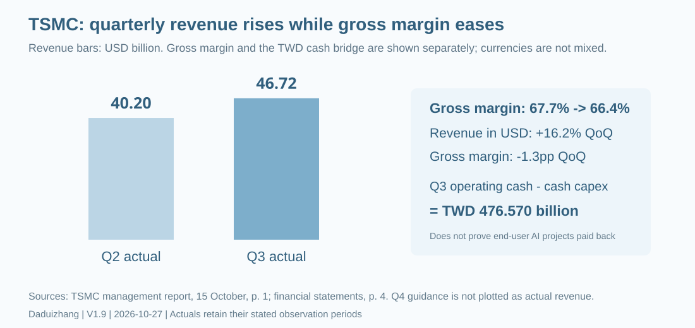
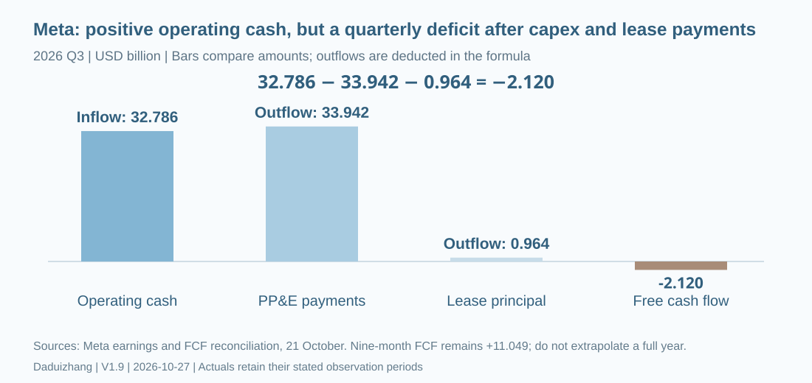
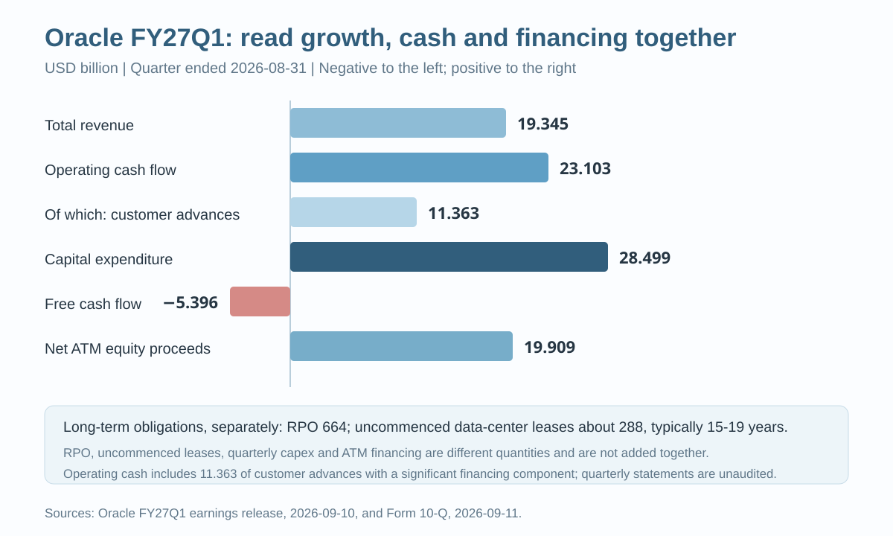
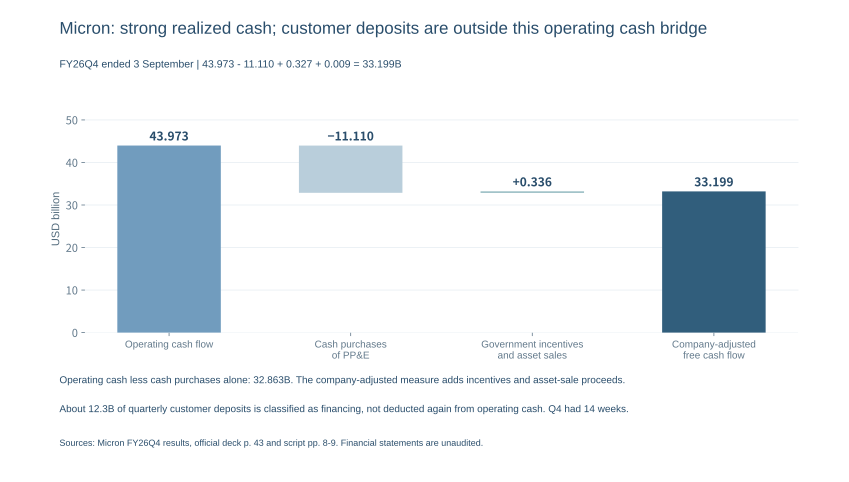
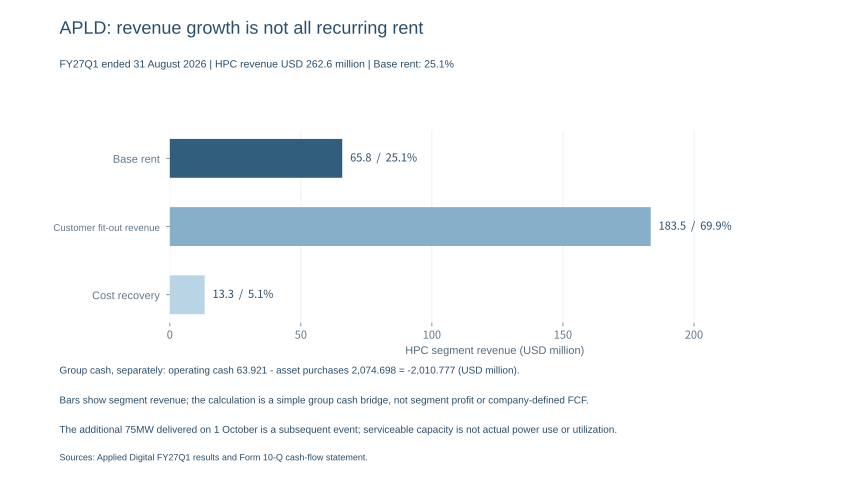
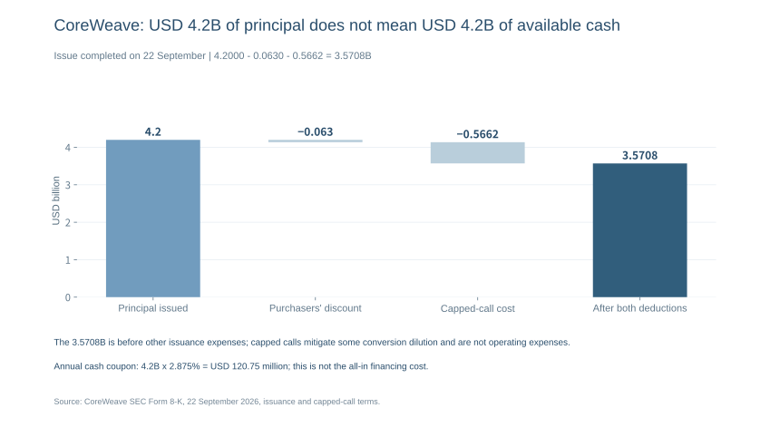
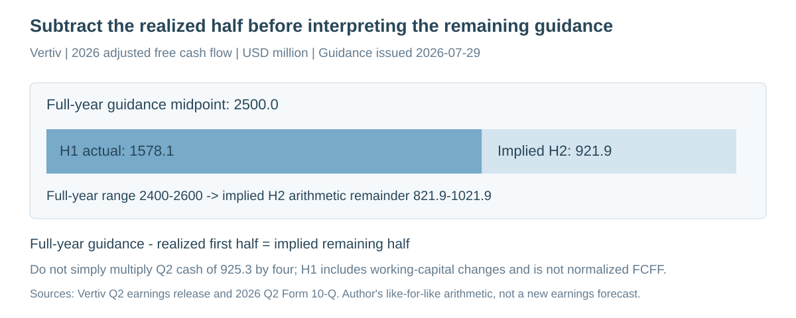

# AI Cycles and the Bubble: Main Research Report · V2.0

Daduizhang · 2026-11-21

## Conclusion

AI already has paying customers. This week, some companies still raised substantial capital, and parts of the supply chain generated substantial cash. I judge the build-out with two tests. **Will net customer receipts arrive in time to cover equipment, lease and debt payments? Over the same assets’ economic lives, will the cash they generate and realizable residual value repay the initial outlay?**

Anthropic closed its IPO and concurrent private placement. Gross proceeds attributable to the issuer across the two transactions were about **USD 117.58 billion**. Its prospectus separately sets out about **USD 70.7 billion** of expected contractual payments in the 12 months following September 30, 2026. The first figure records funding raised at two closings. The second is a forward schedule to compare with actual deliveries, settlement and customer receipts. [Closing announcement](https://www.anthropic.com/news/ipo-close) · [Final prospectus, pp. 178-181](https://www.sec.gov/Archives/edgar/data/2130357/000162828026074944/anthropicpbc-424b4.htm)

Delay amplifies risk when it shifts revenue back while interest or rent continues to accrue. Time can also help absorb prior investment. Suppliers may reschedule payments, customers may continue paying for older machines, and more demand may be funded from customer budgets. Some contracts already show how the dates can diverge. A broad cycle call still requires the divergence to appear in the realized cash flows of multiple participants.

## Follow a customer payment

An outside customer pays a model provider **USD 100**. The provider spends **USD 40** with a cloud platform, which uses **USD 25** of that amount to buy equipment. Each transaction has a commercial purpose. The USD 165 transaction total includes cash recirculating within the chain. To test whether the chain can support itself, ask who funds the next USD 100 and how much the cloud platform must reinvest to keep serving the customer.

For each project, record the dates that equipment and rent become payable, power and acceptance tests finish, customers actually pay, and equipment stops earning as planned. Record recognized revenue, funded financing, enforceable minimum payments, guarantee exposure and cash actually paid in their respective columns. Even a profitable company can face an interim funding gap, and a project that pays its bills can fall short of recovering the initial equipment cost.

Chapters 1 and 2 trace the new financial and contractual evidence. Chapters 9, 11 and 12 cover delivery milestones, tests of cycle transmission and the five-year cash example. Chapter 13 follows the chain through regional operating examples. Chapters 4 through 6 continue the original research on paid video, coding economics and the path from adoption to cash.

## Edition and evidence dates

V2.0 builds directly on the October 31, 2026 V1.9 main report. The underlying research retains its original periods and evidence dates. The additions run through November 21, 2026 in Beijing. This week's market observations end at the November 20 regular U.S. close. Dated updates identify new checks, inherited evidence and illustrative calculations.

Chapter 9 follows power delivery and service acceptance. Chapter 12 covers five-year asset recovery. Chapter 13 applies V1.9's regional framework to public cases in North America, Europe, South Korea and Japan. The English edition uses the chapters of the V1.9 English full report corresponding to the Chinese main report. Both editions now have thirteen chapters. Chapter 11 identifies the distinct dates of the V1.9.1 and V1.9.2 records.

[V1.9 English archive](../V1.9_English_Full_Report/AI_Cycles_and_Bubble_Full_Report_EN_2026-10-31.md)

<!-- BODY_START -->

## Chapter 1: What Is Real Money, and What Is a Valuation Game?

### November 21: strong supplier cash and customer payback are separate findings

NVIDIA's FY27Q3 results, released November 17 for the quarter ended October 25, supply a meaningful counterargument to an industry-wide cash-collapse thesis. Revenue reached USD 115.844 billion, including approximately USD 107.6 billion from Data Center, up 110% year on year. Operating cash flow increased from USD 24.077 billion in the preceding quarter to USD 48.253 billion. Under the company's definition, subtracting USD 4.422 billion of asset purchases and USD 0.054 billion of related principal payments produces free cash flow of **USD 43.777 billion**. The company's explanation includes the timing of federal cash-tax payments. The sequential improvement cannot all be attributed to collections or underlying demand. [NVIDIA FY27Q3 results](https://nvidianews.nvidia.com/news/nvidia-announces-financial-results-for-third-quarter-fiscal-2027), [SEC supplemental financial information](https://www.sec.gov/Archives/edgar/data/1045810/000104581026000088/supplementalfinancialinfor.htm)

Receivables require their own test. Days sales outstanding increased from 60 to 64 days, while the change in accounts receivable absorbed USD 18.052 billion of operating cash. Management linked the pattern partly to Rubin shipment timing and extended payment terms on large, multiquarter contracts with some investment-grade customers. DSO is neither an overdue-balance measure nor a default rate. Subsequent collections, receivables aging and credit-loss allowances will determine whether this is timing, a structural change in terms or worsening recoverability. [NVIDIA CFO commentary](https://www.sec.gov/Archives/edgar/data/1045810/000104581026000088/q3fy27cfocommentary.htm), [supplemental cash-flow statement](https://www.sec.gov/Archives/edgar/data/1045810/000104581026000088/supplementalfinancialinfor.htm)

The updated conclusion is therefore stronger upstream cash generation with an unresolved downstream recovery test. Customers can pay a supplier using operating receipts, cash accumulated elsewhere in their businesses or new financing. Those sources have different implications for repeat orders. NVIDIA's positive free cash flow is evidence about NVIDIA's cash generation. It does not establish the lifetime return on every customer's new equipment. Equally, a customer's construction outflow does not invalidate the supplier's genuine revenue. The next comparison should align the customer's collections, construction payments and financing dates, rather than combine unlike financial periods into an industry cash total.

> Observations through 31 October 2026, Beijing time. This chapter retains V1.8's verification of announcements on 28 - 30 October; earlier earnings reports retain their original reporting periods and publication dates. Unless otherwise stated, amounts are in USD billions; TSMC, ASML, Chinese and Korean companies are separately labeled in local currencies. Each company's reporting period is specified. Quarterly financial statements and Micron's full-year earnings release are unaudited; Microsoft, Lumentum and Coherent full-year figures come from audited 10-Ks. The following distinguishes operating earnings, investment gains, accounting estimates and cash recovery, without substituting one for another.

### From Revenue to Cash

The new earnings reports on 28 - 29 October make the separation of operations and revaluation a two-way test: Alphabet's Q3 equity-security losses depressed EPS, while Cloud revenue and operating income continued growing; Amazon's Q3 net income fell year on year, while AWS operating income still grew. Meanwhile, Alphabet posted negative FCF for a second consecutive quarter, Amazon's rolling FCF outflow widened, and Microsoft retained a positive cash surplus. The assessment is therefore more specific: real demand remains strong, but capital-recovery pressure and investment-gain volatility are more apparent. Changes in net income alone cannot determine a verdict on the entire industry.

This chapter follows revenue through to cash: identify what customers pay for, separate operating income from portfolio gains and taxes, examine collections, capital expenditure and leases, and finally ask whether new investment can recover its cost before the equipment loses economic competitiveness. Oracle FY27Q1 sharpens the tension: cloud-infrastructure revenue grew 121%, yet capital expenditure exceeded operating cash flow, which itself benefited from large customer prepayments. Current evidence supports “operating delivery alongside pressure on capital recovery,” neither “all five companies' profits are unreal” nor “high growth proves any construction cost is justified.”

| Reading location | Question to answer | Definitions that must remain distinct |
|---|---|---|
| Operations and cash analysis | Which operating results have materialized, and how does profit become cash? | Nonoperating gains are not false profits; cash expenditure is not a current-period expense |
| Customers and collections | What has changed in NVIDIA's customers and cash collection? | Direct customers, ultimate customers and receivables concentration are separate |
| Valuation and historical comparisons | What separates a good company from a good investment return? | Valuation dates, historical cases and forecast probabilities are separate |
| Subsequent evidence and countertests | How should the next earnings report overturn or strengthen the assessment? | Observation rules are not statistical models; risk is not a trading instruction |

### 1.1 The Five Giants: Assess Operating Delivery and Cash Recovery Separately

Corporate profits require assessment by source: delivered products and services, nonoperating gains, receivables still outstanding, and capital invested to support future growth answer different questions. The table places operations alongside cash pressure, avoiding a single earnings-quality score with no consistent weighting.

| Company and reporting period | Recognized operations | Main checks in this chapter | Current assessment |
|---|---|---|---|
| NVIDIA, FY27Q2, ended 7/26 | Revenue 96.221, data center 89.023; GAAP gross margin 75.0% | Operating cash flow 24.077, below the previous quarter's 50.344; days sales outstanding rose from 45 to 60 | Demand and profits are strong; collection timing and customer-support arrangements require monitoring |
| Microsoft, FY27Q1, ended 9/30 | Revenue 92.279, operating income 45.915; Azure revenue under the new definition 33.165, up 48% | Operating cash flow 58.000, cash PP&E purchases 39.367 | Cash surplus remains positive; delayed third-party capacity cannot directly establish weaker demand |
| Alphabet, 2026Q3 | Cloud revenue 30.709, operating income 11.121 | Pretax equity-security losses 8.664; quarterly FCF −9.065 | Cloud operating growth coexists with investment losses; cash-recovery pressure deepens |
| Amazon, 2026Q3 | AWS revenue 45.984, operating income 17.773 | Other losses, net, 0.703; TTM FCF through 9/30 −42.357 | AWS growth continues to materialize; consolidated construction payments absorb cash faster |
| Meta, 2026Q3, ended 9/30 | Revenue 64.601, including advertising 63.061; GAAP net income 9.860 | Operating cash flow 32.786, cash PP&E purchases 33.942, finance-lease principal 0.964; earnings include legal-settlement expense of 9.89 | Advertising keeps growing; quarterly FCF turns negative; the decline in operating income cannot all be attributed to AI spending |

Sources: [NVIDIA CFO commentary](https://www.sec.gov/Archives/edgar/data/1045810/000104581026000073/q2fy27cfocommentary.htm), [Microsoft 28 October earnings](https://www.microsoft.com/en-us/Investor/earnings/FY-2027-Q1/press-release-webcast), [Alphabet 28 October earnings](https://s206.q4cdn.com/479360582/files/doc_financials/2026/q3/2026q3-alphabet-earnings-release.pdf), [Amazon 29 October earnings](https://ir.aboutamazon.com/news-release/news-release-details/2026/Amazon-com-Announces-Third-Quarter-Results/default.aspx), [Meta 21 October Q3 earnings](https://investor.atmeta.com/investor-news/press-release-details/2026/Meta-Reports-Third-Quarter-2026-Results/default.aspx). This is not a same-period ranking: NVIDIA's quarter-end differs, and Amazon's FCF covers a rolling 12 months; Meta Q3 and NVIDIA FY27Q2 retain the baseline verified on 27 October and are not newly disclosed in this round. Microsoft's new segments have restated historical figures; the old “Azure and other cloud services” +43% cannot be directly joined to last quarter's Azure +42% under the new definition.

TSMC released formal Q3 results on 15 October: USD revenue was 46.72B, approximately 16.2% above Q2's 40.20B; TWD revenue was 1,494.24B, up 50.9% year on year, which is not interchangeable with USD growth of 41.2%. Gross margin fell from 67.7% to 66.4%, but net income attributable to the parent rose from TWD 706.56B to 763.06B. HPC's 68% revenue share is not an AI share, and the Q4 USD revenue range of 52.3 - 54.3B remains guidance. These realized operating results counter an immediate demand cliff, but do not prove every downstream project has recovered its investment. [TSMC Q3 management report, pages 1 - 2](https://investor.tsmc.com/english/encrypt/files/encrypt_file/reports/2026-10/f83780000ddc0c3b48e57a87eab6814c4ab35058/3Q26%20ManagementReport.pdf), [Q3 actuals and Q4 guidance](https://investor.tsmc.com/english/quarterly-results/2026/q3)

### 1.2 From Accounting Profit to Cash Available for Use

#### 1.2.1 Portfolio Revaluation: Separate It, without Calling “Noncash” “Unreal”

Appreciation in equity holdings may enter earnings under applicable accounting standards. Such gains have economic meaning, but are neither revenue from selling cloud services nor necessarily cash received that quarter. The direct implication for investors is that calculating P/E from EPS containing large revaluation gains may produce a multiple that looks cheap but is unsustainable.

Alphabet's Q3 pretax loss on equity securities was 8.664, with a disclosed after-tax net-income impact of approximately −6.7 and EPS impact of −0.55; USD 2.12+0.55=2.67 represents EPS excluding only this item, not fully normalized operating EPS. Q2's 9.11−6.26=2.85 remains a historical comparison: revaluation can raise or lower reported profits, so adjustments must be symmetric. Q3 total net income of 26.468 differs from the 26.170 attributable to common shareholders by 0.298 in preferred dividends; they should not be conflated. [Alphabet Q3 earnings, pages 5, 8](https://s206.q4cdn.com/479360582/files/doc_financials/2026/q3/2026q3-alphabet-earnings-release.pdf)

Amazon's Q3 net income was 20.685 and operating income 28.076; other losses, net, were 0.703, and after adding interest income and deducting interest expense, the total pretax nonoperating balance was −1.207. The old Q2 other gains of 53.415 and net nonoperating amount of 53.396 no longer represent the current quarter. Q3's year-on-year profit decline includes the base effect of the prior-year Anthropic investment gain, so it cannot establish deterioration in AWS operations; pretax items also cannot be deducted directly from after-tax net income. [Amazon Q3 income statement and investment notes](https://www.sec.gov/Archives/edgar/data/1018724/000101872426000040/amzn-20260930.htm)

Microsoft FY27Q1 GAAP net income was 36.629; excluding the 0.207 after-tax OpenAI investment gain gives 36.422. The company's non-GAAP definition still promises only this adjustment. The earlier FY26Q4 case involving a separate Anthropic gain shows why “company non-GAAP” cannot automatically be treated as excluding all nonoperating gains. NVIDIA FY27Q2 securities gains likewise retain their original-period assessment; FY27Q3 profits are not filled in before the new earnings release. [Microsoft Q1 reconciliation](https://www.microsoft.com/en-us/Investor/earnings/FY-2027-Q1/press-release-webcast)

The profit bridge used for comparison should be:

> GAAP net income − disclosed after-tax nonoperating gains + disclosed after-tax nonoperating losses ± other explicit adjustments = research-defined adjusted net income.

Where only pretax items are available, retain a pretax profit bridge; do not use a uniform 21% tax rate to manufacture a company's “actual after-tax figure.” Whether investment gains can recur, be realized and be distributed are three different questions. Even if the next funding round raises the valuation again, unrealized portfolio gains cannot receive the same valuation multiple as cloud-service revenue.

#### 1.2.2 Depreciation: The Gap between Accounting Life and Economic Life

A GPU that still powers on may no longer attract customers at its original rental rate. Conversely, a new chip generation does not instantly reduce older equipment to zero value; older GPUs may shift to price-sensitive inference, internal R&D or lower-load tasks. Depreciation should be tested against the cash-earning capacity of particular asset groups, rather than a blanket declaration that “all GPUs last only three years.”

Servers, networking equipment and data-center buildings cannot share one economic life. Companies differ in equipment mix, deployment cohorts and residual-value assumptions; changes in accounting estimates generally affect future expense allocation. A further judgment of misstatement requires evidence of a standards violation, an erroneous estimate or a material impairment. External researchers may posit shorter economic lives, but those calculations remain sensitivity assumptions, not proven underdepreciation in audited financial statements.

Start with four checks in existing reports: when additions to fixed assets become available for use, whether depreciation rises as assets enter service, whether idle or prematurely retired assets are impaired, and whether leased and self-built assets fall under different expense headings. Company accounting policies and subsequent changes require item-by-item verification against original notes; a years-old table cannot substitute for current policy. [Microsoft FY2026 10-K](https://www.sec.gov/Archives/edgar/data/789019/000119312526323660/msft-20260630.htm), [Meta Q2 10-Q](https://www.sec.gov/Archives/edgar/data/1326801/000162828026050705/meta-20260630.htm)

A reproducible sensitivity example: assume an equipment cohort with a USD 6 billion depreciable basis and zero residual value. Straight-line depreciation over 6 years is USD 1 billion annually; if economic life is only 3 years, annual economic consumption is equivalent to USD 2 billion. The assumptions differ by USD 1 billion of annual pretax expense, but this only illustrates the same equipment group operating for a full year. The difference cannot be multiplied across all company fixed assets or booked as actual underdepreciation at a particular company.

Cash flow does not entirely resolve this issue either. Although depreciation is added back in operating cash flow, equipment eventually needs replacement. Long-duration projects require a separate estimate of maintenance capital expenditure; “positive operating cash flow” does not mean “the equipment has recovered its cost over its full life cycle.”

#### 1.2.3 Free Cash Flow: Standardize the Calculation before Discussing Pressure

| Company | Period | Operating cash flow | Deductions | FCF or comparable calculation | Definition boundaries |
|---|---|---:|---:|---:|---|
| Alphabet | 2026Q3 | 42.290 | Cash PP&E purchases 51.355 | −9.065 | Company definition; TTM remains +19.747, cumulative first three quarters −4.804 |
| Microsoft | FY27Q1 | 58.000 | Cash PP&E purchases 39.367 | +18.633 | Company's cash FCF definition; deducting finance-lease principal of 1.000 gives +17.633 |
| Meta | 2026Q3 | 32.786 | Fixed assets 33.942+finance-lease principal 0.964 | −2.120 | Company definition already includes this lease principal; cumulative first nine months remain +11.049 |
| NVIDIA | FY27Q2 | 24.077 | Fixed and intangible assets 2.677+related principal 0.059 | +21.341 | Company definition; cash PP&E purchases alone cannot replace all deductions |
| Amazon | TTM through 9/30 | 168.300 | Net cash PP&E purchases 210.657 | −42.357 | Company's principal FCF measure; no additional finance-lease principal deduction in this row |
| Oracle | FY27Q1, ended 8/31 | 23.103 | Capital expenditure 28.499 | −5.396 | Operating cash includes 11.363 in customer prepayments, explicitly identified by the company as having a significant financing component |

These data come from the companies' cash-flow statements and non-GAAP reconciliations cited above. The first five calculations are 42.290−51.355, 58.000−39.367, 32.786−33.942−0.964, 24.077−2.677−0.059 and 168.300−210.657; Oracle is 23.103−28.499. Quarterly and TTM columns must not be summed into “industry FCF.”

Against the 27 October baseline, Alphabet's quarterly FCF changed from −5.855 to −9.065, and Amazon's TTM from −7.604 to −42.357. The latter is a change in a rolling window, not entirely Q3 cash outflow. Amazon's standalone Q3 was 42.422−(77.259−1.381)=−33.456. Microsoft's cash bridge remained positive, but fell from 19.639 in the previous quarter to 18.633. Together, these support “widening investment-recovery pressure with continued differences among companies,” not proof that every construction investment destroys value.

Microsoft's earnings call disclosed total CapEx of 45.2 and finance leases of 7.4; its 10-Q separately reported 5.192 of finance-lease right-of-use assets obtained in exchange for lease obligations. These different metrics cannot be combined arbitrarily with cash purchases of 39.367. Cash principal repayments of 1.000 must be separated from lease interest of 0.769 already included in operating cash flow. At 9/30, another 364.6 of commitments for leases not yet commenced were expected to begin in FY27 - FY34; these are not current-quarter payments. Management attributed some investment deferral to delayed delivery of third-party capacity. Without a full line-item reconciliation, this report does not use the difference to prove “lower CapEx = weaker demand.” [Microsoft earnings call](https://www.microsoft.com/en-us/Investor/events/fy-2027/earnings-fy-2027-q1), [Q1 10-Q lease note](https://www.sec.gov/Archives/edgar/data/789019/000119312526436133/msft-20260930.htm)

Meta's historical Q2 figures remain useful: operating cash flow 31.862, cash PP&E purchases 30.116 and lease principal 0.962 produced FCF of +0.784. In Q3, operating cash rose 0.924 while the two payments together rose 3.828, reducing quarterly FCF by 2.904 to −2.120. Quarter-end cash, cash equivalents and marketable securities totaled approximately 82.45. One negative quarter cannot establish an imminent payment crisis; nor can the company's full-year capital-expenditure guidance of 135 - 145, including lease principal, be described as spending already incurred. [Meta historical Q2 earnings](https://investor.atmeta.com/investor-news/press-release-details/2026/Meta-Reports-Second-Quarter-2026-Results/default.aspx), [Q3 cash flow and guidance](https://investor.atmeta.com/investor-news/press-release-details/2026/Meta-Reports-Third-Quarter-2026-Results/default.aspx)

Oracle FY27Q1 total revenue was 19.345 and cloud revenue 11.607, including IaaS of 7.388, up 121% year on year. Operating delivery is strong, but growth rates alone cannot explain the funding bridge. Of operating cash flow of 23.103, 11.363 came from customer prepayments with a significant financing component; after capital expenditure of 28.499, free cash flow was −5.396. The company also completed an ATM common-stock offering with net proceeds of 19.909. Customer prepayments and equity financing are real funding sources, but neither proves cloud services have earned back their costs. [Oracle FY27Q1 results](https://investor.oracle.com/files/content_files/1q27-pressrelease-September_FINAL.pdf), [Oracle FY27Q1 10-Q](https://www.sec.gov/Archives/edgar/data/1341439/000119312526389274/orcl-20260831.htm)

The chart deliberately does not add remaining performance obligations of 664, uncommenced data-center lease commitments of 288 and quarterly capital expenditure. Approximately 13% of RPO is expected to be recognized over the next 12 months, approximately 37% in months 13 - 36, 34% in months 37 - 60, and the remainder later. The lease commitments of 288 are expected to commence progressively from FY27Q2 through FY29, with contracts typically lasting 15 - 19 years, and were not yet reflected on the 31 August balance sheet. They strengthen future-revenue visibility and long-term performance obligations, not current cash, revenue or losses.

To assess external financing needs, first compare operating cash with cash CapEx, then examine cash balances, debt maturities, dividends and buybacks, equity investments and lease principal repayments. FCF already deducts CapEx; comparing the size of FCF and CapEx again does not measure a funding gap. Even positive FCF can coexist with financing needs from large investments and debt repayments; a negative quarter can be covered by existing cash balances.

Amazon best illustrates this distinction: AWS revenue and segment profit grew substantially, but consolidated construction payments grew faster, turning rolling FCF negative. Neither can AWS profits be described as “dependent on Anthropic revaluation,” nor can AWS margins be used to calculate returns for all AI construction projects. Retail logistics, other technology infrastructure and purchased services are included in consolidated statements; pure-AI returns require more precise allocation of capital and profits.

#### 1.2.5 Overseas Optical Suppliers: Operating Improvement Can Coexist with Financing Losses

Lumentum disclosed on 11 August that FY26Q4 revenue, for the period ended 27 June, was USD 1.0063 billion, up 109.3% year on year, with GAAP operating margin of 27.8% and non-GAAP operating margin of 36.6%. Yet the same quarter's GAAP net loss was approximately USD 7.2 billion, mainly due to approximately USD 7.8 billion of noncash debt-extinguishment losses from convertible debt becoming equity, rather than an equivalent equipment operating loss or cash outflow. Non-GAAP net income of USD 326.3 million helps assess adjusted operations but cannot erase the dilution to common shareholders from debt conversion. [Lumentum quarterly results and reconciliation](https://www.sec.gov/Archives/edgar/data/1633978/000162828026055726/lite_ex991xq4fy26.htm)

Cash requires a separate, full-period view: Lumentum FY2026 operating cash flow of USD 751.4 million less cash PP&E purchases of USD 451.3 million equals USD 300.1 million. This shows full-year operating cash covering that construction payment, not a quarterly cash-conversion ratio, and does not deduct all investing and financing expenditure. The example reminds us to locate the source of a large net loss before concluding that demand or liquidity has collapsed. [Lumentum FY2026 10-K, cash-flow statement and debt note](https://www.sec.gov/Archives/edgar/data/1633978/000162828026057358/lite-20260627.htm)

Coherent's contrast lies in cash. FY26Q4 revenue disclosed on 12 August was USD 2.046 billion, up 33.8% on a reported basis, which must not be mixed with the company's separately reported pro forma growth rate. GAAP and non-GAAP gross margins were 38.5% and 40.2%, with the two profit definitions separately reported. The subsequently filed FY2026 10-K showed operating cash flow of only USD 79.514 million and cash PP&E purchases of USD 1.102909 billion, a difference of −USD 1.023395 billion. The annual report explains cash tied up in inventory and receivables and the offset from payables; NVIDIA equity funding received during the year is financing cash, not operating cash from customers buying products. [Coherent quarterly results](https://www.sec.gov/Archives/edgar/data/820318/000119312526346860/d128030dex991.htm), [Coherent FY2026 10-K, cash-flow statement and liquidity analysis](https://www.sec.gov/Archives/edgar/data/820318/000082031826000020/iivi-20260630.htm)

Both companies' full-year cash figures come from audited annual reports, while quarterly earnings remain unaudited; full-year cash cannot be divided by one quarter's profits. Coherent's negative difference shows that capacity expansion and working capital require funding, but alone does not prove false revenue or a coming payment crisis. The next checks are when inventory will be delivered, when receivables will be collected and how long financing cash will last.

#### 1.2.6 Systems and Chips: Reconstruct Adjusted Cash Item by Item

For Dell Technologies FY27Q2 ended 31 July, AI-optimized server revenue was USD 16.401 billion, up 100% year on year; AI orders were USD 60.9 billion and ending backlog approximately USD 95.0 billion. On 1 September, the company raised full-year AI-server revenue guidance from USD 60.0 billion to USD 74.0 billion. Revenue demonstrates delivery; orders and higher guidance still require future performance and cannot be combined into cash already recovered. [Dell official quarterly results, pages 1 - 2](https://investors.delltechnologies.com/node/20956/pdf)

Dell's consolidated operating cash flow for the same quarter was USD 2.225 billion, down approximately 13% year on year. Its cash reconciliation deducts net capital expenditure of USD 1.239 billion to arrive at FCF of USD 986 million, then adds back USD 6.667 billion of financing-receivable adjustments and USD 496 million of operating-lease equipment adjustments to obtain adjusted FCF of USD 8.149 billion. These three cash metrics are not interchangeable; USD 8.149 billion is not actual quarterly operating cash flow. Timing differences among customer financing, equipment delivery and collections belong in the analysis. Doubling AI-server revenue alone cannot establish whether customers' compute projects have earned their cost of capital. [Dell cash statements and FCF reconciliation, pages 5, 8 - 9](https://investors.delltechnologies.com/node/20956/pdf)

HPE's FY26Q3 results, released on 2 September and also ended 31 July, showed consolidated revenue of USD 12.213 billion, “Cloud & AI” segment revenue of USD 9.042 billion and segment operating margin of 17.0%. That segment includes servers, hybrid cloud and financial services, so it does not represent pure-AI revenue and profit. Consolidated operating cash flow of USD 1.641 billion, less USD 745 million of fixed-asset and software investment, plus USD 92 million of asset disposals, less USD 30 million of foreign-exchange effects, produces company-defined FCF of USD 958 million. Networking also reflects Juniper consolidation; all consolidated growth cannot be described as organic AI growth. [HPE quarterly results and cash reconciliation](https://investors.hpe.com/~/media/Files/H/HP-Enterprise-IR/documents/q3-2026/q3-2026-earnings-press-release.pdf), [HPE 10-Q, segments and operating analysis](https://www.sec.gov/Archives/edgar/data/1645590/000164559026000080/hpe-20260731.htm)

Marvell disclosed on 27 August FY27Q2 revenue of USD 2.7393 billion for the period ended 1 August, up 37% year on year, and GAAP net income of USD 308.0 million. Operating cash flow of USD 605.5 million less cash PP&E purchases of USD 126.7 million equals USD 478.8 million. This is a quarter with both positive profits and cash, but the fabless model still has capital constraints: the 10-Q lists long-term capacity prepayments of USD 487.0 million, against USD 278.8 million at the start of the year, and discloses supply and capacity commitments. Changes in prepayment balances cannot be deducted again from CFO already incorporating their cash effects. Data-center revenue of USD 2.1715 billion also includes multiple product types and cannot all be counted as end-customer AI spending. [Marvell quarterly results](https://investor.marvell.com/news-events/press-releases/detail/1031/marvell-technology-inc-reports-second-quarter-of-fiscal-year-2027-financial-results), [Marvell 10-Q, notes 3, 9 and 14](https://investor.marvell.com/sec-filings/all-sec-filings/content/0001835632-26-000025/mrvl-20260801.htm)

These three quarterly statements are unaudited and use different cash definitions. They also cannot be added to the preceding companies' full-year figures to produce an “industry cash-recovery rate.” Analysis should focus on each company's deliveries, payment terms and investment-recovery period, rather than letting a high-growth table replace the full assessment.

#### 1.2.7 Micron: Memory Profits Have Become Cash, but End-Customer Payback Remains a Separate Question

Micron announced FY26Q4 and full-year results on 30 September for the period ended 3 September. Quarterly revenue was 54.229B, GAAP net income 37.701B and operating cash flow 43.973B; full-year revenue was 133.188B and operating cash 89.675B. The following financial figures come from the company's unaudited earnings materials, with quarterly and full-year data shown separately. [Micron official results and financial statements](https://investors.micron.com/news/press-release/2026/Micron-Technology-Inc--Reports-Record-Fiscal-Fourth-Quarter-and-Full-Year-2026-Results/default.aspx)

| Cash bridge (USD billions) | FY26Q4 | FY2026 |
|---|---:|---:|
| Operating cash flow | 43.973 | 89.675 |
| Cash purchases/construction of PP&E | 11.110 | 30.712 |
| Difference: this report's simple cash bridge | 32.863 | 58.963 |
| Government incentives | 0.327 | 3.316 |
| Proceeds from sales of PP&E | 0.009 | 0.029 |
| Company net capital expenditure | 10.774 | 27.367 |
| Company adjusted free cash flow | 33.199 | 62.308 |

Net capital expenditure deducts government incentives and asset-sale proceeds from asset purchases. Thus quarterly company-adjusted free cash flow is 43.973−11.110＋0.327＋0.009＝33.199B; this report deducts only cash asset purchases from operating cash to obtain 32.863B. Both are positive but are different metrics; neither should be called “GAAP free cash flow.” [Official presentation, cash reconciliations on pages 43, 49](https://s25.q4cdn.com/621799436/files/doc_financials/2026/q4/Q4-26-Earnings-Deck.pdf)

Year-on-year and sequential comparisons also require checking the number of weeks: FY2026 had 53 weeks, Q4 had 14 and Q3 had 13. Quarterly revenue grew 30.81% from the previous quarter's 41.456B; mechanically normalizing by weeks gives approximately 21.47%, but that figure still does not remove price, product-mix or delivery-timing effects and is not organic growth. [Micron Q3 10-Q, Note 1 and MD&A](https://www.sec.gov/Archives/edgar/data/723125/000072312526000015/mu-20260528.htm)

These cash figures directly counter the claim that “supply-chain profits lack operating-cash support.” The company disclosed approximately 12.3B of customer deposits collected in Q4, but classified them as financing activities, so they do not increase operating cash or free cash flow and must not be deducted again from 43.973B. Long-term contracts can support construction, while deposits include refund arrangements once purchasing conditions are met and cannot be treated as permanent revenue. Suppliers' abundant cash and whether cloud providers and model customers recover their investments still require separate tests. [Micron official prepared remarks, pages 8 - 9](https://s25.q4cdn.com/621799436/files/doc_financials/2026/q4/Q4-FY26-Prepared-Remarks.pdf)

For FY27Q1 the company guided to revenue of 61.5±1.5B, net capital expenditure of approximately 11.5B and approximately 25B in the first half, with a higher second half. These are management forecasts, not incurred spending or a definite full-year capital-expenditure point estimate. Subsequent countertests should focus on memory selling prices, deliveries, receivables and inventory, contract renegotiation and cash returns after new capacity enters service.

#### 1.2.8 Data-Center Delivery Starts Billing, but Not All Revenue Is Recurring Rent

Applied Digital released FY27Q1 results after the US close on 7 October for the period ended 31 August. Of USD 262.6 million in HPC hosting revenue, base rent was 65.8, tenant fit-out services 183.5 and expense reimbursement 13.3. The three sum to segment revenue, with base rent only approximately 25.1%. Fit-out services are recognized current-period revenue, but multiplying all 262.6 by four does not yield stable annual rent; revenue is also not cash collected. [Company quarterly earnings, HPC Hosting Update](https://www.globenewswire.com/news-release/2026/10/07/3376854/0/en/applied-digital-reports-fiscal-first-quarter-2027-results.html)

Group GAAP revenue of USD 341.9 million and adjusted revenue of 300.4 have different scopes: the latter excludes consolidated subsidiary ChronoScale. On 1 October, another 75MW became ready for service, taking operational critical IT-load capacity at Polaris Forge 1 to 250MW. This is service-ready capacity, not real-time electricity load, and delivery occurred after quarter-end, so it cannot be placed retrospectively in rent for the quarter ended 31 August. It is positive evidence of construction becoming operations; project payback still requires comparison with operating costs, financing and subsequent cash.

The other side of the group cash-flow statement must also be retained: operating cash flow of USD 63.921 million less cash purchases/construction of PP&E and other assets of USD 2,074.698 million equals −USD 2,010.777 million; net financing cash flow was USD 1,543.472 million. This simple bridge is neither company-defined FCF nor HPC-segment cash flow. It shows construction far exceeding operating-cash support this quarter, but a construction-period gap alone cannot establish negative project NPV or corporate bankruptcy. [FY27Q1 10-Q, page 5](https://ir.applieddigital.com/sec-filings/all-sec-filings/content/0001144879-26-000059/apld-20260831.htm)

#### 1.2.9 Samsung and SK hynix: From Preliminary Guidance to Quarterly Cash Evidence

Samsung's 2026Q3 results released on 29 October replace the 8 October preliminary announcement as the current basis: group revenue was KRW 195.3 trillion and operating income 107.4 trillion; the DS semiconductor division had revenue of 147.1 trillion and operating income of 106.5 trillion, while the DX division lost 0.8 trillion. Divergence within one group does not support treating “AI beneficiary” as growth across all products. [Samsung formal earnings announcement](https://news.samsung.com/global/samsung-electronics-announces-third-quarter-2026-results), [AP cross-check of revenue and operating income](https://apnews.com/article/295ba99532e93f2706b7abff95e0ff15)

Cash summaries from Samsung and SK hynix earnings presentations were obtained in this round. The table covers 2026Q3 in **KRW trillions**, using only simple same-period subtraction. Presentations are not audited annual statements and do not supply pure-HBM cash flow.

| Company | Operating cash flow | Cash PP&E purchases/construction | Simple cash bridge | Additional boundaries |
|---|---:|---:|---:|---|
| Samsung | 98.6 | 26.9 | +71.7 | Presentation precision is only one decimal place; other investments, dividends and buyback payments also exist |
| SK hynix | 54.781 | 12.670 | +42.111 | Deducting the presentation's lease-liability repayments of 0.136 gives 41.975; still not complete distributable cash |

Sources: [Samsung Q3 presentation, page 15](https://images.samsung.com/is/content/samsung/assets/global/ir/docs/2026_3Q_conference_eng.pdf), [SK hynix Q3 presentation, page 16](https://mis-prod-koce-homepage-cdn-01-blob-ep.azureedge.net/web/attach/21435786328187801.pdf). Both tables' ending “cash” definitions include short-term financial instruments and cannot be equated directly with statement cash and cash equivalents. SK also had a KRW 30.845 trillion cash outflow from changes in long-term financial investments. The simple bridge tests whether operations cover that construction item, without claiming all cash is distributable to shareholders. Samsung's full reviewed quarterly-report notes and lease bridge still need completion; the available summary does not resolve every earlier gap.

SK hynix announced Q3 revenue of KRW 104.6155 trillion, operating income of 83.3338 trillion and net income of 39.7756 trillion on 28 October, noting that independent review was incomplete. Operating-income growth coexists with a sequential net-income decline; net income alone cannot establish weaker memory demand. The company says long-term agreements cover over half of 2027 - 2028 capacity, with prices moving within agreed ranges according to market conditions. This improves volume visibility, but is not fixed revenue, noncancellable orders or net cash already received. Its statement that supply shortages will extend through 2030 remains management's forecast. [SK hynix formal announcement and qualifications](https://news.skhynix.com/en/q3-2026-business-results/)

#### 1.2.10 TSMC and ASML: Strong Cash Still Requires Separating Revaluation and Prepayments

TSMC Q3 operating cash flow was TWD 919.776B and cash PP&E purchases/construction 443.206B, a difference of 476.570B. Both are current-quarter cash-flow figures, not cumulative first-three-quarter data, and cannot be divided directly by USD revenue. Operating cash exceeded Q2's 783.365B while revenue and attributable net income grew, countering the claim that “the supply chain has only accounting profits.” However, nonoperating income fell from 95.83B in Q2 to 34.59B in Q3, including the fading effect of prior-quarter asset disposals and revaluation, explaining why net income did not rise as much as revenue. [TSMC financial statements, page 4](https://investor.tsmc.com/english/encrypt/files/encrypt_file/reports/2026-10/3a94d1034b9e6b22446b674f7aaf3d088a12a193/FS.pdf), [Management report, page 1](https://investor.tsmc.com/english/encrypt/files/encrypt_file/reports/2026-10/f83780000ddc0c3b48e57a87eab6814c4ab35058/3Q26%20ManagementReport.pdf)

ASML disclosed US-GAAP Q3 results on 14 October for the period ended 27 September. The following uses EUR billions: revenue 11.6620, operating income 5.1728 and net income 4.9604, up approximately 55.2%, 109.6% and 133.5% year on year, respectively. Profit growth reflects equipment and upgrade operations but also includes 0.5097 in pretax equity-investment gains, which management explicitly attributed mainly to an increased valuation of the Mistral AI investment. That item is approximately 8.9% of pretax income of 5.7507; subtracting it directly from after-tax net income would fabricate an “adjusted net income.” [ASML financial statements, page 2](https://investor.asml.com/static-files/d310262b-d037-485d-83b5-92c93cc462f0), [Management prepared remarks, page 1](https://investor.asml.com/static-files/40c56a6b-1460-4f69-9340-6a869560d24b)

ASML's operating cash for the same quarter was 11.7976; deducting fixed assets of 0.4133 and intangible assets of 0.0339 produces company-defined FCF of 11.3504. Cash is strong, but changes in assets and liabilities contributed 7.0090, approximately 59.4% of operating cash, and management noted support from orders and customer prepayments. That total item is not entirely customer prepayments and cannot be treated as equipment already delivered and profit earned. The cash-flow statement already reverses equity-revaluation gains; do not deduct them again. Q4 revenue of 14.2 - 15.2 and full-year 44 - 45 remain company guidance, while customer intentions for 2029 - 2030 cannot be renamed secured orders. [Financial statements, page 9](https://investor.asml.com/static-files/d310262b-d037-485d-83b5-92c93cc462f0), [Management remarks, page 2](https://investor.asml.com/static-files/40c56a6b-1460-4f69-9340-6a869560d24b), [Formal earnings release](https://www.investor.asml.com/news-releases/news-release-details/asml-reports-eu11.7-billion-total-net-sales-and-eu5.0-billion-net-income-q3-2026)

#### 1.2.12 Tax Depreciation: Changing Cash Timing, Not Equipment's Physical Life

Tax depreciation and financial-statement depreciation answer different questions: the former determines when qualifying investment reduces taxable income; the latter allocates asset cost over benefiting periods. IRS Notice 2026-11, released on 14 January 2026, explains that current law generally restores permanent 100% additional first-year depreciation for qualified property acquired and placed in service after 19 January 2025. Eligibility, acquisition date, service date and elections still require item-by-item checks. This does not permit immediate deduction of every AI construction outlay, nor identical classification of data-center buildings and equipment. [IRS additional first-year depreciation guidance, 2026-01-14](https://www.irs.gov/newsroom/treasury-irs-issue-guidance-on-the-additional-first-year-depreciation-deduction-amended-as-part-of-the-one-big-beautiful-bill), [IRS Publication 946 (2025), Special Depreciation Allowance](https://www.irs.gov/publications/p946)

Accelerated deductions can improve early construction-stage after-tax cash, but are not an unconditional government refund of a fixed share of equipment cost, nor permanent creation of an equal amount of economic profit. Solely to illustrate the mechanism, assume a tax basis of 100, sufficient taxable income, a 21% marginal tax rate, and temporarily ignore state taxes, loss carryforwards, minimum tax and other restrictions. Full first-year deduction reduces current tax by 21 relative to “no deduction for this depreciation,” but against deductions spread over subsequent years, the incremental value is chiefly the present-value difference from an earlier tax shield, not an extra permanent gain of 21. Real projects require comparing annual tax shields, not subtracting a uniform percentage directly from CapEx.

The effective tax rate is also not a standalone score for the quality and substance of reported earnings. Income-tax expense divided by pretax profit is an accounting metric; cash taxes paid are a payment metric. Tax credits, geographic profit mix, one-off tax items and deferred income taxes can all create differences. When pretax profit contains large investment revaluations or is near zero, quarterly effective tax rates are particularly unsuitable for uniform red/amber/green thresholds.

| Item checked | Material to read | Supported assessment | Conclusion that does not follow directly |
|---|---|---|---|
| Additional first-year tax depreciation | Current law, asset classes, acquisition and service dates | Which investment can generate an earlier tax shield | Every AI investment receives the same cash subsidy |
| Accounting depreciation and impairment | Fixed-asset policies, asset groups, useful lives and impairment notes | Whether expense allocation matches asset use | First-year tax deductibility means accounting profit should fall by the same amount |
| Effective tax rate | Pretax profit, income-tax expense and rate reconciliation | How taxes alter reported net income | A low rate means revenue is fictitious |
| Cash and deferred taxes | Cash tax payments, deferred-tax assets/liabilities and realizability explanations | When tax shields become cash and how they may reverse | Current tax savings can continue forever at the same amount |

The influence of taxation on capital budgeting is a mechanism worth retaining, but accelerated orders, supply shortages, tariff risk and product upgrades also alter purchasing timing. Without a project-level counterfactual or explicit company attribution, long-dated order books alone cannot establish tax incentives as the driver of construction, much less make a legislative reversal that has not occurred into a demand cliff in a fixed year.

#### 1.2.13 Intel: Separate Server Growth, PC Pressure and Adjusted Cash

Intel disclosed on 29 October Q3 revenue of USD 16.5B for the period ended 26 September: the DCAI segment was approximately 7.3B, up +78% year on year, while the Client and Physical AI segment was approximately 8.1B, down −5%. DCAI is not pure-AI revenue; segments include internal transactions, so Foundry revenue cannot be added again as external group demand. Q4 revenue guidance of 15 - 16B is a future range, not realized revenue. [Intel Q3 results and segment footnotes](https://www.intc.com/news-events/press-releases/detail/1786/intel-reports-third-quarter-2026-financial-results)

The quarterly cash reconciliation warrants closer inspection, in USD B: operating cash of 5.082 less cash asset purchases of 4.219 and finance-lease payments of 0.119 gives this report's simple difference of 0.744. Company-adjusted FCF is 1.639, additionally including capital-related government incentives of 0.048 and net partner contributions of 0.847. Both bridges are useful, but not all 1.639 represents operating collections from customers. The 10-Q also shows net equity-offering proceeds of 22.617B, strengthening liquidity but classified as financing; the fair-value gain on escrowed-share liabilities in GAAP profit cannot be treated as CPU operating income. [Intel reconciliation](https://www.intc.com/news-events/press-releases/detail/1786/intel-reports-third-quarter-2026-financial-results), [Q3 10-Q, cash-flow and equity notes](https://www.intc.com/filings-reports/all-sec-filings/content/0000050863-26-000191/0000050863-26-000191.pdf)

Management's formal remarks reported both insufficient server supply and weakening PC demand, linking the latter to memory prices, availability and IT budgets. This provides a transmission channel worth observing: AI-related upstream price increases may squeeze other end markets, rather than benefit every semiconductor segment simultaneously. It remains the company's operating explanation, not proof that AI has caused an industry-wide downturn. [Intel official prepared earnings-call remarks, pages 1 - 2](https://d1io3yog0oux5.cloudfront.net/_47986fe477a6ac84fe34efbcbf38dd13/intel/db/887/9273/prepared_remarks/Q3%2726_Prepared_Remarks.pdf)

### 1.3 Classifying NVIDIA's “Real Customers”

#### 1.3.1 First Distinguish Three Types of Customer

Customers ordering directly from NVIDIA may be cloud providers, systems vendors, distributors or system integrators. Ultimate GPU users may purchase compute through multiple clouds, while funders may be investors in those companies. These are not the same lists. Guessing that anonymous direct customers are Microsoft, Meta, Amazon and Google creates false precision and miscalculates look-through concentration.

On 28 October NVIDIA confirmed that the FY27Q3 earnings call, for the quarter ended 25 October, would be at 17:00 US Eastern time on 17 November, or 06:00 Beijing time on 18 November. Results had not been released at this edition's cutoff, so customer and collection analysis still uses FY27Q2; an ended fiscal quarter is not a disclosed quarter. [Company updated schedule](https://nvidianews.nvidia.com/news/nvidia-sets-conference-call-for-third-quarter-financial-results-6928873)

The FY27Q2 10-Q for the period ended 26 July disclosed one direct customer representing 16% of quarterly revenue and three direct customers representing 16%, 15% and 13% of first-half revenue. The five largest direct customers in ending receivables accounted for 22%, 14%, 13%, 11% and 10%: shares of receivable balances, not revenue. The company also stated that an AI research and deployment company materially contributed to NVIDIA revenue by purchasing its customers' cloud services, without providing a directly calculable look-through percentage. [NVIDIA Q2 10-Q, customer concentration and credit-risk notes](https://www.sec.gov/Archives/edgar/data/1045810/000104581026000075/nvda-20260726.htm)

#### 1.3.2 Collection Timing and Cash Buffers

Q2 revenue rose 18% sequentially, but operating cash fell from 50.344 to 24.077 and DSO rose from 45 to 60 days. The company linked this to extended payment terms for some large investment-grade customers, working capital and cash tax payments. The relevant issue is when additional receivables will be collected, neither ignoring payment terms because of an “investment-grade” label nor declaring bad debts as soon as DSO rises.

The next period must jointly test revenue, collections and customer-support arrangements. If receivable growth mainly reflects explainable large-contract deliveries and subsequent collections arrive on time, the current concern weakens. Repeated extensions accompanied by customer refinancing difficulties, contract changes or receivable impairments would be stronger credit evidence. Analysis should also remove the effects of deliveries concentrated at quarter-end, tax payments and inventory preparation.

On 28 September NVIDIA added 150B to its share-repurchase authorization, bringing total remaining authorization to 235B, which it expects to execute before FY2028 ends. This is a potential cash use, not completed repurchases or new industry financing. The 150B is included in 235B and cannot be added again, nor can valuation preemptively deduct an equivalent number of already-repurchased shares. [NVIDIA repurchase-authorization announcement](https://nvidianews.nvidia.com/news/nvidia-announces-a-150-billion-share-repurchase-authorization-increase)

#### 1.3.3 From Equipment Sales to Bearing Some Downstream Risk

Completed GPU sales and recognized revenue do not mean the supplier carries no further risk. NVIDIA also provides some customers with equity funding, cloud-service commitments and construction guarantees, whose legal status Chapter 2 checks item by item. These arrangements can help customers deliver, while exposing the supplier to their refinancing and end demand. Risk depends on contract duration, guarantee triggers and third-party replacement capacity, not a uniform “circularity discount” on all related revenue.

Counterevidence must also be retained: Broadcom's FY26Q3 results released on 9/2 showed AI semiconductor revenue of 16.7, up 221% year on year, and consolidated FCF of 13.665. Some supply-chain links thus deliver revenue and cash together; the industry cannot be described as a purely accounting loop. But Broadcom's consolidated figures include infrastructure software and are not the return on cloud providers' AI projects. [Broadcom official earnings](https://investors.broadcom.com/news-releases/news-release-details/broadcom-inc-announces-third-quarter-fiscal-year-2026-financial)

### 1.4 Valuation: Is It Expensive Now?

As of 31 October, this chapter lacked a complete cross-section of prices at the same trading time, latest share counts and consistent earnings forecasts, so it does not provide precise rankings of current individual P/Es or historical industry valuation percentiles. Financial reports support judgments about earnings composition; whether a particular purchase price is acceptable requires an independent valuation table.

For companies with substantial revaluation gains, first test core operations with segment operating income and operating cash, then value investment assets separately. For heavily investing cloud providers, examine project commissioning dates, revenue ramps and mature maintenance CapEx. Perpetuating current negative FCF undervalues growth assets; applying distant margins to today's spending overvalues projects.

| Valuation subject | More suitable starting point | Additional checks |
|---|---|---|
| Mature businesses such as advertising and subscriptions | Normalized operating income and cash flow | Whether AI efficiency gains and additional operating costs are both included |
| Cloud and AI infrastructure | Segment profit, invested capital and staged cash flows | Old/new asset groups, commissioning rates, utilization, capitalized costs and leases |
| Unlisted equity holdings | Security class, transaction prices and disclosed carrying values | Dilution, illiquidity discounts, tax and sale restrictions |
| GPU suppliers | Normalized earnings and operating cash | Peak-cycle earnings, receivables, inventory and customer-support obligations |

“A good company is not necessarily a good stock” remains this report's judgment, but it requires support from both price and cash flow; a historical crash chart alone cannot establish it. For identical growth expectations, greater dependence on distant cash makes errors in discount rates and the eventual competitive structure more consequential.

### 1.5 Comparing Six Major Historical Bubbles

#### 1.5.1 Comparison Table: Compare Mechanisms, Not Average Drawdowns

Historical cases generate questions; they do not estimate AI crash probability from six observations. Company share prices and market indexes, local and long-term lows, price recovery and total investment returns cannot be directly combined. This section compares financing and operating mechanisms without calculating an average cross-case decline.

| Case | Relevant mechanism | What cannot be applied directly to AI |
|---|---|---|
| South Sea Company, 1720 | Debt-for-equity conversion, financing narratives and investor confidence reinforced one another | It cannot be said to have had no business, nor can AI prices be inferred from its share-price path |
| British railways, 1840s | Construction payments precede a slow revenue ramp; duplicate building and competition erode returns | Railway lives, regulation and financing conditions differ from GPU projects |
| United States, 1929 - 1932 | Margin and credit contraction amplify asset-price declines | The depression and banking crisis cannot be reduced to one day in the stock market |
| Japan, late 1980s | Collateral prices, credit supply and corporate balance sheets interact | Land, banks and demographics are not the US cloud-computing industry |
| Internet and telecoms, around 2000 | Distorted order expectations, inventory accumulation and suppliers/customers sharing a cycle | Profitable companies and loss-making startups of the period require separate comparisons |
| Subprime, 2007 - 2009 | Risk transfer need not reduce aggregate risk; maturity and liquidity mismatches can spread | AI equity investment is not housing mortgages or multilayer structured debt |

#### 1.5.2 The South Sea Bubble: Financing Capacity Is Not Business Return

The South Sea Company's debt-for-equity arrangements and trade narrative jointly supported its share price; Bank of England archives also explicitly record its slave-trading activities. Having a business historically does not mean its cash flows justified the valuation. The same distinction applies to AI: researchers must ask how much external customers will pay, rather than choose between “has a business” and “pure fraud.” [Bank of England archives](https://www.bankofengland.co.uk/CalmView/Record.aspx?id=DS%2FUK%2F633&pos=7&src=CalmView.Persons)

For current projects, record funding raised, investor rights and distributable cash separately. Successful fundraising demonstrates willingness to bear risk, not necessarily positive project NPV.

#### 1.5.3 Railway Mania: The Right Technology Can Still Have the Wrong Capital Budget

The retained lesson from railways is cash timing: project approval, land acquisition and construction consume funds before passenger and freight traffic gradually develop after opening. More optimistic forecasts make duplicate construction in similar markets more likely. Technology transforming society and early investors receiving adequate returns are different matters. Odlyzko's research also emphasizes demand forecasts, accounting analysis and capital-market understanding, making it useful for testing construction narratives rather than mechanically applying an old drawdown to GPUs. [Odlyzko railway-mania research directory](https://www-users.cse.umn.edu/~odlyzko/doc/bubbles.html)

AI differs through faster equipment replacement and more complex interconnection and power constraints. Buildings may remain useful for a long time, while particular accelerators may quickly lose their unit-cost advantage. Models therefore need at least separate civil construction, power, cooling, servers and networking equipment, rather than one life for the whole data center.

#### 1.5.4 1929: Distinguish Valuation Losses from Financing Failure

Federal Reserve historical material records that the Dow fell approximately 89% from its September 1929 peak to July 1932, with the price index not regaining its old high until 1954. That recovery period excludes dividend reinvestment and is not the inflation-adjusted time to recover real purchasing power. [Federal Reserve history](https://www.federalreservehistory.org/essays/stock-market-crash-of-1929)

More useful AI questions are who faces collateral calls when prices fall, who must repay short-term debt and who can wait for operating recovery. Cash-rich giants and heavily indebted compute lessors should not share one risk category. The reverse claim, “large companies have cash, so systemic risk is impossible,” is also invalid: credit exposures can concentrate in project companies, leases, banks or private-credit funds.

#### 1.5.5 Japan's Bubble: Why Balance-Sheet Repair Slows Investment

Bank of Japan research analyzes joint changes in bank property lending, land collateral values and share prices, illustrating how asset appreciation expands financing capacity and falling prices subsequently constrain borrowing and investment. [Bank of Japan research](https://www.imes.boj.or.jp/research/abstracts/english/me14-1-6.html)

The relevant lesson for AI is feedback between collateral and cash flow, not “an inevitable lost thirty years.” Lower GPU residual values may shrink credit lines, causing compute operators to reduce purchases and suppliers' orders. If operators have secured long-term customers and do not rely on short-term refinancing, the feedback may be weaker. Contract data are needed to distinguish these cases.

#### 1.5.6 The Internet: Orders, Inventory and Revenue Can Suddenly Diverge

Cisco recognized approximately USD 2.2 billion of additional inventory charges in FY2001 after demand dropped sharply, a record retained in its 2002 annual report. When supply chains build inventory based on strong demand and customers abruptly cut orders, losses first appear in inventory and purchase-commitment adjustments, not necessarily in the preceding quarter's gross margin. [Cisco 2002 annual report](https://www.cisco.com/c/dam/en_us/about/ac49/ac20/downloads/annualreport/ar2002/pdf/AR.pdf)

Business models cannot be compared solely by total cash burn. Coding subscriptions and e-commerce fulfillment have different cost structures. More explanatory measures are revenue, service costs, acquisition spending and retention per unit of business, and whether fixed construction spending can adjust with demand.

#### 1.5.7 Subprime: Transferring Risk Does Not Eliminate It

The Federal Reserve's review of the subprime crisis emphasizes transmission among housing-asset losses, pressure on financial institutions and credit contraction. In AI, equity contributions, project loans, leases and guarantees can redistribute risk, but a fall in one company's on-balance-sheet debt does not establish deleveraging across the network. [Federal Reserve review of the subprime crisis](https://www.federalreservehistory.org/essays/subprime-mortgage-crisis)

The analogy has limits. Collateral, borrowers, maturities and securitization structures in infrastructure loans need transaction-by-transaction verification. Without evidence that a project reproduces subprime's leverage layers, “off balance sheet” does not mean “the financial crisis has already recurred.”

#### 1.5.8 Broader Comparison: A Current Checklist from Historical Cases

| Dimension | Required data | Evidence strengthening concern | Evidence easing concern |
|---|---|---|---|
| End demand | Payments, retention, actual usage and customer concentration | Slowing usage and customers dependent on financing subsidies | Broader external customers, with price and usage jointly supporting revenue |
| Capital timing | Commissioning cohorts, construction payments, delays and cancellation terms | Payments cannot be deferred while revenue keeps slipping | Phased construction is possible and operating assets collect cash well |
| Equipment residual value | Utilization, rental rates, repurposing and impairment | Rental rates fall faster than costs; renewals struggle | Older equipment still generates positive incremental cash contribution |
| Financing | Debt maturities, guarantees, collateral and credit facilities | Longer payment terms, collateral haircuts and rising refinancing costs | Contracts cover debt duration and external funding is diversified |

#### 1.5.9 Three Adjustment Paths, Not One Crash Timetable

If financing fails first, insufficient funds may interrupt construction and delivery even while demand persists. If earnings lag first, businesses may continue operating while valuations decline with return expectations. If technological efficiency or architectures change, returns on some assets suffer while other applications or suppliers may benefit. These paths can overlap and do not form a law “covering every bubble.”

Market-cap changes are not a strict zero-sum settlement among all buyers and sellers: companies can create profits, distribute dividends or destroy capital. Physical analogies cannot replace a cash-flow model.

#### 1.5.10 AI versus 2000: Buffers and Risks Coexist

Today's large platforms have mature advertising, subscription and software businesses whose cash can fund new activities; that is their buffer. Conversely, customer support has expanded beyond equity contributions into long-term commitments and guarantees, so stronger current earnings do not remove risk. Both belong in the same balance-sheet analysis.

There are already 2026 revenue, cash, financing, receivable and asset-investment data to test; future commissioning and lease renewals have their own windows. Research must settle assessments item by item as data arise, rather than continually postpone judgment to more distant years.

#### 1.5.11 AI's Resemblance to Railways: Even One Facility Needs Layered Valuation

Land and buildings can last longer; GPUs and networking equipment require continuing renewal; software and model investment have different expense treatments again. Treating the entire project as a railway understates technological substitution, while treating it all as GPUs scrapped in three years overstates the consumption of civil works and power assets.

The right direction does not guarantee returns. Tests must reach the asset-group level: who funds construction, which years customer contracts cover, who takes over afterward, what upgrades cost, and whether shareholders, creditors or suppliers lose first. Chapter 2 examines circular-investment arrangements along this line.

### 1.6 The Next Earnings Report: Completing the Cash Bridge

Maintain at least four consecutive quarters of consistently defined data for each company; short-term fluctuations do not automatically become trends.

| Check | Observations available by 31 October | Evidence needed next |
|---|---|---|
| Operating income→net income | Alphabet revaluation moved from Q2 gain to Q3 loss; Amazon Q3 operating and net income diverged | Investment categories, after-tax effects and realized/unrealized changes |
| Operating cash→available cash | Platform construction spending absorbs substantial operating cash | Separate cash fixed assets, lease principal, equity investments and debt maturities |
| Current investment→future returns | A complete return statement for pure-AI project groups is still lacking | Project commissioning rates, utilization, rental prices, maintenance investment and end-customer payments |

CoreWeave's completion of a 4.2 convertible-bond issue on 22 September offers another funding-classification example: financing increases cash, not current operating revenue, and does not prove customers have repaid past equipment investment. It may ease liquidity pressure, but financial review must still separate operating, investing and financing cash. Survival time from debt extension and the project's own earning ability are different questions. [CoreWeave issuance-completion 8-K](https://www.sec.gov/Archives/edgar/data/1769628/000176962826000432/crwv-20260917.htm)

### 1.7 Countercase Table - Where This Report Is Most Likely to Be Wrong

| Counterevidence | Effect on this chapter's assessment | Limits on use |
|---|---|---|
| Strong cloud/AI revenue growth alongside sustained improvements in operating cash and return on capital | Weakens concern that capital investment may not be fully recovered | Company-reported run-rate alone is insufficient; consistent realized revenue and cash are needed |
| Broader customers, shorter receivable terms and no impairment | Weakens concern over concentration and financing-support dependence | More direct customers do not automatically mean more diverse ultimate funding sources |
| Older equipment keeps generating positive cash, with retirements and impairments within original budgets | Supports longer economic-life assumptions | Does not imply one depreciation life suits every asset |
| New-project spending can adjust by stage; mature-business cash covers construction and principal repayment | Reduces risk of external financing disruption | Assess companies separately; industry totals do not substitute |
| Application payments keep rising while service costs grow slower than revenue | Supports commercialization progressing faster than originally expected | Macroeconomic employment changes do not directly establish AI displacement rates or customer ROI |

These are conditions for reassessing research, not automatic statistical-model thresholds. Scenario changes should record evidence duration, comparability and transmission mechanisms; a few favorable headlines cannot directly become a particular crash probability.

### 1.8 Where I May Be Wrong

The main identification difficulty is the inability to separate pure-AI investment and profit fully from consolidated statements. Cash CapEx, cloud leases, R&D and prepaid compute are spread across accounts, so returns may be understated or overstated. Models must disclose allocation assumptions rather than offer a deceptively precise “AI capital expenditure” total.

Portfolio revaluations can recur. Excluding them helps assess core business, but does not deny the assets' own value. If investment assets are separately valued and their gains also capitalized into core-business value, they are double-counted; ignoring them entirely, conversely, understates corporate assets.

Quarterly cash-flow changes also reflect taxes, working capital and delivery timing. The most defensible current conclusion is that demand and operating income are supported by multiple companies, while whether profits can consistently become enough cash to cover long-duration investment and customer-support obligations still requires quarterly validation. This is neither a finding that “demand has collapsed” nor an execution signal for broadly reducing or shorting AI assets.

## Chapter 2: The Capital Circulation Network - How Investment, Procurement, Financing and Guarantees Connect

### November 21: financing has closed, while long-term obligations still need a payment calendar

Anthropic's financing status has changed since the October 31 baseline. The offering was priced on November 18 at USD 83 per share, trading began on November 19, and the company confirmed closing of both its IPO and concurrent private placements on November 20. With the underwriters' option exercised in full, the public offering sold 1.127 billion shares for gross proceeds of USD 93.541 billion. Of that, approximately **USD 91.578 billion** relates to issuer shares and USD 1.963 billion to selling shareholders. Secondary-share proceeds are not new corporate cash. [Anthropic closing announcement](https://www.anthropic.com/news/ipo-close), [SEC pricing terms](https://www.sec.gov/Archives/edgar/data/2130357/000162828026074937/anthropicpbc-fwppricing.htm)

Adding approximately USD 26.0 billion from the concurrent private placements gives issuer gross proceeds of approximately **USD 117.578 billion**. On the same scope, the final prospectus estimated approximately **USD 117.0 billion of net proceeds**, assuming full exercise of the option and completion of the placements, after underwriting discounts and estimated offering expenses. Closing is confirmed. That net figure remains the prospectus estimate, subject to actual expenses. It should not be called a separately audited final bank balance. [Closing announcement](https://www.anthropic.com/news/ipo-close), [final prospectus, use of proceeds](https://www.sec.gov/Archives/edgar/data/2130357/000162828026074944/anthropicpbc-424b4.htm)

Some new subscriptions also fulfill earlier commitments. Google's approximately USD 10.0 billion placement reduces its previously unused commitment from USD 20.0 billion to USD 10.0 billion. AMD's approximately USD 2.5 billion subscription offsets its earlier USD 5.0 billion equity commitment. Up to USD 2.5 billion remains conditional on GPU delivery and deployment. Record the completed subscriptions and the adjusted remaining commitments separately. Adding the original commitments to the full placement would count part of the same financing twice. [Final prospectus, Google arrangements and AMD subscription terms](https://www.sec.gov/Archives/edgar/data/2130357/000162828026074944/anthropicpbc-424b4.htm)

The use of those funds must be compared with dated obligations, not one headline sum. From September 30, 2026, Anthropic expected approximately USD 70.7 billion of contractual payments over the following 12 months. Approximately USD 4.2 billion of that amount concerned arrangements subject to exercisable termination rights or conditions before performance begins. The broader contractual-obligation aggregate was approximately USD 900.9 billion. The company said nearly all of it relates to compute and infrastructure. The September 30 table of approximately USD 319.993 billion is one component. Add USD 17.4 billion of short-term commitments, USD 451.2 billion of estimated undiscounted payments for leases not yet commenced, USD 105.7 billion of subsequent commitments and USD 6.6 billion of subsequent short-term commitments to get USD 900.893 billion before rounding. These overlapping measures cannot be added together again. [Final prospectus, contractual obligations, pages 178–179](https://www.sec.gov/Archives/edgar/data/2130357/000162828026074944/anthropicpbc-424b4.htm)

Approximately USD 186.2 billion within the aggregate concerns arrangements carrying exercisable termination rights or pre-performance conditions. Separate agreements without fixed amounts involve estimated spending of USD 150–175 billion outside that aggregate. These are distinct contract populations. Conditionality does not make a commitment either automatically payable today or automatically avoidable. A cash schedule needs the enforceable amount, the party entitled to cancel, the deadline, any penalty and the date a condition is satisfied. [Final prospectus, contractual obligations](https://www.sec.gov/Archives/edgar/data/2130357/000162828026074944/anthropicpbc-424b4.htm)

NVIDIA's support for SB Energy illustrates a different category. The Ohio campus plans approximately 8.0 GW of IT capacity. The initial residual-value guarantee covers nine buildings representing approximately 4.25 GW. It becomes effective building by building as completion and service-readiness conditions are met, with the first phase expected in NVIDIA FY2029. Maximum aggregate initial exposure is USD 105.0 billion, building up as phases become effective and declining as OpenAI pays rent over the 20-year lease term. NVIDIA said no payments had been made under its guarantee as of the November disclosure. This is contingent exposure tied to delivery and rent, not USD 105.0 billion already paid, already lost or newly due in 2026. [NVIDIA guarantee disclosure](https://www.sec.gov/Archives/edgar/data/1045810/000104581026000088/q3fy27cfocommentary.htm), [SB Energy prospectus](https://www.sec.gov/Archives/edgar/data/2133037/000162828026062846/sbenergy-sx1a2.htm)

On November 20, Apollo and Goldman Sachs announced pricing of approximately USD 44.0 billion of senior and subordinated notes for GPUs and related equipment intended for SpaceX. The related leasing program was expected to start when equipment is delivered in the first half of 2027. This announcement establishes pricing, not completion of every subsequent step. Closing, equipment delivery, lease commencement, site readiness and end-customer collections each need their own evidence. The transaction demonstrates a financing route remains available. It does not establish an operating return on the equipment. [Apollo and Goldman Sachs announcement](https://ir.apollo.com/news-events/press-releases/detail/662/apollo-and-goldman-sachs-announce-pricing-of-44-billion)

> Observations through 31 October 2026, Beijing time. Unless otherwise stated, amounts are USD billions; GW means gigawatts. Announcements, signing, actual investment, delivery and revenue recognition are recorded separately. Facilities, guarantees and construction plans lacking execution evidence retain their original status.

### Who Still Bears Risk after a Sale?

NVIDIA's OpenAI-related construction guarantees signed in August have a potential exposure ceiling of 105. Initial obligations are expected to take effect progressively only in FY2029, after the relevant facilities become service-ready and leases commence. The equipment supplier also provides partial credit support for customers' future land, power and building payments, hoping to obtain long-term equipment demand; completion of a GPU sale does not end the parties' risk relationship. [NVIDIA related 8/17 8-K](https://www.sec.gov/Archives/edgar/data/1045810/000104581026000069/nvda-20260817.htm)

This does not mean 105 has been paid or defaulted on. The important question is what each party owes if construction remains incomplete, customers cannot perform, equipment evolves or third parties stop taking capacity. Equity investment can lose principal; credit facilities may remain undrawn; multiyear procurement becomes revenue only through performance; guarantees have triggers. Adding these as a “total circular financing amount” strips risk analysis of its essential timing and status.

Mutual purchasing among industry participants is not unusual, and real deliveries enabled by financing can qualify for revenue recognition. The challenge is identifying how many financing steps separate supply-chain revenue from external end-customer payments, and who ultimately absorbs losses if projects cannot recover their costs.

### 2.1 Three Major Networks of Circular Relationships

#### 2.1.1 Equity and Commercial Contracts: Two Lines in Opposite Directions

| Direction of funding or obligations | Legal/economic substance | Research question |
|---|---|---|
| Cloud/chip providers→model companies | Funded equity or future capital commitments | How much was actually paid, when, and who bears losses? |
| Model companies→cloud providers | Cloud-service contracts, minimum spending or capacity agreements | Are they cancellable or tied to supply performance or construction milestones? |
| Cloud/compute operators→equipment suppliers | Equipment procurement and payments | How much has been delivered and remains receivable; have payment terms lengthened? |
| External customers→model/cloud companies | Subscription, API and enterprise-service payments | Do they cover inference, R&D, infrastructure and capital costs? |

The last row is the easiest to overlook. The first three can sustain construction for a time, but alone cannot establish returns across the chain. Sustainability ultimately depends on cash from customers outside the circle, or external capital's continued willingness to bear losses and construction risk.

Conversely, not every payment in the first three rows is duplicate revenue. Chips, infrastructure and model services are different products; each supply-chain link normally recognizes its own revenue. Consolidation and elimination are necessary when estimating the ultimate market, net ecosystem financing or capital returns, not to retrospectively label all legitimate operating revenue “false.”

#### 2.1.2 Project Financing: Equipment and Contracts Jointly Support Borrowing

Compute operators can pledge GPUs, customer contracts and related collections to lenders, using loans to fund equipment and construction. Risk depends jointly on customer credit, realizable revenue, equipment residual value, rates and maturities. Strong customer credit does not guarantee rental rates upon renewal; high equipment book values do not guarantee equivalent proceeds in a default sale.

When debt lasts longer than underlying customer contracts, repayment depends on renewals, reletting, other cash or refinancing. CoreWeave's DDTL 5.5 provides a concrete example. Rates and repayment risk require contract-specific analysis; one high-interest loan cannot represent all corporate debt.

#### 2.1.3 Guarantees and Offtake: Financing Risk Returns to Suppliers

Supplier commitments to buy unsold customer capacity, guarantee some rent or support data-center construction can ease customer financing. Greater third-party usage may reduce these obligations; disappointing usage can leave the original equipment seller bearing downstream cash expenditure.

Analysis must therefore preserve both favorable and adverse paths. In the former, support enables construction and growing deliveries, followed by end demand. In the latter, recorded orders keep growing but end-customer cash is insufficient, so incremental investment still needs equity, debt or guarantees. Distinguishing them requires execution data, not merely drawing connections among companies on a relationship map.

### 2.2 Key Transactions: Separate Executed and Unexecuted Arrangements

This is not a complete industry transaction census. It includes arrangements supported by primary documents and material to the conclusions. Columns are not summed, and later modifications to a transaction do not become another new transaction.

| Relationship/project | Verifiable fact and observation date | Status and boundaries |
|---|---|---|
| Amazon→OpenAI equity | Q3 10-Q confirms the remaining 21.3 paid this quarter; together with Q1's 15 and Q2's 13.7, cumulative investment reached 50 at 9/30 | The former Q2 subsequent event is now executed in Q3; 50 is not a quarterly addition and is not added to AWS contracts |
| AWS↔OpenAI commercial contract | Original multiyear contract of 38; Q1 announced expansion by 100 over 8 years | Commercial arrangement including AWS chip-performance obligations; not Q2 revenue or same-period cash returning |
| Amazon→Anthropic equity | Q2 investments of 5 in Series G and 5 in Series H | Separate concurrent contributions; do not duplicate total funding-round amounts |
| Amazon→Anthropic subsequent funding | Q3 10-Q retains a remaining funding commitment capped at 15, subject to compute-delivery milestones and other terms | Available commitment at 9/30, not 15 already paid or unconditional cash |
| AWS↔Anthropic commercial contract | Public S-1 on 10/26 discloses minimum spending of 110 from 2026/5 through 2036/4, with contractual shortfall payments if usage is insufficient | Updated contract definition for the same partnership; not added to Q2's “expansion exceeding 100”; not cash already paid |
| NVIDIA→CoreWeave equity | Cash investment of 2 completed 1/23 at 87.20 per share; announced 1/26 | Transaction and announcement dates differ; count once |
| AMD→OpenAI/Meta warrants | Each up to 160 million shares, exercise price USD 0.01 | Unvested and unexercisable at 6/27; not payments made or certain dilution |
| NVIDIA→OpenAI-related construction credit support | Signed in August, total ceiling 105; approximately 4.25GW, effective in stages | Contingent risk, not current investment of 105 |
| NVIDIA and six financial institutions→independent compute financing platforms | 8/10 announcement of signed memoranda of understanding, targeting mobilization of over 500 in long-term third-party capital | Target, not funds raised or drawn; preliminary arrangements may not become definitive agreements |
| Oracle FY27Q1 expansion funding | Quarterly CapEx 28.499; customer prepayments 11.363; net ATM offering proceeds 19.909 | Separate prepayments, equity funds and operating revenue; financing cash is not project return |
| Broadcom AI XPV | Initial 35 supports over 1GW; five-year lease Backstop maximum undiscounted potential obligation approximately 29 after full deployment | 29 is not a paid loss; conditional convertible notes of 42 remained unissued at 8/2 |
| Meta/BlackRock El Paso | Announced 80%/20% venture, approximately 14 development cost; Meta leases and provides residual-value guarantee | Separate announcement from closing and lease commencement; 20% ownership alone does not put risk off balance sheet |
| SoftBank→OpenAI equity | Third payment of 10 executed 10/1, completing 30 in the round; cumulative investment 64.6, approximately 13% ownership | 10 is included in 30, which is included in the cumulative figure; do not sum them or treat them as OpenAI operating cash |

Sources: [Amazon Q3 10-Q](https://www.sec.gov/Archives/edgar/data/1018724/000101872426000040/amzn-20260930.htm), [Amazon Q2 10-Q, historical contracts and investment](https://www.sec.gov/Archives/edgar/data/1018724/000101872426000026/amzn-20260630.htm), [CoreWeave 1/23 transaction 8-K](https://www.sec.gov/Archives/edgar/data/1769628/000176962826000044/crwv-20260123.htm), [NVIDIA 1/26 announcement](https://nvidianews.nvidia.com/news/nvidia-and-coreweave-strengthen-collaboration-to-accelerate-buildout-of-ai-factories), [AMD Q2 10-Q](https://www.sec.gov/Archives/edgar/data/2488/000000248826000123/amd-20260627.htm), [NVIDIA guarantee 8-K](https://www.sec.gov/Archives/edgar/data/1045810/000104581026000069/nvda-20260817.htm), [Oracle FY27Q1 10-Q](https://www.sec.gov/Archives/edgar/data/1341439/000119312526389274/orcl-20260831.htm), [Broadcom FY26Q3 10-Q](https://investors.broadcom.com/static-files/96641754-401f-4090-a4ab-210728c83a28), [Meta project announcement](https://about.fb.com/news/2026/07/meta-announces-new-venture-with-blackrock-to-develop-data-center-in-el-paso/).

Anthropic's 26 October S-1 makes some Lambda, SpaceXAI and Nscale contracts verifiable; see 2.7.2. It discloses contractual obligations and cancellation conditions, but individual payments and complete actual deliveries have not been obtained, so these figures cannot become additional network cash. Unverified relationships such as Mistral are not listed as verified transactions; exclusion does not mean no transaction exists.

The financing-platform row comes from the [NVIDIA and six institutions joint 8/10 announcement](https://nvidianews.nvidia.com/news/nvidia-partners-with-apollo-blackrock-blackstone-brookfield-goldman-sachs-and-kkr-to-establish-ai-compute-infrastructure-financing-platforms-to-mobilize-over-500-billion-of-third-party-capital) and [Recent Developments in NVIDIA's 10-Q filed 8/26](https://www.sec.gov/Archives/edgar/data/1045810/000104581026000075/nvda-20260726.htm). The announcement and periodic filing complement one another on targets and contractual boundaries; they are not two financings. See 2.5.3 for specific risks.

SoftBank's 1 October announcement confirms that the third payment of 10 was funded by proceeds from foreign-currency senior bonds issued on 24 September. The remaining undrawn bridge facility of 10 was cancelled on 30 September, with bridge borrowing repaid. Equity funds reached OpenAI, but this does not demonstrate operating payback on its projects. Bond financing and the subsequent equity contribution are two ends of one funding chain, not twice the new ecosystem funding. [SoftBank execution announcement](https://group.softbank/en/news/press/20261001)

### 2.3 Classifying Transactions: Why Amounts Cannot Simply Be Added

#### 2.3.1 Five Types of Obligation Use Different Measurements

| Category | What to record | What it must not become |
|---|---|---|
| Equity contributions | Actual payments, carrying values and unpaid capital commitments separately | Portfolio market value is not historical investment; authorization is not cash |
| Debt/credit facilities | Drawn principal, undrawn facilities, rates, collateral and maturity schedule | Entire new facilities are not additional debt outstanding |
| Service/procurement contracts | Remaining contract value, current deliveries, receipts/payments and termination terms | Multiyear RPO or GW capacity is not current revenue |
| Warrants and other customer incentives | Share count, exercise price, vesting conditions and accounting measurement | Target share price × maximum shares is not current cash financing |
| Guarantees/residual-value commitments | Maximum exposure, triggers, commencement and recognized liabilities | Maximum ceilings are not unavoidable losses or current debt |

Adding amounts with different substance and periods that may concern the same underlying assets yields neither new industry cash nor ultimate losses. A complete risk ledger must align observation dates, legal entities and measurement objects before deciding what can be aggregated. Public information currently cannot support a network-wide net amount.

#### 2.3.2 Following Cash Transactions Does Not Mean Tracing the Same Banknote

If a cloud provider invests in a model company that simultaneously buys its compute, the cash directions oppose one another, but public statements generally cannot prove that “the entire investment flowed straight back.” The model company may also pay wages, other suppliers, R&D and taxes, while funds mix with other investors' contributions. Commercial contracts show interdependence, not automatic look-through proof of each payment's funding source.

Conversely, where public documents explicitly tie funding availability to compute deliveries, transactions cannot be treated as wholly independent. Amazon's Anthropic arrangement provides that direct clue: future funding availability relates to delivery milestones. Risk analysis should examine the milestones, supplier performance obligations, end-customer payments and unused-facility expiry.

#### 2.3.3 Minimum Requirements for the Underlying Dataset

Each relationship needs at least: investor and ultimate risk bearer, recipient and legal entity, contract currency, announcement and transaction dates, executed amount, remaining facility, duration, guarantees and exit conditions, financial-statement location and original link. Undisclosed rows must say “undisclosed”; media summaries or differences between totals cannot fill them.

Limited aggregation requires the same cutoff, currency and netting rules. For example, Amazon's individual equity payments in an OpenAI round can be reconciled, but cannot then be added to future AWS cloud contracts and called an equal amount of new AI demand already created.

### 2.4 Risk Concentrations in Contracts and Financing

#### 2.4.1 CoreWeave: Beyond Equity Support, Renewal Risk Enters Debt Structures

NVIDIA's cash investment of 2 completed on 1/23; the official 1/26 announcement linked it to a partnership to build over 5GW before 2030. Equity closing and future construction plans have different statuses; subsequent capital support should be recorded when actually executed. [Closing 8-K](https://www.sec.gov/Archives/edgar/data/1769628/000176962826000044/crwv-20260123.htm)

More relevant to the current text is August's DDTL 5.5: facility size 2.6, approximately 5-year duration against underlying customer contracts averaging approximately 3 years, priced at SOFR plus 5.50%. The company explicitly says it can renew or relet to other customers subject to credit-agreement conditions; it sees this as lender confidence and access to a broader customer base. For researchers, it also means post-contract rental-rate and residual-value risk enters the repayment model. [8/10 financing announcement](https://investors.coreweave.com/news/news-details/2026/CoreWeave-Closes-2-6-Billion-Loan-Facility-Expanding-Financing-Flexibility-for-AI-Infrastructure/default.aspx)

The 10-Q's subsequent-events disclosure says 1.2 of this facility had been drawn. Thus 2.6 is neither entirely unused commitment nor entirely newly drawn borrowing. It also distinguishes recourse from nonrecourse: DDTL 4.0 is nonrecourse with guarantees for limited exceptions, while several other loans carry parent guarantees. They cannot all be described as “risk placed entirely in project companies.” [CoreWeave Q2 10-Q, debt and subsequent events](https://www.sec.gov/Archives/edgar/data/1769628/000176962826000366/crwv-20260630.htm)

Stress testing should be simple and transparent: if the original customer does not renew after three years, the remaining two years require net collections from new customers, equipment disposal or other funding. First estimate rentable equipment performance, unit rental rates and maintenance costs, then test interest, principal and covenants. Without these inputs, “5 years versus 3” alone cannot establish default, nor can oversubscription establish that risk is gone.

On 17 September, the company disclosed new third-quarter customer contracts lasting 3 - 6 months, with annualized revenue of approximately USD 40 million per megawatt for the relevant clusters. This supports strong short-term compute rental rates, not a year's cash already collected or a company-wide rental rate; multiplying it by all 4.2GW of committed power cannot project group revenue. The announcement's reiterated additional commitments exceeding USD 25 billion and 4.2GW of power were already disclosed in August, not September additions. [CoreWeave 17 September announcement](https://investors.coreweave.com/news/news-details/2026/CoreWeave-Continues-to-Contract-New-Compute-Capacity-at-Higher-Prices/default.aspx)

The convertible issue completed on 22 September had total principal of 4.2, including the fully exercised 0.5 additional-purchase option. Proceeds after initial purchaser discounts were approximately 4.137; subtracting capped-call costs of 0.5662 leaves approximately 3.5708 before other issuance expenses. At the 2.875% coupon, annual cash interest is approximately 0.12075. The 2033 maturity and conversion terms affect capital structure; the low coupon cannot be directly compared with ordinary debt to claim reduced credit risk. [CoreWeave issuance-completion 8-K](https://www.sec.gov/Archives/edgar/data/1769628/000176962826000432/crwv-20260917.htm)

Both developments strengthen near-term funding/contracting capacity while making duration more important: 3 - 6-month contracts cannot directly cover multiyear construction and debt repayment, and new financing cannot replace operating recovery. The roughly 5-year loan and 3-year customer contracts above concern another financing; do not assume all new short contracts are pledged to it. Build separate schedules, then test whether renewals, replacement customers and residual values support long-term obligations.

The India project announced on 7 October remains a plan: CoreWeave proposes 240MW in Navi Mumbai across three 80MW buildings, with the first phase expected in mid-2028; another up to 240MW is only an expansion opportunity. This is not 480MW already operating, and the reiterated August figure of 4.2GW committed power cannot be counted again. For the model it adds long-duration delivery and funding needs to monitor; no financing amount or end-customer cash was announced. [CoreWeave India project announcement](https://investors.coreweave.com/news/news-details/2026/CoreWeave-Enters-India-Expanding-AI-Cloud-Platform-With-AdaniConneX/default.aspx)

#### 2.4.2 OpenAI - Oracle - NVIDIA: Revenue Visibility Tied to Construction Credit

Oracle FY27Q1 provides two-sided evidence. IaaS revenue was 7.388, up 121% year on year, with over 30 of new AI-cloud contracts in the quarter and RPO increasing from 638 at FY2026-end to 664. Of 664, approximately 13% is expected to be recognized in the next 12 months, approximately 37% in months 13 - 36 and 34% in months 37 - 60, with the rest later. RPO shows future-revenue visibility, not cash or profits over the coming year. [Oracle FY27Q1 results](https://investor.oracle.com/files/content_files/1q27-pressrelease-September_FINAL.pdf), [Oracle FY27Q1 10-Q](https://www.sec.gov/Archives/edgar/data/1341439/000119312526389274/orcl-20260831.htm)

Construction better illustrates the funding loop: quarterly CapEx was 28.499, operating cash of 23.103 included customer prepayments of 11.363 with a significant financing component, and FCF was −5.396. The company also raised net ATM proceeds of 19.909 while repaying long-term debt of 4.202. At 31 August, short-term borrowing was 7.625 and long-term borrowing 117.712, totaling 125.337. Cash and borrowing did not create an immediate liquidity event that quarter, but expansion clearly relies on financing-component customer prepayments within operating cash and equity funding outside it.

Oracle also has approximately 288 in uncommenced lease commitments, substantially all data centers, expected to begin FY27Q2 through FY29 and typically last 15 - 19 years, absent from the 31 August balance sheet. They cannot be added to RPO, quarterly CapEx or recognized lease liabilities as “total risk,” but extend the monitoring horizon for customer performance, facility delivery and asset residual value.

NVIDIA's SB Energy guarantee extends risk into construction and leasing: the 105 total ceiling corresponds to approximately 4.25GW and becomes effective progressively as facilities enter service. Exposure declines after customer payments and covers specified portions of rent and power payments, not entire campus costs. Additional credit support for approximately 3.8GW is an option NVIDIA may choose to exercise, not an effective guarantee already countable. Future revenue opportunities and exposure ceilings are different quantities; management's expected multigeneration GPU sales cannot directly offset guarantees. [Guarantee 8-K](https://www.sec.gov/Archives/edgar/data/1045810/000104581026000069/nvda-20260817.htm)

Broadcom's FY26Q3 10-Q filed on 10 September states this structure more explicitly: AI XPV combines financial-partner funding with Broadcom technology to bridge the gap between frontier-model labs' current cash flow and upfront investment. The initial 35 arrangement supports over 1GW; once all racks deploy, the five-year lease Backstop has maximum undiscounted potential exposure of approximately 29, calculated on customer default as 85% of outstanding Backstop less rack-disposal value. Its current fair value is immaterial and no payments have occurred, so 29 is not a current liability or loss. [Broadcom FY26Q3 10-Q, Note 10 and MD&A](https://investors.broadcom.com/static-files/96641754-401f-4090-a4ab-210728c83a28)

The same filing permits customers, under specified conditions and if needed, to issue up to 42 in aggregate principal of convertible notes to Broadcom, with proceeds restricted to customer lease obligations. None had been issued at 2 August. This is a new conditional financing mechanism, not 42 already financed, receivable or recognized as revenue. Broadcom also has 126.821 of legally binding purchase commitments noncancellable without penalty, mainly inventory, including 52.674 in FY2027 and 72.952 in FY2028. It does not disclose the AI share; the total is slightly below the prior quarter. It cannot be added to 29 and 42 or described as “198 added this week.”

The Oracle, NVIDIA and Broadcom relationships jointly highlight concentration and duration risk, not an established inability to perform. For Oracle, monitor RPO conversion, collections, construction investment and funding costs; for NVIDIA, post-delivery receivables, customer-support obligations and guarantee triggers; for Broadcom, AI-rack deployment, lease payments, note issuance, asset disposals and fulfillment of purchase commitments. Corporate cash cushions can buffer risk without stripping long-term contingent obligations of economic significance.

Oracle and STACK's joint 30 September statement on the Jupiter flood said water reached the campus but critical infrastructure was undamaged and the project remained on schedule. On 23 October Oracle additionally disclosed over 0.994 of contracts awarded to 30 New Mexico businesses as of 30 September. The 23 October announcement separately said over 0.160 had been paid to date, without a separate payment cutoff. This adds actual-payment evidence beyond construction targets, but not GPU commissioning or customer acceptance; awards, payments and total campus investment cannot be summed. [Oracle/STACK flood statement](https://www.oracle.com/news/announcement/project-jupiter-statement-on-southern-new-mexico-floods-2026-09-30/), [Oracle construction and payment update](https://www.oracle.com/news/announcement/project-jupiter-advances-new-mexico-workforce-growth-and-awards-nearly-1-billion-in-contracts-to-local-businesses-2026-10-23/)

Power permits remain an unfulfilled step. On 15 October Oracle and YGI submitted a revised fuel-cell microgrid design, expecting emissions approximately 35% lower with unchanged IT capacity. The announcement explicitly supplements an air-permit application still awaiting approval, not an approved permit. The 23 October employment, investment and economic-impact forecasts also depend on air-permit and pipeline approval. Next verify regulatory decisions, construction milestones and customer acceptance, rather than substitute company forecasts for regulatory outcomes. [Microgrid design and permit status](https://www.oracle.com/news/announcement/project-jupiter-microgrid-cuts-permitted-emissions-by-35-percent-2026-10-15/)

Anthropic's public S-1 on 26 October adds the Broadcom transaction counterparty's equipment-lease and parent-guarantee terms; see 2.7.2. It does not turn the 42 conditional notes unissued at 2 August into drawn funds. Supplier Backstop, customer rent and potential financing may concern the same equipment and need itemized reconciliation, not aggregation as three independent risks.

#### 2.4.3 AMD - OpenAI/Meta: Warrant Incentives Cannot Become Cash at Target Share Prices

AMD issued warrants for up to 160 million shares each to OpenAI and Meta at an exercise price of USD 0.01, with vesting tied to Instinct GPU purchase milestones, share-price conditions and other requirements. Meta's final tranche involves a USD 600-per-share threshold, not today's realizable per-share value. Both warrants remained unvested and unexercisable at 6/27; the Q2 10-Q explicitly says they had no effect on quarterly or half-year statements. [AMD Q2 10-Q](https://www.sec.gov/Archives/edgar/data/2488/000000248826000123/amd-20260627.htm), [Meta warrant 8-K](https://www.sec.gov/Archives/edgar/data/2488/000000248826000045/amd-20260223.htm)

Maximum shares, share-price thresholds and exercise prices describe different conditions; maximum shares multiplied by a future price is not current financing. Chip vendors use equity incentives to secure large customers; procurement that triggers warrants affects subsequent equity and accounting. Actual effects need updating with vesting, exercise and financial recognition each period.

No current statement effect does not mean future effects are only share dilution. AMD's disclosed treatment includes reducing related revenue at recognition by grant-date fair value, and recognizing fair-value changes in other income/expense while liability-classified. Classification conditions and current status require periodic verification. [AMD 2025Q3 10-Q, note 15](https://ir.amd.com/financial-information/sec-filings/content/0000002488-25-000166/amd-20250927.htm)

6GW is a partnership scale, not automatically USD 90 billion or USD 100 billion in revenue without a model. Each product generation, delivery timing, unit price and contract scope is needed, and some purchasing can occur through third parties. Without a formal total price, this chapter retains only official capacity and conditions.

#### 2.4.4 Micron: Committed Purchases and Customer Deposits Are Not the Same Revenue

Official remarks on 30 September disclosed 26 strategic customer agreements (SCAs) with financial commitments of 32B, not all cash collected. Approximately 150B of remaining performance obligations (RPO) includes only agreements with established pricing frameworks, calculated from committed volumes and minimum prices. The company's disclosure that most calendar-2027 HBM bit supply is contracted at substantially higher year-on-year prices cannot be expanded to all products sold out; RPO, financial commitments and deposits cannot be summed. [Micron remarks, pages 3 - 4, 6](https://s25.q4cdn.com/621799436/files/doc_financials/2026/q4/Q4-FY26-Prepared-Remarks.pdf)

FY2026 financing cash flow lists customer-contract deposit inflows of 12.747B; ending customer cash deposits of approximately 12.7B and balance-sheet noncurrent customer-contract liabilities of 12.895B are different fields. Deposits are financing and progressively refundable in the latter half of agreements once customers meet minimum purchases. They cushion supplier construction funding without increasing current operating cash or automatically demonstrating returns on end-customer projects. Next verify contract performance, refund conditions and new-capacity spending, rather than label deposits permanent profit. [Micron financial statements](https://investors.micron.com/news/press-release/2026/Micron-Technology-Inc--Reports-Record-Fiscal-Fourth-Quarter-and-Full-Year-2026-Results/default.aspx), [Official remarks, pages 8 - 9](https://s25.q4cdn.com/621799436/files/doc_financials/2026/q4/Q4-FY26-Prepared-Remarks.pdf)

#### 2.4.5 Akamai and Anthropic: Seven-Year Contract Revenue Follows Construction

Akamai's 8-K published on 24 September records two project plans signed on 18 September, with Anthropic committing approximately 11.6B in total, each over seven years from service commencement, subject to delivery, availability and termination terms. Filing acceptance was 24 September at 16:14:58 US Eastern, equivalent to 25 September at 04:14:58 Beijing time; publication and signing dates remain separate. [SEC 8-K, Item 1.01](https://www.sec.gov/Archives/edgar/data/1086222/000119312526401048/d288154d8k.htm), [Filing acceptance time](https://www.sec.gov/Archives/edgar/data/1086222/000119312526401048/0001193125-26-401048-index.htm)

The company expects related total CapEx of approximately 5.5B, with approximately 1.7B added in 2026, while current-year revenue guidance remains unchanged. This explicitly requires construction before revenue recognition. Subtracting 5.5 from 11.6 is not profit because operations, financing, taxes and cash timing are excluded; a further up to 9B expansion is only a potential, uncompleted contract. [Akamai announcement](https://www.akamai.com/newsroom/press-release/akamai-announces-11-6-billion-multi-year-agreement-with-anthropic-to-support-growing-demand)

The first 40% warrant tranche requires conditions including the first Plan 3 payment; remaining tranches depend on additional contracts. Anthropic cannot be described as already holding approximately 5% of common stock. The same filing authorizes Jabil to procure approximately 1.7B in memory, with Akamai paying corresponding supplier-invoice amounts when Jabil receives components. This does not establish payment already made or justify adding it mechanically to the construction increment. Stronger demand commitments can coexist with suppliers funding costs upfront. Monitor customer payments, actual delivery, funding costs and cancellation terms, not only contract headlines.

### 2.5 Revenue Provenance and Entity-by-Entity Cash Models

#### 2.5.1 No Natural One-to-One Relationship Exists among Four Revenue Layers

End customers buy applications, application companies buy model/cloud services, and cloud platforms buy equipment; each layer can have real revenue. But chip sales often represent multiyear future service capacity, while subscriptions and API payments usually cover current use. Comparing equipment revenue directly with same-year model subscriptions mixes capital-stock formation with current consumption flows.

| Layer | What customers actually buy | Verifiable revenue evidence | Quantities requiring separate linkage |
|---|---|---|---|
| End payments and internal applications | Subscriptions, software delivery, advertising reach; internal uses appear as cost or efficiency changes | External bills, revenue recognition, renewals and collection | Internal savings are not additional external sales; advertising revenue cannot all be attributed to AI |
| Model/application services | APIs, agent tasks and enterprise deployment | Contract performance, gross/net recognition, product revenue and service costs | Cloud-channel revenue shares, training investment, inference costs and retention |
| Cloud/compute operations | Actually available compute, storage, networking and hosting | Delivered-service revenue, availability and collections | Minimum spending, unperformed contracts, leases and project financing |
| Chips/infrastructure | Equipment, components, construction and installation | Delivery acceptance, equipment sales and receivables | Commissioning dates, utilization, renewal cycles, depreciation and residual value |

This defines analytical categories, not industry size. Equity, borrowing or operating collections as funding sources are a different classification axis from the revenue layer. Inventory preparation can be a reasonable response to lead times; inventory, related-party purchases and external financing cannot become mutually exclusive “inflated-revenue shares.” Stress tests should therefore build entity-specific, period-specific cash bridges, not assign a constant to an unknown circularity rate and use an infinite geometric series to derive industry contraction.

#### 2.5.2 Reconstruct Funding Bridges by Entity

A workable starting point is each company's cash constraint:

> Ending cash = beginning cash + operating cash + new equity cash + net borrowing − cash capital expenditure − equity investments − dividends/buybacks − lease and other payments not included above.

“Net borrowing” already deducts principal repayments, which must not be deducted again; interest and operating leases already included in operating cash likewise cannot be repeated. The model should map directly to company cash-flow statements and notes, then create maturity schedules for project investment, contract cash and guarantee payments.

Individual projects can additionally calculate “existing customer contract coverage/debt duration,” “available cash over the next twelve months/firm payments” and “customer concentration.” These identify funding gaps, but thresholds should reflect specific covenants and risk tolerance, not arbitrary uniform passing grades across companies.

#### 2.5.3 NVIDIA's Commitments: Classification Gives Large Numbers Meaning

The 7/26 10-Q lists supply/capacity commitments of 279, cloud services for company use of 29, uncommenced data centers of 25, equity investments of 25 and capital expenditure of 8, totaling 366. It separately lists AI-cloud agreements of 36 and uncommenced facilities intended for third-party service of 20, totaling 56. Guarantees are presented separately again. These different disclosed contract classes cannot be renamed “422 of circular capital injections into customers.” Supply commitments chiefly cover production components; some can be cancelled, rescheduled or adjusted, potentially with fees. [NVIDIA Q2 10-Q, commitments note](https://www.sec.gov/Archives/edgar/data/1045810/000104581026000075/nvda-20260726.htm)

AI-cloud agreement structure matters: cloud providers buy NVIDIA infrastructure and NVIDIA makes cloud-service commitments. Providers may resell capacity to third parties, reducing NVIDIA's obligations through usage, and NVIDIA may participate in revenue sharing when conditions are met. Whether third-party usage and payments absorb these commitments directly affects NVIDIA's actual future cash expenditure.

Supply commitments, customer support and financing principal have different risk meanings. Dividing them by revenue is comparable only if numerator substance, period and execution status match. Large commitments merit attention, but risk still depends on execution timing, flexibility and counterparties.

The arrangement announced on 10 August seeks additional external capital through financing platforms. NVIDIA signed memoranda of understanding with Apollo, BlackRock, Blackstone, Brookfield, Goldman Sachs and KKR, targeting over 500 of third-party capital over time - not 500 from each institution or 500 invested by NVIDIA. The 26 August 10-Q adds that financial institutions would independently underwrite and provide financing structures; preliminary arrangements may not yield definitive agreements, and NVIDIA may elect to provide limited residual-value support for selected projects. Independent funding can expand supply while residual-value support may leave some risk with the supplier. Neither “all funding is already off balance sheet” nor “NVIDIA guarantees everything” captures both sides. Final platform agreements and aggregate funds actually received remain unobtained; the 31 October search cutoff cannot confer executed status on August targets. [Joint announcement](https://nvidianews.nvidia.com/news/nvidia-partners-with-apollo-blackrock-blackstone-brookfield-goldman-sachs-and-kkr-to-establish-ai-compute-infrastructure-financing-platforms-to-mobilize-over-500-billion-of-third-party-capital), [10-Q platform arrangements](https://www.sec.gov/Archives/edgar/data/1045810/000104581026000075/nvda-20260726.htm)

In particular, the 500 target cannot be added directly to the 105 guarantee. In the 10-Q and exhibit 10.1, the 105 ceiling relates to SB Energy's PORTS project in Piketon, Ohio, and approximately 4.25GW of leases, not uniform guarantee terms for the six institutions' platforms. Public information cannot yet deduplicate whether that project falls within assets the platforms will support. The research ledger must first map projects, legal entities and risk bearers, then separate platform fundraising targets, actual investment and guarantee ceilings, without double-counting financing and credit support for the same assets as new demand. [10-Q project description](https://www.sec.gov/Archives/edgar/data/1045810/000104581026000075/nvda-20260726.htm), [Exhibit 10.1 guarantee](https://www.sec.gov/Archives/edgar/data/1045810/000104581026000075/nvda2027q2ex101.htm)

### 2.6 From Telecom History to Credit and Financing Windows

#### 2.6.1 Comparison with the Telecom Equipment Cycle around 2000

| Dimension | Historical issue | Current verification method |
|---|---|---|
| Supplier support for customers | Customer financing promotes sales but can return credit risk to suppliers | Separate equity, receivable terms, offtake and guarantees |
| Long-term demand forecasts | Multiple participants may extrapolate the same industry growth | Deduplicate ultimate customers/capacity; separate delivery from contractual ceilings |
| Inventory and purchase commitments | Suppliers may be unable to adjust quickly when customers slow | Inventory growth, impairment, cancellation costs and delayed deliveries |
| Cash buffers | Strong cash can delay exposure, but cannot replace end payments | Cash, realizable assets, debt maturities and contingent obligations |
| Risk transfer | Projects and financial instruments change who bears losses | Legal recourse, guarantees, collateral and related-party transactions |

Cisco's 2002 annual report records approximately 2.2 of additional inventory charges from the 2001 demand decline. This shows how assets adjust when order expectations suddenly fail, not a law that every equipment company's shares must fall equally. Comparisons with Lucent and Nortel also require separate reconstruction of customer loans, bad debts, revenue recognition and financing maturities, not one risk multiple for different credit-support forms. [Cisco historical annual report](https://www.cisco.com/c/dam/en_us/about/ac49/ac20/downloads/annualreport/ar2002/pdf/AR.pdf)

NVIDIA still has strong operating profits and positive FCF, but Q2 collection timing differs from Q1 and customer-support structures are more complex. Both “an absolutely safe cash cushion” and “another Lucent” discard the most useful information. Historical analogies identify checks; they do not replace current statements.

Capacity swaps provide a stricter accounting boundary than customer financing. In its 21 October 2004 complaint and settlement announcement against Qwest, the SEC alleged reciprocal purchases of long-term fiber-use rights enabled premature revenue recognition and presentation of one-off deals as recurring service revenue. Complaint paragraphs 89 - 95 detail swaps of similar assets, early sales-gain recognition, capitalization of purchases and insufficient disclosure. Qwest settled without admitting or denying the allegations; regulatory allegations cannot be shortened into a finding that all reciprocal industry purchases are unlawful. [SEC release 2004-148](https://www.sec.gov/newsroom/press-releases/2004-148-sec-charges-qwest-communications-international-inc-multi-faceted-accounting-financial-reporting), [SEC complaint, pages 24 - 25, paragraphs 89 - 95](https://www.sec.gov/litigation/complaints/comp18936.pdf)

AI-contract checks should therefore first ask whether transactions have independent commercial purpose, delivery and control genuinely transfer, hidden repurchase/replacement/refund terms exist, and recognition matches performance obligations; then ask whether suppliers support funding. Customer financing primarily adds credit and capital-recovery risk. Lack of commercial substance or improper recognition raises further accounting-validity issues. Both may coexist, but the former does not establish the latter.

#### 2.6.2 Credit Markets: Retain Spread Signals without Inventing a Causal Clock

Issuance spreads, secondary-bond spreads and single-name CDS are different prices; maturities and currencies also differ in liquidity. Track benchmark date, bond/contract identifier, maturity, currency, quote source and bid-ask spread separately before attributing moves to risk-free rates, credit or trading conditions. As of 31 October, this chapter lacked a verifiable same-day terminal series, so it gives no current CDS/bond-spread trend and derives no default countdown from a spread threshold.

“AI accounts for roughly one-third of new investment-grade issuance” also requires geographic scope, issuance definitions, refinancing deduplication and AI classification rules. Without the original dataset, a sell-side percentage does not create an official independent credit sector, nor establish pension funds' passive ownership of an equivalent share of AI risk.

Verifiable credit evidence already exists in new contracts' funding costs, recourse and maturities: CoreWeave DDTL 5.5 is priced at SOFR+5.50%, and borrowing extends beyond customer-contract years. Unlike vague “widening credit cracks,” this directly enters cash stress tests.

#### 2.6.3 IPOs: A Financing Window Is a Variable, Not a Fixed Timetable

At the October 31 V1.9 cutoff, Anthropic's public S-1 of October 26 recorded a proposed Nasdaq listing under ANT. The company priced the offering on November 18 and confirmed its IPO and concurrent private placement closed on November 20. The November 21 update above records the offering terms and estimated net proceeds. The October evidence on another company's funding negotiations has its own date. SoftBank's completed contribution below remains a separately documented event. [October filing announcement](https://www.anthropic.com/news/s1-sec) · [November 20 closing announcement](https://www.anthropic.com/news/ipo-close)

A listing may provide later shareholder liquidity, but IPO proceeds, secondary sales and lockups are different cash flows. A delayed IPO does not preclude private equity, debt or operating funding; a completed IPO does not prove positive unit economics. Monitoring retains “formal documents, fundraising/secondary-sale structure, lockups and actual revenue disclosure,” without treating unsettled dates as hard triggers.

### 2.7 Anthropic: Public Filing Finally Separates Financing from Procurement

#### 2.7.1 Private Valuation, Annualized Pace and Realized Revenue

Anthropic announced a Series H of 65 at a post-money valuation of 965 on its website on 5/28, saying revenue run-rate had exceeded 47 that month. It states the financing total includes 15 previously committed by cloud providers, including 5 from Amazon, and confirms expanded AWS, Google/Broadcom TPU and SpaceX compute partnerships. The round is not 65 plus another 15 from cloud providers, nor an IPO. [Anthropic Series H announcement](https://www.anthropic.com/news/series-h)

The 47 run-rate remains a company metric at the May observation date, not cash receipts or full-year GAAP revenue. Dividing 965 by 47 yields approximately 20.5 times, describing only the then-private valuation relative to annualized pace. The 26 October S-1 disclosed 2025 revenue of 4.585 and 2026 first-half revenue of 16.286 with corresponding statements. Interim data are unaudited: newly public actuals for old periods, not Q3 results or current annualized revenue. See Chapter 3, 3.3 for operations. [SEC S-1, consolidated statements of operations](https://www.sec.gov/Archives/edgar/data/2130357/000162828026067168/anthropicpbc-sx1.htm)

#### 2.7.2 More Partners Require Separating Supply from Capital Risk

Broader compute sourcing can reduce model companies' dependence on one platform or chip architecture. Multiple suppliers becoming investment/infrastructure partners also tighten commercial relationships. Effects run both ways: more reliable supply may accelerate revenue, but may also increase minimum purchases and construction commitments.

Whether capacity agreements include financing, leases, guaranteed purchases or guarantees depends on the parties' contract notes. GW measures facility scale; revenue or cash forecasts additionally require delivery, price, utilization and contractual scope.

S-1 contract language locates cash pressure better than capacity slogans. The table comes from MD&A pages 171 - 173 and reflects arrangements described at filing. Some contracts were signed earlier; 26 October is the public filing date, not the date every commitment was added.

| Counterparty/instrument | Disclosed amount and period | Conditions most material to cash stress tests |
|---|---|---|
| Microsoft compute services | At least 44.9; 2026/11 - 2033/5; amended again 2026/10 | Minimum spending independent of usage; exceptions include uncured material breach and undelivered tranches |
| Google compute services | At least 114.5; 2026/4 - 2033/7 | Contractual shortfall payments; separate expected TPU spending of 125 - 150 for 2028 - 2031 delivery depends on capacity, deployment and prices, not a homogeneous fixed commitment |
| Amazon compute services | At least 110; 2026/5 - 2036/4 | Independent of usage, with shortfall terms and contractual exceptions; not annual expense or paid cash |
| SpaceXAI compute services | Up to 120.5, extending to 2029; approximately 3.1 monthly after full delivery | Full delivery expected 2026/12; initial noncancellable periods to 2027/1 and 2027/3 respectively, then either side can cancel on 90 days' notice |
| Nscale and Lambda services | Nscale up to approximately 44.6 through 2033; Lambda approximately 41.3 total through 2034 | Billing starts after capacity delivery/acceptance; financing, facility leases, availability and phased delivery have separate termination conditions; Lambda is a total, not a disclosed ceiling |
| Broadcom five-year equipment finance leases | Approximately 161.2 total rent excluding interest over lease terms | Payments generally begin ready-for-service, potentially earlier for specified site delays; dedicated subsidiaries' obligations carry Anthropic parent guarantees and cross-default clauses |

Source: [Anthropic S-1, Infrastructure Service Arrangements and Infrastructure Equipment Leases, pages 171 - 173](https://www.sec.gov/Archives/edgar/data/2130357/000162828026067168/anthropicpbc-sx1.htm). Amounts include minimums, ceilings, estimated spending and rent excluding interest; service and equipment arrangements may also be related. This chapter neither sums them into an “irrevocable total bill” nor adds supplier RPO, guarantees and financing facilities again.

Note 13 separately discloses approximately 265.6 of future fixed/minimum purchase commitments with remaining terms exceeding one year as of 30 June, with contract terms of 1 - 20 years. This aggregate has a specific cutoff and exclusions and cannot be added to individual rows above; it does not directly represent all leases, subsequent additions and variable-capacity arrangements at 26 October. The S-1 establishes concrete long-term payment constraints, but coverage still requires annual actual deliveries, cash collections and cancellation conditions on one timeline. [S-1 note 13, page F-59](https://www.sec.gov/Archives/edgar/data/2130357/000162828026067168/anthropicpbc-sx1.htm)

#### 2.7.3 Amazon Portfolio Revaluation Updated through Q3: Keep Operations and Investment Separate

Amazon's Q3 10-Q updates the capital connection through 30 September: Anthropic nonvoting preferred shares had a carrying value of 92.5, and convertible notes a fair value of 146.2, including 140.3 of unrealized gains in other comprehensive income. These are ending measurements of different securities, not new quarterly cash investment, and cannot all become current operating or net income. Q3 “Other income (expense), net” was −0.703; Q2's large positive revaluation no longer represents current earnings composition. [Amazon Q3 10-Q, investment and nonoperating notes](https://www.sec.gov/Archives/edgar/data/1018724/000101872426000040/amzn-20260930.htm)

The filing also describes share classes after IPO conversion, ownership caps and lockups. Listing can alter security form and liquidity without permitting all holdings to be sold at carrying value that day. Total private valuation multiplied by a fixed ownership percentage cannot linearly project future quarterly net income, because rights, dilution and measurement can differ across rounds.

A lower-priced next round also need not mechanically reduce quarterly profit in proportion to ownership: security rights, accounting measurement, observable transactions, impairment and taxes jointly determine the result. A “valuation decline's effect on net income” scenario is possible, but its assumptions must be explicit, not presented as an inevitable company journal entry.

#### 2.7.4 Commercialization Must Be Tested beyond Nominal Valuation

Anthropic's unaudited 2026 interim statements disclose first-half revenue of 16.286 and operating loss of 0.693, including Q2 operating income of 0.974. Net loss for the same period was 80.748, yet net operating cash inflow was 3.929. The consolidated cash-flow statement separately reverses 72.388 of fair-value changes in convertible notes, derivative liabilities and SAFEs, and 8.720 of recognition/fair-value changes in other financial instruments. Net loss therefore is not equivalent cash burn. First-half financing cash flow of 110.774 is external funding; investing cash flow of −17.181 includes securities purchases and cannot directly be called construction CapEx. [Anthropic S-1, consolidated operations and cash-flow statements, MD&A pages 169 - 170](https://www.sec.gov/Archives/edgar/data/2130357/000162828026067168/anthropicpbc-sx1.htm)

Quarterly operating profitability and positive half-year operating cash are material counterevidence, but cash still reflects receipt/payment timing. Sustainability requires channel revenue recognition, training/inference costs, paid retention and minimum payments after compute delivery on one timeline. Positive cash for half a year cannot prove coverage of all future multiyear commitments.

Likewise, per-million-token prices for different models in different years do not establish “a 99.7% decline for equivalent capability” without matching capability, input/output, caching and reasoning settings. Price competition remains a mechanism, but unit economics require comparable-task revenue and all service costs.

### 2.8 Alphabet Financing: From Initial Plan to Actual Execution

#### 2.8.1 The Initial 80 Plan Was Real; ATM Execution Began in Q3

The 6/1 free writing prospectus proposed an initial equity-financing plan totaling 80: a 30 underwritten offering, 40 ATM program and 10 Berkshire private placement. SEC originals support it; size alone does not make it false news. But “announced” and “raised” must remain distinct. [6/1 initial plan](https://www.sec.gov/Archives/edgar/data/1652044/000119312526251733/d160205dfwp.htm)

| Item | Execution disclosed through Q3 | Correct interpretation |
|---|---|---|
| 6/4 public common-stock offering | Net proceeds approximately 20.5 | Completed, net basis |
| 6/4 private placement to Berkshire affiliates | Raised 10.0 | Completed, not evidence of company “related-party circular collections” |
| 6/5 mandatory convertible preferred stock | Net proceeds approximately 19.0 | Completed, with dividend and future-conversion conditions |
| ATM program | Q3 issuance of 12 million Class A and 24 million Class C shares; cash-flow net amount 12.371; approximately 27.6 remaining at 9/30 | Moves from unused to partly executed; 40 is neither entirely received nor still entirely unused |

Rounded items in the equity note sum to approximately 49.5; the cash-flow statement reports net common-share proceeds of 30.499 and mandatory convertible preferred proceeds of 19.063, totaling 49.562, consistent with management's approximately 49.6 summary. Rounded 20.5, 10.0 and 19.0 cannot reconstruct exact cash proceeds, and equity-statement book entries cannot directly become cash receipts. [Alphabet Q2 10-Q, cash-flow statement and equity note](https://www.sec.gov/Archives/edgar/data/1652044/000165204426000071/goog-20260630.htm)

The 10-Q describes potential ATM proceeds mainly as funding tax obligations related to employee equity awards, whereas completed common/preferred funding serves general corporate purposes including AI infrastructure expansion. The August supplement adds sales agents and explicitly leaves other terms unchanged; it does not disclose another 40 authorization or prove completed execution. [ATM supplement](https://www.sec.gov/Archives/edgar/data/1652044/000119312526336853/d140593d424b5.htm)

The crucial Q3 update is actual ATM use, not whether it can be used. Net cash of 12.371 plus June common/preferred net proceeds of 49.562 gives 61.933 in net cash from these two equity-financing categories over nine months. This is a period bridge from cash-flow statements, not one closing of the original 80 plan. Q3 senior unsecured notes raised approximately 28.7 net across USD and AUD issues; total net debt-issuance cash of 28.996 also includes other borrowings and cannot be added again to note proceeds. [Alphabet Q3 10-Q](https://www.sec.gov/Archives/edgar/data/1652044/000165204426000084/goog-20260930.htm), [Q3 financing and cash-flow statements](https://s206.q4cdn.com/479360582/files/doc_financials/2026/q3/2026q3-alphabet-earnings-release.pdf)

#### 2.8.2 More External Financing Does Not Mean Imminent Cash Failure

At 9/30 Alphabet had long-term debt carrying value of 125.102, cash/equivalents of 56.334 and marketable securities of 208.764, totaling 265.098. Securities include equity investments of 90.384, including SpaceX shares of 75.2 with short-term sale restrictions. Not all 265.098 is cash immediately available for construction bills. Financing and construction expanding together show changing capital sources; share issuance alone does not establish desperate survival financing. [Q3 10-Q, balance sheet and investment note](https://www.sec.gov/Archives/edgar/data/1652044/000165204426000084/goog-20260930.htm)

The previous edition's August final bond documents established issuance arrangements; Q3 now supplies quarterly receipts and ending balances. USD fixed/floating issues, multicurrency notes, other debt financing and repayments require separate reconciliation. Adding August's planned 25 to June debt does not give 31 October net debt; with Q3 financing cash available, the entire quarter's note execution cannot remain “unknown.” Q3 operating cash of 42.290 less cash asset purchases of 51.355 gives FCF −9.065. Cloud profit of 11.121 coexists with the group's construction gap: financing addresses timing and funding sources; subsequent cash must validate project returns. [Q3 financing and FCF reconciliation](https://s206.q4cdn.com/479360582/files/doc_financials/2026/q3/2026q3-alphabet-earnings-release.pdf)

The concrete shareholder effects are potential dilution, preferred dividends, debt interest and whether purchased assets earn sufficient returns. Equity financing can improve solvency while leaving existing shareholders less future profit. Assess financing price, use of proceeds and project returns together, rather than label all financing a “market-top action.”

#### 2.8.3 Berkshire Participation Is Not Sufficient Evidence of Circular Dealing

Berkshire affiliates are external investors. Calling their Alphabet investment “related investment above fair pricing” and including it in internal cloud-ecosystem circulation lacks contractual and fair-value support. Ownership also cannot directly become Abel's official judgment on a technology path, other giants or future share prices.

Strategic investors, dilution, corporate performance and overall markets may all affect prices. Without an event-identification model, no factor receives a precise share-price contribution, and selected companies' financing actions are not reliable market-top signals.

### 2.9 Overall Event Assessment: Where Risk Moves, Not Just Larger Amounts

#### 2.9.1 Meta El Paso: Equity Share Is Not Risk Share

The El Paso project announced 7/28 expects phased operation from 2028 at approximately 14 development cost, with BlackRock-managed funds owning 80% and Meta 20%; Meta intends to lease the entire campus. Initial leases run 4 years, with extensions up to 20, alongside a residual-value guarantee starting around 13 and declining over time. Under specified conditions, guarantee payments relate to shortfalls against then-current asset fair value. BlackRock-side financing of 12.5 and Meta's guarantee ceiling are not two independent debts of the same project. [Meta project announcement](https://about.fb.com/news/2026/07/meta-announces-new-venture-with-blackrock-to-develop-data-center-in-el-paso/)

The arrangement can reduce assets directly held by one entity and introduce long-term capital while retaining lease and residual-value risk. Economic deleveraging depends on closing, accounting control, rent, guarantee triggers and residual value. Meta's 20% ownership does not establish transfer of 80% of risk. An independent closing receipt remains unobtained in this round, so evidence status remains announced arrangement, not automatically upgraded by Meta's Q3 earnings release.

As an earlier contractual baseline, Meta's Q2 10-Q disclosed uncommenced leases of 278.99, noncancellable contractual commitments of 349.31 and conditional cloud-capacity purchase obligations up to 14.72. Their terms and scope differ and may overlap; they cannot be summed into one “total debt,” nor can USD billions be mistranslated tenfold when expressed in Chinese units. [Meta Q2 10-Q, commitments note](https://www.sec.gov/Archives/edgar/data/1326801/000162828026050705/meta-20260630.htm)

With Q3 results on 21 October, Meta announced a new nonvoting Class C share class, proposing amended charter effectiveness on 19 January 2027 and, subject to conditions, one Class C share distributed per Class A/B share. Record/payment dates remain for the board to determine. The company says the class may support future financing, compensation or acquisitions, but creating and distributing shares itself raises no financing cash. It is not a completed capital-raising issue or evidence that El Paso has closed. [Meta Q3 announcement, Establishment of New Class C Common Stock](https://investor.atmeta.com/investor-news/press-release-details/2026/Meta-Reports-Third-Quarter-2026-Results/default.aspx)

#### 2.9.2 Construction, Power and Chips: Different Degrees of Commitment

Power and long-term facility contracts may contain take-or-pay or termination costs; equipment orders may adjust before formal procurement. Alphabet guarantees support counterparties buying long-lead power equipment, while NVIDIA discloses some reschedulable supply commitments. All CapEx is not absolutely irreversible, and physical supply shortages do not guarantee lasting demand.

When delivery is constrained, separate permits, buildings, power, equipment and customer acceptance. Delays at each stage postpone different payments or create different termination costs. Supply constraints enter cash models only through specific contracts; news of investment intentions or distant capacity cannot replace those milestones.

HBM and other key-component price increases also alter profit allocation within the chain, but transmission is not a zero-sum identity. GPU suppliers may pass upstream increases to customers, or product mix, yields and greater system value may absorb them. Upstream and GPU-supplier profits can grow together; one party's price increase does not prove an equal loss of another's profit. Testing profit migration requires same-generation bill of materials, procurement prices, actual selling prices and a gross-margin bridge, not applying an HBM cost share to all AI CapEx. Micron, Samsung and NVIDIA disclosures require their own fiscal periods, consolidation scopes and final reporting status; earlier preliminary-estimate labels must not override new documents.

#### 2.9.3 Conclusions with Evidence, and Conclusions Still without It

Evidence establishes close links between model-company financing and compute supply; supplier downstream support extending from equity to cloud agreements and construction guarantees; some project borrowing bearing renewal risk beyond customer-contract terms; and cash-rich platforms using equity, bonds and ventures to allocate construction capital. These are factual foundations for increasing capital-structure complexity.

Public materials do not establish the network's true net recirculation rate, ultimate external-customer cash contribution, a uniform circular-revenue share or a reliable crash multiplier/timing. This chapter does not automatically raise a bubble score with new contracts or infer both “earlier crash” and “later crash” from the same event to make the conclusion unfalsifiable.

The most discriminating next evidence is Oracle FY27Q2 delivery against growth guidance, commencement of 288 in uncommenced lease commitments, Broadcom AI XPV rack deployment and issuance of 42 in conditional notes, and each company's quarterly collections, actual new investment payments, AMD warrant vesting, CoreWeave renewals, Meta project closing and NVIDIA guarantee-effectiveness milestones. These test whether funding meets actual delivery; expanding announcement totals cannot.

### 2.10 Where I May Be Wrong

Public statements make it difficult to fully deduplicate one model company's compute purchases across clouds or match equity funds to individual commercial payments. This constrains network quantification; it is not a minor gap that estimated totals can conceal.

Partnerships may also create efficiencies: steadier supply, shared R&D and more customer channels can make otherwise unviable independent projects earn positive returns. If external payments and cash recovery keep improving, financing support may be a construction bridge rather than unsustainable demand. Conversely, growing usage with insufficient unit prices and profit can leave financing masking return pressure.

Risk assessments should fall as evidence improves and rise when payment terms, financing and performance deteriorate. Current evidence shows credit ties deeper than ordinary buying and selling, not proof of false revenue, inevitable collapse or default by any particular company.

## Chapter 3: How AI Makes Money - The Monetization Landscape and Coding TAM

### November 21: usage revenue, cash collection and financial-instrument remeasurement must be reconciled

Anthropic's prospectus reports approximately USD 33.2 billion of revenue for the first nine months of 2026, including approximately USD 26.3 billion billed on a usage basis. Operating loss narrowed to USD 1.260 billion from USD 5.224 billion a year earlier. These disclosures strengthen the evidence for commercial demand, while leaving open how much revenue particular products or customer groups can retain after their full delivery costs. Usage consumption, annual subscriptions and long-term purchase minima have different recognition and payment schedules. [Final prospectus, MD&A and operating results](https://www.sec.gov/Archives/edgar/data/2130357/000162828026074944/anthropicpbc-424b4.htm)

The same nine-month period records a GAAP net loss of USD 104.039 billion and positive operating cash flow of USD 6.569 billion. The bridge, in USD billions, is:

| Reconciliation item | Amount |
|---|---:|
| GAAP net loss | −104.039 |
| Fair-value changes in convertible notes, derivative liabilities and SAFEs | +94.324 |
| Recognition and valuation changes in other financial instruments | +10.277 |
| Other noncash adjustments, combined | +5.580 |
| Changes in operating assets and liabilities, net | +0.427 |
| Operating cash flow | **+6.569** |

The two financial-instrument adjustments explain most of the difference between the net loss and operating cash flow. This does not convert every adjustment into recurring operating profit or eliminate the securities' contractual and dilution consequences. The corresponding instruments and their conversion or payment terms still require separate analysis. [Final prospectus, consolidated cash-flow statement and operating activities](https://www.sec.gov/Archives/edgar/data/2130357/000162828026074944/anthropicpbc-424b4.htm)

Within working capital, the receivables movement absorbed USD 7.076 billion, while payables, accrued expenses and other liabilities contributed USD 4.377 billion and deferred revenue contributed USD 1.702 billion. The net contribution from all operating assets and liabilities fell from USD 2.364 billion a year earlier to USD 0.427 billion. The company's explanation attributes the cash improvement principally to the net-loss improvement after noncash items. It would therefore be inaccurate to present the entire positive operating cash flow as a new increase in customer prepayments or unpaid supplier bills. It would also be premature to assume the cash balance is immune to their subsequent settlement. [November 10 amended prospectus](https://www.sec.gov/Archives/edgar/data/2130357/000162828026072484/anthropicpbc-sx1ax2.htm), [final prospectus](https://www.sec.gov/Archives/edgar/data/2130357/000162828026074944/anthropicpbc-424b4.htm)

Approximately USD 110.7 billion of financing cash inflow belongs to the nine months ended September 30. It is a different period and category from the November IPO and private placements. The operating figures had already appeared in the November 10 filing. November 20 closing is the new financing event. A useful next-period test is whether customer collections continue growing after credits expire, while supplier payments and infrastructure commitments mature. Neither a large financing receipt nor a rising annualized revenue figure can substitute for that test.

Definitions and observations are current through 31 October 2026 (Beijing time). B denotes USD billions; 1B equals USD 1 billion. ARR, run-rate and recognized financial-statement revenue are used separately. Anthropic's public S-1 and cloud providers' latest fiscal quarters retain their respective reporting periods; product pricing, channel partnerships and free allowances on 26 - 30 October receive additional checks. Population statistics, historical product prices and tests retain their own observation dates; no comprehensive same-day retest was performed.

### Chapter Map and Chain of Reasoning

Anthropic's public S-1 reports 2026Q2 operating income of 0.974B, yet first-half operating loss of 0.693B; Meta's latest quarterly advertising revenue grew 26% while FCF turned negative. These figures make the commercialization debate more concrete: paid demand can grow and operations improve while cash recovery on new facilities may still lag. The following identifies payers, traces money among clouds, models and applications, then tests whether customer benefits and supplier profits can coexist. Sources appear in 3.2 - 3.3.

| Research question | Location | Conclusion and boundaries |
|---|---|---|
| Who pays, and what is sold? | 3.1 - 3.3 | Distinguish cloud services, advertising, subscriptions and APIs; total business revenue is not pure-AI revenue |
| Were earlier coding estimates correct? | 3.4 and Chapter 5 | Arithmetic holds conditionally; the fixed low-price seat ceiling should be withdrawn; consistent realized market totals remain unavailable |
| Can applications beyond coding earn money? | 3.5 and Chapter 6 | Some have revenue/cash evidence, alongside restructuring and loss cases; verify attribution and full costs individually |
| Can revenue absorb capital investment? | 3.6 - 3.8 | Model asset cohorts, service costs and cash flows; revenue ratios cannot replace IRR |
| What facts would change the judgment? | 3.9 - 3.10 | Track consistent growth, paid retention, cost per successful task and payback; retain unknowns as unknowns |

This chapter does not present “total AI revenue,” because public disclosures cannot support full-chain eliminations. A business pays an application company, which buys model APIs, whose provider rents cloud compute: all three may recognize revenue, but society has not therefore made three end payments. This gap limits aggregate measurement reliability; it does not deny real services at each layer.

### 3.1 14 Monetization Domains: Identify Payers and Billing Units First

Revenue, run-rate, investment and corporate valuation measure different things and cannot form one monetization-size ranking. The following 14 categories span infrastructure through end workflows. Each first asks what customers buy and how they pay, then examines costs and renewals. Charging for a product does not imply positive product profits; positive company net income does not prove every AI product is profitable.

| Domain | Main payer and billing unit | Available evidence | What does not directly follow |
|---|---|---|---|
| Cloud compute/model hosting | Enterprises and model companies; compute time, tokens and committed usage | Cloud-segment revenue and selected AI-specific run-rates; 3.2 | Total cloud revenue is not pure AI; long commitments are not collected cash |
| Advertising optimization | Advertisers; impressions, clicks or conversions | Advertising revenue, impressions/prices; new ChatGPT Ads disclosures, 3.2 | Not all advertising growth is AI-driven; advertisers' transaction volume is not platform revenue |
| Enterprise productivity | Enterprises; seats plus extra usage | Paid M365 Copilot seats; 3.3 | Seats × list price is not actual ARR or profit |
| Chat subscriptions/APIs | Consumers, developers and enterprises | Company run-rates/API prices; 3.3 and 3.7 | Annualized pace is not completed full-year revenue |
| Coding/development agents | Developers and engineering organizations; seats, usage and tasks | Subscriptions, billing rules and some revenue growth; 3.4 | Registered users are not paying developers; generated code is not accepted output |
| Customer service/CRM | Enterprises; seats, conversations, actions or successful resolutions | Agentforce ARR and definitions; 3.5 | Billed actions are neither unique customers nor successful resolutions |
| Legal technology | Law firms/in-house legal teams; users, documents or projects | Named deployments, procurement and renewals require individual checks | Deployment announcements do not replace contract values or legal-liability costs |
| Financial research/information | Financial institutions/enterprises; content subscriptions and workflows | AlphaSense Q2 ARR update; 3.5 and Chapter 6 | Data licensing/expert-network revenue is not all incremental generative AI |
| Medical documentation/assisted diagnosis | Hospitals, doctors or payers; seats or visits | Procurement contracts, actual usage and clinical evaluation | Signed value is not recognized revenue; saved time is not improved clinical quality |
| Audio/video/content generation | Creators/enterprises; subscriptions, duration and generation volume | ElevenLabs company ARR; 3.5 | Total content-market size is not the billable generation-tool market |
| Education | Students, families and schools; subscriptions or courses | Paid retention, tests and learning outcomes | All traditional education-app revenue is not incremental AI revenue |
| Autonomous driving/robotics | Passengers, logistics and industrial customers; transport volume, work hours or equipment | Paid-operation permits, unit operating costs and deliveries | Valuations, financing and demos do not replace repeatable operating profits |
| Research/biopharma | Pharma companies/labs; services, licensing and milestones | Collected service fees, R&D milestones and clinical results | Maximum contractual milestone value is not current revenue |
| Sovereign AI/defense | Governments/contractors; project and maintenance contracts | Appropriations, signing, performance and acceptance | Budget intentions are not orders; orders are not current fiscal payments |

The last eight lack sufficiently consistent public data for industry profit rankings; they cannot all be labeled loss-making. Research can first track customer value and contract execution, then determine which companies warrant earnings models. One ARR label cannot flatten every use case.

### 3.2 Cloud and Advertising: Mature Billing Channels, Not Entirely AI Revenue

#### 3.2.1 Actual Cloud-Segment Revenue and AI-Specific Disclosures

| Company/period | Recognized revenue or operating metric | AI-attribution boundary |
|---|---|---|
| Amazon AWS, 2026Q3 | Revenue 45.984B, operating income 17.773B, recalculated margin 38.7% | Includes conventional cloud and AI; not all pure AI; AI run-rate retains its company-disclosure date |
| Microsoft Azure, FY2027Q1 ended 9/30 | Azure revenue 33.165B, YoY +48%; group operating cash 58.000B is a separate group measure | New Azure definition with restated comparatives; not directly joined to old “Azure and other cloud services,” Microsoft Cloud or group revenue |
| Google Cloud, 2026Q3 | Revenue 30.709B, operating income 11.121B, recalculated margin 36.2% | Includes cloud, Workspace and TPU-system sales; not all recurring compute rent or pure AI; segment profits do not prove payback for each AI asset cohort |

Sources: [Amazon third-quarter earnings](https://ir.aboutamazon.com/news-release/news-release-details/2026/Amazon-com-Announces-Third-Quarter-Results/default.aspx), [Microsoft FY27Q1 earnings](https://www.microsoft.com/en-us/Investor/earnings/FY-2027-Q1/press-release-webcast), [Alphabet third-quarter earnings](https://s206.q4cdn.com/479360582/files/doc_financials/2026/q3/2026q3-alphabet-earnings-release.pdf). All three have now reported quarters ended 30 September, but fiscal-year labels and business definitions still differ; their sum is not the end-customer AI market.

These figures prove real platform billing and segment profitability, not the return on this round of incremental compute. Profits from mature databases, storage, networking and existing customers coexist with new AI. Using all cloud-segment profits to cover new AI assets and then claiming each cohort has paid back substitutes legacy earnings for evidence on new investment.

The three reports awaiting verification in the prior edition are now published. Actuals still support cloud billing and profits, but cash is more divergent: Microsoft group operating cash less cash PP&E is 18.633B; Alphabet company FCF is −9.065B; Amazon TTM FCF is −42.357B. Periods, CapEx and lease definitions differ, so no ranking is made. Separate legacy cash buffers, current new-asset payments and future recovery; neither “record cloud revenue” nor “negative group FCF” supports a one-direction verdict alone. [Microsoft Q1 10-Q](https://www.sec.gov/Archives/edgar/data/789019/000119312526436133/msft-20260930.htm), [Alphabet Q3 10-Q](https://www.sec.gov/Archives/edgar/data/1652044/000165204426000084/goog-20260930.htm), [Amazon Q3 10-Q](https://www.sec.gov/Archives/edgar/data/1018724/000101872426000040/amzn-20260930.htm)

As historical anchors, AWS separately disclosed Q2 AI-business and chip-business run-rates exceeding 25B. These old observations are not Q3 current values. Their workloads may overlap; without a company elimination schedule, they cannot sum to “50B of incremental AI revenue.” Likewise, cloud financing of model companies may help customers pay cloud bills, requiring funding-source monitoring, but does not make all revenue from actual compute use fictitious.

#### 3.2.2 Two Forms of AI Advertising Monetization

Meta's 2026Q3 advertising revenue, released on 21 October, was 63.061B, up 26% year on year; impressions rose 10% and average price 14%. Alphabet's newly released same-quarter advertising revenue was 82.012B: Search 63.350B, YouTube 11.207B and Network 7.455B, replacing the prior Q2 historical anchor of 81.629B. Actual payments demonstrate monetization, but attribution among AI recommendation, customer mix, ad demand and FX still needs breakdowns or experiments. Neither company's entire advertising business is incremental generative-AI revenue. [Meta Q3 earnings](https://investor.atmeta.com/investor-news/press-release-details/2026/Meta-Reports-Third-Quarter-2026-Results/default.aspx), [Alphabet Q3 advertising breakdown](https://s206.q4cdn.com/479360582/files/doc_financials/2026/q3/2026q3-alphabet-earnings-release.pdf)

Billing growth and construction pressure coexist in Meta's report: Q3 operating cash of 32.786B less cash fixed-asset purchases of 33.942B and finance-lease principal of 0.964B yields company FCF of 32.786－33.942－0.964＝−2.120B. Nine-month FCF remained positive at 11.049B, with ending cash/equivalents/marketable securities totaling 82.45B; one negative quarter does not mean cash exhausted for the year. Full-year CapEx guidance including lease principal narrowed from 130 - 145B to 135 - 145B and remains a forecast. GAAP operating income includes 9.89B in legal expense; the entire profit decline cannot be attributed to AI investment. [Meta Q3 earnings, cash reconciliation and CFO outlook](https://investor.atmeta.com/investor-news/press-release-details/2026/Meta-Reports-Third-Quarter-2026-Results/default.aspx)

One monetization route improves conversion or lowers advertiser acquisition costs within existing advertising; another sells ads directly at a new AI entry point. OpenAI disclosed on 31 August 2026 that ChatGPT Ads reached 1B in annualized revenue run-rate within fewer than 200 days of launch. This is more direct evidence of new billing than “AI optimized a USD 400 billion advertising market,” but neither 1B of completed annual advertising revenue nor separately disclosed advertising profit. Source: [OpenAI advertising announcement](https://openai.com/index/expanding-access-to-ai-with-chatgpt-ads/).

Advertising can subsidize free users' inference costs while adding constraints: sufficient inventory, commercial intent and conversion measurement; whether commercial content harms trust; and whether budgets merely move from other platforms. Winning share can grow an individual platform; budget transfers do not create equal new end demand industry-wide.

On 5 October OpenAI announced visual ads in image-generation contexts, planned for testing among US Free/Go users later that month, plus expanded attribution/incrementality measurement partnerships. This adds testable monetization contexts, but the format was not fully launched and the announcement supplied no additional advertising revenue/profit figure. Individual advertiser cases cannot establish platform-wide ROI. [OpenAI advertising and measurement update](https://openai.com/index/new-chatgpt-ads-format-and-measurement/)

An official engineering article on 21 October additionally disclosed over 100,000 advertisers since launch: cumulative participants, not monthly active advertisers, persistent repeat buyers or standalone profit. Its conclusion reiterated advertising run-rate above 1B, without a new precise amount or recognized financial revenue; do not add it to August's figure. This round also obtained no later overall-revenue original of equivalent quality to replace OpenAI's March anchor. [ChatGPT advertising-system explanation](https://openai.com/index/building-chatgpt-ad-stack/).

### 3.3 Models and Enterprise Subscriptions: Public Statements Begin Testing Annualized-Revenue Narratives

#### 3.3.1 Distinguish Three Kinds of “Annual Revenue”

Financial-statement revenue covers performance already delivered during a reporting period. ARR is a company-defined annualization of recurring contractual revenue, with definitions varying across companies; run-rate extrapolates the latest month/quarter into a year. Fast-growing businesses' ending run-rates usually exceed preceding-year recognized revenue; usage businesses also reflect concentrated purchases, seasonality and short campaigns.

This chapter therefore retains disclosure dates and leaves newer values unresolved rather than turning “the older anchor publicly verified so far” into “the company currently reaches only this scale.”

| Entity | Disclosure and observation date | Use |
|---|---|---|
| OpenAI | 2026-03-31 company announcement: monthly revenue 2B | Arithmetically approximately 24B annualized; March operating pace, not 2025 annual revenue or October current performance |
| Anthropic | Public S-1 on 10/26: 2025 revenue 4.585B; 2026H1 revenue 16.286B, operating loss 0.693B | 2026H1 unaudited interim statements; May's 47B run-rate remains historical pace, no substitute for actual revenue/cash |
| Claude Code | 2026-02-12 company disclosure: run-rate above 2.5B | Product within Anthropic; cannot be added to the parent total or treated as October current value |
| M365 Copilot | 2026-07-29 official call: over 30 million paid seats; October FY27Q1 call did not update paid seats | Retain July anchor; activity/automated-task growth cannot extrapolate October paid seats or ARR |
| ChatGPT Ads | 2026-08-31 company disclosure: ad run-rate 1B | Evidence of billing through a new channel; not mechanically added to OpenAI overall revenue |

Sources: [OpenAI March announcement](https://openai.com/index/accelerating-the-next-phase-ai/), [Anthropic October public S-1](https://www.sec.gov/Archives/edgar/data/2130357/000162828026067168/anthropicpbc-sx1.htm), [Anthropic May Series H announcement](https://www.anthropic.com/news/series-h), [Anthropic April announcement](https://www.anthropic.com/news/anthropic-amazon-compute), [Claude Code February disclosure](https://www.anthropic.com/news/anthropic-raises-30-billion-series-g-funding-380-billion-post-money-valuation), [Microsoft July call](https://www.microsoft.com/en-us/investor/events/fy-2026/earnings-fy-2026-q4), [OpenAI August advertising announcement](https://openai.com/index/expanding-access-to-ai-with-chatgpt-ads/).

Anthropic's evidence has progressed: its 26 October public S-1 reports Q1/Q2 revenue of 4.731B/11.555B and Q2 operating income of 0.974B, while first-half operating loss remains 0.693B. These coexist because Q1 operating loss was 1.667B. Quarterly profitability belongs in the assessment but cannot establish full-year, all-model or all-new-compute profitability. These interim figures are unaudited; appearing at the SEC does not make them audited Q3 results. [Anthropic S-1, consolidated operations and Quarterly Results of Operations](https://www.sec.gov/Archives/edgar/data/2130357/000162828026067168/anthropicpbc-sx1.htm)

The easiest misreading is the first-half net loss of 80.748B. The cash-flow statement reverses 72.388B of fair-value changes in convertible notes, derivative liabilities and SAFEs, plus 8.720B of recognition/fair-value changes in other financial instruments. Net loss therefore cannot directly be called “USD 80.7 billion burned in half a year.” Operating cash was positive 3.929B, which the company attributes both to operating improvement after noncash adjustments and to customer/supplier payment timing; net financing inflow of 110.774B is a different cash category, not customer payments. [S-1, Cash Flows and consolidated cash-flow statement](https://www.sec.gov/Archives/edgar/data/2130357/000162828026067168/anthropicpbc-sx1.htm)

| 2026H1 financial observation, USD B | Disclosed value | What it answers, and what it does not |
|---|---:|---|
| Usage-recognized revenue | 13.064 | Usage business dominates revenue, but is not exclusively coding |
| Subscription revenue | 3.222 | Sums with usage to 16.286; subscription run-rate cannot be added again |
| Q1 operating result | −1.667 | Shows profitability was not continuous through the half |
| Q2 operating result | +0.974 | Quarterly operating profit; adding Q1 leaves H1 −0.693 |
| H1 net loss | −80.748 | Contains large noncash financial-instrument items, not direct cash consumption |
| H1 operating cash flow | +3.929 | Current net operating inflow; payment timing and future firm spending still need analysis |

All interim figures are unaudited. Revenue breakdowns come from the S-1 financial-note Revenue section, and operating results from quarterly operating results. They cannot be mixed with adjusted operating income or converted into a particular product's gross profit. [Anthropic 2026-10-26 S-1, Revenue and Quarterly Results of Operations](https://www.sec.gov/Archives/edgar/data/2130357/000162828026067168/anthropicpbc-sx1.htm)

This narrows the claim that “the model layer always depends solely on financing without operating improvement,” but does not prove long-term self-sufficiency. One positive operating-cash observation does not prove that all future minimum purchases/lease payments in Chapter 2 can be covered, nor can all short-term securities purchases in investing cash be called infrastructure CapEx. Align sustained customer collections, working capital, actual equipment investment and lease payments quarterly. Later media run-rates and funding negotiations for OpenAI still lack equivalent formal statements in this review and cannot form a consistent ranking with Anthropic's new accounts.

Rereading also fills the prior edition's omitted September operating metric: the S-1 reports approximately 900% net revenue retention at 30 September, based on the three months one year earlier, including only customers with at least USD 1 of base-period revenue and excluding fixed-price Pro/Max subscribers. Current-period revenue is compared with that same cohort's base-period revenue. It supports substantial expansion among existing enterprise/usage customers, not 900% customer retention or guaranteed repetition next year. The filing says these internal-system metrics lack independent third-party verification; full interim statements still end in June, so September's metric cannot manufacture a Q3 income statement. [S-1 metric definitions, risk qualifications and September customer expansion](https://www.sec.gov/Archives/edgar/data/2130357/000162828026067168/anthropicpbc-sx1.htm)

#### 3.3.2 Why Billing Growth Still Does Not Prove Unit Economics

Attracting users is only step one. Stable subscription revenue alongside rapidly rising use can increase inference, tool-call and human-support consumption per paid seat, separating revenue growth from gross-margin improvement. Conversely, caching, model routing and cheaper models can let use outgrow costs; profits need not fall with API list prices.

Monthly models should track paying customers/seats, actual revenue per seat, extra usage revenue, discounts/free allowances, activity, cancellation/downgrades, inference and support costs. “Paid seats × public monthly price” ignores enterprise discounts, annual-payment timing, product mix and trials; M365 Copilot seat evidence cannot yield an undisclosed precise ARR.

I now place more weight on the same customers' paid usage and gross profit across quarters than on total users. Anthropic's newly disclosed net revenue retention closes one information gap, but product margins, customer cash collection and durability remain incomplete; other companies cannot borrow its metric. Heavy users may drive growth; run-rate size alone still cannot identify the ultimate winner.

Microsoft's latest call still did not update M365 Copilot paid seats. Activity, automated tasks and product-mode choices help observe adoption, but do not replace paid contracts or actual receipts per seat. This report retains July's 30 million historical anchor, without calling it October current value or inferring no growth from the absence of an update. [Microsoft FY27Q1 call](https://www.microsoft.com/en-us/Investor/events/fy-2027/earnings-fy-2027-q1)

#### 3.3.3 Gross versus Net Cloud-Channel Recognition Does Not Determine Whether Profits Are Real

Anthropic's public S-1 notes F-21 - F-22 explain that in cloud-marketplace distribution it still contracts directly with customers, provides intelligence services and sets prices. Cloud providers do not control services before transfer, so Anthropic recognizes revenue gross as principal. Usage services recognize revenue as tokens are consumed; subscriptions recognize over service periods. This formal policy supplies a basis for testing channel revenue. [Anthropic S-1, Revenue Recognition, F-21 - F-22](https://www.sec.gov/Archives/edgar/data/2130357/000162828026067168/anthropicpbc-sx1.htm)

Gross/net methods first answer who controls delivered services, not “gross is unreal, net is real.” Cross-company comparison needs consistent channel scope, performance responsibility, revenue periods and associated costs. Without corresponding contracts/policies, a uniform 25% - 40% haircut to Anthropic revenue cannot create “true net ARR” comparable with another company. Expenses affect profits, and internal industry payments need elimination when estimating end demand; neither adjustment authorizes arbitrary rewriting of recognized issuer revenue.

### 3.4 Coding TAM: Review the Old Forecast before Rebuilding Billing Boundaries

**The ruling on the old estimate: conditional multiplication holds; calling it an absolute market ceiling does not; whether realized industry totals have exceeded it remains unverified.** Comparison with original Git history found that the V1.0 snapshot's original volume listed USD 43.8 billion at monthly prices above USD 100 while calling USD 17.5 billion at USD 40 the “absolute ceiling”; the main report also wrote USD 13.1 billion as $131B. Later market growth cannot hide conflicting assumptions and a tenfold unit error. V1.5 withdrew the hard ceiling and replaced it with sensitivities; this edition retains that correction. See Chapter 5, 5.1 and 5.4 for original locations, individual rulings and validation windows.

#### 3.4.1 Population Base and Actual Billing Boundaries

The 36.50 million professional developers come from SlashData's early-2025 survey estimate, with approximately 47.20 million total developers. Its population page currently shows 48.40 million total developers, explicitly updated for 2025Q3; citation in a 2026Q1 article is not a new population survey. No updated, consistently defined professional subset was obtained, so 36.50 million remains a historical sensitivity base, not an exact October-2026 population. Sources: [SlashData 2025 population research](https://www.slashdata.co/post/global-developer-population-trends-2025-how-many-developers-are-there), [Population definitions page](https://www.slashdata.co/research/developer-population).

GitHub platform users and Copilot users disclosed in Microsoft's FY26Q4 call are two other populations. Registered platform accounts cannot replace professional population, nor can all Copilot users be counted as paying. When one engineer subscribes to several tools, deduplicate people but record actual payments to different vendors separately. Vendors' upstream model payments require elimination in industry-wide end-market totals.

In June 2026 GitHub began moving Copilot billing to token-consumption AI Credits, allowing usage beyond seat-included allowances, with transition arrangements for old annual contracts. The market therefore no longer wholly obeys “each programmer buys one fixed USD 20 monthly software subscription.” Sources: [GitHub billing-plan announcement](https://github.blog/news-insights/company-news/github-copilot-is-moving-to-usage-based-billing/), [June launch details](https://github.blog/changelog/2026-06-01-updates-to-github-copilot-billing-and-plans/).

#### 3.4.2 Seat Sensitivity: Population × Penetration × Price

Annual pure-seat market revenue = addressable professionals N × paid penetration s × average actual monthly revenue P × 12.

The table is mechanical sensitivity, not a market forecast. N=36.50 million, excluding new nonprofessional users and assuming one product per person; prices are scenario variables, not any company's realized average selling price.

| Average actual monthly revenue | 25% paid penetration | 50% paid penetration | 100% paid penetration |
|---|---:|---:|---:|
| USD 10 | USD 1.095 billion | USD 2.190 billion | USD 4.380 billion |
| USD 20 | USD 2.190 billion | USD 4.380 billion | USD 8.760 billion |
| USD 30 | USD 3.285 billion | USD 6.570 billion | USD 13.140 billion |
| USD 40 | USD 4.380 billion | USD 8.760 billion | USD 17.520 billion |
| USD 100 | USD 10.950 billion | USD 21.900 billion | USD 43.800 billion |

At 100% penetration and USD 30 monthly, 36.50 million×30×12＝USD 13.14 billion, or 13.14B. People, dollars and billions must remain dimensionally consistent. This is annual revenue under one seat assumption, not a measured market value.

Seat models remain useful for clarifying customer scale, ability to pay and share assumptions, but are not hard ceilings immune to changing business models. Heavy enterprise users may allocate tools to R&D budgets and pay per task/compute. Nondevelopers may pay only while building sites, cleaning data or automating projects; new users may not remain all year.

#### 3.4.3 Expanded Model: Do Not Count Seats and the Same Usage Twice

Revenue can be expressed as base-seat revenue＋usage revenue beyond included allowances＋independent task/service revenue－refunds and discounts. “Beyond included allowances” matters: adding token value already included in subscriptions overstates revenue.

A purely illustrative enterprise scenario: 10 million paid seats at actual average subscriptions of USD 30 monthly produce USD 3.6 billion annually; an extra USD 100 per seat each year adds USD 1 billion, totaling USD 4.6 billion. If 1 million nondevelopers separately purchase only two months at USD 20 monthly, they add USD 40 million, not USD 240 million of full-year subscriptions. All user counts, prices and consumption are research assumptions, not industry actuals.

Task billing has another boundary: willingness to pay for a migration, fix or build depends on total alternative cost, not code volume. Cheap generation can expand demand, but if requirements, testing, launch, compliance and maintenance still require people, application vendors capture only some value. The entire outsourcing market cannot be transferred without discount into AI-coding-tool revenue potential.

Chapter 5, 5.6 puts professional paid person-months, incremental usage, nonprofessional paid months and nonoverlapping task contracts into a conditional calendar-2027 model, yielding 3.94B and 11.66B. Inputs are not calibrated to measured industry data; these are neither a forecast range nor confidence bounds. Bundles also require coding-use allocation; hosting and noncoding work cannot all count, and vendors' own API procurement cannot be added outside end-customer bills.

#### 3.4.4 Current Competitive Evidence and Valuation Methods

Cursor's November 2025 announcement reported annualized revenue exceeding 1B and post-money valuation of 29.3B, now a historical funding anchor. On 14 August 2026 it formally announced completion of its acquisition by SpaceX, without consideration disclosed. The old financing valuation cannot remain a current independent-company valuation, and negotiation rumors cannot supply the acquisition price. Current packages also contain noncoding features; bundle revenue is not pure coding. [Historical funding announcement](https://cursor.com/blog/series-d), [Acquisition completion](https://cursor.com/blog/joining-spacex), [Current pricing](https://cursor.com/pricing).

Microsoft's July official call reported GitHub Copilot revenue growing over 60% sequentially and effects of new usage billing on revenue and gross margin. October disclosed agent-feature credit consumption more than doubling, without a new absolute product-revenue figure. Anthropic S-1 Q3 heavy Code-user spending distributions show high usage, not average spending across all users; Code cannot be added to parent revenue. Codex official active users are not paying users, and Replit's year-end 1B run-rate target is not yet due. Adding figures across different periods, units and statuses produces an unauditable total. [Microsoft July call](https://www.microsoft.com/en-us/Investor/events/fy-2026/earnings-fy-2026-q4), [October call](https://www.microsoft.com/en-us/Investor/events/fy-2027/earnings-fy-2027-q1), [Anthropic S-1](https://www.sec.gov/Archives/edgar/data/2130357/000162828026067168/anthropicpbc-sx1.htm), [Replit target announcement](https://replit.com/blog/replit-raises-400-million-dollars). See Chapter 5, 5.3 for product originals and gaps.

Valuation exceeding traditional seat TAM alone does not establish a bubble: valuation is a stock of future cash flows and TAM an annual revenue flow, with no requirement that their ratio be below 1. The relevant inputs are future serviceable market, share, net/cash profit margins, competitive pricing, capital consumption and dilution; whether growth brings current high multiples down, and profits arrive when growth slows. Without these inputs, no deceptively precise fair valuation is given.

#### 3.4.5 Productivity: Individual Impressions Cannot Directly Become TAM

Positive evidence must be included. Three enterprise field randomized experiments published in 2026 covered 4867 developers, with a pooled 26.08% increase in completed tasks and a standard error of 10.3 percentage points. Company and Microsoft researchers participated; task/adoption differences limit generalization. More tasks are not proportionate wage savings or a universal productivity multiple for the latest agents. Chapter 5, 5.8 compares enterprise experiments, maintainer acceptance and long-task reconstruction; 5.11 - 5.12 includes human review and failure remediation in equal-quality delivery costs. [Original Management Science study](https://pubsonline.informs.org/doi/10.1287/mnsc.2025.00535).

A counterexample merits retention. METR randomized early-2025 tools across 16 open-source developers familiar with their repositories and 246 tasks; allowing AI increased average completion time 19%. This applies to those tools, tasks and sample, not all current coding AI. METR's February 2026 follow-up explicitly says developers/tasks unwilling to work without AI dropping out, parallel-agent timing and other problems make it difficult to estimate acceleration reliably in the new experiment. Sources: [Original METR paper](https://metr.org/Early_2025_AI_Experienced_OS_Devs_Study-paper.pdf), [Follow-up experiment explanation](https://metr.org/blog/2026-02-24-uplift-update/).

Unqualified “5 - 10 times efficiency” is insufficient for procurement or forecasts. Customers should measure total time from a real task's proposal to acceptance, including prompting, review, retries, integration and maintenance, alongside defects and risk. Willingness to pay indicates perceived value, not that every customer has accurately converted it into cash benefits.

#### 3.4.6 Expanding Software Demand Can Coexist with Job Displacement

If the same software demand takes fewer hours, fixed seats may face pressure; if lower development costs make previously unaffordable projects viable, new projects and nondeveloper usage may expand. These mechanisms cannot be offset in advance, nor can code growth become paid growth. Separately observe existing customers' seat reductions and extra usage, and whether new customers keep paying after trials.

Easier generation does not remove requirements judgment, architecture, data permissions, distribution or maintenance responsibility. Verify which value slice tool providers can charge for, and whether software-company customers demand lower prices from cheaper substitutes or still pay premiums for data, integration and reliability. This neither assumes every software moat disappears nor counts all software services without discount in coding-tool TAM.

#### 3.4.7 From Task Substitution to Team Change: What Lies Between?

Between “the model writes this code” and “the company can employ one fewer person” lie task coverage, actual adoption, review/rework, collaboration and business demand. Developers still clarify requirements, design interfaces, check permissions, handle legacy systems and bear deployment responsibility. Multiplying generation speedup by all wages overstates substitutable labor. Conversely, stable reductions in testing, repair and delivery hours have economic value even without immediate layoffs.

Start with net hours for equivalent-quality delivery, then inspect team bottlenecks. Faster code without improved business acceptance, senior review or deployment queues may not increase releases. Junior roles may first see fewer hires, unfilled departures or reduced outsourcing rather than immediate incumbent removal; job, hiring, wage and delivery data must show which occurs. Fewer junior training opportunities may also affect future senior talent, an organizational cost not measured by current-quarter code volume.

Chapter 5 deepens original labor research and US/China cost scenarios, separating individual activity from company revenue, releases and employment. Vendor cases, surveys, self-reports and observational studies are not randomized causal conclusions. New evidence changes task/organization assessments, not a uniform industry layoff rate.

#### 3.4.8 Hours, Capacity and Cash Belong in Separate Accounts

| Change | Measurable benefit | When cash expenditure changes |
|---|---|---|
| Original team finishes the same work faster | Net hours after review/rework; capacity for other tasks | With everyone retained at unchanged pay, no equivalent wage cash saving arises; tool costs increase |
| Original team delivers more accepted work | Incremental contribution from new demand; value of earlier delivery | Requires new charges, reduced delay losses or other verifiable cash outcomes; more code is insufficient |
| Fewer additional hires or unfilled departures | Employment costs avoided against the original hiring plan | Requires a credible original plan, time window and maintained quality, not an invented retrospective baseline |
| Cancellable outsourcing/overtime reduced | Contractual and actual payment reductions | Deduct minimum commitments, exit fees, handover, internal takeover and ongoing tool costs |
| Existing headcount reduced | Steady-state pay and related avoidable costs | Also deduct severance, transition overlap, training, knowledge loss and future understaffing costs |

The same released hours cannot be valued at wages and fully counted again as outsourcing savings and new sales. Different realization paths require separate counterfactuals. Competition also affects customer-retained savings: lower software prices or shorter service contracts can pass gains downstream rather than leave everything with IDE, model or cloud providers. Chapter 5 therefore separates capacity value, net cash benefits and supplier billable potential, instead of relabeling a labor-cost table TAM.

#### 3.4.9 Latest Organizational Evidence and Two Cash Outcomes

New research observes what happens after generation. Chen and Stratton's 28 October revision covers 655 firms, 720542 workers observed cumulatively and approximately 445 million events. Code-output growth exceeds final-delivery changes, review becomes a constraint, and no significant overall employment change is detected. “Not detected” does not prove zero displacement: preserve statistical intervals, adoption duration and agents' incremental effect over existing assistants. Stanford's ADP study through June finds employment trajectories for ages 22 - 25 in high-AI-exposure occupations lagging low-exposure peers by 19%, mainly through reduced hiring. Authors explicitly call this descriptive, not a causal AI layoff rate. Both can hold: some firms have not cut staff while market entry has narrowed. [Chen-Stratton revision](https://fion.ac/jellyfish.pdf), [Original Stanford study](https://digitaleconomy.stanford.edu/app/uploads/2026/08/Canaries_August2026.pdf)

Chapter 5 translates this distinction into budgets with equivalent acceptance criteria. All are author assumptions, including review, rework, governance and risk budgets, not US/China industry averages. A US team of 10 releases 2400 net steady-state hours, valued at USD 240,000 using original employment costs; after USD 40,000 for tools and other items, net capacity value is USD 200,000. Retaining everyone without additional operating benefits instead increases cash/risk budget by USD 40,000. Only if a full-year USD 180,000 hire is genuinely avoidable is steady-state net benefit USD 140,000. A Chinese team of 8 releases 900 net hours valued internally at RMB 120,000; subtracting RMB 90,000 leaves net capacity value RMB 30,000. If these hours replace cancellable outsourcing of 900 hours at RMB 220/hour, net benefit is RMB 108,000. Internal resource valuation and outsourcing savings are alternative uses and cannot be added.

These assumptions do not seek an attractive average ROI; they expose procurement's deciding variables: truly cancellable contracts/hiring, maintained equivalent quality, savings concentrated into usable people/time, and first-year integration consuming capacity. The US first-year example releases only 1500 net hours, insufficient to remove a full person-year; China's first-year net capacity value is negative. See 5.10 - 5.13 for itemized inputs, transition costs, fixed-headcount/fixed-budget cases and demand elasticity.

### 3.5 Beyond Coding: Find Renewable Demand in Workflows

#### 3.5.1 Customer Service and CRM: Outcomes and Changing Measurements

Salesforce disclosed on 26 August 2026 that Agentforce ARR exceeded 1.5B and combined Agentforce/Data360 ARR approached 3.9B, while noting Agentforce ARR now includes its AI offerings, Slackbot and Headless360. This is newer than 0.8B but changes product scope. Not all year-on-year growth is organic growth of the same product, and Agentforce, the combined figure and company revenue cannot be summed. Source: [Salesforce FY27Q2 earnings](https://www.salesforce.com/news/press-releases/2026/08/26/fy27-q2-earnings/).

Customer service can form a measurable feedback loop through ticket cost, resolution, human-transfer rates and complaints. Still beware “action counts”: splitting one problem into ten actions may raise billing without resolving ten problems. Value should rest on successful resolutions, repeat contacts, handling time and customer losses, not agent activity alone.

OpenAI's expanded ServiceNow partnership on 28 October adds evidence of moving from generated answers to permissioned enterprise actions. The ServiceNow MCP plugin was available that day; enhanced features, voice, security and Codex workflows remained planned or in preview. No new contract value, minimum purchase, recognized revenue or profit was disclosed. This counts as channel/workflow expansion; planned employee coverage is not paid seats, and mutual product use does not prove circular cash. [OpenAI - ServiceNow announcement and availability](https://openai.com/index/openai-servicenow-partnership-expansion/)

#### 3.5.2 Legal and Financial Research: Ability to Pay Comes from Responsibility and Content

Harvey's 28 July announcement disclosed its first quarter adding over 0.1B of ARR; September's said 80% of Am Law 100 firms used its products. Added ARR is not total ARR or quarterly revenue, and firm usage is not payment by every lawyer. Original financial detail sufficient to reconstruct late-October total ARR, collections and profits remains unavailable. [Harvey July announcement](https://www.harvey.ai/blog/harvey-announces-strategic-investment-from-goldman-sachs-and-jp-morgan), [September announcement](https://www.harvey.ai/blog/harvey-raises-dollar550m-at-a-dollar155b-valuation-to-help-legal-teams-own-their-intelligence).

Legal-workflow value includes citation checks, case permissions, version records and responsibility allocation, beyond faster text. Financial research likewise has existing budgets for licensed content, expert interviews, filing retrieval and workflows. AlphaSense's original 27 August release says 2026Q2 ARR exceeded 0.7B, replacing the old 0.5B anchor. It still includes existing information/workflow businesses, not quarterly revenue or pure AI additions. October investment-banking subbusiness growth/new users cannot imply a new total platform ARR. [AlphaSense Q2 ARR disclosure](https://www.alpha-sense.com/press/alphasense-named-the-only-leader-in-market-and-competitive-intelligence-platforms/), [October banking disclosure](https://www.alpha-sense.com/press/alphasense-adds-over-10000-investment-banking-users-in-most-recent-quarter/).

These businesses may retain users better than general chat, but incur licensing, review and enterprise-sales costs. Pricing power depends on renewal, substitution by cheaper general models plus existing content, and who bears error costs.

#### 3.5.3 Audio and Content: Model Subscription Growth alongside Rights Costs

ElevenLabs' 5 May announcement reported ARR exceeding 0.5B in the first four months of 2026, versus 0.35B at 2025-end. Page-maintenance dates do not change that reporting window or make it October current revenue. Source: [ElevenLabs company announcement](https://elevenlabs.io/blog/500m-arr-and-new-investors).

The 30 September announcement said enterprises represented 55% of company revenue and ElevenAgents exceeded 15 million weekly conversations. The figure more than tripling since February was ElevenAgents ARR, not total company ARR. No latest absolute company ARR was supplied; 0.5B from another scope/base period cannot be multiplied by three. A tender offer is not customer revenue. [ElevenLabs September announcement](https://elevenlabs.io/blog/tender-22bn).

See Chapter 4 for US/China AI-video microdrama comparisons and model-provider analysis. Model demand comes from production: finished footage, failed retries, character/shot iteration, acquisition creatives, localization and audio. More viewers watching finished content chiefly increases content/distribution activity, not regeneration for every viewer. Without new titles or real-time personalized generation, viewing minutes cannot directly multiply into an API market.

Seedance, MiniMax/Hailuo and Kling should not be treated as the same business. APIs, consumer creation subscriptions, self-hosted open weights, internal platform usage and distribution channels have different payers and profit attribution. Better usable-output rates may reduce paid attempts per drama while enabling more titles. Price cuts, yield and output jointly determine model revenue. Chapter 4 constrains this reasoning with named products and financials, separating effects on video, dubbing and text-planning models.

Chapter 4 also illustrates transmission using 120 minutes of finished footage. With explicit AI share, reuse, advertising/localization assumptions, newly accepted output of 6000 seconds, acceptance yield 25% and 90% charged, H3's official 768p output rate of USD 0.08/second gives restricted output fees of USD 1728. This excludes separate input, high-definition and service charges and is not an actual title budget. If same-specification prices halve and acceptance yield doubles, newly accepted output must quadruple to maintain output revenue; compute and contribution profit have separate thresholds. This is more testable than “microdrama viewing exceeds movies, so model revenue explodes.” [Current H3 billing items](https://platform.minimax.io/docs/pricing/overview)

These products have clearly paying users, but creators, enterprise customer service and media production differ. Individuals may subscribe per project and cancel; enterprises may pay more for low latency, licensed voices and service quality. More synthesis brings inference, storage, moderation and licensing costs. Generated minutes cannot project annual subscriptions, nor can all model-cost savings be assumed retained by application vendors.

#### 3.5.4 Healthcare, Education and the Physical World: Value Takes Longer to Establish

Financial reports added in V1.8 distinguish business models rather than label them all “not commercialized.” Duolingo Q2 revenue of 0.298454B and company FCF of 0.078630B show a complete education product generating cash, not isolated AI-feature contribution. Tempus revenue was 0.382486B, operating loss 0.075913B and net income 0.005642B, including unrealized securities gains of 0.0985B. Positive net income alone does not establish profitable healthcare-AI operations. Pony.ai Q2 Robotaxi service revenue of approximately 0.0121B includes joint-deployment revenue, not only fares; the group still had an operating loss. Use each on its own scope, without summing an AI-application market. [Duolingo Q2 10-Q](https://www.sec.gov/Archives/edgar/data/1562088/000162828026053603/duol-20260630.htm), [Tempus Q2 earnings](https://investors.tempus.com/files/doc_news/2026/07/Tempus-Reports-Second-Quarter-2026-Results.pdf), [Pony.ai Q2 earnings](https://ir.pony.ai/news-releases/news-release-details/pony-ai-inc-reports-second-quarter-2026-financial-results-total). See Chapter 6, 6.7 - 6.9 for full costs, periods and counterinterpretations.

Medical documentation can first be assessed through recording time, review rates and chart quality; diagnosis assistance also needs clinical safety and payer acceptance. Education needs retention/learning outcomes, not all subscriptions relabeled AI monetization. Autonomous driving and robotics must include human intervention, maintenance, insurance and utilization in unit operating costs.

Research/drug development often has large contractual ceilings but little near-term cash. Milestones need conditions, trigger probabilities and timing separated; cooperation demonstrates willingness to try, not an approved drug. Sovereign AI/defense also require separate intentions, budgets, contracts, acceptance and collection; political priority is not annual revenue. These require different models, not aggregate “AI-application ARR.”

Evidence on 27 - 30 October sharpens this boundary. Anthropic disclosed six drug-research partnerships, explicitly mostly preclinical; the next day's expanded AI for Science offers research institutions free credits. OpenAI launched GPT-6 Rosalind on 30 October for approved institutions' internal research, with standard API input/output at USD 15/75 per million tokens. A priced product exists, but customer count, realized revenue and standalone drug-research returns are undisclosed. Scientific-workflow adoption, free support, paid calls and ultimate drug revenue need separate accounts, not one realized healthcare TAM. [Anthropic drug-research stage](https://www.anthropic.com/research/early-progress-drug-development), [Research-credit program](https://www.anthropic.com/news/ai-for-science-expands-foundations-research-institutions), [OpenAI 30 October release record](https://developers.openai.com/api/docs/changelog), [Rosalind pricing/scope](https://developers.openai.com/api/docs/pricing), [Access scope](https://help.openai.com/en/articles/20001193-gpt-rosalind-for-life-sciences-research)

Government billing likewise distinguishes nominal budgets from consumption. On 27 October Anthropic announced 40% discounts on Enterprise, Government and API for government customers, immediately for direct procurement and over subsequent months for cloud channels, explicitly without minimum spending commitments. Approximately 500 government organizations using it and estimated savings of USD 1 billion are company disclosures; the latter is not USD 1 billion of orders. Discounts may encourage adoption while lowering revenue for equal use; subsequent usage, renewals and costs determine net effects. [Anthropic - GSA agreement explanation](https://www.anthropic.com/news/expanding-partnership-gsa)

#### 3.5.5 Consumer Apps and Chinese Mixed Segments: Revenue Growth Does Not Ensure Continued Operation

Character.ai entered a voluntary Chapter 11 court-supervised sale process on 12 October, with services continuing then, not already shut down or sold. The CEO's court declaration disclosed approximately USD 5.3 million August revenue and USD 8.2 million net cash burn, citing legal, staffing and financing pressures. Compute cost alone cannot explain this, nor can it establish failure of all companionship products. This case requires examining revenue, full service costs and financing dependence together. [Official announcement](https://blog.character.ai/an-update-on-character-ai/), [Court Doc 18, pages 4 - 5, 11 - 12](https://cases.stretto.com/public/x936/14939/PLEADINGS/1493910132680000000119.pdf).

China also requires business boundaries. Baidu's internal-management Q2 AI Applications revenue was RMB 2.5 billion and AI-native marketing RMB 2.6 billion, respectively +3% year on year and broadly flat. Alibaba's new AI Labs and Applications segment in the June-quarter report had revenue RMB 3.338 billion and adjusted EBITA loss RMB 13.861 billion, including model labs and apps, not entirely one consumer app's losses. The former establishes named AI billing; the latter shows mixed businesses still needing funding. Neither defines China-wide AI-application profits. [Baidu Q2 earnings and footnotes](https://www.sec.gov/Archives/edgar/data/1329099/000119312526355431/d112854dex991.htm), [Alibaba June-quarter report](https://data.alibabagroup.com/ecms-files/1532295521/fa5d65fc-9b3e-4e82-a8fc-4ce1c3e2c407/Alibaba%20Group%20Announces%20June%20Quarter%202026%20Results.pdf).

Thus “applications lack real payments” is not a universal explanation. The report's original fourteen domains already recognized multiple billing channels; this review adds operating figures and counterexamples, continuing to test demand, profit attribution, capital recovery and valuation alignment. Coding, microdrama and other-application sections give separate methods: one successful product does not prove industry-wide payback, and one restructuring does not prove technology worthless.

### 3.6 Three Layers of Global CapEx and Asset Recovery

Compute chips, data-center physical infrastructure and power correspond to different assets and payments. Summing revenue across three layers does not mean end users invested the same additional capital. Chips sold to server vendors and servers sold to clouds create revenue at separate companies; equipment, leases and power purchases may fall respectively into CapEx, leases and operating costs.

| Layer | Investment to record | Recovery/risk variables | Link to monetization |
|---|---|---|---|
| Compute chips/networking | Equipment, servers and network configuration | Effective utilization, service life, replacement and cost per task | Convert into billable compute/successful tasks; peak performance does not directly project revenue |
| Data-center physical layer | Construction, distribution, cooling, racks and leases | Service-ready dates, ramp, construction cost and repurposability | Uncommissioned assets cannot be matched to live revenue at assumed full same-year capacity |
| Power/interconnection | Generation/grid investment, connection and long-term power purchase | Timely delivery, price, minimum purchases and curtailment constraints | Power bottlenecks can constrain revenue or postpone spending, not necessarily destroy demand |

Global multiyear cumulative CapEx and one-year investment forecasts for selected clouds differ in sample, start/end years and asset scope. Without complete original models, two similar totals do not validate one another. Multiyear forecasts are not signed capital commitments; testing front-loaded investment needs annual payment paths, not only selected years' shares.

#### 3.6.1 Endpoint Revenue Cannot Directly Yield Capital-Recovery Rates

Fifth-year revenue multiplied by five and divided by cumulative CapEx gives neither actual cumulative revenue nor IRR. It omits revenue paths, operating expenses, tax, working capital, investment dates and residual value. Revenue is not cash returnable to investors; depreciation cannot be deducted again as a cash outflow after cash investment.

Even mathematically, “a linear five-year ramp” does not justify endpoint × five. If annual revenue rises continuously from zero to R at year-five end, the five-year revenue area is 2.5R. If five year-end annual revenues are defined as 0.2R, 0.4R, 0.6R, 0.8R and R, the discrete sum is 3R. Neither is 5R. These are exercises, not forecasts of real AI-industry revenue.

#### 3.6.2 Use Project or Asset-Cohort Cash Flows Instead

For enterprise free cash flow, FCFF = after-tax operating income＋depreciation/amortization－capital expenditure－increase in working capital; enterprise value discounts future FCFF and terminal value. Project returns require period-by-period construction investment, commissioning/ramp, revenue, service costs, replacement capital and exit residual value. Without full cash flows, retain “returns unproven,” not a crude revenue ratio upgraded to a yield.

This also qualifies cycle judgments: high CapEx, rising cloud profits and application revenue can coexist without eliminating risk. Temporarily slower CapEx may reflect grid/construction constraints, not automatically demand collapse. Track commissioned cohorts' revenue utilization, service gross profit and payback periods against the next investment cohort.

### 3.7 API Pricing and Revenue Equations: Price Cuts, Usage and Cost per Successful Task

#### 3.7.1 Disclosed Rates by Product, Observation Date and Context Tier

Price competition exists, but cheaper caching, a cheap new model and lower standard prices for the same model are different events. Older rows retain September - 9 October 2026 announcement observations; Terra, Rosalind, Haiku, Argon and DeepSeek pricing was reread on 31 October. Adding previously omitted Argon/DeepSeek does not mean all launched in the last four days. Unrefetched old rows are not live prices. Units are USD per million tokens; fast modes, tools, cache writes and other nonstandard charges are additional. These are not vendors' actual average revenue.

| Product and pricing observation | Uncached input | Output | Cache read | Limitations |
|---|---:|---:|---:|---|
| Fable 5.1, released 1 September | 10.00 | 50.00 | 0.25 | Cache writing extra; comparison with previous-generation USD 1 caching concerns only that item |
| Gemini 3.8 Flash, 2 September promotional announcement | 0.75 | 3.75 | Not shown here | Announced through 2026-12-31; planned from 2027-01-01: input 1.50, output 7.50 |
| GPT-6 Sol, 22 September announcement | 2.00 | 10.00 | 0.20 | Prompt input no more than 272k tokens |
| GPT-6 Luna, 22 September announcement | 0.10 | 0.50 | 0.01 | Same condition; different capability tier, not an equal-quality price comparison |
| Claude Opus 5.5, released 22 September | 4.00 | 20.00 | 0.20 | Standard mode; cache writing/fast mode extra |
| GPT-6.1 Sol, released 29 September | 2.00 | 10.00 | 0.10 | Launch observation retained; cache change does not alter uncached bills |
| Sonnet 5.5, repriced 7 October, reread 9 October | 2.00 | 10.00 | 0.10 | Replaces September launch cache price 0.20 |
| Haiku 5.5, released 7 October, reread 9 October | 0.10 | 0.50 | 0.01 | Per-request prompt input no more than 100k tokens |
| Haiku 5.5, high-context tier | 0.50 | 2.50 | 0.05 | Per-request prompt input above 100k; entire request charged at high tier |
| GPT-6.1 Terra, released 26 October, reread 31 October | 1.00 | 5.00 | 0.05 | Standard API; capability/task consumption differs from Sol, so half-price does not establish half cost |
| GPT-6 Rosalind, released 30 October, reread 31 October | 15.00 | 75.00 | 1.50 | Approved research uses only; cache writing, tools and other services extra |
| Gemini 4 Argon, released 13 October, reread 31 October | 2.00 | 10.00 | 0.10 | Live API launch promotion; announcement footnote ends promotion 30 November, then 4/20 |
| DeepSeek V4.1-Flash-1017, 31 October pricing, peak | 0.30 | 1.20 | 0.006 | Off-peak 0.15/0.60/0.003; context and tool billing require separate verification |
| DeepSeek V4-Pro-0813, 31 October pricing, peak | 1.32 | 3.96 | 0.044 | Off-peak 0.66/1.98/0.022; capability not equivalent to Flash |

Sources: Anthropic, [Fable/Mythos 5.1 release](https://www.anthropic.com/claude-fable-and-mythos-5-1), [Opus 5.5 release/pricing](https://www.anthropic.com/claude-opus-5-5), [Sonnet 5.5 release](https://www.anthropic.com/claude-sonnet-5-5), [Haiku 5.5 and cache repricing](https://www.anthropic.com/claude-haiku-5-5), [Official pricing/tiers](https://platform.claude.com/docs/en/about-claude/pricing); Google, [2 September release and price footnotes](https://blog.google/innovation-and-ai/models-and-research/gemini-models/3-8-flash-and-3-8-flash-cyber/); OpenAI, [22 September API changelog](https://developers.openai.com/api/docs/changelog), [29 September GPT-6.1 Sol release](https://openai.com/index/introducing-gpt-6-1-sol/).

Sources for the two new rows: [GPT-6.1 Terra launch pricing](https://openai.com/index/introducing-gpt-6-1-terra/), [30 October Rosalind release record](https://developers.openai.com/api/docs/changelog), [OpenAI standard API pricing, short-context tier](https://developers.openai.com/api/docs/pricing). Pricing has Standard, Flex/Batch, Fast and other modes; half-price batching is not universal standard pricing. This review did not reconstruct every long-context tier; requests beyond scope require the original table.

Added sources: [Gemini 4 Argon release/promotional footnote](https://blog.google/innovation-and-ai/models-and-research/gemini-models/introducing-gemini-4-argon/), [DeepSeek official pricing/aliases](https://api-docs.deepseek.com/quick_start/pricing/). DeepSeek peak periods are Monday - Friday UTC 01:00 - 04:00 and 06:00 - 10:00, excluding Chinese statutory holidays; all other times, including weekends, are off-peak. Old Flash aliases are accepted but route to V4.1-Flash-1017, so an alias does not establish use of the original model. Search/Fetch charge separately per successful request; at this edition's cutoff, related server-side calls remained free, with billing starting 1 November at 00:00 Beijing time as stated on the page, not October revenue already collected.

Gemini 4 Carbon's 28 October announcement also lists promotional rates, but initial access is for cyber defenders and approved program participants; general developer, enterprise and consumer access remains future. It is therefore excluded from generally purchasable current rows. Restricted access and published pricing are separate conditions. [Carbon release/access scope](https://blog.google/innovation-and-ai/models-and-research/gemini-models/introducing-gemini-4-carbon/)

Opus 5.5 input/output list prices fell from Opus 5's USD 5/25 to USD 4/20, down 20%; cache reads fell from USD 0.50 to 0.20, down 60%. The company's claimed 40% typical-work cost reduction also includes changed task consumption: vendor workflow testing, not independent measurement or a 40% gross-profit increase. The claim of approximately 20% lower cost for most Sonnet agent tasks needs the same qualification.

For requests all meeting their context conditions, 1 million uncached input and 200,000 billed output tokens cost USD 4 for Sol, USD 0.20 for Luna and USD 8 for Opus 5.5; GPT-6.1 Sol and Sonnet 5.5 both cost USD 4. This is a fixed-usage bill. Real tasks may use different token counts, retries, tools and human review; proportional bills do not establish proportional changes in actual delivery cost.

Haiku thresholds apply per request; prompt input includes cached read/write input, and the premium is not only on tokens above 100,000. Ten requests each with 100,000 uncached input and 20,000 output total 1 million input/200,000 output and cost USD 0.20. Splitting the same total into five requests each with 200,000 input/40,000 output puts every request in the high tier, totaling USD 1. Equal total tokens do not mean equal tiered charges.

Open weights also cannot be plotted at zero cost. They may remove some licensing fees, but inference still needs servers, energy, operations and service-quality investment; tokenizers may count identical text differently. Pricing research should fix tasks, quality, latency and full bills rather than connect minimum input prices across generations/capabilities into a “prices going to zero” curve.

Commercial billing is extending into longer tasks. Microsoft's 25 September announcement put Cowork, Code and Autopilot long tasks under usage billing with budget/consumption management. Home/Code were planned to roll out through Frontier over subsequent weeks, and Autopilot to expand private preview at month-end. Announcement status is retained; actual coverage was not separately verified. Usage billing can match heavy-task consumption but does not yet prove repeat purchasing or positive product gross profit. [Microsoft 25 September announcement, “Managing AI spend”](https://blogs.microsoft.com/blog/2026/09/25/introducing-the-new-copilot-with-home-code-and-autopilot/)

From 28 October, eligible ChatGPT Pro/Business subscriptions can claim API credits up to USD 500 monthly; Business is calculated per paid seat, subject to workspace caps. This is an included subscription benefit, not another equal API cash payment. As an inference, it may promote trials/cross-product retention while reducing some developers' incremental payments. Token analysis must separate promotional-credit consumption, purchased credits and recognized revenue; credit face value cannot be added directly to end demand. [Release record](https://developers.openai.com/api/docs/changelog), [Credit rules/validity](https://developers.openai.com/api/docs/guides/chatgpt-api-credits)

#### 3.7.2 Discrete Growth Must Retain the Cross-Term

For a consistently defined billed category, revenue R=P×Q. If actual average unit price changes p and billed volume q this month, revenue growth is:

**g = (1+p)×(1+q)－1 = p＋q＋p×q.**

The continuous-time differential approximation is dR/R=dP/P+dQ/Q, but is not an exact formula for large monthly changes. The following compares stress scenarios with a consistent discrete method; inputs are not observations.

| Assumed scenario, not observed fact | Monthly price change p | Monthly billed-volume change q | Monthly revenue change g |
|---|---:|---:|---:|
| Stronger usage | -15% | +20% | +2.00% |
| Intermediate stress case | -15% | +10% | -6.50% |
| Weaker usage | -15% | +5% | -10.75% |
| Unchanged revenue | -15% | +17.65% | Approximately 0.00% |

With a fixed -15% price cut, required volume growth to maintain revenue is 1/0.85－1=17.647%. This chapter has no evidence that all platforms continuously face this combination; disclosed billing expansion also means the intermediate stress case cannot be treated as most platforms' realized revenue path.

Multiproduct revenue is the sum of each category's P×Q, plus subscriptions/other revenue. More cheap-model use can lower blended prices while longer agent tasks raise billed volume; caching also changes price structure. Lower blended prices across periods do not necessarily mean an equal price war for the same service.

#### 3.7.3 Recalculating an API Bill

This example uses public Fable5.1 prices, not actual customer traffic: 1 million uncached input, 10 million cached-read and 200,000 output tokens cost USD 10, USD 2.5 and USD 10, totaling USD 22.5. Replacing only cache-read pricing with the previous generation's USD 1, everything else unchanged, gives USD 30: a 25% bill reduction, not 75%.

This simplified bill assumes the cache is already written, excluding new cache writes, tools, runtimes, regional premiums, taxes and contractual discounts. Real budgets must add them and compare task success. Prices 25% lower with retries doubling may still raise cost per success; one successful expensive-model call may cost less than repeated cheap-model calls.

### 3.8 Unit Economics and Customer ROI: Separate Profit, Cash and Value

#### 3.8.1 Application Revenue and Gross-Profit Bridge

Start with assumptions, not any company's earnings forecast: 100,000 paying users averaging USD 30 monthly generate USD 3 million revenue. Monthly inference/hosting costs USD 1.2 million, plus USD 600,000 delivery costs including support, content licenses and payment fees, leave USD 1.2 million gross profit and 40% gross margin. R&D, sales, administration, interest and tax are not deducted, so this is not net margin.

If inference/hosting unit prices fall 30% and total usage rises 20%, that cost falls from USD 1.2 million to USD 1.008 million. With revenue and other delivery costs unchanged, gross profit becomes USD 1.392 million and gross margin 46.4%. Upstream API cuts therefore need not reduce application gross margins. If competition also cuts application selling prices 20%, monthly revenue falls to USD 2.4 million and the same costs leave only 33.0% gross margin. Outcomes depend on whether users, application vendors or model providers retain savings.

#### 3.8.2 Is Paying Worthwhile for the Customer?

Monthly customer net benefit = realizable incremental gross profit/cost savings－tool fees－additional integration/review costs－error/compliance losses. Saved time becomes financial benefit only through usable capacity, less overtime or new business; multiplying salaries by minutes does not make all time savings cash savings.

For example, assume a workflow saves 20 hours monthly at RMB 200 fully loaded hourly cost, with only 40% convertible into realizable capacity or cost savings. Initial monthly benefit is RMB 1600; tools/review costing RMB 1000 leave RMB 600 net. Defining simple monthly ROI as “net benefit/current investment of RMB 1000” gives 60%. At only 20% realizability, benefit is RMB 800 and net loss RMB 200. This predicts no firm's ability to achieve that fraction; it exposes variables needing investigation.

Healthcare, law, finance and production code cannot optimize only this average. Low-probability severe losses may require human review, so automated task completion is not a directly replaceable personnel share.

#### 3.8.3 From Gross Profit to Capital Returns

Application prepayments can raise cash before revenue recognition; cloud capital investment precedes later depreciation/revenue; model companies need continuing training/R&D. Comparing layers' profits requires R&D treatment, licensing, stock compensation and lease definitions, plus checks against misclassifying investment gains as operations.

Determining where each USD 1 of end spending ends up requires full contracts and eliminations. Mixing corporate margins, equipment investment and supply-chain revenue slices cannot yield global profit allocation. A more feasible approach selects one project with bills/contracts, reconciles end payments, channel shares, model fees, cloud resources and equipment depreciation, then assesses replicability.

### 3.9 Verification Checklist for the Rest of 2026 and 2027

Observation thresholds need interpretation within consistent revenue, asset and cash definitions. Annual run-rate and annual CapEx cover different asset lives, revenue scopes and cash flows. Their ratio can indicate pressure, not establish payback. Checks roll forward with each company's next formal disclosure/contract review; unannounced dates are not calendar facts.

| Test | Currently established | Further evidence needed | What would force a revised judgment |
|---|---|---|---|
| Coding expands from seats into usage | GitHub changed billing and disclosed revenue growth | Consistent paid retention, spending per customer and gross profit | Sustained usage-revenue growth/stable retention warrant more potential beyond fixed seats |
| Enterprises pay rather than only trial AI | Paid seats, Agentforce ARR and Anthropic's defined-cohort net revenue retention disclosed; some new channels include credits/discounts | Renewals, discounts, scope changes and consistent growth | Expansion mainly from price cuts, consolidation or credits lowers revenue-quality assessment |
| Conversational advertising is repeatable | ChatGPT Ads disclosed 1B run-rate | Subsequent actual revenue, repeat advertisers and costs | Multiperiod growth/repeat spending with maintained experience supports the channel; short campaigns do not extrapolate |
| Sustainable model-layer profits | Anthropic S-1 shows Q2 operating profit, H1 operating loss but positive operating cash | Subsequent quarters, product costs, working capital and long-term payments | Sustained improvement weakens the pure-cash-burn view; one profitable quarter does not prove all construction repaid |
| Cheaper APIs reduce cost per successful task | Specific items such as caching fell | Fixed-task bills, retries and review | Lower success cost plus better customer net benefit expands payable use cases |
| New assets recover investment | Cloud segments retain real revenue/profit | Commissioning cohorts, utilization and incremental FCF | Improving cohort returns reduce capital-misallocation concern; repeated financing dependence does the opposite |

### 3.10 Where I May Be Wrong

I may still underestimate task billing's market expansion. A small set of intensive enterprise users buying expensive but reliable outcomes consistently can take revenue beyond traditional developer seats. But not all theoretically saved labor costs belong to tool providers. New API credits, government discounts and free research resources also require checking how much growth is incremental cash payment.

I may overestimate company-metric comparability. Changes in subscriptions, usage, channel revenue or contract scope break growth-series consistency. Anthropic's public S-1 improves overall operating/cash visibility, but unaudited interim statements, historical run-rate and product gross margins remain different evidence. Precise decimals cannot fill undisclosed product costs or subsequent quarterly cash.

Another risk is underestimating how cheaper hardware/inference and greater compute efficiency help applications. If unit-task costs fall faster than prices, profits can improve without explosive revenue; more reliable models reducing review can also improve actual customer ROI. Test quality, usage and expenses together, not list prices alone.

The current assessment: AI billing channels have broadened, and “prices going to zero” cannot erase revenue growth. Capital returns still require company-by-company, asset-cohort checks. The focus shifts from “is anyone paying?” to “whose payments are not double-counted, who bears delivery costs, and who ultimately retains cash?”

## Chapter 4: AI Video Microdramas - From Viewing Demand to Model Profits and Compute Capital Recovery

Information as of 31 October 2026, Beijing time. This chapter examines microdrama consumption in China and the United States, AI production workflows, and value capture by video and multimodal models including Seedance, MiniMax/Hailuo, and Kling; it does not value the related securities. It separates “people watch and pay,” “AI enters production,” “models earn external revenue,” and “model and compute capital earns sufficient returns” into an operating chain that can be tested at each stage.

The most important update in this review is that video models now have real commercial revenue and named workflows for finished productions; they can no longer be treated solely as demonstrations. Microdramas can provide recurring professional production orders for models and make long-tail subjects viable to film as costs fall. But finished footage can be played repeatedly: viewing time does not directly equal generation compute. Better model quality may bring new customers while also reducing charges for unusable footage per production. Assessing whether Seedance, Hailuo, and Kling benefit requires connecting products, procurement, net charges, inference, training, and distribution cash receipts.

### 4.1 First Separate Three Businesses

Here, microdramas are short-form episodic dramas that use continuing stories to attract repeat viewing. The focus is mobile vertical drama, including AI animated microdramas with similar distribution and monetization methods. This does not encompass every AI advertisement or standalone creative short video, nor does it classify all traditional long-form animation as microdrama. The statutory definition in China's current Measures for the Development and Administration of Microdramas also includes conditions such as episodes shorter than twenty minutes, making it substantially broader than the one- or two-minute vertical episodes common in overseas apps. Cross-country statistics cannot be converted directly. [National Radio and Television Administration, Measures for the Development and Administration of Microdramas](https://www.nrta.gov.cn/art/2026/7/31/art_1588_73827.html)

| Production type | Core production method | What AI may change | Statistical error to avoid |
|---|---|---|---|
| Traditional live-action microdrama | Primarily actors, locations, cinematography, and manual postproduction | Can initially serve as the comparison baseline | Counting all its revenue as part of the AI-generated market |
| AI-assisted live-action microdrama | Primarily live-action filming, with AI used for scripts, previsualization, dubbing, subtitles, visual effects, or advertising assets | Shortens some processes, increases test versions, and improves localization efficiency | Classifying an entire drama as primarily AI-generated merely because one AI tool was used |
| Primarily AI-generated microdrama | Models generate most key images; people handle the story, character design, selection, editing, and review | Reduces some constraints involving locations, actors, and visual effects, expanding the range of subjects that can be tested | Treating model-output seconds as saleable finished-footage seconds, or equating “primarily generated” with production without people |

Primarily AI-generated productions must also be divided into anime-style works, motion comics, and photorealistic works. Anime-style productions can use stylized movement and editing; photorealistic productions require audiences to accept character expressions, movement, and continuity between shots. Their visual experience, reasons for rework, and copyright assets differ. The cost of a motion comic with little movement cannot be used to estimate the cost of every photorealistic microdrama. This is a judgment about production mechanisms, not an industry cost ranking of the two types.

The actual business can be condensed into one sentence: **Audiences pay for the next part of a story or give their attention to advertising; companies must continually find people willing to return, at a sufficiently low all-in cost.** Models can lower the cost of supplying content, but they do not automatically increase an individual's time, entertainment budget, or willingness to buy again.

### 4.2 How to Interpret “Longer Than Films”

This statement captures a real change: microdramas can now command substantial attention, rather than just scattered minutes. But it mixes four different measures: a title's running time, app usage, audience viewing, and industry revenue. Tracing the claim back to original materials, the closest Chinese formulation compares Hongguo users' daily app usage time with watching a whole film. It is not a film-viewing survey covering cinemas, televisions, computers, and phones.

| Original evidence | Correct time measure and denominator | Supported conclusion |
|---|---|---|
| QuestMobile, Hongguo Free Drama in February 2026 | The chart reports 125.0 minutes of “daily usage time per monthly user”; this does not mean 125 continuous minutes per session | Usage intensity is high; comparing 125 minutes with a particular 120-minute film is a length analogy, not evidence that these users actually spend more time watching microdramas than films |
| Key findings of the China Netcasting Services Association's China Microdrama Industry Development White Paper (2025) | The microdrama-app chart shows 120.5 minutes in August 2025 and 95.7 minutes in January; this is not a January-August average | The source infers from historical long-video trends that usage “may already have exceeded long-video apps”; it offers no same-period, all-device film comparison |
| Omdia, US mobile apps in the fourth quarter of 2025 | ReelShort: 35.7 minutes per user per day; Netflix: 24.8, Prime Video: 26.9, Disney+: 23.0 minutes | These specific microdrama apps have greater per-user mobile usage intensity than these streaming apps; this does not mean greater total viewing or displacement of all films |
| Total length of a microdrama | For example, assume 80 episodes × 1.5 minutes = 120 minutes | Short episodes and a long complete series can coexist; 120 minutes of total running time cannot be treated as 120 minutes actually watched by every viewer |

Originals: [QuestMobile report and original chart](https://www.questmobile.com.cn/research/report/2041710682848727041/), [association PDF, printed page 8](https://www.cnsa.cn/module/download/downfile.jsp?classid=0&filename=d2617fc1d3d742248c26765b0230b970.pdf), [Omdia official release](https://omdia.tech.informa.com/pr/2026/feb/microdramas-overtake-streamers-on-mobile-engagement-says-omdia). The public releases do not provide user panels sufficient to reconstruct every denominator. This report does not manufacture total industry minutes by multiplying monthly active users by daily average time and then by calendar days.

This does not weaken the demand evidence. It makes the conclusion more precise: continuing stories have established strong mobile consumption habits, and some AI productions also retain paying viewers for a long time. The next questions concern release frequency, repeat purchases, and cash collection. Another distinction affects upstream valuations more directly: **A finished, pregenerated production played one million times does not require a video model to generate it one million times again.** Additional bandwidth, storage, recommendation, and advertising computation associated with viewing growth are distribution costs. Only new productions, new shots, new versions, separate advertising assets, and real-time personalized generation directly add corresponding video-generation tasks. The latter requires separate evidence of products and calls; it cannot be assumed from today's viewing time for pregenerated microdramas.

### 4.3 The Market Is Expanding, but No Single Figure Represents the “Total China-US AI Microdrama Market”

The following table preserves the original definitions that can be checked against their sources. “Estimate” means an estimate by a statistical provider, “forecast” means a future or full-year assessment, and “company disclosure” means data supplied by the operator. None automatically constitutes an independent audit finding.

| Source and observation period | Citable result | What it shows | What it does not show |
|---|---|---|---|
| Sensor Tower, global microdrama apps, first quarter of 2026 | More than 850 million downloads, approximately +140% year on year; estimated in-app purchase revenue of approximately USD 750 million, approximately +20% year on year | User acquisition and in-app purchasing in standalone apps continue to grow | Not AI-specific; not full-year US data; downloads are not deduplicated paying users, and in-app purchases are not company net cash |
| Omdia, published February 2026 | Forecast 2026 global microdrama revenue of USD 14 billion, with USD 3 billion outside China, including USD 1.5 billion in the United States | The United States is an overseas revenue market worth studying separately | A full-year forecast is not a full-year result; it includes different production methods and cannot all be assigned to AI |
| QuestMobile, domestic user observations, February 2026 | Approximately 718 million monthly active users in microdramas, including approximately 304 million for Hongguo Free Drama | Domestic microdramas already have a large consumption base, and platform distribution deserves attention | User scale is not revenue, is not AI user scale, and cannot be obtained by simply adding each platform's monthly active users |

These figures cannot be added together. In-app purchases and overall industry revenue have different coverage; market forecasts differ from actual revenue; user counts differ still more from monetary amounts. In particular, “global microdrama market × an unverified AI penetration rate” cannot produce a precise US AI microdrama revenue figure from which model-company shares can then be allocated.

Sensor Tower's faster download growth than in-app purchase growth is a signal that needs explaining, not evidence of a collapse in profitability. Possible explanations include the expansion of free models, changes in the regions supplying new users, and user cohorts that have not yet matured. Its original report also shows that download growth in the quarter was concentrated in Southeast Asia, Latin America, and India. A global download surge therefore cannot be described as a simultaneous surge in high-spending US users. Conversely, quarterly in-app purchase growth should not be ignored. [Sensor Tower report and methodology](https://sensortower.com/blog/state-of-short-drama-apps-2026-report)

This review excludes media-reported forecasts such as “RMB 121 billion for domestic microdramas plus animated microdramas” and “RMB 40 billion for AI microdramas” from its core market-sizing calculations. Some materials list content revenue, advertising transactions, production services, and model services as separate markets, although the same money may flow along one value chain. Even if a forecast ultimately proves accurate, producers' payments to model vendors cannot be added again to end-market content revenue and presented as additional consumer demand. Current evidence cannot support reliable separate estimates of total revenue, profit margins, and market share for primarily AI-generated microdramas in China and the United States.

### 4.5 United States: New Evidence of Willingness to Pay Is Closer to Users - and Easier to Overinterpret

The central US-market question is not whether English-language microdramas can be produced, but whether paying users can be acquired at an affordable cost and encouraged to keep consuming after their first series. Global performance of products such as ReelShort and DramaBox cannot be treated directly as US revenue. Nor should US audiences be confused with the place of incorporation of those products' operators or the nationality of their investors. Chinese companies developing US-facing products still require US-market evidence on users, prices, and cash collection.

The report summary published by HOLYWATER and Owl & Co in July 2026 is among the most valuable additions to this review, and among those requiring the greatest restraint. It reports paid conversion of 23.6% for AI-drama app My Muse and 23.9% for live-action drama app My Drama; the summary also cites a survey of 2737 My Drama users. These data come from the operator's own products. The public release does not provide full user denominators, country composition, acquisition sources, pricing, or observation windows sufficient to reproduce the comparison. This review accessed the entry page for the 55-page report but did not obtain its complete text for page-by-page inspection, so it uses only findings checkable in the official release. [HOLYWATER report entry page](https://www.holywater.tech/report), [HOLYWATER and Owl & Co official release](https://www.globenewswire.com/fr/news-release/2026/07/23/3332522/0/en/holywater-tech-and-owl-co-publish-first-industry-report-on-the-vertical-series-audience.html)

The 0.3-percentage-point difference between 23.6% and 23.9% does not establish “statistical equivalence” between AI and live action. People willing to enter an AI app may already be more receptive to its presentation; the two apps may also differ in free entry points, paywalls, traffic targeting, and content types. A sample of 2737 users of one app cannot represent the entire US audience, and that survey sample cannot substitute for the respective sample sizes behind the two apps' conversion rates. The most defensible conclusion is that the operator observed actual payments by some AI-content users. “Audiences will not pay for AI dramas” can no longer be adopted as an untested premise.

The same release says that approximately nine out of ten paying subscribers to My Muse's flagship production were still watching after 100 cumulative minutes. The condition is “flagship production + already-paying viewers + a particular cumulative duration.” This is not a completion rate for all downloaders, let alone 90% retention across the service. Watching one drama, returning the next day, converting to a second drama, and renewing after three months answer different questions. The last two and their associated net revenue are often more important to capital recovery than a particularly strong viewing checkpoint. [HOLYWATER official release](https://www.globenewswire.com/fr/news-release/2026/07/23/3332522/0/en/holywater-tech-and-owl-co-publish-first-industry-report-on-the-vertical-series-audience.html)

A Google Cloud customer case study adds detail on production mechanics: HOLYWATER organizes its workflow around character and scene design, storyboards, and image and video generation. The company says production is approximately 8 times as fast as traditional vertical-video production and that My Muse's ARR after adopting the new workflow was approximately 10 times its previous level. The case gives no absolute revenue base, comparable resource inputs, or complete income statement, and it is supplier-published customer-success material rather than an independent audit of the operator's results. It supports the judgment that teams have already integrated models into continuing production workflows; it cannot establish that models alone caused the revenue change, nor can ARR be treated as recognized annual revenue or cash. [Google Cloud's HOLYWATER case study](https://cloud.google.com/customers/holywater)

In a written interview on 29 October, HOLYWATER's head of research and development discussed extensive advertising-asset testing and a process of observing first-day advertising returns before combining long-term value and retention to decide whether to continue acquiring users. The interview is useful for explaining the workflow. Its statements about costs, payback periods, and profitability remain single-source claims by the interviewee and cannot be applied across the industry. In particular, improved first-day advertising returns do not mean that all future renewals have already been collected. [Streaming Radar interview with HOLYWATER](https://www.streaming-radar.com/p/interview-with-illia-berestovskyi-holywater-tech)

China and the United States therefore cannot be divided absolutely into “one free, one paid.” Both have hybrid models. More useful comparisons at this stage concern who controls the user relationship, who bears experimentation and paid-acquisition costs, how net advertising or subscription proceeds are settled, and whether content generates a second purchase in its local context. Chinese teams' production experience is transferable, but US users' payment behavior still requires fresh validation.

### 4.6 Video Models Have Entered Production, but They Are Not Text Models under Another Name

Microdrama production uses several model types simultaneously. Language models handle adaptation, scripts, storyboard descriptions, and task orchestration; image models establish character, costume, and scene references; video models handle movement, camera shots, and temporal sequencing; voice, music, and lip-sync tools handle sound and localization. These capabilities may gradually converge or be purchased separately. Consequently, “MiniMax token growth,” “Doubao user growth,” and “paid generated video seconds” are not the same metric, and text-token and video-token counts certainly cannot be added directly to compare compute requirements.

As of 31 October 2026, mainstream offerings had reached the following named, verifiable versions. The table describes product capability boundaries, not a quality ranking. Access rights, model release dates, resolutions, and billing may differ across entry points under the same brand.

| Vendor, model, and verifiable entry points | Single-generation limits checked in this review | Specific implications for microdrama production |
|---|---|---|
| ByteDance Seedance: Seedance 2.5; Jimeng and Volcano Ark in China; Dreamina and BytePlus ModelArk overseas | The Volcano resource page lists 4-30 seconds; the official model page emphasizes reference control and editing. 2.0, Fast, and Mini remain on the API price list | Long takes may need fewer subdivisions; difficult shots and low-cost drafts can use different versions. A 30-second ceiling does not imply continuous generation of an entire 120-minute production |
| MiniMax: H3 released on 31 July, weights opened on 3 August; Hailuo, MiniMax Design, and Open Platform API | H3 supports 4-15 seconds; base output for the open model is 768p, with hosted regeneration reaching 2K; native stereo audio. Legacy APIs remain for Hailuo 2.3/2.3 Fast | The model layer, creative workspace, and API are distinct billing entry points; open weights allow self-hosting and customization, while hosted high-resolution generation and workflows can still carry charges |
| Google: Veo 3.1 enterprise model; Google Cloud enterprise access and creative entry points such as Flow must be checked separately | Enterprise model documentation lists 4, 6, or 8 seconds, with an 8-second limit in reference-image mode; Gemini API's Veo 3.1 Preview was shut down on 22 October | HOLYWATER's use of Veo does not mean the old Preview endpoint remains callable; the enterprise GA model cannot be conflated with old developer-preview pricing |
| Runway: Gen-4.5; Runway creative products and Runway Dev | Official creative-product help lists 2-10 seconds, base 720p, and text/image inputs | Its developer platform also sells other vendors' models; using the Runway workspace does not mean footage was necessarily generated by a Runway-developed model |

Technical progress should produce three operational outcomes. First, the same character should retain their face, clothing, and relationships across shots. Second, the director should be able to require a particular action at a particular moment, rather than merely select outputs that happen to look good. Third, only the erroneous portion should need correction, without redoing all previously acceptable footage. Longer single generations may reduce joins, but a local error may also spoil a longer stretch of output. What creators ultimately buy is “shots that pass acceptance on time,” not the longest video in a specification table.

This also explains why microdramas are a stricter production test than creative shorts. A standalone spectacle only needs to attract attention for a few seconds; a series requires viewers to recognize the same person, remember preceding causes, and believe the consequences. Clip-level visual quality, consistency across scenes, and the watchability of an entire drama are three separate capabilities. Platform rankings test the third; API acceptance and rework records are needed to test how the first two translate into cost.

### 4.7 Actual Pricing: Consumer Memberships, API List Prices, and Enterprise Net Prices Are Three Different Accounts

The following public-price snapshot was checked on 31 October 2026 and preserves the original currencies. It is not a comparison at equal quality, nor does it convert RMB to USD to name a “value-for-money champion.” Resolution, sound, references, generation mode, and usable-output rate vary for each second; so does the value that can ultimately be delivered.

| Entry point and exact specification | Public billing unit and example | Conditions that must be retained in procurement |
|---|---|---|
| Volcano Ark Seedance 2.5, 480p/720p, no input video | RMB 70 per million video tokens; official 5-second, 16:9 example: RMB 3.36 at 480p and RMB 7.56 at 720p | With input video, the rate is RMB 42 per million, but input duration also counts toward tokens and minimum usage applies; a lower unit rate does not establish that editing is cheaper |
| Volcano Ark Seedance 2.0, 720p, no input video | Official 5-second example: Standard RMB 4.97, Fast RMB 4.00, Mini RMB 2.48 | Coexisting versions reflect quality/speed/price tiers; failed generations being free does not mean successful outputs rejected by the director are refunded |
| Overseas BytePlus Seedance 2.5 | Homepage lists USD 10.7 per million tokens without input video and USD 6.4 per million tokens with input video | International access has separate packages, regional rules, and credit-offset rules; Chinese Jimeng membership prices cannot simply be applied |
| MiniMax H3 official API | Output: USD 0.08/second at 768p and USD 0.13/second at 2K; corresponding input video is also billed by the second | The first 5 input images are free, with additional charges thereafter; regeneration to 2K is a separate billed task. This table assumes direct hosted generation and does not treat local compute as free |
| MiniMax Hailuo 2.3 legacy official API | 768p: USD 0.28 per 6-second clip and USD 0.56 per 10-second clip | Tiered per-clip billing, not a strictly linear per-second rate. Current video packages support Hailuo and explicitly do not yet support H3 |
| Runway Dev proprietary Gen-4.5 / Gen-4 Turbo | 12 / 5 credits per second; developer credits cost USD 0.01 each, giving USD 0.12 / 0.05 per second | Creative-product monthly fees and Explore mode are separate; an aggregator's charges for reselling other models are not revenue from Runway-developed models |
| Google enterprise Veo 3.1 | Official Cloud pricing lists USD 0.40 per billable count with audio at 720p/1080p, and USD 0.20/count without audio | The table rendered in this review uses count rather than explicitly seconds, so this is excluded from per-second illustrations; procurement SKU and invoice units must establish the basis. The old per-second price for the closed Gemini Preview is not a current procurement reference |

Sources: [Volcano model prices and per-second examples](https://docs.volcengine.com/docs/ark/model-pricing?lang=zh), [BytePlus official list prices](https://www.byteplus.com/en/), [MiniMax official prices](https://platform.minimax.io/docs/pricing/overview), [Kling official procurement entry point](https://kling.ai/dev/pricing), [Cloudflare's own channel prices](https://developers.cloudflare.com/ai/models/klingai/kling-v4/), [Runway Dev pricing](https://docs.dev.runwayml.com/guides/pricing/), [Google Cloud current pricing](https://cloud.google.com/model-garden/pricing). Google's unit could not be reproducibly confirmed in this review; the qualification is retained rather than filling in a vendor fact with a third-party quotation.

Prices must also be tested against package utilization. MiniMax's legacy Hailuo packages list discounts of 5%-20%, but expire after one month with unused capacity forfeited. Even if a package is nominally 20% cheaper than individual purchases, using only 60% of the purchased capacity leaves an effective unit cost of 0.8 ÷ 0.6 = 1.333 times the individual-purchase price. If the user uses H3, the legacy Hailuo discount does not apply at all. Purchase amounts on the Volcano Seedance 2.5 promotional page - RMB 200/month, RMB 500/three months, and RMB 1000/three months - do not mean “unlimited generation for this amount”; eligible offsets, periods, and proportions depend on the order rules. The promotion states that it ends on 31 October, so that day's promotion cannot be extrapolated into a permanent price. [MiniMax package conditions](https://platform.minimax.io/docs/pricing/overview), [Volcano package promotion](https://www.volcengine.com/activity/seedance25), [promotion rules](https://docs.volcengine.com/docs/acitvity-rule/seedance-25?lang=zh)

Producers therefore need to record four separate quantities: the advertised list price, payments including tax and channel charges, effective credits actually consumed, and usable finished footage that passes acceptance. Model vendors must record net recognized revenue, reseller shares, free inference, and refund costs. Where actual enterprise-volume discounts are undisclosed, “contact sales” must not be arbitrarily interpreted as a 30% or 50% discount. Consumer memberships also provide editing, assets, queue priority, and other benefits; these cannot all be allocated as revenue of one model.

### 4.8 MiniMax: Video Is Already a Commercial Pillar, but the Group's Revenue Mix Is Changing

MiniMax offers the clearest view here of the connection between upstream and downstream businesses because it has disclosed Hailuo product revenue, open-platform revenue, and model costs. Start with the firmest point: in the first nine months of 2025, Hailuo AI product revenue was USD 17.464 million, or 32.6% of group revenue, versus USD 2.347 million and 7.7% in 2024. This shows that video products had already moved beyond zero-revenue experiments. But Hailuo revenue includes many kinds of creator demand; it cannot be claimed that one-third came from microdramas. Video APIs may also be recorded in the open platform, so Hailuo product revenue is not a comprehensive upper bound on company-wide video revenue. [MiniMax prospectus, printed pages 6 and 416](https://www1.hkexnews.hk/listedco/listconews/sehk/2025/1231/2025123100025.pdf)

| Metric, USD million | Full-year 2024 | Full-year 2025 | First half of 2026 |
|---|---:|---:|---:|
| Group revenue | 30.523 | 79.038 | 116.573 |
| AI-native product revenue | 21.805 | 53.075 | 42.644 |
| Open platform and other AI enterprise services revenue | 8.718 | 25.963 | 73.929 |
| Group gross profit | 3.738 | 20.079 | 20.813 |
| Group gross margin | 12.2% | 25.4% | 17.9% |
| Research and development expense | 188.979 | 252.771 | 296.870 |
| Adjusted net loss, non-IFRS | 244.243 | 250.856 | 293.031 |

Sources: [2025 audited annual results and 2024 comparatives](https://www.hkexnews.hk/listedco/listconews/sehk/2026/0302/2026030202838_c.pdf), [2026 unaudited interim results](https://www1.hkexnews.hk/listedco/listconews/sehk/2026/0826/2026082600680.pdf). Interim revenue, gross profit, and R&D agree with the [company's original operating release](https://www.minimax.io/news/minimax-announces-first-half-2026-financial-results-1787744160). These are the same company's figures, not two independent audits. Half-year and full-year figures cannot be compared directly to calculate year-on-year growth; the year-on-year gross-margin comparator for the first half of 2026 is 12.1% in the first half of 2025.

Three substantive conclusions follow.

First, Hailuo's 2025 share can no longer represent today's MiniMax. Open-platform and enterprise services accounted for 63.4% of revenue in the first half of 2026, versus 36.6% for native products. Growth may come from language, coding, voice, video, and packages. The financial statements do not disclose separate revenue and gross profit for H3, Hailuo, or microdramas. H3 was only released in late July, so it cannot explain January-June revenue. The company disclosed that July token consumption had increased 20-fold from January, demonstrating growth in overall calls; it provided no modality breakdown, and this is not 20-fold video revenue or 20-fold physical GPU demand.

Second, improving gross profit and a self-funding group are different things. First-half 2026 gross profit of USD 20.813 million was only approximately 7.0% of R&D expense for the period, and R&D excludes other sales and administrative expenses. A year-on-year gross-margin increase is positive, but still insufficient to cover the investment required to remain competitive in frontier models. The difference between full-year 2025's 25.4% and first-half 2026's 17.9% also cautions investors against treating an early gross margin as a steady-state level. Without segment costs, the decline cannot be blamed on video or credited to language models.

Third, revenue growth still depends substantially on global commercialization and financing. Revenue outside mainland China represented 73.0% in 2025 and 60.8% in the first half of 2026. The company's stated end-June cash balance of USD 1.3228 billion uses a broad definition including financial assets and term deposits; cash and cash equivalents were USD 930.9 million. The disclosure explicitly states that first-half funding needs were mainly met by financing cash flows. A higher cash balance does not establish positive operating cash flow, nor does dividing that balance by the current loss give a precise runway. [Interim results, geographic and funding discussion, pages 5 and 8](https://www1.hkexnews.hk/listedco/listconews/sehk/2026/0826/2026082600680.pdf)

The prospectus classifies training-related cloud costs as R&D and commercial inference cloud costs mainly as cost of sales; inference cloud costs were 92.7% of cost of sales in the first nine months of 2025. In the same period, native products as a whole had a gross margin of 4.7%, versus 69.4% for the open platform and enterprise services. But these groups contain different products, users, and contracts; the latter is not Hailuo API gross margin. Channel migration may alter billing and cost structures. Whether it improves economics requires a like-for-like breakdown, rather than mechanically applying the historical high-margin enterprise-business proportion to 2026 revenue. [Prospectus, printed pages 418-419](https://www1.hkexnews.hk/listedco/listconews/sehk/2025/1231/2025123100025.pdf)

The real strategic significance of microdramas for MiniMax is that they provide professional settings for recurring purchases of video, voice, images, and orchestration, moving from “occasionally generating something entertaining” into production budgets. If these customers consistently collect cash and buy services again, revenue quality will be stronger than registrations attracted by free credits. H3's open weights add another layer: professional teams can move basic generation onto their own compute and then buy hosted context processing or 2K regeneration. Greater model adoption need not produce proportional growth in MiniMax's hosted revenue; commercial licensing, service reliability, and high-value workflows become billing points that require testing.

### 4.9 Kling and ByteDance: Similar Video Capabilities, Different Paths to Profit

ByteDance's structure is more complex: Seedance is the model capability, Jimeng/Dreamina are creative products, Volcano Ark/BytePlus are external model and cloud entry points, and Hongguo/Douyin are content-distribution or advertising settings. Its advantage may lie in connecting content production, model distribution, advertising tests, and consumption feedback. But this review did not obtain separately identifiable Seedance revenue, gross profit, or training expenses. ByteDance group revenue, all Hongguo advertising, or all Jimeng membership fees cannot be treated as Seedance revenue.

| Commercial route | Where it should be recorded | Most important verification |
|---|---|---|
| Studio buys APIs from Volcano, MiniMax, or Kling | External revenue of the model-service provider, net of contractual discounts and appropriate reseller shares | Paid retention, net price, usable-output rate, inference costs, and collections |
| Group content team calls an internal model | Internal group cost allocation; no incremental external revenue at the consolidated level | Whether content net cash receipts increase or total production costs at equal quality decrease |
| External creative workspace resells multiple vendors' models | Workspace and underlying model vendor each recognize revenue under their contracts; eliminate duplication when aggregating the industry | Who controls the customer and routing, and the underlying model's actual share of net revenue |
| Studio or third-party cloud self-hosts open weights | Compute spending goes to cloud or hardware services; model-vendor revenue depends on licensing and value-added services | Whether paid licensing is required, whether official services are purchased, and whether hosted advantages withstand migration |
| The same finished production plays repeatedly on Hongguo, YouTube, or a paid app | Content and distribution revenue, with separate recommendation, advertising, and bandwidth costs | Viewing and net advertising/subscription revenue, not repeated video-generation seconds |

### 4.10 Named Production Chains: Are Models Used in the Finished Production or in Promotional Material?

| Verifiable entity and material | Actual role of models/tools | Evidence strength and financial implications |
|---|---|---|
| HOLYWATER/My Muse, Google Cloud customer case study | Gemini establishes character, clothing, and location specifications; Imagen/Nano Banana generates storyboard references; Veo generates final video; BigQuery analyzes product data | A named workflow in finished production, not merely concept art. Joint supplier/customer self-reporting, with no disclosed order value, unit profit, or randomized control |
| COL, 2026 half-year report and issuance proposal approved by its board in September | Proprietary FlareFlash and AI-Native platforms manage assets and projects, explicitly integrating external models including Seedance 2.5 and Kling | Company disclosures support “proprietary vertical workflows + multiple generation suppliers”; integration is not exclusive procurement, and proposed use of issuance proceeds is not procurement spending already incurred |
| Hailuo official product account, 22 April 2025 release of Bai Zhou (White Curse) | Announced that creator Lao Yang's AI production had launched on Youku, with all episodes available to members | Supports distribution of a Hailuo production through a paid channel; model net receipts, producer revenue shares, and project profit were not disclosed, so general payback cannot be inferred |
| Eclicktech Cyberklick, 2026 half-year report | Creative workflow integrates Seedance 2.5, Kling V3, and others, covering scripts/storyboards, batch images and videos, adaptation across languages and platforms, and performance feedback | A named multimodel workflow for marketing assets; these assets cannot be counted as finished microdrama output |
| Tencent Cloud Media Processing microdrama translation solution | Recognition and translation of subtitles, target-language dubbing, and modification of on-screen text, among other functions | A published capability description; it does not provide named procurement amounts verifiable title by title and cannot establish that a leading app uses the full service suite |

These examples support a more specific conclusion than “AI can cut costs.” Finished production requires a small set of assets reusable across titles and many script-constrained shots; value centers on consistency, local editing, and reliable delivery. Marketing production requires numerous openings, lengths, and audience variants; value centers on inexpensive experimentation, rapid elimination, and performance feedback. Localization has at least three routes: subtitle translation alone, redubbing with the original footage retained, and lip-sync modification or a locally reshot version. The first may mainly consume text models, the second adds voice, and only the third substantially increases video generation. “Adding ten languages” does not automatically mean regenerating the original video ten times.

What model vendors should seek is designation as a reliable supplier within a production system. One drama may be generated once, but a studio has new dramas every month, new languages for existing dramas, and continual advertising iterations, creating recurring procurement. Conversely, once procurement systems support multimodel routing, demand shifts from “loyalty to a brand” to “which supplier can get this type of shot accepted at the lowest cost.” Some pricing power then moves to workflow operators controlling scripts, assets, acceptance records, and distribution results.

The evidence gap cannot be left as a one-line warning. Procurement research should obtain five linked records: titles and version lists; task logs including model versions; mappings between accepted shots and paid outputs; invoices and actual discounts; and distribution net cash receipts and rights contracts. These answer whether growth comes from finished productions or discarded marketing footage, expanded customer production or subsidies sustaining usage, stronger models commanding premiums or workspaces commoditizing underlying suppliers.

### 4.11 From IP to Cash: Five Stages, Five Allocations of Value

| Stage | Actual delivery and payment | Capabilities that may retain value | Costs or constraints most easily missed |
|---|---|---|---|
| IP and subject selection | Novels, original scripts, adaptation rights, character or brand licenses | A sustainable source of stories; complete rights chain; understanding which readers will become viewers | Adaptation territories, terms, languages, sequels, and derivative rights; failed concepts; author revenue shares |
| Generation and production | Storyboards, key images, video, dubbing, editing, and review | Reliable completion, reuse of character assets, traceable human-AI workflows | Multiple generations, unusable footage, manual repair, audiovisual continuity, allocation of failed-project costs |
| Localization | Translation, dubbing, lip-sync, subtitles, plot and cultural adaptation | Understanding local emotions and narrative pacing; reliable delivery | Conversion lost through literal translation; voice and likeness permissions; review of multiple versions |
| Distribution and acquisition | Proprietary apps, platforms, advertising assets, and paid user acquisition | Repeatedly finding users with high payment or advertising value; cross-title recommendations | Advertising auctions, creative fatigue, channel concentration, opportunity cost of organic traffic |
| Settlement and repeat purchases | Reconciliation and receipt of payments, advertising proceeds, or licensing revenue | Net revenue after refunds, transparent revenue sharing, repeat purchases, and cash turnover | Payment and channel fees, refunds, chargebacks, taxes, payment terms, recoupment clauses for minimum guarantees |

One company may span several stages, but industry revenue cannot be counted repeatedly as a result. A consumer pays RMB 100; the platform keeps part and pays rights owners and producers, who then pay model API charges. This is not three separate instances of RMB 100 in consumer demand. Revenue can be examined at each layer when valuing companies, but internal transactions must be eliminated when studying the end market and AI capital recovery.

Different monetization methods also require separate accounts:

| Method | Basic revenue logic | Most useful operating indicators |
|---|---|---|
| Unlocking episodes or series | Users pay to continue viewing; revenue may be recognized as virtual tokens are consumed | Deduplicated payer conversion, actual spending per payer, unconsumed balances, refunds, and repeat purchases across series |
| Subscription | Users acquire viewing rights by week, month, or year | Actual renewal and cancellation rates, net revenue retention, and the difference between service periods and advance cash receipts |
| Advertising | Advertisers pay for valid impressions or agreed outcomes | Valid ad impressions, fill rate, net eCPM, content-owner revenue share, deductions for invalid traffic |
| Licensing and commissioned production | Platforms, distributors, or brands pay for rights or finished productions | Enforceable contracts, acceptance, whether minimum guarantees are recoupable, and progress in revenue recognition and cash collection |
| Model subscriptions and APIs | Production teams pay for generation capabilities | Net-paying customer retention, cost of usable finished footage, inference contribution margin, dependence on free credits and subsidies |

### 4.12 How Much Does a 120-Minute Microdrama Actually Generate for a Model Vendor?

Start with auditable quantities. Let a delivered production contain T seconds, with AI footage share a and reusable existing-shot share r. The newly generated and accepted seconds required for the main production are T×a×(1−r). Add separate advertising assets A and localization L that actually regenerates footage to obtain newly accepted seconds S. Define q as “newly accepted seconds ÷ all successfully generated output seconds”; successful generation volume is then G＝S/q. The denominator of q already includes director-rejected footage and repeated attempts, so it must not be multiplied again by a supposed average retry factor. Tasks such as system failures or moderation rejections that produce no output and incur no charge are recorded separately, rather than confused with successfully generated but unusable footage.

If free credits or subsidies apply, let the net-paid proportion be b and the actual revenue unit price p; the model provider's video revenue is R＝G×b×p. Input video, excess reference images, voice, images, context processing, and high-resolution regeneration must be added separately under their respective SKUs. Amounts retained by resellers cannot still be counted as the underlying model vendor's net revenue. This formula decomposes the business; it does not assume that every vendor recognizes revenue by the second.

The complete illustration below borrows only H3's official public output price of USD 0.08/second at 768p. Production volume, AI share, acceptance yield, free volume, and costs are all assumptions - not actual Hailuo user data or the budget of a specific drama.

| From finished footage to billing | Calculation | Result |
|---|---|---:|
| Entire delivered production | 120 minutes × 60 | 7200 seconds |
| 80% AI footage, with 25% directly reusing existing shots | 7200×80%×75% | 4320 newly generated seconds for the main production |
| Separate advertising assets | 48 clips × 15 seconds, all new footage | 720 seconds |
| Two localized versions, each regenerating 480 seconds | 2×480 | 960 seconds |
| Newly accepted volume S for this project | 4320＋720＋960 | 6000 seconds |
| Acceptance yield q＝25% | 6000÷25% | 24000 seconds of successfully generated output |
| 10% covered by free credits, 90% billed | 24000×90% | 21600 billed seconds |
| Model revenue excluding input video and other value-added items | 21600×USD 0.08 | **USD 1728** |

If each successful task is fixed at 6 seconds, 24000 seconds equals 4000 successful tasks, averaging four output seconds for each accepted second. Accepted volume here excludes repeated splicing; advertising and localization are not counted again as part of the main production. The vendor may still bear additional compute for system-failure tasks. If new footage requires many reference videos or secondary high-resolution outputs, USD 1728 represents only output charges under the stated specifications; those billing items must be added individually. [H3 official prices for output and additional items](https://platform.minimax.io/docs/pricing/overview)

Price and acceptance-yield sensitivity, holding S＝6000 seconds and b＝90% fixed, in USD:

| Acceptance yield for successful outputs | Net price USD 0.04/second | USD 0.08/second | USD 0.12/second |
|---|---:|---:|---:|
| 15% | 1440 | 2880 | 4320 |
| 25% | 864 | 1728 | 2592 |
| 40% | 540 | 1080 | 1620 |

This table shows an often-overlooked direction of change: **For the same finished-footage requirement, better model quality and fewer rejected outputs reduce a supplier's revenue when it charges by output seconds.** They also improve customer returns, strengthen retention, and release more budget for new productions. Assessing the model vendor's net benefit requires testing whether new demand grows faster than fees per production decline. A difficult shot completed by a more expensive but more accurate model may also cost less than repeated failures with a cheaper model, so procurement cannot be based solely on the listed per-second price.

The transmission of higher volume can also be recalculated directly. If all orders match the baseline and there are no additional volume discounts, 1000, 10000, and 100000 projects would generate USD 1.728 million, USD 17.28 million, and USD 172.8 million of video-output revenue, respectively. This is a conditional scale illustration, not an industry production forecast. It shows that supporting a large model company's R&D requires a sustained, substantial pool of net-paid production, or higher charges on high-value tasks. “A microdrama end market worth several billion dollars” does not itself give that amount to model vendors.

Inference costs also require separation. Let each successfully generated video second consume g GPU-seconds, equipment cost per hour be h, and actual utilization be u. If g counts only productive busy time, compute cost is G×g×h÷(3600×u), plus input processing, storage, moderation, scheduling, and failed-task costs. If measured g already includes allocated idle time, it must not be divided by u again. This review did not obtain actual g disclosed by these vendors on comparable specifications, so it does not insert guesses about “how many cards for how many seconds per video.”

A more practical approach is to work backward to the allowable cost. Baseline revenue of USD 1728 over 24000 successful output seconds gives effective revenue of only USD 0.072/second including free tasks. A 50% inference contribution margin requires total attributable inference costs of no more than USD 864, or USD 0.036/second. If all-in inference costs are assumed to be USD 0.02, 0.04, or 0.06/second, total costs are USD 480, 960, or 1440 and contributions are USD 1248, 768, or 288, corresponding to 72.2%, 44.4%, or 16.7%. These three costs are purely sensitivity assumptions, not any company's actual gross margin; R&D, sales, and headquarters expenses also remain undeducted.

For a model vendor, the question is therefore not “how much did this drama earn?” but “how much net billing did this drama and its failed projects collectively bring me, how much inference cost did I incur for all free and paid tasks, and can customers of this kind stay and buy again?” A studio's interests run the other way: lower model fees and better finished footage are favorable. Upstream and downstream businesses can grow together, but their interests do not always move in the same direction.

### 4.13 Three Purely Hypothetical Illustrations: How Rework, Acquisition, and Payment Terms Redistribute Cost Savings

Every number below is an assumption used to explain a mechanism, not a quotation, industry average, any company's internal data, or a market forecast. RMB and USD are calculated separately without exchange-rate conversion. Each illustration ends with project contribution or cost, neither of which equals a listed company's net profit.

**Illustration One: Halving Model-Generation Fees Reduces Total Production Cost by Only 7.5%.**

Assume delivery of 60 minutes of usable finished footage, or 3600 seconds; the model bills actual generated seconds at an assumed RMB 0.50/second. Usable-output rate is defined as finally accepted seconds divided by all paid generated seconds. At a 20% usable-output rate, 18000 paid generated seconds are required, costing RMB 9000. Add RMB 25000 for labor, RMB 10000 for postproduction and localization, RMB 6000 for rights and compliance, and RMB 10000 allocated from unreleased projects, for a total cost of RMB 60000.

| Condition | Paid generated seconds | Generation fees | Total production cost | Cost per minute of usable finished footage |
|---|---:|---:|---:|---:|
| 20% usable-output rate | 18000 | RMB 9000 | RMB 60000 | RMB 1000 |
| 40% usable-output rate, all other costs unchanged | 9000 | RMB 4500 | RMB 55500 | RMB 925 |

Doubling the usable-output rate reduces model fees by 50%, but total costs by 4500÷60000＝7.5%. Better generation quality still has value, although its benefit changes if more manual selection, repair, and version maintenance are also required. Advertised “per-second prices” include neither rejected footage nor productions that fail to become hits or even reach release. Investors need the total cost per accepted finished minute at the same delivery standard, and the net cash ultimately collected per unit of cost across the whole project pool.

**Illustration Two: A Chinese Advertising-Revenue-Sharing Project Can Lose Money Despite Very High Viewing Popularity.**

Assume a content-project pool receives 100 million advertising-impression opportunities, with an 80% fill rate producing 80 million valid ad impressions. Revenue is RMB 12 per thousand valid impressions, of which the content provider receives 40%. The 100 million here is not video plays and cannot be filled in directly from a drama said to have “exceeded 100 million views.”

Content-provider revenue share＝100000000÷1000×80%×12×40%＝RMB 384000. Assume RMB 120000 for finished production, RMB 40000 for failed productions and rework, RMB 100000 for the content provider's user acquisition, and RMB 60000 for distribution, manual operations, and other project expenditure. Total spending is RMB 320000, leaving project contribution of RMB 64000 before headquarters fixed costs, financing costs, and income tax.

Holding other conditions unchanged, a decline in eCPM from RMB 12 to RMB 9 reduces content-provider revenue to RMB 288000 and turns project contribution into −RMB 32000. Breakeven requires eCPM of RMB 10, or approximately 83.3333 million advertising-impression opportunities at the original RMB 12. Even if production saves RMB 20000, those savings may not be retained if advertising prices, valid traffic, or revenue-sharing terms deteriorate at the same time.

A contractual question is also implicit: is the platform's displayed sharing percentage applied to gross advertising revenue, net revenue after channel fees, or the balance after paid media and minimum-guarantee recoupment? Forty percent applied to different denominators produces entirely different cash receipts. Contracts must be checked before discussing “high revenue shares.”

**Illustration Three: For a US-Facing Paid App, a Few Tenths of a Dollar in Acquisition-Cost Difference Can Change the Result.**

Assume all 100000 new users in a cohort are acquired through paid channels at USD 1.50 each, costing USD 150000 in total. Within 90 days, 4%, or 4000 users, pay; each payer spends USD 60 in total over those 90 days. Refunds are 5%, and combined payment and channel fees are assumed to be 20% of revenue after refunds. Content costs allocated to the cohort are USD 20000, including failed productions; service and operating costs are USD 10000.

90-day net receipts＝100000×4%×60×95%×80%＝USD 182400. Project contribution＝182400−150000−20000−10000＝USD 2400. Acquisition cost per new user is USD 1.50; per paying user it is USD 37.50. Both cannot be called CAC without identifying the denominator. USD 60 is also not a monthly subscription price; it is an assumed cumulative payment within an observed 90-day window.

| 90-day payer conversion | Acquisition cost per new user: USD 1.00 | USD 1.50 | USD 2.00 |
|---|---:|---:|---:|
| 3% | +USD 6800 | −USD 43200 | −USD 93200 |
| 4% | +USD 52400 | +USD 2400 | −USD 47600 |
| 5% | +USD 98000 | +USD 48000 | −USD 2000 |

Only payer conversion and acquisition cost change in the table; all other assumptions remain fixed. Baseline breakeven requires approximately 3.947% payer conversion, or, at 4% conversion, at least approximately USD 59.21 in cumulative 90-day spending per payer. In this illustration, increasing conversion from 4% to 5% matters more than halving the USD 20000 content cost again. This does not establish that paid acquisition matters most for every company; it requires examining the actual cost structure before assigning financial weight to technical improvements.

If spending precedes installment receipts, even a positive eventual contribution requires working capital. Assume the USD 180000 of project spending above has been fully paid before day 30, while only 35% of those net receipts - USD 63840 - has arrived. Unrecovered project spending is then USD 116160. The actual peak funding gap must be reconstructed from daily payments and receipts; “LTV/CAC greater than 1” cannot replace that calculation. Renewals beyond 90 days can only be additional scenarios until verified, not cash gains booked in advance.

### 4.14 Look for AI Opportunities across the Complete Workflow First

The first opportunity is cheaper, faster testing of subjects. AI may reduce investment in sample production and concept testing, helping decide whether to proceed. Its incremental value must be compared with traditional samples, storyboards, and advertising-test workflows; it cannot assume that feedback was previously available only after filming an entire production. Its value includes reducing mistaken capital commitments, not just making successful projects cheaper. But test-version audiences may differ from eventual live-action audiences, and advertising click-through rates may move in the opposite direction from payments for the production itself. This process has economic value only if test signals reliably predict final net cash receipts.

The second opportunity is scenes and styles previously too expensive to produce. Fantasy, science fiction, imagined history, and anime-style narratives can try replacing some costly assets with generated footage. But “easier to film” solves only a supply constraint; consumer appeal, willingness to pay, and platform willingness to allocate traffic need separate validation. New categories may expand the market or merely redirect time previously spent on novels, games, and short videos.

The third opportunity is rapid experimentation with localization and advertising assets. The same IP can produce multiple languages, openings, and advertising concepts, shortening the search for suitable users. But accurate translation does not ensure accurate emotion, and synchronized lips do not ensure a believable performance. Producing ten thousand assets cheaply also does not equal ten thousand useful learning opportunities. A useful system connects “who the advertisement's promise attracted,” “who the production satisfied,” and “who continued paying after refunds,” while preventing click optimization from damaging retention.

The fourth opportunity is reliable production and tools for external customers. A contractor collecting contractual payments with acceptance standards and payment milestones may bear less paid-acquisition risk than an operator of its own paid app. The tradeoff is customer price pressure and potentially nonrecurring project revenue. Model vendors may capture demand across studios, but face alternative models, price cuts, and customers buying from several vendors. Both business models need their own income statements; selling the proverbial shovels does not guarantee high returns.

These improvements may also generate training feedback, but “having data” does not mean “the model vendor has data it may train on.” A professional workflow typically generates prompts, reference assets, failure reasons, manual edits, acceptance decisions, final viewing records, and payment records. The first five can help teach controllability and editing preferences; the last two can inform subject selection and distribution, but mix in the effects of genre, price, paid acquisition, and recommendations. A high-click shot may promise content absent from the actual production, so using click-through rate directly as a visual reward may harm retention.

Four rights must be distinguished: possessing a file, processing it to fulfill an order, using it to train a model, and supplying the resulting training benefits to competitors. Permission to adapt does not automatically include permission to train, and uploading assets to a workspace does not automatically authorize indefinite supplier retention. Google Cloud's current service-specific terms explicitly state that customer data is not used to train or fine-tune AI/ML models without the customer's prior permission or instruction. This directly rejects the inference that “all cloud production data necessarily flows back into training.” [Google Cloud service-specific terms](https://cloud.google.com/terms/service-terms)

If customers retain training rights, workflow companies may accumulate stronger proprietary acceptance data, while foundation-model vendors must improve through licensed partnerships, product-feedback programs, or independent data development. A vendor that owns the creative entry point, foundation model, and licensed data has a shorter feedback path, but must still show improvements in acceptance yield beyond the same subjects and benefits greater than curation, licensing, and training costs. A real data advantage means that, on the same budget, the next batch of productions is more likely to pass acceptance and collect cash - not merely that the warehouse contains several million more low-quality generated clips.

### 4.15 A Moat Is What Remains after Others Copy the Workflow, Not Simply the Ability to Use Models

| Potential advantage | Conditions for a durable advantage | Observations that could disprove it |
|---|---|---|
| IP and character assets | Clear licensing, with repeat purchases across titles, seasons, and media producing sustained cash receipts | A large rights library but low adaptation success and actual collections; productions lost when rights expire |
| Human-AI production workflow | Reliably shorter delivery times at equal quality, less rework, and asset reuse without sacrificing differentiation | Competitors quickly catch up using the same model; labor and failure costs offset lower generation prices |
| User and recommendation relationships | Users keep watching other dramas after the first, with organic returns reducing subsequent acquisition spending | Users must be repurchased for every new title; revenue disappears quickly when paid acquisition stops |
| Data and advertising capabilities | Ability to distinguish advertising, story, and audience problems, with reproducible improvements across subjects | Effective only for a few hits or during temporary traffic advantages; returns deteriorate with scale |
| Rights, compliance, and delivery reputation | Reduced platform risk from removals, infringement, and delivery creates repeat purchases | Costs do not translate into order, price, or retention advantages; a single customer can switch suppliers at any time |

These are test conditions, not established company-moat scores. Widespread model-generation capabilities may erode differentiation based solely on production technique; large platforms' channel advantages may also be challenged by more specialized content brands or new distribution entry points. More fragmented production and more concentrated channel profits can coexist; a rising number of studios does not establish more dispersed profits.

The operating system most likely to accumulate value lets IP, content judgment, production assets, user feedback, and settlement data improve one another. Its existence should be judged across productions and quarters, not from a company's flowchart. Management also needs scrutiny: does it continue expanding low-return advertising when content supply suddenly increases, treat subsidies as a lasting advantage, or willingly stop projects that cannot collect cash?

The model layer has barriers of its own; the importance of workflows does not erase underlying capabilities. A meaningful lead in complex multi-person interaction, motion behavior, precise adherence to reference assets, and stable audiovisual synchronization can reduce rework on difficult shots and support customer willingness to pay a premium. Better inference engineering and scheduling can lower costs at equal quality, allowing a model vendor to retain more profit at the same selling price. Test the former through blind evaluation and actual acceptance rates, and the latter through costs at the same specifications, wait times, and peak-load reliability; curated samples and total registrations cannot substitute.

But once a workflow controls asset formats, prompt templates, evaluation, and billing routes, switching models becomes easier. Runway Dev explicitly offers a Model Router and bills according to the model actually selected by the router; disclosures from COL and Cyberklick also show multimodel integration. Aggregation points can concentrate demand and press down procurement prices, so foundation models may gain distribution while losing user relationships and pricing power. [Runway developer billing guide](https://docs.dev.runwayml.com/guides/pricing/)

H3 also extends competition to hosted services versus open weights. MiniMax officially released open weights on 3 August, but its Community License imposes conditions including geography and commercial scale; it is not unconditional use by every company in every region. The official licensing application page lists regions requiring separate applications, including the United States, European Union, United Kingdom, and South Korea. Commercial products and services with annual revenue exceeding USD 20 million also require prior written authorization. When researching US-facing microdramas, downloadable weights cannot be treated as proof of US distribution and commercial-use permission. [H3 original license](https://huggingface.co/MiniMaxAI/MiniMax-H3/blob/main/LICENSE), [official additional-license application](https://platform.minimax.io/h3-license)

Open weights constrain hosted prices but do not reduce every professional-production cost to zero. Studios must handle deployment, compatibility, peak capacity, failure recovery, maintenance, and rights management. Official hosting can still charge if it reliably delivers better results. Conversely, if large customers keep basic generation on low-cost proprietary compute and buy official premium services only for a few shots, model adoption can decouple from model-vendor revenue. Actual migration rates, customer net revenue retention, and licensing revenue should determine which route is stronger, rather than labeling “open source” bullish or bearish in advance.

### 4.17 Copyright and Regulation Belong in the Cost Schedule, Not in an Appendix Disclaimer

China's official measures effective from 1 September 2026 classify management by investment amount and subject matter. Categories one and two have different review and licensing requirements; category three requires prerelease review and an identifying number from a qualified broadcasting entity. AI-generated or AI-produced microdramas must also display required notices prominently in every episode. The text does not directly set universally applicable fixed monetary thresholds, so historical category figures such as “RMB 300000 and RMB 1 million” are not transplanted here as current boundaries under the new measures. [National Radio and Television Administration official measures, Articles Five, Seventeen, and Thirty-Four](https://www.nrta.gov.cn/art/2026/7/31/art_1588_73827.html)

The economic implication is that low production cost does not eliminate review, rights clearance, or version management. Changes to generated characters, dialogue, or plots may affect several shots. More versions mean more work tracking permissions, labels, and advertising assets. Compliance capability may create a delivery advantage if it reduces rework and removals, but it should not receive a valuation premium in advance without contracts and orders supporting it.

The US Copyright Office's Part 2 report, released on 29 January 2025, distinguishes human authorship from purely AI-generated material. AI assistance does not automatically preclude protection; human original expression, creative selection and arrangement, and modifications may receive corresponding protection. Purely AI-generated material or expression with insufficient human control is different. Its assessment of prompts concerns technology generally available at the time: prompts alone were considered insufficient to provide adequate control over the expressive output, while specific authorship still requires case-by-case assessment. This analyzes the existing copyright framework; it is not a new 2026 law. It cannot be reduced to “all AI videos lack copyright,” nor does paying model fees establish complete exclusive rights. [US Copyright Office AI report page](https://www.copyright.gov/ai/), [Part 2 conclusions](https://www.copyright.gov/ai/Copyright-and-Artificial-Intelligence-Part-2-Copyrightability-Report.pdf)

Producers must therefore distinguish adaptation rights in the underlying work, script copyright, human-authored portions of final footage, voice and likeness permissions, and music and asset licenses. Permission for commercial use from a model service does not replace that entire rights chain. Ownership of copyright in the finished production is also a different question from whether the use of others' material infringes their rights. For investment research, the practical questions are whether a successful production can legally receive sequels, be licensed, and have its rights enforced, and whether contracts leave related liabilities with undercapitalized studios.

### 4.18 The Strongest Counterargument: Cheaper Content May Make Profits Harder to Earn

The counterargument need not deny model capability. It can accept that AI video will grow substantially, that people will watch it, and that some companies will make money, then pose a tougher capital-return question: when everyone can produce quickly with the same models, supply may expand faster than audience time and payment budgets. Falling content prices and advertising auctions may absorb producers' cost advantages; platforms gain more choice, model customers switch frequently, and studios continually pay again to acquire users for the next drama.

Along this path, consumer welfare and industry productivity may both improve while content producers, app investors, and even some model suppliers earn poor returns. Hits can be real, and so can losses. Additional revenue may reflect spending transferred from another entertainment category rather than a sufficiently large entirely new market. “AI content has end-market revenue” alone does not answer who retains profit or how much capital must be invested.

| Failure path | How damage occurs | Evidence to monitor |
|---|---|---|
| Oversupply | More interchangeable productions reduce revenue per title and platform procurement prices | Lower net cash receipts for comparable-quality works; a higher failed-production share after capacity expansion |
| Paid acquisition absorbs cost savings | Competitors jointly bid up prices, while creative fatigue accelerates | Unchanged cohort net revenue but rising acquisition costs and longer payback after scaling |
| Only the first drama works | A single plot attracts users who do not accept the platform's other content | Low payment conversion for a second drama, weak organic returns, and long-term net revenue below early forecasts |
| Platform concentration and payment terms | One customer changes procurement, revenue-sharing, or settlement rules | Receivables outgrow revenue, collections are delayed, and larger minimum-guarantee or paid-media advances are required |
| Quality and rights problems | Removals, claims, rework, or inability to license again | Higher acceptance-failure rates, missing rights documentation, and increased refunds and complaints |
| Inflated model demand | Free credits or subsidies sustain usage, which disappears when prices rise | Generation volume grows but net-paid retention is weak; customer profits cannot sustain procurement |

There is currently no sufficiently consistent sample to assign reliable probabilities to these failure paths, so this report does not insert deceptively precise percentages. The easiest research mistake is to treat the best productions and fastest growth periods voluntarily publicized by leading operators as results new entrants can typically achieve. Conversely, the current absence of industry statistics does not mean the entire industry cannot be profitable.

### 4.19 Price Cuts, Efficiency, and Demand Elasticity: What Determines Upstream Benefits?

Video-demand growth has at least three different outcomes: growth in finished productions, model revenue, and physical compute. These are not the same curve. Higher acceptance yield reduces discarded footage, inference optimization reduces GPU time per second, and falling prices reduce revenue per second; new subjects, customers, and languages increase required production seconds. The net upstream impact of microdramas is the product of these changes.

Continue with the baseline in 4.12 without introducing any assumptions about a vendor's actual costs: original acceptance yield 25%, unit charge USD 0.08, free share 10%, and assumed all-in inference cost USD 0.04 per generated second. Now halve the selling price to USD 0.04, double acceptance yield to 50%, and reduce cost per generated second by 40% to USD 0.024. Let newly accepted finished-footage seconds grow to k times the original level.

| Item | New-to-old ratio | k required to exceed the original level |
|---|---:|---:|
| Successfully generated output seconds | k÷2 | Greater than 2 |
| Model-output revenue | k÷4 | Greater than 4 |
| Effective physical computation, additionally assuming compute per second falls 40% | 0.3k | Greater than 3.33 |
| Inference contribution, using this illustration's costs and free share | 0.1875k | Greater than 5.33 |

Inference contribution is derived as follows: original net revenue per generated second is 0.08×90%＝USD 0.072; deducting 0.04 leaves USD 0.032. New revenue per generated second is USD 0.036; deducting 0.024 leaves USD 0.012. New output is k/2 of the original, so the contribution ratio is (k/2)×(0.012/0.032)＝0.1875k. These thresholds follow from assumptions, not fixed industry-law multiples. Faster cost reductions, fewer free credits, or revenue including workflow subscriptions would produce different results.

This illustration reveals a strong positive path: technical advances make previously unprofitable subjects, languages, and customers viable, increasing acceptable output beyond these thresholds so that revenue, profit, and compute can all grow together. Microdramas' frequent releases, marketing versions, and long-tail IP provide settings for such expansion. It also reveals a strong negative path: production efficiency is excellent and industry output doubles, yet model revenue falls because less footage is discarded and prices are lower. Invoking “Jevons paradox” cannot replace empirical measurement of demand elasticity.

Compute must also be separated into peak demand and total volume. Offline tasks for pregenerated microdramas allow queuing and batching and may use idle overnight resources; high-profile releases and customer deadlines can create peaks. Higher utilization of existing clusters can first improve cloud vendors' cash recovery without immediately requiring proportional new GPU purchases. Only sustained paid demand exceeding existing effective capacity supplies a corresponding basis for additional servers, power, and networks. Average GPU utilization, task-specific queue times, and actual paid capacity contracts are more relevant to infrastructure investment than the viewing minutes of a single hit.

Inference and training also cannot be added and then counted again. Inference fees paid by a model vendor to a cloud provider are the model vendor's costs and the cloud provider's revenue. If cloud charges already include equipment depreciation, subtracting the same full server cost again as a current model cost double-counts the deduction when examining the entire industry. Training expenditure is an R&D wager funded before future revenue and must be supported by multiple customer categories. Microdramas can contribute some demand; they are not inherently responsible for repaying all R&D for an entire general-purpose model or all cloud-industry capital expenditure.

Finally, consider the counterfactual: without AI video, would this budget have gone to live-action filming, outsourced animation, stock footage, or not been spent at all? Replacing old production budgets can create new revenue for model vendors but does not increase society-wide consumption by the same amount. Successful commercialization of previously unaffordable subjects is closer to incremental end demand. Both may have investment value, but they must be separated when estimating the industry's net expansion.

### 4.20 Implications for the AI Bubble Thesis: What Should Be Upgraded, and What Would Overturn the Judgment?

For model vendors, the value of microdramas is connecting generation capabilities to continually refreshed content factories. One production may generate demand for finished footage, advertising, localization, and subsequent seasons; one professional customer can repeatedly buy video, voice, images, and orchestration without every viewer subscribing directly to a model. Compared with free creative trials, these budgets are constrained by cash receipts, making them both more demanding and more likely to create sustained demand. Controllable shots, reliable delivery, and higher acceptance yields can indeed establish competitive model advantages; “it will be commoditized” cannot simply erase them.

| Subsequent observable result | Judgment it would strengthen | How to update if the opposite occurs |
|---|---|---|
| The same professional customers continue net payments across at least two payback cycles and remain after subsidies decline | Real production demand is becoming recurring procurement | Generation grows without more paying customers or actual receipts: lower the assessment of revenue quality |
| Total finished-production costs fall at the same acceptance standard while customers' project-pool net cash receipts improve | Technical productivity carries through to application operations | Only per-second prices fall while acquisition and rework consume savings: do not equate price reductions with profit growth |
| Model net prices fall more slowly than all-in inference costs at the same specifications, with sustained contribution improvement | Foundation models can retain part of the efficiency gains | Free volume, reseller shares, and retry costs erode gross profit on actual receipts: reduce expected value capture |
| Video, voice, and text are clearly separated, as are external customers and internal calls | Commercial growth can be reliably attributed to products and modalities | Only total tokens, cumulative generations, and group revenue are reported: retain the segment-attribution gap |
| Workflow upgrades improve acceptance yields across subjects, with rights permitting training | Data and technology may create repeatable advantages | Feedback improves only one hit, or rights prohibit training: assign no unsupported data premium |
| Sustained paid workloads exceed effective existing capacity and new capacity contracts provide recovery | Demand supports some incremental compute capital expenditure | Workloads are mainly absorbed through free trials, internal subsidies, or off-peak idle capacity: do not extrapolate the same expansion intensity |
| Operators improve second-drama consumption, retention after refunds, and project-pool cash | Consumption habits become a more stable content business | Users must be reacquired at high cost for every production and cash recovery is delayed: sustained upstream purchasing also suffers |

The AI bubble thesis should therefore be amended in three specific respects: further increase the weight of video demand rather than describe it only through demonstrations and potential markets; add industrialized content production, marketing tests, and localization to application productivity; and test upstream video returns jointly through net prices, acceptance yields, customer scale, inference costs, and training investment. This deepens the present analysis; it does not imply that earlier drafts never acknowledged revenue outside coding. It weakens the argument that “AI has no real demand” while reinforcing the report's more useful question: **Who ultimately captures real demand, how much cash remains, and how much capital is worth committing in advance?** This chapter has not completed current valuation and capital-structure research on related securities and provides no winner rankings, target prices, or entry prices.

New original materials, price snapshots, financial reconciliations, and calculations are in V1.9_Video Models and Microdramas Deep-Research Evidence_20261031; original duration charts, the dissemination chain, and definitions are in V1.9_Microdrama Duration Claim Verification_20261031. Company ownership, project unit economics, and regulatory evidence verified in V1.8 are retained. Same-source republications, company self-reports, and supplier success stories continue to be used according to their actual evidentiary strength.

## Chapter 5: AI Coding - Labor Displacement, Customer Costs, and Market Reassessment

This chapter's cutoff is 31 October 2026, Beijing time. Historical drafts are frozen and reviewed using the numbers and conditions actually written at the time. B means billion US dollars; 1B＝USD 1 billion. Company annualized revenue, ARR, financial-statement revenue, paying-user counts, and active users are presented separately. This chapter has no verifiable industry-wide revenue total for 2026 and does not package conditional illustrations as a new market forecast. Key operating figures for private products are mostly operator self-reports; independent customer invoices or product audits were not obtained, so these are treated as single-source evidence.

What truly needs correction in the early report is the definition of the “market ceiling.” At USD 20 per month, 36.5 million professional developers do indeed produce 8.76B annually; USD 30 per month produces 13.14B. But this only answers the question of seat revenue under a particular headcount and price assumption. By the observation date, included seat allowances, additional inference, long tasks, code review, nonprofessionals, and multifunction packages jointly determined bills. The old single-seat model is clearly inadequate. Conversely, public information still cannot establish that deduplicated pure-coding revenue has exceeded 13.14B, nor can a surge in active users establish equivalent growth in payments.

Both statements can be true: **We initially defined the billable scope too narrowly; we still cannot translate that structural underestimate into an industry-wide amount already realized.** V1.5 had begun correcting this. This review asks further questions: exactly which work does AI reduce, why might it initially suppress hiring rather than immediately eliminate the same proportion of employees, and how do savings enter customer cash flow and supplier profit? The settled review of earlier forecasts is retained first. Organizational research, Chinese and US cost benchmarks, and reproducible team illustrations available by the cutoff then connect tasks, people, budgets, and revenue in one accounting framework.

### 5.1 Restore the Original Draft First; Do Not Replace the Forecast Target after the Fact

The V1.8 review located the original volume and main report in the V1.0 commit snapshot in Git history. The commit is `8caf2c1`, dated 12 June 2026 at 17:06:53 UTC, or 13 June at 01:06:53 Beijing time. The attached PDF footer still reads “V0.8.2·2026/06/03,” and the volume states that research data run through May 2026. The table therefore calls it the “original volume in the V1.0 commit snapshot”; the commit date is not presented as the first writing date of all content. Page numbers refer to physical PDF pages. Original paths, the complete commit, and object checksums are in the separate evidence record.

| Version and location | What the original actually said | Assumptions and verification period at the time | Treatment in this review |
|---|---|---|---|
| Original volume in the V1.0 commit snapshot, p21 | “36.5 million professional developers worldwide”; USD 20/month corresponds to “USD 8.8 billion/year,” and USD 30-40 to “USD 13.1-17.5 billion/year” | 100% of professional developers, one fixed-price product per person; no target year | Retain as conditional arithmetic; do not calculate forecast accuracy |
| Same volume, p21-22 | p21 also lists “USD 43.8 billion/year” for monthly fees of USD 100 or more, but p22 calls USD 40/month and USD 17.5 billion the “absolute ceiling” | A high-priced usage scenario was already in its own assumption set; the ceiling lacked a consistent definition | Withdraw the absolute ceiling; the error did not first arise in October 2026 |
| Same volume, p21-22 | The 2026 market “has grown to approximately USD 12.8 billion”; major tools' paid revenue is USD 1.44-1.95 billion, followed by “close to USD 12-13 billion/year” including enterprise and APIs | A current-market estimate without a complete enterprise/API bridge, deduplication method, or consistent revenue period | Unauditable; do not treat it as verified industry results |
| Same volume, p24; main report, p52-53 | “True TAM (under traditional developer-seat logic) is approximately USD 8.8-17.5 billion/year”; citizen developers “may exceed USD 30 billion” | Restricts seats while also expanding users; the larger market lacks a deadline and payment assumptions | The conditional seat range remains calculable; expansion has directional evidence, but the amount is untestable |
| V1.0 snapshot main report, p48, p53, p68; corresponding V1.4 passages | “$131B,” a “$50-80B ceiling,” and “USD 13.1 billion” all appear | Inconsistent units and market boundaries; no single jointly testable forecast | $131B is a tenfold unit error; neither of the other figures may be selected after the fact as the correct forecast |
| V1.4 combined source, 3.4 and summary, rolling verification through 9 August 2026 | Still uses 100% penetration and USD 30/month, yielding USD 13.1 billion, to argue “far too little to support Cursor's USD 50 billion valuation” | Old seat arithmetic and a negotiated valuation, without a bridge for margin, share, growth, or discounting | Preserve the historical error; annual sales flows cannot be compared directly with the stock of equity value |
| V1.5, Part 3, 8 September 2026, 10:00; V1.7, Part 3, 27 October | Explicitly states “mechanical sensitivity, not a market forecast,” withdraws the absolute ceiling, and introduces extra usage, nonprofessional users, gross margin, and productivity limits | 36.5 million is only a historical baseline; no promise that any table cell will be reached in a particular year | Continue and refine this treatment; do not misclassify conditional scenarios as successful or failed forecasts |

The original volume also wrote 36.5 million×30×12 as approximately USD 11 billion on the same page; the correct value is USD 13.14 billion. V1.5 corrected this consistently. It also placed Cursor's 2B annualized revenue alongside a “2026 revenue forecast of 0.6B” without explaining different measurement dates or definitions, so a reliable price-to-sales ratio cannot be reconstructed. No earlier version was found containing a statement with clear boundaries, timing, and metric that “we forecast AI coding revenue of only 10B in 2027.” This chapter will not invent an easier-to-test proposition for the original draft.

The main issue exposed by this review is not multiplication itself, but mixing conditional illustrations, third-party industry forecasts, operators' annualized metrics, and the author's judgments. Calling something a “ceiling” on the opening page while acknowledging users and spending beyond it in the body is not a binding forecast. Nor can retaining only the expansion scenarios later justify claiming to have accurately foreseen the market.

### 5.2 User Denominators: Occupational Populations, Accounts, Active Users, and Payers Are Not Interchangeable

The 36.5 million figure comes from SlashData's estimate of professional developers in early 2025, when the total developer population was approximately 47.2 million; the original main report incorrectly attributed it to GitHub. SlashData's current population page shows 48.4 million but explicitly dates that update to the third quarter of 2025. Its reuse in a 2026 Q1 article does not make it a new 2026 Q1 survey, much less an October 2026 professional-developer count. This review did not obtain an updated professional-developer subset on the same basis; continuing to use 36.5 million can therefore only serve to review the old calculation. [SlashData original population research](https://www.slashdata.co/post/global-developer-population-trends-2025-how-many-developers-are-there), [population definitions page](https://www.slashdata.co/research/developer-population).

Market models have at least four distinct denominators: the stock of professional workers, accounts that have ever used a tool, people active in a given week/month, and actual paid person-months. One person may use Copilot, Cursor, and Claude Code simultaneously; one enterprise account may allocate credits to multiple people; one nontechnical user may pay only during the month spent building a website. Adding all product users double-counts people, while multiplying the entire professional population by annual fees overstates retained months. Conversely, one person can run multiple agents and spend more than the price of one cheap seat; “one person can buy only USD 20” is not a valid assumption.

The solution is not to add arbitrary people to the old denominator. Measure professional and nonprofessional users separately over the same period; deduplicate people across products while retaining their actual total spending; separate free users and promotional credits; and split uses when workflows expand from coding into slides, research, or sales. If separation is impossible, report ranges for the bundled business and the coding business rather than attributing everything to coding.

### 5.3 What Have Five Product Categories Actually Disclosed by the Observation Date?

This is an evidence table, not an additive market-share table. Each row retains the original date of the data. “Not obtained” describes the limits of this review's evidence, not an assertion that the company has no further nonpublic data.

| Product | Verifiable commercial and usage evidence | Billing and payer | Key items still unverifiable in this review |
|---|---|---|---|
| GitHub Copilot | Microsoft's 29 July earnings call said revenue grew more than 60% quarter on quarter; on 28 October it said credit consumption for GitHub agent features had more than doubled since usage-based billing launched | Individual and enterprise development budgets; included subscription credits plus additional usage, with code review potentially also consuming Actions minutes | Latest absolute product revenue, standalone gross margin, and comparable payer count; credit consumption does not directly equal incremental cash revenue |
| Cursor | On 13 November 2025, the company disclosed annualized revenue above 1B, a 2.3B financing round, and a 29.3B post-money valuation; on 14 August 2026 it officially announced acquisition by SpaceX | Developers, enterprises, and buyers of broader packages; the current price list includes coding, Grok, and other features, with third-party models billed separately | Acquisition price and complete terms, standalone October revenue and cash flow, and the share of current package revenue attributable to coding |
| Claude Code | On 12 February, the company disclosed a run rate above 2.5B, with enterprise usage contributing more than half of Code revenue; the public S-1 of 26 October provides a third-quarter spending distribution for heavy Enterprise users | Individual subscriptions, enterprise subscriptions/usage, direct APIs, or cloud channels; a long tail of heavy-user spending | Latest standalone Code financial-statement revenue, payer count, and product gross margin; Anthropic consolidated revenue cannot all be attributed to Code |
| Codex | On 2 June, the official disclosure reported more than 5 million weekly active users, approximately 20% knowledge workers; on 29 October, Work and Codex package allowances were officially adjusted | ChatGPT individual/enterprise packages and additional usage, among other channels; the same package serves multiple kinds of work | Latest comparable standalone coding payer count, revenue, and gross margin; active does not mean paid, and package revenue cannot all be assigned to Codex |
| Replit | On 11 March, the company disclosed a 0.4B financing round, a 9B valuation, and a target of a 1B revenue run rate by year-end 2026; credit consumption based on work complexity is publicly documented | Individuals, nontechnical teams, and enterprises; Agent, hosting, storage, and other services may share credits | Actual comparable revenue reached by October, pure-coding share, repeat-purchase retention, and standalone gross margin; the year-end target is not yet due |

GitHub offers the most direct disconfirming evidence: its 27 April announcement said AI Credits would replace request-count billing from 1 June, with additional credits purchasable beyond subscription allowances and a transition for existing annual contracts. The July call subsequently reported revenue growth and explicitly said the new billing model improved gross margin in the latter part of the quarter. This shows that heavy tasks can generate additional charges and also suggests that earlier low-price packages may have carried inference costs they could not adequately cover. It did not disclose a product gross-margin percentage usable here. The October call also said agent-generated PRs had grown approximately 6-fold in six months and agents initiated more than one-third of GitHub PRs. Creating a PR is not the same as merging production code, and all of GitHub is not the Copilot paying population. M365's 30 million paid seats, broad Copilot customer growth, and GitHub Advanced Security revenue are not transferred into coding user or revenue figures. [GitHub billing announcement](https://github.blog/news-insights/company-news/github-copilot-is-moving-to-usage-based-billing/), [Microsoft July earnings call](https://www.microsoft.com/en-us/Investor/events/fy-2026/earnings-fy-2026-q4), [Microsoft October earnings call](https://www.microsoft.com/en-us/Investor/events/fy-2027/earnings-fy-2027-q1).

Cursor's changes require abandoning its old valuation example as merely an “independent IDE company.” Completion of the acquisition is officially confirmed, but the announcement did not disclose consideration; earlier negotiation rumors cannot fill the gap. Its website links to a March 2026 media report of 2B annualized revenue, but this remains a media figure; appearing as a link on the official website does not upgrade it to audited revenue. The 31 October pricing snapshot lists monthly tiers of USD 8, 30, 100, and 200 while including Grok chat, images and video, and some social features, with third-party model usage billed separately. This supports the existence of tiered and usage-based pricing while weakening the assumption that “the full package price = pure-coding ARPU.” [Cursor original financing announcement](https://cursor.com/blog/series-d), [acquisition completion announcement](https://cursor.com/blog/joining-spacex), [current prices](https://cursor.com/pricing).

Claude Code's 2.5B is a February run-rate floor, not a value that can be carried forward to October or treated as 2.5B of full-year revenue. The newer S-1 states that third-quarter Claude Enterprise users not using Code spent less than USD 75 per month on average, while the top 5% of heavy Code users spent approximately 20 times that group's average. Because the baseline is “less than 75,” the result cannot be stated precisely as USD 1500; because only the top 5% are selected, it cannot be generalized to average spending across all Code users. It is evidence of the heavy-use distribution, not a causal experiment showing Code causes 20-fold spending, and it provides no bridge to total Code revenue. [February company announcement](https://www.anthropic.com/news/anthropic-raises-30-billion-series-g-funding-380-billion-post-money-valuation), [public S-1, printed pages 195-196](https://www.sec.gov/Archives/edgar/data/2130357/000162828026067168/anthropicpbc-sx1.htm).

This review also checked Anthropic's 27 October government-partnership announcement: approximately 500 government organizations use Claude, and the expanded agreement offers a 40% discount with no minimum spending commitment. Organizational use, estimated savings from discounts, and procurement frameworks cannot be recorded as contracted revenue. This also reminds us that public list prices are not actual ARPU and enterprise-customer counts cannot simply be multiplied by individual-plan prices. [Government partnership announcement](https://www.anthropic.com/news/expanding-partnership-gsa).

Codex's official June data demonstrate that its uses have expanded beyond software development. Community sources also repeat claims of “20 million active users” in August and “40 million combined across Work and Codex” in October, but this review could not reread the original social announcements and full statistical definitions, so it does not upgrade them into comparable payer counts in this table. Even if subsequently verified, combined figures cannot be treated as standalone coding user counts. The latest allowance expansion on 29 October shows a changing product offering; package prices alone cannot establish revenue or per-task gross profit. [June official announcement](https://openai.com/index/codex-for-knowledge-work/), [October official release notes](https://help.openai.com/en/articles/6825453-chatgpt-release-notes).

Replit's 1B is the year-end target announced in March and is not yet due on 31 October. “Users at 85% of Fortune 500 companies” also does not mean 85% have signed paid enterprise contracts. Current billing documentation explicitly says Agent, cloud hosting, storage, and databases share allowances; some third-party APIs consume credits at suppliers' public prices. Thus, neither can all Replit company revenue be called AI coding revenue, nor can its procurement from model vendors be counted again after Replit's end-customer bills have already been counted. [Original financing and target announcement](https://replit.com/blog/replit-raises-400-million-dollars), [Agent billing documentation](https://docs.replit.com/billing/ai-billing).

These public metrics establish expansion of the business model but remain insufficient to assemble a reliable industry size. Adding Cursor's annualized figure for one month, Code's February run rate, GitHub's growth rate, and Replit's future target has neither a common date nor a common accounting definition and fails to eliminate model procurement and overlapping packages. It produces a very specific false number.

### 5.4 Claim-by-Claim Judgments: What Holds and What Must Be Withdrawn

| Historical proposition | Judgment as of 31 October | Basis and remaining limitations |
|---|---|---|
| 36.5 million people×USD 20/30×12＝approximately USD 8.8/13.1 billion | Supported, as arithmetic only | Exact values are 8.76/13.14B; the population is an early-2025 estimate, and 100% payment with full-year retention is not an observed result |
| One USD 20-40 seat per professional developer constrains the whole market | Disconfirmed: the constraint's premise has failed | Product evidence exists for extra usage, tiered packages, tasks, and nonprofessional users; this does not claim industry revenue already exceeds 17.52B |
| The industry has already reached 12-13B in 2026 | Untestable | The old draft lacks complete sourcing, a consistent period, and a deduplication bridge; this review obtained no replacement industry-wide financial statistics |
| Nonprofessionals will expand the coding-tool market | Partly supported | Codex's broader uses and Replit's purchasing paths support the direction; they do not automatically verify “>30B” or long-term retention |
| Citizen developers >30B, and another 50-80B ceiling | Untestable | No clear verification date, conversion rate, use allocation, or revenue definition; correct direction does not establish a correct number |
| Equity valuation exceeds one year's TAM, so the valuation cannot be justified | Disconfirmed: the argument is invalid | Missing share, profit, capital requirements, growth, and discounting; withdrawing the inference does not establish that any particular transaction price is reasonable |
| API price cuts necessarily reduce revenue | Disconfirmed as an unconditional proposition | Revenue depends jointly on actual price, volume, and product mix; conditional multiplication under a fixed price-cut assumption remains valid |
| AI generally improves development efficiency by 5-10 times | Untestable; withdraw the universal quantitative assertion | The original did not define tasks, quality, review, or time; neither positive and negative experiments nor long-task results support general application of that multiple |
| A particular cell in the V1.5/V1.7 sensitivity table will become market revenue | Not an original forecast; cannot be scored | The source explicitly excludes that interpretation; this review does not add a target year afterward |
| The old draft's 2027 verification window for application ARR relative to AI capital expenditure; Replit's year-end 1B target | Not yet due; treat separately | The former is not a pure-coding forecast and first requires redefinition; the latter is a company target. Neither is settled prematurely using October data |

“Disconfirmed” here has two meanings: reality has broken the empirical premise that fixed seats are the sole billing method, while directly comparing a stock valuation with one year's flow is a logical error that never supported the conclusion. Both differ from “industry revenue has been proved to exceed the old figure.” We withdraw invalid arguments while retaining skepticism about high valuations, low retention, and inference costs.

### 5.5 Set the Boundary before Reassessment: Count Each Dollar of End-Customer Spending Once

The market to be measured here is defined as the net amount paid by final customers in a calendar year for, and attributable to, code generation, modification, testing, review, and software-engineering agent services, after discounts, refunds, and indirect taxes. It includes professional and nonprofessional customers and enterprise task contracts not procured per head. It excludes ordinary cloud hosting, advertising, noncoding knowledge work, and transfers of the same payment within the supply chain. This measures end-customer spending, not any individual company's accounting revenue; a separate bridge is needed for gross/net recognition, advance receipts, and deferred revenue.

For a USD 100 end-customer bill, assume the application provider pays the model vendor USD 30 and other operating costs of USD 10; the model vendor pays a cloud provider USD 18 out of its USD 30. The 100, 30, and 18 may each be revenue for different companies, but end-customer coding demand remains USD 100, not USD 148. The application provider's remaining USD 60 is not net profit either: support, security, sales, R&D, and other expenses remain. The model vendor's USD 30 may come directly from customers or from other coding tools. Duplication depends on the transaction path, not the company name.

Conversely, if the same enterprise buys a USD 30 tool and USD 20 of additional direct API usage not included in that tool's bill, end-customer spending is USD 50. Deduplicating people does not mean deleting actual multitool consumption. For included package allowances, record package revenue attributable to coding once; allowance consumption explains cost and usage intensity. Only additional payments beyond an already-counted package, and not part of another already-counted channel, enter incremental usage revenue. Adding included-credit consumption again at list prices turns one payment into two sales.

The market therefore needs three reconciled schedules: final-payer spending, application-model-cloud transactions, and each public or private company's profits and cash. End-demand growth answers whether users pay, supply-chain revenue identifies where value is recognized, and profits and cash establish whether investors can earn returns. One TAM figure cannot answer all three questions.

### 5.6 A Market Model That Can Be Updated Quarterly

The following explicitly uses **calendar year 2027** as a conditional calculation window, with parameters registered on 31 October 2026 and not yet calibrated to observed industry data. It is not a 2027 forecast range. Annual end-customer spending is modeled as:

`R＝professional paid person-months×average monthly net subscription spending attributable to coding＋professional users' additional net usage spending＋nonprofessional paid person-months×corresponding net spending＋task-contract spending not covered by preceding terms.`

“Professional users” in the model means people deduplicated across products, while average monthly subscription spending is each person's total across all products; a deduplicated count cannot be paired with one vendor's average price. “Additional usage” excludes included credits and already-counted packages. Professional and nonprofessional person-months are mutually exclusive; midyear status changes are classified by month. Task contracts are calculated from nonduplicated work volume and net unit price; enterprise credit pools can appear in only one place. Original data on refunds, channel net amounts, and package revenue attributable to coding should be retained; where unavailable, retain ranges.

| Parameter/amount | Conditional illustration A | Conditional illustration B | Calibration evidence to obtain later |
|---|---:|---:|---|
| Professionals paying continuously throughout the year | 8 million people | 12 million people | Deduplicated paid person-months; 12 months per person assumed here |
| Monthly net coding-subscription spending per person | USD 25 | USD 40 | Total across tools, net of discounts and noncoding allocations |
| Annual additional net usage per professional | USD 150 | USD 400 | Actual additional receipts outside packages attributable to coding, not token volume at list prices |
| Professional subscription revenue | 2.40B | 5.76B | People×12×monthly spending |
| Professional additional usage | 1.20B | 4.80B | People×annual extra spending |
| Nonprofessional payers, paid months per year, monthly spending | 4 million×3×USD 20 | 8 million×4×USD 25 | Registered users cannot be treated as full-year subscribers |
| Nonprofessional revenue | 0.24B | 0.80B | Product of the three inputs above |
| Nonoverlapping task contracts | 500000 tasks×USD 200 | 1 million tasks×USD 300 | Additional final-customer payments, excluding tasks already covered by person-months |
| Task-contract revenue | 0.10B | 0.30B | Unit price consistent with the contract acceptance definition |
| Total end-customer spending | 3.94B | 11.66B | Sum of four nonoverlapping revenue items |

All inputs are assumptions, not actual industry populations, average charges, or subjective probabilities. Illustration B exceeds the old 8.76B associated with USD 20 and 100% penetration using only 12 million continuously paying professionals, because real spending per person and billing units change - not because mathematics creates users from nothing. It remains below 13.14B and cannot establish that “actual revenue has already broken through the old ceiling.” A and B are not pessimistic/optimistic confidence intervals; outcomes outside them are entirely possible.

V1.5 already included another conditional example: 10 million payers×USD 30×12, plus USD 100 of extra usage per person, plus 1 million nonprofessionals×2 months×USD 20, totaling 4.64B. This demonstrates a decomposition method. Replacing one input with active-user figures from today's news while holding all other assumptions unchanged does not verify a historical forecast.

For actual updates, fill seven columns each quarter first: net cash collected, recognized revenue, deferred amounts, paid person-months, excess usage, refunds, and the share attributable to coding. Then show how missing items affect the total. If a company discloses only ARR, retain an ARR column dated to that observation; if it provides only growth, retain a growth-rate column. Do not infer an unknown absolute amount from year-on-year growth or multiply a quarter-end run rate by a year and call it annual revenue. Public data from a few large products form an observation sample, not an industry census; undisclosed enterprise procurement and Chinese tools cannot be assigned zero revenue merely because disclosure is zero.

### 5.7 What Does AI Actually Replace? Decompose Work before Discussing Jobs

A software team's final product is software that continually meets business requirements in a given environment. Code is an intermediate product. If an agent completes a code change but requirements remain unconfirmed, data unmigrated, production permissions unobtained, or protection of existing customer workflows unproven, the enterprise has not received a complete delivery. Converting “how much code was generated” into “how many developers were eliminated” skips precisely those stages the organization still pays to resolve.

Yet the distinction between tasks and jobs must not become an excuse to minimize displacement. A job consists of multiple tasks; if standardized work falls substantially, managers may combine the remaining tasks into other people's roles. Displacement does not require AI to complete an entire job description alone; it only needs the necessary work previously done by ten people to be completed by fewer people at unchanged quality and deadlines. Conversely, saving a scattered half-hour for each of ten people may not eliminate half a position if the savings occur at different times, involve different skills, and cannot support the same delivery. Staffing changes are determined by the complete team after work is reorganized, not one task's success rate.

The following is an analytical map of the software-development lifecycle, not industry-average automation percentages for its stages. It identifies work that may shrink and constraints that must be tested alongside it.

| Work stage | Specific labor that can be assigned to AI | What equal-standard acceptance still requires | Staffing demand most likely to change first |
|---|---|---|---|
| Requirements clarification and product definition | Organize interviews, summarize tickets, generate prototypes, search existing rules, draft acceptance checklists | Resolve conflicting requirements; identify customers actually willing to pay; confirm implicit rules and data permissions | Less repetitive documentation and simple prototyping; business owners can manage more experiments, but prototype count does not automatically replace product judgment |
| Architecture and technology selection | Compare options, research dependencies, map call relationships, propose migrations and scaling plans | Existing-system constraints, capacity costs, failure boundaries, future maintenance, and responsibility for irreversible migrations | System-aware architects can broaden their reach; context-free proposal production is more exposed to price pressure |
| Coding and modification | Boilerplate, interfaces, data transformations, local repairs, refactoring, scaffolding, and small clearly specified features | Alignment with actual intent, correct dependency versions, appropriate scope, and code worth maintaining long term | Pressure on junior implementation and outsourced hours for clear, repetitive specifications; complex-system knowledge may become more valuable |
| Testing and verification | Generate unit tests, construct edge-case inputs, run regressions, locate failures, organize coverage gaps | Tests independent of faulty implementation; coverage of real business and performance scenarios; reproducible results | Less repetitive manual testing; more demand for test design, evaluation-set maintenance, and failure attribution |
| Review and merging | Explain diffs, detect common defects, flag security/style issues, automatically address feedback | Detection of blind spots shared by generator and reviewer; sign-off responsibility for complex changes | Routine checks can shrink; senior reviewers become scarce if submissions grow faster |
| Deployment and operations | Write configuration, generate migration scripts, analyze logs, propose rollbacks, handle known alerts | Actual production permissions, state consistency, on-call coverage, rapid incident judgment, and external accountability | Less repetitive operations work; reliability engineering and high-risk change control still require accountable arrangements |
| Security and compliance | Scan dependencies, organize vulnerabilities, generate patches and audit materials | Complete threat models, rules for sending sensitive data externally, responsibility for leaks, downtime, and contractual damages | More scanning; security-review demand may grow with code and system counts, so generation-side time savings alone are insufficient |
| Collaboration and organizational knowledge | Search repositories, summarize decisions, write handover documentation, support onboarding | Correctly updated documentation, knowledge recovery after loss, and actual completion of cross-department coordination | Less information gathering and basic question answering; conflict resolution, junior training, and ownership must be reorganized |

Four groups of differences often hidden by averages follow.

First, junior versus senior is not a simple ranking of “who is easier to replace.” Juniors often gain more assistance on clearly defined small tasks, both increasing their individual output and reducing seniors' need to delegate tasks to them. Junior job seekers may simultaneously become more capable once hired and face fewer openings. Seniors hold architecture and customer context and may become review bottlenecks in the short term. But that scarcity can also diminish as context is organized and automated verification improves. A current bottleneck is not a permanent moat.

Second, internal R&D and outsourcing convert savings into cash at different speeds. Permanent internal employees receive fixed salaries; two fewer working hours do not change that month's payroll. For hourly outsourcing, buying two fewer hours may reduce the bill directly. Fixed-price outsourcing is the reverse: delivery costs fall first, and the provider retains the profit while the original contract price is unchanged. Customers can capture the benefit at renewal or rebidding. Hourly service providers face falling billable volume; outcome-priced providers may retain efficiency gains but also bear failure and rework.

Third, greenfield projects can start from clear templates, while legacy projects face undocumented interfaces, historical data, exceptional customers, and deployment constraints. A new small internal tool can launch with limited functionality; bank accounting or industrial-control systems cannot achieve the same “efficiency gains” by lowering acceptance standards. Legacy projects are not inherently unsuitable for AI either: adding tests, upgrading dependencies, and batch migrations may be excellent uses, but require a reasonably complete runnable environment, regression tests, and rollback capability. Procurement should test task clusters rather than draw a blanket distinction between “new” and “old” projects.

Fourth, labor time and calendar time differ. Agents running overnight may reduce waiting or lengthen the next day's review queue. Several hundred machine-hours consumed by parallel agents do not equal several hundred human-hours. If releases occur only once a week, reducing coding from three days to one need not bring deployment forward; if a fix avoids two hours of downtime, the same two hours may be highly valuable. Reports should record human touch time, end-to-end delivery time, and machine charges together rather than use one as a proxy for the other two.

This gives the chapter a clear judgment on the sequence of displacement: implementation and repetitive testing with clear specifications, rapid feedback, and automatically verifiable outcomes are more likely to reduce labor per delivery first. Cross-system responsibility, business tradeoffs, and review capacity determine whether those hours can then become staffing changes. This sequence follows from work structure; it is not a measured displacement rate for all products or regions.

### 5.8 Experiments and Organizational Data: Capability Gains Are Visible, but Benefits Attenuate through the Workflow

Evidence must be read along the chain “task completion → team delivery → business output → staffing budgets.” Experiments measuring a particular task have the best chance of identifying local causality but cannot also establish how many people a company hires a year later. Data covering real enterprise workflows are closer to operating outcomes but are usually not randomized. These forms of evidence complement rather than cancel each other.

Three enterprise randomized trials published on 27 February 2026 covered 4867 developers at Microsoft, Accenture, and an anonymous Fortune 100 company. The pooled estimate was a 26.08% increase in completed tasks, with a standard error of 10.3 percentage points; less-experienced workers had higher adoption and gains. This is formally published positive causal evidence involving Microsoft and participating enterprises, measuring earlier coding assistants. Its effect cannot be transferred unchanged into wage savings from current agents. Even assuming fixed quality and task mix, a 26.08% increase in output per hour implies a time reduction for the same output of `1－1/1.2608＝20.685%`, not 26.08%; real applications must also deduct other stages' costs. [Three-company randomized trials](https://pubsonline.informs.org/doi/10.1287/mnsc.2025.00535)

METR's early-2025 randomized trial of 16 experienced open-source developers and 246 real tasks found the opposite: allowing AI increased time by 19%, with a confidence interval of approximately +2% to +39%. Participants knew their own repositories well and do not represent ordinary developers. Its follow-up explanation on 24 February 2026 identified selection bias from participants unwilling to work without AI dropping out, changed recruitment compensation, and timing of parallel agents. Subsequent data were insufficient to reliably estimate current efficiency gains. The appropriate use is to retain the mechanism whereby prompting, understanding, and review can consume savings, while rejecting the old 19% as a description of every tool in October 2026. [Original trial](https://metr.org/Early_2025_AI_Experienced_OS_Devs_Study-paper.pdf), [follow-up methodology explanation](https://metr.org/blog/2026-02-24-uplift-update/)

Two production-data studies updated this year move the discussion beyond those conflicting experiments:

| New evidence and observation window | Findings | What it can inform, and limits on extrapolation |
|---|---|---|
| Demirer, Musolff, Yang, May 2026 NBER Working Paper 35275; 2022-2026, more than 100000 GitHub developers plus tool telemetry, matched event study | Cumulative effects on commits from completion, interactive agents, and autonomous agents are approximately +40%, +140%, and +180%; the last translates into approximately +50% for projects and +30% for releases | Coding activity increases across tool generations, with attenuation toward final delivery; not randomized, cumulative tiers cannot be summed to 360%, and releases are neither user payments nor wage reductions |
| Chen, Stratton, authors' revised draft of 28 October 2026; January 2021-August 2026, 655 enterprises, 720542 workers observed cumulatively, approximately 445 million events | Uses differences in enterprise adoption timing; point estimates for agents relative to prior assistants are +44.0% in lines of code, +13.7% in Jira issues completed, and +18.0% in epics completed; no significant change detected in engineer employment | Code measures substantially exceed delivery measures; +13.7% is only at the significance threshold, not a certain gain. Enterprise adoption is not random; parallel trends, platform-client selection, and actual usage affect causal interpretation |

Sources: [Original NBER paper](https://www.ftc.gov/system/files/ftc_gov/pdf/musolffdemireryang.pdf), [Chen-Stratton authors' revised draft](https://fion.ac/jellyfish.pdf). Older media reports on the latter still use 718 enterprises, approximately 300 million events, and earlier coefficients; this chapter does not mix old samples with new results. Its agent effect is incremental to existing assistants and cannot be conflated with a no-AI comparison; the larger lines-of-code point estimate also has a large standard error.

The latter study's employment measure is mainly monthly active engineers at enterprises, with a sample skewed toward mature companies; cumulatively observed workers are not workers employed at one point in time. The employment point estimate 12 months after agent adoption is −2.6%, with an approximate 95% interval of −15.6% to +10.5% under a linear approximation to the log coefficient. “Not detected” therefore does not mean “workforce reductions ruled out.” Longer review waits also cannot be rewritten directly as poorer final software quality: the study did not detect a significant deterioration in postproduction defect reports. Effects within an adopting company also cannot fully capture employment crowded out at competitors as it expands.

These studies support a conclusion more specific than “not yet proved”: generation-side supply has increased, but merging, review, releases, and software actually used have not increased proportionately. Enterprises may next find more value in independent tests, smaller changes, redesigned review queues, and less cross-team waiting than in unlimited generation. For investors, surging tokens and code lines can produce tool revenue but cannot alone establish long-term customer renewal or proportional payroll reductions.

Quality evidence must also retain its applicable scope. On 10 March, METR had 4 maintainers review 296 AI PRs across 3 repositories and 95 tasks, finding that approximately half the test-passing submissions still could not be merged directly. The study used 2024-2025 models, single submissions, and no feedback; that proportion cannot be treated as the overall failure rate of new tools. It demonstrates a gap between “passes tests” and “worth maintaining long term.” [Original maintainer review](https://metr.org/notes/2026-03-10-many-swe-bench-passing-prs-would-not-be-merged-into-main/)

Evidence of expanding capability should likewise be retained: in Epoch and METR's preliminary April MirrorCode study, Opus 4.6 reconstructed the approximately 16000-line gotree tool under clear specifications and with an executable reference. The 2-17-week human duration was a researcher estimate; a long-term human baseline on the same task was not completed. It shows that longer work can be attempted by agents but does not provide a universal enterprise-lifecycle multiplier. [Original MirrorCode research](https://epoch.ai/publications/mirrorcode-preliminary-results)

Chinese enterprises also provide domestic evidence. The BIS CodeFuse study uses Ant's six-week 2023 trial, comparing matched programmers who did and did not use the tool. Lines-of-code output increased approximately 55%, with significant gains concentrated among juniors. This is quasi-experimental rather than randomized, not a test of 2026 tools, and one author works at Ant. It supports room for productivity gains in Chinese teams, not the claim that 55% of Chinese programmers can be dismissed. A 2026 journal version exists, but full-text access was restricted in this review, so the readable working-paper basis is retained; secondary excerpts are not upgraded into new observed evidence. [BIS original research and author affiliations](https://www.bis.org/publications/working-paper-1208-generative-ai-and-labour-productivity-field-experiment-coding)

Supplier cases belong on a different evidentiary level. The four-week pilot involving 34 developers in Anthropic's October government announcement relies mainly on self-reported time savings, without a control, failed samples, or full procurement costs. GitHub agent PR counts and Codex active users measure activity. They help identify what to measure next, but cannot replace customer accounts incorporating costs, quality, and staffing arrangements together. [Government pilot disclosure](https://www.anthropic.com/news/expanding-partnership-gsa)

### 5.9 Have Jobs Already Declined? Hiring Entry Points Tell Us More Than Layoff Lists

Companies can pursue similar efficiency goals by stopping expansion, not replacing departures, cutting outsourcing, shortening project cycles, redeploying staff, or actually laying people off. These differ for the people affected and for financial statements. If a company planned to hire ten people but hires only six, four positions of demand have been avoided under a credible counterfactual in which demand did not change. If year-end staffing still rises by six, that pressure does not appear in “net layoffs.”

The most important evidence at this review date concerns narrowing entry-level hiring, rather than proof of broad large-scale disappearance of programmers. Stanford's revised study of 12 August 2026 uses ADP administrative payroll data through June covering millions of US workers. Employment of 22-25-year-olds in highly AI-exposed occupations lagged by 19% relative to the path it would have followed alongside less-exposed peers of the same age; more-experienced workers had no comparable gap. The authors attribute the main divergence to reduced hiring and do not find general economy-wide replacement. Age is not experience, and highly exposed occupations include more than programmers. The 19% is a relative-path gap, not “19% of junior programmers laid off.” Divergence remaining after controls deserves attention, but education, hiring cycles, the sample, and pretrends prevent it from being treated as an identified net causal AI percentage. [Stanford original paper, August 2026 version](https://digitaleconomy.stanford.edu/app/uploads/2026/08/Canaries_August2026.pdf)

Another US dataset provides directional corroboration. In a 20 March working paper, Federal Reserve researchers Crane and Soto define programming-intensive occupations using O*NET and link them to CPS. After controlling for industry-level shocks, programmers' annual employment-growth trend after ChatGPT's arrival was approximately 3 percentage points below its previous trend; total employment still grew. This is closer to occupational demand than simply tracking technology-company layoffs and does not attribute all slowing to an industry downturn. But using late 2022 as the event breakpoint cannot fully exclude contemporaneous occupational shocks and remains insufficient to attribute the entire difference to AI. Researchers' views are also not an official Federal Reserve forecast. [Original Federal Reserve paper](https://www.federalreserve.gov/econres/feds/files/2026018pap.pdf)

Epoch/Ipsos adds a direct survey signal of task transfers. A probability-sample survey conducted on 10-19 July 2026 included 1106 employed US adults, with 1103 retained after quality control. Approximately 20% said at least one task previously assigned to a colleague or contractor was now assigned to AI. This is not “20% of jobs replaced,” nor a coding-specific sample, and the answers do not establish whether the former colleague became unemployed. It nevertheless shows that work-allocation boundaries are changing. Such task transfers may first reduce outsourced orders and new hiring, then gradually affect the stock of jobs. [Epoch original results](https://epoch.ai/publications/one-in-five-workers-delegate-work-to-ai), [Ipsos sample description](https://www.ipsos.com/en-us/epoch-ai-ipsos-august-2026-poll)

Actual company materials must separate facts, management explanations, and research attribution, rather than select only examples that fit the narrative:

| Company material | Observed or announced fact | Reasonable interpretation of AI displacement |
|---|---|---|
| Block, shareholder letter of 26 February 2026 | Announced a reduction from more than 10000 people to fewer than 6000, with more than 4000 leaving or entering consultation; explicitly attributed the decision to intelligent tools and organizational restructuring | Serious evidence of management's displacement decision, stronger than a vague AI vision; an announcement is not a completed departure list and does not disclose software-role breakdowns, comparable output, or a no-AI counterfactual. All 4000 cannot be recorded as net displacement by code automation |
| Amazon, June 2025 CEO statement and organizational announcement of 28 January 2026 | CEO expected AI to reduce total corporate workforce needs over the coming years; January announcement affected approximately 16000 roles, citing fewer layers, greater ownership, and less bureaucracy | Both a forecast and an actual organizational action exist; broad departmental changes are not a pure-coding experiment, and the two documents cannot be combined into “16000 programmers already taken over by AI” |
| Accenture, fiscal 2026 Form 10-K | Approximately 814000 employees worldwide at end-August versus 779000 a year earlier; annual voluntary attrition of 13%, versus 14% | Large service providers can grow headcount while changing skills, pricing, and contracts internally. Total staffing does not prove AI has displaced no hours and also contradicts the mechanical claim that AI use must reduce year-on-year headcount |

Sources: [Block shareholder letter filed with the SEC](https://www.sec.gov/Archives/edgar/data/1512673/000119312526076557/d108590dex991.htm), [Amazon CEO statement](https://www.aboutamazon.com/news/company-news/amazon-ceo-andy-jassy-on-generative-ai), [Amazon organizational-change announcement](https://www.aboutamazon.com/news/company-news/amazon-layoffs-corporate-jan-2026), [Accenture 2026 annual report](https://www.sec.gov/Archives/edgar/data/1467373/000146737326000049/acn-20260831.htm). All are company single-source disclosures; the same filing on the SEC and company websites is not two independent economic sources. Accenture's growth also includes acquisitions and business-mix changes and is not causal proof of AI job creation.

The overall judgment should rest on observable actions: incremental demand for junior coding, repetitive testing, and standardized outsourcing faces pressure, with evidence extending beyond “only demonstrations and no employment effects.” Yet evidence remains insufficient for a percentage estimate of industry-wide net job losses, each company's AI-attributable share, or a comparable Chinese displacement rate. This review found no similarly accessible Chinese administrative-payroll causal study, so the US 19% figure for ages 22-25 cannot simply be transferred. Job advertisements are not actual hires either; canceled positions, duplicate postings, and ongoing talent pools must be removed.

Longer-term effects also matter. If newcomers no longer implement boilerplate features and fix small defects, they may complete complex work sooner in the short run while losing opportunities to learn system boundaries. A small randomized learning trial published by Anthropic on 29 January recruited 52 mostly junior engineers to learn an unfamiliar Python library. The AI group showed lower post-test mastery, with no significant difference in completion speed. This is not a long-term career experiment or proof that all AI-assisted learning is harmful; it shows that “more delivery” does not automatically imply “faster talent development.” [Skill-formation research](https://www.anthropic.com/research/AI-assistance-coding-skills)

If companies treat all training costs as removable redundancy, they may temporarily reduce junior payroll but lack people capable of independent review, incident ownership, and context maintenance two or three years later. Conversely, retaining unaided explanations, independent reproduction, rotations, and production-incident drills can make tools an aid to training. This consumes senior time and belongs in the cost model; it cannot be deleted from the ROI table and acknowledged only verbally in the risk discussion.

### 5.10 Chinese and US Cost Denominators: Wages, Full Employment Costs, and Avoidable Expenditure

Comparing economics cannot begin by selecting a high US engineer salary and multiplying it by the global population. BLS occupational definitions, National Bureau of Statistics industry definitions, and actual company payroll measure different things. Those differences must be explained before calculating how much cost tools can replace.

| Benchmark and actual period | Verified value | Use in this chapter |
|---|---:|---|
| US BLS, software-developer occupational wages, May 2025 | Median annual wage USD 135980; software QA analysts and testers USD 104300 | Establishes the scale of US occupational pay; the median cannot simply be multiplied by headcount to obtain total occupational payroll, and excludes full benefits, equipment, and organizational costs |
| US BLS, private-sector employer costs, June 2026 | Wages USD 32.82 and benefits USD 14.07 per hour worked, totaling USD 46.89 | Illustrates the bridge from wages to employer cost; benefits/wages approximately 42.87% is an all-private-sector average, not a uniform software-engineer markup |
| China National Bureau of Statistics, information transmission, software, and IT services, 2025 | Average annual wage RMB 248752 in urban nonprivate units and RMB 128166 in private units | Industry averages, not occupational medians for programmers; include other jobs, and nonprivate does not mean only state-owned. Neither figure may be chosen as the wage of all Chinese developers |
| Professional and technical personnel in above-designated-size enterprises in that industry, same Chinese statistics | Average annual wage RMB 275504 | Closer to technical labor, but still not programmers alone; overlaps the preceding populations and cannot be added to calculate people or a cost pool |

Sources: [BLS occupational wages](https://www.bls.gov/ooh/Computer-and-Information-Technology/software-developers.htm), [BLS employer costs](https://www.bls.gov/ecec/), [National Bureau of Statistics original 2025 wage tables](https://www.stats.gov.cn/sj/zxfb/202605/t20260515_1963707.html). Each set of official wage data in this review comes from its institution's single survey system; media republication is not independent cross-verification. They calibrate cost magnitude, not the task-saving rates below.

The Chinese wages above are pretax and already include withheld individual income tax and employees' own social-insurance and housing-fund contributions; employee portions must not be added again. Employer-paid social insurance, housing fund, benefits, and recruitment costs depend on location, contribution bases, and actual contracts, not one nationwide percentage. National Bureau of Statistics coverage is urban legal entities with at least 5 people, excluding freelancers and others. An outsourcing contractor's price also includes management, downtime, taxes, and profit. US employer benefits include paid leave; adding them to annual cost and then marking up leave hours again under another rule likewise overstates costs.

The following examples therefore use explicit, independent author assumptions: annual cash employment cost of USD 180000 per US employee and RMB 240000 per Chinese employee. Both include wages and assumed additional employer expenses, excluding office leases, long-term fixed management costs, and equity compensation. The Chinese example can be read as RMB 180000 of wages plus RMB 60000 of employer-related costs; the US example does not claim to be the BLS software-occupation average. Both use 1800 hours of allocable annual labor capacity, including requirements, communication, review, and operations - not 1800 hours purely writing code. The 1800 is a scheduling assumption to be replaced by actual customer records for leave, training, meetings, and on-call work.

Full cost is appropriate for long-term resource consumption; marginal avoidable expenditure is appropriate for short-term cash savings. Avoiding one engineer hire may save a year's wages and benefits but does not immediately eliminate an office lease. If an employee stays and shifts to other tasks, payroll is not saved; capacity is created. Capitalized software development, expensed R&D, and cash payments may also occur at different times. This chapter's cash model does not equate changes in current income-statement expenses with equal cash changes.

A large software-labor cost pool establishes economic significance, not tool-vendor revenue. Converting it into a payable budget requires deductions for work that cannot be automated, teams that do not adopt, review and rework, and time not realized as savings, while leaving customers sufficient benefit. The old draft's “software-development value pool above USD 500 billion” has not been reverified here as current global statistics. It cannot bypass national, occupational, and accounting boundaries to replace the withdrawn seat ceiling.

### 5.11 The Customer ROI Bridge: From a Minute Saved to a Dollar Actually Not Paid

First fix the comparison: the same set of qualifying requirements, equal quality and security acceptance, and the same time window. The no-AI baseline must also use existing search, automated testing, and normal development tools, rather than a deliberately inefficient manual process. Include all completed tasks and failure remediation in the baseline; retain all failed attempts, canceled tasks, and human takeovers in the AI group too, rather than showing only successful deliveries.

For a team, define `H` as annual labor hours actually needed by the original process to deliver baseline output, `e` as the share of task hours technically suitable for AI, `a` as actual adoption among suitable tasks, and `g` as the gross time-saving proportion in the generation/execution stage of adopted tasks. Gross savings are `G＝H×e×a×g`. All of the 1800-hours-per-person capacity assumption below is devoted to this work; existing idle time, if any, must first be excluded rather than counted as newly saved AI time. These four variables represent original task volume, capability coverage, actual adoption, and local effect. Buying a seat does not set a to 100%, and success on a benchmark does not directly determine e.

Subtract labor newly required relative to the original process: prompting and task preparation, review, rework, permission maintenance, and continuing governance. Let their total be `R`; steady-state net hours released are `S＝G－R`, and the net time-saving proportion is `s＝S/H`. R records only increments: existing baseline review cannot be deducted again. If AI reduces existing review, that can be a negative increment, but must be measured. If g already measures complete end-to-end net time savings, the same review cannot be deducted a second time. For reproducibility below, g explicitly refers only to gross time savings in generation/execution; other items are separate.

The first year must also deduct hours for training, environment integration, and parallel validation, `T`, so `S₁＝S－T`. If adoption ramps monthly, calculate Haeg separately by month rather than apply year-end adoption to the entire year. Record actual tool and model payments, additional test execution, external security services, and other cash costs as `K`, and one-time integration cash as `K₀`. Tool bills include actual net amounts after failed retries and cache hits; estimates cannot use only the lowest call price for successful tasks.

| Account | Calculation and meaning | Most common mistake |
|---|---|---|
| Gross time savings | G: reduction only in execution time for original tasks | Assuming all team time falls proportionately |
| Net labor released | S or S₁: after additional labor and transition work | Deducting the same review within g and again in R, or ignoring human takeover |
| Cost value of capacity | S×c, where c is full cash employment cost per hour; measures transferable labor resources | Treating it as cash already back in the bank, or valuing fragmented hours at 100% when they cannot be consolidated |
| Realizable expenditure savings | Actual payments avoided through removable outsourcing, less paid overtime, delayed hiring, unfilled departures, or headcount reduction | Calling a person who would never have been hired an “avoided hire,” or counting less work by fixed-salary staff as expenditure savings |
| Incremental operating value | Incremental contribution profit from extra delivered projects or verifiable reductions in delay losses | Using incremental sales instead of profit, or counting the same hour as both savings and new output |
| Net cash benefit | Realized savings above＋incremental contribution cash－K－K₀－severance and other transition cash | Ignoring the timing of prepaid tools, minimum usage, severance, or incident compensation |

Here c should reflect the actual roles: saving 100 junior-coding hours while adding 100 senior-review hours may cost more despite unchanged total hours. A fuller resource expression for heterogeneous teams is `Σ net hours by role×that role's cost`; a team average is appropriate only for an explicitly simplified homogeneous example. Where on-call coverage, security approval, or customer relationships require minimum staffing, S/1800 is merely equivalent person-years and cannot be rounded down to authorize layoffs.

Let f be the share actually convertible into avoidable labor cash. In a simplified case without new revenue, `net cash benefit＝f×S×c－K`, with breakeven requiring `f>K/(S×c)`. f is not an AI-capability parameter; it results jointly from scheduling, contracts, departures, and hiring decisions. When monetizing savings at outsourcing prices, use actual removable contract amounts rather than mechanically retain internal c. A tool vendor's maximum sustainable charge must also be below the customer's expected benefit after switching risk and minimum required return.

Security incidents cannot be dismissed with “humans remain responsible.” For ordinary reversible internal tools, incremental incident probability multiplied by average cash loss can form a risk allowance. For low-frequency, high-loss businesses, maximum single-event loss and capacity to absorb tail cash losses also matter. No incidents across several hundred tasks cannot estimate extremely small probabilities. The transparent small allowances below do not establish coverage of high-risk systems; work without an acceptable incident boundary should not enter a calculation using the same automation proportion.

Fixed quality, fixed budget, and fixed headcount are three different questions. At fixed quality and delivery volume, ask whether fewer people or less outsourcing are needed. At fixed headcount, wages do not fall but more business may be delivered. At fixed total budget, new AI expenses must displace another resource. Under idealized conditions without bottlenecks, with ample demand and continuously adjustable labor hours, the fixed-headcount capacity multiplier is `1/(1－s)` and the fixed-budget multiplier is `[1－K/(Hc)]/(1－s)`. These illustrate capacity ceilings, not promised actual output; the ceiling is unattainable when review and product decisions are already fully loaded.

The simplified fixed-budget formula also assumes s remains stable over the incremental output range and K stays fixed or existing allowances cover it. If APIs, sandboxes, and incident allowances rise with task volume, replace K with K(Q) and solve jointly with budget and output. Generation cannot expand free of charge while original tool expenses are held unchanged.

### 5.12 Complete Accounts for Two Small Teams: Similar Coding Capability, Opposite Cash Outcomes

These are neither company measurements, industry averages, nor forecasts of 2027 displacement rates. They are budget models for two hypothetical buyers under equal delivery-acceptance standards, illustrating which information changes a decision. All amounts retain their original currencies; exchange rates are unnecessary to compare the mechanisms, and US wages do not validate Chinese savings. Gross time savings of 50% mean halving the generation/execution stage of adopted suitable tasks, not doubling overall team efficiency. Tools, adoption, and costs are treated as full-year parameters; real customers must substitute monthly ramps.

| Annual input and calculation | US internal product team | Chinese business-systems team |
|---|---:|---:|
| People and annual labor capacity per person | 10 people×1800 hours | 8 people×1800 hours |
| H: total labor capacity | 18000 hours | 14400 hours |
| Cash employment cost per person | USD 180000 | RMB 240000 |
| Team cash employment cost; c | USD 1800000; USD 100/hour | RMB 1920000; RMB 133⅓/hour |
| e: suitable-task share; a: adoption within it | 60%; 80% | 50%; 75% |
| g: gross time savings on adopted tasks | 50% | 50% |
| G＝H×e×a×g | 4320 hours | 2700 hours |
| Incremental prompting, review, and integration | 1080 hours | 900 hours |
| Incremental manual rework and failure takeover | 540 hours | 540 hours |
| Incremental permissions, continuing governance, and training maintenance | 300 hours | 360 hours |
| S: steady-state net hours released | 2400 hours, 13.333% of original capacity | 900 hours, 6.25% of original capacity |
| Equivalent person-years S/1800 | 1.333 person-years | 0.5 person-years |
| Seat fees | 10×150×12＝USD 18000 | 8×500×12＝RMB 48000 |
| Extra calls, execution, and automatic retries | USD 12000 | RMB 24000 |
| Cash for external governance and security services | USD 6000 | RMB 12000 |
| Allowance for expected incremental incident losses | USD 4000 | RMB 6000 |
| K: annual incremental cost/risk budget | USD 40000 | RMB 90000 |
| S×c: cost value of released labor | USD 240000 | RMB 120000 |
| Steady-state net capacity value after K | USD 200000 | RMB 30000 |
| Additional first-year learning and integration T | 900 hours | 540 hours |
| One-time first-year external integration K₀ | USD 20000 | RMB 30000 |
| First-year net hours released S₁ | 1500 hours | 360 hours |
| First-year net capacity value S₁×c－K－K₀ | USD 90000 | −RMB 72000 |

Internal governance hours and external security services are distinct inputs, already separated; training T records only the first-year increment, not continuing maintenance again. The risk allowance is an expected decision cost, not necessarily cash paid in that year. To make the cash scenarios below comparable, assume temporarily that this allowance also occupies disposable funds. Actual bank movements should separately report “tools and services paid” and “risk allowance/actual incidents”; a reserve cannot be called an incident expense already incurred. Without actual incidents, steady-state hard cash outlays are USD 36000 in the US case and RMB 84000 in China; this chapter uses the fuller net benefit including the risk budget.

The business meaning of the US example is that saving 4320 hours on suitable work looks equivalent to 2.4 engineers, but only 1.333 person-years remain after additional work, falling further to 0.833 in the first year. Procurement can offer excellent resource returns without allowing two fewer people from day one. In particular, if 1080 review hours fall on one senior person, scheduled releases may be impossible despite spare average capacity.

There are at least three mutually exclusive cash-realization paths. Retaining all 10 people, with no new revenue and no canceled procurement, changes the steady-state cash/risk budget by −USD 40000 and the first-year budget by −USD 60000. USD 200000 is usable net capacity value, not profit already earned. If there is an approved need for a comparable role, one full-year USD 180000 hire can truly be avoided, and released time and skills cover 1800 hours, steady-state net benefit is USD 140000, with the remaining 600 hours as a buffer. First-year net release is only 1500 hours, insufficient to avoid a full person-year of necessary work. If scheduling allows a half-year hiring delay, USD 90000 of payments can be avoided, leaving USD 30000 after first-year costs of USD 60000. Register the hiring baseline before deployment; do not invent it afterward.

The third path actually removes one position after steady state is reached. Assume USD 180000 less spending for that complete year and USD 45000 of severance and transition costs. Net cash/risk-budget benefit is USD 95000, returning to USD 140000 only in the following complete year. USD 45000 is purely illustrative, not a statutory standard in any jurisdiction. If the original role carries indivisible on-call or approval responsibilities, removal is infeasible. The same 1800 hours cannot then be used to calculate extra-project benefits, nor can this path be added to the preceding “avoided hire.”

The Chinese example is closer to a procurement boundary case. At internal cost, 900 hours are worth only RMB 120000, leaving RMB 30000 after RMB 90000 of spending and risk budget. First-year learning and integration consume RMB 72000 of opportunity cost; adding RMB 30000 of external integration turns net capacity value negative. The tool may be effective without any layoffs during the year, but managers must explain how they will use the mere 900 hours productively; otherwise the budget only increases. 0.5 person-years does not directly turn 8 people into 7.5, much less justify rounding up to dismiss one person.

Assume here that 900 hours of outsourcing were genuinely needed, skill-matched, and cancelable, at RMB 220/hour, originally totaling RMB 198000. The team uses released time to perform that work, avoiding RMB 198000 of outsourcing payments in steady state and retaining RMB 108000 after the RMB 90000 cost. This differs from the RMB 30000 value at internal cost because the outsourcing quote includes the contractor's other costs and profit. They evaluate two alternative uses and cannot be added into RMB 138000. Verify that the same outsourced work was actually completed internally, rather than shifted into unpaid overtime or next quarter's backlog.

With only 360 hours released in the first year, at most 360×220＝RMB 79200 of outsourcing can initially be removed. After first-year costs and risk budget of RMB 120000, the net result is −RMB 40800. The contract must allow hourly reductions; otherwise no cash may be saved at all. Without outsourcing, paid overtime, or a hiring plan, the same technical result still means a −RMB 90000 steady-state cash/risk-budget change and −RMB 120000 in the first year - not “R&D costs down 6.25%.”

Sensitivity analysis prevents the 50% assumption from deciding the conclusion for the reader:

| Change only g; all other inputs unchanged | US steady-state net hours / net capacity value | China steady-state net hours / net capacity value |
|---|---:|---:|
| Gross time savings 40% | 1536 hours / USD 113600 | 360 hours / −RMB 42000 |
| Gross time savings 50% | 2400 hours / USD 200000 | 900 hours / RMB 30000 |
| Gross time savings 60% | 3264 hours / USD 286400 | 1440 hours / RMB 102000 |

Assuming 100% utilization of released capacity, g must exceed 26.85% in the US case and 45.83% in China to cover K. These thresholds follow from `g>(R＋K/c)/(H×e×a)`. If only half the cost value of released labor can become cash, the thresholds rise to 31.48% and 58.33%. These are procurement thresholds under particular cost and realization conditions, not tool-capability thresholds themselves. If review or retries change with g and usage, recalculate them jointly rather than retain this table's fixed R and K.

Under the original 50% assumption, the US case must convert at least 16.67% of USD 240000 in labor value into cash to cover USD 40000; China must realize 75% of RMB 120000 to cover RMB 90000. Lower wages do not mean AI is useless. They mean that services of equal quality must be cheaper, review smaller, removable outsourcing greater, or incremental business value higher. A cheap model that creates more failed-task takeovers may move farther from the threshold.

The ideal fixed-headcount capacity increase with unrestricted scaling is 15.38% in the United States and 6.67% in China, greater than time-saving rates of 13.33% and 6.25% because the denominators differ. If total budgets remain at original employment cost and additional AI spending displaces labor resources, theoretical increases fall to 12.82% and 1.67%. Permanent employees cannot be continuously divided into fractions; this fixed-budget expression applies only to adjustable outsourcing, overtime, or next-period hiring allocations. Procurement reports should state the chosen strategy rather than alternate between retaining everyone for growth and assuming all wages are saved.

### 5.13 How Much Demand Will Return? Prices, Output, and Jobs Need a Joint Model

“Software demand is infinite” does not guarantee stable employment. Wishes differ from funded demand; projects require business acceptance and carry maintenance burdens. Cheaply generating more unused software will not sustainably support paid developer jobs. At the other extreme, “each job needs half as many people, so staffing halves” assumes demand volume stays fixed. Both arguments embed the conditions they need to prove in their conclusions.

The simplest accounting identity is: `labor-demand ratio＝accepted-output ratio×human hours required per unit ratio`. If net labor per unit falls by s and output grows by q, `L₁/L₀＝(1＋q)(1－s)`. Output growth needed to maintain original labor demand is `q*＝1/(1－s)－1`. This is not an economic forecast; it simply states how many real additional projects must absorb a given productivity gain.

For example, net time savings of 20% require 25% more accepted output to maintain total labor. If output grows only 10%, labor demand becomes 0.8×1.1＝0.88, a 12% decline; if output rises 40%, labor demand is 1.12, a 12% increase. These are conditional illustrations, not industry displacement rates. If new demand concentrates in different skills, locations, or new firms, affected juniors may not return to their former jobs even if industry-wide hours recover.

Demand elasticity further explains the source of output. If final delivery prices fall by d, constant price elasticity is ε, and other conditions remain unchanged, `Q₁/Q₀＝(1－d)^(-ε)`, so `L₁/L₀＝(1－s)(1－d)^(-ε)`. With net time savings of 20% but delivery prices down only 10%, preventing a labor decline requires ε above approximately 2.12; if prices fall 20%, the threshold is 1. A 20% fall in API price per token cannot be inserted directly as final project-price decline d: project quotations also include review, integration, responsibility, and sales costs, and the customer may not cut prices at all.

This review obtained no uniform ε applicable to global AI coding, much less evidence that Chinese legacy-system modernization and US new-application development share one elasticity. The baseline judgment should therefore be that, for teams with a fixed project pool and constrained near-term budgets, falling unit labor directly suppresses replacement hiring. Teams with real backlogs and sufficient product-management and release capacity may absorb some or all released time through new projects. Net job direction depends on the relative weight of those teams. Neither complete demand offset nor zero offset can be assumed in advance.

Another easily missed distinction is that software's marginal replication cost was already low. Lower development costs need not reduce end-customer subscription prices proportionately. Competition may transfer gains to customers, or they may first become software-company profit. Demand for new features may not respond like demand for quantities of cheaper goods. Internal projects depend mainly on expected returns, business-owner time, and budget approval and may have no observable market price. In such cases, directly record projects formerly rejected because of labor cost that are now approved and actually used, rather than force them onto the same demand curve.

Organizational constraints also change over time. Overloaded reviewers can be addressed through redeployment, reviewer hiring, redesigned tests, or review agents; bottlenecks are not permanent, but training and redesign cost time and money. Persistently weakening junior training may instead slow the supply of seniors. If end-to-end agents become more reliable at interpreting requirements, testing, and deployment, e and g rise and R falls, making customer cash thresholds easier to cross while potentially intensifying labor displacement. Future judgments must allow both directions at once, rather than use today's bottlenecks to prove that displacement will never occur.

### 5.14 Who Captures the Wages Saved? Positive Customer ROI Does Not Guarantee a Good Supplier Business

A customer saving RMB 100 of avoidable cost does not mean a tool vendor receives RMB 100 in revenue. Customers bear switching, learning, acceptance, and output responsibility and require a retained return; competition may force them to pass savings to their own customers. Models, IDEs, cloud platforms, and service providers compete for the remainder through different contracts. Examine the transaction chain first, then who actually holds pricing power.

| Position | Potential economic benefit | Billing method and principal constraints |
|---|---|---|
| Final adopting enterprise | Less outsourcing, fewer replacement hires, more accepted output, shorter time to market | Benefits may be lower costs, higher revenue, or lower risk; competitive price cuts may prevent retention of all profits over time |
| Independent IDE and workflow entry point | Continuing value from integrating repositories, permissions, organizational standards, and collaboration | Seats plus usage; replaceable model capabilities, multitool use, and platform bundling constrain standalone prices |
| Foundation model and direct agent | Success on difficult tasks and execution volume of long tasks | APIs, credits, or task prices; stronger inference and retries add cost, while open-source alternatives and routing constrain price increases |
| Cloud and execution platform | Training/inference, sandboxes, storage, deployment, and running workloads | Resource usage; capital spending, utilization, and equipment depreciation determine profit. Less end-customer labor does not ensure high upstream capital returns |
| Software vendor and systems integrator | Cheaper development translated into product profit or lower quotes; delivery and responsibility bundled | Fixed-price contracts may temporarily retain efficiency gains, hourly contracts may suffer first, and tenders and renewals redistribute value |
| Security, review, and governance provider | Helps turn generatable code into acceptable delivery | Must show lower total risk or labor; merely adding another license layer may reduce customer ROI |

This also explains why the old coding TAM needs reassessment but cannot be arbitrarily enlarged. End-customer budgets no longer depend solely on “USD 20 per person”: one person can manage several long tasks and buy extra model credits, while enterprises can pay per migration, review, or delivered outcome. Nonprofessionals may buy complete software-generation and deployment services. New billing units expand billable scope, but actual spending remains constrained by each customer's net benefit, means of realization, and alternatives.

Conversely, fewer developers may mean fewer seats. If a customer goes from 10 people to 8 at unchanged per-seat fees, seat revenue initially falls 20%. Tool revenue rises only if usage per person, task contracts, or new customers increase enough. An effective tool does not always favor a per-head vendor. Including coding within a broader platform package may improve retention of the whole package while making standalone coding prices harder to raise. Shifting former office-software or cloud budgets into an AI package cannot all be described as incremental society-wide coding spending.

Task pricing can align more closely with customer value but must define failure and acceptance. Charging per attempt puts failure costs on the customer; charging only for successful delivery puts retries and human fallback on the supplier. Harder tasks and greater responsibility may raise apparent ticket size while requiring more inference, support, and compensation reserves. Whether “success” means passing tests, merging a PR, or running in production for a period without serious defects changes revenue, costs, and disputes. High-priced tasks cannot uniformly be assigned low-marginal-cost SaaS margins.

Consider a purely illustrative decomposition: the final customer can avoid RMB 100 of labor expense, pays the tool vendor RMB 30, and incurs RMB 10 of additional internal governance, retaining RMB 60 in benefits. From its RMB 30, the vendor spends RMB 18 on models and execution and RMB 5 on support and operations, leaving RMB 7 of contribution profit before R&D and sales. If difficult tasks raise model execution costs to RMB 28, the customer still retains RMB 60 but the vendor's contribution becomes −RMB 3. Positive customer ROI and positive supplier gross profit are not logically inseparable. This is consistent with the end-spending deduplication in 5.5: tool payments to models cannot be added again to customer coding TAM.

Outsourcing migration particularly deserves separate treatment. Suppose a customer originally pays RMB 1 million for a project and the provider completes it with RMB 700000 of labor. With AI, labor falls to RMB 500000 and models/governance add RMB 100000. If the contract still pays RMB 1 million, provider gross profit rises RMB 100000. If renewal brings a customer demand for RMB 850000, the customer gains RMB 150000 while provider gross profit falls RMB 50000 below its original level. The 700000, 500000, 100000, and 850000 are all assumptions illustrating how productivity growth and declining provider profit can coexist. Track project quotations at equal acceptance standards, billable people/hours, realized gross profit, and renewals - not just announced numbers of employees trained.

The old API calculation also retains its conditional boundary: if comparable actual unit prices fall 15% per month and volume grows 10%, the revenue multiplier is 0.85×1.10＝0.935, or −6.5%; volume must rise 17.647% to break even. This cannot prove a permanent death spiral because model generations, task difficulty, caching, tokens per task, and routing all change. More investment-relevant units are net revenue and total cost per accepted delivery, and what customers will pay at renewal for equal quality.

### 5.15 The Next 12-24 Months: Which Judgments Have Support, and How Would We Know They Are Wrong?

This chapter's coding-market judgment goes beyond “tools are useful; overall jobs are unknown.” More specifically: **AI is reducing the labor required for some software tasks. In the short term, this is more likely to reach budgets through fewer junior hires, unfilled departures, and reduced standardized outsourcing. Whether it becomes substantial headcount reduction depends on complete delivery, responsibility coverage, and new demand; code output alone cannot establish it.** On the customer side, teams with high US labor costs, removable outsourcing, or real hiring plans more readily create room to pay. Chinese teams can also earn positive returns but often need tighter tool costs, review time, and realization rates. Both are directional judgments supported by mechanisms and existing evidence, not national-average displacement rates.

In the 12-month observation window through end-October 2027, four research hypotheses have support: use continues expanding for clear, verifiable tasks; some organizations reduce demand for additional implementation staff; long tasks and extra usage continue moving bills beyond a single cheap seat; and review, integration, and security become central to renewals. By the 24-month window ending October 2028, we should further see whether organizations redesign training, review, and permissions, and whether released time accumulates into removable roles or more software actually adopted. These are registered directions to test, not layoff percentages without baselines.

Claims currently unsupported include: universal 5-10-fold gains for all developers; a study's task increase equaling the same wage reduction; the latest long-task demonstration proving that an entire enterprise R&D department needs no people; the US younger-worker gap equaling the replacement rate for Chinese junior programmers; global software wages becoming model-vendor revenue; or customer savings alone proving present private-tool valuations reasonable. These claims cross the distinct denominators separated in this chapter.

The next review must go beyond layoff news and ARR snapshots. Buyers, researchers, and investors can share a minimum monitoring table:

| Quarterly metric to record | Correct denominator and comparison | Signal supporting displacement/realization | Signal overturning an optimistic interpretation |
|---|---|---|---|
| Hiring shortfall | Predeployment approved hiring plans with business justification; comparable nonadopting teams | Persistently fewer hires at equal business volume, especially junior implementation roles | Original plans were never approved, or overall demand fell rather than efficiency improving |
| Unfilled departures and canceled outsourcing | Separate voluntary departures, canceled roles, and actual outsourcing payments | Avoidable cash falls without lower delivery or extra overtime | Backlogs and missed deliveries grow, or work shifts to employees whose labor is not charged to the project or to other departments |
| Accepted output | Consistent task difficulty, customer adoption, and production deployment definitions | Sustained growth in accepted deliveries per cash unit | Code/PR growth without more releases, adoption, or revenue |
| Defects and security | Serious defects, rollbacks, downtime, and losses per deployment or equivalent work | Maintained quality and tolerable incident tails | Delayed defects emerge; incidents and warranty work consume saved hours |
| Review and takeover | Actual human touch hours, waiting time, takeover rate after failure | Maintained acceptance quality and lower net labor, not merely a shift between stages | Longer review queues, senior overtime, juniors unable to take over independently |
| Adoption and skills | Active person-months, adoption within suitable tasks, by experience; spot checks of unaided capability | Broader adoption with retained organizational knowledge | Idle paid seats, a few experts producing all gains, accumulating training debt |
| Customer cash ROI | Actual avoided payments and incremental contribution cash, net of calls, integration, training, and risk | Net benefits consistently cover tool spending; transition ends on schedule | Persistent reporting only of “time saved,” without budget realization or new profit |
| Supplier renewals and contribution margin | Same-cohort net renewals, discounts, refunds, inference, and support costs | Retention and contribution profit per delivery improve together | More credits or subsidies needed to sustain activity; heavier customers create larger losses |

Validating organizational outcomes requires at least a complete delivery cycle and the subsequent defect-exposure period. Training costs must be registered beforehand to distinguish temporary transition losses from structurally negative returns. Teams can deploy in stages, comparing similar teams not yet deployed while controlling for demand, project difficulty, and staffing changes; high-risk work must not relax security requirements for an experiment. If randomization is impossible, at least report preadoption trends and nonadopters, retaining teams that drop out, fail, or decline participation to avoid selecting only successful customers.

For researchers with no position, broader market boundaries create new research subjects, not automatically safe entry prices. Prioritize verifiable cash benefits and recurring contracts: do customers actually have removable costs, can suppliers earn money after inference and support, and how much of group results is really coding? For existing exposure, withdrawing the 13.14B absolute ceiling does not automatically justify higher valuations. Incremental task revenue, fewer-seat risk, price competition, and capital needs belong in the same cash-flow model.

This review's greatest analytical risks run in two directions: underestimating tool iteration by permanently constraining e and g with old negative experiments and current organizational friction; and overestimating realization by mixing gross time savings, capacity, and cash and assuming suppliers capture all customer benefits. The first requires updated complete-delivery tests; the second requires payroll records, canceled contracts, renewals, and contribution profit. Confidence is relatively high in “fixed cheap seats do not cap the whole market” and “task-level efficiency gains do not directly equal job losses.” Confidence is substantially lower in future net industry employment, total global revenue, and any single equity valuation.

Original-draft evidence and settled historical arithmetic remain in V1.8_AI Coding Retrospective Evidence_20261031. New sources, team-model recalculations, unavailable data, and cross-review results are in V1.9_AI Coding Labor and Cost Deep-Research Evidence_20261031. Scenario inputs have not been renamed industry forecasts, and undisclosed data have not been filled with zeros.

## Chapter 6: AI Applications - From Adoption to Cash Recovery

### Follow one external payment through the chain

Consider a deliberately simple example. An external business pays a model provider USD 100. The model provider pays a cloud platform USD 40, and the cloud platform uses USD 25 of that cash to purchase equipment. The three transactions total USD 165 of transaction value, while the external customer supplied USD 100. Each transaction can be real and each seller can legitimately recognize revenue under its accounting rules. The example shows why adding every seller's revenue does not measure independent end-customer spending. It does not claim that all industry demand comes from one customer or that equipment spending is expensed immediately.

The same distinction applies when the first payer is an investor. Equity funding can pay for an initial cloud bill. The cloud provider can deliver a useful service and the equipment supplier can earn a real profit. Sustainability then depends on the source of the next bills. If customers renew from their own operating budgets because the service produces valuable work, financing has helped bridge adoption. If each purchase still requires a new contribution from the same supporting investors, funding dependence remains in the chain. Ownership links alone establish neither fabricated sales nor a successful capital return.

Four observations help distinguish the paths: the amount customers actually pay after credits, refunds and rebates. Renewal behavior after subsidies end. The full cost of accepted work, including review and failed attempts. And the cash retained after operating and maintenance outlays. These should be tracked for comparable customer cohorts and service quality. Higher token volume can coexist with lower revenue, while lower revenue per task can coexist with higher total contribution if paid demand expands sufficiently. Neither direction follows from a model benchmark alone.

Evidence on tasks also needs its original boundaries. A published customer-support study found an average 15% improvement in issues resolved per hour in its studied setting. A separate randomized study of 16 experienced open-source developers found that the tools tested made work on their familiar projects take 19% longer. These results address different populations and workflows, not a universal AI productivity coefficient. For a customer, saved time becomes cash only through lower actual expenditure or attributable new receipts. Keeping the same workforce without additional business can leave tool costs as an extra payment. [Customer-support study](https://academic.oup.com/qje/article/140/2/889/7990658), [METR developer experiment](https://metr.org/Early_2025_AI_Experienced_OS_Devs_Study-paper.pdf)

**Information cutoff: 31 October 2026, Beijing time.** This chapter retains the noncoding, nonvideo application evidence verified in V1.8. V1.9's deeper research on video models and software labor appears in Chapters 4 and 5 respectively; this chapter does not claim that every company here was researched afresh in this round. “AI applications” includes AI added to existing software, information services, and physical operations, as well as new products built around AI. Both can create value, but they cannot collectively be called incremental generative-AI revenue.

### 6.1 Which Judgments Should Change in This Review?

Earlier drafts already recognized charges in cloud, advertising, enterprise subscriptions, and multiple verticals. This update concerns scale, profits, and counterexamples of failure. Enterprise office software has large-scale paid seats; CRM discloses ARR for named AI products; vertical information platforms continue expanding; education companies have real subscriptions and cash flow; medical data and autonomous-driving services also have recognized revenue. But this evidence does not support “user growth has generally become sustainable profit.” Character.ai entered a Chapter 11 sale process; Alibaba's mixed model-and-application segment still has substantial losses; autonomous-driving companies have growing service revenue alongside operating losses. Evidence supporting commercialization and opposing unconditional optimism comes from the same round of original materials, with definitions detailed below.

This review makes three updates to Chapter 3's original fourteen-field framework: **add verifiable billing and cash data for some fields; account separately for the cash-recovery paths of subscriptions, advertising, and physical services; and include cases of heavy usage without sustainable operations in the main text.** Directional application-market progress is not converted into a global revenue total or used to conclude that all AI infrastructure investment will be recovered. Any market estimate treating all office payroll, advertising spending, medical expenditure, or automotive travel spending as AI revenue available to suppliers still uses too broad a denominator.

There is also a clear correction to an old reference point: AlphaSense should no longer remain at October 2025's “more than USD 500 million ARR.” Its original release on 27 August 2026 says second-quarter ARR exceeded USD 700 million. This is a company-reported recurring-revenue metric for the whole platform, including content, search, and workflows - not USD 700 million of quarterly revenue or revenue added solely by generative AI. [AlphaSense original release, growth section](https://www.alpha-sense.com/press/alphasense-named-the-only-leader-in-market-and-competitive-intelligence-platforms/)

### 6.2 First Separate Five Kinds of Evidence

At least five tests stand between adoption, payment, and returns. First, someone is trying or using the product. Second, there is an identifiable payer and charging structure. Third, the company recognizes revenue or discloses valid recurring contracts. Fourth, full delivery costs are covered. Fifth, collections support subsequent acquisition, R&D, capital investment, and contractual obligations. A business can pass the first three without passing the last two.

| Observed metric | What it can establish | What it cannot directly establish |
|---|---|---|
| Users, seats, conversations, tasks, miles | Reach or usage scale; separate free and paid | Realized revenue, customer cash savings, company profit |
| ARR, ACV, annualized run rate | Annualized scale at a particular point under a particular definition | Current-period recognized revenue, cash collected, inevitable renewal |
| Bookings, RPO, total contract value | Signed or remaining performance opportunities, depending on definition | Full realization of contract ceilings, current revenue, irrevocable cash receipts |
| Revenue, gross profit, operating profit | Accounting operating results for the period | Full cash collection of revenue, growth wholly caused by AI |
| Operating cash flow, free cash flow | Cash generation and residual cash after some capital spending for the period | Costless equity compensation, profitability of every AI product |

AI-specific revenue, revenue from products containing AI, and total company revenue must also be separated. Renaming traditional CRM “Agentforce Apps” or adding AI to an existing subscription does not automatically turn historical revenue into a new AI market. Conversely, free AI features that retain subscribers can have economic value without separately disclosed AI revenue. Test changes in renewal, pricing, churn, and service cost against the baseline rather than declaring zero value because no “AI revenue” line exists.

Similarly, one end-customer subscription payment may become application-company revenue, part of which then becomes model API revenue and subsequently cloud revenue. Studying each layer's operations is valid; adding all three to claim a threefold expansion of the end market counts the same funds repeatedly.

### 6.3 Application Commercialization Matrix: Who Pays, and How Far Does the Evidence Go?

Dates below are those of the latest relevant original materials obtained in this review or the stated performance period; they do not guarantee that every disclosure from every company has been exhausted. Charging units are analytical perspectives on the business, not standardized quotations. Detailed sources and limitations appear near the relevant discussion below.

| Field | Payer and charging unit | Metrics verified in this review | Conclusion and principal gap |
|---|---|---|---|
| Enterprise office software | Enterprises; seats, suites, usage | M365 Copilot exceeded 30 million paid seats in FY2026; October added activity metrics | Paid adoption has scale; standalone revenue, net retention, and profit for the new quarter remain unseparated |
| CRM, customer service, enterprise agents | Enterprises; seats, consumption, workflows, or outcomes | Salesforce FY27Q2 Agentforce ARR above USD 1.5 billion; ServiceNow disclosed production-consumption growth in October | Verify ARR definitions, billed tasks, and successful outcomes; consistent customer cash-ROI evidence is still absent |
| Search and advertising | Advertisers; impressions, clicks, conversions | Meta Q3 advertising revenue; Baidu Q2 named AI-native marketing revenue | Clear payers exist; overall advertising and AI increments cannot be conflated |
| E-commerce and shopping agents | Merchants, platforms, consumers; commissions, ads, software | Alibaba's June-quarter report describes shopping assistants and merchant workflows but does not isolate their incremental profit | GMV is not platform revenue; examine incremental contribution after refunds and subsidies |
| Consumer subscriptions and companionship | Individuals and advertisers; monthly fees, in-app purchases, ads | Character.ai court filings disclose August revenue and cash burn; entered a sale process in October | Charging does not establish self-sustainability; do not generalize to failure of every companionship product |
| Voice and interaction | Enterprises and developers; subscriptions, duration, calls | ElevenLabs September announcement: enterprises represent 55% of revenue, more than 15 million conversations weekly | Company single-source evidence; conversations are not paid resolutions, and no latest absolute total ARR was disclosed |
| Legal | Law firms and legal departments; seats, enterprise contracts | Harvey disclosed in July that one quarter added more than USD 100 million ARR; named deployments continued in October | Added ARR is neither total ARR nor quarterly revenue; lawyer review and liability costs cannot be omitted |
| Financial research and knowledge services | Financial institutions and enterprises; platform and content contracts | AlphaSense Q2 ARR above USD 700 million; October updated investment-banking users | Includes content licensing and traditional services; no complete public bridge to incremental AI profit |
| Education | Learners, families, institutions; subscriptions, exams | Duolingo Q2 revenue, paying users, and FCF are verifiable | Whole-product financials; learning outcomes, incremental AI revenue, and renewal contribution require separate evidence |
| Medical documentation, testing, and data | Healthcare institutions, payers, pharmaceutical companies; seats, tests, data licenses | Microsoft healthcare usage; Tempus Q2 testing and data revenue | Documentation use does not establish diagnostic approval; net profit requires separate examination of nonoperating volatility |
| Scientific research and drug discovery | Pharmaceutical companies and research institutions; services, milestones, licensing | October drug-research partnerships and expanded free research credits | Most partnerships remain preclinical; separate free use from drug-sales revenue |
| Autonomous driving, robotics, and industry | Passengers, operators, factories; trips, equipment, services | Pony.ai Q2 service/product revenue; Amazon cumulative robot manufacturing count | Paid services, vehicle operations, and manufacturing each exist; overall profitability and general human replacement remain unproved |

Missing cost items also differ by field. Office and customer-service tools require model calls, integration, permission governance, human escalation, and customer-success staff. Legal and financial services require database licenses, verification, confidentiality, and liability. Consumer products require compute for free users, channels, acquisition, refunds, and content governance. Education and healthcare require instructional or clinical quality validation, expert supervision, and workflow integration. Robots require hardware depreciation, downtime, remote assistance, maintenance, and insurance. Explaining all product profits through token prices alone usually omits the items most important to cash recovery.

### 6.4 Case One: Office Software and Enterprise Agents Have Payers, but Suites and Renamed Metrics Require Care

Microsoft's annual report confirms that M365 Copilot exceeded 30 million paid seats in FY2026, much stronger evidence than “how many companies are piloting.” Its 28 October call also reported that automated tasks had nearly doubled since July and daily active users had grown nearly 50% quarter on quarter, but these figures answer different questions. Tasks and daily activity cannot be converted into a new paid-seat total, nor can 30 million multiplied by a public list price reconstruct actual revenue: enterprise discounts, seat activation dates, suite allocation, and billing methods may alter realized prices. [Microsoft 2026 annual report](https://www.microsoft.com/investor/reports/ar26/), [FY27Q1 earnings call](https://www.microsoft.com/en-us/Investor/events/fy-2027/earnings-fy-2027-q1)

Salesforce supplies a more direct product financial metric: for FY27Q2 ended 31 July, Agentforce ARR exceeded USD 1.5 billion, approaching USD 3.9 billion combined with Data 360. The same announcement states a crucial limitation: from this quarter, Agentforce ARR includes AI offerings, Slackbot, and Headless 360. Researchers can report the new disclosed scale but must flag the scope change when comparing growth with earlier definitions. Combined ARR cannot all be called autonomous-agent revenue. The quarter's 3.2 billion AWUs delivered are also not 3.2 billion customer problems successfully resolved and paid for. [Salesforce FY27Q2 results](https://investor.salesforce.com/news/news-details/2026/Salesforce-Delivers-Record-Second-Quarter-Fiscal-2027-Results/default.aspx)

ServiceNow's 28 October results show another boundary: the company raised its end-2026 AI annual-contract-value target to USD 1.7 billion and said year-to-date production consumption exceeded 13 times the prior-year level. This supports the company's claim that usage has entered production, but USD 1.7 billion is a year-end target and 13-fold is consumption growth without an absolute amount. Neither is recognized AI revenue. Subscription revenue of USD 3.988 billion in the period covers the whole company and cannot replace missing AI segment revenue. [ServiceNow Q3 results](https://investor.servicenow.com/news/news-details/2026/ServiceNow-Reports-Third-Quarter-2026-Financial-Results/default.aspx)

These companies' potential advantage lies in existing customer data, identity and access permissions, approval processes, distribution, and renewal relationships. As models become cheaper, integration and reliable delivery may support charges without ownership of the strongest model. But this is not a permanent moat: model platforms completing the same tasks more cheaply, or new agents reducing traditional seat requirements, may erode existing software revenue. AI revenue growth and legacy-seat contraction must be examined together at customer level rather than reporting only additions.

For customers, the most useful unit is not “actions completed” but “total cost of an acceptable completed outcome.” Customer-service comparisons should examine first-contact resolution, human transfers, repeat calls, compensation, and churn for similar calls. Sales agents should be assessed on gross profit from actual closed sales, not email counts. When suppliers bill conversations or actions, customers still bear rework after failures; outcome billing leaves more failure cost with the supplier. The same technical success rate may therefore allocate profit differently.

Voice is a separate charging entry point in this chain. ElevenLabs' 30 September announcement says enterprises account for 55% of revenue, ElevenAgents handles more than 15 million conversations weekly, and ElevenAgents ARR has more than tripled since February; the latter is not ElevenLabs' company-wide ARR growth rate. No latest absolute total ARR was provided. The USD 300 million employee share tender is an equity transaction, not customer revenue. Its deployment-engineer model reminds us that sounding human on a phone differs from integrating enterprise systems, processing correct refunds, preserving records, and enabling human takeover; delivery work remains. [ElevenLabs company announcement](https://elevenlabs.io/blog/tender-22bn)

**A reproducible hypothetical customer cash ROI.** Assume an enterprise has 1000 employees, each saving 4 task hours per month before the review/rework costs below: 48000 hours annually. At attributable labor cost of USD 50/hour, “time value” is USD 2.4 million. Assume only 25% can become reduced overtime, outsourcing, or avoided new hires, giving USD 600000 of cash benefit. Annual subscriptions of USD 360000, integration/governance of USD 150000, and review/rework of USD 120000 total USD 630000, leaving annual net cash benefit of −USD 30000. With other conditions unchanged, cash realization must reach 26.25% to break even; at 50%, net benefit is USD 570000. These are purely hypothetical, not M365 customer averages, and do not equate employee time directly with layoff benefits. If saved time produces new sales, count incremental contribution profit and avoid counting the same hours again as savings.

### 6.5 Search Advertising, E-commerce, and Vertical Information: Cash Entry Points and Attribution Problems

Advertising has an advantage: payers and feedback cycles are relatively clear. Meta recognized USD 63.061 billion of advertising revenue in 2026 Q3, up 26% year on year, with impressions and average prices increasing 10% and 14%. This proves the platform earns real commercial revenue, not that all USD 63.061 billion is AI revenue or that AI caused all 26% growth. Advertising demand, inventory, customer mix, and pricing change; incremental AI effects still require comparable experiments or more granular disclosures. [Meta Q3 results](https://investor.atmeta.com/investor-news/press-release-details/2026/Meta-Reports-Third-Quarter-2026-Results/default.aspx)

New AI entry points also have more direct billing signals. On 31 August, OpenAI disclosed that ChatGPT Ads had reached a USD 1 billion annualized revenue run rate. Its 21 October engineering article revisited that milestone and disclosed more than 100000 advertisers had placed ads cumulatively since launch. The closing section reiterated that the annualized run rate then exceeded USD 1 billion but gave no new precise revenue figure. Cumulative advertisers are not current active or consistently returning customers, and annualized run rate is not actual October revenue. Visual ads announced on 5 October were still described as planned for US testing that month; this review obtained no original material sufficient to update that to full launch and incremental revenue. [August revenue milestone](https://openai.com/index/expanding-access-to-ai-with-chatgpt-ads/), [21 October engineering update](https://openai.com/index/building-chatgpt-ad-stack/), [5 October advertising announcement](https://openai.com/index/new-chatgpt-ads-format-and-measurement/)

China has more explicitly named disclosures, but labels must remain intact. Baidu's 18 August announcement reported Q2 AI Applications revenue of RMB 2.5 billion, up 3% year on year, and AI-native Marketing Services revenue of RMB 2.6 billion, broadly flat. Both come from unaudited internal management records and cannot become revenue or growth rates for all Chinese AI applications. They particularly show that an AI billing category does not mean every activity grows rapidly; adding AI to products such as Wenku and Netdisk does not automatically make their entire revenue an increment from the new features. [Baidu Q2 results, operating metrics and footnote 2](https://www.sec.gov/Archives/edgar/data/1329099/000119312526355431/d112854dex991.htm)

E-commerce markets are even easier to overstate. Shopping agents help users place orders; platforms may earn commissions, advertising, or merchant software fees, while most merchandise value still belongs to the goods transaction. Alibaba's quarter ended 30 June describes shopping assistants and merchant-agent workflows and discloses RMB 3.338 billion of revenue and an adjusted EBITA loss of RMB 13.861 billion in the new AI Labs and Applications segment. It includes model laboratories, Qwen consumer operations, and QwenWork, so the loss cannot all be attributed to shopping assistants, Qwen App, or the pure application layer. It remains strong mixed-business evidence that expanding adoption still needs funding. [Alibaba June-quarter report, pages 2 and 6-9](https://data.alibabagroup.com/ecms-files/1532295521/fa5d65fc-9b3e-4e82-a8fc-4ce1c3e2c407/Alibaba%20Group%20Announces%20June%20Quarter%202026%20Results.pdf)

For shopping and advertising applications, the strictest test is incremental net contribution from comparable users: after refunds, promotional subsidies, payment costs, fulfillment, customer service, and compute, was more money earned? Moving users from an existing search box to a chat box may improve experience or merely change the traffic entry point; migrated orders cannot all be booked as a new market. Capturing another platform's advertising budget is growth for one platform but not new end-customer spending for the entire industry.

Vertical knowledge services offer another route. AlphaSense's USD 700 million ARR reference strengthens the commercialization evidence. On 6 October, it also said Q3 added more than ten thousand investment-banking users and investment-banking ARR grew 75% year on year. The latter rate applies only to that subbusiness, and the additional users have not individually been established as new paid seats. This report does not reverse-engineer current total ARR from it. [AlphaSense October release](https://www.alpha-sense.com/press/alphasense-adds-over-10000-investment-banking-users-in-most-recent-quarter/)

The potential moat for such products is not “generating a report” but lawful content supply, traceable sources, internal enterprise permissions, and workflows. They can reduce search, organization, and repeated verification costs, but improving investment returns or winning transactions is a separate causal chain. Content suppliers may also raise licensing prices because of AI use, and customers must still verify high-risk judgments. If licensing and human review rise with usage, platforms should demonstrate better contribution margin per accepted output rather than merely celebrate higher token consumption.

Legal services need the same standard. Harvey's original 28 July announcement says it had, for the first time, added more than USD 100 million ARR in one quarter. Its September financing announcement says 80% of Am Law 100 firms use the product. These are stronger than one demonstration, but added ARR is not total ARR, financing is not revenue, and law-firm “use” does not mean all lawyers have paid. This review did not obtain original financial details allowing consistent reconstruction of total ARR, collections, and profit through end-October. The gap remains rather than being filled with a precise media estimate. [Harvey July announcement](https://www.harvey.ai/blog/harvey-announces-strategic-investment-from-goldman-sachs-and-jp-morgan), [September announcement](https://www.harvey.ai/blog/harvey-raises-dollar550m-at-a-dollar155b-valuation-to-help-legal-teams-own-their-intelligence)

### 6.6 Case Two: Character.ai - Revenue Growth Can Coexist with Unsustainable Operations

The most valuable update in consumer companionship is not a user-population forecast but materials showing revenue and expenditure together. On 12 October, Character.ai announced voluntary Chapter 11 proceedings to seek a court-supervised sale. It said services would continue operating but the platform would terminate if no viable offer could be obtained. This is neither “already shut down” nor a completed sale. [Character.ai official announcement and FAQ](https://blog.character.ai/an-update-on-character-ai/)

The CEO's sworn declaration filed with the court on 13 October disclosed approximately USD 5.3 million of August 2026 revenue, comprising approximately USD 2.8 million in subscriptions and USD 2.5 million in advertising, with monthly operating losses then approximately USD 8-9 million. August operating expenditure was approximately USD 13.3 million excluding legal fees, and net cash burn approximately USD 8.2 million. Compute costs for January-August were approximately USD 56.1 million, approximately 45% of operating expenditure for that period. These are figures submitted by the debtor in sworn court testimony, stronger than anonymous rumors but still not complete independently audited monthly financial statements. [Court Doc 18, pages 4-5 and 11-12](https://cases.stretto.com/public/x936/14939/PLEADINGS/1493910132680000000119.pdf)

Three things can be established. The product was not entirely without revenue; adding subscriptions and advertising still left a substantial expenditure gap; and lower compute costs did not automatically remove operating problems. The declaration also records employee departures, legal and regulatory burdens, and financing obstacles, so the outcome cannot be attributed solely to model inference costs or generalized into inevitable failure for all companionship products. For this company, user value, shareholder value, and the ability to sustain service have diverged.

The commercial challenge is that the people most eager to use companionship products may not be most willing to pay, while the heaviest free users may create greater compute and governance costs. Fixed subscriptions with variable usage let heavy use erode contribution margin. Advertising needs sufficient commercial intent and suitable inventory; interaction duration itself is not advertising revenue. Stronger age and content safeguards change the serviceable audience, experience, and costs, but necessary safeguards cannot simply be treated as expenses that may be freely removed.

A sustainable model must track paid-cohort renewals, refunds, cost per unit of usage, and free-to-paid conversion together, rather than multiply monthly active users by list prices. This review does not divide user counts in the testimony into another month's revenue to manufacture “revenue per user,” or multiply August revenue by 12 as actual annual results. The case changes the weight of risk: once financing subsidies recede, whether revenue covers service obligations must become an initial application-assessment question.

### 6.7 Case Three: Duolingo - A Paid Product Can Be Profitable while AI Features' Contribution Remains Separate

As of 31 October, the latest quarter verifiable in this review is 2026 Q2; Q3 results are scheduled for 3 November and are not used early. Q2 revenue was USD 298.454 million, with 12.7 million paying subscribers at period end and USD 88.26 million of operating cash flow. Under the company's definition, deducting USD 2.734 million of capitalized development and related items and USD 6.896 million of property and equipment purchases yields USD 78.63 million of free cash flow. This is billing and cash evidence for the complete education product, not AI-feature revenue. [Duolingo Q2 10-Q, pages 24-27 and cash flow statement](https://www.sec.gov/Archives/edgar/data/1562088/000162828026053603/duol-20260630.htm), [company investor-relations calendar](https://investors.duolingo.com/)

In the same quarter, revenue grew 18% year on year but total bookings only 8%, while disclosed FCF fell 9%. One selected growth rate cannot represent the entire product. The shareholder letter says most new Super subscribers could already use Video Call, and Q2 gross margin of 72.6% exceeded prior expectations in connection with the pace of AI-feature rollout and AI cost efficiencies. This demonstrates AI entering existing paid packages and cost management, but does not attribute every gross-margin change to AI or make all course subscriptions an AI-tutoring market. [Duolingo Q2 shareholder letter, pages 4 and 8-10](https://www.sec.gov/Archives/edgar/data/1562088/000162828026053299/q2fy26duolingo6-30x26share.htm)

Education applications have two different standards of success: companies need renewal and cash; learners need actual learning. More practice and retention may help both but are not inherently equivalent. AI conversation may raise subscription value by encouraging practice. Inaccurate answers, unsuitable difficulty, or misleading feedback may instead let longer usage conceal lower learning efficiency. Commercial research should demand learning outcomes grouped by proficiency and course, not replace educational results with chat duration.

In unit economics, education platforms' advantages may come from curriculum structure, learning feedback, brand, and distribution, not merely generated answers. Full costs include curriculum and content quality, teachers or language specialists, platform channels, support, AI calls, and acquisition. Adding AI to lower-tier packages can expand usage while weakening differentiation of a separate premium tier. Examine overall renewal and contribution per user rather than mechanically assuming free feature expansion must lower profit or additional features must raise revenue.

The correction this case makes to the original thesis is limited but concrete: consumer education products incorporating AI can generate positive cash at the whole-product level. Yet public information still cannot isolate “what the company would have earned without these AI features,” nor transfer a mature product's acquisition and brand advantages to every AI education startup.

### 6.8 Case Four: Healthcare - Documentation, Testing, Data Licensing, and Drug Sales Are Different Businesses

Healthcare applications cannot be condensed into one “AI healthcare market.” Hospitals or clinics mainly pay for documentation workflows; testing typically involves healthcare payers or customers; pharmaceutical companies and other institutions buy clinical data and model services; drug development may recover capital through research contracts, milestones, licenses, and eventual sales. Time saved on documentation does not establish authorization for independent diagnosis; a research collaboration does not mean a drug has reached the market.

Microsoft's October earnings call said its healthcare solutions handled workflows relating to 30 million patient encounters during the quarter, up 70% year on year, with ten providers each exceeding 1 million since the start of the year. These show large-scale integration into healthcare workflows but give no corresponding AI revenue, hospital net cash savings, or clinical outcomes. Continue tracking physician review time, error correction, health-record integration costs, and contract renewal. [Microsoft FY27Q1 call, healthcare discussion](https://www.microsoft.com/en-us/Investor/events/fy-2027/earnings-fy-2027-q1)

Tempus provides a more complete financial view. Revenue in 2026 Q2 was USD 382.486 million, comprising approximately USD 289.3 million in Diagnostics and USD 93.20 million in Data and Applications. The company reported an operating loss of USD 75.913 million but net income of USD 5.642 million; the announcement says net income includes USD 98.50 million in unrealized gains on marketable securities. Thus, “a medical AI company is already net profitable” misleads if it omits operating losses and the investment-gain source. Testing and data services have real revenue, but not all revenue is necessarily generated directly by generative AI. [Tempus Q2 results, pages 1-2](https://investors.tempus.com/files/doc_news/2026/07/Tempus-Reports-Second-Quarter-2026-Results.pdf)

The same announcement's approximately USD 200 million of new Data and Applications licensing represents newly signed business, not additional realized quarterly revenue; it cannot be added to the USD 382.486 million above. Medical-data collaborations ultimately require examination of license terms, options, performance milestones, revenue recognition, and collections. Research partners' willingness to pay for data and tools signals commercial value; clinical effectiveness, payer reimbursement, and eventual patient benefit each require their own evidence and do not follow automatically from a large partnership amount.

Healthcare's full cost includes much more than inference. Sampling, laboratories, physician review, data preparation, compliance and security, clinical validation, collection cycles, and maintenance of customer interfaces may determine capital needs. A model reducing report-writing costs does not mean the entire test cost falls proportionately or pharmaceutical R&D budgets decline in tandem. Research should separately ask “what did the software supplier earn?”, “what expenditure did the hospital reduce?”, and “how did patient outcomes improve?”, without using one answer to replace the other two.

On the research side, this review verified Anthropic's 27 October account of collaborations with six drug-research organizations, explicitly stating that most remain preclinical; the expanded research program the next day provides free credits. These support deeper AI integration into research, not realized profits from drug sales. Free credits can encourage exploration but cannot be counted as revenue actually paid by participating institutions; progress in one candidate does not directly establish better success probabilities across an entire pipeline. [Anthropic original drug-research collaborations](https://www.anthropic.com/research/early-progress-drug-development), [research-credit program](https://www.anthropic.com/news/ai-for-science-expands-foundations-research-institutions)

### 6.9 Case Five: Autonomous Driving and Industry - Billing and Deployment Exist; Capital Recovery Is a Separate Calculation

Autonomous driving is an important commercial test of AI moving from digital to physical services, but four things must be separated: test vehicles, commercial operating vehicles, passenger trips, and revenue-generating trips. Selling vehicles or technical services also differs from operating vehicles and collecting fares. The former may recognize product revenue earlier; the latter must bear ongoing fleet costs and utilization risk.

Pony.ai's original Q2 results released on 18 August report total revenue of USD 36.22 million, including approximately USD 12.10 million of Robotaxi service revenue, up 691.2% year on year. Product revenue was approximately USD 16.80 million, with growth mainly from more Robotaxi vehicle deliveries under the co-deployment model. The company reported a fleet of 1975 vehicles at end-June; more than 3500 by year-end remained a target. The USD 12.10 million service category includes co-deployment-related revenue and cannot all be treated as passenger fares. Nor can vehicle-product revenue and several future years of fares be treated as the same batch of already-realized end-market revenue. [Pony.ai Q2 results](https://ir.pony.ai/news-releases/news-release-details/pony-ai-inc-reports-second-quarter-2026-financial-results-total)

In the same quarter, the company's overall gross margin was 17.5% and operating loss approximately USD 65.70 million. Commercialization is advancing, but company-level operating profitability has not been achieved. Overall gross margin does not replace Robotaxi's standalone contribution margin; company losses also do not prove every mature route loses money. Replicability requires same-city, same-vehicle data on revenue, depreciation, electricity, maintenance, remote assistance, insurance, incidents, and empty mileage, separating new-city expansion costs from mature operations.

Identify who funds subsidies as well. A passenger paying RMB 10 with another RMB 10 from the platform can produce the same operator revenue as a passenger independently paying RMB 20, but demand sustainability differs. Partner-funded vehicles lower the technology company's capital expenditure without eliminating system-wide capital needs; risk may transfer to fleet owners. Check whether partners can recover vehicle and operating investment at reasonable utilization, or even an asset-light model lacks a stable renewal basis.

Industrial robotics requires separating deployed specialized automation from expectations for general-purpose robots. Amazon's September 2026 manufacturing-facility announcement says it had manufactured more than 1 million robots in the United States. This is cumulative production, not additional deployment that month, and not 1 million humanoid robots. New-factory investment and future capacity are at another stage and must not be recorded early as deliveries or benefits. [Amazon manufacturing-facility announcement, 24 September](https://press.aboutamazon.com/job-creation-and-investment/2026/9/amazon-to-create-300-high-paying-jobs-at-new-advanced-manufacturing-facility-in-greenwood-indiana)

Industrial evaluation more generally should use a specific process as its unit. Faster cycle times still require tests of yield, downtime, maintenance, changeovers, onsite integration, and safety. Internal deployment can save company costs without external “robot revenue.” This review obtained no comparable data sufficient to elevate general-purpose humanoid trials, intended orders, and short demonstrations into durable profitability across operating conditions. The stage-specific conclusion remains; enthusiasm or equipment prices multiplied by planned output cannot fill in TAM.

### 6.10 Reviewing Earlier Market Estimates: Direction Can Be Right while the Revenue Denominator Is Wrong

This review does not raise or lower all old estimates together; it corrects the stage at which different forecasts have been realized. Paid adoption is clearly stronger in office tools, customer service, and vertical knowledge services. Education and healthcare-related companies provide readable operating statements. Consumer companionship, mixed model/application segments, and autonomous driving show that revenue and profit can move in different directions. Chapter 5 reviews old quantitative coding estimates individually; noncoding figures here do not replace that verification.

| Proposition or estimation method to test | Judgment in this review | Subsequent evidence that could change the judgment |
|---|---|---|
| Common external claim: only coding can monetize | False, and not the position of earlier drafts of this report; original sources support enterprise product ARR, education subscriptions, testing, and autonomous-driving service revenue | Continued expansion across periods in revenue, renewal, and actual collections |
| Users and production usage will quickly produce profit | False; usage and costs can grow together | Sustained cash contribution after free service, acquisition, review, and R&D |
| All knowledge-worker payroll is AI software TAM | Overstates obtainable revenue; customers pay only part of realizable value | Rebuild from budget ownership, paid penetration, actual contract prices, and competitive substitutes |
| Adding AI features enables higher software prices | Cannot be assumed; bundling, concessions, or erosion of legacy seats may result | Comparable total spending, retention, and profit changes for the same customers |
| Healthcare and robotics have no commercialization yet | Too strong; specific services already have revenue or deployment | Clinical performance, generalization, regulation, and scaled profitability still require separate validation |
| One product's failure means the entire application direction has no value | False; analyze operating, capital, and liability structures | Sustained comparable results across companies and cohorts |

More reliable revenue estimates should start with actual payers and serviceable workloads: procurable customers×actual adoption rate×realized annual revenue, checked against renewal and product overlap. Outcome-billed businesses should use accepted outcomes×realized charges, deducting failures, retries, and escalation costs. Advertising is constrained by real advertising budgets; e-commerce by obtainable commissions or service fees; physical applications additionally by vehicle or equipment utilization. A large market does not remove these constraints.

This review does not build a sum of “all AI application revenue.” The disclosures mix USD and RMB, quarterly revenue, ARR, and targets, and include models, content, traditional software, and hardware. Converting currencies and adding them still would not produce a consistent market size; exchange-rate conversion cannot solve overlapping definitions or repeated supply-chain counting.

### 6.11 Which Opportunities Merit Further Tracking, and What Would Make the Judgments Fail?

Better-supported opportunities cluster where AI enters an existing payment process: permission-controlled enterprise workflows, knowledge services with licensed content and traceability, mature subscription products that retain users and control call costs, and healthcare or physical services with measurable outputs in bounded settings. They share clear payers and acceptance standards, not just a model demonstration.

Each advantage has a corresponding failure condition. If workflow vendors cannot reduce implementation and human review, revenue growth may require more service staff. Knowledge platforms without stable content licenses may become more dependent on outside supply as generation improves. Consumer subscriptions with costly heavy users and weak renewal amplify their funding gaps with scale. Robots requiring substantial remote labor or continuing subsidies increase funding needs as fleets expand. Moats must be tested under competition and actual delivery costs, not demonstration quality alone.

The strongest optimistic argument is that customers already pay for some applications; falling model costs and maturing workflows may allow the same revenue to cover more costs, gradually producing repeatable vertical profits. The strongest counterargument is that competition in general capabilities, suite bundling, free subsidies, and customer self-development depress prices, while AI converts some service costs formerly tied mainly to staffing into ongoing calls and liability. Both forces can operate simultaneously. Results depend on the particular product, not a uniform “AI application profit margin.”

This review further supports the paid demand already acknowledged in earlier drafts while focusing the bubble judgment on potential mismatches among demand, profit allocation, capital-recovery speed, and valuation. More application-payment evidence supports technical value and may increase model and cloud demand. But if end-customer cash cannot yet cover investment across all industry layers, or profits mainly remain with existing distribution and data platforms, reasonable returns for every model company, compute supplier, and application shareholder do not follow.

The next review should await five kinds of material rather than more adoption news: comparable renewal and refund cohorts; unit contribution after failures and human takeover; customers' actual reduced cash outlays or increased contribution profit; conversion from contracts to revenue to cash; and capital-payback periods after expansion. These determine whether current billing signals become durable business models. Without those tests, and without current security-price and capital-structure verification, this chapter offers no buy recommendations, target prices, or position sizes.

Information cutoff: October 31, 2026 (Beijing time). This part carries forward V1.8's section-by-section verification of models and agents, open weights, physical AI, energy and export rules, including September-October materials, while retaining topics still at earlier observation dates. V1.9's further research on video models and software-labor economics appears in Chapters 4 and 5. Vendor tests, independent research, product availability and author inference are used separately; models were not independently retested. Section 8.10 lists each section's observation scope. This is not an audit of every model ranking, every project or the complete history of the EAR.

## Chapter 7: When Will AGI Arrive?

From early September to late October, new public evidence made "capabilities have not improved" an increasingly difficult basis for cautious pricing. Anthropic released Fable 5.1 and Mythos 5.1 on September 1, Google released Gemini 3.8 Flash and Flash Cyber on September 2, and OpenAI released GPT-6 Astra on September 3. These products expand long-workflow tasks while presenting different deployment restrictions. For this report, what needs reassessment is the speed of transmission from task capability to economic output, rather than maintaining an inevitably delayed AGI timetable because of previous bubble concerns. [Anthropic release notes](https://www.anthropic.com/claude-fable-and-mythos-5-1), [Google release notes](https://blog.google/innovation-and-ai/models-and-research/gemini-models/3-8-flash-and-3-8-flash-cyber/), [OpenAI release notes](https://openai.com/index/gpt-6-astra/)

A model crossing a human reference line on a category of tests is technological evidence. Whether businesses dare entrust it with continuous execution of real operations adds reliability, permissions, data and liability. Whether the resulting gains ultimately accrue to model vendors, application providers, employees or customers is decided by competition and contracts. Compressing these layers into one AGI year, then using that year to explain valuations and market turning points, misses the most important commercial transmission.

### 7.1 How to Read Laboratory Timetables

Public predictions are valuable because they expose forecasters' assumptions about technological paths. They are not a consistently defined set of measurements. Some discuss performing most high-value work, some require human-level cross-domain learning, and others mean superintelligence far exceeding groups of experts. Taking a median of these years produces only a number, not a probability under a shared definition.

In his January 2026 essay, The Adolescence of Technology, Dario Amodei continued to discuss the possibility of powerful AI emerging quickly, while retaining the qualification that it could take longer. He envisions systems with broad professional capabilities that can be replicated at scale, not simply an upgraded chat product. This text treats it as a risk scenario proposed by a laboratory leader, not confirmation that "2027 is established." His commercial interests need recognition, but the technical argument cannot be dismissed solely because of them. [Amodei's original essay](https://darioamodei.com/essay/the-adolescence-of-technology)

A different, more research-friendly advance is the cognitive assessment framework published by Google DeepMind on March 16, 2026: it divides general cognitive ability into ten categories and calls for capability profiles based on held-out tasks with human references. It does not settle every definitional dispute, but is more suitable for continuous updates than "a leader says a few years remain," because improvement in one capability and continued weakness in another can be seen explicitly. [DeepMind cognitive framework](https://storage.googleapis.com/deepmind-media/DeepMind.com/Blog/measuring-progress-toward-agi/measuring-progress-toward-agi-a-cognitive-framework.pdf)

Views from laboratory executives and researchers can supply technological paths and risk assumptions, but should not be weighted by personal prestige into an AGI timetable. Any prediction should be cited with its original interview, publication date, definition and qualifications. Commercial interests deserve disclosure, but cannot replace examination of the argument itself.

Prediction markets require the same discipline. Retaining a number requires at least the question's settlement conditions, deadline, observation time and aggregation method. "First announcement of general intelligence," "automation of most occupations" and "superintelligence" are not interchangeable. Prediction-market figures without these conditions and contemporaneous snapshots do not enter the current timing judgment; trading prices cannot be called objective consensus independently of liquidity, participants and settlement rules.

**This part's timing judgment is that there is evidence of continued rapid capability improvement, while generality and the extent of economic substitution still require separate acceptance tests; no uniform AGI arrival year or calibrated probability is currently provided.** A useful timing judgment must first state what counts as arrival and what new evidence would bring the assessment forward or push it back.

### 7.2 Scaling: From "More Compute" to "What Does Delivering the Same Result Cost?"

Pretraining, post-training, inference-time compute and external tools jointly change system capabilities. One model generation's performance cannot declare an entire path finished. A generation falling short of expectations does not prove pretraining scaling has failed; a growing reasoning budget is not a universal law that "longer thinking is better." More budget improves some tasks, while others may reach a plateau sooner. If more search repeatedly follows the wrong path, additional compute does not automatically produce a more reliable answer.

Evaluation should hold tasks, tools and quality thresholds constant before comparing costs, rather than only compare price lists per million tokens. Effective business cost includes at least model calls, retries, tool calls, infrastructure, human review and rework after failure. Model A may be cheaper per call but, if it requires repeated attempts and extensive checking, not cheaper per acceptable result. Model B may cost more per call yet be more economical by reducing workflow back-and-forth. This is the research method used here, not an empirical cost finding for any vendor.

September's public evaluations offer a concrete example. High and low scores coexist on the same model release page; the most striking score cannot represent every capability. The following table records only disclosures at that release and does not construct a cross-year "total intelligence" curve.

| Release disclosure | Verifiable result and conditions | How it should be used |
|---|---|---|
| OpenAI GPT-6 Astra, September 3 | FrontierMath Tier 4 (v2) 97.6%; AutomationBench 41.4%; the release page reports the highest results across reasoning budgets, and research/API environments may differ from the product environment | Progress is uneven between specialized mathematics and business-workflow tests; the former cannot replace the latter |
| Anthropic Fable 5.1, September 1 | OSWorld 2.0 partial-credit score 77.9%, strict score 41.7%; HLE 60.9% without tools, 65.0% with tools, with production safeguards involved | Changing acceptance rules or tools materially changes conclusions for the same model; scores cannot be ranked directly against other settings |

Sources: [OpenAI evaluation table and footnotes](https://openai.com/index/gpt-6-astra/), [Anthropic evaluation table and safeguard explanation](https://www.anthropic.com/claude-fable-and-mythos-5-1). These are vendor disclosures, not independent retests performed for this report.

SWE-bench, HLE, ARC-AGI, GPQA and FrontierMath measure different tasks. Every observation in a trend chart should be bound to a model version, dataset version, tools, attempt count, budget and test date. Material setting changes require a separate series; saturation speeds of different benchmarks cannot be plotted as one intelligence-growth curve.

Long-task progress needs the same reading. METR's 50% time horizon is a fitted success-rate scale based on how long humans take to complete tasks, not "AI can already work reliably and independently for this long." METR explained on March 20, 2026 that correcting fitting errors changes existing results, and task distributions and statistical choices also materially affect estimates. Time-horizon results must therefore be read with success rates, sample scope and fitting methods, not rewritten directly as hours of reliable autonomous work. [METR methodology and revisions](https://metr.org/notes/2026-03-20-impact-of-modelling-assumptions-on-time-horizon-results/)

Independent research also points in two directions. A preliminary METR study released on March 10 found that, in its tested sample, approximately half of AI patches passing SWE-bench's automated tests still failed maintainers' merge standards. The sample included only four maintainers, three repositories and 95 tasks, used 2024-2025 models, and lacked the iterative feedback of normal collaboration. It demonstrates a gap between passing tests and engineering acceptance, not an October 2026 model failure rate. [METR maintainer-acceptance study and sample limitations](https://metr.org/notes/2026-03-10-many-swe-bench-passing-prs-would-not-be-merged-into-main/)

Conversely, MirrorCode, jointly developed by Epoch and METR, released preliminary results on April 10: Opus 4.6 reimplemented gotree, a Go project of approximately 16,000 lines, with authors' human-duration estimates ranging from two to seventeen weeks. The same study's Pkl project remained unsuccessful despite a very high budget. The first is capability progress; the second shows that budget and task structure still matter. The projects had executable reference programs, tests and fairly precise specifications, and human durations were estimates. This cannot be generalized to unsupervised delivery of all software work or converted into actual payroll savings. [Epoch/METR original MirrorCode study](https://epoch.ai/publications/mirrorcode-preliminary-results)

Chinese-model observation also cannot remain frozen in April. DeepSeek released V4.1-Flash on September 10, announcing a new encoder-decoder design and cache-efficiency improvements. These are vendor technical claims; lower cache usage does not mean proportionally lower total inference-system costs. The September announcement cannot replace current service configuration: rereading the API documentation on October 31 showed `deepseek-flash` pointing to V4.1-Flash-1017, with the old Flash and vision-exp aliases also redirected to 1017, while `deepseek-v4-pro` pointed to V4-Pro-0813. Retests must therefore retain model snapshots and actual service versions, not only API names whose targets may change. Open-weight and licensing boundaries appear in 8.1. [September architecture release](https://deepseek.com/en/news/deepseek-v4-1-flash/), [October 31 service-version observation](https://api-docs.deepseek.com/quick_start/pricing/)

My judgment is that **competition is extending from the capability of a single answer to whether a piece of work can be completed within acceptable budget and risk.** If high scores do not reduce human checking, businesses are still paying for an assistance tool. Only when task acceptance improves, review costs fall and those gains are consistently reproducible does expanding application revenue have a firmer foundation.

On September 22, OpenAI released Sol and Luna, and Anthropic released Opus 5.5, extending competition across capability and cost tiers. Anthropic says typical work costs 40% less with Opus 5.5 than Opus 5, but that includes changes in listed prices and task consumption. This vendor claim requires retesting with fixed tasks and acceptance standards; it cannot directly imply a 40% reduction in corporate personnel costs. These products broaden deployment choices but still provide no uniform AGI arrival date. [OpenAI official changelog](https://developers.openai.com/api/docs/changelog), [Anthropic release notes](https://www.anthropic.com/claude-opus-5-5)

GPT-6.1 Terra, released on October 26, combines computer use, visual understanding and cost in its positioning, with standard API input/output prices of USD 1/5 per million tokens. The vendor's Terminal-Bench 4.0 result at maximum reasoning effort is 50.3%, versus the predecessor's published 21.5%. This review adds an omission from the October 27 baseline, not an event that first occurred after October 28. The release page also retains the qualification that complex coding tasks are better suited to Sol/Astra. The test should therefore be whether it lowers acceptance cost in specific visual workflows, not whether one specialized-task score represents a leap in general intelligence. [GPT-6.1 Terra release and test conditions](https://openai.com/index/introducing-gpt-6-1-terra/), [API changelog, October 26](https://developers.openai.com/api/docs/changelog)

Haiku 5.5, released on October 7, focuses on summarization, context compression, classification and coding subtasks, with selectable reasoning effort. This supports reducing cost by assigning models by task, not the claim that the cheapest model now suits every complex agent workflow. Its OSWorld score uses an offline subset of version 2.1 and cannot be connected directly into a progress curve with version 2.0 partial or strict scoring above. Small-model cost savings must be calculated together with stronger models, human acceptance and retries after failure. [Haiku 5.5 positioning and test conditions](https://www.anthropic.com/claude-haiku-5-5)

### 7.3 Defining AGI: Capability, Generality and Autonomy Are Not Interchangeable

This text retains three categories of discussion without treating them as three arrival dates already arranged in sequence.

| Subject | Question that actually needs answering | Evidence insufficient on its own |
|---|---|---|
| Economically useful powerful AI | How much paid work can it perform, in which industries, at what quality and total cost? | High competition scores, user counts or a single demonstration |
| Broad human-level cognitive ability | Are learning, reasoning, memory and transfer sufficiently stable on new tasks not specifically prepared for? | Superhuman performance on a few tasks, long context length or the model's own claim to understand |
| Superintelligence and highly autonomous systems | How strong a human reference can it exceed across broad domains, and over what scope can it act independently? | Faster answers, more parallel instances or triggering a particular safety threshold |

DeepMind's 2023 Levels of AGI distinguishes depth of performance, breadth of capability and autonomy. Its June 12, 2026 From AGI to ASI continues discussing multiple post-AGI paths, rather than guaranteeing a direct route from current models to superintelligence. This text adopts that distinction, while the economic-acceptance questions in the table are the author's operational method for industry research. [Levels of AGI paper](https://arxiv.org/abs/2311.02462), [DeepMind post-AGI research](https://deepmind.google/research/publications/239142/)

Safety restrictions also cannot simply be treated as lack of capability. A model may possess a latent capability while its deployer restricts access because of risk. Conversely, research performance with safeguards removed is not production capability customers can purchase. On September 3, OpenAI said Astra reached the cybersecurity Critical level in its internal preparedness framework, while disclosing monitoring difficulties and additional deployment safeguards. This is a vendor risk classification and test result, not an AGI certification accepted across institutions, and does not establish that widespread real-world loss of control has occurred. [OpenAI safety explanation](https://openai.com/index/safety-overview-gpt-6-astra/)

Google's corresponding release supplies another contrast: 3.8 Flash and Flash Cyber use the same base intelligence but differ in cybersecurity safeguards and access. The first entered API, enterprise and subscription products; the second, with more permissive cybersecurity restrictions, is available only to trusted defenders through Fairwind. This reminds us that capability actually available to customers must be recorded with product version, permissions and safeguard configuration. Restricted-environment results cannot all be converted into services ordinary customers can buy. [Google deployment and safeguard explanation](https://blog.google/innovation-and-ai/models-and-research/gemini-models/3-8-flash-and-3-8-flash-cyber/)

October developments further widen this distinction. Google opened Gemini 4 Argon to developer APIs and corresponding enterprise and subscription products on October 13. When announcing Carbon on October 28, however, it first targeted selected cyber defenders, with gradual expansion to trusted partners; ordinary developers and consumers remained scheduled for later access. Google's statement that Carbon ran internally for days is a company-use observation, and some cybersecurity benchmarks explicitly disabled safeguards. Neither represents a uniform success rate in ordinary customers' production environments. [Argon availability](https://blog.google/innovation-and-ai/models-and-research/gemini-models/introducing-gemini-4-argon/), [Carbon release and restrictions](https://blog.google/innovation-and-ai/models-and-research/gemini-models/introducing-gemini-4-carbon/)

Investment research must retain both directions: stronger capability may broaden revenue sources, while safeguards, approvals, liability and data isolation may raise delivery costs. Explaining every product restriction as "the model is inadequate," or converting every laboratory upper bound into immediate revenue, misreads commercialization speed.

On October 30, OpenAI's API changelog added GPT-6 Rosalind for life-sciences research by approved institutions. The help center states that Research and API require the relevant approval, and that current API access may not be used for commercial applications serving external customers. Its system card says it retains the trusted-access structure without broadly expanding eligibility through this release. Capability, accessible scope and the billable market are thus even more clearly separated: a specialized biological-research model can expand high-value scientific work, but this review obtained no independent evidence of drug-development output, customer payment or model profit, and does not bring forward a uniform AGI year on that basis. [October 30 API release record](https://developers.openai.com/api/docs/changelog), [Access and permitted uses](https://help.openai.com/en/articles/20001193-gpt-rosalind-for-life-sciences-research), [System card and deployment boundaries](https://deploymentsafety.openai.com/gpt-rosalind-6)

### 7.4 How Compute, Electricity and Data Constrain, Rather Than Determine, the Timetable

Inferring AGI timing requires simultaneous consideration of algorithms, data, evaluation methods and organizational capability. Compute is an important input, but there is no validated conversion table between expanded inputs, capability progress and an AGI year. The same hardware scale can produce different results because of utilization, communication, failures and training design.

Safety engineering also changes training progress. OpenAI explained on September 1 that, after the earlier Hugging Face incident, it had paused some frontier training for two weeks, including parts of Astra training. Some larger reinforcement-learning runs were paused longer; one previously paused large run resumed on August 28, while some smaller experiments remained deferred. The company also explicitly said Astra was not involved in the original incident. This was a pause and resumption of specific training processes, not a halt to all training, and cannot determine a uniform AGI delay. It shows that even after hardware is ready, isolation, monitoring and safety acceptance may constrain effective R&D progress. [OpenAI training and resumption explanation](https://openai.com/index/path-to-astra/)

**Start with clusters that can operate, not announced power.** A site announcement may separately mention land capacity, approved electricity supply, energized capacity, installed servers and capacity currently serving customers. These are not five ways of describing the same quantity. Deriving effective training compute from planned power requires a project list, commissioning schedule and utilization. Without that conversion chain, no reliable expansion multiple or AGI year can be obtained.

**Power constraints are local and can be redistributed.** Data centers care not only about national generation but also transformers, transmission, backup power, permits and timing at specific nodes. Statistics on generation projects queued for grid connection cannot be applied directly to all new electricity loads. On-site generation also faces equipment, fuel and regulatory constraints; it is not inherently a fast track. Chapter 8 uses the IEA update to explain demand scale; this section retains only the mechanism: a delay at one location may lead to relocation, lower density, phased commissioning or delayed delivery, not directly establish that global technology paths are delayed by a number of years.

**Advanced-manufacturing constraints must be traced through to system delivery.** Advanced processes, HBM high-bandwidth memory, advanced packaging, networking equipment and complete-system integration can all constrain volumes, but "packaged wafers per month" cannot be converted directly into "training centers per year." Wafer size, product mix, yields, resources per package, chip interconnects and site configuration are needed. Without that calculation chain, packaging-expansion figures cannot determine the number of training centers that can be built, still less a fixed technological delay.

**Data constraints should be discussed by task.** High-quality, novel, legally usable data being more valuable does not mean all internet text has been exhausted. Automatically verifiable mathematics or coding tasks differ from tasks requiring real-world feedback, tacit knowledge and complex evaluation in the difficulty of obtaining reliable training signals. Synthetic data can expand some training but also requires screening and independent testing. For models with undisclosed training sets, public-text inventories cannot establish the proportion of usable data already consumed.

On October 27, Anthropic announced collaborations with six drug-research organizations and its own early drug development, explicitly noting that most remained preclinical. The expanded AI for Science program on October 28 included free Claude credits for researchers and classified laboratory-hardware standards as a research preview. These materials strengthen evidence of models entering real research workflows while reminding us that physical experiments, validation and regulation do not disappear when code generation accelerates. Free credits and partnership counts are not paid scale; mouse results are neither human efficacy nor drug revenue. [Drug-development progress and stage qualifications](https://www.anthropic.com/research/early-progress-drug-development), [Science program and free credits](https://www.anthropic.com/news/ai-for-science-expands-foundations-research-institutions)

**Physical AI requires separate acceptance of spatial reasoning, simulation and real action.** Google disclosed Argon's ERQA spatial-reasoning results on October 13 and demonstrated Spot and robotic arms performing tasks. The first is not long-term robot operating reliability. The second uses digital twins, camera calibration, existing motion skills or control interfaces and visual feedback; it demonstrates an integrated system, not a language model independently controlling every motor. Further evidence should include success rates on unselected tasks, human-intervention frequency, collisions and downtime. [Google robotics demonstration and system configuration](https://developers.googleblog.com/gemini-4-argon-for-robotics/)

Genie 4 entered a trusted-tester research preview on October 27. Apollo playing chess in combination with Argon was a real-time world simulation, not real Apollo hardware already performing the same task reliably. Realistic video can help generate training scenarios and test hypotheses, but physical consistency and transfer from simulation to real equipment still require validation. The model release page also calls it an early experimental system. [Genie 4 research preview](https://deepmind.google/blog/genie-4-a-new-generation-of-world-simulation/)

On October 21, NVIDIA announced general availability of Isaac Lab 3.0, alongside a runtime and reference workflows. The Agile ONE SN research humanoid reference platform in the same article was planned for early 2027, while some safety integration remained planned. Released software, planned hardware availability and customer production-line acceptance are different stages. This text accordingly increases attention to robotics R&D efficiency but adds no conclusion of large-scale job displacement by general-purpose robots or project payback. Application revenue and deployment cases are covered separately in the non-coding applications topic. [NVIDIA robotics-platform announcement](https://nvidianews.nvidia.com/news/nvidia-advances-isaac-platform-for-general-purpose-robotics-with-new-reference-humanoid-frameworks-simulation-pipelines-and-data/)

The table separates capability, deployment and pricing into three testable scenarios, without assigning probabilities or predicting an AGI arrival year.

| Scenario | Changes that need to be observed | Research implication | Evidence invalidating the scenario |
|---|---|---|---|
| Capability and deployment accelerate together | New tasks pass consistently, cost per acceptable task falls, and customers expand pilots into sustained use | Raise commercialization-speed assumptions and review overly conservative adoption rates | Results hold only with specific tools or high budgets; customer retention and acceptance do not improve |
| Capability improves but delivery is obstructed | Evaluations improve while access, data governance, liability or supply delivery remain delayed | Defer affected-business cash flows while retaining revenue from already available uses | Customers deploy rapidly at scale under equivalent compliance requirements |
| Costs improve but competition passes value through | Many alternative models and rapid price cuts give customers clear gains while vendor margins are pressured | Distinguish industry productivity gains from model-supplier investment returns | Product differentiation and switching costs preserve net prices, renewals and margins |

The table leaves specific open questions: can the next capability jump actually reduce review for tasks that require repeated human checking? Will newly built compute first meet growing paid demand or first become fixed cost? These deserve more attention than retaining an apparently precise AGI year.

### 7.5 From Technology Timetable to Valuation: Discount Only Affected Cash Flows

AI-company cash flows may come from advertising efficiency, cloud services, coding tools and enterprise automation without waiting for universal agreement that AGI has arrived. Existing businesses can therefore be valued through cash flows even without a common AGI determination. Some distant valuations may indeed depend on unvalidated large-scale adoption, but that must be identified through company models, not a uniform percentage assigned to the entire industry in advance.

Without separating existing businesses, future businesses, capital investment and financing terms, one cannot infer an AGI-narrative share from a financing valuation or preset a uniform delay discount. Rights across private financing rounds also affect the comparability of headline valuations. First identify which cash flow segment is being delayed.

A transparent discount calculation can be retained. Assume one expected cash flow segment is **shifted back in full by three years, with amount and risk unchanged**. Its new-to-old present-value ratio is `1 / (1+r)^3`. This is not a price target for any company and excludes additional investment or lost business.

| Annual discount rate r (scenario input) | Present value retained when this cash flow segment moves back three years | Reduction in that segment's present value |
|---|---:|---:|
| 8% | 79.4% | 20.6% |
| 10% | 75.1% | 24.9% |
| 12% | 71.2% | 28.8% |

If only 40% of enterprise value comes from the delayed segment, then at a 10% discount rate in this simplified scenario, the pure timing loss in enterprise value is `40% × [1 − 1/(1.1)^3] ≈ 9.95%`, not 24.9%, still less automatically 40-55%. The 40% is only an illustrative input and cannot be reverse-labeled as the market already assigning 40% of value to AGI.

Competition may further reduce future net prices, additional training or service expenditure may reduce net cash flow, and financing may dilute common equity. Each belongs in the corresponding model year, not an arbitrary extra discount added to pure discounting loss. Stronger-than-expected demand, lower costs or improvement in other businesses may partly offset delay losses. Direction must be determined by model inputs.

There is a lag from capability to cash flow, but different companies and businesses do not share one procurement cycle or commissioning gap. Paid pilots, expansion, renewals, contractual liability and collections should be examined by use case: developer-tool users may try the same day, while core financial processes may require data permissions, audits and multilayer acceptance. Combining them into one adoption rate overestimates some businesses and underestimates others.

Likewise, power and semiconductor assets are not inherently safe when AGI is delayed. Projects with identified customers, enforceable long contracts and manageable debt differ sharply in risk from speculative expansion relying on future leases for occupancy. Greater energy or equipment demand still passes through competition, pricing, capital expenditure and working capital before reaching shareholder returns. This text retains caution about realization timing and capital mismatches, without providing a hedge portfolio justified solely by an AGI judgment.

### 7.6 Where I May Be Wrong

First, September-October models may be at the early stage of accelerating enterprise adoption, while existing revenue and employment data naturally lag. If multiple customers consistently disclose improved acceptance, staffing input and net benefits in comparable workflows, using historically slow deployment alone to suppress adoption assumptions would underestimate this change.

Second, overemphasizing leaderboard limitations may also miss a genuine technological leap. Standardized evaluations are not everything, but neither are they worthless. Reproducible progress should be retained and supplemented with new tasks, different budgets and actual delivery, rather than dismissing evaluation because the result conflicts with the original judgment.

Third, physical and data bottlenecks move with architectures, scheduling and algorithms. If work of equivalent quality requires substantially less compute, older capacity may produce more output; if cheaper capabilities induce more calls, absolute demand may rise. One cannot select only the half of the mechanism favorable to a bullish or bearish view.

Finally, this part has not calibrated AGI probabilities or put every frontier model through one independent test. Retaining these gaps means withholding a number for now, not stopping research. Follow-up should prioritize real-work samples rather than another timetable of prominent people's predictions.

## Chapter 8: How Will AI Reshape the International Order?

### November 21: hardware delivery is advancing. The ultimate payer still matters

NVIDIA's FY27Q3 release states that shipments of Vera Rubin NVL72 have begun and that several partners have racks running. This is evidence of initial product shipment and operation beyond a future roadmap. It does not establish the number of commercially accepted systems across all customers, universal production availability, paid utilization or collections on each installation. A useful deployment sequence remains shipment, installation, acceptance, billable service and cash collection, with the date and supporting document recorded for each step. [NVIDIA FY27Q3 release filed with the SEC](https://www.sec.gov/Archives/edgar/data/1045810/000104581026000088/q3fy27pr.htm)

AMD and TPU production alternatives broaden the set of workloads that can be supplied and can reduce dependence on one vendor. Their economic value must include migration, networking, software support, reliability and acceptance costs at comparable service quality. AMD's Data Center revenue includes CPUs. Alphabet's Cloud operating profit is not a standalone TPU profit measure. A competing chip's shipment growth cannot by itself prove that customers' previous GPU investments have paid back. [Meta production-training research](https://arxiv.org/html/2610.22230v1), [Alphabet Q3 earnings discussion](https://abc.xyz/investor/events/event-details/2026/2026-Q3-Earnings-Call-2026-Ujou16CTw9/)

More suppliers also need not mean more independent sources of customer cash. AMD has disclosed compute commitments and guarantees, while some externally sold TPUs carry Alphabet repurchase support. Anthropic's AMD subscription must be reconciled with the remaining earlier equity commitment rather than treated as an unrelated second financing pool. These arrangements can help deploy useful capacity, but common customers may transmit the same budget or credit shock across platforms. [AMD contractual disclosures](https://www.sec.gov/Archives/edgar/data/2488/000000248826000191/amd-20260926.htm), [Alphabet repurchase support](https://www.sec.gov/Archives/edgar/data/1652044/000165204426000084/goog-20260930.htm), [Anthropic final prospectus](https://www.sec.gov/Archives/edgar/data/2130357/000162828026074944/anthropicpbc-424b4.htm)

The countercase deserves equal weight: cheaper compute may expand paid tasks, improve existing equipment utilization and allow older systems to remain economical on suitable workloads. The adverse case requires a different combination: falling net prices or residual values, insufficient offsetting volume or cost improvements, and continuing firm payments. Competitor progress does not choose between these cases automatically, and it does not reset a previously registered forecast deadline.

Competition between Chinese and US models does not mean the two countries' complete industrial capabilities are equal, and chip restrictions do not mean the constrained side cannot create valuable applications. AI's impact on the international order must be observed separately through models, manufacturing, energy, capital, institutions and application diffusion. Convergence in one layer can coexist with constraints in another. Similar leaderboard positions do not prove identical industrial capabilities, and restrictions on one chip category do not mean China's AI market disappears.

### 8.1 The China-US Model Gap: Fix the Measuring Scale Before Discussing Catch-Up

Measuring the China-US model gap first requires checking whether the scale supports percentages. Arena's paired preferences and Bradley-Terry-type ratings reflect which responses are chosen more often within a particular sample. The score's origin and scale do not convey "intelligence differs by a certain percentage"; dividing 30 points by a total score does not give the capability proportion represented by 30 points. Even if a leaderboard implements scoring differently, the limitation that "relative ratings are not capability ratios" still applies. [Arena scoring methodology](https://arxiv.org/html/2403.04132v1)

Stanford's 2026 AI Index does conclude that the performance gap between Chinese and US frontier models narrowed substantially. This supports the direction of "closer competition," but the report has a statistical cutoff. It is not a real-time October 31 ranking of all models and tasks, nor proof of comprehensive parity in cost, long tasks, safety and commercialization. It is a narrowing assessment with a statistical cutoff, not an "intelligence percentage" directly usable in current valuation. [Stanford 2026 AI Index](https://hai.stanford.edu/ai-index/2026-ai-index-report)

For an investment-useful comparison table, I would record task accuracy, cost at equivalent quality, response latency, adaptation to Chinese-language and specialist data, deployment permissions, tool use and failure recovery together. Chinese models may better suit some customers' Chinese-language and local-deployment needs; US models may lead on other complex tasks. Both require validation in the target scenario, rather than substituting nationality for model version and workload.

DeepSeek-V4's official release and Huawei Cloud's April 24, 2026 launch-adaptation note verify progress in adapting model services to a domestic platform. This is meaningful engineering evidence, but running a model on a platform does not mean all its training stages occurred there, still less that all enterprise migration costs have disappeared. Autonomous supply for complete frontier training requires separate training-configuration and system evidence. [DeepSeek official transparency center](https://www.deepseek.com/en/transparency/), [Huawei Cloud launch adaptation](https://www.huaweicloud.com/news/2026/20260424172129152.html)

DeepSeek's September 10 open V4.1-Flash materials and October 31 hosted 1017 snapshot provide separate observation points for architecture and current service; their configurations cannot be assumed identical. The official model card and code repository use the MIT license, broadening self-deployment and modification options without showing that all training data, the full training process and costs are public. Open weights reduce dependence on a single hosted API but still require hardware, operations, upgrades, evaluation and licensing-compliance costs. [DeepSeek official model card and license](https://huggingface.co/deepseek-ai/DeepSeek-V4.1-Flash)

Chinese supply is not limited to DeepSeek. Rereading Qwen's official repository on October 31 confirmed availability of Qwen3.8-2.4T-A95B weights and configurations. The model card also states that hosted Qwen3.8-Max includes differences such as vision, non-thinking mode and built-in tools, so open weights and cloud service cannot be treated as identical products. Its specific license additionally requires separate commercial permission when entities and affiliates engaged in model-as-a-service or AI work-assistant businesses have combined trailing-twelve-month revenue above USD 50 million, with an exception for qualifying purely internal use. Open weights therefore do not automatically allow every coding platform to operate without license fees; DeepSeek's MIT rights cannot be applied to them. Alibaba Cloud's September 2 notice also announced that the Max alias would move to the 0902 snapshot from September 5, again showing the importance of version pinning. This evidence supports continued expansion of Chinese models and deployment choices, but is insufficient for a real-time, same-task, same-budget winner table covering every Chinese and US model. [Qwen official model card](https://huggingface.co/Qwen/Qwen3.8-2.4T-A95B), [Full Qwen license](https://huggingface.co/Qwen/Qwen3.8-2.4T-A95B/blob/main/LICENSE), [Alibaba Cloud version-update notice](https://www.alibabacloud.com/en/notice/model_studio_update_notice_for_qwen38max_models_863)

### 8.2 Sovereign AI: Compare Actual Capability, Rather Than Add Announced Amounts

Legitimate aims of sovereign AI include data governance, continuity of critical services, local languages, industrial capability and policy autonomy. Buying foreign chips, renting overseas models and possessing long-term local operating capability meet different levels of need. State-capital participation also does not automatically mean a project earns commercial returns.

**United States: separate Stargate commitments from operations.** OpenAI's official January 20, 2026 update said Abilene was already training and serving frontier systems, while explicitly describing the 2029 target of 10GW and progress beyond halfway as planned capacity. Actual service is stronger evidence than signing, but cannot establish that all 10GW is operating. Multiyear investment targets, individual-site budgets and supplier contracts may refer to the same project and should not be double-counted. [Official Stargate progress](https://openai.com/index/stargate-community/)

**Saudi Arabia: the first phase, five-year plan and local absorption capacity differ.** NVIDIA and HUMAIN's May 13, 2025 announcement planned up to 500MW and hundreds of thousands of GPUs over five years, with 18,000 GB300 systems in the first phase. This cannot be written as "500,000 GPUs already purchased." After chip arrival, data centers, electricity, networks, operations and customer demand must still be resolved before saleable compute services exist. This round still lacks continuous primary records of phase-by-phase acceptance and utilization, so the old plan is not upgraded into verified operating scale as of October 31, 2026. [NVIDIA-HUMAIN announcement](https://nvidianews.nvidia.com/news/saudi-arabia-and-nvidia-to-build-ai-factories-to-power-next-wave-of-intelligence-for-the-age-of-reasoning)

**Europe: mobilizing investment is not fiscal money already spent.** The EU's EUR 200 billion InvestAI target includes mobilizing public and private capital; the EUR 20 billion arrangement for AI gigafactories likewise does not mean all funds have been disbursed. The Commission's facility page emphasizes using EU, member-state and financial-institution funds to reduce risk and attract private investment. Research should continue tracking project selection, financing close, construction and use, not enter policy targets directly as annual equipment revenue. [EU AI action plan](https://eur-lex.europa.eu/legal-content/EN/TXT/?uri=celex%3A52025DC0165), [European Commission AI Gigafactories](https://commission.europa.eu/topics/competitiveness/competitiveness-coordination-tool-projects/ai-gigafactories_en)

**India: distinguish existing supply from proposed additions.** On February 17, 2026, the Indian government disclosed 38,000 existing GPUs and announced a further 20,000. The same statement's more than USD 200 billion of investment over the next two years was an expectation, not a receipt record. This text retains the announcement dates and does not add 38,000 and 20,000 into 58,000 GPUs allegedly verified as operating in October. [India PIB announcement](https://www.pib.gov.in/PressReleasePage.aspx?PRID=2229171&lang=1&reg=1)

**China: application diffusion needs more detailed acceptance than installed capacity.** The NDRC's August 26, 2025 interpretation of the State Council's "AI+" opinions lists science, industry, consumption, public well-being, governance and global cooperation as priorities, emphasizing coordination between applications and foundational capability supply. Policy targets should be separated from actual adoption. Security and controllability requirements also do not imply one nationally mandated domestic-content percentage for all state-owned and government clouds. [NDRC policy interpretation](https://www.ndrc.gov.cn/xxgk/jd/jd/202508/t20250826_1400058.html)

The United Kingdom, Japan, the UAE and other locations remain important subjects, but this review did not recheck all their project progress individually, so no unbounded ranking of "total global sovereign-AI investment" is given. Follow-up should consistently collect operating capacity, availability, unit costs, external-customer revenue and dependence on a single foreign supplier. Completing comparable regional metrics is more valuable than aggregating every statement of intent into a larger number.

### 8.3 Military and Security: Three Evidence Layers of Procurement Demand, Deployable Capability and Operational Results

Company valuations cannot prove AI's military value, nor can the total value of every government contract directly explain valuations. The US Department of Defense's May 21, 2025 disclosure of a USD 795 million modification to Palantir's Maven Smart System software-license contract is a verifiable procurement record. It is not revenue recognized that year, and supplies no measurement of the model's effect in a particular operation. [US Department of Defense contract announcement](https://www.defense.gov/News/Contracts/Contract/Article/4194643/)

There is no fixed conversion between military-AI companies' private valuations, funding or call counts and deliverable capability. Without original contract terms, customer acceptance and publicly verifiable task outcomes, military AI cannot be described as comprehensively mature at scale.

From an industry-research perspective, proceed by evidence strength: first verify formal budgets and procurement, then deployable scope, permissions and responsibility, and only then discuss recurring service revenue, gross profit and renewals. An experiment, exercise or vendor demonstration can indicate technological direction but cannot leapfrog into evidence of operational effects in combat. Defense customers may also require proprietary integration, offline environments and long certification cycles; these costs cannot be hidden by the general impression that "software has high gross margins."

Frontier models' cybersecurity capabilities make this issue more urgent, but safety-release materials primarily describe controlled tests and safeguard boundaries and should not sensationalize unverified combat capabilities. For investors, more verifiable effects concern changes in customer security budgets, product availability and deployment responsibility, rather than betting from one demonstration that the entire military order has been rewritten.

Safety assurances also need dates. The independent red-team record published by METR and Redwood on October 22 examined the internal agent-monitoring system as it stood on July 21, with actual work continuing through August 11. Researchers found gaps; OpenAI subsequently said most were fixed, but the researchers did not independently verify the later fixes or coverage. The old test therefore cannot establish the same defects in all current products, nor can the company's remediation statement become an independent safety certification. This material adds boundaries to safety-engineering evidence, not evidence of military-task effects. [METR red-team study, observation period and remediation qualifications](https://metr.org/blog/2026-10-22-red-teaming-openai-agent-monitoring/)

### 8.4 Employment Effects: Young Workers, Hiring Changes and Causal Boundaries

This section reread Stanford Digital Economy Lab's Canaries in the Coal Mine? on October 31, still using the August 12 revision with ADP data through June. The page reread date does not advance the employment observation period to October. The authors report that, in their analysis, employment among 22-25-year-olds in highly AI-exposed occupations lagged the reference trajectory of same-age, less-exposed workers by 19%, mainly through reduced hiring rather than increased separations. The study did not find generalized job displacement across the economy, and the authors describe these results as descriptive early signals, not causal estimates of AI-induced unemployment. [Stanford revised study](https://digitaleconomy.stanford.edu/publication/canaries-in-the-coal-mine-six-facts-about-the-recent-employment-effects-of-artificial-intelligence/)

This cannot be rewritten as "junior programmer jobs fell 19%." Age is not years of experience, highly exposed occupations include more than programmers, and lagging a reference trajectory is not an absolute 19% year-over-year decline in jobs. Education controls, sample selection and some pre-existing trends also affect interpretation. Omitting these limitations does not justify claiming that AI has already eliminated that proportion of jobs.

The Anthropic Economic Index is better suited to asking what tasks users give models and how they use them than calculating national employment changes. Its Learning curves study released on March 24, 2026 observed Claude use in February; a self-selected user sample is not all workers or firms. Rising use may mean automation or work augmentation, with different effects on hiring and output. [Anthropic study and sample explanation](https://www.anthropic.com/research/economic-index-march-2026-report)

The IMF's earlier conclusion that approximately 60% of jobs in advanced economies may be affected by AI concerns exposure and complementarity/substitution potential, not 60% of jobs disappearing. Its January 2026 new-skills research continues separating labor-market change into skill demand, wages and differences in opportunity, suggesting that one aggregate unemployment measure cannot capture the transition. [IMF original exposure article](https://www.imf.org/en/Blogs/Articles/2024/01/14/ai-will-transform-the-global-economy-lets-make-sure-it-benefits-humanity), [IMF 2026 skills research](https://www.imf.org/en/blogs/articles/2026/01/14/new-skills-and-ai-are-reshaping-the-future-of-work)

How does this enter international-competition analysis? If entry-level tasks shrink while experienced workers' output rises, short-term productivity and long-term talent development may move in opposite directions. Corporate cost savings also need not all become profit; price cuts may pass them to customers. Track hiring composition, job duties, output per unit, wages and training, rather than only a layoff list. China, India and the United States differ in service exports, industrial structure and talent pathways; one US age-group sample cannot be extrapolated directly into a global employment forecast.

This part consequently raises attention to entry opportunities for young workers and organizational training mechanisms, without upgrading the study into "AI has already caused a macroeconomic recession" or providing a net unemployment forecast.

### 8.5 The Energy Landscape: Use the IEA 2026 Update and Separate Demand from Investment Returns

The IEA's April 16, 2026 Key Questions on Energy and AI updated estimated global data-center electricity consumption to 485TWh in 2025, with a central projection of approximately 950TWh in 2030, roughly 3% of global electricity consumption then; AI-oriented data-center use is projected to grow faster. Both 485 and 950 here cover **all data centers**; the 2030 figure is a forecast, not demand already realized. [IEA 2026 update](https://www.iea.org/reports/key-questions-on-energy-and-ai/executive-summary)

The IEA 2025 report's 415TWh for 2024 and 945TWh for 2030 can explain forecast history, but cannot be mixed with the new base year into one actual-growth series. Global data centers, US data centers and the AI subset also have different electricity scopes, and annual consumption and shares of incremental consumption must be listed separately. [IEA 2025 edition](https://www.iea.org/reports/energy-and-ai/executive-summary)

| Comparison | IEA 2025 report | IEA 2026 report | Supported conclusion |
|---|---|---|---|
| Global data-center base-year electricity use | 415TWh in 2024 | 485TWh in 2025, estimated by the IEA in 2026 | The base year advances by one year; this is not an upward revision to the original year's value |
| Global data-center electricity use in 2030 | 2025-edition forecast of 945TWh | 2026-edition forecast of 950TWh | Central forecasts are close; this does not show all near-term bottlenecks have been resolved |

Growing electricity use first changes regional load composition. Where stable low-cost power, networks and transformer headroom already exist, new loads may improve utilization of existing assets. In already constrained regions, new loads require expansion, making responsibility for construction costs and their recovery an allocation issue among residents, regulators, developers and utilities. Electricity-pricing mechanisms and capital costs therefore still separate "more demand" from "more earnings for existing shareholders."

The IEA's October 14 Powering Artificial Intelligence further focuses on electricity systems and contracts. Covering 34 jurisdictions representing approximately nine-tenths of global data-center capacity, it notes that connection applications may be duplicated or speculative and actual loads generally ramp gradually. Grid queues therefore cannot all be counted as certain demand, nor can duplicate applications establish that all load is fictitious. This report adds policy and delivery mechanisms without upgrading the earlier central 2030 projection into actual electricity use. [IEA October policy and electricity study](https://www.iea.org/reports/powering-artificial-intelligence/executive-summary)

The IEA discusses long-term minimum payments, exit fees and collateral to allocate risks of low utilization, early exit or never connecting. The investment-research inference is that, for the same capacity announcement, who contractually bears idle-capacity costs may explain project-financing quality better than total GW. On-site generation can also face gas-turbine, supporting-equipment and permit-delivery constraints and is not evidence that national grid bottlenecks are solved.

A nuclear restart is a verifiable case, but financing must still be separated from commissioning. The US Department of Energy announced a USD 1 billion loan on November 18, 2025 for restarting the 835MW Crane Clean Energy Center. Closing a loan agreement does not mean the unit has restarted, still less support extrapolating 25GW of new US nuclear capacity before 2030 from one project. Follow-up should check permits, construction, testing and actual generation, rather than treat a long-term power purchase agreement as current power supply. [US Department of Energy project announcement](https://www.energy.gov/articles/energy-department-closes-loan-restart-nuclear-power-plant-pennsylvania)

Middle Eastern energy and capital, power and climate in parts of Northern Europe, and complementary loads and energy between eastern and western China may all affect site selection, but low electricity prices are not complete competitiveness. Training, inference and real-time interaction have different latency requirements; power-cost advantages may be offset by cross-border data, networks, talent, equipment and low utilization. What is needed is available, stable, compliant compute service with customers, not an isolated comparison of the price per kilowatt-hour.

Energy and grids are important constraints, but electricity-demand growth does not guarantee gains for every related company. Companies that secure creditworthy customers, reasonably share expansion costs and avoid excessive idle-capacity risk are more likely to convert new demand into returns. If debt coverage requires high utilization while customers remain at the trial stage, technological optimism may instead amplify financial risk.

### 8.6 From Currency to Institutions: What Gives Countries Bargaining Power?

Advanced compute resources can affect bargaining, but are not literally hard currency. Chips face iteration, failure and use-case constraints; compute services face timing and location limits and cannot interchange directly like a common currency. Trade, reserves, asset supply and capital flows separate a project settling in USD from a change in the dollar system's position; these links cannot be skipped to establish direct causation.

The more useful question is where control resides: can a model interface be shut off unilaterally, who handles data and logs, whose software updates are required, are chips and spares continuously available, and do local teams or external suppliers operate critical roles? Sovereign funds may buy equity, services or infrastructure. These three actions have different cash flows, dilution, control and political aims and cannot be combined into one positive claim of a "sovereign-capital backstop."

Rules themselves are a competitive factor. The European Commission explained on July 31, 2026 that relevant enforcement and new transparency requirements would begin on August 2, including some systems informing users that they are interacting with AI and labeling certain synthetic content. These matters have entered implementation, rather than remaining future calendar events. The date also cannot be described as the day every high-risk-system obligation took effect. [European Commission July 31 explanation](https://digital-strategy.ec.europa.eu/en/news/commission-starts-enforcing-ai-act-rules-and-new-transparency-requirements-2-august)

For suppliers, these requirements may add labeling, logging, evaluation and customer-support costs, while helping companies with established compliance capabilities earn procurement trust. Whether they form a barrier or compress profit depends on incremental cost, enforceable common standards and customers' willingness to pay. One cannot assume either "strong regulation necessarily means falling behind" or "strong regulation necessarily means pricing power." Specific legal applicability still requires separate judgment by product, entity and formal text; this is not compliance advice.

On October 30, OpenAI announced that it would implement a general AI-training preference signal in robots.txt over the following months, with existing crawler controls continuing to apply. This is a voluntary corporate implementation commitment, not a completed technical switch that day or a new law. Its same-day fair-use article presents a litigation position and supporting views, not a final court judgment. The practical valuation questions are how future available data, licensing costs, enforcement scope and potential liability change; this round does not turn a company statement into the removal of copyright risk. [Training-preference announcement](https://openai.com/index/helping-websites-express-ai-training-preferences/), [Company copyright position](https://openai.com/index/fair-use-benefits-everyone/)

Trade effects should separate service exports from equipment-related capital inflows. Lower coding, translation and data-processing costs may reduce export prices for services billed by standardized labor hours, or enable firms to take more projects. Imported equipment and capital inflows from building data centers are a different cash flow and cannot automatically offset the former's effects on revenue and employment. Manufacturing likewise requires separate validation of automation investment, unit cost and product demand; erosion of labor-cost advantages does not mean every emerging economy must lose competitiveness. These are transmission hypotheses, not country GDP effects estimated in this round.

Geographic concentration in advanced manufacturing also cuts both ways: it can create bargaining power and concentrate the effects of supply disruptions. The so-called "silicon shield" is not a safety guarantee that can be inserted directly into valuation. Risk should be analyzed through suppliers, capacity locations, backup capability and critical delivery periods. Technological importance does not mean geopolitical risk has been offset by that importance.

### 8.7 Models and Hardware: Retain the Two Curves as a Testable Framework

Sonnet 5.5 and GPT-6.1 Sol on September 28-29 continued reducing usage or cache costs in some workflows, but better capability, lower task costs and corporate returns remain three separate tests. Vendor testing and public price lists support budget recalculation, not a premature uniform AGI year or industry margin. [Sonnet 5.5 release](https://www.anthropic.com/claude-sonnet-5-5), [GPT-6.1 Sol release](https://openai.com/index/introducing-gpt-6-1-sol/)

"Model competition is closer, the training-hardware gap remains wide, and inference substitution is faster" can be a research hypothesis, not an already quantified uniform fact. Model capability, training-cluster efficiency and inference-deployment cost are related but do not correspond one to one; they require independent measurement.

**Frontier training concerns system efficiency.** One chip's theoretical floating-point performance is only one input. Large-scale training also depends on memory bandwidth, interconnects, communication algorithms, compilers, fault tolerance, scheduling, effective utilization and completion of the full training run. Calling a domestic chip "70% of an H100" without precision, model, parallel scale, software stack and power consumption is insufficient for procurement or industry judgment. Using that percentage to infer how many generations a country lags is even less reliable.

**Inference concerns the target workload.** Only after fixing model, context, output quality and latency can throughput, cost per acceptable task and operating requirements establish where domestic equipment is competitive. Short-text batching, long-context retrieval, low-latency conversation and complex multistep agents have different compute, bandwidth and memory needs. Successful migration of one task does not mean substitution across the entire inference market is complete.

**Post-training progress cannot stand in for complete pretraining substitution.** Adaptation, fine-tuning, full-parameter post-training and full pretraining differ in compute scale and goals. For example, 910C post-training materials cannot replace full-pretraining evidence. Without an original paper, configuration and independent reproduction for a particular result, the vendor's entire training supply is not guessed forward from it.

| Research layer | Evidence needed for acceptance | What still cannot be inferred directly |
|---|---|---|
| Models | Same-task quality, budget, version and independent retests | Equal overall national AI capability |
| Frontier-training hardware | Training logs, cluster size, utilization, failures and actual cost | Theoretical single-card compute equals full-cluster efficiency |
| Inference hardware | Throughput, latency, energy consumption and migration cost at a specified service quality | One adaptation case covers all enterprises |
| Industrial realization | Delivery, customer acceptance, repeat purchases, collections and profit | Shipment plans equal revenue or profit |

Domestic substitution may create order opportunities, but not every link can earn high profits simultaneously. Faster downstream substitution may coexist with restrictions on upstream equipment, memory or key materials. Re-entry of imported products may benefit local customers while pressuring local suppliers' prices. A substitution-rate estimate must define whether its denominator is shipments, compute, workloads or customer spending and supply contemporaneous primary sources. Percentages without a common denominator do not enter the model.

**Access points to the open ecosystem are changing too, but transaction status must be explicit.** NVIDIA signed an agreement to acquire Hugging Face on September 2 and filed with the SEC on September 3, expecting completion in the first half of 2027, still subject to regulatory approval and closing conditions. The verified evidence in this round therefore supports "agreement signed," not "acquisition completed." The research implication is a potentially closer link between the chip platform and distribution channels for models and datasets. This is a judgment about competitive structure, not already realized exclusive control. [Transaction 8-K](https://www.sec.gov/Archives/edgar/data/1045810/000104581026000078/nvda-20260902.htm), [SEC filing date](https://www.sec.gov/Archives/edgar/data/1045810/000104581026000078/0001045810-26-000078-index.htm)

NVIDIA pledged continued support for open models and datasets, preserving users' choice of clouds, frameworks and different hardware without requiring NVIDIA compute. This is the buyer's public commitment; platform governance and actual compatibility still need later validation. The pledge does not prove permanent openness, nor justify the opposite assertion that Chinese models will automatically be excluded. For international competition, track changes in cross-chip distribution, model availability and regulatory applicability, not only transaction size. [NVIDIA open-ecosystem explanation](https://blogs.nvidia.com/blog/nvidia-to-acquire-hugging-face/)

This part's judgment is: **Chinese models and applications have a basis for global competition, while hardware constraints must be separated into training, inference and specific supply links. Company research ultimately still has to establish what customers will pay for which deliverable capabilities.**

MLPerf Inference v6.1 on September 16 supplied preview evidence: NVIDIA disclosed that Vera Rubin NVL72 throughput on Qwen3-VL and DeepSeek-R1 reached up to 3.7x and 2.5x GB300 respectively, with different software stacks and workloads. MLCommons' analysis the following day confirmed the Preview category. This report did not independently rerun the tests and cannot turn test multiples into revenue or profit multiples. [NVIDIA test explanation](https://blogs.nvidia.com/blog/vera-rubin-nvl72-mlperf-inference/), [MLCommons methodology and analysis](https://mlcommons.org/2026/09/chairs-mlperf-inference-v6-1/)

By September 30, evidence had advanced from preview to limited production use: CoreWeave said Rubin NVL72 was available to selected customers on a limited basis, involving hundreds of GPUs, with Cognition the first production customer. For SWE-2 inference at equivalent interactive performance, total token throughput per GPU reached up to 4.8x GB200 NVL72. This is customer testing published by the supplier, not independent acceptance by this report. It cannot form one growth series with the earlier MLPerf tests using different models and a GB300 baseline. Equipment hourly costs and actual utilization remain missing, so unit cost cannot simply be divided by 4.8. [CoreWeave engineering explanation](https://www.coreweave.com/blog/cognition-becomes-first-customer-for-nvidia-vera-rubin-nvl72-on-coreweave-cloud)

NVIDIA said the same day that CoreWeave's V100s still ran customer workloads, refuting the extreme claim that "every new generation immediately makes old cards useless," but supplied no rental prices, remaining costs or project recovery rates. Still being used does not mean rents are unchanged or every old-card investment has paid back. [NVIDIA production-deployment explanation](https://blogs.nvidia.com/blog/coreweave-agentic-ai-vera-rubin/)

NVIDIA and Oracle's October 27 announcement advanced another step: Vera Rubin NVL72 and Vera CPU were generally available on OCI, but multigigawatt expansion and introduction of HGX Rubin NVL8 remained plans. Availability for purchase on a cloud platform does not mean all planned capacity is energized, and this report obtained no customer-utilization or net-cash-return evidence for that scale. CPUs handle tool execution, code testing and other stages, further showing that agent cost cannot count only model GPU time. [NVIDIA and Oracle availability and expansion plans](https://nvidianews.nvidia.com/news/nvidia-and-oracle-expand-nvidia-vera-rubin-to-multi-gigawatt-scale-and-bring-nvidia-vera-cpu-to-oracle-cloud-infrastructure)

For capital recovery, efficiency gains cut both ways: the same equipment investment may support more billable tasks, or reduce affordable rents for older equipment. Only when utilization, task demand, power consumption and actual acquisition cost enter one model can the stronger effect be judged. Benchmark throughput improvements cannot be converted directly into lower industry-wide compute demand.

AMD added an explanation of MI455X versus MI355X testing on October 8: in a single-GPU DeepSeek-V4-Flash comparison with 1,024 input and output tokens each, the total-throughput ratio was 2.47x at a per-user threshold of 20 tokens/second, reaching 33.98x only at 90 tokens/second. These were AMD vendor measurements from July using prerelease hardware and software, not October delivery acceptance or a comparison with NVIDIA. Changing workloads and interaction thresholds changes the multiple; the highest point cannot be divided directly into industry-wide inference cost or converted into investment return. [AMD technical explanation and test footnotes](https://rocm.blogs.amd.com/software-tools-optimization/mi455x-vs-mi355x/README.html)

### 8.8 Export Controls: Update Legal and Commercial Facts Without Turning Rumors into Rules

Start with legal status. On May 13, 2025, BIS announced non-enforcement of the AI Diffusion Rule and began the formal rescission process. A GAO decision published on May 12, 2026 cited Commerce's response that the rule remained in the CFR until that process was completed. Announced rescission therefore cannot be written as completed formal repeal, nor can the old three-tier arrangement be carried forward without stating enforcement status. This round reopened the GAO original and spot-checked current provisions synchronized by BIS. That updates the observation date for some clauses but is not verification of the complete EAR amendment history. "No other new rule found" does not mean "all other rules certainly unchanged." [GAO B-337935](https://www.gao.gov/products/b-337935) Non-enforcement of this rule also does not cancel other advanced-computing, end-use and entity restrictions. [BIS 2025 announcement](https://www.bis.gov/press-release/department-commerce-rescinds-biden-era-artificial-intelligence-diffusion-rule-strengthens-chip-related)

A further published change occurred on January 13, 2026. BIS moved applications for exports to China of NVIDIA H200, AMD MI325X and similar chips to case-by-case review under security conditions, with requirements concerning US supply, buyer compliance and third-party testing. This is neither unrestricted export nor approval for every buyer. [BIS January 13, 2026 announcement](https://www.bis.gov/press-release/department-commerce-revises-license-review-policy-semiconductors-exported-china)

To avoid relying solely on the January press release, this round also checked §742.6(b)(10)(iii)(A)(1) and Supplement No. 2(dd) to Part 748, marked by BIS as synchronized from eCFR as of October 30 at 1:45 US Eastern time. Specified advanced-computing items for China or Macao enter that case-by-case review only if they simultaneously satisfy TPP below 21,000, total DRAM bandwidth below 6,500GB/s and the associated certification requirements. Meeting performance thresholds alone does not automatically confer approval. Conditions concerning non-displacement of US orders, restricted end uses and users, remote access and third-party testing still require verification; other provisions may also govern specific transactions. [Current BIS Part 742](https://www.bis.gov/regulations/ear/742), [Current BIS Part 748 supplementary certification requirements](https://www.bis.gov/regulations/ear/748)

The BIS guidance of May 31, 2026 must also be included: entities headquartered, or whose ultimate parent is headquartered, in Country Group D:5 or Macao require licenses for exports of covered advanced-computing items even if located elsewhere outside the United States, unless a specified license exception applies. This requirement originated in 2023; non-enforcement of additional AI Diffusion requirements in 2025 cannot be read as canceling it. Overseas supply research must check the ultimate parent, item and specific license together, not merely the data center's location. [Official BIS May 31 guidance](https://www.bis.gov/media/documents/bis-guidance-may-31-2026.pdf)

The same guidance preserves a boundary for existing operations: ordinary data-center operators whose other activities comply with the EAR need not, solely because of this, stop using, storing, disposing of or maintaining existing items until further notice. It is not a new ban requiring all existing overseas data centers to stop operating. Omitting this qualification does not justify calculating the scale of a complete supply cutoff. [Final paragraph of BIS guidance](https://www.bis.gov/media/documents/bis-guidance-may-31-2026.pdf)

Commercial realization requires separate checks. NVIDIA's 10-Q for the quarter ended July 26, 2026 says the United States granted licenses for small quantities of H200s to specific Chinese customers, but Chinese restrictions meant the company could not sell all licensed products. Completed shipments under some licenses represented less than 1% of the latest quarter's Data Center revenue. The next-quarter outlook released on August 26 still assumed no China Data Center compute revenue. Small deliveries and the assumptions in next-quarter guidance are separate matters; together they cannot be shortened to "all NVIDIA China revenue is zero," still less "Chinese AI demand is zero." [NVIDIA 10-Q](https://www.sec.gov/Archives/edgar/data/1045810/000104581026000075/nvda-20260726.htm), [NVIDIA August 26 outlook](https://nvidianews.nvidia.com/news/nvidia-announces-financial-results-for-second-quarter-fiscal-2027)

Read subsequent news in stages: "formal rule - individual license - destination authorization - delivery acceptance - revenue and collection." An incomplete stage cannot automatically mark the next as complete.

| Scenario (no probabilities assigned) | Trigger evidence to verify first | What may improve | What may deteriorate |
|---|---|---|---|
| Some supply restrictions ease | Formal rules or specific licenses, followed by verifiable delivery | More equipment choices downstream and potentially lower construction costs or waiting times | Domestic suppliers face import competition and pressure on prices and orders |
| Restrictions persist with case-specific channels | Stable review policy, with divergence between individual licenses and actual sales | Certified alternatives may receive sustained orders | Key supporting components remain restricted and customer projects may be delayed |
| Restrictions expand | Effective rules, lists or formal licensing changes | Stronger incentives for some substitution R&D and local procurement | Upstream supply cuts, migration costs, utilization and capital recovery may all worsen |

These policy scenarios have no assigned probabilities and do not presume that every scenario creates an investment opportunity. Sentiment trading on policy and companies generating cash flow are different matters. Without historical samples and an estimation procedure, the table is only a stress-testing tool, not an objective probability or direct trading signal.

### 8.9 Where I May Be Wrong

Convergence at the model layer may be reversed by the next architecture or data breakthrough, or may proceed faster than current leaderboards suggest. Looking only at public English question-and-answer rankings may miss both weaknesses in some fields and strengths in Chinese-language or proprietary enterprise uses.

Domestic equipment may also improve faster than public evidence appears. Not guessing undisclosed configurations is not an assertion that progress has not occurred. Such information should remain pending verification until reproducible training, inference or customer-acceptance materials appear, rather than being written as a definite breakthrough before its source is found.

Sovereign projects do not follow commercial capital returns exclusively; security and public-service goals may support longer investment cycles. Judging every project likely to halt solely by ordinary corporate payback periods would underestimate policy funding's persistence. Continued policy investment likewise does not prove every supplier's valuation reasonable.

Finally, export policy, labor markets and energy data change at different speeds. Rules may change the same day, while procurement and employment statistics take longer to emerge. The next update should refresh these evidence chains separately, without stamping all old data with a new date or letting a newly released model overwrite industrial outcomes that remain unknown.

### 8.10 Source Index for Technology and International Topics

The following first lists this round's section-level observation scope. Every "reread" means inspecting the source on October 31, 2026, not that the source's data also runs through that day. Older links not listed as reread retain their original observation dates. Vendor tests were not independently rerun, and no global-project or complete regulatory audit was performed.

| Section | Current observation and retained baseline | Key evidence still unavailable |
|---|---|---|
| 7.1 Timetable | Retains January leadership argument and March cognitive framework; no new consistently defined AGI-arrival measurement obtained | Common definition, calibrated probabilities and settlement rules |
| 7.2 Task capability and cost | Newly checked DeepSeek September architecture/October 31 1017 service and October Haiku; added March METR and April MirrorCode; retained October 26 Terra | Independent retests covering all October frontier models on the same tasks and budgets |
| 7.3 Generality and availability | Newly checked October 13 Argon and October 28 Carbon; retained October 30 Rosalind approval boundaries | Broad access to restricted models and large-sample production results |
| 7.4 Supply and physical AI | Newly checked October 13 robotics, October 21 Isaac and October 27 Genie; retained October 27-28 drug-development stages | Unselected real-robot success rates, takeover rates and safety records |
| 7.5 Valuation | Recalculated pure-discounting illustration; 8%-12% remain scenario inputs | Specific companies' AGI-related cash-flow shares, not reverse-inferred from financing valuations |
| 7.6 Disconfirming evidence | Updated conditions to test based on new capabilities and deployment boundaries | Uniform AGI probabilities and independent all-model comparison |
| 8.1 Chinese and US models | Newly checked DeepSeek V4.1/1017, Qwen weight/license/service differences and September snapshot notice | Real-time same-budget comparison, full training sources and total costs |
| 8.2 Sovereign projects | Retains each country's announcement dates; this round's EU facilities-page fetch failed, and no continuous acceptance series was obtained for other projects | Phase-by-phase energization, utilization and external-customer revenue; no global sum provided |
| 8.3 Military and security | Procurement example remains May 2025; newly checked red-team research published in October and conducted in July-August | New publicly verifiable combat effects and independent post-remediation acceptance |
| 8.4 Employment | Reread Stanford's August 12 revision with data through June | Comparable October employment sample and causal identification |
| 8.5 Electricity | Newly checked October 14 IEA policy report; April power forecast and 2025 Crane financing remain old baselines | Regional real-time loads, project commissioning and realized contractual cash |
| 8.6 Institutions | Reread Commission July 31 implementation explanation; retained October 30 training-preference commitment | Legal applicability to all products, training-preference implementation and final copyright outcomes |
| 8.7 Hardware and ecosystem | Newly checked October 27 OCI availability; retained September preview/limited production and October 8 AMD testing | Same-workload procurement costs, utilization and cross-generation capital recovery |
| 8.8 Exports | Newly checked specified BIS 742/748 clauses synchronized through October 30 and reread GAO; commercial baseline is NVIDIA's July quarter/August guidance | Complete amendment chain and specific buyer licenses, delivery and collections |
| 8.9 Disconfirming evidence | Retains different update frequencies for models, supply, policy and outcomes | Do not treat missing public materials as absence of progress |

The following are topic entry points for earlier materials; new originals are linked beside the relevant text. Detailed old/new differences and access gaps appear in this round's technology and international-landscape verification record.

- OpenAI: [GPT-6 Astra](https://openai.com/index/gpt-6-astra/), [September 3 safety explanation](https://openai.com/index/safety-overview-gpt-6-astra/). Vendor capability and risk disclosures.

- Anthropic: [Fable/Mythos 5.1 release](https://www.anthropic.com/claude-fable-and-mythos-5-1), [Official model page and September 1 date](https://www.anthropic.com/claude/fable), [March 2026 usage study](https://www.anthropic.com/research/economic-index-march-2026-report). Vendor evaluations and self-selected usage samples.

- Dario Amodei: [The Adolescence of Technology](https://darioamodei.com/essay/the-adolescence-of-technology). The author's public prediction and risk argument, not a calibrated probability.

- Google DeepMind: [2026 cognitive assessment framework](https://storage.googleapis.com/deepmind-media/DeepMind.com/Blog/measuring-progress-toward-agi/measuring-progress-toward-agi-a-cognitive-framework.pdf), [Levels of AGI](https://arxiv.org/abs/2311.02462), [From AGI to ASI](https://deepmind.google/research/publications/239142/). Methodological research by the original authors.

- METR: [Time-horizon fitting and revision explanation](https://metr.org/notes/2026-03-20-impact-of-modelling-assumptions-on-time-horizon-results/). An independent evaluator's methodology and limitations.

- Arena: [Bradley-Terry scoring explanation](https://arxiv.org/html/2403.04132v1); Stanford: [2026 AI Index](https://hai.stanford.edu/ai-index/2026-ai-index-report). Used for scale interpretation and annual trends respectively, not a unified real-time October ranking.

- DeepSeek: [Transparency center](https://www.deepseek.com/en/transparency/); Huawei Cloud: [April 24, 2026 adaptation announcement](https://www.huaweicloud.com/news/2026/20260424172129152.html). Product and adaptation evidence, without extrapolating undisclosed training sources.

- Sovereign AI: [OpenAI Stargate](https://openai.com/index/stargate-community/), [NVIDIA-HUMAIN](https://nvidianews.nvidia.com/news/saudi-arabia-and-nvidia-to-build-ai-factories-to-power-next-wave-of-intelligence-for-the-age-of-reasoning), [EU action plan](https://eur-lex.europa.eu/legal-content/EN/TXT/?uri=celex%3A52025DC0165), [Commission facility arrangements](https://commission.europa.eu/topics/competitiveness/competitiveness-coordination-tool-projects/ai-gigafactories_en), [India PIB](https://www.pib.gov.in/PressReleasePage.aspx?PRID=2229171&lang=1&reg=1), [NDRC policy interpretation](https://www.ndrc.gov.cn/xxgk/jd/jd/202508/t20250826_1400058.html). Announcements, policies and individually bounded operating measures.

- Security and employment: [US Department of Defense contract](https://www.defense.gov/News/Contracts/Contract/Article/4194643/), [Stanford August 2026 employment revision](https://digitaleconomy.stanford.edu/publication/canaries-in-the-coal-mine-six-facts-about-the-recent-employment-effects-of-artificial-intelligence/), [IMF exposure](https://www.imf.org/en/Blogs/Articles/2024/01/14/ai-will-transform-the-global-economy-lets-make-sure-it-benefits-humanity), [IMF 2026 skills research](https://www.imf.org/en/blogs/articles/2026/01/14/new-skills-and-ai-are-reshaping-the-future-of-work). Contracts, descriptive research and macroeconomic research cannot substitute for one another.

- Energy: [IEA 2026 edition](https://www.iea.org/reports/key-questions-on-energy-and-ai/executive-summary), [IEA 2025 edition](https://www.iea.org/reports/energy-and-ai/executive-summary), [US Department of Energy Crane loan](https://www.energy.gov/articles/energy-department-closes-loan-restart-nuclear-power-plant-pennsylvania). Historical estimates, forecasts and project financing are used separately.

- Exports and regulation: [BIS 2025 announcement](https://www.bis.gov/press-release/department-commerce-rescinds-biden-era-artificial-intelligence-diffusion-rule-strengthens-chip-related), [BIS 2026 case-by-case review](https://www.bis.gov/press-release/department-commerce-revises-license-review-policy-semiconductors-exported-china), [NVIDIA 10-Q](https://www.sec.gov/Archives/edgar/data/1045810/000104581026000075/nvda-20260726.htm), [NVIDIA August 26 outlook](https://nvidianews.nvidia.com/news/nvidia-announces-financial-results-for-second-quarter-fiscal-2027), [European Commission July 31 implementation explanation](https://digital-strategy.ec.europa.eu/en/news/commission-starts-enforcing-ai-act-rules-and-new-transparency-requirements-2-august). Formal announcements and company disclosures; media rumors of drafts are not treated as current rules.

## Chapter 9: From Equipment Delivery to Energization, Acceptance and Rent

The critical question for a new data center is the date on which physical capacity becomes a service customers will pay for. Equipment delivery, electricity supply, integrated acceptance, lease commencement and customer billing are separate milestones. Moving one date does not automatically move the others. The project may already owe rent or financing payments before it can issue its first service invoice.

This chapter replaces the regional-asset-transmission chapter in the current report. The earlier discussion remains in the [October 31 V1.9 English historical report](../V1.9_English_Full_Report/AI_Cycles_and_Bubble_Full_Report_EN_2026-10-31.md). Preserving that record does not turn its observations into newly verified November 21 findings.

### 9.1 The electrical requirement begins with the actual equipment

NVIDIA's DGX GB200 NVL72 hardware guide gives approximate rack power of 120 kW, with liquid cold plates for CPUs and GPUs and air cooling for some other components. In a hypothetical installation, 100 racks each drawing 120 kW produce 12 MW of rack load. If those racks represent the entire IT load and facility power is 1.20 times IT power at the same operating condition, facility demand is 14.4 MW. This arithmetic does not establish a real site's contracted capacity, annual average consumption, peaks or reserve requirement. Other servers, support equipment and redundancy need their own allowances. [NVIDIA hardware guide](https://docs.nvidia.com/dgx/dgxgb200-user-guide/hardware.html), [US Department of Energy metering guidance](https://www1.eere.energy.gov/femp/pdfs/hpc_metering_protocol.pdf)

Rated generation capacity is not equivalent to continuously available IT load. A transformer delivery date is not permission to energize. Permission to energize is not proof that cooling, networking and software pass integrated acceptance. For revenue modeling, use the specific project's supply agreement, installation progress, load testing and customer-acceptance terms. An industry queue statistic can establish a constraint, but cannot fill in a missing project completion date.

### 9.2 Queue statistics describe different populations

The Department of Energy's 2024 transformer report recorded typical quoted lead times of approximately 36 months for large power transformers, reaching 60 months in some cases. Berkeley Lab's 2026 interconnection study found that generation projects entering operation in 2025, in regions with data, had a median interval exceeding five years from interconnection request to commercial operation. ERCOT's November 5 load-side preliminary survey received 433 responses representing approximately 177 GW of requested connection capacity. Generation-project waiting times, load-side applications and the usable power of an individual data center measure different things. They cannot be combined into a universal five-year delay for AI facilities or counted as 177 GW of operating demand. [DOE transformer report, page 2](https://www.energy.gov/sites/default/files/2024-10/EXEC-2022-001242%20-%20Large%20Power%20Transformer%20Resilience%20Report%20signed%20by%20Secretary%20Granholm%20on%207-10-24.pdf), [Berkeley Lab interconnection study](https://emp.lbl.gov/publications/queued-2026-edition-characteristics), [ERCOT survey, page 2](https://www.ercot.com/files/docs/2026/11/05/Community-Impact-RFI-PUC-Update.pdf)

The Crane restart project, formerly Three Mile Island Unit 1, offers a dated example. Microsoft signed a 20-year power-purchase agreement. In its November 9 quarterly filing, Constellation confirmed transfer of the capacity-interconnection rights associated with Eddystone Units 3 and 4 to Crane. The company targeted restart in 2027, with nuclear review, other permits and grid work still requiring their own progress checks. A long-term buyer and transferred rights improve the project's position. Neither proves that electricity is already available to a data center. [Constellation project update](https://investors.constellationenergy.com/node/10176/pdf), [Constellation quarterly filing, note 3](https://www.sec.gov/Archives/edgar/data/1868275/000186827526000119/ceg-20260930.htm), [NRC project review](https://www.nrc.gov/facilities-safety/facility-finder/reactors/ccec)

### 9.3 Rent can begin before commercial service

Anthropic's five-year equipment-finance leases with Broadcom and related parties provide access to TPU capacity. Aggregate rent is approximately USD 161.2 billion, with interest additional. Quarterly rent generally begins when equipment is ready for service. In specified circumstances, including delays in data-center readiness, it can begin before the equipment can be placed in service. One lease signed in 2026 permits convertible notes to finance part of quarterly rent under specified conditions. A permitted financing mechanism is not evidence that notes have already been issued, or that the rent obligation has disappeared. [Anthropic final prospectus, equipment leases, page 181](https://www.sec.gov/Archives/edgar/data/2130357/000162828026074944/anthropicpbc-424b4.htm)

The Microsoft agreement provides another timing constraint: Anthropic committed to spend at least USD 47.2 billion and up to USD 49.2 billion between November 2026 and June 2033, independent of actual usage. Termination for an uncured material Microsoft breach and cancellation rights for certain undelivered tranches require their own contractual tests. Lower utilization does not automatically cancel the minimum spend. These amounts belong in the contract ledger. They must not be added once more to aggregates that already include them. [Final prospectus, infrastructure-service arrangements, page 179](https://www.sec.gov/Archives/edgar/data/2130357/000162828026074944/anthropicpbc-424b4.htm)

### 9.4 A delay can increase or reduce the financing need

In a separate hypothetical financing example, assume USD 0.150 billion has already been borrowed and fully spent. At 8% annual simple interest, an additional half-year before operation adds USD 0.006 billion of interest, while the first customer bill arrives later. The example excludes fees, compounding and any offsetting receipts. It illustrates the cost of drawn and spent funds, not a charge on an undrawn commitment.

If equipment payments, drawdowns and lease commencement can instead move with acceptance, the same construction delay may create much less cash strain. That outcome requires contractual rights or an agreed amendment, including any penalties. It cannot be obtained merely by moving dates in a spreadsheet. The strongest evidence for delayed amplification is receipts moving back while unavoidable payments continue. Evidence for orderly absorption is spending genuinely deferred, paid use retained and existing assets generating more cash. Both paths must remain possible.

### 9.5 The project record that can establish transmission

A usable record links each project to its equipment batch, responsible legal entity and customer. It records the original and revised electricity, acceptance, rent, billing and collection dates. Cash already spent. Future enforceable payments. Available financing and draw conditions. And the allocation of delay costs. A project delay becomes evidence of broader financial transmission only when those changes can be connected to another party's unpaid receivable, amended funding terms, guarantee call or operating reduction. Multiple announcements of the same capacity cannot supply multiple independent observations.

## Chapter 10: Company Divergence - Operating Resilience Does Not Mean Valuation Safety

### November 21: cash survival, capital recovery and value creation have different thresholds

An operating asset can generate positive cash and still fail to recover its purchase price within its economic life. It can recover that nominal price and still fail to earn its required return after discounting. Financing can prevent a near-term payment failure without changing either investment result. These are three distinct judgments: liquidity, recovery of invested capital and value after the cost of capital. Company comparisons should state which one is supported by the available evidence.

Useful lives also differ by asset class and investment batch. Amazon extended estimated server life from five to six years, reducing 2024 depreciation and amortization by USD 3.2 billion. In 2025 it shortened the life of some servers and networking equipment from six to five years, increasing depreciation and amortization by USD 1.4 billion. Microsoft extended estimated lives for data-center buildings and office buildings from 15 to 25 years beginning in FY27. A building-life change cannot be applied to GPUs. These accounting estimates affect expense timing. They do not retrospectively change the price already paid. [Amazon 2024 annual report, note 1](https://www.sec.gov/Archives/edgar/data/1018724/000101872425000004/amzn-20241231.htm), [Amazon 2025 annual report, note 1](https://www.sec.gov/Archives/edgar/data/1018724/000101872426000004/amzn-20251231.htm), [Microsoft FY26Q4 earnings discussion](https://www.microsoft.com/en-us/investor/events/fy-2026/earnings-fy-2026-q4)

For an existing equipment batch, test remaining billable demand, realized prices, operating and maintenance expenditure, required upgrades and achievable residual value. New hardware can reduce its economic rent, but suitable lower-cost tasks may extend its revenue life. A positive cash contribution after maintenance is useful evidence. Calling that contribution full payback requires comparison with the original investment and the entire remaining cash schedule. Debt service and lease payments belong in the financing or equity cash model without charging equipment principal twice after it has already entered investment cash flow.

A valuation conclusion would additionally need a dated market price, normalized operating assumptions, net debt, dilution, a consistent discount rate and a terminal-value basis. This update does not create new target prices or infer an appropriate multiple from one strong quarter. The evidence warrants differentiated business and asset models, with legacy cash providing a buffer rather than automatic proof of AI-project returns.

As of October 31, 2026, Vertiv's Q3 results released on October 28 further confirm growth in equipment sales and cash, but still do not directly answer what the stock is worth: how much cash came from current-period deliveries, how much from customers paying in advance, and how much working capital will the next orders require? Within the same AI investment cycle, cloud providers, equipment suppliers and model companies bear different assets and contracts. Company research should first locate those differences in financial statements, then discuss price.

### 10.1 Group by Business Model, Without Predetermining Companies' Outcomes

| Research group | Representative companies | Core business and investment position | Primary verification question |
|---|---|---|---|
| Integrated cloud and applications | Alphabet, Microsoft, Amazon | Cash generation from cloud, advertising or software alongside AI construction | Whether mature-business cash can support new investment, and whether AI's contribution can be identified within the overall business |
| Advertising and end-user applications | Meta, Apple | Advertising or device/service monetization, including internally built or externally purchased AI investment | Whether efficiency gains cover incremental R&D, compute and depreciation, and whether pricing and usage changes can be attributed to AI |
| Computing platforms and chips | NVIDIA, Broadcom and other chip suppliers | Current sales, software ecosystems, R&D, supply commitments and customer-financing relationships | How realized earnings and collections, customer concentration, alternative architectures and commitment exposure are changing |
| Cloud infrastructure and dedicated compute | Oracle, CoreWeave and others | Upfront capacity investment, with revenue and leases developing as delivery occurs | Whether customer credit, contract cancellation, projects whose leases have not begun and refinancing create mismatches |
| Physical equipment and systems | Vertiv, server and network-equipment suppliers | Power and cooling, system delivery and services | Whether orders convert into revenue and cash, and whether growth comes from volume, price or mix |

Companies can span groups, and grouping is not a risk rating. Tesla's automotive, autonomous-driving and robotics businesses require independent models; its usual inclusion in the "Magnificent Seven" does not justify transplanting other companies' cloud-investment risks to it. The table likewise does not misclassify Oracle and CoreWeave as members of the Magnificent Seven.

### 10.2 Break the Financial Statements into Five Small Tables

The first records operating results: segment revenue, operating profit and gross profit, marking the fiscal quarter, non-GAAP status and inclusion of traditional businesses. The second records cash: operating cash flow, cash capital expenditure and finance-lease payments, on a consistent period. The third records assets and contracts: depreciation, construction in progress, purchase commitments, leases, guarantees, receivables and concentration. The fourth records valuation: forecast year, net debt and share count, multiples or discount rates. The fifth records disconfirming evidence: what data would invalidate the current judgment.

Numbers in these five tables are not freely interchangeable. Operating profit and investment-holding revaluations should enter core-business value and investment-asset value separately, without duplicate capitalization. Customer investments and credit-enhancement arrangements also require contract-specific checks; they do not justify defining all revenue from that customer as fictitious. Vertiv's formal disclosures illustrate this calculation chain below; other companies still require their own inputs to be reconstructed.

A company with strong operating cash flow may still trade at an excessive price; a company with temporarily negative cash flow may have positive net present value because of valuable construction projects. The task is to analyze future cash receipts, payments and their uncertainty, not translate the sign of one quarter's cash flow directly into corporate life or death.

### 10.3 The Bridge from Enterprise Value to Equity Value

When using enterprise value/earnings before interest, taxes, depreciation and amortization (EV/EBITDA), first multiply target-year EBITDA by a comparable multiple to obtain enterprise value; then subtract net debt and other deductible claims at the same valuation date, and divide by diluted shares. Adjustments for minority interests, lease liabilities, pensions or non-operating assets must be consistent with the comparable-company multiple definition.

EV/EBITDA is not automatically more correct than P/E. Depreciation reflects asset consumption, equipment needs replacement, and adding depreciation back in EBITDA does not pay those replacement costs for shareholders. Capital-intensive companies therefore also require examination of free cash flow. When discounting free cash flow to the firm (FCFF), the basic expression is after-tax operating profit plus depreciation and amortization, minus capital expenditure and increased working capital, discounted at the weighted average cost of capital. Depreciation and capital expenditure must not be deducted twice, and comparability issues caused by lease payments must not be omitted.

For equipment companies such as Vertiv, the keys are conversion of orders to revenue, incremental margins, working capital and maintenance investment. Cloud providers additionally require distinctions among the depreciation and economic lives of servers, networks, buildings and land. Applying the same terminal multiple to both types erases the most important differences in the research.

#### 10.3.1 The Vertiv Case: Establish Actual Results and Company Guidance First

The following uses Vertiv (VRT)'s Q3 results for the period ended September 30, released on October 28, replacing the Q2 baseline used in the October 27 edition. Amounts are USD millions; EPS is USD per share. Unaudited actual results and company forward-looking figures are shown separately.

| Item | Realized | Company full-year 2026 guidance or boundary |
|---|---:|---|
| Revenue | 4312.8 in Q3; 10236.6 for the first three quarters | 14450-14850, previously 13800-14200 |
| Operating profit | Q3 GAAP 983.8 | Full-year adjusted 3475-3555; not combined with the left-hand figure |
| Adjusted operating margin | Q3 25.2% | Full year 23.5%-24.5% |
| Operating cash flow | 794.0 in Q3; 2660.6 for the first three quarters | Cannot simply be multiplied by four as a forecast |
| Adjusted free cash flow | 652.2 in Q3; 2230.3 for the first three quarters | Full year 2600-2800, previously 2400-2600 |
| Diluted EPS | Q3 GAAP 1.95, adjusted 2.21 | Full-year GAAP midpoint 6.29, adjusted 7.10-7.20 |

Source: [Vertiv official October 28 results and cash reconciliation](https://investors.vertiv.com/news/news-details/2026/Vertiv-Reports-Strong-Third-Quarter-2026-with-Net-Sales-Growth-of-61-Organic-Orders-Growth-over-100-and-Diluted-EPS-Growth-of-91-Adjusted-Diluted-EPS-Growth-of-78-Raises-Full-Year-2026-Guidance-Across-All-Key-Metrics/default.aspx). [Independent financial reporting](https://finance.yahoo.com/markets/stocks/articles/vertiv-raises-2026-outlook-third-145400193.html) corroborates revenue growth and Q3 cash at USD-million precision; cumulative cash and detailed line items remain single-source company disclosures. Adjusted metrics are neither GAAP nor FCFF already normalized for interest, tax and capital investment.

NVIDIA announced the DSX Ready qualification program on September 21, listing Vertiv among CDU (coolant distribution unit) participants, with initial coverage of energy-storage systems and liquid-cooling equipment. A qualification program evidences product entry into an ecosystem, not specific site design, customer orders or acceptance, and does not justify independently raising revenue and EPS. This update uses the company's formal October 28 guidance, which still requires validation through orders, deliveries and realized gross profit. [NVIDIA DSX Ready explanation](https://blogs.nvidia.com/blog/dsx-ready-ai-factories-power-cooling/)

#### 10.3.2 Where Cash Is Strong, and How Much Can Recur

Company-defined adjusted FCF for the first three quarters is 2660.6−425.0−5.3=2230.3, with the last two items representing capital expenditure and capitalized software investment. Following the increase in full-year guidance to 2600-2800, the implied Q4 contribution is 369.7-569.7. Multiplying Q3's 652.2 by four to obtain 2608.8 is not a forecast. Higher full-year guidance is evidence of operating resilience; lower cash in the remaining quarter than in the current quarter does not automatically mean weakening demand, as seasonality, stocking and payment timing may contribute.

The old chart remains the H1/full-year guidance bridge from the July Q2 release, retained only as observation history; the current cash bridge in this edition is recalculated from the new guidance above.

Working capital used a net 138.3 in Q3, but provided a cumulative net 540.5 over the first three quarters. Deferred revenue contributed 2312.9 over those three quarters; receivables and inventories used 1276.1 and 1814.9 respectively; payables provided 1409.0, with other items completing the net amount. Customer prepayments continue to support cash, but this quarter's increment no longer fully covers working capital required for deliveries. This neither means all deferred revenue consists of AI deposits nor proves slow-moving inventory. The key is subsequent delivery costs and whether advance receipts can recur.

Revenue also receives an arithmetic check: the full-year midpoint of 14650 less first-three-quarter revenue of 10236.6 implies Q4 revenue of 4413.4, consistent within rounding with the company's quarterly guidance midpoint of approximately 4413. The new midpoint is 650 above July's 14000; it should come from the formal delivery and profit model. Orders growing more than 100% year over year do not justify extrapolating the same rate over subsequent years. If delivery is delayed after payment has occurred, revenue and cash may move in opposite directions temporarily; timing differences must continue to be distinguished from cancellations.

#### 10.3.3 From an Earnings Anchor to Valuation Inputs, Without Premature Price Targets

Before a complete 2027 model exists, a transparent conditional table can be tested: take the midpoint of the company's October 28 adjusted 2026 EPS guidance, 7.15, and multiply it by the author's assumed P/E multiples of 25/30/35 to obtain USD 178.75/214.50/250.25. These three multiples have not been calibrated against peers or historical percentiles. The values show pricing sensitivity only; they are **not a fair-value range, price forecast or entry/exit levels**.

| Assumed adjusted P/E | 25x | 30x | 35x |
|---|---:|---:|---:|
| Conditional price corresponding to USD 7.15 adjusted EPS | 178.75 | 214.50 | 250.25 |

Using the company's GAAP EPS midpoint of 6.29 from the same release instead gives USD 188.70 at 30x. The old edition's adjusted EPS midpoint of 6.70 and corresponding conditional prices apply only to July guidance and cannot remain labeled current. The difference first comes from the earnings definition; it does not automatically create two comparable valuation sets. Peer adjustments for amortization, stock-based compensation and one-off items must be consistent. P/E already applies to equity earnings, so net debt cannot be subtracted from the result again. EV/EBITDA first requires the enterprise-to-equity-value bridge; the two calculations cannot be mixed.

Before a formal valuation is established, 2027 product revenue, normalized margins, working capital and maintenance investment must be completed, terminal value checked with cash-flow discounting, and dated current prices, net debt and diluted shares obtained. Only this complete input set provides grounds to upgrade the conditional demonstration into a company-valuation conclusion. The most important current-model question is whether delivery profits can continue to generate cash as prepayment support weakens, not simply whether current orders are plentiful.

### 10.4 Can Growth Offset Multiple Compression?

Under simplified assumptions of temporarily unchanged net debt and share count, the enterprise-value change factor equals "earnings change factor × valuation-multiple change factor." For example, if EBITDA is revised up 20% but the valuation multiple falls from 20x to 15x, enterprise value becomes 90% of baseline. When net debt is positive and enterprise value still exceeds net debt, the decline in equity value is amplified; this direction does not apply to net-cash companies. The conditional expression is "value per share＝(target-period EBITDA × consistently defined multiple − net debt and other deductible items) ÷ diluted shares," adding any relevant non-operating assets separately. The enterprise-value decline cannot be treated directly as the share-price decline.

This is more reproducible than prescribing a stock's decline from a historical bubble analogy. A real price target still needs forecast-period earnings, capital structure, consistently defined comparables and explicit scenario assumptions. Expected upside/downside also needs a stated starting price; probability weighting additionally requires disclosure of the basis for weights. This review does not relabel July or August share prices as current October 31 prices, or provide new buy/sell levels without those inputs.

As verified by October 31, the Treasury's October 30 ten-year nominal yield was 4.94% and its real yield 2.60%, both 6 basis points below the earlier October 26 observations of 5.00% and 2.66%. The discount benchmark continued to decline, easing one source of pressure on high valuations. Credit spreads, capital structure and project risk may not improve by the same amount, however, so a risk-free-rate change cannot be treated directly as a change in corporate WACC, nor retroactively change fixed coupons. Without a complete new earnings model and same-day current price, this chapter does not upgrade higher guidance or lower rates into a buy price target. [Treasury nominal yields, October 30 row](https://home.treasury.gov/resource-center/data-chart-center/interest-rates/TextView?field_tdr_date_value_month=202610&type=daily_treasury_yield_curve), [Real yields, October 30 row](https://home.treasury.gov/resource-center/data-chart-center/interest-rates/TextView?field_tdr_date_value_month=202610&type=daily_treasury_real_yield_curve)

### 10.5 What Historical Comparisons Can Establish

The internet, telecommunications-equipment and shale-oil experience shows that technology diffusion and shareholder returns can diverge, and changes in financing conditions can sharply reverse equipment orders. Yet asset reuse, customer cash reserves, contract duration and competitive structure differ across industries. One company's historical decline is not a valuation model for an identical decline at another company today.

Historical analogies are useful for comparing transmission mechanisms and checking the conditions under which the analogy fails. Index drawdowns, however, must be calculated from constituent weights, other companies' performance and rebalancing; listing a few individual-stock decline ranges does not mean an index drawdown has been calculated.

### 10.6 Evidence That Would Change This Chapter's Conclusion

If customers can pay consistently without new financing, unfulfilled orders keep converting to cash, and suppliers maintain collections and pricing while expanding capacity, risk should be reduced. If revenue keeps growing but depends on longer payment terms, customer guarantees and continual capital injections, growth quality requires stricter discounting or scenario assumptions. These should not be combined into an opaque "overall cash-flow depth" score.

This chapter concludes that companies require differentiated research, not that one group of stocks must outperform another. Starting valuations and subsequent evidence can both overturn such a simple ranking.

## Chapter 11: Judge Operations, Capital Recovery and Financial Conditions Separately

### November 21: a market repricing has occurred. Operating contagion remains a separate test

Anthropic closed its first two regular trading sessions, November 19 and 20 US time, at USD 97.17 and USD 88.91. The second close was approximately 8.50% below the first and 7.12% above the USD 83 issue price. These are secondary-market prices. The issuing company's financing proceeds follow the previously agreed offering terms and closing, rather than changing dollar for dollar with the next day's stock price. [Nasdaq ANT historical prices](https://api.nasdaq.com/api/quote/ANT/historical?assetclass=stocks&fromdate=2026-11-19&todate=2026-11-20), [Anthropic pricing announcement](https://www.anthropic.com/news/anthropic-prices-initial-public-offering), [closing announcement](https://www.anthropic.com/news/ipo-close)

The Nasdaq Composite fell from 25,136.27 on November 13 to 22,617.73 on November 20, approximately 10.02% on a close-to-close basis. Over those dates, the US Treasury ten-year nominal yield fell from 5.15% to 4.92%, a decrease of 23 basis points. The observations establish a substantial equity-market repricing alongside a lower Treasury benchmark yield. They do not attribute the index move to Anthropic, establish a rise in every company's borrowing cost or prove deterioration throughout AI customer payment chains. Credit spreads, collateral terms, access to loans and contractual payment performance require separate evidence. [Nasdaq official historical series](https://api.nasdaq.com/api/quote/COMP/historical?assetclass=index&fromdate=2026-11-13&todate=2026-11-20&limit=20), [Treasury November yield table](https://home.treasury.gov/resource-center/data-chart-center/interest-rates/TextView?field_tdr_date_value_month=202611&type=daily_treasury_yield_curve)

The strongest counterevidence to an immediate industry-wide financing collapse is concrete: Anthropic's financing closed. NVIDIA reported strong operating and free cash flow. And Microsoft's existing FY27Q1 record shows USD 58.0 billion of operating cash against approximately USD 39.367 billion of cash property-and-equipment purchases. None proves that all new AI assets will earn an adequate return. Together, they require a more discriminating conclusion than a simultaneous collapse in industry demand and funding. Microsoft reported group capital expenditure of USD 45.2 billion including USD 7.4 billion of finance leases. Cash purchases of property and equipment are the separate cash-flow measure. [Microsoft FY27Q1 financial statements](https://www.microsoft.com/en-us/investor/earnings/fy-2027-q1/press-release-webcast/), [Microsoft capital-spending discussion](https://www.microsoft.com/en-us/investor/events/fy-2027/earnings-fy-2027-q1)

On November 12 NVIDIA disclosed that its board had accepted Jensen Huang's resignation on November 11. Colette Kress was appointed interim CEO and continued as CFO. Shipment performance, supplier terms and documented credit support are the operating measures to follow after the change. [NVIDIA Form 8-K](https://www.sec.gov/Archives/edgar/data/1045810/000104581026000082/nvda-20261111.htm)

The historical forecast record has three dates. **V1.9, dated October 31, concluded that operating growth persisted while capital-recovery pressure differed across companies. The main risk window below was re-registered on November 1 in V1.9.1, using evidence through October 31. V1.9.2 subsequently organized the nine core judgments and the technology-versus-recovery matrix.** They are adopted here as subsequent recorded judgments, not presented as verbatim components of the October 31 main report.

| Registered path | Original observation window | Evidence required for this path |
|---|---|---|
| Baseline broader rupture | H1 2027–H1 2028 | Sustained repricing across multiple entities, corroborated by investment, financing and asset-recovery pressure |
| Earlier credit shock | November 2026–Q1 2027 | Disrupted major-customer payments or refinancing, with demonstrable transmission through procurement, collateral or guarantees |
| Delayed amplification | H2 2028–H1 2029 | Continued financing supports expansion while new net firm obligations outgrow collections and capital-recovery pressure accumulates |
| Absorption without a full-scale rupture | Observe 2027–2029 | Paid demand and efficiency absorb earlier investment, construction slows in an orderly manner and cash improves |

These paths carry no calibrated probabilities and cannot be added into a composite crash probability. **If the baseline's multi-entity repricing and transmission through funding and operations have not appeared by June 30, 2028, that window must be recorded as unfulfilled. The later path cannot automatically extend the original deadline or turn a miss into a hit.** The November 21 update retains the original window and settlement responsibility. One stock decline or one week of index losses does not satisfy its full definition. [November 1 V1.9.1 forecast record](../10_源码_markdown/V1.9.1_观点与简版_20261101/author_view_en.md), [V1.9.2 provenance and matrix inventory](../10_源码_markdown/V1.9.2_核心观点_20261101/view_inventory.md)

At present, the supplied disclosures support real commercial activity, financing that remains available in several observed cases, and unresolved exposure to delayed delivery, pricing and future payments. They do not yet establish the complete transmission chain required for an industry-wide credit conclusion. The forecast must weaken if unsubsidized renewal, asset utilization and retained cash improve while new obligations slow. Financing success cannot always be relabeled as risk amplification, just as a financing setback cannot by itself prove failed operating economics.

### 11.1 Six Dimensions: Stop Substituting the Number of Red Lights for a Model

| Dimension | Assessment method used in the current text | What cannot be inferred directly |
|---|---|---|
| Demand and delivery | Check realized company revenue, product shipments, order conversion and utilization; disclosed supplier results support operating growth | Every project along the entire chain is fully loaded, or future demand is permanent |
| Earnings and cash | Separate legitimate non-operating gains from operating profit; reconcile cash and working capital item by item | Noncash gains are fraud, or temporarily weak cash means demand has collapsed |
| Capital and credit | Separate existing debt, future commitments, leases and guarantees; examine customers' payment sources | Adding different items into "total AI debt" |
| Valuation | Forecast earnings, multiples, discount rates, net debt and share counts are supported and calculable | A precise decline derived directly from an industry story |
| Technology and commercialization | Validate task capability, unit cost, production deployment and paid returns layer by layer | Benchmark progress is AGI, or all cloud revenue is AI revenue |
| Macroeconomic and international constraints | Use latest statistical revisions and effective policies; distinguish single-name risk from systemic spread | Employment changes by industry can be attributed solely to AI, or export restrictions necessarily strengthen all domestic companies |

Cash recovery must be bounded by a company or project, recording initial investment, annual operating cash, subsequent capital expenditure and residual value separately, then discounting for time and risk. Reported operating cash already contains working-capital changes, which must not be deducted again. Only when rebuilding free cash flow to the firm from after-tax operating profit are noncash depreciation added and capital expenditure and increased working capital deducted separately. Capital expenditure creates multiyear assets, revenue comes from multiple businesses, and sales within the industry chain require elimination. Dividing one year's capital expenditure by one category of consumer-subscription revenue cannot replace this recovery model.

#### How Current Evidence Enters the Next Judgment

The evidence-search cutoff is October 31, 2026; B in monetary amounts denotes USD billions. The table lists verified evidence by each company's reporting period or announcement date. A newer overall cutoff does not turn an earlier fiscal quarter into same-day performance. Entities are not summed, and event counts are not converted into risk scores. The review window is the next formal results or financing disclosure. Changes in direction should explain seasonality and definition changes in subsequent comparable disclosures; "twice consecutively" must not itself be presented as a statistical test.

| Entity and baseline | Judgment currently supported | Evidence that would reduce concern | Evidence that would increase concern and resulting model action |
|---|---|---|---|
| Micron, FY26Q4 ended September 3: revenue 54.229B, operating cash 43.973B, cash asset purchases/construction 11.110B | Supplier profit has substantive cash support; customer deposits are separately classified as financing and need not be deducted again from operating cash | Prices, delivery and cash remain sustainable after new supply enters production: reduce concern about recovery in memory/storage | Weaker selling prices or delivery, contract renegotiation and persistent inventory/receivables accumulation: lower profit and recovery; do not use consolidated cash to prove end-customer ROI |
| Akamai, September 24 disclosure of a seven-year Anthropic contract worth 11.6B; expected associated construction of 5.5B, with 1.7B added within the year | The contract improves demand visibility, but upfront investment and later collections remain separated in time; the amounts cannot be added | On-time delivery and agreed payments received: narrow the construction-period funding gap | Delays, service interruptions or insufficient customer payment: defer revenue cash and increase financing and performance pressure |
| NVIDIA, FY27Q2 ended July 26: revenue 96.221B, operating cash 24.077B; preceding-quarter operating cash 50.344B, days sales outstanding rose from 45 to 60 | Strong sales, but collection timing needs separate examination; not confirmed bad debts | New receivables collected as agreed, with cash improving after tax and delivery-timing effects: lower working-capital requirements | Repeatedly extended payment terms alongside customer financing difficulties or receivable impairment: reduce recoverable cash and broaden stress scenarios |
| Alphabet, 2026Q3: Cloud revenue 30.709B, operating profit 11.121B; group operating cash 42.290B, cash asset purchases/construction 51.355B, FCF −9.065B | Cloud profits expanded, while this quarter's group construction cash gap widened from Q2; net ATM execution of 12.371B means it can no longer be called unused | Subsequent operating cash and recovery from operating assets follow through: reduce financing dependence | Construction payments persistently outpace operating cash while new shares and interest burdens rise: lower per-share recovery assumptions |
| Microsoft, FY27Q1 ended September 30: Azure revenue +48% year over year; group operating cash 58.000B, cash asset purchases/construction 39.367B, simple FCF +18.633B | Growth and cash coverage remain strong; the group balance does not prove every AI project's payback | Delivery, usage and cash grow together, with lease obligations covered by operations: reduce the recovery discount | Third-party capacity is delayed or 364.6B of payments for leases not yet commenced gradually begin while collections lag: defer cash by asset batch |
| Amazon, 2026Q3: AWS revenue 45.984B, operating profit 17.773B; TTM FCF −42.357B | AWS has operating profit while group construction cash pressure deepens; investments and business operations cannot be conflated | Newly operating assets consistently generate fees and cash, while CapEx growth slows: narrow the funding gap | Net PP&E purchases/construction continue exceeding operating cash and reliance on external financing rises: reassess construction pace and return on capital |
| Meta, 2026Q3 released October 21: operating cash 32.786B, cash PP&E purchases/construction 33.942B, finance-lease principal 0.964B, company FCF −2.120B | Quarterly operating cash did not cover these two asset-payment items; first-three-quarter FCF on the same basis remained +11.049B | Subsequent operating cash grows and construction and lease payments become manageable: lower the group funding-gap assumption | Persistent construction overruns or lagging cash generation: expand stress scenarios; do not attribute the entire group gap to AI |
| Anthropic confirmed completion of its IPO and concurrent private placement on November 20 | The issuer raised gross proceeds of approximately USD 117.578 billion across the two transactions | Verify final expenses, available liquidity and collections in subsequent disclosures | If customer collections lag or financing conditions change, measure the cash shortfall against dated obligations |
| GitHub Copilot: moved to usage-based billing in June; July official earnings call disclosed sequential revenue growth above 60% | Fixed low-price seats are not the only revenue source; full profit and cash disclosures remain unavailable | Consistently defined usage revenue, renewals and gross profit improve: raise revenue and profit assumptions beyond seats | Growth comes mainly from definition changes, low retention or faster-rising costs: lower per-customer cash contribution |
| CoreWeave, August DDTL 5.5: facility 2.6B, loan approximately 5 years, underlying customer contracts approximately 3 years on average | Some repayments depend on renewal, re-leasing or other funds, requiring maturity stress tests; not an existing default | Subsequent net contract collections cover remaining debt and maintenance investment: reduce renewal and residual-value discounts | Renewal prices or utilization fall below the original model and affect debt-service coverage: lower remaining-period cash and residual value |
| CoreWeave, September 17 short contracts and September 22 financing: new 3-6-month contracts; 4.2B convertible issuance completed | Short-term compute prices and financing retain support, but short-contract revenue and multiyear debt have different maturities | Contracts continue renewing at expiry, construction enters service on time and net cash covers debt: improve the liquidity assessment | Renewal discounts, lower utilization or financing consumed faster than cash is generated: tighten rent, maturity and dilution assumptions |
| Oracle, FY27Q1 ended August 31: IaaS 7.388B, +121% year over year; CapEx 28.499B, FCF −5.396B | Demand materialized; operating cash includes 11.363B of customer prepayments, with 19.909B in net ATM proceeds completed in the same period | RPO converts to revenue and cash on schedule, and subsequent construction is covered by core-business cash: raise recovery and reduce financing dependence | Prepayments, issuance or new financing continue to outpace discretionary cash, while 288B of leases not yet commenced enter execution: raise maturity and dilution pressure |
| Broadcom AI XPV, as of August 2: initial 35B; maximum undiscounted potential Backstop liability after full deployment approximately 29B | The financing platform can still support expansion; risk moves from customers through leases and guarantees to financial partners and suppliers | Customers pay rent on time, rack residual values remain stable and 42B of conditional notes need not be issued: reduce contingent loss | Note issuance, lease defaults or disposal discounts occur: recognize credit losses and residual-value and cash-flow pressure |
| TSMC, 2026Q3 released October 15: USD revenue 46.72B, +41.2% year over year and +16.2% sequentially; gross margin 66.4% | Quarterly operating growth has materialized, beyond summing monthly reports; consolidated revenue is not pure AI revenue, and gross margin still fell 1.3 percentage points sequentially | Subsequent orders, profit and cash continue, and new capacity earns sustainable returns: improve supplier-side recovery assessment | Margins, cash or orders weaken: analyze by product, customer, commissioning batch and exchange rate; do not directly infer a turning point for the whole chain |
| Applied Digital, FY27Q1 ended August 31: HPC revenue USD 262.6 million, base rent 65.8; group simple cash bridge −2.010777B | Leasing begins to materialize, while construction remains heavy; segment revenue cannot be mixed with group cash to form a project return | Subsequent commissioning drives recurring rent and cash grows faster than maintenance and further investment: improve recovery | Fit-out revenue fades, construction overruns or customer collections lag: reassess rent and financing needs; do not infer bankruptcy from negative construction-period cash |

Sources: [NVIDIA CFO commentary and cash disclosure](https://www.sec.gov/Archives/edgar/data/1045810/000104581026000073/q2fy27cfocommentary.htm), [Alphabet Q3 results](https://s206.q4cdn.com/479360582/files/doc_financials/2026/q3/2026q3-alphabet-earnings-release.pdf), [GitHub billing-launch explanation](https://github.blog/changelog/2026-06-01-updates-to-github-copilot-billing-and-plans/), [Microsoft official July earnings call](https://www.microsoft.com/en-us/investor/events/fy-2026/earnings-fy-2026-q4), [CoreWeave August 10 loan announcement](https://investors.coreweave.com/news/news-details/2026/CoreWeave-Closes-2-6-Billion-Loan-Facility-Expanding-Financing-Flexibility-for-AI-Infrastructure/default.aspx), [Oracle FY27Q1 10-Q](https://www.sec.gov/Archives/edgar/data/1341439/000119312526389274/orcl-20260831.htm), [Broadcom FY26Q3 10-Q](https://investors.broadcom.com/static-files/96641754-401f-4090-a4ab-210728c83a28). New fiscal-quarter sources: [Microsoft FY27Q1 and lease notes](https://www.sec.gov/Archives/edgar/data/789019/000119312526436133/msft-20260930.htm), [Amazon Q3](https://www.sec.gov/Archives/edgar/data/1018724/000101872426000040/amzn-20260930.htm). This is a research application of verified evidence, not additional successful prediction scoring.

Recent original financial documents: [TSMC Q3 results announcement and footnotes](https://www.sec.gov/Archives/edgar/data/1046179/000104617926000726/a3q26e_withguidancexfinal.htm), [TSMC Q3 results presentation](https://www.sec.gov/Archives/edgar/data/1046179/000104617926000726/a3q26presentatione.htm), [Meta Q3 cash flows and non-GAAP reconciliation](https://investor.atmeta.com/investor-news/press-release-details/2026/Meta-Reports-Third-Quarter-2026-Results/default.aspx), [Anthropic S-1 announcement](https://www.anthropic.com/news/s1-sec). TSMC's announcement states that the quarter's figures had not yet been approved by the board. Meta's quarterly statements are unaudited; FCF is the company's non-GAAP measure and does not directly equal FCFF.

### 11.2 Current Combined Judgment and Opposing Evidence

V1.9's judgment on October 31, 2026 was: **cloud operating growth continues to materialize, while construction cash pressure has increased at some groups; the Federal Reserve held rates, September PCE was elevated and the Q3 economy still grew, yet long yields declined. Existing evidence remains insufficient to confirm a comprehensive bursting of the AI bubble.** Alphabet's and AWS's cloud segments continue to generate operating profit, and Microsoft's simple group cash bridge remains positive. Negative free cash flow in Alphabet Q3 and Amazon TTM calls for stricter checks of project recovery and financing uses. Anthropic's quarterly move into operating profit was important counterevidence in V1.9. See the dated update above and Chapter 3 for the November 20 closing and the nine-month financial results. "Diverging recovery pressure" here is a research judgment, not a uniform earnings conclusion for all AI assets. [Alphabet Q3 results](https://s206.q4cdn.com/479360582/files/doc_financials/2026/q3/2026q3-alphabet-earnings-release.pdf), [Microsoft FY27Q1 results](https://www.microsoft.com/en-us/Investor/earnings/FY-2027-Q1/press-release-webcast), [Amazon Q3 results](https://ir.aboutamazon.com/news-release/news-release-details/2026/Amazon-com-Announces-Third-Quarter-Results/default.aspx), [Anthropic application status](https://www.anthropic.com/news/s1-sec)

TSMC's Q3 financial statements show operating cash of TWD 919,776 million and cash PP&E purchases/construction of TWD 443,206 million, a difference of 476,570 million, or TWD 476.570 billion. Its own supplier-side construction remains cash-covered. This positive evidence should be acknowledged, but the simple funding bridge excludes some investments, financing and shareholder distributions. It is neither entirely distributable cash nor proof of end-customer payback supplied by a wafer supplier's cash. This edition consistently recalculates original financial-statement figures, without mixing them with USD revenue or lower-precision presentation values. [TSMC Q3 financial statements, page 4](https://investor.tsmc.com/english/encrypt/files/encrypt_file/reports/2026-10/3a94d1034b9e6b22446b674f7aaf3d088a12a193/FS.pdf)

Meta's company-defined FCF must be recalculated as 32.786−33.942−0.964＝−2.120B, with the last item representing finance-lease principal. Subtracting only cash PP&E purchases/construction to obtain −1.156B does not give the company's disclosed FCF. The first three quarters remained +11.049B on the same basis; one quarter's gap cannot be made permanent, nor all group cash assigned to AI projects. Anthropic's unaudited interim statements disclosed H1 operating cash of +3.929B and Q2 operating profit of +0.974B, while H1 still had an operating loss of 0.693B. The improvement is genuinely disclosed, but operating cash is also affected by receipt and payment timing; it cannot be extrapolated to a full year or to self-funding of all long-term compute commitments. These operating results through June and the completed November financing belong to their respective periods. [Meta cash flows and FCF definition](https://investor.atmeta.com/investor-news/press-release-details/2026/Meta-Reports-Third-Quarter-2026-Results/default.aspx), [Anthropic S-1 quarterly income statements and cash flows](https://www.sec.gov/Archives/edgar/data/2130357/000162828026067168/anthropicpbc-sx1.htm), [Anthropic application status](https://www.anthropic.com/news/s1-sec)

As of October 31, the latest national monthly employment report remained September data released on October 2: nonfarm payrolls added 29,000, unemployment was 4.2%, and July-August were revised down by a combined 60,000. This existing weak baseline is retained, not counted again as new deterioration on October 28-31. The ECI released on October 30 measures employment costs, not an update to nonfarm headcount, and cannot establish that AI caused unemployment; the next national employment report remains due November 6. [BLS September employment report](https://www.bls.gov/news.release/archives/empsit_10022026.htm), [BLS October 30 ECI](https://www.bls.gov/news.release/archives/eci_10302026.htm)

September CPI released on October 14 rose 0.6% month over month seasonally adjusted and 3.7% year over year unadjusted, with core readings of 0.3% and 2.6%. Gasoline accounted for more than half the headline monthly increase, so the entire acceleration cannot be attributed to AI. September final-demand PPI released on October 15 rose 1.3% month over month and 6.3% year over year; excluding food, energy and trade services, the readings were 0.5% and 5.0%. That PPI release revised August headline figures to 0.5%/5.6% and the specified exclusion measure to 0.3%/4.8%. Current comparisons must use these revisions; the original 0.4%/5.4% and 4.7% belong only to the historical September release. Accelerating inflation raises cost and policy uncertainty. The FOMC's actual October 28 decision is listed separately below and is no longer predicted from these price data. [BLS September CPI, Table A](https://www.bls.gov/news.release/archives/cpi_10142026.htm), [BLS September PPI, Table A and revision footnotes](https://www.bls.gov/news.release/archives/ppi_10152026.htm)

On September 16, the Federal Reserve raised the federal funds target range by 25 basis points to 3.75%-4.00%, corresponding to September 17 at 02:00 Beijing time. In the accompanying projections, median policy rates for both end-2026 and end-2027 were 4.1%, and median 2026 core PCE inflation was 3.4%. Projection medians are neither commitments nor the current target range, still less companies' financing rates. [Official FOMC decision](https://www.federalreserve.gov/newsevents/pressreleases/monetary20260916a.htm), [September economic projections](https://www.federalreserve.gov/monetarypolicy/fomcprojtabl20260916.htm)

At 14:00 EDT on October 28, or 02:00 Beijing time on October 29, the FOMC voted 10 to 2 to maintain 3.75%-4.00%; two dissenters wanted a 25-basis-point hike. The statement described the economy as still relatively strong and inflation as elevated. This replaces the previous edition's "meeting decision pending" status, but should not be written as a turn to cuts or an additional hike. Corporate credit spreads, floating-rate repricing and new-project discount rates still require separate checks. [Official FOMC October 28 decision](https://www.federalreserve.gov/newsevents/pressreleases/monetary20261028a.htm)

The latest published Treasury yield observation in this round is October 30. Compared with the October 26 figures actually used in the prior edition, the two-year yield fell 12 basis points, the ten-year nominal yield 6 and the ten-year real yield 6. October 31 was a Saturday, so no closing observation is fabricated. Elevated inflation coexists with declining risk-free market yields; all financial conditions cannot be summarized as continuously tightening. [Treasury nominal yields](https://home.treasury.gov/resource-center/data-chart-center/interest-rates/TextView?field_tdr_date_value_month=202610&type=daily_treasury_yield_curve), [Treasury real yields](https://home.treasury.gov/resource-center/data-chart-center/interest-rates/TextView?field_tdr_date_value_month=202610&type=daily_treasury_real_yield_curve)

| Observation date | Two-year nominal | Ten-year nominal | Ten-year real | 10-year minus 2-year | Ten-year nominal minus real |
|---|---:|---:|---:|---:|---:|
| October 26, prior edition's actual baseline | 4.68% | 5.00% | 2.66% | 32bp | 2.34 percentage points |
| October 30, this edition's latest observation | 4.56% | 4.94% | 2.60% | 38bp | 2.34 percentage points |
| Change | −12bp | −6bp | −6bp | +6bp | 0.00 percentage points |

The nominal-real spread also includes liquidity and risk premiums and is not pure inflation expectations; curve changes alone cannot identify their causes. Corporate funding costs depend on credit spreads, repricing dates, covenants and hedges. Falling Treasury yields do not mean every company's funding cost falls proportionally.

Minutes of the September 15-16 FOMC meeting, released on October 7, showed that most participants then considered another increase within the year potentially appropriate, while emphasizing that subsequent decisions depended on new information. They record the September meeting's assessment, preceding the new employment report on October 2, and cannot be read as an October decision to hike. The minutes also described active corporate-bond issuance at the meeting and slightly narrower spreads for large AI cloud providers than at the preceding meeting. That argues against "financing was already entirely closed then," but cannot stand in for current single-name credit readings on October 31. [FOMC minutes, pages 5 and 9](https://www.federalreserve.gov/monetarypolicy/files/fomcminutes20260916.pdf)

The October 14 Beige Book adds two-sided project observations: data-center construction continued to support manufacturing, transport and construction in some districts, while contacts reported shortages of skilled tradespeople, rising costs, and some project cancellations or delays caused by local moratoria. The information runs through October 5 and consists of qualitative contact reports, not industry-wide utilization or a list of local policies independently verified in this edition. It calls for stress-testing specific project commissioning dates and costs, but is insufficient to establish a broad collapse in demand or financing. [Fed Beige Book, printed pages 18-19, 25-26 and 46](https://www.federalreserve.gov/monetarypolicy/files/BeigeBook_20261014.pdf)

This round's macroeconomic data must distinguish statistical periods from release dates and cannot all be called "October economic data." The Q3 GDP advance estimate released on October 29 showed annualized quarter-over-quarter growth of 3.4%, above Q2's 2.2%. Real final sales to private domestic purchasers grew 4.9%, evidence against "aggregate demand has already collapsed across the board." Increased investment included inventories and equipment, with information-processing equipment contributing, but all GDP growth cannot be credited to AI. [BEA Q3 GDP advance estimate](https://www.bea.gov/news/2026/gdp-advance-estimate-3rd-quarter-2026)

| Release date / statistical period | Latest original released figures | Limits on the risk judgment |
|---|---|---|
| October 29 / September 2026 PCE | Prices +0.5% month over month, +3.6% year over year; core +0.3% / +3.1% | Use the monthly series revised in this release, not splice it with the old August initial readings released in September |
| Same personal income and outlays report / September | Real disposable income −0.3% month over month; real PCE growth below 0.1%, rounded to 0.0% in the table; saving rate 3.8% | Nominal consumption growth of +0.5% is mainly price-driven; one stagnant month does not mean a full-year consumption recession |
| October 30 / ECI for the three months through September | Civilian compensation costs +0.8% seasonally adjusted, slowing from Q2's +0.9%; +3.4% year over year | Quarterly cost growth is not monthly employment headcount; wages, benefits and industry mix must be separated |

Sources: [BEA September personal income and outlays](https://www.bea.gov/news/2026/personal-income-and-outlays-september-2026), [BLS official September ECI release](https://www.bls.gov/news.release/archives/eci_10302026.htm). Quarterly annualized PCE inflation in GDP and September PCE monthly and yearly changes are different growth measures. New information combines economic expansion, weak monthly real consumption and inflation pressure. It supports item-by-item stress testing, not declaring "stagflation" or "recession" confirmed by these single-period data.

On credit, publicly traded instruments must also be distinguished from market series with licensing restrictions. This public edition does not reproduce exact ICE BofA option-adjusted spread levels. CoreWeave's SEC filing confirms completion of the 4.2B convertible issuance on September 22. Proceeds after initial-purchaser discounts were approximately 4.137B; subtracting 0.5662B of capped-call transaction costs leaves approximately 3.5708B before other issuance expenses. New financing cushions near-term liquidity but is neither customer payment nor operating profit. The 2.875% cash coupon is also not an all-in financing cost incorporating equity options and transaction expenses. [CoreWeave issuance-completion 8-K](https://www.sec.gov/Archives/edgar/data/1769628/000176962826000432/crwv-20260917.htm), [FRED licensing explanation](https://fred.stlouisfed.org/series/BAMLH0A0HYM2)

SoftBank executed the third 10B contribution of this OpenAI round on October 1, completing all 30B in the round. This is direct evidence that financing can still continue, not customer operating payments. Together with CoreWeave's financing completed in September, it still does not support a fully closed financing window. The weak employment baseline, inflation and long-term payment constraints warrant greater vigilance, but new GDP still shows growth and sufficient evidence of simultaneous deterioration in credit, orders and cash across multiple entities remains absent. Systemic credit-risk spread cannot be confirmed. [SoftBank execution announcement](https://group.softbank/en/news/press/20261001)

Opposing evidence must remain in the text: if growth in investment and depreciation moderates over the next two quarters, customers continue paying and cash generation improves on a consistent basis, the earlier cautious capital-recovery judgment should be reduced. Strong earnings cannot be explained as "the bubble keeps inflating" and weak earnings as "the bubble is confirmed," making the same hypothesis fit every outcome.

Late-October commercialization events also require both sides to be considered: the ServiceNow partnership broadens enterprise workflows, Terra and Rosalind expand different capability and cost tiers, and API credits, government discounts and free research support also increase usage without new payment. As an inference, these developments raise adoption opportunities but make estimates equating "call growth with revenue growth" more prone to overstatement. Follow-up should verify actual payments, net prices after discounts, task acceptance rates and costs, rather than increase revenue forecasts by counting announcements. [ServiceNow partnership](https://openai.com/index/openai-servicenow-partnership-expansion/), [API credits](https://developers.openai.com/api/docs/guides/chatgpt-api-credits), [Government discounts and no minimum spend](https://www.anthropic.com/news/expanding-partnership-gsa)

New supply-chain evidence likewise requires both sides: Samsung's and SK hynix's Q3 presentations show operating cash still covering listed cash PP&E purchases/construction; Intel shows server growth alongside PC pressure, and its adjusted FCF also includes government capital incentives and net partner contributions. Reuters reported significant pressure on Intel and related technology stocks on October 30, showing that markets were repricing construction expenditure, cost pass-through and return expectations. That report alone cannot be scored as an industry-wide demand collapse or systemic financing interruption. For China's supply chain, rising memory prices may increase manufacturers' profits while reducing affordable end demand for PCs, phones and other products; products and customers require separate checks. Original documents and cash bridges appear in the profit chapter. [Intel official results](https://www.intc.com/news-events/press-releases/detail/1786/intel-reports-third-quarter-2026-financial-results), [Intel official management remarks](https://d1io3yog0oux5.cloudfront.net/_47986fe477a6ac84fe34efbcbf38dd13/intel/db/887/9273/prepared_remarks/Q3%2726_Prepared_Remarks.pdf), [Reuters market-reaction report](https://www.investing.com/news/stock-market-news/intel-warning-sparks-chip-rout-as-pc-weakness-clouds-turnaround-4987123?source=newscura)

Old coding forecasts should also enter the opposing-case review. The old conditional multiplication of user count × monthly fee can be reproduced, but the premise that fixed low-price seats cover the whole market has failed. V1.5 already withdrew the hard ceiling; this review used the original manuscript to confirm early internal contradictions and dimensional errors. That weakens the argument that "the old 13.14B alone proves every coding valuation excessive," but does not prove actual industry revenue has exceeded that amount or that any trading price is reasonable. Chapter 5 distinguishes arithmetic, structure, realized market outcomes and targets not yet due item by item.

Other applications provide broader positive and negative evidence: AlphaSense's company ARR has been updated to more than 0.7B in Q2, and Duolingo's complete product has positive FCF; Character.ai entered a court-supervised sale process despite subscription and advertising revenue, with service continuing at the time. Revenue, gross profit, group cash and incremental AI contributions each need their own attribution. The first two examples cannot prove universal profitability, nor can the last negate demand for the whole category. Chapter 6 adds payment, delivery-cost and recovery evidence within the original multi-field framework. [AlphaSense original release](https://www.alpha-sense.com/press/alphasense-named-the-only-leader-in-market-and-competitive-intelligence-platforms/), [Duolingo Q2 10-Q](https://www.sec.gov/Archives/edgar/data/1562088/000162828026053603/duol-20260630.htm), [Character.ai official status](https://blog.character.ai/an-update-on-character-ai/).

Technical capability, production deployment and commercial recovery still require layer-by-layer validation. New evidence on models, open licenses, independent evaluations, robotics and electricity connections is in Chapter 7; restricted previews, company self-tests and future hardware plans have not been treated as generally delivered. The overall conclusion therefore remains a judgment by business and asset batch, without mechanically turning new topics into an industry-wide crash probability.

This round's deeper analysis further distinguishes application demand from value capture. Microdrama production purchases video, voice and text-planning capabilities. The same finished title can be viewed repeatedly, spreading generation costs across multiple consumption events without generating it again for each viewing. Model providers' net revenue depends on incremental production volume, purchasing channel, free or bundled credits, adoption and net unit price. Less rework helps studios but may reduce the API bill for the same amount of content; sufficiently rapid growth in new works and advertising assets may increase total calls again. Chapter 4 puts these directions in one volume, price and cost model, presuming neither that price cuts must destroy revenue nor that all content consumption becomes model-provider profit.

AI coding's labor effects also transmit in both directions. Lower qualified-delivery costs may expand the agent tasks companies are willing to buy, reduce some hiring, outsourcing or existing jobs, or allow the original team to take on more projects. Payroll cash falls only when a specific realization path occurs, while tool, governance, review and transition costs may arise first. For capital markets, improved customer ROI can support tool revenue while also lowering software and service prices and reducing traditional seats. How much model and cloud providers capture must be reverified through contracts and competition. Chapter 5 separates observed organizational research, conditional cost models and unknown industry-wide substitution rates.

The original thesis therefore needs more specific revision in both directions: the procurable application scope is broader than fixed low-price seats, and evidence that technology creates real value deserves greater weight. At the same time, all customer labor costs, all viewing minutes or all content revenue cannot be assigned to model providers. The variables that matter most to valuation remain the net cash ultimately collectible, when it arrives, and the additional capital and obligations required to obtain it.

The new evidence in this review supports the following judgments at different levels. These change research weights, not directly establish security price targets.

| Question | Update supported in this review | Inference still beyond the evidence |
|---|---|---|
| Does video already have billable demand? | Hailuo's historical product revenue, Kling's quarterly revenue and named production workflows support a commercial path of recurring production purchases | All microdrama revenue, viewing minutes and MiniMax tokens cannot be classified as cash received by video models |
| Does model revenue cover R&D? | MiniMax H1 gross profit of USD 20.813M versus R&D of 296.870M; existing gross profit remains far short of current-period R&D | A group shortfall does not make video valueless, and growth rates do not establish payback |
| Does coding affect labor? | Fewer tasks in some areas and hiring pressure in young, highly exposed occupations make avoided hires and reduced outsourcing key paths to monitor | Failure to detect significant aggregate employment change does not prove zero displacement; a 19% relative trajectory gap is not the nationwide programmer layoff rate |
| Does efficiency necessarily save cash? | At equivalent quality, specifically cancelable contracts, hires or roles are what move resource savings into the accounts | Retaining all staff while counting all net hours saved as payroll savings; double-counting the same time as capacity and outsourcing benefits |

Original model financials: [MiniMax interim results](https://www1.hkexnews.hk/listedco/listconews/sehk/2026/0826/2026082600680.pdf); organizational and labor research: [Chen-Stratton](https://fion.ac/jellyfish.pdf), [Stanford ADP study](https://digitaleconomy.stanford.edu/app/uploads/2026/08/Canaries_August2026.pdf). Chapters 4 and 5 retain full definitions, sample limitations, opposing evidence and conditional calculations.

### 11.3 Scenario Definitions and Evidence Thresholds

| Scenario | Research meaning | Observations that should appear | Distinction from other scenarios |
|---|---|---|---|
| A Gradual disillusionment | Returns fall below optimistic pricing, with investment adjustment and valuation absorption in stages | Slower growth and lower earnings forecasts or multiples, without necessarily systemic defaults | Not synonymous with a soft landing |
| B Technological disruption | Architecture or cost changes redistribute industry profits | Lower costs for the same tasks, customer migration and changes in supplier pricing | May benefit applications and hurt some hardware; not wholly bearish |
| C Macroeconomic reinforcement | Operating stress combines with financing or macroeconomic contraction | Multiple credit categories, financing and orders deteriorate together | Cannot be confirmed by one share-price drawdown |
| D Soft landing | Revenue and efficiency absorb earlier investment while capital expenditure adjusts in an orderly way | Better recovery, continued customer use and no need for financing deterioration | Does not require every stock to rise |

These scenarios do not yet have mutually exclusive event definitions, sufficient historical samples or out-of-sample calibration, so no current probability allocation is given. Technological disruption may coincide with valuation absorption or help applications achieve a soft landing. Adding subjective scenario weights does not produce a statistically meaningful crash probability. Rising or falling risk should be expressed through observable conditions below, not hidden behind a precise percentage when data is missing.

| Judgment level | Evidence needed | Current boundary |
|---|---|---|
| Recovery pressure at individual projects | Delayed project collections or falling prices, with reconcilable costs, financing and contractual terms | Requires project or company documents; negative group cash flow is only a lead |
| Lower industry earnings | Several comparable companies reduce order, delivery, profit or cash guidance over similar periods | One customer's delay or one quarter's lower gross margin is insufficient |
| Systemic risk spread | Financing availability, collateral/guarantees, renewals and operations worsen across multiple entities, with evidence of transmission | Public information is insufficient to confirm it; share-price volatility cannot replace credit and cash checks |
| Orderly absorption and soft landing | Utilization and paid use hold up, costs fall, CapEx growth slows and cash recovery improves | Actively accept this disconfirming evidence rather than reinterpret it as inevitable deepening of the bubble |

The six-dimension dashboard, scenario weights and fixed-event scoring serve different purposes. The first is a review framework, scenarios discuss possible paths, and fixed scoring checks conditions set in advance. They cannot be converted into one another without modeling, still less produce trading actions directly from "two lights turning on."

### 11.4 How Judgments Are Scored and Corrected

Before an event occurs, record the subject, metric definition, threshold, deadline and original basis. At scoring, check only that set of conditions; do not change the denominator or extend the window because favorable data later appears. Financial-results validation, share-price reaction and financing completion are three separate events and must be recorded separately. Publication of a formal half-year report cannot fill an earlier preliminary-results market-reaction window; a financing announcement cannot replace settlement of funds.

Credit events already observed when a rule is created are baseline conditions, not successful predictions after rule creation. Several correlated judgments also cannot serve as independent probability samples. Historical E scoring and original conditions are retained in a separate archive. This chapter supplies only the current scoring method, not past aggregate counts as today's crash probability or long-run hit rate.

### 11.5 What Evidence That Could Overturn This Report Is Still Missing?

The most important gaps are how much end customers sustainably pay for AI, who retains profits after unit-task costs fall, and how multiyear capital commitments match obtainable operating cash. Where public segment disclosures are inadequate, retain the gap. Do not fill it with all cloud or advertising revenue, or automatically classify missing disclosure as a loss.

TSMC's Q3 USD revenue growth and sequential gross-margin decline disclosed on October 15 should both enter subsequent judgments; consolidated profit still does not prove downstream capital recovery. Next, check orders, delivery and cash without counting forward guidance as already realized. Anthropic has confirmed its offering closed. Check final net proceeds, customer collections and actual payments under equipment contracts in subsequent disclosures. [TSMC Q3 announcement](https://www.sec.gov/Archives/edgar/data/1046179/000104617926000726/a3q26e_withguidancexfinal.htm), [Anthropic closing announcement](https://www.anthropic.com/news/ipo-close)

Follow-up should continue checking renewal of CoreWeave's short contracts and cash consumption, Oracle's prepayments and recognition of leases not yet commenced, and Broadcom XPV lease payments and conditional-note status. Falling model prices and improving inference efficiency should first enter cost per successful task and older-asset rents, followed by a test of whether customer usage offsets price pressure. They cannot be converted directly into industry-wide revenue or gross-profit changes. Each item changes only its corresponding model input; event counts are not converted into probabilities.

## Chapter 12: Testing Recovery and Transmission with One Consistent Cash Model

The following model is deliberately hypothetical. It separates the cash needed to keep operating, the recovery of the initial investment and the value of that recovery after discounting. It is not an estimate for a named company or an industry funding gap. Aggregate financial amounts below are in USD billions. Unit prices are in dollars per billed hour.

### 12.1 Fix the asset batch, service standard and cash boundary

Assume an initial investment of USD 0.150 billion and annual capacity of 40 million saleable accelerator-hours. Realized cash price is USD 2 per billed hour, variable cash cost is USD 0.50 per billed hour, and fixed operating and sustaining expenditure totals USD 0.020 billion a year. All billed revenue is collected in the same year. Financing, taxes, staged construction and residual value are excluded from this first unlevered operating calculation and must be modeled separately when evaluating an actual project.

| Billed use | Hours (m) | Receipts | Variable cost | Fixed cost | Net cash | Payback (yr) |
|---|---:|---:|---:|---:|---:|---:|
| 45% | 18 | 0.036 | 0.009 | 0.020 | **0.007** | 21.4 |
| 60% | 24 | 0.048 | 0.012 | 0.020 | **0.016** | 9.4 |
| 75% | 30 | 0.060 | 0.015 | 0.020 | **0.025** | 6.0 |

Net operating cash here equals billed hours multiplied by the difference between realized price and variable cash cost, less fixed and sustaining outlays. Static payback divides the original investment by an assumed unchanged annual cash amount. It does not establish that the equipment will remain competitive for that many years. It also does not show whether annual financing payments can be met, because no financing schedule has yet been supplied.

### 12.2 Price cuts require volume or cost changes to compensate

At 60% utilization, reducing realized price from USD 2 to USD 1.70, with other inputs unchanged, lowers annual net operating cash from USD 0.016 billion to **USD 0.0088 billion**. Restoring USD 0.016 billion requires 30 million billed hours, equivalent to 75% of the assumed annual capacity and 25% more billed hours than the baseline. The required volume increase follows from the contribution per billed hour, which falls from USD 1.50 to USD 1.20. It cannot be inferred from the price percentage alone.

The demand response is the unresolved empirical question. Customers must buy the additional hours at the stated service quality, and the site must be able to deliver them. Lower per-hour operating costs could provide another route to recovery. Extra power, maintenance or support requirements could offset it. Price cuts help absorb the investment only to the extent that the combined effect on paid volume, cost and retained cash is favorable.

### 12.3 Positive operating cash does not establish lifetime payback

Now assume this particular asset batch has a five-year economic life and zero residual value. At baseline utilization, five annual net cash receipts of USD 0.016 billion sum to **USD 0.080 billion**, leaving **USD 0.070 billion** of the initial investment unrecovered. The project can produce positive operating cash in every year and still fall short on capital recovery. The five-year life is an explicit scenario assumption, not a claim about all GPUs or data-center buildings.

Using 10% as an illustrative annual discount rate and placing each receipt at year-end gives a present value of approximately **USD 0.0606526 billion**. Subtracting the initial USD 0.150 billion gives net present value of approximately **negative USD 0.0893474 billion**. The difference from nominal recovery is the timing and required-return test. Neither 10% nor the five-year life has been calibrated to a real company's financing terms or asset history.

Adding financing does not repair the project's unlevered operating return by itself. It changes who supplies cash, when interest and principal must be paid and how residual proceeds are shared. If the full equipment investment has already been counted at inception, deducting all financing principal again from that same unlevered calculation would count the initial purchase twice. A separate equity cash schedule should record financing inflows, debt service and the equity contribution consistently.

### 12.4 Delayed amplification and absorption must remain distinguishable

The two paths can both feature slower construction. Their cash consequences are different.

| Observation for the same project or asset batch | Delayed amplification | Orderly absorption |
|---|---|---|
| Delivery and billing | Commercial service moves back while paid equipment, rent or interest continue | Delivery and spending can be rescheduled together on enforceable terms |
| Existing equipment | Realized price or utilization weakens without sufficient cost relief | Paid utilization or cash contribution improves at comparable quality |
| New commitments | Net noncancelable obligations keep growing faster than customer collections | New commitments slow, lapse or are amended, after allowing for penalties |
| Financing | New money principally sustains expanding obligations without improving project economics | Committed funding bridges a feasible ramp while operating recovery improves |
| Evidence that would overturn the label | Stable renewal, better retained cash and genuinely lower future payments | Persistent weak collections, worsening renewals and growing unavoidable payments |

The same financing receipt can improve short-term liquidity under either path. It therefore cannot decide the label. Nor can a lower capital-expenditure figure: construction could have slowed because supply is delayed, because management is avoiding uneconomic expansion or because customers no longer wish to pay. Contract amendments, acceptance dates and subsequent collections distinguish those explanations. Improving retained cash is directional counterevidence to amplification. A finding that an investment has actually been absorbed still requires the lifetime recovery test, and a finding of value creation additionally requires the discounted-return test.

### 12.5 From a local deviation to a transmission finding

An evidence chain begins with a dated operating deviation: lower realized prices, reduced paid use, delayed acceptance or late collections against agreed terms. The next link is a documented consequence for a counterparty, such as changed drawdown conditions, unpaid receivables, a collateral demand, a guarantee payment or a canceled order. A broader claim needs comparable developments across multiple entities and a plausible contractual or funding connection. Shared ownership, correlated equity prices or multiple press releases about the same project are not substitutes for that link.

Three cases must remain separate. A valuation correction can occur while customer payments remain healthy. An individual project can fail its recovery test while the broader industry expands. A system-wide credit contraction requires evidence that payment or funding constraints spread beyond the initial project. Conversely, customer renewals that persist after subsidies, older assets that retain cash and fewer new obligations are evidence against the amplification thesis. They cannot be dismissed merely because the original forecast was cautious.

### 12.6 How the forecast will be evaluated

Preserve the observation dates, subjects and conditions in the November 1 record. The current update may refine measurement and identify missing evidence, but it must not invent historical thresholds or score information already known at registration as a later prediction. The June 30, 2028 baseline deadline remains fixed. Subsequent developments can support the separately recorded later path while the earlier window is still recorded as unfulfilled.

The near-term record should therefore keep market prices, financing completion, project milestones and operating collections in separate columns. November's equity losses establish market repricing. Anthropic's closing establishes completed financing. NVIDIA's financial statements establish a period of strong supplier cash generation. Only subsequent contract and cash evidence can determine whether those observations connect into the broader adverse mechanism, or whether growing paid use and better capital discipline are absorbing earlier investment.

## Chapter 13: Regional Markets and the Transmission of Cash Pressure

A North American data center can use lithography, memory and test equipment from several regions and bill a customer based elsewhere. One build-out may contribute to several companies' revenue. Cash moves in different quarters under each contract. Chapter 9 of V1.9 tracked orders, collections, financing and valuation as separate steps. The following cases put that method to work across regions. [V1.9 regional chapter](../V1.9_English_Full_Report/AI_Cycles_and_Bubble_Full_Report_EN_2026-10-31.md)

### 13.1 Place the facility, the customer and the payment on the same timeline

Record the location of the facility, the delivery counterparty and the legal entity that ultimately pays. For a single batch, follow when the order becomes enforceable, when the equipment ships, when the customer accepts delivery and revenue can be recognized under the contract, when payment is received and when the customer decides to renew or expand. Invoicing and revenue recognition can also fall on different dates. This separates power availability, equipment demand and the end customer's own budget.

Track minimum purchases, payment terms, advances, guarantees, supplier investments in customers and cancellation rights. One customer can place orders through several intermediaries that ultimately depend on the same payer. Leave undisclosed counterparty identities open until a company release or actual payment provides a link.

### 13.2 Four regions viewed from five places in the supply chain

The examples are selected by business activity. Amounts remain in the reporting currency and the reporting periods are stated for each case. Consolidated figures can include activity in several regions. Vertiv's regional sales rates use its own reported geographic groups.

**North American cloud operator.** On November 10 CoreWeave reported consolidated results for the quarter ended September 30, 2026. Revenue was **USD 3.661 billion**. Net cash provided by operating activities was **USD 1.975 billion** and cash purchases of property and equipment, including capitalized internal-use software, were **USD 9.441 billion**. The simple difference was **negative USD 7.466 billion**, a measure of the gap between these two cash lines for the quarter. The company reported over **1.7 GW** of active power and over **4.6 GW** of contracted power. The two largest customers separately accounted for about **30%** and **24%** of quarterly revenue. Follow project acceptance, load, collections and the funding terms attached to equipment. [CoreWeave quarterly results and cash flows](https://www.sec.gov/Archives/edgar/data/1769628/000176962826000461/coreweave3q26earningspress.htm) · [CoreWeave Form 10-Q](https://www.sec.gov/Archives/edgar/data/1769628/000176962826000465/crwv-20260930.htm)

**Power and cooling.** Vertiv reported **USD 4.313 billion** of third-quarter 2026 net sales and **USD 794 million** of consolidated operating cash flow, up **61%** and **64%** year on year, respectively. Under its own regional reporting, net sales rose **75%** in the Americas, **50%** in Asia-Pacific and **23%** in Europe, the Middle East and Africa. Its corresponding organic rates were **66%**, **48%** and **19%**, after adjustments for factors including acquisitions and currencies. Sales diverged across regions even within the same equipment supplier. Attributing these changes to a particular campus would require its orders, deliveries and payments. [Vertiv quarterly and regional results](https://www.sec.gov/Archives/edgar/data/1674101/000162828026067707/q32026exhibit991vrt10282026.htm)

**European semiconductor equipment.** Netherlands-based ASML reported **EUR 11.662 billion** of net sales for the third quarter ended September 27. Installed Base Management net sales of **EUR 3.289 billion** covered services and field options and represented about **28.2%** of sales. Quarterly operating cash flow was about **EUR 11.798 billion**. Subtracting cash purchases of property, plant and equipment and intangible assets gives about **EUR 11.350 billion**. Changes in assets and liabilities produced a **EUR 7.009 billion** net operating cash-flow contribution. The company attributed its strong free cash flow partly to orders and related customer down payments. Reconcile advances with subsequent deliveries to assess repeatable cash. Equipment orders, upgrades on installed systems and customer receipts can have different timing. [ASML quarterly results](https://www.investor.asml.com/news-releases/news-release-details/asml-reports-eu11.7-billion-total-net-sales-and-eu5.0-billion-net-income-q3-2026) · [ASML consolidated cash-flow statements](https://www.sec.gov/Archives/edgar/data/937966/000162828026065813/financial_statementsxusx.htm) · [ASML prepared remarks, p. 2](https://investor.asml.com/static-files/40c56a6b-1460-4f69-9340-6a869560d24b)

**South Korean memory.** In preliminary K-IFRS results released on October 28, SK hynix reported third-quarter 2026 revenue of **KRW 104.6155 trillion** and operating profit of **KRW 83.3338 trillion**. Operating profit increased **38%** from the prior quarter and net profit declined **58%**. The company reported that HBM4 and high-value server sales expanded. Evaluate operating performance and net profit separately, then follow product mix, inventory, collections and the delivery and pricing terms of long-term capacity agreements. [SK hynix preliminary quarterly results](https://news.skhynix.com/en/q3-2026-business-results/)

**Japanese testing.** Advantest reported **JPY 845.2 billion** of net sales for the six months ended September 30, a **60.5%** year-on-year increase. Operating cash flow was **JPY 306.966 billion** over the same six months, while inventory increases used **JPY 119.541 billion** in the cash-flow statement. Sales growth and inventory investment can coexist. Management also cited rising DRAM prices among the reasons for expecting a lower second-half operating margin than in the first half. This last point is a management outlook. [Advantest semiannual results](https://www.advantest.com/document/en/investors/ir-library/result/E_FR_FY2026_2Q.pdf) · [Advantest Q&A, questions 5–6](https://www.advantest.com/document/en/investors/ir-library/result/JE_BIZ_261028_QA.pdf)

These results locate cash pressure at different points. The U.S. cloud example grew while cash purchases ran ahead of operating cash. The Dutch equipment supplier generated strong cash in the quarter, where the timing of receipts matters. The Korean memory company's operating and net profits moved in different directions. Business role and contract timing help explain these differences before any broader inference about a region.

### 13.3 Follow price changes and funding into cash

Consider a hypothetical equipment order of 100. The customer prepays 30 and the supplier pays 45 for inputs. Suppose acceptance completes performance and gives the supplier an unconditional right to payment. It recognizes the full revenue and offsets the advance, leaving 70 as a receivable. With no new cash paid at acceptance, the supplier still has 15 of net cash tied up across the two payments. If the buyer postpones acceptance while the supplier's input payments stay fixed, the cash remains tied up longer. Start with the actual milestone dates and payment terms.

Software has its own sequence. A coding tool saves cash only when hours translate into more billable deliveries or lower outlays. Contract income less labor, tools, compute and other delivery costs gives a starting point. Then check whether the customer negotiates a lower price, when the work is accepted and how much rework it takes. Differences in wages and procurement terms can change the result across regions.

Keep financing by legal entity. Equity proceeds, available debt, supplier payment terms, guarantees and customer operating budgets all affect who can pay. For a procurement restriction, identify the product, license, delivery date and qualified alternatives. A financing instrument can be listed in a different jurisdiction from the site it funds. Identify the source, availability date and terms of that cash.

### 13.4 Higher earnings can coexist with lower modeled equity value

Take the V1.9 sensitivity example. Hypothetical earnings before interest, taxes, depreciation and amortization (EBITDA) are 100, enterprise value at 20 times EBITDA is 2,000 and net debt is 200. Implied equity value is 1,800. At EBITDA of 120 and a multiple of 15, equity value is 1,600, **11.1%** lower than the starting level. Keeping net debt fixed isolates the variables. For a real business, investments, refinancing and dilution change the cash schedule and equity value. Future cash flows also need to be discounted. [V1.9 hypothetical valuation](../V1.9_English_Full_Report/AI_Cycles_and_Bubble_Full_Report_EN_2026-10-31.md)

Follow the next round of disclosures for three conditions. **Delivery.** If projects can reschedule rental and advance payments and redeploy equipment, slower construction can help the sector absorb prior investment. **Credit.** If one payer's late payments affect multiple suppliers and produce tighter financing terms or contract renegotiations, the evidence of transmission strengthens. **Counterevidence.** Services, upgrades and product transitions can offset slower orders in individual regions. Match shipments, concentration, receivables and post-period settlements before revising the conclusion.

<!-- REFERENCES_START -->

## Reference index

This edition contains 306 references after exact-URL deduplication. The links beside the relevant passages are retained, and full URLs are listed below in order of first citation for use in print. Titles use the checked company, reporting period and document type, or the source shorthand used in the text; they are not invariably official titles. The period, verification limits and access restrictions stated in the relevant passages govern. This list does not mean that every historical source was obtained anew during this research round.

1. [NVIDIA FY27Q3 results](https://nvidianews.nvidia.com/news/nvidia-announces-financial-results-for-third-quarter-fiscal-2027) | nvidianews.nvidia.com

    https://nvidianews.nvidia.com/news/nvidia-announces-financial-results-for-third-quarter-fiscal-2027

2. [SEC supplemental financial information](https://www.sec.gov/Archives/edgar/data/1045810/000104581026000088/supplementalfinancialinfor.htm) | www.sec.gov

    https://www.sec.gov/Archives/edgar/data/1045810/000104581026000088/supplementalfinancialinfor.htm

3. [NVIDIA guarantee disclosure](https://www.sec.gov/Archives/edgar/data/1045810/000104581026000088/q3fy27cfocommentary.htm) | www.sec.gov

    https://www.sec.gov/Archives/edgar/data/1045810/000104581026000088/q3fy27cfocommentary.htm

4. [NVIDIA CFO commentary and cash disclosure](https://www.sec.gov/Archives/edgar/data/1045810/000104581026000073/q2fy27cfocommentary.htm) | www.sec.gov

    https://www.sec.gov/Archives/edgar/data/1045810/000104581026000073/q2fy27cfocommentary.htm

5. [Microsoft 28 October earnings](https://www.microsoft.com/en-us/Investor/earnings/FY-2027-Q1/press-release-webcast) | www.microsoft.com

    https://www.microsoft.com/en-us/Investor/earnings/FY-2027-Q1/press-release-webcast

6. [Q3 financing and cash-flow statements](https://s206.q4cdn.com/479360582/files/doc_financials/2026/q3/2026q3-alphabet-earnings-release.pdf) | s206.q4cdn.com

    https://s206.q4cdn.com/479360582/files/doc_financials/2026/q3/2026q3-alphabet-earnings-release.pdf

7. [Amazon third-quarter earnings](https://ir.aboutamazon.com/news-release/news-release-details/2026/Amazon-com-Announces-Third-Quarter-Results/default.aspx) | ir.aboutamazon.com

    https://ir.aboutamazon.com/news-release/news-release-details/2026/Amazon-com-Announces-Third-Quarter-Results/default.aspx

8. [Meta Platforms: Q3 2026 results and non-GAAP reconciliations](https://investor.atmeta.com/investor-news/press-release-details/2026/Meta-Reports-Third-Quarter-2026-Results/default.aspx) | investor.atmeta.com  2026-10-21. The text also cites the Class C matter in the same announcement; it is not another independent item of evidence.

    https://investor.atmeta.com/investor-news/press-release-details/2026/Meta-Reports-Third-Quarter-2026-Results/default.aspx

9. [TSMC: Q3 2026 management report](https://investor.tsmc.com/english/encrypt/files/encrypt_file/reports/2026-10/f83780000ddc0c3b48e57a87eab6814c4ab35058/3Q26%20ManagementReport.pdf) | investor.tsmc.com  2026-10-15. Quarterly operating data.

    https://investor.tsmc.com/english/encrypt/files/encrypt_file/reports/2026-10/f83780000ddc0c3b48e57a87eab6814c4ab35058/3Q26%20ManagementReport.pdf

10. [Q3 actuals and Q4 guidance](https://investor.tsmc.com/english/quarterly-results/2026/q3) | investor.tsmc.com

    https://investor.tsmc.com/english/quarterly-results/2026/q3

11. [Amazon Q3 10-Q, investment and nonoperating notes](https://www.sec.gov/Archives/edgar/data/1018724/000101872426000040/amzn-20260930.htm) | www.sec.gov

    https://www.sec.gov/Archives/edgar/data/1018724/000101872426000040/amzn-20260930.htm

12. [Microsoft FY2026 10-K](https://www.sec.gov/Archives/edgar/data/789019/000119312526323660/msft-20260630.htm) | www.sec.gov

    https://www.sec.gov/Archives/edgar/data/789019/000119312526323660/msft-20260630.htm

13. [Meta Q2 10-Q, commitments note](https://www.sec.gov/Archives/edgar/data/1326801/000162828026050705/meta-20260630.htm) | www.sec.gov

    https://www.sec.gov/Archives/edgar/data/1326801/000162828026050705/meta-20260630.htm

14. [Microsoft FY27Q1 call, healthcare discussion](https://www.microsoft.com/en-us/Investor/events/fy-2027/earnings-fy-2027-q1) | www.microsoft.com

    https://www.microsoft.com/en-us/Investor/events/fy-2027/earnings-fy-2027-q1

15. [Microsoft FY27Q1 and lease notes](https://www.sec.gov/Archives/edgar/data/789019/000119312526436133/msft-20260930.htm) | www.sec.gov

    https://www.sec.gov/Archives/edgar/data/789019/000119312526436133/msft-20260930.htm

16. [Meta Platforms: Q2 2026 earnings release](https://investor.atmeta.com/investor-news/press-release-details/2026/Meta-Reports-Second-Quarter-2026-Results/default.aspx) | investor.atmeta.com  Historical comparison baseline, not a new disclosure for the current quarter.

    https://investor.atmeta.com/investor-news/press-release-details/2026/Meta-Reports-Second-Quarter-2026-Results/default.aspx

17. [Oracle FY27Q1 results](https://investor.oracle.com/files/content_files/1q27-pressrelease-September_FINAL.pdf) | investor.oracle.com

    https://investor.oracle.com/files/content_files/1q27-pressrelease-September_FINAL.pdf

18. [Oracle FY27Q1 10-Q](https://www.sec.gov/Archives/edgar/data/1341439/000119312526389274/orcl-20260831.htm) | www.sec.gov

    https://www.sec.gov/Archives/edgar/data/1341439/000119312526389274/orcl-20260831.htm

19. [Lumentum quarterly results and reconciliation](https://www.sec.gov/Archives/edgar/data/1633978/000162828026055726/lite_ex991xq4fy26.htm) | www.sec.gov

    https://www.sec.gov/Archives/edgar/data/1633978/000162828026055726/lite_ex991xq4fy26.htm

20. [Lumentum FY2026 10-K, cash-flow statement and debt note](https://www.sec.gov/Archives/edgar/data/1633978/000162828026057358/lite-20260627.htm) | www.sec.gov

    https://www.sec.gov/Archives/edgar/data/1633978/000162828026057358/lite-20260627.htm

21. [Coherent: fiscal Q4 2026 earnings release](https://www.sec.gov/Archives/edgar/data/820318/000119312526346860/d128030dex991.htm) | www.sec.gov  Disclosed on 2026-08-12; company fiscal quarter.

    https://www.sec.gov/Archives/edgar/data/820318/000119312526346860/d128030dex991.htm

22. [Coherent FY2026 10-K, cash-flow statement and liquidity analysis](https://www.sec.gov/Archives/edgar/data/820318/000082031826000020/iivi-20260630.htm) | www.sec.gov

    https://www.sec.gov/Archives/edgar/data/820318/000082031826000020/iivi-20260630.htm

23. [Dell cash statements and FCF reconciliation, pages 5, 8 - 9](https://investors.delltechnologies.com/node/20956/pdf) | investors.delltechnologies.com

    https://investors.delltechnologies.com/node/20956/pdf

24. [HPE quarterly results and cash reconciliation](https://investors.hpe.com/~/media/Files/H/HP-Enterprise-IR/documents/q3-2026/q3-2026-earnings-press-release.pdf) | investors.hpe.com

    https://investors.hpe.com/~/media/Files/H/HP-Enterprise-IR/documents/q3-2026/q3-2026-earnings-press-release.pdf

25. [HPE 10-Q, segments and operating analysis](https://www.sec.gov/Archives/edgar/data/1645590/000164559026000080/hpe-20260731.htm) | www.sec.gov

    https://www.sec.gov/Archives/edgar/data/1645590/000164559026000080/hpe-20260731.htm

26. [Marvell: fiscal Q2 2027 earnings release](https://investor.marvell.com/news-events/press-releases/detail/1031/marvell-technology-inc-reports-second-quarter-of-fiscal-year-2027-financial-results) | investor.marvell.com  Quarter ended 2026-08-01.

    https://investor.marvell.com/news-events/press-releases/detail/1031/marvell-technology-inc-reports-second-quarter-of-fiscal-year-2027-financial-results

27. [Marvell 10-Q, notes 3, 9 and 14](https://investor.marvell.com/sec-filings/all-sec-filings/content/0001835632-26-000025/mrvl-20260801.htm) | investor.marvell.com

    https://investor.marvell.com/sec-filings/all-sec-filings/content/0001835632-26-000025/mrvl-20260801.htm

28. [Micron official results and financial statements](https://investors.micron.com/news/press-release/2026/Micron-Technology-Inc--Reports-Record-Fiscal-Fourth-Quarter-and-Full-Year-2026-Results/default.aspx) | investors.micron.com

    https://investors.micron.com/news/press-release/2026/Micron-Technology-Inc--Reports-Record-Fiscal-Fourth-Quarter-and-Full-Year-2026-Results/default.aspx

29. [Micron: fiscal Q4 2026 earnings presentation](https://s25.q4cdn.com/621799436/files/doc_financials/2026/q4/Q4-26-Earnings-Deck.pdf) | s25.q4cdn.com  The cash reconciliation in the report cites pp. 43 and 49.

    https://s25.q4cdn.com/621799436/files/doc_financials/2026/q4/Q4-26-Earnings-Deck.pdf

30. [Micron Q3 10-Q, Note 1 and MD&A](https://www.sec.gov/Archives/edgar/data/723125/000072312526000015/mu-20260528.htm) | www.sec.gov

    https://www.sec.gov/Archives/edgar/data/723125/000072312526000015/mu-20260528.htm

31. [Micron: fiscal Q4 2026 prepared management remarks](https://s25.q4cdn.com/621799436/files/doc_financials/2026/q4/Q4-FY26-Prepared-Remarks.pdf) | s25.q4cdn.com  Relevant passages in the report cite pp. 8-9.

    https://s25.q4cdn.com/621799436/files/doc_financials/2026/q4/Q4-FY26-Prepared-Remarks.pdf

32. [Company quarterly earnings, HPC Hosting Update](https://www.globenewswire.com/news-release/2026/10/07/3376854/0/en/applied-digital-reports-fiscal-first-quarter-2027-results.html) | www.globenewswire.com  News-distribution or republication platform; not an additional independent item of operating evidence. 

    https://www.globenewswire.com/news-release/2026/10/07/3376854/0/en/applied-digital-reports-fiscal-first-quarter-2027-results.html

33. [FY27Q1 10-Q, page 5](https://ir.applieddigital.com/sec-filings/all-sec-filings/content/0001144879-26-000059/apld-20260831.htm) | ir.applieddigital.com

    https://ir.applieddigital.com/sec-filings/all-sec-filings/content/0001144879-26-000059/apld-20260831.htm

34. [Samsung formal earnings announcement](https://news.samsung.com/global/samsung-electronics-announces-third-quarter-2026-results) | news.samsung.com

    https://news.samsung.com/global/samsung-electronics-announces-third-quarter-2026-results

35. [AP cross-check of revenue and operating income](https://apnews.com/article/295ba99532e93f2706b7abff95e0ff15) | apnews.com

    https://apnews.com/article/295ba99532e93f2706b7abff95e0ff15

36. [Samsung Q3 presentation, page 15](https://images.samsung.com/is/content/samsung/assets/global/ir/docs/2026_3Q_conference_eng.pdf) | images.samsung.com

    https://images.samsung.com/is/content/samsung/assets/global/ir/docs/2026_3Q_conference_eng.pdf

37. [SK hynix Q3 presentation, page 16](https://mis-prod-koce-homepage-cdn-01-blob-ep.azureedge.net/web/attach/21435786328187801.pdf) | mis-prod-koce-homepage-cdn-01-blob-ep.azureedge.net

    https://mis-prod-koce-homepage-cdn-01-blob-ep.azureedge.net/web/attach/21435786328187801.pdf

38. [SK hynix formal announcement and qualifications](https://news.skhynix.com/en/q3-2026-business-results/) | news.skhynix.com

    https://news.skhynix.com/en/q3-2026-business-results/

39. [TSMC: Q3 2026 financial statements](https://investor.tsmc.com/english/encrypt/files/encrypt_file/reports/2026-10/3a94d1034b9e6b22446b674f7aaf3d088a12a193/FS.pdf) | investor.tsmc.com  See p. 4 of the original for the cash-flow check. Financial statements are in TWD million.

    https://investor.tsmc.com/english/encrypt/files/encrypt_file/reports/2026-10/3a94d1034b9e6b22446b674f7aaf3d088a12a193/FS.pdf

40. [ASML financial statements, page 2](https://investor.asml.com/static-files/d310262b-d037-485d-83b5-92c93cc462f0) | investor.asml.com

    https://investor.asml.com/static-files/d310262b-d037-485d-83b5-92c93cc462f0

41. [Management prepared remarks, page 1](https://investor.asml.com/static-files/40c56a6b-1460-4f69-9340-6a869560d24b) | investor.asml.com

    https://investor.asml.com/static-files/40c56a6b-1460-4f69-9340-6a869560d24b

42. [ASML: Q3 2026 earnings release](https://www.investor.asml.com/news-releases/news-release-details/asml-reports-eu11.7-billion-total-net-sales-and-eu5.0-billion-net-income-q3-2026) | www.investor.asml.com

    https://www.investor.asml.com/news-releases/news-release-details/asml-reports-eu11.7-billion-total-net-sales-and-eu5.0-billion-net-income-q3-2026

43. [IRS additional first-year depreciation guidance, 2026-01-14](https://www.irs.gov/newsroom/treasury-irs-issue-guidance-on-the-additional-first-year-depreciation-deduction-amended-as-part-of-the-one-big-beautiful-bill) | www.irs.gov

    https://www.irs.gov/newsroom/treasury-irs-issue-guidance-on-the-additional-first-year-depreciation-deduction-amended-as-part-of-the-one-big-beautiful-bill

44. [IRS Publication 946 (2025), Special Depreciation Allowance](https://www.irs.gov/publications/p946) | www.irs.gov

    https://www.irs.gov/publications/p946

45. [Intel Q3 results and segment footnotes](https://www.intc.com/news-events/press-releases/detail/1786/intel-reports-third-quarter-2026-financial-results) | www.intc.com

    https://www.intc.com/news-events/press-releases/detail/1786/intel-reports-third-quarter-2026-financial-results

46. [Q3 10-Q, cash-flow and equity notes](https://www.intc.com/filings-reports/all-sec-filings/content/0000050863-26-000191/0000050863-26-000191.pdf) | www.intc.com

    https://www.intc.com/filings-reports/all-sec-filings/content/0000050863-26-000191/0000050863-26-000191.pdf

47. [Intel official prepared earnings-call remarks, pages 1 - 2](https://d1io3yog0oux5.cloudfront.net/_47986fe477a6ac84fe34efbcbf38dd13/intel/db/887/9273/prepared_remarks/Q3%2726_Prepared_Remarks.pdf) | d1io3yog0oux5.cloudfront.net

    https://d1io3yog0oux5.cloudfront.net/_47986fe477a6ac84fe34efbcbf38dd13/intel/db/887/9273/prepared_remarks/Q3%2726_Prepared_Remarks.pdf

48. [Company updated schedule](https://nvidianews.nvidia.com/news/nvidia-sets-conference-call-for-third-quarter-financial-results-6928873) | nvidianews.nvidia.com

    https://nvidianews.nvidia.com/news/nvidia-sets-conference-call-for-third-quarter-financial-results-6928873

49. [NVIDIA Q2 10-Q, customer concentration and credit-risk notes](https://www.sec.gov/Archives/edgar/data/1045810/000104581026000075/nvda-20260726.htm) | www.sec.gov

    https://www.sec.gov/Archives/edgar/data/1045810/000104581026000075/nvda-20260726.htm

50. [NVIDIA repurchase-authorization announcement](https://nvidianews.nvidia.com/news/nvidia-announces-a-150-billion-share-repurchase-authorization-increase) | nvidianews.nvidia.com

    https://nvidianews.nvidia.com/news/nvidia-announces-a-150-billion-share-repurchase-authorization-increase

51. [Broadcom: fiscal Q3 2026 financial results](https://investors.broadcom.com/news-releases/news-release-details/broadcom-inc-announces-third-quarter-fiscal-year-2026-financial) | investors.broadcom.com

    https://investors.broadcom.com/news-releases/news-release-details/broadcom-inc-announces-third-quarter-fiscal-year-2026-financial

52. [Bank of England archives](https://www.bankofengland.co.uk/CalmView/Record.aspx?id=DS%2FUK%2F633&pos=7&src=CalmView.Persons) | www.bankofengland.co.uk

    https://www.bankofengland.co.uk/CalmView/Record.aspx?id=DS%2FUK%2F633&amp;pos=7&amp;src=CalmView.Persons

53. [Odlyzko railway-mania research directory](https://www-users.cse.umn.edu/~odlyzko/doc/bubbles.html) | www-users.cse.umn.edu

    https://www-users.cse.umn.edu/~odlyzko/doc/bubbles.html

54. [Federal Reserve history](https://www.federalreservehistory.org/essays/stock-market-crash-of-1929) | www.federalreservehistory.org

    https://www.federalreservehistory.org/essays/stock-market-crash-of-1929

55. [Bank of Japan research](https://www.imes.boj.or.jp/research/abstracts/english/me14-1-6.html) | www.imes.boj.or.jp

    https://www.imes.boj.or.jp/research/abstracts/english/me14-1-6.html

56. [Cisco historical annual report](https://www.cisco.com/c/dam/en_us/about/ac49/ac20/downloads/annualreport/ar2002/pdf/AR.pdf) | www.cisco.com

    https://www.cisco.com/c/dam/en_us/about/ac49/ac20/downloads/annualreport/ar2002/pdf/AR.pdf

57. [Federal Reserve review of the subprime crisis](https://www.federalreservehistory.org/essays/subprime-mortgage-crisis) | www.federalreservehistory.org

    https://www.federalreservehistory.org/essays/subprime-mortgage-crisis

58. [CoreWeave issuance-completion 8-K](https://www.sec.gov/Archives/edgar/data/1769628/000176962826000432/crwv-20260917.htm) | www.sec.gov

    https://www.sec.gov/Archives/edgar/data/1769628/000176962826000432/crwv-20260917.htm

59. [November 20 closing announcement](https://www.anthropic.com/news/ipo-close) | www.anthropic.com

    https://www.anthropic.com/news/ipo-close

60. [SEC pricing terms](https://www.sec.gov/Archives/edgar/data/2130357/000162828026074937/anthropicpbc-fwppricing.htm) | www.sec.gov

    https://www.sec.gov/Archives/edgar/data/2130357/000162828026074937/anthropicpbc-fwppricing.htm

61. [Final prospectus, consolidated cash-flow statement and operating activities](https://www.sec.gov/Archives/edgar/data/2130357/000162828026074944/anthropicpbc-424b4.htm) | www.sec.gov

    https://www.sec.gov/Archives/edgar/data/2130357/000162828026074944/anthropicpbc-424b4.htm

62. [SB Energy prospectus](https://www.sec.gov/Archives/edgar/data/2133037/000162828026062846/sbenergy-sx1a2.htm) | www.sec.gov

    https://www.sec.gov/Archives/edgar/data/2133037/000162828026062846/sbenergy-sx1a2.htm

63. [Apollo and Goldman Sachs announcement](https://ir.apollo.com/news-events/press-releases/detail/662/apollo-and-goldman-sachs-announce-pricing-of-44-billion) | ir.apollo.com

    https://ir.apollo.com/news-events/press-releases/detail/662/apollo-and-goldman-sachs-announce-pricing-of-44-billion

64. [NVIDIA related 8/17 8-K](https://www.sec.gov/Archives/edgar/data/1045810/000104581026000069/nvda-20260817.htm) | www.sec.gov

    https://www.sec.gov/Archives/edgar/data/1045810/000104581026000069/nvda-20260817.htm

65. [Amazon Q2 10-Q, historical contracts and investment](https://www.sec.gov/Archives/edgar/data/1018724/000101872426000026/amzn-20260630.htm) | www.sec.gov

    https://www.sec.gov/Archives/edgar/data/1018724/000101872426000026/amzn-20260630.htm

66. [CoreWeave 1/23 transaction 8-K](https://www.sec.gov/Archives/edgar/data/1769628/000176962826000044/crwv-20260123.htm) | www.sec.gov

    https://www.sec.gov/Archives/edgar/data/1769628/000176962826000044/crwv-20260123.htm

67. [NVIDIA 1/26 announcement](https://nvidianews.nvidia.com/news/nvidia-and-coreweave-strengthen-collaboration-to-accelerate-buildout-of-ai-factories) | nvidianews.nvidia.com

    https://nvidianews.nvidia.com/news/nvidia-and-coreweave-strengthen-collaboration-to-accelerate-buildout-of-ai-factories

68. [AMD Q2 10-Q](https://www.sec.gov/Archives/edgar/data/2488/000000248826000123/amd-20260627.htm) | www.sec.gov

    https://www.sec.gov/Archives/edgar/data/2488/000000248826000123/amd-20260627.htm

69. [Broadcom FY26Q3 10-Q, Note 10 and MD&A](https://investors.broadcom.com/static-files/96641754-401f-4090-a4ab-210728c83a28) | investors.broadcom.com

    https://investors.broadcom.com/static-files/96641754-401f-4090-a4ab-210728c83a28

70. [Meta project announcement](https://about.fb.com/news/2026/07/meta-announces-new-venture-with-blackrock-to-develop-data-center-in-el-paso/) | about.fb.com

    https://about.fb.com/news/2026/07/meta-announces-new-venture-with-blackrock-to-develop-data-center-in-el-paso/

71. [NVIDIA and six institutions joint 8/10 announcement](https://nvidianews.nvidia.com/news/nvidia-partners-with-apollo-blackrock-blackstone-brookfield-goldman-sachs-and-kkr-to-establish-ai-compute-infrastructure-financing-platforms-to-mobilize-over-500-billion-of-third-party-capital) | nvidianews.nvidia.com

    https://nvidianews.nvidia.com/news/nvidia-partners-with-apollo-blackrock-blackstone-brookfield-goldman-sachs-and-kkr-to-establish-ai-compute-infrastructure-financing-platforms-to-mobilize-over-500-billion-of-third-party-capital

72. [SoftBank execution announcement](https://group.softbank/en/news/press/20261001) | group.softbank

    https://group.softbank/en/news/press/20261001

73. [CoreWeave August 10 loan announcement](https://investors.coreweave.com/news/news-details/2026/CoreWeave-Closes-2-6-Billion-Loan-Facility-Expanding-Financing-Flexibility-for-AI-Infrastructure/default.aspx) | investors.coreweave.com

    https://investors.coreweave.com/news/news-details/2026/CoreWeave-Closes-2-6-Billion-Loan-Facility-Expanding-Financing-Flexibility-for-AI-Infrastructure/default.aspx

74. [CoreWeave Q2 10-Q, debt and subsequent events](https://www.sec.gov/Archives/edgar/data/1769628/000176962826000366/crwv-20260630.htm) | www.sec.gov

    https://www.sec.gov/Archives/edgar/data/1769628/000176962826000366/crwv-20260630.htm

75. [CoreWeave 17 September announcement](https://investors.coreweave.com/news/news-details/2026/CoreWeave-Continues-to-Contract-New-Compute-Capacity-at-Higher-Prices/default.aspx) | investors.coreweave.com

    https://investors.coreweave.com/news/news-details/2026/CoreWeave-Continues-to-Contract-New-Compute-Capacity-at-Higher-Prices/default.aspx

76. [CoreWeave India project announcement](https://investors.coreweave.com/news/news-details/2026/CoreWeave-Enters-India-Expanding-AI-Cloud-Platform-With-AdaniConneX/default.aspx) | investors.coreweave.com

    https://investors.coreweave.com/news/news-details/2026/CoreWeave-Enters-India-Expanding-AI-Cloud-Platform-With-AdaniConneX/default.aspx

77. [Oracle/STACK flood statement](https://www.oracle.com/news/announcement/project-jupiter-statement-on-southern-new-mexico-floods-2026-09-30/) | www.oracle.com

    https://www.oracle.com/news/announcement/project-jupiter-statement-on-southern-new-mexico-floods-2026-09-30/

78. [Oracle construction and payment update](https://www.oracle.com/news/announcement/project-jupiter-advances-new-mexico-workforce-growth-and-awards-nearly-1-billion-in-contracts-to-local-businesses-2026-10-23/) | www.oracle.com

    https://www.oracle.com/news/announcement/project-jupiter-advances-new-mexico-workforce-growth-and-awards-nearly-1-billion-in-contracts-to-local-businesses-2026-10-23/

79. [Microgrid design and permit status](https://www.oracle.com/news/announcement/project-jupiter-microgrid-cuts-permitted-emissions-by-35-percent-2026-10-15/) | www.oracle.com

    https://www.oracle.com/news/announcement/project-jupiter-microgrid-cuts-permitted-emissions-by-35-percent-2026-10-15/

80. [Meta warrant 8-K](https://www.sec.gov/Archives/edgar/data/2488/000000248826000045/amd-20260223.htm) | www.sec.gov

    https://www.sec.gov/Archives/edgar/data/2488/000000248826000045/amd-20260223.htm

81. [AMD 2025Q3 10-Q, note 15](https://ir.amd.com/financial-information/sec-filings/content/0000002488-25-000166/amd-20250927.htm) | ir.amd.com

    https://ir.amd.com/financial-information/sec-filings/content/0000002488-25-000166/amd-20250927.htm

82. [SEC 8-K, Item 1.01](https://www.sec.gov/Archives/edgar/data/1086222/000119312526401048/d288154d8k.htm) | www.sec.gov

    https://www.sec.gov/Archives/edgar/data/1086222/000119312526401048/d288154d8k.htm

83. [Filing acceptance time](https://www.sec.gov/Archives/edgar/data/1086222/000119312526401048/0001193125-26-401048-index.htm) | www.sec.gov

    https://www.sec.gov/Archives/edgar/data/1086222/000119312526401048/0001193125-26-401048-index.htm

84. [Akamai announcement](https://www.akamai.com/newsroom/press-release/akamai-announces-11-6-billion-multi-year-agreement-with-anthropic-to-support-growing-demand) | www.akamai.com

    https://www.akamai.com/newsroom/press-release/akamai-announces-11-6-billion-multi-year-agreement-with-anthropic-to-support-growing-demand

85. [Exhibit 10.1 guarantee](https://www.sec.gov/Archives/edgar/data/1045810/000104581026000075/nvda2027q2ex101.htm) | www.sec.gov

    https://www.sec.gov/Archives/edgar/data/1045810/000104581026000075/nvda2027q2ex101.htm

86. [SEC release 2004-148](https://www.sec.gov/newsroom/press-releases/2004-148-sec-charges-qwest-communications-international-inc-multi-faceted-accounting-financial-reporting) | www.sec.gov

    https://www.sec.gov/newsroom/press-releases/2004-148-sec-charges-qwest-communications-international-inc-multi-faceted-accounting-financial-reporting

87. [SEC complaint, pages 24 - 25, paragraphs 89 - 95](https://www.sec.gov/litigation/complaints/comp18936.pdf) | www.sec.gov

    https://www.sec.gov/litigation/complaints/comp18936.pdf

88. [Anthropic: company announcement of its public S-1 filing](https://www.anthropic.com/news/s1-sec) | www.anthropic.com  2026-10-26. Offering status follows the original announcement and filing.

    https://www.anthropic.com/news/s1-sec

89. [Anthropic May Series H announcement](https://www.anthropic.com/news/series-h) | www.anthropic.com

    https://www.anthropic.com/news/series-h

90. [Anthropic PBC: public Form S-1 registration statement](https://www.sec.gov/Archives/edgar/data/2130357/000162828026067168/anthropicpbc-sx1.htm) | www.sec.gov  2026-10-26. Includes unaudited interim financial statements. A filing is not the effectiveness, pricing or closing of an offering.

    https://www.sec.gov/Archives/edgar/data/2130357/000162828026067168/anthropicpbc-sx1.htm

91. [6/1 initial plan](https://www.sec.gov/Archives/edgar/data/1652044/000119312526251733/d160205dfwp.htm) | www.sec.gov

    https://www.sec.gov/Archives/edgar/data/1652044/000119312526251733/d160205dfwp.htm

92. [Alphabet Q2 10-Q, cash-flow statement and equity note](https://www.sec.gov/Archives/edgar/data/1652044/000165204426000071/goog-20260630.htm) | www.sec.gov

    https://www.sec.gov/Archives/edgar/data/1652044/000165204426000071/goog-20260630.htm

93. [ATM supplement](https://www.sec.gov/Archives/edgar/data/1652044/000119312526336853/d140593d424b5.htm) | www.sec.gov

    https://www.sec.gov/Archives/edgar/data/1652044/000119312526336853/d140593d424b5.htm

94. [Q3 10-Q, balance sheet and investment note](https://www.sec.gov/Archives/edgar/data/1652044/000165204426000084/goog-20260930.htm) | www.sec.gov

    https://www.sec.gov/Archives/edgar/data/1652044/000165204426000084/goog-20260930.htm

95. [November 10 amended prospectus](https://www.sec.gov/Archives/edgar/data/2130357/000162828026072484/anthropicpbc-sx1ax2.htm) | www.sec.gov

    https://www.sec.gov/Archives/edgar/data/2130357/000162828026072484/anthropicpbc-sx1ax2.htm

96. [OpenAI August advertising announcement](https://openai.com/index/expanding-access-to-ai-with-chatgpt-ads/) | openai.com

    https://openai.com/index/expanding-access-to-ai-with-chatgpt-ads/

97. [OpenAI advertising and measurement update](https://openai.com/index/new-chatgpt-ads-format-and-measurement/) | openai.com

    https://openai.com/index/new-chatgpt-ads-format-and-measurement/

98. [ChatGPT advertising-system explanation](https://openai.com/index/building-chatgpt-ad-stack/) | openai.com

    https://openai.com/index/building-chatgpt-ad-stack/

99. [OpenAI March announcement](https://openai.com/index/accelerating-the-next-phase-ai/) | openai.com

    https://openai.com/index/accelerating-the-next-phase-ai/

100. [Anthropic April announcement](https://www.anthropic.com/news/anthropic-amazon-compute) | www.anthropic.com

    https://www.anthropic.com/news/anthropic-amazon-compute

101. [Claude Code February disclosure](https://www.anthropic.com/news/anthropic-raises-30-billion-series-g-funding-380-billion-post-money-valuation) | www.anthropic.com

    https://www.anthropic.com/news/anthropic-raises-30-billion-series-g-funding-380-billion-post-money-valuation

102. [Microsoft official July earnings call](https://www.microsoft.com/en-us/investor/events/fy-2026/earnings-fy-2026-q4) | www.microsoft.com

    https://www.microsoft.com/en-us/investor/events/fy-2026/earnings-fy-2026-q4

103. [SlashData original population research](https://www.slashdata.co/post/global-developer-population-trends-2025-how-many-developers-are-there) | www.slashdata.co

    https://www.slashdata.co/post/global-developer-population-trends-2025-how-many-developers-are-there

104. [Population definitions page](https://www.slashdata.co/research/developer-population) | www.slashdata.co

    https://www.slashdata.co/research/developer-population

105. [GitHub billing-plan announcement](https://github.blog/news-insights/company-news/github-copilot-is-moving-to-usage-based-billing/) | github.blog

    https://github.blog/news-insights/company-news/github-copilot-is-moving-to-usage-based-billing/

106. [GitHub billing-launch explanation](https://github.blog/changelog/2026-06-01-updates-to-github-copilot-billing-and-plans/) | github.blog

    https://github.blog/changelog/2026-06-01-updates-to-github-copilot-billing-and-plans/

107. [Cursor original financing announcement](https://cursor.com/blog/series-d) | cursor.com

    https://cursor.com/blog/series-d

108. [acquisition completion announcement](https://cursor.com/blog/joining-spacex) | cursor.com

    https://cursor.com/blog/joining-spacex

109. [Current pricing](https://cursor.com/pricing) | cursor.com

    https://cursor.com/pricing

110. [Microsoft July earnings call](https://www.microsoft.com/en-us/Investor/events/fy-2026/earnings-fy-2026-q4) | www.microsoft.com

    https://www.microsoft.com/en-us/Investor/events/fy-2026/earnings-fy-2026-q4

111. [Original financing and target announcement](https://replit.com/blog/replit-raises-400-million-dollars) | replit.com

    https://replit.com/blog/replit-raises-400-million-dollars

112. [Original Management Science study](https://pubsonline.informs.org/doi/10.1287/mnsc.2025.00535) | pubsonline.informs.org

    https://pubsonline.informs.org/doi/10.1287/mnsc.2025.00535

113. [METR developer experiment](https://metr.org/Early_2025_AI_Experienced_OS_Devs_Study-paper.pdf) | metr.org

    https://metr.org/Early_2025_AI_Experienced_OS_Devs_Study-paper.pdf

114. [follow-up methodology explanation](https://metr.org/blog/2026-02-24-uplift-update/) | metr.org

    https://metr.org/blog/2026-02-24-uplift-update/

115. [Chen-Stratton authors' revised draft](https://fion.ac/jellyfish.pdf) | fion.ac

    https://fion.ac/jellyfish.pdf

116. [Stanford original paper, August 2026 version](https://digitaleconomy.stanford.edu/app/uploads/2026/08/Canaries_August2026.pdf) | digitaleconomy.stanford.edu

    https://digitaleconomy.stanford.edu/app/uploads/2026/08/Canaries_August2026.pdf

117. [Salesforce FY27Q2 earnings](https://www.salesforce.com/news/press-releases/2026/08/26/fy27-q2-earnings/) | www.salesforce.com

    https://www.salesforce.com/news/press-releases/2026/08/26/fy27-q2-earnings/

118. [OpenAI - ServiceNow announcement and availability](https://openai.com/index/openai-servicenow-partnership-expansion/) | openai.com

    https://openai.com/index/openai-servicenow-partnership-expansion/

119. [Harvey July announcement](https://www.harvey.ai/blog/harvey-announces-strategic-investment-from-goldman-sachs-and-jp-morgan) | www.harvey.ai

    https://www.harvey.ai/blog/harvey-announces-strategic-investment-from-goldman-sachs-and-jp-morgan

120. [September announcement](https://www.harvey.ai/blog/harvey-raises-dollar550m-at-a-dollar155b-valuation-to-help-legal-teams-own-their-intelligence) | www.harvey.ai

    https://www.harvey.ai/blog/harvey-raises-dollar550m-at-a-dollar155b-valuation-to-help-legal-teams-own-their-intelligence

121. [AlphaSense original release, growth section](https://www.alpha-sense.com/press/alphasense-named-the-only-leader-in-market-and-competitive-intelligence-platforms/) | www.alpha-sense.com

    https://www.alpha-sense.com/press/alphasense-named-the-only-leader-in-market-and-competitive-intelligence-platforms/

122. [October banking disclosure](https://www.alpha-sense.com/press/alphasense-adds-over-10000-investment-banking-users-in-most-recent-quarter/) | www.alpha-sense.com

    https://www.alpha-sense.com/press/alphasense-adds-over-10000-investment-banking-users-in-most-recent-quarter/

123. [ElevenLabs: USD 500 million ARR and new-investor announcement](https://elevenlabs.io/blog/500m-arr-and-new-investors) | elevenlabs.io  Announced 2026-05-05; the page later showed an 8/31 update. The data used in the report still refers to the first four months.

    https://elevenlabs.io/blog/500m-arr-and-new-investors

124. [ElevenLabs September announcement](https://elevenlabs.io/blog/tender-22bn) | elevenlabs.io

    https://elevenlabs.io/blog/tender-22bn

125. [H3 official prices for output and additional items](https://platform.minimax.io/docs/pricing/overview) | platform.minimax.io

    https://platform.minimax.io/docs/pricing/overview

126. [Duolingo Q2 10-Q, pages 24-27 and cash flow statement](https://www.sec.gov/Archives/edgar/data/1562088/000162828026053603/duol-20260630.htm) | www.sec.gov

    https://www.sec.gov/Archives/edgar/data/1562088/000162828026053603/duol-20260630.htm

127. [Tempus Q2 results, pages 1-2](https://investors.tempus.com/files/doc_news/2026/07/Tempus-Reports-Second-Quarter-2026-Results.pdf) | investors.tempus.com

    https://investors.tempus.com/files/doc_news/2026/07/Tempus-Reports-Second-Quarter-2026-Results.pdf

128. [Pony.ai Q2 earnings](https://ir.pony.ai/news-releases/news-release-details/pony-ai-inc-reports-second-quarter-2026-financial-results-total) | ir.pony.ai

    https://ir.pony.ai/news-releases/news-release-details/pony-ai-inc-reports-second-quarter-2026-financial-results-total

129. [Drug-development progress and stage qualifications](https://www.anthropic.com/research/early-progress-drug-development) | www.anthropic.com

    https://www.anthropic.com/research/early-progress-drug-development

130. [Science program and free credits](https://www.anthropic.com/news/ai-for-science-expands-foundations-research-institutions) | www.anthropic.com

    https://www.anthropic.com/news/ai-for-science-expands-foundations-research-institutions

131. [30 October Rosalind release record](https://developers.openai.com/api/docs/changelog) | developers.openai.com

    https://developers.openai.com/api/docs/changelog

132. [OpenAI standard API pricing, short-context tier](https://developers.openai.com/api/docs/pricing) | developers.openai.com

    https://developers.openai.com/api/docs/pricing

133. [Access and permitted uses](https://help.openai.com/en/articles/20001193-gpt-rosalind-for-life-sciences-research) | help.openai.com

    https://help.openai.com/en/articles/20001193-gpt-rosalind-for-life-sciences-research

134. [Government discounts and no minimum spend](https://www.anthropic.com/news/expanding-partnership-gsa) | www.anthropic.com

    https://www.anthropic.com/news/expanding-partnership-gsa

135. [Character.ai official announcement and FAQ](https://blog.character.ai/an-update-on-character-ai/) | blog.character.ai

    https://blog.character.ai/an-update-on-character-ai/

136. [Court Doc 18, pages 4 - 5, 11 - 12](https://cases.stretto.com/public/x936/14939/PLEADINGS/1493910132680000000119.pdf) | cases.stretto.com

    https://cases.stretto.com/public/x936/14939/PLEADINGS/1493910132680000000119.pdf

137. [Baidu Q2 results, operating metrics and footnote 2](https://www.sec.gov/Archives/edgar/data/1329099/000119312526355431/d112854dex991.htm) | www.sec.gov

    https://www.sec.gov/Archives/edgar/data/1329099/000119312526355431/d112854dex991.htm

138. [Alibaba June-quarter report, pages 2 and 6-9](https://data.alibabagroup.com/ecms-files/1532295521/fa5d65fc-9b3e-4e82-a8fc-4ce1c3e2c407/Alibaba%20Group%20Announces%20June%20Quarter%202026%20Results.pdf) | data.alibabagroup.com

    https://data.alibabagroup.com/ecms-files/1532295521/fa5d65fc-9b3e-4e82-a8fc-4ce1c3e2c407/Alibaba%20Group%20Announces%20June%20Quarter%202026%20Results.pdf

139. [Anthropic evaluation table and safeguard explanation](https://www.anthropic.com/claude-fable-and-mythos-5-1) | www.anthropic.com

    https://www.anthropic.com/claude-fable-and-mythos-5-1

140. [Opus 5.5 release/pricing](https://www.anthropic.com/claude-opus-5-5) | www.anthropic.com

    https://www.anthropic.com/claude-opus-5-5

141. [Sonnet 5.5 release](https://www.anthropic.com/claude-sonnet-5-5) | www.anthropic.com

    https://www.anthropic.com/claude-sonnet-5-5

142. [Haiku 5.5 positioning and test conditions](https://www.anthropic.com/claude-haiku-5-5) | www.anthropic.com

    https://www.anthropic.com/claude-haiku-5-5

143. [Official pricing/tiers](https://platform.claude.com/docs/en/about-claude/pricing) | platform.claude.com

    https://platform.claude.com/docs/en/about-claude/pricing

144. [Google deployment and safeguard explanation](https://blog.google/innovation-and-ai/models-and-research/gemini-models/3-8-flash-and-3-8-flash-cyber/) | blog.google

    https://blog.google/innovation-and-ai/models-and-research/gemini-models/3-8-flash-and-3-8-flash-cyber/

145. [29 September GPT-6.1 Sol release](https://openai.com/index/introducing-gpt-6-1-sol/) | openai.com

    https://openai.com/index/introducing-gpt-6-1-sol/

146. [GPT-6.1 Terra release and test conditions](https://openai.com/index/introducing-gpt-6-1-terra/) | openai.com

    https://openai.com/index/introducing-gpt-6-1-terra/

147. [Gemini 4 Argon release/promotional footnote](https://blog.google/innovation-and-ai/models-and-research/gemini-models/introducing-gemini-4-argon/) | blog.google

    https://blog.google/innovation-and-ai/models-and-research/gemini-models/introducing-gemini-4-argon/

148. [October 31 service-version observation](https://api-docs.deepseek.com/quick_start/pricing/) | api-docs.deepseek.com

    https://api-docs.deepseek.com/quick_start/pricing/

149. [Carbon release and restrictions](https://blog.google/innovation-and-ai/models-and-research/gemini-models/introducing-gemini-4-carbon/) | blog.google

    https://blog.google/innovation-and-ai/models-and-research/gemini-models/introducing-gemini-4-carbon/

150. [Microsoft 25 September announcement, “Managing AI spend”](https://blogs.microsoft.com/blog/2026/09/25/introducing-the-new-copilot-with-home-code-and-autopilot/) | blogs.microsoft.com

    https://blogs.microsoft.com/blog/2026/09/25/introducing-the-new-copilot-with-home-code-and-autopilot/

151. [Credit rules/validity](https://developers.openai.com/api/docs/guides/chatgpt-api-credits) | developers.openai.com

    https://developers.openai.com/api/docs/guides/chatgpt-api-credits

152. [National Radio and Television Administration, Measures for the Development and Administration of Microdramas](https://www.nrta.gov.cn/art/2026/7/31/art_1588_73827.html) | www.nrta.gov.cn

    https://www.nrta.gov.cn/art/2026/7/31/art_1588_73827.html

153. [QuestMobile report and original chart](https://www.questmobile.com.cn/research/report/2041710682848727041/) | www.questmobile.com.cn

    https://www.questmobile.com.cn/research/report/2041710682848727041/

154. [association PDF, printed page 8](https://www.cnsa.cn/module/download/downfile.jsp?classid=0&filename=d2617fc1d3d742248c26765b0230b970.pdf) | www.cnsa.cn

    https://www.cnsa.cn/module/download/downfile.jsp?classid=0&amp;filename=d2617fc1d3d742248c26765b0230b970.pdf

155. [Omdia official release](https://omdia.tech.informa.com/pr/2026/feb/microdramas-overtake-streamers-on-mobile-engagement-says-omdia) | omdia.tech.informa.com

    https://omdia.tech.informa.com/pr/2026/feb/microdramas-overtake-streamers-on-mobile-engagement-says-omdia

156. [Sensor Tower report and methodology](https://sensortower.com/blog/state-of-short-drama-apps-2026-report) | sensortower.com

    https://sensortower.com/blog/state-of-short-drama-apps-2026-report

157. [HOLYWATER report entry page](https://www.holywater.tech/report) | www.holywater.tech

    https://www.holywater.tech/report

158. [HOLYWATER and Owl & Co official release](https://www.globenewswire.com/fr/news-release/2026/07/23/3332522/0/en/holywater-tech-and-owl-co-publish-first-industry-report-on-the-vertical-series-audience.html) | www.globenewswire.com  News-distribution or republication platform; not an additional independent item of operating evidence. 

    https://www.globenewswire.com/fr/news-release/2026/07/23/3332522/0/en/holywater-tech-and-owl-co-publish-first-industry-report-on-the-vertical-series-audience.html

159. [Google Cloud's HOLYWATER case study](https://cloud.google.com/customers/holywater) | cloud.google.com

    https://cloud.google.com/customers/holywater

160. [Streaming Radar interview with HOLYWATER](https://www.streaming-radar.com/p/interview-with-illia-berestovskyi-holywater-tech) | www.streaming-radar.com

    https://www.streaming-radar.com/p/interview-with-illia-berestovskyi-holywater-tech

161. [Volcano model prices and per-second examples](https://docs.volcengine.com/docs/ark/model-pricing?lang=zh) | docs.volcengine.com

    https://docs.volcengine.com/docs/ark/model-pricing?lang=zh

162. [BytePlus official list prices](https://www.byteplus.com/en/) | www.byteplus.com

    https://www.byteplus.com/en/

163. [Kling official procurement entry point](https://kling.ai/dev/pricing) | kling.ai

    https://kling.ai/dev/pricing

164. [Cloudflare's own channel prices](https://developers.cloudflare.com/ai/models/klingai/kling-v4/) | developers.cloudflare.com

    https://developers.cloudflare.com/ai/models/klingai/kling-v4/

165. [Runway developer billing guide](https://docs.dev.runwayml.com/guides/pricing/) | docs.dev.runwayml.com

    https://docs.dev.runwayml.com/guides/pricing/

166. [Google Cloud current pricing](https://cloud.google.com/model-garden/pricing) | cloud.google.com

    https://cloud.google.com/model-garden/pricing

167. [Volcano package promotion](https://www.volcengine.com/activity/seedance25) | www.volcengine.com

    https://www.volcengine.com/activity/seedance25

168. [promotion rules](https://docs.volcengine.com/docs/acitvity-rule/seedance-25?lang=zh) | docs.volcengine.com

    https://docs.volcengine.com/docs/acitvity-rule/seedance-25?lang=zh

169. [MiniMax prospectus, printed pages 6 and 416](https://www1.hkexnews.hk/listedco/listconews/sehk/2025/1231/2025123100025.pdf) | www1.hkexnews.hk

    https://www1.hkexnews.hk/listedco/listconews/sehk/2025/1231/2025123100025.pdf

170. [2025 audited annual results and 2024 comparatives](https://www.hkexnews.hk/listedco/listconews/sehk/2026/0302/2026030202838_c.pdf) | www.hkexnews.hk

    https://www.hkexnews.hk/listedco/listconews/sehk/2026/0302/2026030202838_c.pdf

171. [Interim results, geographic and funding discussion, pages 5 and 8](https://www1.hkexnews.hk/listedco/listconews/sehk/2026/0826/2026082600680.pdf) | www1.hkexnews.hk

    https://www1.hkexnews.hk/listedco/listconews/sehk/2026/0826/2026082600680.pdf

172. [company's original operating release](https://www.minimax.io/news/minimax-announces-first-half-2026-financial-results-1787744160) | www.minimax.io

    https://www.minimax.io/news/minimax-announces-first-half-2026-financial-results-1787744160

173. [Google Cloud service-specific terms](https://cloud.google.com/terms/service-terms) | cloud.google.com

    https://cloud.google.com/terms/service-terms

174. [H3 original license](https://huggingface.co/MiniMaxAI/MiniMax-H3/blob/main/LICENSE) | huggingface.co

    https://huggingface.co/MiniMaxAI/MiniMax-H3/blob/main/LICENSE

175. [official additional-license application](https://platform.minimax.io/h3-license) | platform.minimax.io

    https://platform.minimax.io/h3-license

176. [US Copyright Office AI report page](https://www.copyright.gov/ai/) | www.copyright.gov

    https://www.copyright.gov/ai/

177. [Part 2 conclusions](https://www.copyright.gov/ai/Copyright-and-Artificial-Intelligence-Part-2-Copyrightability-Report.pdf) | www.copyright.gov

    https://www.copyright.gov/ai/Copyright-and-Artificial-Intelligence-Part-2-Copyrightability-Report.pdf

178. [June official announcement](https://openai.com/index/codex-for-knowledge-work/) | openai.com

    https://openai.com/index/codex-for-knowledge-work/

179. [October official release notes](https://help.openai.com/en/articles/6825453-chatgpt-release-notes) | help.openai.com

    https://help.openai.com/en/articles/6825453-chatgpt-release-notes

180. [Agent billing documentation](https://docs.replit.com/billing/ai-billing) | docs.replit.com

    https://docs.replit.com/billing/ai-billing

181. [Original NBER paper](https://www.ftc.gov/system/files/ftc_gov/pdf/musolffdemireryang.pdf) | www.ftc.gov

    https://www.ftc.gov/system/files/ftc_gov/pdf/musolffdemireryang.pdf

182. [METR maintainer-acceptance study and sample limitations](https://metr.org/notes/2026-03-10-many-swe-bench-passing-prs-would-not-be-merged-into-main/) | metr.org

    https://metr.org/notes/2026-03-10-many-swe-bench-passing-prs-would-not-be-merged-into-main/

183. [Epoch/METR original MirrorCode study](https://epoch.ai/publications/mirrorcode-preliminary-results) | epoch.ai

    https://epoch.ai/publications/mirrorcode-preliminary-results

184. [BIS original research and author affiliations](https://www.bis.org/publications/working-paper-1208-generative-ai-and-labour-productivity-field-experiment-coding) | www.bis.org

    https://www.bis.org/publications/working-paper-1208-generative-ai-and-labour-productivity-field-experiment-coding

185. [Original Federal Reserve paper](https://www.federalreserve.gov/econres/feds/files/2026018pap.pdf) | www.federalreserve.gov

    https://www.federalreserve.gov/econres/feds/files/2026018pap.pdf

186. [Epoch original results](https://epoch.ai/publications/one-in-five-workers-delegate-work-to-ai) | epoch.ai

    https://epoch.ai/publications/one-in-five-workers-delegate-work-to-ai

187. [Ipsos sample description](https://www.ipsos.com/en-us/epoch-ai-ipsos-august-2026-poll) | www.ipsos.com

    https://www.ipsos.com/en-us/epoch-ai-ipsos-august-2026-poll

188. [Block shareholder letter filed with the SEC](https://www.sec.gov/Archives/edgar/data/1512673/000119312526076557/d108590dex991.htm) | www.sec.gov

    https://www.sec.gov/Archives/edgar/data/1512673/000119312526076557/d108590dex991.htm

189. [Amazon CEO statement](https://www.aboutamazon.com/news/company-news/amazon-ceo-andy-jassy-on-generative-ai) | www.aboutamazon.com

    https://www.aboutamazon.com/news/company-news/amazon-ceo-andy-jassy-on-generative-ai

190. [Amazon organizational-change announcement](https://www.aboutamazon.com/news/company-news/amazon-layoffs-corporate-jan-2026) | www.aboutamazon.com

    https://www.aboutamazon.com/news/company-news/amazon-layoffs-corporate-jan-2026

191. [Accenture 2026 annual report](https://www.sec.gov/Archives/edgar/data/1467373/000146737326000049/acn-20260831.htm) | www.sec.gov

    https://www.sec.gov/Archives/edgar/data/1467373/000146737326000049/acn-20260831.htm

192. [Skill-formation research](https://www.anthropic.com/research/AI-assistance-coding-skills) | www.anthropic.com

    https://www.anthropic.com/research/AI-assistance-coding-skills

193. [BLS occupational wages](https://www.bls.gov/ooh/Computer-and-Information-Technology/software-developers.htm) | www.bls.gov

    https://www.bls.gov/ooh/Computer-and-Information-Technology/software-developers.htm

194. [BLS employer costs](https://www.bls.gov/ecec/) | www.bls.gov

    https://www.bls.gov/ecec/

195. [National Bureau of Statistics original 2025 wage tables](https://www.stats.gov.cn/sj/zxfb/202605/t20260515_1963707.html) | www.stats.gov.cn

    https://www.stats.gov.cn/sj/zxfb/202605/t20260515_1963707.html

196. [Customer-support study](https://academic.oup.com/qje/article/140/2/889/7990658) | academic.oup.com

    https://academic.oup.com/qje/article/140/2/889/7990658

197. [Microsoft 2026 annual report](https://www.microsoft.com/investor/reports/ar26/) | www.microsoft.com

    https://www.microsoft.com/investor/reports/ar26/

198. [Salesforce FY27Q2 results](https://investor.salesforce.com/news/news-details/2026/Salesforce-Delivers-Record-Second-Quarter-Fiscal-2027-Results/default.aspx) | investor.salesforce.com

    https://investor.salesforce.com/news/news-details/2026/Salesforce-Delivers-Record-Second-Quarter-Fiscal-2027-Results/default.aspx

199. [ServiceNow Q3 results](https://investor.servicenow.com/news/news-details/2026/ServiceNow-Reports-Third-Quarter-2026-Financial-Results/default.aspx) | investor.servicenow.com

    https://investor.servicenow.com/news/news-details/2026/ServiceNow-Reports-Third-Quarter-2026-Financial-Results/default.aspx

200. [company investor-relations calendar](https://investors.duolingo.com/) | investors.duolingo.com

    https://investors.duolingo.com/

201. [Duolingo Q2 shareholder letter, pages 4 and 8-10](https://www.sec.gov/Archives/edgar/data/1562088/000162828026053299/q2fy26duolingo6-30x26share.htm) | www.sec.gov

    https://www.sec.gov/Archives/edgar/data/1562088/000162828026053299/q2fy26duolingo6-30x26share.htm

202. [Amazon manufacturing-facility announcement, 24 September](https://press.aboutamazon.com/job-creation-and-investment/2026/9/amazon-to-create-300-high-paying-jobs-at-new-advanced-manufacturing-facility-in-greenwood-indiana) | press.aboutamazon.com

    https://press.aboutamazon.com/job-creation-and-investment/2026/9/amazon-to-create-300-high-paying-jobs-at-new-advanced-manufacturing-facility-in-greenwood-indiana

203. [OpenAI evaluation table and footnotes](https://openai.com/index/gpt-6-astra/) | openai.com

    https://openai.com/index/gpt-6-astra/

204. [The Adolescence of Technology](https://darioamodei.com/essay/the-adolescence-of-technology) | darioamodei.com

    https://darioamodei.com/essay/the-adolescence-of-technology

205. [2026 cognitive assessment framework](https://storage.googleapis.com/deepmind-media/DeepMind.com/Blog/measuring-progress-toward-agi/measuring-progress-toward-agi-a-cognitive-framework.pdf) | storage.googleapis.com

    https://storage.googleapis.com/deepmind-media/DeepMind.com/Blog/measuring-progress-toward-agi/measuring-progress-toward-agi-a-cognitive-framework.pdf

206. [Time-horizon fitting and revision explanation](https://metr.org/notes/2026-03-20-impact-of-modelling-assumptions-on-time-horizon-results/) | metr.org

    https://metr.org/notes/2026-03-20-impact-of-modelling-assumptions-on-time-horizon-results/

207. [September architecture release](https://deepseek.com/en/news/deepseek-v4-1-flash/) | deepseek.com

    https://deepseek.com/en/news/deepseek-v4-1-flash/

208. [Levels of AGI paper](https://arxiv.org/abs/2311.02462) | arxiv.org

    https://arxiv.org/abs/2311.02462

209. [DeepMind post-AGI research](https://deepmind.google/research/publications/239142/) | deepmind.google

    https://deepmind.google/research/publications/239142/

210. [September 3 safety explanation](https://openai.com/index/safety-overview-gpt-6-astra/) | openai.com

    https://openai.com/index/safety-overview-gpt-6-astra/

211. [System card and deployment boundaries](https://deploymentsafety.openai.com/gpt-rosalind-6) | deploymentsafety.openai.com

    https://deploymentsafety.openai.com/gpt-rosalind-6

212. [OpenAI training and resumption explanation](https://openai.com/index/path-to-astra/) | openai.com

    https://openai.com/index/path-to-astra/

213. [Google robotics demonstration and system configuration](https://developers.googleblog.com/gemini-4-argon-for-robotics/) | developers.googleblog.com

    https://developers.googleblog.com/gemini-4-argon-for-robotics/

214. [Genie 4 research preview](https://deepmind.google/blog/genie-4-a-new-generation-of-world-simulation/) | deepmind.google

    https://deepmind.google/blog/genie-4-a-new-generation-of-world-simulation/

215. [NVIDIA robotics-platform announcement](https://nvidianews.nvidia.com/news/nvidia-advances-isaac-platform-for-general-purpose-robotics-with-new-reference-humanoid-frameworks-simulation-pipelines-and-data/) | nvidianews.nvidia.com

    https://nvidianews.nvidia.com/news/nvidia-advances-isaac-platform-for-general-purpose-robotics-with-new-reference-humanoid-frameworks-simulation-pipelines-and-data/

216. [NVIDIA FY27Q3 release filed with the SEC](https://www.sec.gov/Archives/edgar/data/1045810/000104581026000088/q3fy27pr.htm) | www.sec.gov

    https://www.sec.gov/Archives/edgar/data/1045810/000104581026000088/q3fy27pr.htm

217. [Meta production-training research](https://arxiv.org/html/2610.22230v1) | arxiv.org

    https://arxiv.org/html/2610.22230v1

218. [Alphabet Q3 earnings discussion](https://abc.xyz/investor/events/event-details/2026/2026-Q3-Earnings-Call-2026-Ujou16CTw9/) | abc.xyz

    https://abc.xyz/investor/events/event-details/2026/2026-Q3-Earnings-Call-2026-Ujou16CTw9/

219. [AMD contractual disclosures](https://www.sec.gov/Archives/edgar/data/2488/000000248826000191/amd-20260926.htm) | www.sec.gov

    https://www.sec.gov/Archives/edgar/data/2488/000000248826000191/amd-20260926.htm

220. [Bradley-Terry scoring explanation](https://arxiv.org/html/2403.04132v1) | arxiv.org

    https://arxiv.org/html/2403.04132v1

221. [Stanford 2026 AI Index](https://hai.stanford.edu/ai-index/2026-ai-index-report) | hai.stanford.edu

    https://hai.stanford.edu/ai-index/2026-ai-index-report

222. [DeepSeek official transparency center](https://www.deepseek.com/en/transparency/) | www.deepseek.com

    https://www.deepseek.com/en/transparency/

223. [April 24, 2026 adaptation announcement](https://www.huaweicloud.com/news/2026/20260424172129152.html) | www.huaweicloud.com

    https://www.huaweicloud.com/news/2026/20260424172129152.html

224. [DeepSeek official model card and license](https://huggingface.co/deepseek-ai/DeepSeek-V4.1-Flash) | huggingface.co

    https://huggingface.co/deepseek-ai/DeepSeek-V4.1-Flash

225. [Qwen official model card](https://huggingface.co/Qwen/Qwen3.8-2.4T-A95B) | huggingface.co

    https://huggingface.co/Qwen/Qwen3.8-2.4T-A95B

226. [Full Qwen license](https://huggingface.co/Qwen/Qwen3.8-2.4T-A95B/blob/main/LICENSE) | huggingface.co

    https://huggingface.co/Qwen/Qwen3.8-2.4T-A95B/blob/main/LICENSE

227. [Alibaba Cloud version-update notice](https://www.alibabacloud.com/en/notice/model_studio_update_notice_for_qwen38max_models_863) | www.alibabacloud.com

    https://www.alibabacloud.com/en/notice/model_studio_update_notice_for_qwen38max_models_863

228. [Official Stargate progress](https://openai.com/index/stargate-community/) | openai.com

    https://openai.com/index/stargate-community/

229. [NVIDIA-HUMAIN announcement](https://nvidianews.nvidia.com/news/saudi-arabia-and-nvidia-to-build-ai-factories-to-power-next-wave-of-intelligence-for-the-age-of-reasoning) | nvidianews.nvidia.com

    https://nvidianews.nvidia.com/news/saudi-arabia-and-nvidia-to-build-ai-factories-to-power-next-wave-of-intelligence-for-the-age-of-reasoning

230. [EU AI action plan](https://eur-lex.europa.eu/legal-content/EN/TXT/?uri=celex%3A52025DC0165) | eur-lex.europa.eu

    https://eur-lex.europa.eu/legal-content/EN/TXT/?uri=celex%3A52025DC0165

231. [European Commission AI Gigafactories](https://commission.europa.eu/topics/competitiveness/competitiveness-coordination-tool-projects/ai-gigafactories_en) | commission.europa.eu

    https://commission.europa.eu/topics/competitiveness/competitiveness-coordination-tool-projects/ai-gigafactories_en

232. [India PIB announcement](https://www.pib.gov.in/PressReleasePage.aspx?PRID=2229171&lang=1&reg=1) | www.pib.gov.in

    https://www.pib.gov.in/PressReleasePage.aspx?PRID=2229171&amp;lang=1&amp;reg=1

233. [NDRC policy interpretation](https://www.ndrc.gov.cn/xxgk/jd/jd/202508/t20250826_1400058.html) | www.ndrc.gov.cn

    https://www.ndrc.gov.cn/xxgk/jd/jd/202508/t20250826_1400058.html

234. [US Department of Defense contract announcement](https://www.defense.gov/News/Contracts/Contract/Article/4194643/) | www.defense.gov

    https://www.defense.gov/News/Contracts/Contract/Article/4194643/

235. [METR red-team study, observation period and remediation qualifications](https://metr.org/blog/2026-10-22-red-teaming-openai-agent-monitoring/) | metr.org

    https://metr.org/blog/2026-10-22-red-teaming-openai-agent-monitoring/

236. [Stanford August 2026 employment revision](https://digitaleconomy.stanford.edu/publication/canaries-in-the-coal-mine-six-facts-about-the-recent-employment-effects-of-artificial-intelligence/) | digitaleconomy.stanford.edu

    https://digitaleconomy.stanford.edu/publication/canaries-in-the-coal-mine-six-facts-about-the-recent-employment-effects-of-artificial-intelligence/

237. [Anthropic study and sample explanation](https://www.anthropic.com/research/economic-index-march-2026-report) | www.anthropic.com

    https://www.anthropic.com/research/economic-index-march-2026-report

238. [IMF original exposure article](https://www.imf.org/en/Blogs/Articles/2024/01/14/ai-will-transform-the-global-economy-lets-make-sure-it-benefits-humanity) | www.imf.org

    https://www.imf.org/en/Blogs/Articles/2024/01/14/ai-will-transform-the-global-economy-lets-make-sure-it-benefits-humanity

239. [IMF 2026 skills research](https://www.imf.org/en/blogs/articles/2026/01/14/new-skills-and-ai-are-reshaping-the-future-of-work) | www.imf.org

    https://www.imf.org/en/blogs/articles/2026/01/14/new-skills-and-ai-are-reshaping-the-future-of-work

240. [IEA 2026 edition](https://www.iea.org/reports/key-questions-on-energy-and-ai/executive-summary) | www.iea.org

    https://www.iea.org/reports/key-questions-on-energy-and-ai/executive-summary

241. [IEA 2025 edition](https://www.iea.org/reports/energy-and-ai/executive-summary) | www.iea.org

    https://www.iea.org/reports/energy-and-ai/executive-summary

242. [IEA October policy and electricity study](https://www.iea.org/reports/powering-artificial-intelligence/executive-summary) | www.iea.org

    https://www.iea.org/reports/powering-artificial-intelligence/executive-summary

243. [US Department of Energy project announcement](https://www.energy.gov/articles/energy-department-closes-loan-restart-nuclear-power-plant-pennsylvania) | www.energy.gov

    https://www.energy.gov/articles/energy-department-closes-loan-restart-nuclear-power-plant-pennsylvania

244. [European Commission July 31 implementation explanation](https://digital-strategy.ec.europa.eu/en/news/commission-starts-enforcing-ai-act-rules-and-new-transparency-requirements-2-august) | digital-strategy.ec.europa.eu

    https://digital-strategy.ec.europa.eu/en/news/commission-starts-enforcing-ai-act-rules-and-new-transparency-requirements-2-august

245. [Training-preference announcement](https://openai.com/index/helping-websites-express-ai-training-preferences/) | openai.com

    https://openai.com/index/helping-websites-express-ai-training-preferences/

246. [Company copyright position](https://openai.com/index/fair-use-benefits-everyone/) | openai.com

    https://openai.com/index/fair-use-benefits-everyone/

247. [Transaction 8-K](https://www.sec.gov/Archives/edgar/data/1045810/000104581026000078/nvda-20260902.htm) | www.sec.gov

    https://www.sec.gov/Archives/edgar/data/1045810/000104581026000078/nvda-20260902.htm

248. [SEC filing date](https://www.sec.gov/Archives/edgar/data/1045810/000104581026000078/0001045810-26-000078-index.htm) | www.sec.gov

    https://www.sec.gov/Archives/edgar/data/1045810/000104581026000078/0001045810-26-000078-index.htm

249. [NVIDIA open-ecosystem explanation](https://blogs.nvidia.com/blog/nvidia-to-acquire-hugging-face/) | blogs.nvidia.com

    https://blogs.nvidia.com/blog/nvidia-to-acquire-hugging-face/

250. [NVIDIA test explanation](https://blogs.nvidia.com/blog/vera-rubin-nvl72-mlperf-inference/) | blogs.nvidia.com

    https://blogs.nvidia.com/blog/vera-rubin-nvl72-mlperf-inference/

251. [MLCommons methodology and analysis](https://mlcommons.org/2026/09/chairs-mlperf-inference-v6-1/) | mlcommons.org

    https://mlcommons.org/2026/09/chairs-mlperf-inference-v6-1/

252. [CoreWeave engineering explanation](https://www.coreweave.com/blog/cognition-becomes-first-customer-for-nvidia-vera-rubin-nvl72-on-coreweave-cloud) | www.coreweave.com

    https://www.coreweave.com/blog/cognition-becomes-first-customer-for-nvidia-vera-rubin-nvl72-on-coreweave-cloud

253. [NVIDIA production-deployment explanation](https://blogs.nvidia.com/blog/coreweave-agentic-ai-vera-rubin/) | blogs.nvidia.com

    https://blogs.nvidia.com/blog/coreweave-agentic-ai-vera-rubin/

254. [NVIDIA and Oracle availability and expansion plans](https://nvidianews.nvidia.com/news/nvidia-and-oracle-expand-nvidia-vera-rubin-to-multi-gigawatt-scale-and-bring-nvidia-vera-cpu-to-oracle-cloud-infrastructure) | nvidianews.nvidia.com

    https://nvidianews.nvidia.com/news/nvidia-and-oracle-expand-nvidia-vera-rubin-to-multi-gigawatt-scale-and-bring-nvidia-vera-cpu-to-oracle-cloud-infrastructure

255. [AMD technical explanation and test footnotes](https://rocm.blogs.amd.com/software-tools-optimization/mi455x-vs-mi355x/README.html) | rocm.blogs.amd.com

    https://rocm.blogs.amd.com/software-tools-optimization/mi455x-vs-mi355x/README.html

256. [GAO B-337935](https://www.gao.gov/products/b-337935) | www.gao.gov

    https://www.gao.gov/products/b-337935

257. [BIS 2025 announcement](https://www.bis.gov/press-release/department-commerce-rescinds-biden-era-artificial-intelligence-diffusion-rule-strengthens-chip-related) | www.bis.gov

    https://www.bis.gov/press-release/department-commerce-rescinds-biden-era-artificial-intelligence-diffusion-rule-strengthens-chip-related

258. [BIS January 13, 2026 announcement](https://www.bis.gov/press-release/department-commerce-revises-license-review-policy-semiconductors-exported-china) | www.bis.gov

    https://www.bis.gov/press-release/department-commerce-revises-license-review-policy-semiconductors-exported-china

259. [Current BIS Part 742](https://www.bis.gov/regulations/ear/742) | www.bis.gov

    https://www.bis.gov/regulations/ear/742

260. [Current BIS Part 748 supplementary certification requirements](https://www.bis.gov/regulations/ear/748) | www.bis.gov

    https://www.bis.gov/regulations/ear/748

261. [Final paragraph of BIS guidance](https://www.bis.gov/media/documents/bis-guidance-may-31-2026.pdf) | www.bis.gov

    https://www.bis.gov/media/documents/bis-guidance-may-31-2026.pdf

262. [NVIDIA August 26 outlook](https://nvidianews.nvidia.com/news/nvidia-announces-financial-results-for-second-quarter-fiscal-2027) | nvidianews.nvidia.com

    https://nvidianews.nvidia.com/news/nvidia-announces-financial-results-for-second-quarter-fiscal-2027

263. [Official model page and September 1 date](https://www.anthropic.com/claude/fable) | www.anthropic.com

    https://www.anthropic.com/claude/fable

264. [NVIDIA hardware guide](https://docs.nvidia.com/dgx/dgxgb200-user-guide/hardware.html) | docs.nvidia.com

    https://docs.nvidia.com/dgx/dgxgb200-user-guide/hardware.html

265. [US Department of Energy metering guidance](https://www1.eere.energy.gov/femp/pdfs/hpc_metering_protocol.pdf) | www1.eere.energy.gov

    https://www1.eere.energy.gov/femp/pdfs/hpc_metering_protocol.pdf

266. [DOE transformer report, page 2](https://www.energy.gov/sites/default/files/2024-10/EXEC-2022-001242%20-%20Large%20Power%20Transformer%20Resilience%20Report%20signed%20by%20Secretary%20Granholm%20on%207-10-24.pdf) | www.energy.gov

    https://www.energy.gov/sites/default/files/2024-10/EXEC-2022-001242%20-%20Large%20Power%20Transformer%20Resilience%20Report%20signed%20by%20Secretary%20Granholm%20on%207-10-24.pdf

267. [Berkeley Lab interconnection study](https://emp.lbl.gov/publications/queued-2026-edition-characteristics) | emp.lbl.gov

    https://emp.lbl.gov/publications/queued-2026-edition-characteristics

268. [ERCOT survey, page 2](https://www.ercot.com/files/docs/2026/11/05/Community-Impact-RFI-PUC-Update.pdf) | www.ercot.com

    https://www.ercot.com/files/docs/2026/11/05/Community-Impact-RFI-PUC-Update.pdf

269. [Constellation project update](https://investors.constellationenergy.com/node/10176/pdf) | investors.constellationenergy.com

    https://investors.constellationenergy.com/node/10176/pdf

270. [Constellation quarterly filing, note 3](https://www.sec.gov/Archives/edgar/data/1868275/000186827526000119/ceg-20260930.htm) | www.sec.gov

    https://www.sec.gov/Archives/edgar/data/1868275/000186827526000119/ceg-20260930.htm

271. [NRC project review](https://www.nrc.gov/facilities-safety/facility-finder/reactors/ccec) | www.nrc.gov

    https://www.nrc.gov/facilities-safety/facility-finder/reactors/ccec

272. [Amazon 2024 annual report, note 1](https://www.sec.gov/Archives/edgar/data/1018724/000101872425000004/amzn-20241231.htm) | www.sec.gov

    https://www.sec.gov/Archives/edgar/data/1018724/000101872425000004/amzn-20241231.htm

273. [Amazon 2025 annual report, note 1](https://www.sec.gov/Archives/edgar/data/1018724/000101872426000004/amzn-20251231.htm) | www.sec.gov

    https://www.sec.gov/Archives/edgar/data/1018724/000101872426000004/amzn-20251231.htm

274. [Vertiv official October 28 results and cash reconciliation](https://investors.vertiv.com/news/news-details/2026/Vertiv-Reports-Strong-Third-Quarter-2026-with-Net-Sales-Growth-of-61-Organic-Orders-Growth-over-100-and-Diluted-EPS-Growth-of-91-Adjusted-Diluted-EPS-Growth-of-78-Raises-Full-Year-2026-Guidance-Across-All-Key-Metrics/default.aspx) | investors.vertiv.com

    https://investors.vertiv.com/news/news-details/2026/Vertiv-Reports-Strong-Third-Quarter-2026-with-Net-Sales-Growth-of-61-Organic-Orders-Growth-over-100-and-Diluted-EPS-Growth-of-91-Adjusted-Diluted-EPS-Growth-of-78-Raises-Full-Year-2026-Guidance-Across-All-Key-Metrics/default.aspx

275. [Independent financial reporting](https://finance.yahoo.com/markets/stocks/articles/vertiv-raises-2026-outlook-third-145400193.html) | finance.yahoo.com

    https://finance.yahoo.com/markets/stocks/articles/vertiv-raises-2026-outlook-third-145400193.html

276. [NVIDIA DSX Ready explanation](https://blogs.nvidia.com/blog/dsx-ready-ai-factories-power-cooling/) | blogs.nvidia.com

    https://blogs.nvidia.com/blog/dsx-ready-ai-factories-power-cooling/

277. [Treasury nominal yields, October 30 row](https://home.treasury.gov/resource-center/data-chart-center/interest-rates/TextView?field_tdr_date_value_month=202610&type=daily_treasury_yield_curve) | home.treasury.gov

    https://home.treasury.gov/resource-center/data-chart-center/interest-rates/TextView?field_tdr_date_value_month=202610&amp;type=daily_treasury_yield_curve

278. [Real yields, October 30 row](https://home.treasury.gov/resource-center/data-chart-center/interest-rates/TextView?field_tdr_date_value_month=202610&type=daily_treasury_real_yield_curve) | home.treasury.gov

    https://home.treasury.gov/resource-center/data-chart-center/interest-rates/TextView?field_tdr_date_value_month=202610&amp;type=daily_treasury_real_yield_curve

279. [Nasdaq ANT historical prices](https://api.nasdaq.com/api/quote/ANT/historical?assetclass=stocks&fromdate=2026-11-19&todate=2026-11-20) | api.nasdaq.com

    https://api.nasdaq.com/api/quote/ANT/historical?assetclass=stocks&amp;fromdate=2026-11-19&amp;todate=2026-11-20

280. [Anthropic pricing announcement](https://www.anthropic.com/news/anthropic-prices-initial-public-offering) | www.anthropic.com

    https://www.anthropic.com/news/anthropic-prices-initial-public-offering

281. [Nasdaq official historical series](https://api.nasdaq.com/api/quote/COMP/historical?assetclass=index&fromdate=2026-11-13&todate=2026-11-20&limit=20) | api.nasdaq.com

    https://api.nasdaq.com/api/quote/COMP/historical?assetclass=index&amp;fromdate=2026-11-13&amp;todate=2026-11-20&amp;limit=20

282. [Treasury November yield table](https://home.treasury.gov/resource-center/data-chart-center/interest-rates/TextView?field_tdr_date_value_month=202611&type=daily_treasury_yield_curve) | home.treasury.gov

    https://home.treasury.gov/resource-center/data-chart-center/interest-rates/TextView?field_tdr_date_value_month=202611&amp;type=daily_treasury_yield_curve

283. [Microsoft FY27Q1 financial statements](https://www.microsoft.com/en-us/investor/earnings/fy-2027-q1/press-release-webcast/) | www.microsoft.com

    https://www.microsoft.com/en-us/investor/earnings/fy-2027-q1/press-release-webcast/

284. [Microsoft capital-spending discussion](https://www.microsoft.com/en-us/investor/events/fy-2027/earnings-fy-2027-q1) | www.microsoft.com

    https://www.microsoft.com/en-us/investor/events/fy-2027/earnings-fy-2027-q1

285. [NVIDIA Form 8-K](https://www.sec.gov/Archives/edgar/data/1045810/000104581026000082/nvda-20261111.htm) | www.sec.gov

    https://www.sec.gov/Archives/edgar/data/1045810/000104581026000082/nvda-20261111.htm

286. [TSMC Q3 results announcement and footnotes](https://www.sec.gov/Archives/edgar/data/1046179/000104617926000726/a3q26e_withguidancexfinal.htm) | www.sec.gov

    https://www.sec.gov/Archives/edgar/data/1046179/000104617926000726/a3q26e_withguidancexfinal.htm

287. [TSMC Q3 results presentation](https://www.sec.gov/Archives/edgar/data/1046179/000104617926000726/a3q26presentatione.htm) | www.sec.gov

    https://www.sec.gov/Archives/edgar/data/1046179/000104617926000726/a3q26presentatione.htm

288. [BLS September employment report](https://www.bls.gov/news.release/archives/empsit_10022026.htm) | www.bls.gov

    https://www.bls.gov/news.release/archives/empsit_10022026.htm

289. [BLS official September ECI release](https://www.bls.gov/news.release/archives/eci_10302026.htm) | www.bls.gov

    https://www.bls.gov/news.release/archives/eci_10302026.htm

290. [BLS September CPI, Table A](https://www.bls.gov/news.release/archives/cpi_10142026.htm) | www.bls.gov

    https://www.bls.gov/news.release/archives/cpi_10142026.htm

291. [BLS September PPI, Table A and revision footnotes](https://www.bls.gov/news.release/archives/ppi_10152026.htm) | www.bls.gov

    https://www.bls.gov/news.release/archives/ppi_10152026.htm

292. [Official FOMC decision](https://www.federalreserve.gov/newsevents/pressreleases/monetary20260916a.htm) | www.federalreserve.gov

    https://www.federalreserve.gov/newsevents/pressreleases/monetary20260916a.htm

293. [September economic projections](https://www.federalreserve.gov/monetarypolicy/fomcprojtabl20260916.htm) | www.federalreserve.gov

    https://www.federalreserve.gov/monetarypolicy/fomcprojtabl20260916.htm

294. [Official FOMC October 28 decision](https://www.federalreserve.gov/newsevents/pressreleases/monetary20261028a.htm) | www.federalreserve.gov

    https://www.federalreserve.gov/newsevents/pressreleases/monetary20261028a.htm

295. [FOMC minutes, pages 5 and 9](https://www.federalreserve.gov/monetarypolicy/files/fomcminutes20260916.pdf) | www.federalreserve.gov

    https://www.federalreserve.gov/monetarypolicy/files/fomcminutes20260916.pdf

296. [Fed Beige Book, printed pages 18-19, 25-26 and 46](https://www.federalreserve.gov/monetarypolicy/files/BeigeBook_20261014.pdf) | www.federalreserve.gov

    https://www.federalreserve.gov/monetarypolicy/files/BeigeBook_20261014.pdf

297. [BEA Q3 GDP advance estimate](https://www.bea.gov/news/2026/gdp-advance-estimate-3rd-quarter-2026) | www.bea.gov

    https://www.bea.gov/news/2026/gdp-advance-estimate-3rd-quarter-2026

298. [BEA September personal income and outlays](https://www.bea.gov/news/2026/personal-income-and-outlays-september-2026) | www.bea.gov

    https://www.bea.gov/news/2026/personal-income-and-outlays-september-2026

299. [FRED licensing explanation](https://fred.stlouisfed.org/series/BAMLH0A0HYM2) | fred.stlouisfed.org

    https://fred.stlouisfed.org/series/BAMLH0A0HYM2

300. [Reuters market-reaction report](https://www.investing.com/news/stock-market-news/intel-warning-sparks-chip-rout-as-pc-weakness-clouds-turnaround-4987123?source=newscura) | www.investing.com

    https://www.investing.com/news/stock-market-news/intel-warning-sparks-chip-rout-as-pc-weakness-clouds-turnaround-4987123?source=newscura

301. [CoreWeave quarterly results and cash flows](https://www.sec.gov/Archives/edgar/data/1769628/000176962826000461/coreweave3q26earningspress.htm) | www.sec.gov

    https://www.sec.gov/Archives/edgar/data/1769628/000176962826000461/coreweave3q26earningspress.htm

302. [CoreWeave Form 10-Q](https://www.sec.gov/Archives/edgar/data/1769628/000176962826000465/crwv-20260930.htm) | www.sec.gov

    https://www.sec.gov/Archives/edgar/data/1769628/000176962826000465/crwv-20260930.htm

303. [Vertiv quarterly and regional results](https://www.sec.gov/Archives/edgar/data/1674101/000162828026067707/q32026exhibit991vrt10282026.htm) | www.sec.gov

    https://www.sec.gov/Archives/edgar/data/1674101/000162828026067707/q32026exhibit991vrt10282026.htm

304. [ASML: Q3 2026 US GAAP financial statements](https://www.sec.gov/Archives/edgar/data/937966/000162828026065813/financial_statementsxusx.htm) | www.sec.gov  Quarter ended 2026-09-27. A company filing hosted by the SEC does not imply SEC endorsement of this report's conclusions.

    https://www.sec.gov/Archives/edgar/data/937966/000162828026065813/financial_statementsxusx.htm

305. [Advantest semiannual results](https://www.advantest.com/document/en/investors/ir-library/result/E_FR_FY2026_2Q.pdf) | www.advantest.com

    https://www.advantest.com/document/en/investors/ir-library/result/E_FR_FY2026_2Q.pdf

306. [Advantest Q&A, questions 5–6](https://www.advantest.com/document/en/investors/ir-library/result/JE_BIZ_261028_QA.pdf) | www.advantest.com

    https://www.advantest.com/document/en/investors/ir-library/result/JE_BIZ_261028_QA.pdf

## Disclosure

This is personal research prepared outside working hours, using publicly available sources. It represents no employer or financial institution. The new research covers U.S. market observations and public compute-industry information. The original edition archives historical regional securities cases. This report does not provide investment advice. Readers make their own judgments and assume their own risk.
